# EtwpClearSessionAndUnreferenceEntry

- RVA: `0x008C1438`–`0x008C1987` (길이 `1,359` bytes)
- VA: `0x00000001408C1438`
- 실행 섹션: `PAGE`
- PDB 이름 있음: `예`; PDB Function 태그: `아니요`
- unwind 정보 RVA: `0x0008360C`
- 디코드: `330`개 명령, `1,359/1,359` bytes 표시
- 미해석 바이트: `0` (있으면 어셈블리에 `.byte`로 보존)

> 이 문서는 커널 이미지의 기계어와 PDB 기호를 분석해 생성했습니다. 4번과 5번은 함수 원형과 자료형을 바이너리 사용 방식에서 추정한 C 해석이며 원본 소스 복구 결과는 아닙니다.

## 1. Dependencies

- 직접 호출 지점: **22**; 고유 호출 대상: **17**
- 직접 호출자로 확인된 함수: **1**
- RIP 상대 이미지 참조: **1**

### Outgoing calls
- `0x008C14BA` → [KeAbPreAcquire](../../text/21/KeAbPreAcquire_function_00210230.md) (function, `0x00210230`)
- `0x008C14D3` → [ExfAcquirePushLockExclusiveEx](../../text/20/ExfAcquirePushLockExclusiveEx_function_0020FC90.md) (function, `0x0020FC90`)
- `0x008C1570` → [KeAbPostRelease](../../text/2E/KeAbPostRelease_function_002E1600.md) (function, `0x002E1600`)
- `0x008C157E` → [KeLeaveCriticalRegionThread](../../text/25/KeLeaveCriticalRegionThread_function_0025EFF0.md) (function, `0x0025EFF0`)
- `0x008C158B` → [EtwpUnreferenceGuidEntry](EtwpUnreferenceGuidEntry_function_008C3320.md) (function, `0x008C3320`)
- `0x008C159A` → [_security_check_cookie](../../text/6A/_security_check_cookie_function_006AC640.md) (function, `0x006AC640`)
- `0x008C1652` → [memset](../../text/6C/memset_function_006C6C40.md) (function, `0x006C6C40`)
- `0x008C1665` → [EtwpUpdateGuidFilterData](../9F/EtwpUpdateGuidFilterData_function_009FD214.md) (function, `0x009FD214`)
- `0x008C16A9` → [ExfReleasePushLock](../../text/26/ExfReleasePushLock_function_002638D0.md) (function, `0x002638D0`)
- `0x008C170E` → [KeAbPreAcquire](../../text/21/KeAbPreAcquire_function_00210230.md) (function, `0x00210230`)
- `0x008C1727` → [ExfAcquirePushLockExclusiveEx](../../text/20/ExfAcquirePushLockExclusiveEx_function_0020FC90.md) (function, `0x0020FC90`)
- `0x008C178A` → [EtwpComputeRegEntryEnableInfo](EtwpComputeRegEntryEnableInfo_function_008C0FE0.md) (function, `0x008C0FE0`)
- `0x008C1797` → [EtwpGetSchematizedFilterSize](../9F/EtwpGetSchematizedFilterSize_function_009FE308.md) (function, `0x009FE308`)
- `0x008C17CE` → [RtlCompareMemory](../../text/6B/RtlCompareMemory_function_006BA670.md) (function, `0x006BA670`)
- `0x008C17E3` → [EtwpSendDataBlock](EtwpSendDataBlock_function_008C8530.md) (function, `0x008C8530`)
- `0x008C183C` → [KeAbPostRelease](../../text/2E/KeAbPostRelease_function_002E1600.md) (function, `0x002E1600`)
- `0x008C1841` → [KeLeaveCriticalRegion](../../text/25/KeLeaveCriticalRegion_function_0025D8B0.md) (function, `0x0025D8B0`)
- `0x008C186A` → [EtwpUnreferenceDataBlock](../8B/EtwpUnreferenceDataBlock_function_008BFC5C.md) (function, `0x008BFC5C`)
- `0x008C189C` → [ExfReleasePushLock](../../text/26/ExfReleasePushLock_function_002638D0.md) (function, `0x002638D0`)
- `0x008C18A6` → [EtwpUnreferenceDataBlock](../8B/EtwpUnreferenceDataBlock_function_008BFC5C.md) (function, `0x008BFC5C`)
- `0x008C18BB` → [ExAllocatePool2](../../poolcode/B8/ExAllocatePool2_function_00B820F0.md) (function, `0x00B820F0`)
- `0x008C196E` → [EtwpCopySchematizedFilters](EtwpCopySchematizedFilters_function_008C380C.md) (function, `0x008C380C`)

### Direct callers
- [EtwpDisableTraceProviders](../A2/EtwpDisableTraceProviders_function_00A22680.md) at `0x00A226D4`
- [EtwpDisableTraceProviders](../A2/EtwpDisableTraceProviders_function_00A22680.md) at `0x00A226FB`

### Static image references
- `0x008C145B` → RVA `0x00E0A740` (`.data`; read)

## 2. Other-region calls and transfers

- 다른 실행 섹션으로 향하는 call: **14**
  - `0x008C14BA` → [KeAbPreAcquire](../../text/21/KeAbPreAcquire_function_00210230.md) (`PAGE` → `.text`)
  - `0x008C14D3` → [ExfAcquirePushLockExclusiveEx](../../text/20/ExfAcquirePushLockExclusiveEx_function_0020FC90.md) (`PAGE` → `.text`)
  - `0x008C1570` → [KeAbPostRelease](../../text/2E/KeAbPostRelease_function_002E1600.md) (`PAGE` → `.text`)
  - `0x008C157E` → [KeLeaveCriticalRegionThread](../../text/25/KeLeaveCriticalRegionThread_function_0025EFF0.md) (`PAGE` → `.text`)
  - `0x008C159A` → [_security_check_cookie](../../text/6A/_security_check_cookie_function_006AC640.md) (`PAGE` → `.text`)
  - `0x008C1652` → [memset](../../text/6C/memset_function_006C6C40.md) (`PAGE` → `.text`)
  - `0x008C16A9` → [ExfReleasePushLock](../../text/26/ExfReleasePushLock_function_002638D0.md) (`PAGE` → `.text`)
  - `0x008C170E` → [KeAbPreAcquire](../../text/21/KeAbPreAcquire_function_00210230.md) (`PAGE` → `.text`)
  - `0x008C1727` → [ExfAcquirePushLockExclusiveEx](../../text/20/ExfAcquirePushLockExclusiveEx_function_0020FC90.md) (`PAGE` → `.text`)
  - `0x008C17CE` → [RtlCompareMemory](../../text/6B/RtlCompareMemory_function_006BA670.md) (`PAGE` → `.text`)
  - `0x008C183C` → [KeAbPostRelease](../../text/2E/KeAbPostRelease_function_002E1600.md) (`PAGE` → `.text`)
  - `0x008C1841` → [KeLeaveCriticalRegion](../../text/25/KeLeaveCriticalRegion_function_0025D8B0.md) (`PAGE` → `.text`)
  - `0x008C189C` → [ExfReleasePushLock](../../text/26/ExfReleasePushLock_function_002638D0.md) (`PAGE` → `.text`)
  - `0x008C18BB` → [ExAllocatePool2](../../poolcode/B8/ExAllocatePool2_function_00B820F0.md) (`PAGE` → `POOLCODE`)
- 별도 외부 분기/꼬리 이동을 확인하지 못했습니다.

## 3. Assembly (complete function range)

```asm
008C1438  48 8B C4                        mov rax, rsp
008C143B  48 89 58 08                     mov qword ptr [rax + 8], rbx
008C143F  48 89 70 18                     mov qword ptr [rax + 0x18], rsi
008C1443  48 89 78 20                     mov qword ptr [rax + 0x20], rdi
008C1447  55                              push rbp
008C1448  41 54                           push r12
008C144A  41 55                           push r13
008C144C  41 56                           push r14
008C144E  41 57                           push r15
008C1450  48 8D 68 C8                     lea rbp, [rax - 0x38]
008C1454  48 81 EC 10 01 00 00            sub rsp, 0x110
008C145B  48 8B 05 DE 92 54 00            mov rax, qword ptr [rip + 0x5492de]
008C1462  48 33 C4                        xor rax, rsp
008C1465  48 89 45 00                     mov qword ptr [rbp], rax
008C1469  45 33 ED                        xor r13d, r13d
008C146C  89 4C 24 3C                     mov dword ptr [rsp + 0x3c], ecx
008C1470  0F 57 C0                        xorps xmm0, xmm0
008C1473  44 88 44 24 21                  mov byte ptr [rsp + 0x21], r8b
008C1478  0F 11 45 E0                     movups xmmword ptr [rbp - 0x20], xmm0
008C147C  44 8B E1                        mov r12d, ecx
008C147F  48 83 C9 FF                     or rcx, 0xffffffffffffffff
008C1483  0F 11 45 F0                     movups xmmword ptr [rbp - 0x10], xmm0
008C1487  65 48 8B 04 25 88 01 00 00      mov rax, qword ptr gs:[0x188]
008C1490  48 8D B2 98 02 00 00            lea rsi, [rdx + 0x298]
008C1497  48 8B FA                        mov rdi, rdx
008C149A  44 88 6C 24 20                  mov byte ptr [rsp + 0x20], r13b
008C149F  45 33 C0                        xor r8d, r8d
008C14A2  44 89 6C 24 24                  mov dword ptr [rsp + 0x24], r13d
008C14A7  33 D2                           xor edx, edx
008C14A9  41 8B DD                        mov ebx, r13d
008C14AC  66 01 88 E4 01 00 00            add word ptr [rax + 0x1e4], cx
008C14B3  45 8B FD                        mov r15d, r13d
008C14B6  48 8B CE                        mov rcx, rsi
008C14B9  90                              nop
008C14BA  E8 71 ED 94 FF                  call 0x140210230
008C14BF  F0 48 0F BA 2E 00               lock bts qword ptr [rsi], 0
008C14C5  4C 8B F0                        mov r14, rax
008C14C8  73 0E                           jae 0x1408c14d8
008C14CA  4C 8B C6                        mov r8, rsi
008C14CD  48 8B D0                        mov rdx, rax
008C14D0  48 8B CE                        mov rcx, rsi
008C14D3  E8 B8 E7 94 FF                  call 0x14020fc90
008C14D8  BE 01 00 00 00                  mov esi, 1
008C14DD  4D 85 F6                        test r14, r14
008C14E0  74 04                           je 0x1408c14e6
008C14E2  41 88 76 0A                     mov byte ptr [r14 + 0xa], sil
008C14E6  65 48 8B 04 25 88 01 00 00      mov rax, qword ptr gs:[0x188]
008C14EF  48 89 87 A0 02 00 00            mov qword ptr [rdi + 0x2a0], rax
008C14F6  0F B7 47 58                     movzx eax, word ptr [rdi + 0x58]
008C14FA  89 44 24 38                     mov dword ptr [rsp + 0x38], eax
008C14FE  41 3B C4                        cmp eax, r12d
008C1501  0F 84 AC 01 00 00               je 0x1408c16b3
008C1507  45 8B F5                        mov r14d, r13d
008C150A  41 83 FE 10                     cmp r14d, 0x10
008C150E  73 20                           jae 0x1408c1530
008C1510  41 8B C6                        mov eax, r14d
008C1513  48 C1 E0 05                     shl rax, 5
008C1517  41 8B CE                        mov ecx, r14d
008C151A  0F B7 84 38 86 00 00 00         movzx eax, word ptr [rax + rdi + 0x86]
008C1522  41 3B C4                        cmp eax, r12d
008C1525  0F 84 96 00 00 00               je 0x1408c15c1
008C152B  44 03 F6                        add r14d, esi
008C152E  EB DA                           jmp 0x1408c150a
008C1530  41 8A F5                        mov sil, r13b
008C1533  4C 89 AF A0 02 00 00            mov qword ptr [rdi + 0x2a0], r13
008C153A  48 8D 9F 98 02 00 00            lea rbx, [rdi + 0x298]
008C1541  0F 0D 0B                        prefetchw byte ptr [rbx]
008C1544  48 8B 03                        mov rax, qword ptr [rbx]
008C1547  48 8B C8                        mov rcx, rax
008C154A  48 83 E1 F0                     and rcx, 0xfffffffffffffff0
008C154E  48 83 F9 10                     cmp rcx, 0x10
008C1552  48 8D 50 F0                     lea rdx, [rax - 0x10]
008C1556  49 0F 46 D5                     cmovbe rdx, r13
008C155A  A8 02                           test al, 2
008C155C  0F 85 44 01 00 00               jne 0x1408c16a6
008C1562  F0 48 0F B1 13                  lock cmpxchg qword ptr [rbx], rdx
008C1567  0F 85 39 01 00 00               jne 0x1408c16a6
008C156D  48 8B CB                        mov rcx, rbx
008C1570  E8 8B 00 A2 FF                  call 0x1402e1600
008C1575  65 48 8B 0C 25 88 01 00 00      mov rcx, qword ptr gs:[0x188]
008C157E  E8 6D DA 99 FF                  call 0x14025eff0
008C1583  40 84 F6                        test sil, sil
008C1586  74 08                           je 0x1408c1590
008C1588  48 8B CF                        mov rcx, rdi
008C158B  E8 90 1D 00 00                  call 0x1408c3320
008C1590  41 8B C7                        mov eax, r15d
008C1593  48 8B 4D 00                     mov rcx, qword ptr [rbp]
008C1597  48 33 CC                        xor rcx, rsp
008C159A  E8 A1 B0 DE FF                  call 0x1406ac640
008C159F  4C 8D 9C 24 10 01 00 00         lea r11, [rsp + 0x110]
008C15A7  49 8B 5B 30                     mov rbx, qword ptr [r11 + 0x30]
008C15AB  49 8B 73 40                     mov rsi, qword ptr [r11 + 0x40]
008C15AF  49 8B 7B 48                     mov rdi, qword ptr [r11 + 0x48]
008C15B3  49 8B E3                        mov rsp, r11
008C15B6  41 5F                           pop r15
008C15B8  41 5E                           pop r14
008C15BA  41 5D                           pop r13
008C15BC  41 5C                           pop r12
008C15BE  5D                              pop rbp
008C15BF  C3                              ret
008C15C0  CC                              int3
008C15C1  48 8D 41 04                     lea rax, [rcx + 4]
008C15C5  48 C1 E0 05                     shl rax, 5
008C15C9  44 39 2C 38                     cmp dword ptr [rax + rdi], r13d
008C15CD  0F 84 58 FF FF FF               je 0x1408c152b
008C15D3  44 89 2C 38                     mov dword ptr [rax + rdi], r13d
008C15D7  48 8D 97 84 00 00 00            lea rdx, [rdi + 0x84]
008C15DE  0F 57 C0                        xorps xmm0, xmm0
008C15E1  44 8B EE                        mov r13d, esi
008C15E4  0F 11 44 24 40                  movups xmmword ptr [rsp + 0x40], xmm0
008C15E9  44 8B 5C 24 48                  mov r11d, dword ptr [rsp + 0x48]
008C15EE  41 8B CE                        mov ecx, r14d
008C15F1  44 8A 4C 24 44                  mov r9b, byte ptr [rsp + 0x44]
008C15F6  0F 11 44 24 50                  movups xmmword ptr [rsp + 0x50], xmm0
008C15FB  4C 8B 54 24 50                  mov r10, qword ptr [rsp + 0x50]
008C1600  41 D3 E5                        shl r13d, cl
008C1603  48 83 C8 FF                     or rax, 0xffffffffffffffff
008C1607  4C 8B C0                        mov r8, rax
008C160A  48 89 44 24 58                  mov qword ptr [rsp + 0x58], rax
008C160F  44 8D 78 11                     lea r15d, [rax + 0x11]
008C1613  39 5A FC                        cmp dword ptr [rdx - 4], ebx
008C1616  75 69                           jne 0x1408c1681
008C1618  48 83 C2 20                     add rdx, 0x20
008C161C  4C 2B FE                        sub r15, rsi
008C161F  75 F2                           jne 0x1408c1613
008C1621  4C 89 44 24 58                  mov qword ptr [rsp + 0x58], r8
008C1626  48 8D 4C 24 70                  lea rcx, [rsp + 0x70]
008C162B  44 88 4C 24 44                  mov byte ptr [rsp + 0x44], r9b
008C1630  45 8D 47 68                     lea r8d, [r15 + 0x68]
008C1634  44 89 5C 24 48                  mov dword ptr [rsp + 0x48], r11d
008C1639  33 D2                           xor edx, edx
008C163B  0F 10 44 24 40                  movups xmm0, xmmword ptr [rsp + 0x40]
008C1640  4C 89 54 24 50                  mov qword ptr [rsp + 0x50], r10
008C1645  0F 10 4C 24 50                  movups xmm1, xmmword ptr [rsp + 0x50]
008C164A  0F 11 47 60                     movups xmmword ptr [rdi + 0x60], xmm0
008C164E  0F 11 4F 70                     movups xmmword ptr [rdi + 0x70], xmm1
008C1652  E8 E9 55 E0 FF                  call 0x1406c6c40
008C1657  4C 8D 4C 24 70                  lea r9, [rsp + 0x70]
008C165C  44 8A C6                        mov r8b, sil
008C165F  41 8B D6                        mov edx, r14d
008C1662  48 8B CF                        mov rcx, rdi
008C1665  E8 AA BB 13 00                  call 0x1409fd214
008C166A  48 8D 47 38                     lea rax, [rdi + 0x38]
008C166E  4C 8B 20                        mov r12, qword ptr [rax]
008C1671  4C 3B E0                        cmp r12, rax
008C1674  75 49                           jne 0x1408c16bf
008C1676  44 8B FB                        mov r15d, ebx
008C1679  45 33 ED                        xor r13d, r13d
008C167C  E9 B2 FE FF FF                  jmp 0x1408c1533
008C1681  0F B6 0A                        movzx ecx, byte ptr [rdx]
008C1684  44 3A C9                        cmp r9b, cl
008C1687  41 0F B6 C1                     movzx eax, r9b
008C168B  89 74 24 40                     mov dword ptr [rsp + 0x40], esi
008C168F  0F 46 C1                        cmovbe eax, ecx
008C1692  4C 0B 52 0C                     or r10, qword ptr [rdx + 0xc]
008C1696  4C 23 42 14                     and r8, qword ptr [rdx + 0x14]
008C169A  44 8A C8                        mov r9b, al
008C169D  44 0B 5A 04                     or r11d, dword ptr [rdx + 4]
008C16A1  E9 72 FF FF FF                  jmp 0x1408c1618
008C16A6  48 8B CB                        mov rcx, rbx
008C16A9  E8 22 22 9A FF                  call 0x1402638d0
008C16AE  E9 BA FE FF FF                  jmp 0x1408c156d
008C16B3  0F 57 C0                        xorps xmm0, xmm0
008C16B6  0F 11 47 50                     movups xmmword ptr [rdi + 0x50], xmm0
008C16BA  E9 48 FE FF FF                  jmp 0x1408c1507
008C16BF  66 41 F7 D5                     not r13w
008C16C3  45 33 C0                        xor r8d, r8d
008C16C6  44 89 6C 24 28                  mov dword ptr [rsp + 0x28], r13d
008C16CB  44 38 44 24 21                  cmp byte ptr [rsp + 0x21], r8b
008C16D0  0F 84 9E 01 00 00               je 0x1408c1874
008C16D6  48 83 C9 FF                     or rcx, 0xffffffffffffffff
008C16DA  49 8D 44 24 56                  lea rax, [r12 + 0x56]
008C16DF  48 89 44 24 60                  mov qword ptr [rsp + 0x60], rax
008C16E4  4D 8D 74 24 F0                  lea r14, [r12 - 0x10]
008C16E9  65 48 8B 04 25 88 01 00 00      mov rax, qword ptr gs:[0x188]
008C16F2  45 33 C0                        xor r8d, r8d
008C16F5  33 D2                           xor edx, edx
008C16F7  66 01 88 E4 01 00 00            add word ptr [rax + 0x1e4], cx
008C16FE  90                              nop
008C16FF  4D 8B 7C 24 10                  mov r15, qword ptr [r12 + 0x10]
008C1704  49 81 C7 98 02 00 00            add r15, 0x298
008C170B  49 8B CF                        mov rcx, r15
008C170E  E8 1D EB 94 FF                  call 0x140210230
008C1713  F0 49 0F BA 2F 00               lock bts qword ptr [r15], 0
008C1719  4C 8B E8                        mov r13, rax
008C171C  73 0E                           jae 0x1408c172c
008C171E  4D 8B C7                        mov r8, r15
008C1721  48 8B D0                        mov rdx, rax
008C1724  49 8B CF                        mov rcx, r15
008C1727  E8 64 E5 94 FF                  call 0x14020fc90
008C172C  4D 85 ED                        test r13, r13
008C172F  74 04                           je 0x1408c1735
008C1731  41 88 75 0A                     mov byte ptr [r13 + 0xa], sil
008C1735  65 48 8B 0C 25 88 01 00 00      mov rcx, qword ptr gs:[0x188]
008C173E  49 8B 44 24 10                  mov rax, qword ptr [r12 + 0x10]
008C1743  48 8B 54 24 60                  mov rdx, qword ptr [rsp + 0x60]
008C1748  44 8B 6C 24 28                  mov r13d, dword ptr [rsp + 0x28]
008C174D  40 88 74 24 20                  mov byte ptr [rsp + 0x20], sil
008C1752  48 89 88 A0 02 00 00            mov qword ptr [rax + 0x2a0], rcx
008C1759  0F B7 0A                        movzx ecx, word ptr [rdx]
008C175C  41 0F B7 C5                     movzx eax, r13w
008C1760  4D 8B 24 24                     mov r12, qword ptr [r12]
008C1764  66 23 C1                        and ax, cx
008C1767  66 89 02                        mov word ptr [rdx], ax
008C176A  44 0F B7 C0                     movzx r8d, ax
008C176E  41 F6 46 62 08                  test byte ptr [r14 + 0x62], 8
008C1773  0F 85 08 01 00 00               jne 0x1408c1881
008C1779  66 44 3B C1                     cmp r8w, cx
008C177D  0F 84 0C 01 00 00               je 0x1408c188f
008C1783  48 8D 55 E0                     lea rdx, [rbp - 0x20]
008C1787  49 8B CE                        mov rcx, r14
008C178A  E8 51 F8 FF FF                  call 0x1408c0fe0
008C178F  41 0F B7 56 64                  movzx edx, word ptr [r14 + 0x64]
008C1794  48 8B CF                        mov rcx, rdi
008C1797  E8 6C CB 13 00                  call 0x1409fe308
008C179C  44 8B E8                        mov r13d, eax
008C179F  41 BF 78 00 00 00               mov r15d, 0x78
008C17A5  85 C0                           test eax, eax
008C17A7  0F 85 CE 01 00 00               jne 0x1408c197b
008C17AD  48 85 DB                        test rbx, rbx
008C17B0  0F 84 F5 00 00 00               je 0x1408c18ab
008C17B6  44 39 7B 04                     cmp dword ptr [rbx + 4], r15d
008C17BA  0F 85 E3 00 00 00               jne 0x1408c18a3
008C17C0  48 8D 4B 48                     lea rcx, [rbx + 0x48]
008C17C4  41 B8 20 00 00 00               mov r8d, 0x20
008C17CA  48 8D 55 E0                     lea rdx, [rbp - 0x20]
008C17CE  E8 9D 8E DF FF                  call 0x1406ba670
008C17D3  48 83 F8 20                     cmp rax, 0x20
008C17D7  0F 85 C6 00 00 00               jne 0x1408c18a3
008C17DD  48 8B D3                        mov rdx, rbx
008C17E0  49 8B CE                        mov rcx, r14
008C17E3  E8 48 6D 00 00                  call 0x1408c8530
008C17E8  44 8B 6C 24 28                  mov r13d, dword ptr [rsp + 0x28]
008C17ED  44 8B F8                        mov r15d, eax
008C17F0  89 44 24 24                     mov dword ptr [rsp + 0x24], eax
008C17F4  45 33 C0                        xor r8d, r8d
008C17F7  44 38 44 24 20                  cmp byte ptr [rsp + 0x20], r8b
008C17FC  74 50                           je 0x1408c184e
008C17FE  49 8B 46 20                     mov rax, qword ptr [r14 + 0x20]
008C1802  4C 89 80 A0 02 00 00            mov qword ptr [rax + 0x2a0], r8
008C1809  4D 8B 76 20                     mov r14, qword ptr [r14 + 0x20]
008C180D  49 81 C6 98 02 00 00            add r14, 0x298
008C1814  41 0F 0D 0E                     prefetchw byte ptr [r14]
008C1818  49 8B 06                        mov rax, qword ptr [r14]
008C181B  48 8B C8                        mov rcx, rax
008C181E  48 83 E1 F0                     and rcx, 0xfffffffffffffff0
008C1822  48 83 F9 10                     cmp rcx, 0x10
008C1826  48 8D 50 F0                     lea rdx, [rax - 0x10]
008C182A  49 0F 46 D0                     cmovbe rdx, r8
008C182E  A8 02                           test al, 2
008C1830  75 67                           jne 0x1408c1899
008C1832  F0 49 0F B1 16                  lock cmpxchg qword ptr [r14], rdx
008C1837  75 60                           jne 0x1408c1899
008C1839  49 8B CE                        mov rcx, r14
008C183C  E8 BF FD A1 FF                  call 0x1402e1600
008C1841  E8 6A C0 99 FF                  call 0x14025d8b0
008C1846  45 33 C0                        xor r8d, r8d
008C1849  44 88 44 24 20                  mov byte ptr [rsp + 0x20], r8b
008C184E  48 8D 47 38                     lea rax, [rdi + 0x38]
008C1852  4C 3B E0                        cmp r12, rax
008C1855  0F 85 70 FE FF FF               jne 0x1408c16cb
008C185B  45 33 ED                        xor r13d, r13d
008C185E  48 85 DB                        test rbx, rbx
008C1861  0F 84 CC FC FF FF               je 0x1408c1533
008C1867  48 8B CB                        mov rcx, rbx
008C186A  E8 ED E3 FF FF                  call 0x1408bfc5c
008C186F  E9 BF FC FF FF                  jmp 0x1408c1533
008C1874  4D 8B F4                        mov r14, r12
008C1877  49 8D 54 24 64                  lea rdx, [r12 + 0x64]
008C187C  E9 D8 FE FF FF                  jmp 0x1408c1759
008C1881  8B 44 24 38                     mov eax, dword ptr [rsp + 0x38]
008C1885  3B 44 24 3C                     cmp eax, dword ptr [rsp + 0x3c]
008C1889  0F 84 EA FE FF FF               je 0x1408c1779
008C188F  44 8B 7C 24 24                  mov r15d, dword ptr [rsp + 0x24]
008C1894  E9 5B FF FF FF                  jmp 0x1408c17f4
008C1899  49 8B CE                        mov rcx, r14
008C189C  E8 2F 20 9A FF                  call 0x1402638d0
008C18A1  EB 96                           jmp 0x1408c1839
008C18A3  48 8B CB                        mov rcx, rbx
008C18A6  E8 B1 E3 FF FF                  call 0x1408bfc5c
008C18AB  41 8B D7                        mov edx, r15d
008C18AE  B9 00 01 00 00                  mov ecx, 0x100
008C18B3  41 B8 45 74 77 44               mov r8d, 0x44777445
008C18B9  33 DB                           xor ebx, ebx
008C18BB  E8 30 08 2C 00                  call 0x140b820f0
008C18C0  45 33 C0                        xor r8d, r8d
008C18C3  48 85 C0                        test rax, rax
008C18C6  74 69                           je 0x1408c1931
008C18C8  89 70 08                        mov dword ptr [rax + 8], esi
008C18CB  48 8B D8                        mov rbx, rax
008C18CE  C7 00 03 00 00 00               mov dword ptr [rax], 3
008C18D4  44 89 78 04                     mov dword ptr [rax + 4], r15d
008C18D8  49 8B 46 20                     mov rax, qword ptr [r14 + 0x20]
008C18DC  44 88 44 24 33                  mov byte ptr [rsp + 0x33], r8b
008C18E1  0F 10 40 28                     movups xmm0, xmmword ptr [rax + 0x28]
008C18E5  F3 0F 7F 43 28                  movdqu xmmword ptr [rbx + 0x28], xmm0
008C18EA  0F 10 4D E0                     movups xmm1, xmmword ptr [rbp - 0x20]
008C18EE  0F 11 4B 48                     movups xmmword ptr [rbx + 0x48], xmm1
008C18F2  0F 10 45 F0                     movups xmm0, xmmword ptr [rbp - 0x10]
008C18F6  0F 11 43 58                     movups xmmword ptr [rbx + 0x58], xmm0
008C18FA  0F B6 47 5B                     movzx eax, byte ptr [rdi + 0x5b]
008C18FE  23 C6                           and eax, esi
008C1900  89 43 70                        mov dword ptr [rbx + 0x70], eax
008C1903  0F B7 47 58                     movzx eax, word ptr [rdi + 0x58]
008C1907  66 89 44 24 30                  mov word ptr [rsp + 0x30], ax
008C190C  8A 47 5A                        mov al, byte ptr [rdi + 0x5a]
008C190F  88 44 24 32                     mov byte ptr [rsp + 0x32], al
008C1913  8B 47 50                        mov eax, dword ptr [rdi + 0x50]
008C1916  89 44 24 34                     mov dword ptr [rsp + 0x34], eax
008C191A  48 8B 44 24 30                  mov rax, qword ptr [rsp + 0x30]
008C191F  48 89 43 68                     mov qword ptr [rbx + 0x68], rax
008C1923  45 85 ED                        test r13d, r13d
008C1926  75 1E                           jne 0x1408c1946
008C1928  44 89 43 74                     mov dword ptr [rbx + 0x74], r8d
008C192C  E9 AC FE FF FF                  jmp 0x1408c17dd
008C1931  44 8B 6C 24 28                  mov r13d, dword ptr [rsp + 0x28]
008C1936  41 BF 17 00 00 C0               mov r15d, 0xc0000017
008C193C  44 89 7C 24 24                  mov dword ptr [rsp + 0x24], r15d
008C1941  E9 B1 FE FF FF                  jmp 0x1408c17f7
008C1946  C7 83 84 00 00 00 00 00 00 80   mov dword ptr [rbx + 0x84], 0x80000000
008C1950  48 8D 8B 88 00 00 00            lea rcx, [rbx + 0x88]
008C1957  44 89 AB 80 00 00 00            mov dword ptr [rbx + 0x80], r13d
008C195E  48 8B D7                        mov rdx, rdi
008C1961  48 C7 43 78 88 00 00 00         mov qword ptr [rbx + 0x78], 0x88
008C1969  45 0F B7 46 64                  movzx r8d, word ptr [r14 + 0x64]
008C196E  E8 99 1E 00 00                  call 0x1408c380c
008C1973  89 73 74                        mov dword ptr [rbx + 0x74], esi
008C1976  E9 62 FE FF FF                  jmp 0x1408c17dd
008C197B  44 8D B8 88 00 00 00            lea r15d, [rax + 0x88]
008C1982  E9 26 FE FF FF                  jmp 0x1408c17ad
```

## 4. C-style interpretation (structured pseudocode)

```c
__int64 __fastcall EtwpClearSessionAndUnreferenceEntry(__int64 a1, __int64 a2, int a3)
{
    __int64 result;
    __int64 v_r10;
    __int64 v_r11;
    __int64 v_r13;
    __int64 v_r14;
    __int64 v_r15;
    __int64 v_rbx;
    __int64 v_rsp;
    unsigned int v_stack_m100;
    unsigned int v_stack_m114;
    unsigned __int8 v_stack_m117;
    unsigned __int8 v_stack_m118;
    unsigned __int64 v_stack_m28;
    unsigned __int64 v_stack_mA0;
    unsigned __int64 v_stack_mB0;
    unsigned __int64 v_stack_mB8;
    unsigned __int64 v_stack_mC0;
    unsigned int v_stack_mC8;
    unsigned __int8 v_stack_mCC;
    unsigned __int64 v_stack_mD0;
    unsigned int v_stack_mD4;
    unsigned int v_stack_mD8;
    unsigned int v_stack_mDC;
    unsigned __int8 v_stack_mDD;
    unsigned __int8 v_stack_mDE;
    unsigned __int16 v_stack_mE0;
    unsigned int v_stack_mE8;
    unsigned int v_stack_mEC;
    unsigned __int8 v_stack_mEF;
    unsigned __int8 v_stack_mF0;
    unsigned int v_stack_mFC;

    *(unsigned __int64 *)(v_rsp + 8) = v_rbx;
    *(unsigned __int64 *)(v_rsp + 24) = v_rsi;
    *(unsigned __int64 *)(v_rsp + 32) = v_rdi;
    v_rsp = (v_rsp) - (272);
    result = (*(unsigned __int64 *)(v_rip + 5542622)) ^ (v_rsp);
    *(unsigned __int64 *)(v_rsp - 56) = result;
    v_r13 = 0;
    v_stack_mFC = (unsigned int)(a1);
    v_stack_m117 = (unsigned __int8)(a3);
    *(unsigned __int64 *)(v_rsp - 56 - 32) = v_xmm0;
    a1 = (a1) | (-1);
    *(unsigned __int64 *)(v_rsp - 56 - 16) = v_xmm0;
    v_stack_m118 = 0;
    a3 = 0;
    v_stack_m114 = 0;
    a2 = 0;
    result = KeAbPreAcquire(a2 + 664, a2, a3, a4);
    if (!(condition_is_above_or_equal)) {
        a3 = a2 + 664;
        a2 = result;
        a1 = a2 + 664;
        result = ExfAcquirePushLockExclusiveEx(a1, a2, a3, a4);
    }
    if (result != 0) {
        *(unsigned __int8 *)(result + 10) = 1;
    }
    *(unsigned __int64 *)(a2 + 672) = *(unsigned __int64 *)(gs_base + (0 + 392));
    v_stack_m100 = (unsigned int)(*(unsigned __int16 *)(a2 + 88));
    if (((unsigned int)(*(unsigned __int16 *)(a2 + 88))) == ((unsigned int)((unsigned int)((unsigned int)(a1))))) goto loc_008C16B3;
loc_008C1507:
loc_008C150A:
    if (0 >= 16) goto loc_008C1530;
    result = (0) << (5);
    if (((unsigned int)(*(unsigned __int16 *)(result + a2 * 1 + 134))) == ((unsigned int)((unsigned int)((unsigned int)(a1))))) goto loc_008C15C1;
loc_008C152B:
    v_r14 = (unsigned int)((0) + (1));
    goto loc_008C150A;
loc_008C1530:
loc_008C1533:
    *(unsigned __int64 *)(a2 + 672) = 0;
    a1 = (*(unsigned __int64 *)(a2 + 664)) & (-16);
    a2 = *(unsigned __int64 *)(a2 + 664) - 16;
    if (a1 <= 16) { a2 = 0; }
    if ((((unsigned __int8)(*(unsigned __int64 *)(a2 + 664))) & (2)) != 0) goto loc_008C16A6;
    if ((((unsigned __int8)(*(unsigned __int64 *)(a2 + 664))) & (2)) != 0) goto loc_008C16A6;
loc_008C156D:
    result = KeAbPostRelease(a2 + 664, a2, a3, a4);
    result = KeLeaveCriticalRegionThread(*(unsigned __int64 *)(gs_base + (0 + 392)), a2, a3, a4);
    if (0 != 0) {
        a1 = a2;
        result = EtwpUnreferenceGuidEntry(a1, a2, a3, a4);
    }
    a1 = (*(unsigned __int64 *)(v_rsp - 56)) ^ (v_rsp);
    result = _security_check_cookie(a1, a2, a3, a4);
    return result;
loc_008C15C1:
    result = (a1 + 4) << (5);
    if ((*(unsigned int *)(result + *(unsigned __int64 *)(v_stack_m28 + 72) * 1)) == 0) goto loc_008C152B;
    *(unsigned int *)(result + *(unsigned __int64 *)(v_stack_m28 + 72) * 1) = 0;
    v_stack_mD0 = v_xmm0;
    v_stack_mC0 = v_xmm0;
    v_r13 = (unsigned int)(((unsigned int)((unsigned int)(*(unsigned __int64 *)(v_stack_m28 + 64)))) << ((unsigned __int8)((unsigned int)((unsigned int)(v_r14)))));
    result = (result) | (-1);
    v_stack_mB8 = result;
loc_008C1613:
    if ((*(unsigned int *)(*(unsigned __int64 *)(v_stack_m28 + 72) + 132 - 4)) != ((unsigned int)(*(unsigned __int64 *)(v_stack_m28 + 48)))) goto loc_008C1681;
loc_008C1618:
    a2 = (*(unsigned __int64 *)(v_stack_m28 + 72) + 132) + (32);
    v_r15 = (result + 17) - (*(unsigned __int64 *)(v_stack_m28 + 64));
    if (condition_is_not_equal) goto loc_008C1613;
    v_stack_mB8 = result;
    v_stack_mCC = (unsigned __int8)(v_stack_mCC);
    v_stack_mC8 = (unsigned int)((unsigned int)(v_stack_mC8));
    a2 = 0;
    v_stack_mC0 = v_stack_mC0;
    *(unsigned __int64 *)(*(unsigned __int64 *)(v_stack_m28 + 72) + 96) = v_xmm0;
    *(unsigned __int64 *)(*(unsigned __int64 *)(v_stack_m28 + 72) + 112) = v_xmm1;
    result = memset(v_stack_mA0, a2, v_r15 + 104, v_stack_mCC);
    result = EtwpUpdateGuidFilterData(*(unsigned __int64 *)(v_stack_m28 + 72), (unsigned int)((unsigned int)(v_r14)), (unsigned __int8)(*(unsigned __int64 *)(v_stack_m28 + 64)), v_stack_mA0);
    if ((*(unsigned __int64 *)(*(unsigned __int64 *)(v_stack_m28 + 72) + 56)) != (*(unsigned __int64 *)(v_stack_m28 + 72) + 56)) goto loc_008C16BF;
    v_r13 = 0;
    goto loc_008C1533;
loc_008C1681:
    v_stack_mD0 = (unsigned int)(*(unsigned __int64 *)(v_stack_m28 + 64));
    result = (unsigned __int8)(v_stack_mA0);
    if (((unsigned __int8)(v_stack_mA0)) <= ((unsigned __int8)(*(unsigned __int8 *)((unsigned int)((unsigned int)(v_r14)))))) { result = (unsigned int)(*(unsigned __int8 *)((unsigned int)((unsigned int)(v_r14)))); }
    v_r10 = (v_stack_mC0) | (*(unsigned __int64 *)((unsigned int)((unsigned int)(v_r14)) + 12));
    a3 = ((unsigned __int8)(*(unsigned __int64 *)(v_stack_m28 + 64))) & (*(unsigned __int64 *)((unsigned int)((unsigned int)(v_r14)) + 20));
    v_r11 = (unsigned int)(((unsigned int)(v_stack_mC8)) | (*(unsigned int *)((unsigned int)((unsigned int)(v_r14)) + 4)));
    goto loc_008C1618;
loc_008C16A6:
    result = ExfReleasePushLock(*(unsigned __int64 *)(v_stack_m28 + 48), (unsigned int)((unsigned int)(v_r14)), a3, (unsigned __int8)(result));
    goto loc_008C156D;
loc_008C16B3:
    *(unsigned __int64 *)(*(unsigned __int64 *)(v_stack_m28 + 72) + 80) = v_xmm0;
    goto loc_008C1507;
loc_008C16BF:
    v_r13 = (unsigned __int16)(~(v_r13));
    a3 = 0;
    v_stack_mE8 = (unsigned int)(v_r13);
loc_008C16CB:
    if (v_stack_mEF == 0) goto loc_008C1874;
    a1 = (*(unsigned __int64 *)(v_stack_m28 + 48)) | (-1);
    v_stack_mB0 = *(unsigned __int64 *)(*(unsigned __int64 *)(v_stack_m28 + 72) + 56) + 86;
    a3 = 0;
    a2 = 0;
    v_r15 = (*(unsigned __int64 *)(*(unsigned __int64 *)(*(unsigned __int64 *)(v_stack_m28 + 72) + 56) + 16)) + (664);
    result = KeAbPreAcquire(v_r15, a2, a3, (unsigned __int8)(result));
    if (!(condition_is_above_or_equal)) {
        a3 = v_r15;
        a2 = result;
        a1 = v_r15;
        result = ExfAcquirePushLockExclusiveEx(a1, a2, a3, (unsigned __int8)(result));
    }
    if (result != 0) {
        *(unsigned __int8 *)(result + 10) = (unsigned __int8)(*(unsigned __int64 *)(v_stack_m28 + 64));
    }
    v_stack_mF0 = (unsigned __int8)(*(unsigned __int64 *)(v_stack_m28 + 64));
    *(unsigned __int64 *)(*(unsigned __int64 *)(*(unsigned __int64 *)(*(unsigned __int64 *)(v_stack_m28 + 72) + 56) + 16) + 672) = *(unsigned __int64 *)(gs_base + (0 + 392));
loc_008C1759:
    result = (unsigned __int16)(((unsigned __int16)((unsigned int)(v_stack_mE8))) & ((unsigned __int16)(*(unsigned __int16 *)(v_stack_mB0))));
    *(unsigned __int16 *)(v_stack_mB0) = (unsigned __int16)(result);
    if (((*(unsigned __int8 *)(*(unsigned __int64 *)(*(unsigned __int64 *)(v_stack_m28 + 72) + 56) - 16 + 98)) & (8)) != 0) goto loc_008C1881;
loc_008C1779:
    if (((unsigned __int16)((unsigned __int16)(result))) == ((unsigned __int16)(*(unsigned __int16 *)(v_stack_mB0)))) goto loc_008C188F;
    result = EtwpComputeRegEntryEnableInfo(*(unsigned __int64 *)(*(unsigned __int64 *)(v_stack_m28 + 72) + 56) - 16, v_rsp - 56 - 32, (unsigned __int16)(result), (unsigned __int8)(result));
    result = EtwpGetSchematizedFilterSize(*(unsigned __int64 *)(v_stack_m28 + 72), *(unsigned __int16 *)(*(unsigned __int64 *)(*(unsigned __int64 *)(v_stack_m28 + 72) + 56) - 16 + 100), (unsigned __int16)(result), (unsigned __int8)(result));
    if ((unsigned int)(result) != 0) goto loc_008C197B;
loc_008C17AD:
    if (*(unsigned __int64 *)(v_stack_m28 + 48) == 0) goto loc_008C18AB;
    if ((*(unsigned int *)(*(unsigned __int64 *)(v_stack_m28 + 48) + 4)) != 120) goto loc_008C18A3;
    result = RtlCompareMemory(*(unsigned __int64 *)(v_stack_m28 + 48) + 72, v_rsp - 56 - 32, 32, (unsigned __int8)(result));
    if (result != 32) goto loc_008C18A3;
loc_008C17DD:
    result = EtwpSendDataBlock(*(unsigned __int64 *)(*(unsigned __int64 *)(v_stack_m28 + 72) + 56) - 16, *(unsigned __int64 *)(v_stack_m28 + 48), 32, (unsigned __int8)(result));
    v_stack_mEC = (unsigned int)(result);
loc_008C17F4:
    a3 = 0;
loc_008C17F7:
    if (v_stack_mF0 == 0) goto loc_008C184E;
    *(unsigned __int64 *)(*(unsigned __int64 *)(*(unsigned __int64 *)(*(unsigned __int64 *)(v_stack_m28 + 72) + 56) - 16 + 32) + 672) = 0;
    v_r14 = (*(unsigned __int64 *)(*(unsigned __int64 *)(*(unsigned __int64 *)(v_stack_m28 + 72) + 56) - 16 + 32)) + (664);
    a1 = (*(unsigned __int64 *)(v_r14)) & (-16);
    a2 = *(unsigned __int64 *)(v_r14) - 16;
    if (a1 <= 16) { a2 = 0; }
    if ((((unsigned __int8)(*(unsigned __int64 *)(v_r14))) & (2)) != 0) goto loc_008C1899;
    if ((((unsigned __int8)(*(unsigned __int64 *)(v_r14))) & (2)) != 0) goto loc_008C1899;
loc_008C1839:
    result = KeAbPostRelease(v_r14, a2, a3, (unsigned __int8)(result));
    result = KeLeaveCriticalRegion(v_r14, a2, a3, (unsigned __int8)(result));
    a3 = 0;
    v_stack_mF0 = 0;
loc_008C184E:
    if ((*(unsigned __int64 *)(*(unsigned __int64 *)(*(unsigned __int64 *)(v_stack_m28 + 72) + 56))) != (*(unsigned __int64 *)(v_stack_m28 + 72) + 56)) goto loc_008C16CB;
    v_r13 = 0;
    if (*(unsigned __int64 *)(v_stack_m28 + 48) == 0) goto loc_008C1533;
    result = EtwpUnreferenceDataBlock(*(unsigned __int64 *)(v_stack_m28 + 48), a2, a3, (unsigned __int8)(result));
    goto loc_008C1533;
loc_008C1874:
    goto loc_008C1759;
loc_008C1881:
    if (((unsigned int)((unsigned int)(v_stack_mD8))) == v_stack_mD4) goto loc_008C1779;
loc_008C188F:
    goto loc_008C17F4;
loc_008C1899:
    result = ExfReleasePushLock(*(unsigned __int64 *)(*(unsigned __int64 *)(*(unsigned __int64 *)(v_stack_m28 + 72) + 56)), *(unsigned __int64 *)(*(unsigned __int64 *)(*(unsigned __int64 *)(v_stack_m28 + 72) + 56)) + 100, a3, (unsigned __int8)(result));
    goto loc_008C1839;
loc_008C18A3:
    result = EtwpUnreferenceDataBlock(*(unsigned __int64 *)(v_stack_m28 + 48), *(unsigned __int64 *)(*(unsigned __int64 *)(*(unsigned __int64 *)(v_stack_m28 + 72) + 56)) + 100, a3, (unsigned __int8)(result));
loc_008C18AB:
    v_rbx = 0;
    result = ExAllocatePool2(256, (unsigned int)((unsigned int)((unsigned int)(v_stack_mEC))), (unsigned int)(0x44777445ULL), (unsigned __int8)(result));
    a3 = 0;
    if (result == 0) goto loc_008C1931;
    *(unsigned int *)(result + 8) = (unsigned int)(*(unsigned __int64 *)(v_stack_m28 + 64));
    *(unsigned int *)(result) = 3;
    *(unsigned int *)(result + 4) = (unsigned int)((unsigned int)(v_stack_mEC));
    v_stack_mDD = 0;
    *(unsigned __int64 *)(result + 40) = v_xmm0;
    *(unsigned __int64 *)(result + 72) = v_xmm1;
    *(unsigned __int64 *)(result + 88) = v_xmm0;
    result = (unsigned int)((*(unsigned __int8 *)(*(unsigned __int64 *)(v_stack_m28 + 72) + 91)) & ((unsigned int)(*(unsigned __int64 *)(v_stack_m28 + 64))));
    *(unsigned int *)(result + 112) = (unsigned int)(result);
    v_stack_mE0 = (unsigned __int16)(*(unsigned __int16 *)(*(unsigned __int64 *)(v_stack_m28 + 72) + 88));
    v_stack_mDE = (unsigned __int8)(*(unsigned __int8 *)(*(unsigned __int64 *)(v_stack_m28 + 72) + 90));
    v_stack_mDC = (unsigned int)((unsigned int)(*(unsigned int *)(*(unsigned __int64 *)(v_stack_m28 + 72) + 80)));
    *(unsigned __int64 *)(result + 104) = v_stack_mE0;
    if (0 != 0) goto loc_008C1946;
    *(unsigned int *)(result + 116) = 0;
    goto loc_008C17DD;
loc_008C1931:
    v_stack_mEC = (unsigned int)((unsigned int)(0xC0000017ULL));
    goto loc_008C17F7;
loc_008C1946:
    *(unsigned int *)(result + 132) = 0x80000000ULL;
    *(unsigned int *)(result + 128) = (unsigned int)((unsigned int)(v_stack_mE8));
    *(unsigned __int64 *)(result + 120) = 136;
    result = EtwpCopySchematizedFilters(result + 136, *(unsigned __int64 *)(v_stack_m28 + 72), *(unsigned __int16 *)(*(unsigned __int64 *)(*(unsigned __int64 *)(*(unsigned __int64 *)(v_stack_m28 + 72) + 56)) + 100), (unsigned __int8)(result));
    *(unsigned int *)(result + 116) = (unsigned int)(*(unsigned __int64 *)(v_stack_m28 + 64));
    goto loc_008C17DD;
loc_008C197B:
    goto loc_008C17AD;
}
```

## 5. (Beta) C Style

```c
int64_t EtwpClearSessionAndUnreferenceEntry(int64_t Arg1, void *Arg2, int32_t Arg3)
{
    uint8_t *arg2 = (uint8_t *)Arg2;

    int64_t result;
    int64_t local_r10;
    int64_t local_r11;
    int64_t local_r13;
    int64_t local_r14;
    int64_t local_r15;
    int64_t local_rbx;
    int64_t local_rsp;
    uint32_t v_stack_m100;
    uint32_t v_stack_m114;
    uint8_t v_stack_m117;
    uint8_t v_stack_m118;
    uint64_t v_stack_m28;
    uint64_t v_stack_mA0;
    uint64_t v_stack_mB0;
    uint64_t v_stack_mB8;
    uint64_t v_stack_mC0;
    uint32_t v_stack_mC8;
    uint8_t v_stack_mCC;
    uint64_t v_stack_mD0;
    uint32_t v_stack_mD4;
    uint32_t v_stack_mD8;
    uint32_t v_stack_mDC;
    uint8_t v_stack_mDD;
    uint8_t v_stack_mDE;
    uint16_t v_stack_mE0;
    uint32_t v_stack_mE8;
    uint32_t v_stack_mEC;
    uint8_t v_stack_mEF;
    uint8_t v_stack_mF0;
    uint32_t v_stack_mFC;

    *(uint64_t *)(local_rsp + 0x8) = local_rbx;
    *(uint64_t *)(local_rsp + 0x18) = local_rsi;
    *(uint64_t *)(local_rsp + 0x20) = local_rdi;
    local_rsp = (local_rsp) - (272);
    result = (*(uint64_t *)(v_rip + 0x5492DE)) ^ (local_rsp);
    *(uint64_t *)(local_rsp - 0x38) = result;
    local_r13 = 0;
    v_stack_mFC = (uint32_t)(Arg1);
    v_stack_m117 = (uint8_t)(Arg3);
    *(uint64_t *)(local_rsp - 0x38 - 0x20) = v_xmm0;
    Arg1 = (Arg1) | (-1);
    *(uint64_t *)(local_rsp - 0x38 - 0x10) = v_xmm0;
    v_stack_m118 = 0;
    Arg3 = 0;
    v_stack_m114 = 0;
    Arg2 = 0;
    result = KeAbPreAcquire(Arg2 + 664, Arg2, Arg3, a4);
    if (!(condition_is_above_or_equal)) {
        Arg3 = Arg2 + 664;
        Arg2 = result;
        Arg1 = Arg2 + 664;
        result = ExfAcquirePushLockExclusiveEx(Arg1, Arg2, Arg3, a4);
    }
    if (result != 0) {
        *(uint8_t *)(result + 0xA) = 1;
    }
    *(uint64_t *)(arg2 + 0x2A0) = *(uint64_t *)(gs_base + (0 + 0x188));
    v_stack_m100 = (uint32_t)(*(uint16_t *)(arg2 + 0x58));
    if (((uint32_t)(*(uint16_t *)(arg2 + 0x58))) == ((uint32_t)((uint32_t)((uint32_t)(Arg1))))) goto loc_008C16B3;
loc_008C1507:
loc_008C150A:
    if (0 >= 16) goto loc_008C1530;
    result = (0) << (5);
    if (((uint32_t)(*(uint16_t *)(result + arg2 * 1 + 0x86))) == ((uint32_t)((uint32_t)((uint32_t)(Arg1))))) goto loc_008C15C1;
loc_008C152B:
    local_r14 = (uint32_t)((0) + (1));
    goto loc_008C150A;
loc_008C1530:
loc_008C1533:
    *(uint64_t *)(arg2 + 0x2A0) = 0;
    Arg1 = (*(uint64_t *)(arg2 + 0x298)) & (-16);
    Arg2 = *(uint64_t *)(arg2 + 0x298) - 16;
    if (Arg1 <= 16) { Arg2 = 0; }
    if ((((uint8_t)(*(uint64_t *)(arg2 + 0x298))) & (2)) != 0) goto loc_008C16A6;
    if ((((uint8_t)(*(uint64_t *)(arg2 + 0x298))) & (2)) != 0) goto loc_008C16A6;
loc_008C156D:
    result = KeAbPostRelease(Arg2 + 664, Arg2, Arg3, a4);
    result = KeLeaveCriticalRegionThread(*(uint64_t *)(gs_base + (0 + 0x188)), Arg2, Arg3, a4);
    if (0 != 0) {
        Arg1 = Arg2;
        result = EtwpUnreferenceGuidEntry(Arg1, Arg2, Arg3, a4);
    }
    Arg1 = (*(uint64_t *)(local_rsp - 0x38)) ^ (local_rsp);
    result = _security_check_cookie(Arg1, Arg2, Arg3, a4);
    return result;
loc_008C15C1:
    result = (Arg1 + 4) << (5);
    if ((*(uint32_t *)(result + *(uint64_t *)(v_stack_m28 + 0x48) * 1)) == 0) goto loc_008C152B;
    *(uint32_t *)(result + *(uint64_t *)(v_stack_m28 + 0x48) * 1) = 0;
    v_stack_mD0 = v_xmm0;
    v_stack_mC0 = v_xmm0;
    local_r13 = (uint32_t)(((uint32_t)((uint32_t)(*(uint64_t *)(v_stack_m28 + 0x40)))) << ((uint8_t)((uint32_t)((uint32_t)(local_r14)))));
    result = (result) | (-1);
    v_stack_mB8 = result;
loc_008C1613:
    if ((*(uint32_t *)(*(uint64_t *)(v_stack_m28 + 0x48) + 0x84 - 0x4)) != ((uint32_t)(*(uint64_t *)(v_stack_m28 + 0x30)))) goto loc_008C1681;
loc_008C1618:
    Arg2 = (*(uint64_t *)(v_stack_m28 + 0x48) + 132) + (32);
    local_r15 = (result + 17) - (*(uint64_t *)(v_stack_m28 + 0x40));
    if (condition_is_not_equal) goto loc_008C1613;
    v_stack_mB8 = result;
    v_stack_mCC = (uint8_t)(v_stack_mCC);
    v_stack_mC8 = (uint32_t)((uint32_t)(v_stack_mC8));
    Arg2 = 0;
    v_stack_mC0 = v_stack_mC0;
    *(uint64_t *)(*(uint64_t *)(v_stack_m28 + 0x48) + 0x60) = v_xmm0;
    *(uint64_t *)(*(uint64_t *)(v_stack_m28 + 0x48) + 0x70) = v_xmm1;
    result = memset(v_stack_mA0, Arg2, local_r15 + 104, v_stack_mCC);
    result = EtwpUpdateGuidFilterData(*(uint64_t *)(v_stack_m28 + 0x48), (uint32_t)((uint32_t)(local_r14)), (uint8_t)(*(uint64_t *)(v_stack_m28 + 0x40)), v_stack_mA0);
    if ((*(uint64_t *)(*(uint64_t *)(v_stack_m28 + 0x48) + 0x38)) != (*(uint64_t *)(v_stack_m28 + 0x48) + 56)) goto loc_008C16BF;
    local_r13 = 0;
    goto loc_008C1533;
loc_008C1681:
    v_stack_mD0 = (uint32_t)(*(uint64_t *)(v_stack_m28 + 0x40));
    result = (uint8_t)(v_stack_mA0);
    if (((uint8_t)(v_stack_mA0)) <= ((uint8_t)(*(uint8_t *)((uint32_t)((uint32_t)(local_r14)))))) { result = (uint32_t)(*(uint8_t *)((uint32_t)((uint32_t)(local_r14)))); }
    local_r10 = (v_stack_mC0) | (*(uint64_t *)((uint32_t)((uint32_t)(local_r14)) + 0xC));
    Arg3 = ((uint8_t)(*(uint64_t *)(v_stack_m28 + 0x40))) & (*(uint64_t *)((uint32_t)((uint32_t)(local_r14)) + 0x14));
    local_r11 = (uint32_t)(((uint32_t)(v_stack_mC8)) | (*(uint32_t *)((uint32_t)((uint32_t)(local_r14)) + 0x4)));
    goto loc_008C1618;
loc_008C16A6:
    result = ExfReleasePushLock(*(uint64_t *)(v_stack_m28 + 0x30), (uint32_t)((uint32_t)(local_r14)), Arg3, (uint8_t)(result));
    goto loc_008C156D;
loc_008C16B3:
    *(uint64_t *)(*(uint64_t *)(v_stack_m28 + 0x48) + 0x50) = v_xmm0;
    goto loc_008C1507;
loc_008C16BF:
    local_r13 = (uint16_t)(~(local_r13));
    Arg3 = 0;
    v_stack_mE8 = (uint32_t)(local_r13);
loc_008C16CB:
    if (v_stack_mEF == 0) goto loc_008C1874;
    Arg1 = (*(uint64_t *)(v_stack_m28 + 0x30)) | (-1);
    v_stack_mB0 = *(uint64_t *)(*(uint64_t *)(v_stack_m28 + 0x48) + 0x38) + 86;
    Arg3 = 0;
    Arg2 = 0;
    local_r15 = (*(uint64_t *)(*(uint64_t *)(*(uint64_t *)(v_stack_m28 + 0x48) + 0x38) + 0x10)) + (664);
    result = KeAbPreAcquire(local_r15, Arg2, Arg3, (uint8_t)(result));
    if (!(condition_is_above_or_equal)) {
        Arg3 = local_r15;
        Arg2 = result;
        Arg1 = local_r15;
        result = ExfAcquirePushLockExclusiveEx(Arg1, Arg2, Arg3, (uint8_t)(result));
    }
    if (result != 0) {
        *(uint8_t *)(result + 0xA) = (uint8_t)(*(uint64_t *)(v_stack_m28 + 0x40));
    }
    v_stack_mF0 = (uint8_t)(*(uint64_t *)(v_stack_m28 + 0x40));
    *(uint64_t *)(*(uint64_t *)(*(uint64_t *)(*(uint64_t *)(v_stack_m28 + 0x48) + 0x38) + 0x10) + 0x2A0) = *(uint64_t *)(gs_base + (0 + 0x188));
loc_008C1759:
    result = (uint16_t)(((uint16_t)((uint32_t)(v_stack_mE8))) & ((uint16_t)(*(uint16_t *)(v_stack_mB0))));
    *(uint16_t *)(v_stack_mB0) = (uint16_t)(result);
    if (((*(uint8_t *)(*(uint64_t *)(*(uint64_t *)(v_stack_m28 + 0x48) + 0x38) - 0x10 + 0x62)) & (8)) != 0) goto loc_008C1881;
loc_008C1779:
    if (((uint16_t)((uint16_t)(result))) == ((uint16_t)(*(uint16_t *)(v_stack_mB0)))) goto loc_008C188F;
    result = EtwpComputeRegEntryEnableInfo(*(uint64_t *)(*(uint64_t *)(v_stack_m28 + 0x48) + 0x38) - 16, local_rsp - 56 - 32, (uint16_t)(result), (uint8_t)(result));
    result = EtwpGetSchematizedFilterSize(*(uint64_t *)(v_stack_m28 + 0x48), *(uint16_t *)(*(uint64_t *)(*(uint64_t *)(v_stack_m28 + 0x48) + 0x38) - 0x10 + 0x64), (uint16_t)(result), (uint8_t)(result));
    if ((uint32_t)(result) != 0) goto loc_008C197B;
loc_008C17AD:
    if (*(uint64_t *)(v_stack_m28 + 0x30) == 0) goto loc_008C18AB;
    if ((*(uint32_t *)(*(uint64_t *)(v_stack_m28 + 0x30) + 0x4)) != 120) goto loc_008C18A3;
    result = RtlCompareMemory(*(uint64_t *)(v_stack_m28 + 0x30) + 72, local_rsp - 56 - 32, 32, (uint8_t)(result));
    if (result != 32) goto loc_008C18A3;
loc_008C17DD:
    result = EtwpSendDataBlock(*(uint64_t *)(*(uint64_t *)(v_stack_m28 + 0x48) + 0x38) - 16, *(uint64_t *)(v_stack_m28 + 0x30), 32, (uint8_t)(result));
    v_stack_mEC = (uint32_t)(result);
loc_008C17F4:
    Arg3 = 0;
loc_008C17F7:
    if (v_stack_mF0 == 0) goto loc_008C184E;
    *(uint64_t *)(*(uint64_t *)(*(uint64_t *)(*(uint64_t *)(v_stack_m28 + 0x48) + 0x38) - 0x10 + 0x20) + 0x2A0) = 0;
    local_r14 = (*(uint64_t *)(*(uint64_t *)(*(uint64_t *)(v_stack_m28 + 0x48) + 0x38) - 0x10 + 0x20)) + (664);
    Arg1 = (*(uint64_t *)(local_r14)) & (-16);
    Arg2 = *(uint64_t *)(local_r14) - 16;
    if (Arg1 <= 16) { Arg2 = 0; }
    if ((((uint8_t)(*(uint64_t *)(local_r14))) & (2)) != 0) goto loc_008C1899;
    if ((((uint8_t)(*(uint64_t *)(local_r14))) & (2)) != 0) goto loc_008C1899;
loc_008C1839:
    result = KeAbPostRelease(local_r14, Arg2, Arg3, (uint8_t)(result));
    result = KeLeaveCriticalRegion(local_r14, Arg2, Arg3, (uint8_t)(result));
    Arg3 = 0;
    v_stack_mF0 = 0;
loc_008C184E:
    if ((*(uint64_t *)(*(uint64_t *)(*(uint64_t *)(v_stack_m28 + 0x48) + 0x38))) != (*(uint64_t *)(v_stack_m28 + 0x48) + 56)) goto loc_008C16CB;
    local_r13 = 0;
    if (*(uint64_t *)(v_stack_m28 + 0x30) == 0) goto loc_008C1533;
    result = EtwpUnreferenceDataBlock(*(uint64_t *)(v_stack_m28 + 0x30), Arg2, Arg3, (uint8_t)(result));
    goto loc_008C1533;
loc_008C1874:
    goto loc_008C1759;
loc_008C1881:
    if (((uint32_t)((uint32_t)(v_stack_mD8))) == v_stack_mD4) goto loc_008C1779;
loc_008C188F:
    goto loc_008C17F4;
loc_008C1899:
    result = ExfReleasePushLock(*(uint64_t *)(*(uint64_t *)(*(uint64_t *)(v_stack_m28 + 0x48) + 0x38)), *(uint64_t *)(*(uint64_t *)(*(uint64_t *)(v_stack_m28 + 0x48) + 0x38)) + 100, Arg3, (uint8_t)(result));
    goto loc_008C1839;
loc_008C18A3:
    result = EtwpUnreferenceDataBlock(*(uint64_t *)(v_stack_m28 + 0x30), *(uint64_t *)(*(uint64_t *)(*(uint64_t *)(v_stack_m28 + 0x48) + 0x38)) + 100, Arg3, (uint8_t)(result));
loc_008C18AB:
    local_rbx = 0;
    result = ExAllocatePool2(256, (uint32_t)((uint32_t)((uint32_t)(v_stack_mEC))), (uint32_t)(0x44777445ULL), (uint8_t)(result));
    Arg3 = 0;
    if (result == 0) goto loc_008C1931;
    *(uint32_t *)(result + 0x8) = (uint32_t)(*(uint64_t *)(v_stack_m28 + 0x40));
    *(uint32_t *)(result) = 3;
    *(uint32_t *)(result + 0x4) = (uint32_t)((uint32_t)(v_stack_mEC));
    v_stack_mDD = 0;
    *(uint64_t *)(result + 0x28) = v_xmm0;
    *(uint64_t *)(result + 0x48) = v_xmm1;
    *(uint64_t *)(result + 0x58) = v_xmm0;
    result = (uint32_t)((*(uint8_t *)(*(uint64_t *)(v_stack_m28 + 0x48) + 0x5B)) & ((uint32_t)(*(uint64_t *)(v_stack_m28 + 0x40))));
    *(uint32_t *)(result + 0x70) = (uint32_t)(result);
    v_stack_mE0 = (uint16_t)(*(uint16_t *)(*(uint64_t *)(v_stack_m28 + 0x48) + 0x58));
    v_stack_mDE = (uint8_t)(*(uint8_t *)(*(uint64_t *)(v_stack_m28 + 0x48) + 0x5A));
    v_stack_mDC = (uint32_t)((uint32_t)(*(uint32_t *)(*(uint64_t *)(v_stack_m28 + 0x48) + 0x50)));
    *(uint64_t *)(result + 0x68) = v_stack_mE0;
    if (0 != 0) goto loc_008C1946;
    *(uint32_t *)(result + 0x74) = 0;
    goto loc_008C17DD;
loc_008C1931:
    v_stack_mEC = (uint32_t)((uint32_t)(0xC0000017ULL));
    goto loc_008C17F7;
loc_008C1946:
    *(uint32_t *)(result + 0x84) = 0x80000000ULL;
    *(uint32_t *)(result + 0x80) = (uint32_t)((uint32_t)(v_stack_mE8));
    *(uint64_t *)(result + 0x78) = 136;
    result = EtwpCopySchematizedFilters(result + 136, *(uint64_t *)(v_stack_m28 + 0x48), *(uint16_t *)(*(uint64_t *)(*(uint64_t *)(*(uint64_t *)(v_stack_m28 + 0x48) + 0x38)) + 0x64), (uint8_t)(result));
    *(uint32_t *)(result + 0x74) = (uint32_t)(*(uint64_t *)(v_stack_m28 + 0x40));
    goto loc_008C17DD;
loc_008C197B:
    goto loc_008C17AD;
}
```

### 관측된 메모리 오프셋

구조체 형식이 확인되지 않은 접근은 인자 기준의 오프셋으로만 기록했습니다.

| 기준 인자 | 오프셋 표현 | 폭 (bit) | 접근 |
|---|---:|---:|---|
| `Arg2` | `- 0x4` | `32` | `R` |
| `Arg2` | `+ 0x0` | `8` | `R` |
| `Arg2` | `+ 0x0` | `64` | `R` |
| `Arg2` | `+ 0x0` | `64` | `R/W` |
| `Arg2` | `+ 0x4` | `32` | `R` |
| `Arg2` | `+ 0xC` | `64` | `R` |
| `Arg2` | `+ 0x14` | `64` | `R` |
| `Arg2` | `+ 0x38` | `64` | `R` |
| `Arg2` | `+ 0x50` | `32` | `R` |
| `Arg2` | `+ 0x50` | `128` | `R` |
| `Arg2` | `+ 0x58` | `16` | `R` |
| `Arg2` | `+ 0x5A` | `8` | `R` |
| `Arg2` | `+ 0x5B` | `8` | `R` |
| `Arg2` | `+ 0x60` | `128` | `R` |
| `Arg2` | `+ 0x70` | `128` | `R` |
| `Arg2` | `+ 0x84` | `64` | `R` |
| `Arg2` | `+ 0x298` | `64` | `R` |
| `Arg2` | `+ 0x2A0` | `64` | `W` |

## 6. Execution-region graph

[열기: 2D/3D 그래프와 함수 탐색 컨트롤 패널](../../../control-panel.html?section=page&rva=0x008C1438&view=graph)

- 2D 그래프는 위에서 아래로 흐르고, 3D 그래프는 빈 공간을 드래그해 회전합니다. Shift+드래그는 이동, 휠은 확대·축소, 함수 노드 선택은 대상 보고서 이동입니다.

### Static fallback

```mermaid
flowchart TD
  bb_008C1438[BB_008C1438]
  bb_008C14CA[BB_008C14CA]
  bb_008C14D8[BB_008C14D8]
  bb_008C14E2[BB_008C14E2]
  bb_008C14E6[BB_008C14E6]
  bb_008C1507[BB_008C1507]
  bb_008C150A[BB_008C150A]
  bb_008C1510[BB_008C1510]
  bb_008C152B[BB_008C152B]
  bb_008C1530[BB_008C1530]
  bb_008C1533[BB_008C1533]
  bb_008C1562[BB_008C1562]
  bb_008C156D[BB_008C156D]
  bb_008C1588[BB_008C1588]
  bb_008C1590[BB_008C1590]
  bb_008C15C0[BB_008C15C0]
  bb_008C15C1[BB_008C15C1]
  bb_008C15D3[BB_008C15D3]
  bb_008C1613[BB_008C1613]
  bb_008C1618[BB_008C1618]
  bb_008C1621[BB_008C1621]
  bb_008C1676[BB_008C1676]
  bb_008C1681[BB_008C1681]
  bb_008C16A6[BB_008C16A6]
  bb_008C16B3[BB_008C16B3]
  bb_008C16BF[BB_008C16BF]
  bb_008C16CB[BB_008C16CB]
  bb_008C16D6[BB_008C16D6]
  bb_008C171E[BB_008C171E]
  bb_008C172C[BB_008C172C]
  bb_008C1731[BB_008C1731]
  bb_008C1735[BB_008C1735]
  bb_008C1759[BB_008C1759]
  bb_008C1779[BB_008C1779]
  bb_008C1783[BB_008C1783]
  bb_008C17AD[BB_008C17AD]
  bb_008C17B6[BB_008C17B6]
  bb_008C17C0[BB_008C17C0]
  bb_008C17DD[BB_008C17DD]
  bb_008C17F4[BB_008C17F4]
  bb_008C17F7[BB_008C17F7]
  bb_008C17FE[BB_008C17FE]
  bb_008C1832[BB_008C1832]
  bb_008C1839[BB_008C1839]
  bb_008C184E[BB_008C184E]
  bb_008C185B[BB_008C185B]
  bb_008C1867[BB_008C1867]
  bb_008C1874[BB_008C1874]
  bb_008C1881[BB_008C1881]
  bb_008C188F[BB_008C188F]
  bb_008C1899[BB_008C1899]
  bb_008C18A3[BB_008C18A3]
  bb_008C18AB[BB_008C18AB]
  bb_008C18C8[BB_008C18C8]
  bb_008C1928[BB_008C1928]
  bb_008C1931[BB_008C1931]
  bb_008C1946[BB_008C1946]
  bb_008C197B[BB_008C197B]
  bb_008C1438 -->|branch| bb_008C14D8
  bb_008C1438 -->|fallthrough| bb_008C14CA
  bb_008C14CA -->|flow| bb_008C14D8
  bb_008C14D8 -->|branch| bb_008C14E6
  bb_008C14D8 -->|fallthrough| bb_008C14E2
  bb_008C14E2 -->|flow| bb_008C14E6
  bb_008C14E6 -->|branch| bb_008C16B3
  bb_008C14E6 -->|fallthrough| bb_008C1507
  bb_008C1507 -->|flow| bb_008C150A
  bb_008C150A -->|branch| bb_008C1530
  bb_008C150A -->|fallthrough| bb_008C1510
  bb_008C1510 -->|branch| bb_008C15C1
  bb_008C1510 -->|fallthrough| bb_008C152B
  bb_008C152B -->|branch| bb_008C150A
  bb_008C1530 -->|flow| bb_008C1533
  bb_008C1533 -->|branch| bb_008C16A6
  bb_008C1533 -->|fallthrough| bb_008C1562
  bb_008C1562 -->|branch| bb_008C16A6
  bb_008C1562 -->|fallthrough| bb_008C156D
  bb_008C156D -->|branch| bb_008C1590
  bb_008C156D -->|fallthrough| bb_008C1588
  bb_008C1588 -->|flow| bb_008C1590
  bb_008C15C0 -->|flow| bb_008C15C1
  bb_008C15C1 -->|branch| bb_008C152B
  bb_008C15C1 -->|fallthrough| bb_008C15D3
  bb_008C15D3 -->|flow| bb_008C1613
  bb_008C1613 -->|branch| bb_008C1681
  bb_008C1613 -->|fallthrough| bb_008C1618
  bb_008C1618 -->|branch| bb_008C1613
  bb_008C1618 -->|fallthrough| bb_008C1621
  bb_008C1621 -->|branch| bb_008C16BF
  bb_008C1621 -->|fallthrough| bb_008C1676
  bb_008C1676 -->|branch| bb_008C1533
  bb_008C1681 -->|branch| bb_008C1618
  bb_008C16A6 -->|branch| bb_008C156D
  bb_008C16B3 -->|branch| bb_008C1507
  bb_008C16BF -->|flow| bb_008C16CB
  bb_008C16CB -->|branch| bb_008C1874
  bb_008C16CB -->|fallthrough| bb_008C16D6
  bb_008C16D6 -->|branch| bb_008C172C
  bb_008C16D6 -->|fallthrough| bb_008C171E
  bb_008C171E -->|flow| bb_008C172C
  bb_008C172C -->|branch| bb_008C1735
  bb_008C172C -->|fallthrough| bb_008C1731
  bb_008C1731 -->|flow| bb_008C1735
  bb_008C1735 -->|flow| bb_008C1759
  bb_008C1759 -->|branch| bb_008C1881
  bb_008C1759 -->|fallthrough| bb_008C1779
  bb_008C1779 -->|branch| bb_008C188F
  bb_008C1779 -->|fallthrough| bb_008C1783
  bb_008C1783 -->|branch| bb_008C197B
  bb_008C1783 -->|fallthrough| bb_008C17AD
  bb_008C17AD -->|branch| bb_008C18AB
  bb_008C17AD -->|fallthrough| bb_008C17B6
  bb_008C17B6 -->|branch| bb_008C18A3
  bb_008C17B6 -->|fallthrough| bb_008C17C0
  bb_008C17C0 -->|branch| bb_008C18A3
  bb_008C17C0 -->|fallthrough| bb_008C17DD
  bb_008C17DD -->|flow| bb_008C17F4
  bb_008C17F4 -->|flow| bb_008C17F7
  bb_008C17F7 -->|branch| bb_008C184E
  bb_008C17F7 -->|fallthrough| bb_008C17FE
  bb_008C17FE -->|branch| bb_008C1899
  bb_008C17FE -->|fallthrough| bb_008C1832
  bb_008C1832 -->|branch| bb_008C1899
  bb_008C1832 -->|fallthrough| bb_008C1839
  bb_008C1839 -->|flow| bb_008C184E
  bb_008C184E -->|branch| bb_008C16CB
  bb_008C184E -->|fallthrough| bb_008C185B
  bb_008C185B -->|branch| bb_008C1533
  bb_008C185B -->|fallthrough| bb_008C1867
  bb_008C1867 -->|branch| bb_008C1533
  bb_008C1874 -->|branch| bb_008C1759
  bb_008C1881 -->|branch| bb_008C1779
  bb_008C1881 -->|fallthrough| bb_008C188F
  bb_008C188F -->|branch| bb_008C17F4
  bb_008C1899 -->|branch| bb_008C1839
  bb_008C18A3 -->|flow| bb_008C18AB
  bb_008C18AB -->|branch| bb_008C1931
  bb_008C18AB -->|fallthrough| bb_008C18C8
  bb_008C18C8 -->|branch| bb_008C1946
  bb_008C18C8 -->|fallthrough| bb_008C1928
  bb_008C1928 -->|branch| bb_008C17DD
  bb_008C1931 -->|branch| bb_008C17F7
  bb_008C1946 -->|branch| bb_008C17DD
  bb_008C197B -->|branch| bb_008C17AD
```


