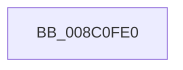

# EtwpComputeRegEntryEnableInfo

- RVA: `0x008C0FE0`–`0x008C1012` (길이 `50` bytes)
- VA: `0x00000001408C0FE0`
- 실행 섹션: `PAGE`
- PDB 이름 있음: `예`; PDB Function 태그: `아니요`
- unwind 정보 RVA: `0x00083574`
- 디코드: `13`개 명령, `50/50` bytes 표시
- 미해석 바이트: `0` (있으면 어셈블리에 `.byte`로 보존)

> 이 문서는 커널 이미지의 기계어와 PDB 기호를 분석해 생성했습니다. 4번과 5번은 함수 원형과 자료형을 바이너리 사용 방식에서 추정한 C 해석이며 원본 소스 복구 결과는 아닙니다.

## 1. Dependencies

- 직접 호출 지점: **0**; 고유 호출 대상: **0**
- 직접 호출자로 확인된 함수: **6**
- RIP 상대 이미지 참조: **0**

### Outgoing calls
- 직접 디코드된 call 명령이 없습니다.

### Direct callers
- [SendCaptureStateNotificationsWorker](../7B/SendCaptureStateNotificationsWorker_function_007BCF30.md) at `0x007BD13D`
- [sub_008C0C36](Unknown_function_008C0C36.md) at `0x008C0CF9`
- [EtwpClearSessionAndUnreferenceEntry](EtwpClearSessionAndUnreferenceEntry_function_008C1438.md) at `0x008C178A`
- [sub_008C28B0](Unknown_function_008C28B0.md) at `0x008C2AF8`
- [EtwpRegisterKMProvider](../92/EtwpRegisterKMProvider_function_009209A4.md) at `0x00920C24`
- [EtwpAddRegEntryToGroup](../9F/EtwpAddRegEntryToGroup_function_009F39D4.md) at `0x009F4061`
- [EtwpAddRegEntryToGroup](../9F/EtwpAddRegEntryToGroup_function_009F39D4.md) at `0x009F4107`

### Static image references
- 디코드된 RIP-relative 메모리 참조가 없습니다.

## 2. Other-region calls and transfers

- 다른 실행 섹션으로 향하는 call: **0**
- 별도 외부 분기/꼬리 이동을 확인하지 못했습니다.

## 3. Assembly (complete function range)

```asm
008C0FE0  48 89 6C 24 18                  mov qword ptr [rsp + 0x18], rbp
008C0FE5  48 89 74 24 20                  mov qword ptr [rsp + 0x20], rsi
008C0FEA  41 55                           push r13
008C0FEC  41 56                           push r14
008C0FEE  41 57                           push r15
008C0FF0  4C 8B 41 20                     mov r8, qword ptr [rcx + 0x20]
008C0FF4  33 F6                           xor esi, esi
008C0FF6  4C 8B 59 28                     mov r11, qword ptr [rcx + 0x28]
008C0FFA  4C 8B D2                        mov r10, rdx
008C0FFD  0F B7 41 64                     movzx eax, word ptr [rcx + 0x64]
008C1001  44 0F B7 71 68                  movzx r14d, word ptr [rcx + 0x68]
008C1006  4D 8B A8 90 02 00 00            mov r13, qword ptr [r8 + 0x290]
008C100D  44 0F B7 79 6A                  movzx r15d, word ptr [rcx + 0x6a]
```

## 4. C-style interpretation (structured pseudocode)

```c
__int64 __fastcall EtwpComputeRegEntryEnableInfo(__int64 a1, __int64 a2)
{
    __int64 v_rsi;
    unsigned __int64 v_stack_p18;
    unsigned __int64 v_stack_p20;

    v_stack_p18 = v_rbp;
    v_stack_p20 = v_rsi;
    v_rsi = 0;
    return *(unsigned __int16 *)(a1 + 100);
}
```

## 5. (Beta) C Style

```c
int64_t EtwpComputeRegEntryEnableInfo(void *Arg1, int64_t Arg2)
{
    uint8_t *arg1 = (uint8_t *)Arg1;

    int64_t local_rsi;
    uint64_t v_stack_p18;
    uint64_t v_stack_p20;

    v_stack_p18 = local_rbp;
    v_stack_p20 = local_rsi;
    local_rsi = 0;
    return *(uint16_t *)(arg1 + 0x64);
}
```

### 관측된 메모리 오프셋

구조체 형식이 확인되지 않은 접근은 인자 기준의 오프셋으로만 기록했습니다.

| 기준 인자 | 오프셋 표현 | 폭 (bit) | 접근 |
|---|---:|---:|---|
| `Arg1` | `+ 0x20` | `64` | `R` |
| `Arg1` | `+ 0x28` | `64` | `R` |
| `Arg1` | `+ 0x64` | `16` | `R` |
| `Arg1` | `+ 0x68` | `16` | `R` |
| `Arg1` | `+ 0x6A` | `16` | `R` |

## 6. Execution-region graph

[열기: 2D/3D 그래프와 함수 탐색 컨트롤 패널](../../../control-panel.html?section=page&rva=0x008C0FE0&view=graph)

- 2D 그래프는 위에서 아래로 흐르고, 3D 그래프는 빈 공간을 드래그해 회전합니다. Shift+드래그는 이동, 휠은 확대·축소, 함수 노드 선택은 대상 보고서 이동입니다.

### Static fallback


