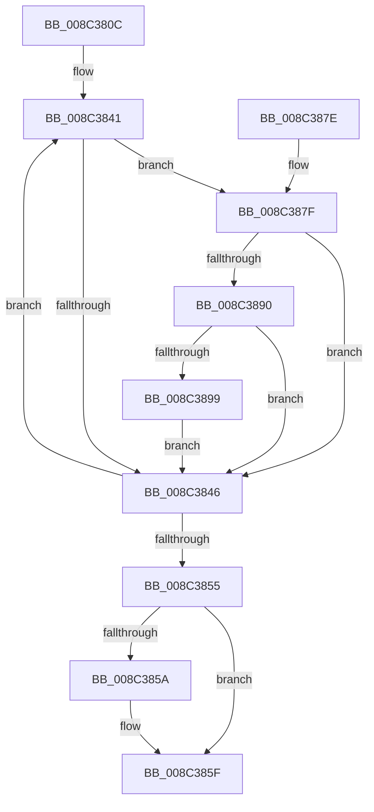

# EtwpCopySchematizedFilters

- RVA: `0x008C380C`–`0x008C38BD` (길이 `177` bytes)
- VA: `0x00000001408C380C`
- 실행 섹션: `PAGE`
- PDB 이름 있음: `예`; PDB Function 태그: `아니요`
- unwind 정보 RVA: `0x000838A0`
- 디코드: `54`개 명령, `177/177` bytes 표시
- 미해석 바이트: `0` (있으면 어셈블리에 `.byte`로 보존)

> 이 문서는 커널 이미지의 기계어와 PDB 기호를 분석해 생성했습니다. 4번과 5번은 함수 원형과 자료형을 바이너리 사용 방식에서 추정한 C 해석이며 원본 소스 복구 결과는 아닙니다.

## 1. Dependencies

- 직접 호출 지점: **1**; 고유 호출 대상: **1**
- 직접 호출자로 확인된 함수: **6**
- RIP 상대 이미지 참조: **0**

### Outgoing calls
- `0x008C38A3` → [memcpy](../../text/6C/memcpy_function_006C6840.md) (function, `0x006C6840`)

### Direct callers
- [sub_008C0E09](Unknown_function_008C0E09.md) at `0x008C0F67`
- [EtwpClearSessionAndUnreferenceEntry](EtwpClearSessionAndUnreferenceEntry_function_008C1438.md) at `0x008C196E`
- [sub_008C2328](Unknown_function_008C2328.md) at `0x008C2789`
- [EtwpAddRegEntryToGroup](../9F/EtwpAddRegEntryToGroup_function_009F39D4.md) at `0x009F40AF`
- [EtwpAddRegEntryToGroup](../9F/EtwpAddRegEntryToGroup_function_009F39D4.md) at `0x009F415A`
- [sub_00B225A4](../B2/Unknown_function_00B225A4.md) at `0x00B22632`
- [sub_00B309B4](../B3/Unknown_function_00B309B4.md) at `0x00B309E9`

### Static image references
- 디코드된 RIP-relative 메모리 참조가 없습니다.

## 2. Other-region calls and transfers

- 다른 실행 섹션으로 향하는 call: **1**
  - `0x008C38A3` → [memcpy](../../text/6C/memcpy_function_006C6840.md) (`PAGE` → `.text`)
- 별도 외부 분기/꼬리 이동을 확인하지 못했습니다.

## 3. Assembly (complete function range)

```asm
008C380C  48 8B C4                        mov rax, rsp
008C380F  48 89 58 08                     mov qword ptr [rax + 8], rbx
008C3813  48 89 68 10                     mov qword ptr [rax + 0x10], rbp
008C3817  48 89 70 18                     mov qword ptr [rax + 0x18], rsi
008C381B  48 89 78 20                     mov qword ptr [rax + 0x20], rdi
008C381F  41 54                           push r12
008C3821  41 56                           push r14
008C3823  41 57                           push r15
008C3825  48 83 EC 20                     sub rsp, 0x20
008C3829  45 33 C9                        xor r9d, r9d
008C382C  45 0F B7 E0                     movzx r12d, r8w
008C3830  33 DB                           xor ebx, ebx
008C3832  48 8D BA 80 00 00 00            lea rdi, [rdx + 0x80]
008C3839  33 F6                           xor esi, esi
008C383B  4C 8B F2                        mov r14, rdx
008C383E  4C 8B F9                        mov r15, rcx
008C3841  83 3F 00                        cmp dword ptr [rdi], 0
008C3844  75 39                           jne 0x1408c387f
008C3846  FF C3                           inc ebx
008C3848  48 83 C7 20                     add rdi, 0x20
008C384C  48 83 C6 68                     add rsi, 0x68
008C3850  83 FB 10                        cmp ebx, 0x10
008C3853  72 EC                           jb 0x1408c3841
008C3855  4D 85 C9                        test r9, r9
008C3858  74 05                           je 0x1408c385f
008C385A  41 83 61 14 00                  and dword ptr [r9 + 0x14], 0
008C385F  48 8B 5C 24 40                  mov rbx, qword ptr [rsp + 0x40]
008C3864  48 8B 6C 24 48                  mov rbp, qword ptr [rsp + 0x48]
008C3869  48 8B 74 24 50                  mov rsi, qword ptr [rsp + 0x50]
008C386E  48 8B 7C 24 58                  mov rdi, qword ptr [rsp + 0x58]
008C3873  48 83 C4 20                     add rsp, 0x20
008C3877  41 5F                           pop r15
008C3879  41 5E                           pop r14
008C387B  41 5C                           pop r12
008C387D  C3                              ret
008C387E  CC                              int3
008C387F  49 8B 86 80 02 00 00            mov rax, qword ptr [r14 + 0x280]
008C3886  48 8B 6C 30 58                  mov rbp, qword ptr [rax + rsi + 0x58]
008C388B  48 85 ED                        test rbp, rbp
008C388E  74 B6                           je 0x1408c3846
008C3890  0F B6 CB                        movzx ecx, bl
008C3893  41 0F A3 CC                     bt r12d, ecx
008C3897  73 AD                           jae 0x1408c3846
008C3899  44 8B 45 10                     mov r8d, dword ptr [rbp + 0x10]
008C389D  48 8B D5                        mov rdx, rbp
008C38A0  49 8B CF                        mov rcx, r15
008C38A3  E8 98 2F E0 FF                  call 0x1406c6840
008C38A8  8B 45 10                        mov eax, dword ptr [rbp + 0x10]
008C38AB  4D 8B CF                        mov r9, r15
008C38AE  83 C0 07                        add eax, 7
008C38B1  83 E0 F8                        and eax, 0xfffffff8
008C38B4  41 89 47 14                     mov dword ptr [r15 + 0x14], eax
008C38B8  4C 03 F8                        add r15, rax
008C38BB  EB 89                           jmp 0x1408c3846
```

## 4. C-style interpretation (structured pseudocode)

```c
__int64 __fastcall EtwpCopySchematizedFilters(__int64 a1, __int64 a2, unsigned __int16 a3, int a4)
{
    __int64 result;
    __int64 v_r15;
    __int64 v_rbx;
    __int64 v_rdi;
    __int64 v_rsi;
    __int64 v_rsp;
    unsigned __int64 v_stack_p10;
    unsigned __int64 v_stack_p18;
    unsigned __int64 v_stack_p20;
    unsigned __int64 v_stack_p8;

    *(unsigned __int64 *)(v_rsp + 8) = v_rbx;
    *(unsigned __int64 *)(v_rsp + 16) = v_rbp;
    *(unsigned __int64 *)(v_rsp + 24) = v_rsi;
    *(unsigned __int64 *)(v_rsp + 32) = v_rdi;
    v_rsp = (v_rsp) - (32);
    a4 = 0;
    v_rbx = 0;
    v_rsi = 0;
loc_008C3841:
    if ((*(unsigned int *)(a2 + 128)) != 0) goto loc_008C387F;
loc_008C3846:
    v_rbx = (unsigned int)((v_rbx) + 1);
    v_rdi = (a2 + 128) + (32);
    v_rsi = (v_rsi) + (104);
    if (((unsigned int)(v_rbx)) < 16) goto loc_008C3841;
    if (0 != 0) {
    }
    v_rsp = (v_rsp) + (32);
    return v_rsp;
loc_008C387F:
    if (*(unsigned __int64 *)(*(unsigned __int64 *)(a2 + 640) + v_stack_p18 * 1 + 88) == 0) goto loc_008C3846;
    if (condition_is_above_or_equal) goto loc_008C3846;
    result = memcpy(a1, *(unsigned __int64 *)(*(unsigned __int64 *)(a2 + 640) + v_stack_p18 * 1 + 88), (unsigned int)(*(unsigned int *)(*(unsigned __int64 *)(*(unsigned __int64 *)(a2 + 640) + v_stack_p18 * 1 + 88) + 16)), a4);
    result = (unsigned int)(((unsigned int)(*(unsigned int *)(*(unsigned __int64 *)(*(unsigned __int64 *)(a2 + 640) + v_stack_p18 * 1 + 88) + 16))) + (7));
    result = (unsigned int)((result) & (0xFFFFFFF8ULL));
    *(unsigned int *)(a1 + 20) = (unsigned int)(result);
    v_r15 = (a1) + (result);
    goto loc_008C3846;
}
```

## 5. (Beta) C Style

```c
int64_t EtwpCopySchematizedFilters(void *Arg1, void *Arg2, uint16_t Arg3, int32_t Arg4)
{
    uint8_t *arg1 = (uint8_t *)Arg1;
    uint8_t *arg2 = (uint8_t *)Arg2;

    int64_t result;
    int64_t local_r15;
    int64_t local_rbx;
    int64_t local_rdi;
    int64_t local_rsi;
    int64_t local_rsp;
    uint64_t v_stack_p10;
    uint64_t v_stack_p18;
    uint64_t v_stack_p20;
    uint64_t v_stack_p8;

    *(uint64_t *)(local_rsp + 0x8) = local_rbx;
    *(uint64_t *)(local_rsp + 0x10) = local_rbp;
    *(uint64_t *)(local_rsp + 0x18) = local_rsi;
    *(uint64_t *)(local_rsp + 0x20) = local_rdi;
    local_rsp = (local_rsp) - (32);
    Arg4 = 0;
    local_rbx = 0;
    local_rsi = 0;
loc_008C3841:
    if ((*(uint32_t *)(arg2 + 0x80)) != 0) goto loc_008C387F;
loc_008C3846:
    local_rbx = (uint32_t)((local_rbx) + 1);
    local_rdi = (Arg2 + 128) + (32);
    local_rsi = (local_rsi) + (104);
    if (((uint32_t)(local_rbx)) < 16) goto loc_008C3841;
    if (0 != 0) {
    }
    local_rsp = (local_rsp) + (32);
    return local_rsp;
loc_008C387F:
    if (*(uint64_t *)(*(uint64_t *)(arg2 + 0x280) + v_stack_p18 * 1 + 0x58) == 0) goto loc_008C3846;
    if (condition_is_above_or_equal) goto loc_008C3846;
    result = memcpy(Arg1, *(uint64_t *)(*(uint64_t *)(arg2 + 0x280) + v_stack_p18 * 1 + 0x58), (uint32_t)(*(uint32_t *)(*(uint64_t *)(*(uint64_t *)(arg2 + 0x280) + v_stack_p18 * 1 + 0x58) + 0x10)), Arg4);
    result = (uint32_t)(((uint32_t)(*(uint32_t *)(*(uint64_t *)(*(uint64_t *)(arg2 + 0x280) + v_stack_p18 * 1 + 0x58) + 0x10))) + (7));
    result = (uint32_t)((result) & (0xFFFFFFF8ULL));
    *(uint32_t *)(arg1 + 0x14) = (uint32_t)(result);
    local_r15 = (Arg1) + (result);
    goto loc_008C3846;
}
```

### 관측된 메모리 오프셋

구조체 형식이 확인되지 않은 접근은 인자 기준의 오프셋으로만 기록했습니다.

| 기준 인자 | 오프셋 표현 | 폭 (bit) | 접근 |
|---|---:|---:|---|
| `Arg1` | `+ 0x14` | `32` | `W` |
| `Arg2` | `+ 0x0` | `32` | `R` |
| `Arg2` | `+ 0x80` | `64` | `R` |
| `Arg2` | `+ 0x280` | `64` | `R` |

## 6. Execution-region graph

[열기: 2D/3D 그래프와 함수 탐색 컨트롤 패널](../../../control-panel.html?section=page&rva=0x008C380C&view=graph)

- 2D 그래프는 위에서 아래로 흐르고, 3D 그래프는 빈 공간을 드래그해 회전합니다. Shift+드래그는 이동, 휠은 확대·축소, 함수 노드 선택은 대상 보고서 이동입니다.

### Static fallback


