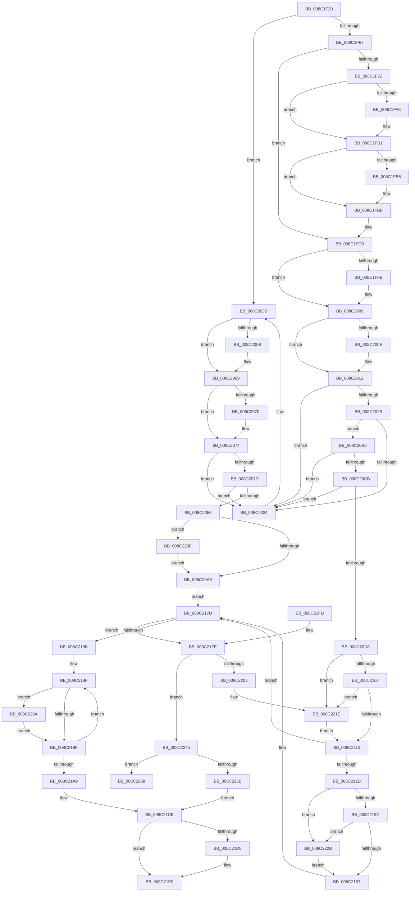

# EtwpDeleteRegistrationObject

- RVA: `0x008C1F30`–`0x008C2291` (길이 `865` bytes)
- VA: `0x00000001408C1F30`
- 실행 섹션: `PAGE`
- PDB 이름 있음: `예`; PDB Function 태그: `예`
- unwind 정보 RVA: `0x000836B0`
- 디코드: `220`개 명령, `865/865` bytes 표시
- 미해석 바이트: `0` (있으면 어셈블리에 `.byte`로 보존)

> 이 문서는 커널 이미지의 기계어와 PDB 기호를 분석해 생성했습니다. 4번과 5번은 함수 원형과 자료형을 바이너리 사용 방식에서 추정한 C 해석이며 원본 소스 복구 결과는 아닙니다.

## 1. Dependencies

- 직접 호출 지점: **24**; 고유 호출 대상: **15**
- 직접 호출자로 확인된 함수: **0**
- RIP 상대 이미지 참조: **2**

### Outgoing calls
- `0x008C1F92` → [KeAbPreAcquire](../../text/21/KeAbPreAcquire_function_00210230.md) (function, `0x00210230`)
- `0x008C1FAC` → [ExfAcquirePushLockExclusiveEx](../../text/20/ExfAcquirePushLockExclusiveEx_function_0020FC90.md) (function, `0x0020FC90`)
- `0x008C1FEB` → [KeAbPreAcquire](../../text/21/KeAbPreAcquire_function_00210230.md) (function, `0x00210230`)
- `0x008C2004` → [ExfAcquirePushLockExclusiveEx](../../text/20/ExfAcquirePushLockExclusiveEx_function_0020FC90.md) (function, `0x0020FC90`)
- `0x008C204A` → [KeAbPreAcquire](../../text/21/KeAbPreAcquire_function_00210230.md) (function, `0x00210230`)
- `0x008C2064` → [ExfAcquirePushLockExclusiveEx](../../text/20/ExfAcquirePushLockExclusiveEx_function_0020FC90.md) (function, `0x0020FC90`)
- `0x008C20A9` → [KeAbPostRelease](../../text/2E/KeAbPostRelease_function_002E1600.md) (function, `0x002E1600`)
- `0x008C2115` → [KeAbPostRelease](../../text/2E/KeAbPostRelease_function_002E1600.md) (function, `0x002E1600`)
- `0x008C2123` → [KeLeaveCriticalRegionThread](../../text/25/KeLeaveCriticalRegionThread_function_0025EFF0.md) (function, `0x0025EFF0`)
- `0x008C216A` → [KeAbPostRelease](../../text/2E/KeAbPostRelease_function_002E1600.md) (function, `0x002E1600`)
- `0x008C2178` → [KeLeaveCriticalRegionThread](../../text/25/KeLeaveCriticalRegionThread_function_0025EFF0.md) (function, `0x0025EFF0`)
- `0x008C21B0` → [EtwpRundownNotifications](EtwpRundownNotifications_function_008C1284.md) (function, `0x008C1284`)
- `0x008C21BE` → [ObfDereferenceObjectWithTag](../../text/2F/ObfDereferenceObjectWithTag_function_002F78E0.md) (function, `0x002F78E0`)
- `0x008C21C6` → [EtwpReleaseProviderTraitsReference](EtwpReleaseProviderTraitsReference_function_008C11EC.md) (function, `0x008C11EC`)
- `0x008C21CE` → [EtwpUnreferenceGuidEntry](EtwpUnreferenceGuidEntry_function_008C3320.md) (function, `0x008C3320`)
- `0x008C21DB` → [EtwpUnreferenceGuidEntry](EtwpUnreferenceGuidEntry_function_008C3320.md) (function, `0x008C3320`)
- `0x008C2218` → [KeBugCheckEx](../../text/4F/KeBugCheckEx_function_004FD660.md) (function, `0x004FD660`)
- `0x008C2221` → [ExfReleasePushLock](../../text/26/ExfReleasePushLock_function_002638D0.md) (function, `0x002638D0`)
- `0x008C222E` → [ExfReleasePushLock](../../text/26/ExfReleasePushLock_function_002638D0.md) (function, `0x002638D0`)
- `0x008C223B` → [ExfTryToWakePushLock](../../text/26/ExfTryToWakePushLock_function_00265DD0.md) (function, `0x00265DD0`)
- `0x008C224E` → [KeRundownQueueEx](../../text/35/KeRundownQueueEx_function_00351508.md) (function, `0x00351508`)
- `0x008C2260` → [ExFreePoolWithTag](../../poolcode/B8/ExFreePoolWithTag_function_00B82870.md) (function, `0x00B82870`)
- `0x008C2272` → [EtwpSendNoReplyReply](../7B/EtwpSendNoReplyReply_function_007B9134.md) (function, `0x007B9134`)
- `0x008C227F` → [EtwpReleaseQueueEntry](../9F/EtwpReleaseQueueEntry_function_009FED48.md) (function, `0x009FED48`)

### Direct callers
- 이 함수 시작 RVA로 연결되는 직접 call은 확인되지 않았습니다. 간접 호출은 완전히 역산할 수 없습니다.

### Static image references
- `0x008C203B` → RVA `0x00EFF200` (`.data`; read)
- `0x008C2091` → RVA `0x00EFF200` (`.data`; read/write)

## 2. Other-region calls and transfers

- 다른 실행 섹션으로 향하는 call: **18**
  - `0x008C1F92` → [KeAbPreAcquire](../../text/21/KeAbPreAcquire_function_00210230.md) (`PAGE` → `.text`)
  - `0x008C1FAC` → [ExfAcquirePushLockExclusiveEx](../../text/20/ExfAcquirePushLockExclusiveEx_function_0020FC90.md) (`PAGE` → `.text`)
  - `0x008C1FEB` → [KeAbPreAcquire](../../text/21/KeAbPreAcquire_function_00210230.md) (`PAGE` → `.text`)
  - `0x008C2004` → [ExfAcquirePushLockExclusiveEx](../../text/20/ExfAcquirePushLockExclusiveEx_function_0020FC90.md) (`PAGE` → `.text`)
  - `0x008C204A` → [KeAbPreAcquire](../../text/21/KeAbPreAcquire_function_00210230.md) (`PAGE` → `.text`)
  - `0x008C2064` → [ExfAcquirePushLockExclusiveEx](../../text/20/ExfAcquirePushLockExclusiveEx_function_0020FC90.md) (`PAGE` → `.text`)
  - `0x008C20A9` → [KeAbPostRelease](../../text/2E/KeAbPostRelease_function_002E1600.md) (`PAGE` → `.text`)
  - `0x008C2115` → [KeAbPostRelease](../../text/2E/KeAbPostRelease_function_002E1600.md) (`PAGE` → `.text`)
  - `0x008C2123` → [KeLeaveCriticalRegionThread](../../text/25/KeLeaveCriticalRegionThread_function_0025EFF0.md) (`PAGE` → `.text`)
  - `0x008C216A` → [KeAbPostRelease](../../text/2E/KeAbPostRelease_function_002E1600.md) (`PAGE` → `.text`)
  - `0x008C2178` → [KeLeaveCriticalRegionThread](../../text/25/KeLeaveCriticalRegionThread_function_0025EFF0.md) (`PAGE` → `.text`)
  - `0x008C21BE` → [ObfDereferenceObjectWithTag](../../text/2F/ObfDereferenceObjectWithTag_function_002F78E0.md) (`PAGE` → `.text`)
  - `0x008C2218` → [KeBugCheckEx](../../text/4F/KeBugCheckEx_function_004FD660.md) (`PAGE` → `.text`)
  - `0x008C2221` → [ExfReleasePushLock](../../text/26/ExfReleasePushLock_function_002638D0.md) (`PAGE` → `.text`)
  - `0x008C222E` → [ExfReleasePushLock](../../text/26/ExfReleasePushLock_function_002638D0.md) (`PAGE` → `.text`)
  - `0x008C223B` → [ExfTryToWakePushLock](../../text/26/ExfTryToWakePushLock_function_00265DD0.md) (`PAGE` → `.text`)
  - `0x008C224E` → [KeRundownQueueEx](../../text/35/KeRundownQueueEx_function_00351508.md) (`PAGE` → `.text`)
  - `0x008C2260` → [ExFreePoolWithTag](../../poolcode/B8/ExFreePoolWithTag_function_00B82870.md) (`PAGE` → `POOLCODE`)
- call이 아닌 외부 분기/꼬리 이동: **1**
  - `0x008C228C` → [sub_00B1AF32](../B1/Unknown_function_00B1AF32.md) (`tail-transfer`)

## 3. Assembly (complete function range)

```asm
008C1F30  48 89 5C 24 08                  mov qword ptr [rsp + 8], rbx
008C1F35  48 89 6C 24 10                  mov qword ptr [rsp + 0x10], rbp
008C1F3A  48 89 74 24 18                  mov qword ptr [rsp + 0x18], rsi
008C1F3F  57                              push rdi
008C1F40  41 54                           push r12
008C1F42  41 55                           push r13
008C1F44  41 56                           push r14
008C1F46  41 57                           push r15
008C1F48  48 83 EC 30                     sub rsp, 0x30
008C1F4C  4C 8B 69 20                     mov r13, qword ptr [rcx + 0x20]
008C1F50  41 BC 04 00 00 00               mov r12d, 4
008C1F56  48 8B F9                        mov rdi, rcx
008C1F59  4C 8B 71 28                     mov r14, qword ptr [rcx + 0x28]
008C1F5D  44 84 61 62                     test byte ptr [rcx + 0x62], r12b
008C1F61  0F 85 D4 00 00 00               jne 0x1408c203b
008C1F67  48 83 CB FF                     or rbx, 0xffffffffffffffff
008C1F6B  33 F6                           xor esi, esi
008C1F6D  4D 85 F6                        test r14, r14
008C1F70  74 59                           je 0x1408c1fcb
008C1F72  65 48 8B 04 25 88 01 00 00      mov rax, qword ptr gs:[0x188]
008C1F7B  49 8D AE 98 02 00 00            lea rbp, [r14 + 0x298]
008C1F82  45 33 C0                        xor r8d, r8d
008C1F85  33 D2                           xor edx, edx
008C1F87  48 8B CD                        mov rcx, rbp
008C1F8A  66 01 98 E4 01 00 00            add word ptr [rax + 0x1e4], bx
008C1F91  90                              nop
008C1F92  E8 99 E2 94 FF                  call 0x140210230
008C1F97  F0 48 0F BA 6D 00 00            lock bts qword ptr [rbp], 0
008C1F9E  4C 8B F8                        mov r15, rax
008C1FA1  73 0E                           jae 0x1408c1fb1
008C1FA3  4C 8B C5                        mov r8, rbp
008C1FA6  48 8B D0                        mov rdx, rax
008C1FA9  48 8B CD                        mov rcx, rbp
008C1FAC  E8 DF DC 94 FF                  call 0x14020fc90
008C1FB1  4D 85 FF                        test r15, r15
008C1FB4  74 05                           je 0x1408c1fbb
008C1FB6  41 C6 47 0A 01                  mov byte ptr [r15 + 0xa], 1
008C1FBB  65 48 8B 04 25 88 01 00 00      mov rax, qword ptr gs:[0x188]
008C1FC4  49 89 86 A0 02 00 00            mov qword ptr [r14 + 0x2a0], rax
008C1FCB  65 48 8B 04 25 88 01 00 00      mov rax, qword ptr gs:[0x188]
008C1FD4  45 33 C0                        xor r8d, r8d
008C1FD7  33 D2                           xor edx, edx
008C1FD9  66 01 98 E4 01 00 00            add word ptr [rax + 0x1e4], bx
008C1FE0  49 8D 9D 98 02 00 00            lea rbx, [r13 + 0x298]
008C1FE7  48 8B CB                        mov rcx, rbx
008C1FEA  90                              nop
008C1FEB  E8 40 E2 94 FF                  call 0x140210230
008C1FF0  F0 48 0F BA 2B 00               lock bts qword ptr [rbx], 0
008C1FF6  48 8B E8                        mov rbp, rax
008C1FF9  73 0E                           jae 0x1408c2009
008C1FFB  4C 8B C3                        mov r8, rbx
008C1FFE  48 8B D0                        mov rdx, rax
008C2001  48 8B CB                        mov rcx, rbx
008C2004  E8 87 DC 94 FF                  call 0x14020fc90
008C2009  48 85 ED                        test rbp, rbp
008C200C  74 04                           je 0x1408c2012
008C200E  C6 45 0A 01                     mov byte ptr [rbp + 0xa], 1
008C2012  65 48 8B 04 25 88 01 00 00      mov rax, qword ptr gs:[0x188]
008C201B  49 89 85 A0 02 00 00            mov qword ptr [r13 + 0x2a0], rax
008C2022  48 8B 0F                        mov rcx, qword ptr [rdi]
008C2025  48 39 79 08                     cmp qword ptr [rcx + 8], rdi
008C2029  75 09                           jne 0x1408c2034
008C202B  48 8B 47 08                     mov rax, qword ptr [rdi + 8]
008C202F  48 39 38                        cmp qword ptr [rax], rdi
008C2032  74 7F                           je 0x1408c20b3
008C2034  B9 03 00 00 00                  mov ecx, 3
008C2039  CD 29                           int 0x29
008C203B  48 8D 2D BE D1 63 00            lea rbp, [rip + 0x63d1be]
008C2042  45 33 C0                        xor r8d, r8d
008C2045  48 8B CD                        mov rcx, rbp
008C2048  33 D2                           xor edx, edx
008C204A  E8 E1 E1 94 FF                  call 0x140210230
008C204F  F0 48 0F BA 6D 00 00            lock bts qword ptr [rbp], 0
008C2056  48 8B D8                        mov rbx, rax
008C2059  73 0E                           jae 0x1408c2069
008C205B  4C 8B C5                        mov r8, rbp
008C205E  48 8B D0                        mov rdx, rax
008C2061  48 8B CD                        mov rcx, rbp
008C2064  E8 27 DC 94 FF                  call 0x14020fc90
008C2069  33 F6                           xor esi, esi
008C206B  48 85 DB                        test rbx, rbx
008C206E  74 04                           je 0x1408c2074
008C2070  C6 43 0A 01                     mov byte ptr [rbx + 0xa], 1
008C2074  48 8B 0F                        mov rcx, qword ptr [rdi]
008C2077  48 39 79 08                     cmp qword ptr [rcx + 8], rdi
008C207B  75 B7                           jne 0x1408c2034
008C207D  48 8B 47 08                     mov rax, qword ptr [rdi + 8]
008C2081  48 39 38                        cmp qword ptr [rax], rdi
008C2084  75 AE                           jne 0x1408c2034
008C2086  48 89 08                        mov qword ptr [rax], rcx
008C2089  48 83 CB FF                     or rbx, 0xffffffffffffffff
008C208D  48 89 41 08                     mov qword ptr [rcx + 8], rax
008C2091  F0 48 0F C1 1D 66 D1 63 00      lock xadd qword ptr [rip + 0x63d166], rbx
008C209A  80 E3 06                        and bl, 6
008C209D  80 FB 02                        cmp bl, 2
008C20A0  0F 84 92 01 00 00               je 0x1408c2238
008C20A6  48 8B CD                        mov rcx, rbp
008C20A9  E8 52 F5 A1 FF                  call 0x1402e1600
008C20AE  E9 CA 00 00 00                  jmp 0x1408c217d
008C20B3  48 89 08                        mov qword ptr [rax], rcx
008C20B6  48 89 41 08                     mov qword ptr [rcx + 8], rax
008C20BA  48 8D 47 10                     lea rax, [rdi + 0x10]
008C20BE  48 8B 10                        mov rdx, qword ptr [rax]
008C20C1  48 39 42 08                     cmp qword ptr [rdx + 8], rax
008C20C5  0F 85 69 FF FF FF               jne 0x1408c2034
008C20CB  48 8B 48 08                     mov rcx, qword ptr [rax + 8]
008C20CF  48 39 01                        cmp qword ptr [rcx], rax
008C20D2  0F 85 5C FF FF FF               jne 0x1408c2034
008C20D8  48 89 11                        mov qword ptr [rcx], rdx
008C20DB  48 89 4A 08                     mov qword ptr [rdx + 8], rcx
008C20DF  49 89 B5 A0 02 00 00            mov qword ptr [r13 + 0x2a0], rsi
008C20E6  0F 0D 0B                        prefetchw byte ptr [rbx]
008C20E9  48 8B 03                        mov rax, qword ptr [rbx]
008C20EC  48 8B C8                        mov rcx, rax
008C20EF  48 83 E1 F0                     and rcx, 0xfffffffffffffff0
008C20F3  48 83 F9 10                     cmp rcx, 0x10
008C20F7  48 8D 50 F0                     lea rdx, [rax - 0x10]
008C20FB  48 0F 46 D6                     cmovbe rdx, rsi
008C20FF  A8 02                           test al, 2
008C2101  0F 85 17 01 00 00               jne 0x1408c221e
008C2107  F0 48 0F B1 13                  lock cmpxchg qword ptr [rbx], rdx
008C210C  0F 85 0C 01 00 00               jne 0x1408c221e
008C2112  48 8B CB                        mov rcx, rbx
008C2115  E8 E6 F4 A1 FF                  call 0x1402e1600
008C211A  65 48 8B 0C 25 88 01 00 00      mov rcx, qword ptr gs:[0x188]
008C2123  E8 C8 CE 99 FF                  call 0x14025eff0
008C2128  4D 85 F6                        test r14, r14
008C212B  74 50                           je 0x1408c217d
008C212D  49 89 B6 A0 02 00 00            mov qword ptr [r14 + 0x2a0], rsi
008C2134  49 8D 9E 98 02 00 00            lea rbx, [r14 + 0x298]
008C213B  0F 0D 0B                        prefetchw byte ptr [rbx]
008C213E  48 8B 03                        mov rax, qword ptr [rbx]
008C2141  48 8B C8                        mov rcx, rax
008C2144  48 83 E1 F0                     and rcx, 0xfffffffffffffff0
008C2148  48 83 F9 10                     cmp rcx, 0x10
008C214C  48 8D 50 F0                     lea rdx, [rax - 0x10]
008C2150  48 0F 46 D6                     cmovbe rdx, rsi
008C2154  A8 02                           test al, 2
008C2156  0F 85 CF 00 00 00               jne 0x1408c222b
008C215C  F0 48 0F B1 13                  lock cmpxchg qword ptr [rbx], rdx
008C2161  0F 85 C4 00 00 00               jne 0x1408c222b
008C2167  48 8B CB                        mov rcx, rbx
008C216A  E8 91 F4 A1 FF                  call 0x1402e1600
008C216F  65 48 8B 0C 25 88 01 00 00      mov rcx, qword ptr gs:[0x188]
008C2178  E8 73 CE 99 FF                  call 0x14025eff0
008C217D  66 F0 83 67 62 BF               lock and word ptr [rdi + 0x62], 0xffbf
008C2183  0F B7 47 62                     movzx eax, word ptr [rdi + 0x62]
008C2187  A8 02                           test al, 2
008C2189  74 73                           je 0x1408c21fe
008C218B  48 8D 6F 30                     lea rbp, [rdi + 0x30]
008C218F  48 8B DE                        mov rbx, rsi
008C2192  48 87 5D 00                     xchg qword ptr [rbp], rbx
008C2196  48 85 DB                        test rbx, rbx
008C2199  0F 85 CB 00 00 00               jne 0x1408c226a
008C219F  48 83 C5 08                     add rbp, 8
008C21A3  49 83 EC 01                     sub r12, 1
008C21A7  75 E6                           jne 0x1408c218f
008C21A9  48 8B 4F 50                     mov rcx, qword ptr [rdi + 0x50]
008C21AD  48 8B D7                        mov rdx, rdi
008C21B0  E8 CF F0 FF FF                  call 0x1408c1284
008C21B5  48 8B 4F 50                     mov rcx, qword ptr [rdi + 0x50]
008C21B9  BA 45 74 77 52                  mov edx, 0x52777445
008C21BE  E8 1D 57 A3 FF                  call 0x1402f78e0
008C21C3  48 8B CF                        mov rcx, rdi
008C21C6  E8 21 F0 FF FF                  call 0x1408c11ec
008C21CB  49 8B CD                        mov rcx, r13
008C21CE  E8 4D 11 00 00                  call 0x1408c3320
008C21D3  4D 85 F6                        test r14, r14
008C21D6  74 08                           je 0x1408c21e0
008C21D8  49 8B CE                        mov rcx, r14
008C21DB  E8 40 11 00 00                  call 0x1408c3320
008C21E0  48 8B 5C 24 60                  mov rbx, qword ptr [rsp + 0x60]
008C21E5  48 8B 6C 24 68                  mov rbp, qword ptr [rsp + 0x68]
008C21EA  48 8B 74 24 70                  mov rsi, qword ptr [rsp + 0x70]
008C21EF  48 83 C4 30                     add rsp, 0x30
008C21F3  41 5F                           pop r15
008C21F5  41 5E                           pop r14
008C21F7  41 5D                           pop r13
008C21F9  41 5C                           pop r12
008C21FB  5F                              pop rdi
008C21FC  C3                              ret
008C21FD  CC                              int3
008C21FE  41 84 C4                        test r12b, al
008C2201  75 42                           jne 0x1408c2245
008C2203  4C 8B C8                        mov r9, rax
008C2206  48 89 74 24 20                  mov qword ptr [rsp + 0x20], rsi
008C220B  4C 8B C7                        mov r8, rdi
008C220E  BA 03 00 00 00                  mov edx, 3
008C2213  B9 1D 01 00 00                  mov ecx, 0x11d
008C2218  E8 43 B4 C3 FF                  call 0x1404fd660
008C221D  CC                              int3
008C221E  48 8B CB                        mov rcx, rbx
008C2221  E8 AA 16 9A FF                  call 0x1402638d0
008C2226  E9 E7 FE FF FF                  jmp 0x1408c2112
008C222B  48 8B CB                        mov rcx, rbx
008C222E  E8 9D 16 9A FF                  call 0x1402638d0
008C2233  E9 2F FF FF FF                  jmp 0x1408c2167
008C2238  48 8B CD                        mov rcx, rbp
008C223B  E8 90 3B 9A FF                  call 0x140265dd0
008C2240  E9 61 FE FF FF                  jmp 0x1408c20a6
008C2245  4C 8B 7F 30                     mov r15, qword ptr [rdi + 0x30]
008C2249  B2 01                           mov dl, 1
008C224B  49 8B CF                        mov rcx, r15
008C224E  E8 B5 F2 A8 FF                  call 0x140351508
008C2253  48 8B E8                        mov rbp, rax
008C2256  48 85 C0                        test rax, rax
008C2259  75 2E                           jne 0x1408c2289
008C225B  33 D2                           xor edx, edx
008C225D  49 8B CF                        mov rcx, r15
008C2260  E8 0B 06 2C 00                  call 0x140b82870
008C2265  E9 61 FF FF FF                  jmp 0x1408c21cb
008C226A  48 8B 4B 20                     mov rcx, qword ptr [rbx + 0x20]
008C226E  49 8D 55 28                     lea rdx, [r13 + 0x28]
008C2272  E8 BD 6E EF FF                  call 0x1407b9134
008C2277  BA 02 00 00 00                  mov edx, 2
008C227C  48 8B CB                        mov rcx, rbx
008C227F  E8 C4 CA 13 00                  call 0x1409fed48
008C2284  E9 16 FF FF FF                  jmp 0x1408c219f
008C2289  48 8B FD                        mov rdi, rbp
008C228C  E9 A1 8C 25 00                  jmp 0x140b1af32
```

## 4. C-style interpretation (structured pseudocode)

```c
__int64 __fastcall EtwpDeleteRegistrationObject(__int64 a1, int a2, int a3)
{
    __int64 result;
    __int64 v_r12;
    __int64 v_rbp;
    __int64 v_rbx;
    __int64 v_rsi;
    __int64 v_rsp;
    unsigned __int64 v_stack_p10;
    unsigned __int64 v_stack_p18;
    unsigned __int64 v_stack_p20;
    unsigned __int64 v_stack_p8;

    v_stack_p8 = v_rbx;
    v_stack_p10 = v_rbp;
    v_stack_p18 = v_rsi;
    v_rsp = (v_rsp) - (48);
    if (((*(unsigned __int8 *)(a1 + 98)) & (4)) != 0) goto loc_008C203B;
    v_rbx = (v_rbx) | (-1);
    v_rsi = 0;
    if (*(unsigned __int64 *)(a1 + 40) == 0) goto loc_008C1FCB;
    a3 = 0;
    a2 = 0;
    result = KeAbPreAcquire(*(unsigned __int64 *)(a1 + 40) + 664, a2, a3, a4);
    if (!(condition_is_above_or_equal)) {
        a3 = *(unsigned __int64 *)(a1 + 40) + 664;
        a2 = result;
        a1 = *(unsigned __int64 *)(a1 + 40) + 664;
        result = ExfAcquirePushLockExclusiveEx(a1, a2, a3, a4);
    }
    if (result != 0) {
        *(unsigned __int8 *)(result + 10) = 1;
    }
    *(unsigned __int64 *)(*(unsigned __int64 *)(a1 + 40) + 672) = *(unsigned __int64 *)(gs_base + (0 + 392));
loc_008C1FCB:
    a3 = 0;
    a2 = 0;
    result = KeAbPreAcquire(*(unsigned __int64 *)(a1 + 32) + 664, a2, a3, a4);
    if (!(condition_is_above_or_equal)) {
        a3 = *(unsigned __int64 *)(a1 + 32) + 664;
        a2 = result;
        a1 = *(unsigned __int64 *)(a1 + 32) + 664;
        result = ExfAcquirePushLockExclusiveEx(a1, a2, a3, a4);
    }
    if (result != 0) {
        *(unsigned __int8 *)(result + 10) = 1;
    }
    *(unsigned __int64 *)(*(unsigned __int64 *)(a1 + 32) + 672) = *(unsigned __int64 *)(gs_base + (0 + 392));
    if ((*(unsigned __int64 *)(*(unsigned __int64 *)(a1) + 8)) != a1) goto loc_008C2034;
    if ((*(unsigned __int64 *)(*(unsigned __int64 *)(a1 + 8))) == a1) goto loc_008C20B3;
loc_008C2034:
loc_008C203B:
    a3 = 0;
    a2 = 0;
    result = KeAbPreAcquire(v_rip + 6541758, a2, a3, a4);
    if (!(condition_is_above_or_equal)) {
        a3 = v_rip + 6541758;
        a2 = result;
        a1 = v_rip + 6541758;
        result = ExfAcquirePushLockExclusiveEx(a1, a2, a3, a4);
    }
    v_rsi = 0;
    if (result != 0) {
        *(unsigned __int8 *)(result + 10) = 1;
    }
    if ((*(unsigned __int64 *)(*(unsigned __int64 *)(a1) + 8)) != a1) goto loc_008C2034;
    if ((*(unsigned __int64 *)(*(unsigned __int64 *)(a1 + 8))) != a1) goto loc_008C2034;
    *(unsigned __int64 *)(*(unsigned __int64 *)(a1 + 8)) = *(unsigned __int64 *)(a1);
    v_rbx = (result) | (-1);
    *(unsigned __int64 *)(*(unsigned __int64 *)(a1) + 8) = *(unsigned __int64 *)(a1 + 8);
    v_rbx = (unsigned __int8)((v_rbx) & (6));
    if (((unsigned __int8)(v_rbx)) == 2) goto loc_008C2238;
loc_008C20A6:
    result = KeAbPostRelease(v_rip + 6541758, a2, a3, a4);
    goto loc_008C217D;
loc_008C20B3:
    *(unsigned __int64 *)(result) = v_rip + 6541758;
    *(unsigned __int64 *)(v_rip + 6541758 + 8) = result;
    if ((*(unsigned __int64 *)(*(unsigned __int64 *)(a1 + 16) + 8)) != (a1 + 16)) goto loc_008C2034;
    if ((*(unsigned __int64 *)(*(unsigned __int64 *)(a1 + 16 + 8))) != (a1 + 16)) goto loc_008C2034;
    *(unsigned __int64 *)(*(unsigned __int64 *)(a1 + 16 + 8)) = *(unsigned __int64 *)(a1 + 16);
    *(unsigned __int64 *)(*(unsigned __int64 *)(a1 + 16) + 8) = *(unsigned __int64 *)(a1 + 16 + 8);
    *(unsigned __int64 *)(*(unsigned __int64 *)(a1 + 32) + 672) = 0;
    a1 = (*(unsigned __int64 *)(v_rbx)) & (-16);
    a2 = *(unsigned __int64 *)(v_rbx) - 16;
    if (a1 <= 16) { a2 = 0; }
    if ((((unsigned __int8)(*(unsigned __int64 *)(v_rbx))) & (2)) != 0) goto loc_008C221E;
    if ((((unsigned __int8)(*(unsigned __int64 *)(v_rbx))) & (2)) != 0) goto loc_008C221E;
loc_008C2112:
    result = KeAbPostRelease(v_rbx, a2, a3, a4);
    result = KeLeaveCriticalRegionThread(*(unsigned __int64 *)(gs_base + (0 + 392)), a2, a3, a4);
    if (*(unsigned __int64 *)(a1 + 40) == 0) goto loc_008C217D;
    *(unsigned __int64 *)(*(unsigned __int64 *)(a1 + 40) + 672) = 0;
    a1 = (*(unsigned __int64 *)(*(unsigned __int64 *)(a1 + 40) + 664)) & (-16);
    a2 = *(unsigned __int64 *)(*(unsigned __int64 *)(a1 + 40) + 664) - 16;
    if (a1 <= 16) { a2 = 0; }
    if ((((unsigned __int8)(*(unsigned __int64 *)(*(unsigned __int64 *)(a1 + 40) + 664))) & (2)) != 0) goto loc_008C222B;
    if ((((unsigned __int8)(*(unsigned __int64 *)(*(unsigned __int64 *)(a1 + 40) + 664))) & (2)) != 0) goto loc_008C222B;
loc_008C2167:
    result = KeAbPostRelease(*(unsigned __int64 *)(a1 + 40) + 664, a2, a3, a4);
    result = KeLeaveCriticalRegionThread(*(unsigned __int64 *)(gs_base + (0 + 392)), a2, a3, a4);
loc_008C217D:
    if ((((unsigned __int8)(*(unsigned __int16 *)(a1 + 98))) & (2)) == 0) goto loc_008C21FE;
loc_008C218F:
    if (0 != 0) goto loc_008C226A;
loc_008C219F:
    v_rbp = (a1 + 48) + (8);
    v_r12 = (4) - (1);
    if (condition_is_not_equal) goto loc_008C218F;
    result = EtwpRundownNotifications(*(unsigned __int64 *)(a1 + 80), a1, a3, a4);
    result = ObfDereferenceObjectWithTag(*(unsigned __int64 *)(a1 + 80), (unsigned int)(0x52777445ULL), a3, a4);
    result = EtwpReleaseProviderTraitsReference(a1, (unsigned int)(0x52777445ULL), a3, a4);
loc_008C21CB:
    result = EtwpUnreferenceGuidEntry(*(unsigned __int64 *)(a1 + 32), (unsigned int)(0x52777445ULL), a3, a4);
    if (*(unsigned __int64 *)(a1 + 40) != 0) {
        a1 = *(unsigned __int64 *)(a1 + 40);
        result = EtwpUnreferenceGuidEntry(a1, (unsigned int)(0x52777445ULL), a3, a4);
    }
    v_rsp = (v_rsp) + (48);
    return result;
loc_008C21FE:
    if ((((unsigned __int8)(v_r12)) & ((unsigned __int8)(result))) != 0) goto loc_008C2245;
    v_stack_p20 = v_stack_p18;
    result = KeBugCheckEx(285, 3, a1, result);
loc_008C221E:
    result = ExfReleasePushLock(v_stack_p8, 3, a1, result);
    goto loc_008C2112;
loc_008C222B:
    result = ExfReleasePushLock(v_stack_p8, 3, a1, result);
    goto loc_008C2167;
loc_008C2238:
    result = ExfTryToWakePushLock(v_stack_p10, 3, a1, result);
    goto loc_008C20A6;
loc_008C2245:
    result = KeRundownQueueEx(*(unsigned __int64 *)(a1 + 48), 1, a1, result);
    if (result != 0) goto loc_008C2289;
    a2 = 0;
    result = ExFreePoolWithTag(*(unsigned __int64 *)(a1 + 48), a2, a1, result);
    goto loc_008C21CB;
loc_008C226A:
    result = EtwpSendNoReplyReply(*(unsigned __int64 *)(v_stack_p8 + 32), *(unsigned __int64 *)(a1 + 32) + 40, a1, result);
    result = EtwpReleaseQueueEntry(v_stack_p8, 2, a1, result);
    goto loc_008C219F;
loc_008C2289:
}
```

## 5. (Beta) C Style

```c
int64_t EtwpDeleteRegistrationObject(void *Arg1, int32_t Arg2, int32_t Arg3)
{
    uint8_t *arg1 = (uint8_t *)Arg1;

    int64_t result;
    int64_t local_r12;
    int64_t local_rbp;
    int64_t local_rbx;
    int64_t local_rsi;
    int64_t local_rsp;
    uint64_t v_stack_p10;
    uint64_t v_stack_p18;
    uint64_t v_stack_p20;
    uint64_t v_stack_p8;

    v_stack_p8 = local_rbx;
    v_stack_p10 = local_rbp;
    v_stack_p18 = local_rsi;
    local_rsp = (local_rsp) - (48);
    if (((*(uint8_t *)(arg1 + 0x62)) & (4)) != 0) goto loc_008C203B;
    local_rbx = (local_rbx) | (-1);
    local_rsi = 0;
    if (*(uint64_t *)(arg1 + 0x28) == 0) goto loc_008C1FCB;
    Arg3 = 0;
    Arg2 = 0;
    result = KeAbPreAcquire(*(uint64_t *)(arg1 + 0x28) + 664, Arg2, Arg3, a4);
    if (!(condition_is_above_or_equal)) {
        Arg3 = *(uint64_t *)(arg1 + 0x28) + 664;
        Arg2 = result;
        Arg1 = *(uint64_t *)(arg1 + 0x28) + 664;
        result = ExfAcquirePushLockExclusiveEx(Arg1, Arg2, Arg3, a4);
    }
    if (result != 0) {
        *(uint8_t *)(result + 0xA) = 1;
    }
    *(uint64_t *)(*(uint64_t *)(arg1 + 0x28) + 0x2A0) = *(uint64_t *)(gs_base + (0 + 0x188));
loc_008C1FCB:
    Arg3 = 0;
    Arg2 = 0;
    result = KeAbPreAcquire(*(uint64_t *)(arg1 + 0x20) + 664, Arg2, Arg3, a4);
    if (!(condition_is_above_or_equal)) {
        Arg3 = *(uint64_t *)(arg1 + 0x20) + 664;
        Arg2 = result;
        Arg1 = *(uint64_t *)(arg1 + 0x20) + 664;
        result = ExfAcquirePushLockExclusiveEx(Arg1, Arg2, Arg3, a4);
    }
    if (result != 0) {
        *(uint8_t *)(result + 0xA) = 1;
    }
    *(uint64_t *)(*(uint64_t *)(arg1 + 0x20) + 0x2A0) = *(uint64_t *)(gs_base + (0 + 0x188));
    if ((*(uint64_t *)(*(uint64_t *)(arg1) + 0x8)) != Arg1) goto loc_008C2034;
    if ((*(uint64_t *)(*(uint64_t *)(arg1 + 0x8))) == Arg1) goto loc_008C20B3;
loc_008C2034:
loc_008C203B:
    Arg3 = 0;
    Arg2 = 0;
    result = KeAbPreAcquire(v_rip + 6541758, Arg2, Arg3, a4);
    if (!(condition_is_above_or_equal)) {
        Arg3 = v_rip + 6541758;
        Arg2 = result;
        Arg1 = v_rip + 6541758;
        result = ExfAcquirePushLockExclusiveEx(Arg1, Arg2, Arg3, a4);
    }
    local_rsi = 0;
    if (result != 0) {
        *(uint8_t *)(result + 0xA) = 1;
    }
    if ((*(uint64_t *)(*(uint64_t *)(arg1) + 0x8)) != Arg1) goto loc_008C2034;
    if ((*(uint64_t *)(*(uint64_t *)(arg1 + 0x8))) != Arg1) goto loc_008C2034;
    *(uint64_t *)(*(uint64_t *)(arg1 + 0x8)) = *(uint64_t *)(arg1);
    local_rbx = (result) | (-1);
    *(uint64_t *)(*(uint64_t *)(arg1) + 0x8) = *(uint64_t *)(arg1 + 0x8);
    local_rbx = (uint8_t)((local_rbx) & (6));
    if (((uint8_t)(local_rbx)) == 2) goto loc_008C2238;
loc_008C20A6:
    result = KeAbPostRelease(v_rip + 6541758, Arg2, Arg3, a4);
    goto loc_008C217D;
loc_008C20B3:
    *(uint64_t *)(result) = v_rip + 6541758;
    *(uint64_t *)(v_rip + 0x63D1BE + 0x8) = result;
    if ((*(uint64_t *)(*(uint64_t *)(arg1 + 0x10) + 0x8)) != (Arg1 + 16)) goto loc_008C2034;
    if ((*(uint64_t *)(*(uint64_t *)(arg1 + 0x10 + 0x8))) != (Arg1 + 16)) goto loc_008C2034;
    *(uint64_t *)(*(uint64_t *)(arg1 + 0x10 + 0x8)) = *(uint64_t *)(arg1 + 0x10);
    *(uint64_t *)(*(uint64_t *)(arg1 + 0x10) + 0x8) = *(uint64_t *)(arg1 + 0x10 + 0x8);
    *(uint64_t *)(*(uint64_t *)(arg1 + 0x20) + 0x2A0) = 0;
    Arg1 = (*(uint64_t *)(local_rbx)) & (-16);
    Arg2 = *(uint64_t *)(local_rbx) - 16;
    if (Arg1 <= 16) { Arg2 = 0; }
    if ((((uint8_t)(*(uint64_t *)(local_rbx))) & (2)) != 0) goto loc_008C221E;
    if ((((uint8_t)(*(uint64_t *)(local_rbx))) & (2)) != 0) goto loc_008C221E;
loc_008C2112:
    result = KeAbPostRelease(local_rbx, Arg2, Arg3, a4);
    result = KeLeaveCriticalRegionThread(*(uint64_t *)(gs_base + (0 + 0x188)), Arg2, Arg3, a4);
    if (*(uint64_t *)(arg1 + 0x28) == 0) goto loc_008C217D;
    *(uint64_t *)(*(uint64_t *)(arg1 + 0x28) + 0x2A0) = 0;
    Arg1 = (*(uint64_t *)(*(uint64_t *)(arg1 + 0x28) + 0x298)) & (-16);
    Arg2 = *(uint64_t *)(*(uint64_t *)(arg1 + 0x28) + 0x298) - 16;
    if (Arg1 <= 16) { Arg2 = 0; }
    if ((((uint8_t)(*(uint64_t *)(*(uint64_t *)(arg1 + 0x28) + 0x298))) & (2)) != 0) goto loc_008C222B;
    if ((((uint8_t)(*(uint64_t *)(*(uint64_t *)(arg1 + 0x28) + 0x298))) & (2)) != 0) goto loc_008C222B;
loc_008C2167:
    result = KeAbPostRelease(*(uint64_t *)(arg1 + 0x28) + 664, Arg2, Arg3, a4);
    result = KeLeaveCriticalRegionThread(*(uint64_t *)(gs_base + (0 + 0x188)), Arg2, Arg3, a4);
loc_008C217D:
    if ((((uint8_t)(*(uint16_t *)(arg1 + 0x62))) & (2)) == 0) goto loc_008C21FE;
loc_008C218F:
    if (0 != 0) goto loc_008C226A;
loc_008C219F:
    local_rbp = (Arg1 + 48) + (8);
    local_r12 = (4) - (1);
    if (condition_is_not_equal) goto loc_008C218F;
    result = EtwpRundownNotifications(*(uint64_t *)(arg1 + 0x50), Arg1, Arg3, a4);
    result = ObfDereferenceObjectWithTag(*(uint64_t *)(arg1 + 0x50), (uint32_t)(0x52777445ULL), Arg3, a4);
    result = EtwpReleaseProviderTraitsReference(Arg1, (uint32_t)(0x52777445ULL), Arg3, a4);
loc_008C21CB:
    result = EtwpUnreferenceGuidEntry(*(uint64_t *)(arg1 + 0x20), (uint32_t)(0x52777445ULL), Arg3, a4);
    if (*(uint64_t *)(arg1 + 0x28) != 0) {
        Arg1 = *(uint64_t *)(arg1 + 0x28);
        result = EtwpUnreferenceGuidEntry(Arg1, (uint32_t)(0x52777445ULL), Arg3, a4);
    }
    local_rsp = (local_rsp) + (48);
    return result;
loc_008C21FE:
    if ((((uint8_t)(local_r12)) & ((uint8_t)(result))) != 0) goto loc_008C2245;
    v_stack_p20 = v_stack_p18;
    result = KeBugCheckEx(285, 3, Arg1, result);
loc_008C221E:
    result = ExfReleasePushLock(v_stack_p8, 3, Arg1, result);
    goto loc_008C2112;
loc_008C222B:
    result = ExfReleasePushLock(v_stack_p8, 3, Arg1, result);
    goto loc_008C2167;
loc_008C2238:
    result = ExfTryToWakePushLock(v_stack_p10, 3, Arg1, result);
    goto loc_008C20A6;
loc_008C2245:
    result = KeRundownQueueEx(*(uint64_t *)(arg1 + 0x30), 1, Arg1, result);
    if (result != 0) goto loc_008C2289;
    Arg2 = 0;
    result = ExFreePoolWithTag(*(uint64_t *)(arg1 + 0x30), Arg2, Arg1, result);
    goto loc_008C21CB;
loc_008C226A:
    result = EtwpSendNoReplyReply(*(uint64_t *)(v_stack_p8 + 0x20), *(uint64_t *)(arg1 + 0x20) + 40, Arg1, result);
    result = EtwpReleaseQueueEntry(v_stack_p8, 2, Arg1, result);
    goto loc_008C219F;
loc_008C2289:
}
```

### 관측된 메모리 오프셋

구조체 형식이 확인되지 않은 접근은 인자 기준의 오프셋으로만 기록했습니다.

| 기준 인자 | 오프셋 표현 | 폭 (bit) | 접근 |
|---|---:|---:|---|
| `Arg1` | `+ 0x0` | `64` | `R` |
| `Arg1` | `+ 0x0` | `64` | `R/W` |
| `Arg1` | `+ 0x8` | `64` | `R` |
| `Arg1` | `+ 0x10` | `64` | `R` |
| `Arg1` | `+ 0x20` | `64` | `R` |
| `Arg1` | `+ 0x28` | `64` | `R` |
| `Arg1` | `+ 0x30` | `64` | `R` |
| `Arg1` | `+ 0x50` | `64` | `R` |
| `Arg1` | `+ 0x62` | `8` | `R` |
| `Arg1` | `+ 0x62` | `16` | `R` |
| `Arg1` | `+ 0x62` | `16` | `R/W` |

## 6. Execution-region graph

[열기: 2D/3D 그래프와 함수 탐색 컨트롤 패널](../../../control-panel.html?section=page&rva=0x008C1F30&view=graph)

- 2D 그래프는 위에서 아래로 흐르고, 3D 그래프는 빈 공간을 드래그해 회전합니다. Shift+드래그는 이동, 휠은 확대·축소, 함수 노드 선택은 대상 보고서 이동입니다.

### Static fallback


