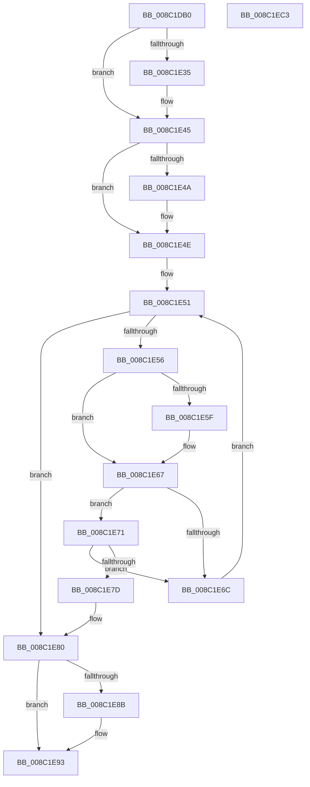

# EtwpFindGuidEntryByGuid

- RVA: `0x008C1DB0`–`0x008C1EC4` (길이 `276` bytes)
- VA: `0x00000001408C1DB0`
- 실행 섹션: `PAGE`
- PDB 이름 있음: `예`; PDB Function 태그: `아니요`
- unwind 정보 RVA: `0x00083688`
- 디코드: `83`개 명령, `276/276` bytes 표시
- 미해석 바이트: `0` (있으면 어셈블리에 `.byte`로 보존)

> 이 문서는 커널 이미지의 기계어와 PDB 기호를 분석해 생성했습니다. 4번과 5번은 함수 원형과 자료형을 바이너리 사용 방식에서 추정한 C 해석이며 원본 소스 복구 결과는 아닙니다.

## 1. Dependencies

- 직접 호출 지점: **6**; 고유 호출 대상: **6**
- 직접 호출자로 확인된 함수: **9**
- RIP 상대 이미지 참조: **0**

### Outgoing calls
- `0x008C1E1D` → [KeAbPreAcquire](../../text/21/KeAbPreAcquire_function_00210230.md) (function, `0x00210230`)
- `0x008C1E40` → [ExfAcquirePushLockSharedEx](../../text/21/ExfAcquirePushLockSharedEx_function_0021044C.md) (function, `0x0021044C`)
- `0x008C1E74` → [EtwpReferenceGuidEntry](EtwpReferenceGuidEntry_function_008C1ED0.md) (function, `0x008C1ED0`)
- `0x008C1E8E` → [ExfReleasePushLockShared](../../text/26/ExfReleasePushLockShared_function_00263440.md) (function, `0x00263440`)
- `0x008C1E96` → [KeAbPostRelease](../../text/2E/KeAbPostRelease_function_002E1600.md) (function, `0x002E1600`)
- `0x008C1EA4` → [KeLeaveCriticalRegionThread](../../text/25/KeLeaveCriticalRegionThread_function_0025EFF0.md) (function, `0x0025EFF0`)

### Direct callers
- [NtTraceEvent](../../text/2F/NtTraceEvent_function_002FA6C0.md) at `0x002FAFDA`
- [SendCaptureStateNotificationsWorker](../7B/SendCaptureStateNotificationsWorker_function_007BCF30.md) at `0x007BD084`
- [sub_008BFE0A](../8B/Unknown_function_008BFE0A.md) at `0x008BFE10`
- [EtwpNotifyGuid](EtwpNotifyGuid_function_008C8110.md) at `0x008C81AC`
- [EtwpGetTraceGroupInfo](../9A/EtwpGetTraceGroupInfo_function_009A9CC0.md) at `0x009A9CF4`
- [EtwpBufferingModeFlush](../9B/EtwpBufferingModeFlush_function_009BD8F4.md) at `0x009BDA7C`
- [sub_009E8C24](../9E/Unknown_function_009E8C24.md) at `0x009E8CD6`
- [EtwpNotifyDisallowedGuidChange](../9E/EtwpNotifyDisallowedGuidChange_function_009EAD14.md) at `0x009EAD4F`
- [EtwpEnableGuid](../A5/EtwpEnableGuid_function_00A5CD28.md) at `0x00A5CF7D`

### Static image references
- 디코드된 RIP-relative 메모리 참조가 없습니다.

## 2. Other-region calls and transfers

- 다른 실행 섹션으로 향하는 call: **5**
  - `0x008C1E1D` → [KeAbPreAcquire](../../text/21/KeAbPreAcquire_function_00210230.md) (`PAGE` → `.text`)
  - `0x008C1E40` → [ExfAcquirePushLockSharedEx](../../text/21/ExfAcquirePushLockSharedEx_function_0021044C.md) (`PAGE` → `.text`)
  - `0x008C1E8E` → [ExfReleasePushLockShared](../../text/26/ExfReleasePushLockShared_function_00263440.md) (`PAGE` → `.text`)
  - `0x008C1E96` → [KeAbPostRelease](../../text/2E/KeAbPostRelease_function_002E1600.md) (`PAGE` → `.text`)
  - `0x008C1EA4` → [KeLeaveCriticalRegionThread](../../text/25/KeLeaveCriticalRegionThread_function_0025EFF0.md) (`PAGE` → `.text`)
- 별도 외부 분기/꼬리 이동을 확인하지 못했습니다.

## 3. Assembly (complete function range)

```asm
008C1DB0  48 89 5C 24 10                  mov qword ptr [rsp + 0x10], rbx
008C1DB5  48 89 6C 24 18                  mov qword ptr [rsp + 0x18], rbp
008C1DBA  56                              push rsi
008C1DBB  57                              push rdi
008C1DBC  41 54                           push r12
008C1DBE  41 56                           push r14
008C1DC0  41 57                           push r15
008C1DC2  48 83 EC 20                     sub rsp, 0x20
008C1DC6  8B 42 08                        mov eax, dword ptr [rdx + 8]
008C1DC9  48 81 C1 D0 02 00 00            add rcx, 0x2d0
008C1DD0  44 8B 4A 0C                     mov r9d, dword ptr [rdx + 0xc]
008C1DD4  48 8B FA                        mov rdi, rdx
008C1DD7  4C 33 C8                        xor r9, rax
008C1DDA  41 8B F0                        mov esi, r8d
008C1DDD  8B 42 04                        mov eax, dword ptr [rdx + 4]
008C1DE0  45 33 E4                        xor r12d, r12d
008C1DE3  4C 33 C8                        xor r9, rax
008C1DE6  48 C1 E6 04                     shl rsi, 4
008C1DEA  8B 02                           mov eax, dword ptr [rdx]
008C1DEC  45 33 C0                        xor r8d, r8d
008C1DEF  4C 33 C8                        xor r9, rax
008C1DF2  33 D2                           xor edx, edx
008C1DF4  41 83 E1 3F                     and r9d, 0x3f
008C1DF8  45 8B F4                        mov r14d, r12d
008C1DFB  49 6B C1 38                     imul rax, r9, 0x38
008C1DFF  48 03 C8                        add rcx, rax
008C1E02  65 48 8B 04 25 88 01 00 00      mov rax, qword ptr gs:[0x188]
008C1E0B  48 03 F1                        add rsi, rcx
008C1E0E  66 FF 88 E4 01 00 00            dec word ptr [rax + 0x1e4]
008C1E15  48 8D 69 30                     lea rbp, [rcx + 0x30]
008C1E19  48 8B CD                        mov rcx, rbp
008C1E1C  90                              nop
008C1E1D  E8 0E E4 94 FF                  call 0x140210230
008C1E22  48 8B D8                        mov rbx, rax
008C1E25  41 BF 11 00 00 00               mov r15d, 0x11
008C1E2B  33 C0                           xor eax, eax
008C1E2D  F0 4C 0F B1 7D 00               lock cmpxchg qword ptr [rbp], r15
008C1E33  74 10                           je 0x1408c1e45
008C1E35  4C 8B CD                        mov r9, rbp
008C1E38  4C 8B C3                        mov r8, rbx
008C1E3B  33 D2                           xor edx, edx
008C1E3D  48 8B CD                        mov rcx, rbp
008C1E40  E8 07 E6 94 FF                  call 0x14021044c
008C1E45  48 85 DB                        test rbx, rbx
008C1E48  74 04                           je 0x1408c1e4e
008C1E4A  C6 43 0A 01                     mov byte ptr [rbx + 0xa], 1
008C1E4E  48 8B 1E                        mov rbx, qword ptr [rsi]
008C1E51  48 3B DE                        cmp rbx, rsi
008C1E54  74 2A                           je 0x1408c1e80
008C1E56  48 8B 07                        mov rax, qword ptr [rdi]
008C1E59  48 2B 43 28                     sub rax, qword ptr [rbx + 0x28]
008C1E5D  75 08                           jne 0x1408c1e67
008C1E5F  48 8B 47 08                     mov rax, qword ptr [rdi + 8]
008C1E63  48 2B 43 30                     sub rax, qword ptr [rbx + 0x30]
008C1E67  48 85 C0                        test rax, rax
008C1E6A  74 05                           je 0x1408c1e71
008C1E6C  48 8B 1B                        mov rbx, qword ptr [rbx]
008C1E6F  EB E0                           jmp 0x1408c1e51
008C1E71  48 8B CB                        mov rcx, rbx
008C1E74  E8 57 00 00 00                  call 0x1408c1ed0
008C1E79  84 C0                           test al, al
008C1E7B  74 EF                           je 0x1408c1e6c
008C1E7D  4C 8B F3                        mov r14, rbx
008C1E80  49 8B C7                        mov rax, r15
008C1E83  F0 4C 0F B1 65 00               lock cmpxchg qword ptr [rbp], r12
008C1E89  74 08                           je 0x1408c1e93
008C1E8B  48 8B CD                        mov rcx, rbp
008C1E8E  E8 AD 15 9A FF                  call 0x140263440
008C1E93  48 8B CD                        mov rcx, rbp
008C1E96  E8 65 F7 A1 FF                  call 0x1402e1600
008C1E9B  65 48 8B 0C 25 88 01 00 00      mov rcx, qword ptr gs:[0x188]
008C1EA4  E8 47 D1 99 FF                  call 0x14025eff0
008C1EA9  48 8B 5C 24 58                  mov rbx, qword ptr [rsp + 0x58]
008C1EAE  49 8B C6                        mov rax, r14
008C1EB1  48 8B 6C 24 60                  mov rbp, qword ptr [rsp + 0x60]
008C1EB6  48 83 C4 20                     add rsp, 0x20
008C1EBA  41 5F                           pop r15
008C1EBC  41 5E                           pop r14
008C1EBE  41 5C                           pop r12
008C1EC0  5F                              pop rdi
008C1EC1  5E                              pop rsi
008C1EC2  C3                              ret
008C1EC3  CC                              int3
```

## 4. C-style interpretation (structured pseudocode)

```c
__int64 __fastcall EtwpFindGuidEntryByGuid(__int64 a1, __int64 a2, int a3)
{
    __int64 result;
    __int64 v_r12;
    __int64 v_rsi;
    __int64 v_rsp;
    unsigned __int64 v_stack_p10;
    unsigned __int64 v_stack_p18;

    v_stack_p10 = v_rbx;
    v_stack_p18 = v_rbp;
    v_rsp = (v_rsp) - (32);
    a1 = (a1) + (720);
    a4 = ((unsigned int)(*(unsigned int *)(a2 + 12))) ^ ((unsigned int)(*(unsigned int *)(a2 + 8)));
    v_r12 = 0;
    a4 = (a4) ^ ((unsigned int)(*(unsigned int *)(a2 + 4)));
    v_rsi = ((unsigned int)(a3)) << (4);
    a3 = 0;
    a4 = (a4) ^ ((unsigned int)(*(unsigned int *)(a2)));
    a2 = 0;
    a4 = (unsigned int)((a4) & (63));
    result = ((unsigned int)(*(unsigned int *)(a2))) * (a4);
    a1 = (a1) + (result);
    v_rsi = (v_rsi) + (a1);
    result = KeAbPreAcquire(a1 + 48, a2, a3, a4);
    result = 0;
    if (!(condition_is_equal)) {
        a4 = a1 + 48;
        a3 = 0;
        a2 = 0;
        a1 = a1 + 48;
        result = ExfAcquirePushLockSharedEx(a1, a2, a3, a4);
    }
    if (result != 0) {
        *(unsigned __int8 *)(result + 10) = 1;
    }
loc_008C1E51:
    if ((*(unsigned __int64 *)(v_rsi)) == v_rsi) goto loc_008C1E80;
    result = (*(unsigned __int64 *)(a2)) - (*(unsigned __int64 *)(*(unsigned __int64 *)(v_rsi) + 40));
    if (!(condition_is_not_equal)) {
        result = *(unsigned __int64 *)(a2 + 8);
        result = (result) - (*(unsigned __int64 *)(*(unsigned __int64 *)(v_rsi) + 48));
    }
    if (result == 0) goto loc_008C1E71;
loc_008C1E6C:
    goto loc_008C1E51;
loc_008C1E71:
    result = EtwpReferenceGuidEntry(*(unsigned __int64 *)(*(unsigned __int64 *)(v_rsi)), a2, a3, a4);
    if ((unsigned __int8)(result) == 0) goto loc_008C1E6C;
loc_008C1E80:
    result = 17;
    if ((unsigned __int8)(result) != 0) {
        a1 = a1 + 48;
        result = ExfReleasePushLockShared(a1, a2, a3, a4);
    }
    result = KeAbPostRelease(a1 + 48, a2, a3, a4);
    result = KeLeaveCriticalRegionThread(*(unsigned __int64 *)(gs_base + (0 + 392)), a2, a3, a4);
    v_rsp = (v_rsp) + (32);
    return *(unsigned __int64 *)(*(unsigned __int64 *)(v_rsi));
}
```

## 5. (Beta) C Style

```c
int64_t EtwpFindGuidEntryByGuid(void *Arg1, void *Arg2, int32_t Arg3)
{
    uint8_t *arg1 = (uint8_t *)Arg1;
    uint8_t *arg2 = (uint8_t *)Arg2;

    int64_t result;
    int64_t local_r12;
    int64_t local_rsi;
    int64_t local_rsp;
    uint64_t v_stack_p10;
    uint64_t v_stack_p18;

    v_stack_p10 = local_rbx;
    v_stack_p18 = local_rbp;
    local_rsp = (local_rsp) - (32);
    Arg1 = (Arg1) + (720);
    a4 = ((uint32_t)(*(uint32_t *)(arg2 + 0xC))) ^ ((uint32_t)(*(uint32_t *)(arg2 + 0x8)));
    local_r12 = 0;
    a4 = (a4) ^ ((uint32_t)(*(uint32_t *)(arg2 + 0x4)));
    local_rsi = ((uint32_t)(Arg3)) << (4);
    Arg3 = 0;
    a4 = (a4) ^ ((uint32_t)(*(uint32_t *)(arg2)));
    Arg2 = 0;
    a4 = (uint32_t)((a4) & (63));
    result = ((uint32_t)(*(uint32_t *)(arg2))) * (a4);
    Arg1 = (Arg1) + (result);
    local_rsi = (local_rsi) + (Arg1);
    result = KeAbPreAcquire(Arg1 + 48, Arg2, Arg3, a4);
    result = 0;
    if (!(condition_is_equal)) {
        a4 = Arg1 + 48;
        Arg3 = 0;
        Arg2 = 0;
        Arg1 = Arg1 + 48;
        result = ExfAcquirePushLockSharedEx(Arg1, Arg2, Arg3, a4);
    }
    if (result != 0) {
        *(uint8_t *)(result + 0xA) = 1;
    }
loc_008C1E51:
    if ((*(uint64_t *)(local_rsi)) == local_rsi) goto loc_008C1E80;
    result = (*(uint64_t *)(arg2)) - (*(uint64_t *)(*(uint64_t *)(local_rsi) + 0x28));
    if (!(condition_is_not_equal)) {
        result = *(uint64_t *)(arg2 + 0x8);
        result = (result) - (*(uint64_t *)(*(uint64_t *)(local_rsi) + 0x30));
    }
    if (result == 0) goto loc_008C1E71;
loc_008C1E6C:
    goto loc_008C1E51;
loc_008C1E71:
    result = EtwpReferenceGuidEntry(*(uint64_t *)(*(uint64_t *)(local_rsi)), Arg2, Arg3, a4);
    if ((uint8_t)(result) == 0) goto loc_008C1E6C;
loc_008C1E80:
    result = 17;
    if ((uint8_t)(result) != 0) {
        Arg1 = Arg1 + 48;
        result = ExfReleasePushLockShared(Arg1, Arg2, Arg3, a4);
    }
    result = KeAbPostRelease(Arg1 + 48, Arg2, Arg3, a4);
    result = KeLeaveCriticalRegionThread(*(uint64_t *)(gs_base + (0 + 0x188)), Arg2, Arg3, a4);
    local_rsp = (local_rsp) + (32);
    return *(uint64_t *)(*(uint64_t *)(local_rsi));
}
```

### 관측된 메모리 오프셋

구조체 형식이 확인되지 않은 접근은 인자 기준의 오프셋으로만 기록했습니다.

| 기준 인자 | 오프셋 표현 | 폭 (bit) | 접근 |
|---|---:|---:|---|
| `Arg1` | `+ 0x0` | `64` | `R` |
| `Arg1` | `+ 0x30` | `64` | `R` |
| `Arg2` | `+ 0x0` | `32` | `R` |
| `Arg2` | `+ 0x0` | `64` | `R` |
| `Arg2` | `+ 0x4` | `32` | `R` |
| `Arg2` | `+ 0x8` | `32` | `R` |
| `Arg2` | `+ 0x8` | `64` | `R` |
| `Arg2` | `+ 0xC` | `32` | `R` |

## 6. Execution-region graph

[열기: 2D/3D 그래프와 함수 탐색 컨트롤 패널](../../../control-panel.html?section=page&rva=0x008C1DB0&view=graph)

- 2D 그래프는 위에서 아래로 흐르고, 3D 그래프는 빈 공간을 드래그해 회전합니다. Shift+드래그는 이동, 휠은 확대·축소, 함수 노드 선택은 대상 보고서 이동입니다.

### Static fallback


