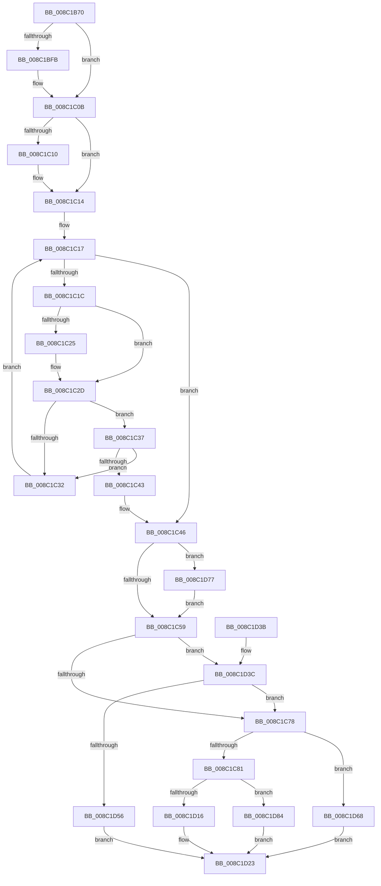

# EtwpFindOrCreateGuidEntry

- RVA: `0x008C1B70`–`0x008C1D9B` (길이 `555` bytes)
- VA: `0x00000001408C1B70`
- 실행 섹션: `PAGE`
- PDB 이름 있음: `예`; PDB Function 태그: `아니요`
- unwind 정보 RVA: `0x0008366C`
- 디코드: `147`개 명령, `555/555` bytes 표시
- 미해석 바이트: `0` (있으면 어셈블리에 `.byte`로 보존)

> 이 문서는 커널 이미지의 기계어와 PDB 기호를 분석해 생성했습니다. 4번과 5번은 함수 원형과 자료형을 바이너리 사용 방식에서 추정한 C 해석이며 원본 소스 복구 결과는 아닙니다.

## 1. Dependencies

- 직접 호출 지점: **11**; 고유 호출 대상: **11**
- 직접 호출자로 확인된 함수: **2**
- RIP 상대 이미지 참조: **1**

### Outgoing calls
- `0x008C1BE4` → [KeAbPreAcquire](../../text/21/KeAbPreAcquire_function_00210230.md) (function, `0x00210230`)
- `0x008C1C06` → [ExfAcquirePushLockSharedEx](../../text/21/ExfAcquirePushLockSharedEx_function_0021044C.md) (function, `0x0021044C`)
- `0x008C1C3A` → [EtwpReferenceGuidEntry](EtwpReferenceGuidEntry_function_008C1ED0.md) (function, `0x008C1ED0`)
- `0x008C1C5C` → [KeAbPostRelease](../../text/2E/KeAbPostRelease_function_002E1600.md) (function, `0x002E1600`)
- `0x008C1C6A` → [KeLeaveCriticalRegionThread](../../text/25/KeLeaveCriticalRegionThread_function_0025EFF0.md) (function, `0x0025EFF0`)
- `0x008C1CA5` → [SeCaptureSubjectContext](../86/SeCaptureSubjectContext_function_0086B820.md) (function, `0x0086B820`)
- `0x008C1CFC` → [SeAccessCheck](../../text/3A/SeAccessCheck_function_003A6BC0.md) (function, `0x003A6BC0`)
- `0x008C1D06` → [SeReleaseSubjectContext](../86/SeReleaseSubjectContext_function_0086B710.md) (function, `0x0086B710`)
- `0x008C1D45` → [EtwpAddGuidEntry](../8B/EtwpAddGuidEntry_function_008BFC80.md) (function, `0x008BFC80`)
- `0x008C1D7A` → [ExfReleasePushLockShared](../../text/26/ExfReleasePushLockShared_function_00263440.md) (function, `0x00263440`)
- `0x008C1D87` → [EtwpUnreferenceGuidEntry](EtwpUnreferenceGuidEntry_function_008C3320.md) (function, `0x008C3320`)

### Direct callers
- [EtwpRegisterKMProvider](../92/EtwpRegisterKMProvider_function_009209A4.md) at `0x00920A48`
- [EtwpAddRegEntryToGroup](../9F/EtwpAddRegEntryToGroup_function_009F39D4.md) at `0x009F3A52`

### Static image references
- `0x008C1CE2` → RVA `0x00011360` (`.rdata`; read)

## 2. Other-region calls and transfers

- 다른 실행 섹션으로 향하는 call: **6**
  - `0x008C1BE4` → [KeAbPreAcquire](../../text/21/KeAbPreAcquire_function_00210230.md) (`PAGE` → `.text`)
  - `0x008C1C06` → [ExfAcquirePushLockSharedEx](../../text/21/ExfAcquirePushLockSharedEx_function_0021044C.md) (`PAGE` → `.text`)
  - `0x008C1C5C` → [KeAbPostRelease](../../text/2E/KeAbPostRelease_function_002E1600.md) (`PAGE` → `.text`)
  - `0x008C1C6A` → [KeLeaveCriticalRegionThread](../../text/25/KeLeaveCriticalRegionThread_function_0025EFF0.md) (`PAGE` → `.text`)
  - `0x008C1CFC` → [SeAccessCheck](../../text/3A/SeAccessCheck_function_003A6BC0.md) (`PAGE` → `.text`)
  - `0x008C1D7A` → [ExfReleasePushLockShared](../../text/26/ExfReleasePushLockShared_function_00263440.md) (`PAGE` → `.text`)
- 별도 외부 분기/꼬리 이동을 확인하지 못했습니다.

## 3. Assembly (complete function range)

```asm
008C1B70  48 89 5C 24 20                  mov qword ptr [rsp + 0x20], rbx
008C1B75  55                              push rbp
008C1B76  56                              push rsi
008C1B77  57                              push rdi
008C1B78  41 54                           push r12
008C1B7A  41 55                           push r13
008C1B7C  41 56                           push r14
008C1B7E  41 57                           push r15
008C1B80  48 83 EC 70                     sub rsp, 0x70
008C1B84  44 8B 52 0C                     mov r10d, dword ptr [rdx + 0xc]
008C1B88  33 C0                           xor eax, eax
008C1B8A  44 8B F0                        mov r14d, eax
008C1B8D  41 8B F0                        mov esi, r8d
008C1B90  8B 42 08                        mov eax, dword ptr [rdx + 8]
008C1B93  4C 8B E9                        mov r13, rcx
008C1B96  4C 33 D0                        xor r10, rax
008C1B99  45 8B E0                        mov r12d, r8d
008C1B9C  8B 42 04                        mov eax, dword ptr [rdx + 4]
008C1B9F  48 81 C1 D0 02 00 00            add rcx, 0x2d0
008C1BA6  4C 33 D0                        xor r10, rax
008C1BA9  48 C1 E6 04                     shl rsi, 4
008C1BAD  8B 02                           mov eax, dword ptr [rdx]
008C1BAF  48 8B FA                        mov rdi, rdx
008C1BB2  4C 33 D0                        xor r10, rax
008C1BB5  45 33 C0                        xor r8d, r8d
008C1BB8  41 83 E2 3F                     and r10d, 0x3f
008C1BBC  33 D2                           xor edx, edx
008C1BBE  49 6B C2 38                     imul rax, r10, 0x38
008C1BC2  45 0F B6 F9                     movzx r15d, r9b
008C1BC6  48 03 C8                        add rcx, rax
008C1BC9  65 48 8B 04 25 88 01 00 00      mov rax, qword ptr gs:[0x188]
008C1BD2  48 03 F1                        add rsi, rcx
008C1BD5  66 FF 88 E4 01 00 00            dec word ptr [rax + 0x1e4]
008C1BDC  48 8D 69 30                     lea rbp, [rcx + 0x30]
008C1BE0  48 8B CD                        mov rcx, rbp
008C1BE3  90                              nop
008C1BE4  E8 47 E6 94 FF                  call 0x140210230
008C1BE9  48 8B D8                        mov rbx, rax
008C1BEC  B9 11 00 00 00                  mov ecx, 0x11
008C1BF1  33 C0                           xor eax, eax
008C1BF3  F0 48 0F B1 4D 00               lock cmpxchg qword ptr [rbp], rcx
008C1BF9  74 10                           je 0x1408c1c0b
008C1BFB  4C 8B CD                        mov r9, rbp
008C1BFE  4C 8B C3                        mov r8, rbx
008C1C01  33 D2                           xor edx, edx
008C1C03  48 8B CD                        mov rcx, rbp
008C1C06  E8 41 E8 94 FF                  call 0x14021044c
008C1C0B  48 85 DB                        test rbx, rbx
008C1C0E  74 04                           je 0x1408c1c14
008C1C10  C6 43 0A 01                     mov byte ptr [rbx + 0xa], 1
008C1C14  48 8B 1E                        mov rbx, qword ptr [rsi]
008C1C17  48 3B DE                        cmp rbx, rsi
008C1C1A  74 2A                           je 0x1408c1c46
008C1C1C  48 8B 07                        mov rax, qword ptr [rdi]
008C1C1F  48 2B 43 28                     sub rax, qword ptr [rbx + 0x28]
008C1C23  75 08                           jne 0x1408c1c2d
008C1C25  48 8B 47 08                     mov rax, qword ptr [rdi + 8]
008C1C29  48 2B 43 30                     sub rax, qword ptr [rbx + 0x30]
008C1C2D  48 85 C0                        test rax, rax
008C1C30  74 05                           je 0x1408c1c37
008C1C32  48 8B 1B                        mov rbx, qword ptr [rbx]
008C1C35  EB E0                           jmp 0x1408c1c17
008C1C37  48 8B CB                        mov rcx, rbx
008C1C3A  E8 91 02 00 00                  call 0x1408c1ed0
008C1C3F  84 C0                           test al, al
008C1C41  74 EF                           je 0x1408c1c32
008C1C43  4C 8B F3                        mov r14, rbx
008C1C46  B8 11 00 00 00                  mov eax, 0x11
008C1C4B  33 F6                           xor esi, esi
008C1C4D  F0 48 0F B1 75 00               lock cmpxchg qword ptr [rbp], rsi
008C1C53  0F 85 1E 01 00 00               jne 0x1408c1d77
008C1C59  48 8B CD                        mov rcx, rbp
008C1C5C  E8 9F F9 A1 FF                  call 0x1402e1600
008C1C61  65 48 8B 0C 25 88 01 00 00      mov rcx, qword ptr gs:[0x188]
008C1C6A  E8 81 D3 99 FF                  call 0x14025eff0
008C1C6F  4D 85 F6                        test r14, r14
008C1C72  0F 84 C4 00 00 00               je 0x1408c1d3c
008C1C78  45 84 FF                        test r15b, r15b
008C1C7B  0F 84 E7 00 00 00               je 0x1408c1d68
008C1C81  49 8B 5E 48                     mov rbx, qword ptr [r14 + 0x48]
008C1C85  48 8D 4C 24 50                  lea rcx, [rsp + 0x50]
008C1C8A  0F 57 C0                        xorps xmm0, xmm0
008C1C8D  89 B4 24 C0 00 00 00            mov dword ptr [rsp + 0xc0], esi
008C1C94  0F 11 44 24 50                  movups xmmword ptr [rsp + 0x50], xmm0
008C1C99  89 B4 24 B0 00 00 00            mov dword ptr [rsp + 0xb0], esi
008C1CA0  0F 11 44 24 60                  movups xmmword ptr [rsp + 0x60], xmm0
008C1CA5  E8 76 9B FA FF                  call 0x14086b820
008C1CAA  B8 00 10 00 00                  mov eax, 0x1000
008C1CAF  48 8D 54 24 50                  lea rdx, [rsp + 0x50]
008C1CB4  41 B9 00 08 00 00               mov r9d, 0x800
008C1CBA  41 83 FC 02                     cmp r12d, 2
008C1CBE  48 8B CB                        mov rcx, rbx
008C1CC1  44 0F 44 C8                     cmove r9d, eax
008C1CC5  48 8D 84 24 C0 00 00 00         lea rax, [rsp + 0xc0]
008C1CCD  48 89 44 24 48                  mov qword ptr [rsp + 0x48], rax
008C1CD2  45 33 C0                        xor r8d, r8d
008C1CD5  48 8D 84 24 B0 00 00 00         lea rax, [rsp + 0xb0]
008C1CDD  48 89 44 24 40                  mov qword ptr [rsp + 0x40], rax
008C1CE2  48 8D 05 77 F6 74 FF            lea rax, [rip - 0x8b0989]
008C1CE9  C6 44 24 38 01                  mov byte ptr [rsp + 0x38], 1
008C1CEE  48 89 44 24 30                  mov qword ptr [rsp + 0x30], rax
008C1CF3  48 89 74 24 28                  mov qword ptr [rsp + 0x28], rsi
008C1CF8  89 74 24 20                     mov dword ptr [rsp + 0x20], esi
008C1CFC  E8 BF 4E AE FF                  call 0x1403a6bc0
008C1D01  48 8D 4C 24 50                  lea rcx, [rsp + 0x50]
008C1D06  E8 05 9A FA FF                  call 0x14086b710
008C1D0B  8B 9C 24 C0 00 00 00            mov ebx, dword ptr [rsp + 0xc0]
008C1D12  85 DB                           test ebx, ebx
008C1D14  78 6E                           js 0x1408c1d84
008C1D16  48 8B 84 24 D0 00 00 00         mov rax, qword ptr [rsp + 0xd0]
008C1D1E  4C 89 30                        mov qword ptr [rax], r14
008C1D21  8B C3                           mov eax, ebx
008C1D23  48 8B 9C 24 C8 00 00 00         mov rbx, qword ptr [rsp + 0xc8]
008C1D2B  48 83 C4 70                     add rsp, 0x70
008C1D2F  41 5F                           pop r15
008C1D31  41 5E                           pop r14
008C1D33  41 5D                           pop r13
008C1D35  41 5C                           pop r12
008C1D37  5F                              pop rdi
008C1D38  5E                              pop rsi
008C1D39  5D                              pop rbp
008C1D3A  C3                              ret
008C1D3B  CC                              int3
008C1D3C  45 8B C4                        mov r8d, r12d
008C1D3F  48 8B D7                        mov rdx, rdi
008C1D42  49 8B CD                        mov rcx, r13
008C1D45  E8 36 DF FF FF                  call 0x1408bfc80
008C1D4A  4C 8B F0                        mov r14, rax
008C1D4D  48 85 C0                        test rax, rax
008C1D50  0F 85 22 FF FF FF               jne 0x1408c1c78
008C1D56  48 8B 8C 24 D0 00 00 00         mov rcx, qword ptr [rsp + 0xd0]
008C1D5E  48 89 01                        mov qword ptr [rcx], rax
008C1D61  B8 17 00 00 C0                  mov eax, 0xc0000017
008C1D66  EB BB                           jmp 0x1408c1d23
008C1D68  48 8B 8C 24 D0 00 00 00         mov rcx, qword ptr [rsp + 0xd0]
008C1D70  8B C6                           mov eax, esi
008C1D72  4C 89 31                        mov qword ptr [rcx], r14
008C1D75  EB AC                           jmp 0x1408c1d23
008C1D77  48 8B CD                        mov rcx, rbp
008C1D7A  E8 C1 16 9A FF                  call 0x140263440
008C1D7F  E9 D5 FE FF FF                  jmp 0x1408c1c59
008C1D84  49 8B CE                        mov rcx, r14
008C1D87  E8 94 15 00 00                  call 0x1408c3320
008C1D8C  48 8B 8C 24 D0 00 00 00         mov rcx, qword ptr [rsp + 0xd0]
008C1D94  8B C3                           mov eax, ebx
008C1D96  48 89 31                        mov qword ptr [rcx], rsi
008C1D99  EB 88                           jmp 0x1408c1d23
```

## 4. C-style interpretation (structured pseudocode)

```c
__int64 __fastcall EtwpFindOrCreateGuidEntry(__int64 a1, __int64 a2, int a3, unsigned __int8 a4, __int64 a5)
{
    __int64 result;
    __int64 v_r10;
    __int64 v_rsi;
    __int64 v_rsp;
    unsigned __int64 v_stack_m48;
    unsigned __int64 v_stack_m58;
    unsigned __int64 v_stack_m60;
    unsigned __int64 v_stack_m68;
    unsigned __int8 v_stack_m70;
    unsigned __int64 v_stack_m78;
    unsigned __int64 v_stack_m80;
    unsigned int v_stack_m88;
    unsigned int v_stack_p18;
    unsigned __int64 v_stack_p20;
    unsigned int v_stack_p8;

    v_stack_p20 = v_rbx;
    v_rsp = (v_rsp) - (112);
    result = 0;
    v_r10 = ((unsigned int)(*(unsigned int *)(a2 + 12))) ^ ((unsigned int)(*(unsigned int *)(a2 + 8)));
    a1 = (a1) + (720);
    v_r10 = (v_r10) ^ ((unsigned int)(*(unsigned int *)(a2 + 4)));
    v_rsi = ((unsigned int)(a3)) << (4);
    v_r10 = (v_r10) ^ ((unsigned int)(*(unsigned int *)(a2)));
    a3 = 0;
    v_r10 = (unsigned int)((v_r10) & (63));
    a2 = 0;
    result = ((unsigned int)(*(unsigned int *)(a2))) * (v_r10);
    a1 = (a1) + (result);
    v_rsi = (v_rsi) + (a1);
    result = KeAbPreAcquire(a1 + 48, a2, a3, a4);
    result = 0;
    if (!(condition_is_equal)) {
        a4 = a1 + 48;
        a3 = 0;
        a2 = 0;
        a1 = a1 + 48;
        result = ExfAcquirePushLockSharedEx(a1, a2, a3, a4);
    }
    if (result != 0) {
        *(unsigned __int8 *)(result + 10) = 1;
    }
loc_008C1C17:
    if ((*(unsigned __int64 *)(v_rsi)) == v_rsi) goto loc_008C1C46;
    result = (*(unsigned __int64 *)(a2)) - (*(unsigned __int64 *)(*(unsigned __int64 *)(v_rsi) + 40));
    if (!(condition_is_not_equal)) {
        result = *(unsigned __int64 *)(a2 + 8);
        result = (result) - (*(unsigned __int64 *)(*(unsigned __int64 *)(v_rsi) + 48));
    }
    if (result == 0) goto loc_008C1C37;
loc_008C1C32:
    goto loc_008C1C17;
loc_008C1C37:
    result = EtwpReferenceGuidEntry(*(unsigned __int64 *)(*(unsigned __int64 *)(v_rsi)), a2, a3, a4);
    if ((unsigned __int8)(result) == 0) goto loc_008C1C32;
loc_008C1C46:
    v_rsi = 0;
    if (condition_is_not_equal) goto loc_008C1D77;
loc_008C1C59:
    result = KeAbPostRelease(a1 + 48, a2, a3, a4);
    result = KeLeaveCriticalRegionThread(*(unsigned __int64 *)(gs_base + (0 + 392)), a2, a3, a4);
    if (*(unsigned __int64 *)(*(unsigned __int64 *)(v_rsi)) == 0) goto loc_008C1D3C;
loc_008C1C78:
    if (a4 == 0) goto loc_008C1D68;
    v_stack_p18 = 0;
    v_stack_m58 = v_xmm0;
    v_stack_p8 = 0;
    v_stack_m48 = v_xmm0;
    result = SeCaptureSubjectContext(v_stack_m58, a2, a3, a4);
    a4 = (unsigned int)(0x800ULL);
    if (((unsigned int)((unsigned int)(a3))) == 2) { a4 = (unsigned int)((unsigned int)(0x1000ULL)); }
    v_stack_m60 = v_stack_p18;
    a3 = 0;
    v_stack_m68 = v_stack_p8;
    v_stack_m70 = 1;
    v_stack_m78 = v_rip - 9111945;
    v_stack_m80 = 0;
    v_stack_m88 = 0;
    result = SeAccessCheck(*(unsigned __int64 *)(*(unsigned __int64 *)(*(unsigned __int64 *)(v_rsi)) + 72), v_stack_m58, a3, a4);
    result = SeReleaseSubjectContext(v_stack_m58, v_stack_m58, a3, a4);
    if (sign_flag) goto loc_008C1D84;
    *(unsigned __int64 *)(a5) = *(unsigned __int64 *)(*(unsigned __int64 *)(v_rsi));
loc_008C1D23:
    v_rsp = (v_rsp) + (112);
    return (unsigned int)((unsigned int)((unsigned int)(v_stack_p18)));
loc_008C1D3C:
    result = EtwpAddGuidEntry(a1, 0, (unsigned int)((unsigned int)((unsigned int)(a3))), a4);
    if (result != 0) goto loc_008C1C78;
    *(unsigned __int64 *)(a5) = result;
    goto loc_008C1D23;
loc_008C1D68:
    *(unsigned __int64 *)(a5) = result;
    goto loc_008C1D23;
loc_008C1D77:
    result = ExfReleasePushLockShared(a1 + 48, 0, (unsigned int)((unsigned int)((unsigned int)(a3))), a4);
    goto loc_008C1C59;
loc_008C1D84:
    result = EtwpUnreferenceGuidEntry(result, 0, (unsigned int)((unsigned int)((unsigned int)(a3))), a4);
    *(unsigned __int64 *)(a5) = 0;
    goto loc_008C1D23;
}
```

## 5. (Beta) C Style

```c
int64_t EtwpFindOrCreateGuidEntry(void *Arg1, void *Arg2, int32_t Arg3, uint8_t Arg4, void *Arg5)
{
    uint8_t *arg1 = (uint8_t *)Arg1;
    uint8_t *arg2 = (uint8_t *)Arg2;
    uint8_t *arg5 = (uint8_t *)Arg5;

    int64_t result;
    int64_t local_r10;
    int64_t local_rsi;
    int64_t local_rsp;
    uint64_t v_stack_m48;
    uint64_t v_stack_m58;
    uint64_t v_stack_m60;
    uint64_t v_stack_m68;
    uint8_t v_stack_m70;
    uint64_t v_stack_m78;
    uint64_t v_stack_m80;
    uint32_t v_stack_m88;
    uint32_t v_stack_p18;
    uint64_t v_stack_p20;
    uint32_t v_stack_p8;

    v_stack_p20 = local_rbx;
    local_rsp = (local_rsp) - (112);
    result = 0;
    local_r10 = ((uint32_t)(*(uint32_t *)(arg2 + 0xC))) ^ ((uint32_t)(*(uint32_t *)(arg2 + 0x8)));
    Arg1 = (Arg1) + (720);
    local_r10 = (local_r10) ^ ((uint32_t)(*(uint32_t *)(arg2 + 0x4)));
    local_rsi = ((uint32_t)(Arg3)) << (4);
    local_r10 = (local_r10) ^ ((uint32_t)(*(uint32_t *)(arg2)));
    Arg3 = 0;
    local_r10 = (uint32_t)((local_r10) & (63));
    Arg2 = 0;
    result = ((uint32_t)(*(uint32_t *)(arg2))) * (local_r10);
    Arg1 = (Arg1) + (result);
    local_rsi = (local_rsi) + (Arg1);
    result = KeAbPreAcquire(Arg1 + 48, Arg2, Arg3, Arg4);
    result = 0;
    if (!(condition_is_equal)) {
        Arg4 = Arg1 + 48;
        Arg3 = 0;
        Arg2 = 0;
        Arg1 = Arg1 + 48;
        result = ExfAcquirePushLockSharedEx(Arg1, Arg2, Arg3, Arg4);
    }
    if (result != 0) {
        *(uint8_t *)(result + 0xA) = 1;
    }
loc_008C1C17:
    if ((*(uint64_t *)(local_rsi)) == local_rsi) goto loc_008C1C46;
    result = (*(uint64_t *)(arg2)) - (*(uint64_t *)(*(uint64_t *)(local_rsi) + 0x28));
    if (!(condition_is_not_equal)) {
        result = *(uint64_t *)(arg2 + 0x8);
        result = (result) - (*(uint64_t *)(*(uint64_t *)(local_rsi) + 0x30));
    }
    if (result == 0) goto loc_008C1C37;
loc_008C1C32:
    goto loc_008C1C17;
loc_008C1C37:
    result = EtwpReferenceGuidEntry(*(uint64_t *)(*(uint64_t *)(local_rsi)), Arg2, Arg3, Arg4);
    if ((uint8_t)(result) == 0) goto loc_008C1C32;
loc_008C1C46:
    local_rsi = 0;
    if (condition_is_not_equal) goto loc_008C1D77;
loc_008C1C59:
    result = KeAbPostRelease(Arg1 + 48, Arg2, Arg3, Arg4);
    result = KeLeaveCriticalRegionThread(*(uint64_t *)(gs_base + (0 + 0x188)), Arg2, Arg3, Arg4);
    if (*(uint64_t *)(*(uint64_t *)(local_rsi)) == 0) goto loc_008C1D3C;
loc_008C1C78:
    if (Arg4 == 0) goto loc_008C1D68;
    v_stack_p18 = 0;
    v_stack_m58 = v_xmm0;
    v_stack_p8 = 0;
    v_stack_m48 = v_xmm0;
    result = SeCaptureSubjectContext(v_stack_m58, Arg2, Arg3, Arg4);
    Arg4 = (uint32_t)(0x800ULL);
    if (((uint32_t)((uint32_t)(Arg3))) == 2) { Arg4 = (uint32_t)((uint32_t)(0x1000ULL)); }
    v_stack_m60 = v_stack_p18;
    Arg3 = 0;
    v_stack_m68 = v_stack_p8;
    v_stack_m70 = 1;
    v_stack_m78 = v_rip - 9111945;
    v_stack_m80 = 0;
    v_stack_m88 = 0;
    result = SeAccessCheck(*(uint64_t *)(*(uint64_t *)(*(uint64_t *)(local_rsi)) + 0x48), v_stack_m58, Arg3, Arg4);
    result = SeReleaseSubjectContext(v_stack_m58, v_stack_m58, Arg3, Arg4);
    if (sign_flag) goto loc_008C1D84;
    *(uint64_t *)(arg5) = *(uint64_t *)(*(uint64_t *)(local_rsi));
loc_008C1D23:
    local_rsp = (local_rsp) + (112);
    return (uint32_t)((uint32_t)((uint32_t)(v_stack_p18)));
loc_008C1D3C:
    result = EtwpAddGuidEntry(Arg1, 0, (uint32_t)((uint32_t)((uint32_t)(Arg3))), Arg4);
    if (result != 0) goto loc_008C1C78;
    *(uint64_t *)(arg5) = result;
    goto loc_008C1D23;
loc_008C1D68:
    *(uint64_t *)(arg5) = result;
    goto loc_008C1D23;
loc_008C1D77:
    result = ExfReleasePushLockShared(Arg1 + 48, 0, (uint32_t)((uint32_t)((uint32_t)(Arg3))), Arg4);
    goto loc_008C1C59;
loc_008C1D84:
    result = EtwpUnreferenceGuidEntry(result, 0, (uint32_t)((uint32_t)((uint32_t)(Arg3))), Arg4);
    *(uint64_t *)(arg5) = 0;
    goto loc_008C1D23;
}
```

### 관측된 메모리 오프셋

구조체 형식이 확인되지 않은 접근은 인자 기준의 오프셋으로만 기록했습니다.

| 기준 인자 | 오프셋 표현 | 폭 (bit) | 접근 |
|---|---:|---:|---|
| `Arg1` | `+ 0x0` | `64` | `R` |
| `Arg1` | `+ 0x30` | `64` | `R` |
| `Arg2` | `+ 0x0` | `32` | `R` |
| `Arg2` | `+ 0x0` | `64` | `R` |
| `Arg2` | `+ 0x4` | `32` | `R` |
| `Arg2` | `+ 0x8` | `32` | `R` |
| `Arg2` | `+ 0x8` | `64` | `R` |
| `Arg2` | `+ 0xC` | `32` | `R` |
| `Arg5` | `+ 0x0` | `64` | `W` |

## 6. Execution-region graph

[열기: 2D/3D 그래프와 함수 탐색 컨트롤 패널](../../../control-panel.html?section=page&rva=0x008C1B70&view=graph)

- 2D 그래프는 위에서 아래로 흐르고, 3D 그래프는 빈 공간을 드래그해 회전합니다. Shift+드래그는 이동, 휠은 확대·축소, 함수 노드 선택은 대상 보고서 이동입니다.

### Static fallback


