# EtwpFreeFilterInfo

- RVA: `0x008C8A24`–`0x008C8B0A` (길이 `230` bytes)
- VA: `0x00000001408C8A24`
- 실행 섹션: `PAGE`
- PDB 이름 있음: `예`; PDB Function 태그: `아니요`
- unwind 정보 RVA: `0x0007FFC8`
- 디코드: `78`개 명령, `230/230` bytes 표시
- 미해석 바이트: `0` (있으면 어셈블리에 `.byte`로 보존)

> 이 문서는 커널 이미지의 기계어와 PDB 기호를 분석해 생성했습니다. 4번과 5번은 함수 원형과 자료형을 바이너리 사용 방식에서 추정한 C 해석이며 원본 소스 복구 결과는 아닙니다.

## 1. Dependencies

- 직접 호출 지점: **12**; 고유 호출 대상: **2**
- 직접 호출자로 확인된 함수: **2**
- RIP 상대 이미지 참조: **0**

### Outgoing calls
- `0x008C8AA2` → [ExFreePoolWithTag](../../poolcode/B8/ExFreePoolWithTag_function_00B82870.md) (function, `0x00B82870`)
- `0x008C8AAB` → [ExFreePoolWithTag](../../poolcode/B8/ExFreePoolWithTag_function_00B82870.md) (function, `0x00B82870`)
- `0x008C8AB4` → [ExFreePoolWithTag](../../poolcode/B8/ExFreePoolWithTag_function_00B82870.md) (function, `0x00B82870`)
- `0x008C8ABD` → [ExFreePoolWithTag](../../poolcode/B8/ExFreePoolWithTag_function_00B82870.md) (function, `0x00B82870`)
- `0x008C8AC6` → [ExFreePoolWithTag](../../poolcode/B8/ExFreePoolWithTag_function_00B82870.md) (function, `0x00B82870`)
- `0x008C8ACF` → [ExFreePoolWithTag](../../poolcode/B8/ExFreePoolWithTag_function_00B82870.md) (function, `0x00B82870`)
- `0x008C8AD8` → [ExFreePoolWithTag](../../poolcode/B8/ExFreePoolWithTag_function_00B82870.md) (function, `0x00B82870`)
- `0x008C8AE1` → [ExFreePoolWithTag](../../poolcode/B8/ExFreePoolWithTag_function_00B82870.md) (function, `0x00B82870`)
- `0x008C8AEA` → [ExFreePoolWithTag](../../poolcode/B8/ExFreePoolWithTag_function_00B82870.md) (function, `0x00B82870`)
- `0x008C8AF3` → [ExFreePoolWithTag](../../poolcode/B8/ExFreePoolWithTag_function_00B82870.md) (function, `0x00B82870`)
- `0x008C8AFC` → [ExFreePoolWithTag](../../poolcode/B8/ExFreePoolWithTag_function_00B82870.md) (function, `0x00B82870`)
- `0x008C8B03` → [EtwpFreeEventNameFilter](../9F/EtwpFreeEventNameFilter_function_009FD69C.md) (function, `0x009FD69C`)

### Direct callers
- [EtwpNotifyGuid](EtwpNotifyGuid_function_008C8110.md) at `0x008C81E7`
- [EtwpEnableGuid](../A5/EtwpEnableGuid_function_00A5CD28.md) at `0x00A5D9CE`

### Static image references
- 디코드된 RIP-relative 메모리 참조가 없습니다.

## 2. Other-region calls and transfers

- 다른 실행 섹션으로 향하는 call: **11**
  - `0x008C8AA2` → [ExFreePoolWithTag](../../poolcode/B8/ExFreePoolWithTag_function_00B82870.md) (`PAGE` → `POOLCODE`)
  - `0x008C8AAB` → [ExFreePoolWithTag](../../poolcode/B8/ExFreePoolWithTag_function_00B82870.md) (`PAGE` → `POOLCODE`)
  - `0x008C8AB4` → [ExFreePoolWithTag](../../poolcode/B8/ExFreePoolWithTag_function_00B82870.md) (`PAGE` → `POOLCODE`)
  - `0x008C8ABD` → [ExFreePoolWithTag](../../poolcode/B8/ExFreePoolWithTag_function_00B82870.md) (`PAGE` → `POOLCODE`)
  - `0x008C8AC6` → [ExFreePoolWithTag](../../poolcode/B8/ExFreePoolWithTag_function_00B82870.md) (`PAGE` → `POOLCODE`)
  - `0x008C8ACF` → [ExFreePoolWithTag](../../poolcode/B8/ExFreePoolWithTag_function_00B82870.md) (`PAGE` → `POOLCODE`)
  - `0x008C8AD8` → [ExFreePoolWithTag](../../poolcode/B8/ExFreePoolWithTag_function_00B82870.md) (`PAGE` → `POOLCODE`)
  - `0x008C8AE1` → [ExFreePoolWithTag](../../poolcode/B8/ExFreePoolWithTag_function_00B82870.md) (`PAGE` → `POOLCODE`)
  - `0x008C8AEA` → [ExFreePoolWithTag](../../poolcode/B8/ExFreePoolWithTag_function_00B82870.md) (`PAGE` → `POOLCODE`)
  - `0x008C8AF3` → [ExFreePoolWithTag](../../poolcode/B8/ExFreePoolWithTag_function_00B82870.md) (`PAGE` → `POOLCODE`)
  - `0x008C8AFC` → [ExFreePoolWithTag](../../poolcode/B8/ExFreePoolWithTag_function_00B82870.md) (`PAGE` → `POOLCODE`)
- 별도 외부 분기/꼬리 이동을 확인하지 못했습니다.

## 3. Assembly (complete function range)

```asm
008C8A24  40 53                           push rbx
008C8A26  48 83 EC 20                     sub rsp, 0x20
008C8A2A  48 8B D9                        mov rbx, rcx
008C8A2D  48 8B 49 08                     mov rcx, qword ptr [rcx + 8]
008C8A31  48 85 C9                        test rcx, rcx
008C8A34  75 6A                           jne 0x1408c8aa0
008C8A36  48 8B 4B 10                     mov rcx, qword ptr [rbx + 0x10]
008C8A3A  48 85 C9                        test rcx, rcx
008C8A3D  75 6A                           jne 0x1408c8aa9
008C8A3F  48 8B 4B 18                     mov rcx, qword ptr [rbx + 0x18]
008C8A43  48 85 C9                        test rcx, rcx
008C8A46  75 6A                           jne 0x1408c8ab2
008C8A48  48 8B 4B 20                     mov rcx, qword ptr [rbx + 0x20]
008C8A4C  48 85 C9                        test rcx, rcx
008C8A4F  75 6A                           jne 0x1408c8abb
008C8A51  48 8B 4B 28                     mov rcx, qword ptr [rbx + 0x28]
008C8A55  48 85 C9                        test rcx, rcx
008C8A58  75 6A                           jne 0x1408c8ac4
008C8A5A  48 8B 4B 30                     mov rcx, qword ptr [rbx + 0x30]
008C8A5E  48 85 C9                        test rcx, rcx
008C8A61  75 6A                           jne 0x1408c8acd
008C8A63  48 8B 4B 38                     mov rcx, qword ptr [rbx + 0x38]
008C8A67  48 85 C9                        test rcx, rcx
008C8A6A  75 6A                           jne 0x1408c8ad6
008C8A6C  48 8B 4B 40                     mov rcx, qword ptr [rbx + 0x40]
008C8A70  48 85 C9                        test rcx, rcx
008C8A73  75 6A                           jne 0x1408c8adf
008C8A75  48 8B 4B 48                     mov rcx, qword ptr [rbx + 0x48]
008C8A79  48 85 C9                        test rcx, rcx
008C8A7C  75 6A                           jne 0x1408c8ae8
008C8A7E  48 8B 4B 50                     mov rcx, qword ptr [rbx + 0x50]
008C8A82  48 85 C9                        test rcx, rcx
008C8A85  75 6A                           jne 0x1408c8af1
008C8A87  48 8B 4B 58                     mov rcx, qword ptr [rbx + 0x58]
008C8A8B  48 85 C9                        test rcx, rcx
008C8A8E  75 6A                           jne 0x1408c8afa
008C8A90  48 8B 4B 60                     mov rcx, qword ptr [rbx + 0x60]
008C8A94  48 85 C9                        test rcx, rcx
008C8A97  75 6A                           jne 0x1408c8b03
008C8A99  48 83 C4 20                     add rsp, 0x20
008C8A9D  5B                              pop rbx
008C8A9E  C3                              ret
008C8A9F  CC                              int3
008C8AA0  33 D2                           xor edx, edx
008C8AA2  E8 C9 9D 2B 00                  call 0x140b82870
008C8AA7  EB 8D                           jmp 0x1408c8a36
008C8AA9  33 D2                           xor edx, edx
008C8AAB  E8 C0 9D 2B 00                  call 0x140b82870
008C8AB0  EB 8D                           jmp 0x1408c8a3f
008C8AB2  33 D2                           xor edx, edx
008C8AB4  E8 B7 9D 2B 00                  call 0x140b82870
008C8AB9  EB 8D                           jmp 0x1408c8a48
008C8ABB  33 D2                           xor edx, edx
008C8ABD  E8 AE 9D 2B 00                  call 0x140b82870
008C8AC2  EB 8D                           jmp 0x1408c8a51
008C8AC4  33 D2                           xor edx, edx
008C8AC6  E8 A5 9D 2B 00                  call 0x140b82870
008C8ACB  EB 8D                           jmp 0x1408c8a5a
008C8ACD  33 D2                           xor edx, edx
008C8ACF  E8 9C 9D 2B 00                  call 0x140b82870
008C8AD4  EB 8D                           jmp 0x1408c8a63
008C8AD6  33 D2                           xor edx, edx
008C8AD8  E8 93 9D 2B 00                  call 0x140b82870
008C8ADD  EB 8D                           jmp 0x1408c8a6c
008C8ADF  33 D2                           xor edx, edx
008C8AE1  E8 8A 9D 2B 00                  call 0x140b82870
008C8AE6  EB 8D                           jmp 0x1408c8a75
008C8AE8  33 D2                           xor edx, edx
008C8AEA  E8 81 9D 2B 00                  call 0x140b82870
008C8AEF  EB 8D                           jmp 0x1408c8a7e
008C8AF1  33 D2                           xor edx, edx
008C8AF3  E8 78 9D 2B 00                  call 0x140b82870
008C8AF8  EB 8D                           jmp 0x1408c8a87
008C8AFA  33 D2                           xor edx, edx
008C8AFC  E8 6F 9D 2B 00                  call 0x140b82870
008C8B01  EB 8D                           jmp 0x1408c8a90
008C8B03  E8 94 4B 13 00                  call 0x1409fd69c
008C8B08  EB 8F                           jmp 0x1408c8a99
```

## 4. C-style interpretation (structured pseudocode)

```c
__int64 __fastcall EtwpFreeFilterInfo(__int64 a1, int a2)
{
    __int64 result;
    __int64 v_rsp;

    v_rsp = (v_rsp) - (32);
    if (*(unsigned __int64 *)(a1 + 8) != 0) goto loc_008C8AA0;
loc_008C8A36:
    if (*(unsigned __int64 *)(a1 + 16) != 0) goto loc_008C8AA9;
loc_008C8A3F:
    if (*(unsigned __int64 *)(a1 + 24) != 0) goto loc_008C8AB2;
loc_008C8A48:
    if (*(unsigned __int64 *)(a1 + 32) != 0) goto loc_008C8ABB;
loc_008C8A51:
    if (*(unsigned __int64 *)(a1 + 40) != 0) goto loc_008C8AC4;
loc_008C8A5A:
    if (*(unsigned __int64 *)(a1 + 48) != 0) goto loc_008C8ACD;
loc_008C8A63:
    if (*(unsigned __int64 *)(a1 + 56) != 0) goto loc_008C8AD6;
loc_008C8A6C:
    if (*(unsigned __int64 *)(a1 + 64) != 0) goto loc_008C8ADF;
loc_008C8A75:
    if (*(unsigned __int64 *)(a1 + 72) != 0) goto loc_008C8AE8;
loc_008C8A7E:
    if (*(unsigned __int64 *)(a1 + 80) != 0) goto loc_008C8AF1;
loc_008C8A87:
    if (*(unsigned __int64 *)(a1 + 88) != 0) goto loc_008C8AFA;
loc_008C8A90:
    if (*(unsigned __int64 *)(a1 + 96) != 0) goto loc_008C8B03;
loc_008C8A99:
    v_rsp = (v_rsp) + (32);
    return result;
loc_008C8AA0:
    a2 = 0;
    result = ExFreePoolWithTag(*(unsigned __int64 *)(a1 + 96), a2, a3, a4);
    goto loc_008C8A36;
loc_008C8AA9:
    a2 = 0;
    result = ExFreePoolWithTag(*(unsigned __int64 *)(a1 + 96), a2, a3, a4);
    goto loc_008C8A3F;
loc_008C8AB2:
    a2 = 0;
    result = ExFreePoolWithTag(*(unsigned __int64 *)(a1 + 96), a2, a3, a4);
    goto loc_008C8A48;
loc_008C8ABB:
    a2 = 0;
    result = ExFreePoolWithTag(*(unsigned __int64 *)(a1 + 96), a2, a3, a4);
    goto loc_008C8A51;
loc_008C8AC4:
    a2 = 0;
    result = ExFreePoolWithTag(*(unsigned __int64 *)(a1 + 96), a2, a3, a4);
    goto loc_008C8A5A;
loc_008C8ACD:
    a2 = 0;
    result = ExFreePoolWithTag(*(unsigned __int64 *)(a1 + 96), a2, a3, a4);
    goto loc_008C8A63;
loc_008C8AD6:
    a2 = 0;
    result = ExFreePoolWithTag(*(unsigned __int64 *)(a1 + 96), a2, a3, a4);
    goto loc_008C8A6C;
loc_008C8ADF:
    a2 = 0;
    result = ExFreePoolWithTag(*(unsigned __int64 *)(a1 + 96), a2, a3, a4);
    goto loc_008C8A75;
loc_008C8AE8:
    a2 = 0;
    result = ExFreePoolWithTag(*(unsigned __int64 *)(a1 + 96), a2, a3, a4);
    goto loc_008C8A7E;
loc_008C8AF1:
    a2 = 0;
    result = ExFreePoolWithTag(*(unsigned __int64 *)(a1 + 96), a2, a3, a4);
    goto loc_008C8A87;
loc_008C8AFA:
    a2 = 0;
    result = ExFreePoolWithTag(*(unsigned __int64 *)(a1 + 96), a2, a3, a4);
    goto loc_008C8A90;
loc_008C8B03:
    result = EtwpFreeEventNameFilter(*(unsigned __int64 *)(a1 + 96), a2, a3, a4);
    goto loc_008C8A99;
}
```

## 5. (Beta) C Style

```c
int64_t EtwpFreeFilterInfo(void *Arg1, int32_t Arg2)
{
    uint8_t *arg1 = (uint8_t *)Arg1;

    int64_t result;
    int64_t local_rsp;

    local_rsp = (local_rsp) - (32);
    if (*(uint64_t *)(arg1 + 0x8) != 0) goto loc_008C8AA0;
loc_008C8A36:
    if (*(uint64_t *)(arg1 + 0x10) != 0) goto loc_008C8AA9;
loc_008C8A3F:
    if (*(uint64_t *)(arg1 + 0x18) != 0) goto loc_008C8AB2;
loc_008C8A48:
    if (*(uint64_t *)(arg1 + 0x20) != 0) goto loc_008C8ABB;
loc_008C8A51:
    if (*(uint64_t *)(arg1 + 0x28) != 0) goto loc_008C8AC4;
loc_008C8A5A:
    if (*(uint64_t *)(arg1 + 0x30) != 0) goto loc_008C8ACD;
loc_008C8A63:
    if (*(uint64_t *)(arg1 + 0x38) != 0) goto loc_008C8AD6;
loc_008C8A6C:
    if (*(uint64_t *)(arg1 + 0x40) != 0) goto loc_008C8ADF;
loc_008C8A75:
    if (*(uint64_t *)(arg1 + 0x48) != 0) goto loc_008C8AE8;
loc_008C8A7E:
    if (*(uint64_t *)(arg1 + 0x50) != 0) goto loc_008C8AF1;
loc_008C8A87:
    if (*(uint64_t *)(arg1 + 0x58) != 0) goto loc_008C8AFA;
loc_008C8A90:
    if (*(uint64_t *)(arg1 + 0x60) != 0) goto loc_008C8B03;
loc_008C8A99:
    local_rsp = (local_rsp) + (32);
    return result;
loc_008C8AA0:
    Arg2 = 0;
    result = ExFreePoolWithTag(*(uint64_t *)(arg1 + 0x60), Arg2, a3, a4);
    goto loc_008C8A36;
loc_008C8AA9:
    Arg2 = 0;
    result = ExFreePoolWithTag(*(uint64_t *)(arg1 + 0x60), Arg2, a3, a4);
    goto loc_008C8A3F;
loc_008C8AB2:
    Arg2 = 0;
    result = ExFreePoolWithTag(*(uint64_t *)(arg1 + 0x60), Arg2, a3, a4);
    goto loc_008C8A48;
loc_008C8ABB:
    Arg2 = 0;
    result = ExFreePoolWithTag(*(uint64_t *)(arg1 + 0x60), Arg2, a3, a4);
    goto loc_008C8A51;
loc_008C8AC4:
    Arg2 = 0;
    result = ExFreePoolWithTag(*(uint64_t *)(arg1 + 0x60), Arg2, a3, a4);
    goto loc_008C8A5A;
loc_008C8ACD:
    Arg2 = 0;
    result = ExFreePoolWithTag(*(uint64_t *)(arg1 + 0x60), Arg2, a3, a4);
    goto loc_008C8A63;
loc_008C8AD6:
    Arg2 = 0;
    result = ExFreePoolWithTag(*(uint64_t *)(arg1 + 0x60), Arg2, a3, a4);
    goto loc_008C8A6C;
loc_008C8ADF:
    Arg2 = 0;
    result = ExFreePoolWithTag(*(uint64_t *)(arg1 + 0x60), Arg2, a3, a4);
    goto loc_008C8A75;
loc_008C8AE8:
    Arg2 = 0;
    result = ExFreePoolWithTag(*(uint64_t *)(arg1 + 0x60), Arg2, a3, a4);
    goto loc_008C8A7E;
loc_008C8AF1:
    Arg2 = 0;
    result = ExFreePoolWithTag(*(uint64_t *)(arg1 + 0x60), Arg2, a3, a4);
    goto loc_008C8A87;
loc_008C8AFA:
    Arg2 = 0;
    result = ExFreePoolWithTag(*(uint64_t *)(arg1 + 0x60), Arg2, a3, a4);
    goto loc_008C8A90;
loc_008C8B03:
    result = EtwpFreeEventNameFilter(*(uint64_t *)(arg1 + 0x60), Arg2, a3, a4);
    goto loc_008C8A99;
}
```

### 관측된 메모리 오프셋

구조체 형식이 확인되지 않은 접근은 인자 기준의 오프셋으로만 기록했습니다.

| 기준 인자 | 오프셋 표현 | 폭 (bit) | 접근 |
|---|---:|---:|---|
| `Arg1` | `+ 0x8` | `64` | `R` |
| `Arg1` | `+ 0x10` | `64` | `R` |
| `Arg1` | `+ 0x18` | `64` | `R` |
| `Arg1` | `+ 0x20` | `64` | `R` |
| `Arg1` | `+ 0x28` | `64` | `R` |
| `Arg1` | `+ 0x30` | `64` | `R` |
| `Arg1` | `+ 0x38` | `64` | `R` |
| `Arg1` | `+ 0x40` | `64` | `R` |
| `Arg1` | `+ 0x48` | `64` | `R` |
| `Arg1` | `+ 0x50` | `64` | `R` |
| `Arg1` | `+ 0x58` | `64` | `R` |
| `Arg1` | `+ 0x60` | `64` | `R` |

## 6. Execution-region graph

[열기: 2D/3D 그래프와 함수 탐색 컨트롤 패널](../../../control-panel.html?section=page&rva=0x008C8A24&view=graph)

- 2D 그래프는 위에서 아래로 흐르고, 3D 그래프는 빈 공간을 드래그해 회전합니다. Shift+드래그는 이동, 휠은 확대·축소, 함수 노드 선택은 대상 보고서 이동입니다.

### Static fallback

```mermaid
flowchart TD
  bb_008C8A24[BB_008C8A24]
  bb_008C8A36[BB_008C8A36]
  bb_008C8A3F[BB_008C8A3F]
  bb_008C8A48[BB_008C8A48]
  bb_008C8A51[BB_008C8A51]
  bb_008C8A5A[BB_008C8A5A]
  bb_008C8A63[BB_008C8A63]
  bb_008C8A6C[BB_008C8A6C]
  bb_008C8A75[BB_008C8A75]
  bb_008C8A7E[BB_008C8A7E]
  bb_008C8A87[BB_008C8A87]
  bb_008C8A90[BB_008C8A90]
  bb_008C8A99[BB_008C8A99]
  bb_008C8A9F[BB_008C8A9F]
  bb_008C8AA0[BB_008C8AA0]
  bb_008C8AA9[BB_008C8AA9]
  bb_008C8AB2[BB_008C8AB2]
  bb_008C8ABB[BB_008C8ABB]
  bb_008C8AC4[BB_008C8AC4]
  bb_008C8ACD[BB_008C8ACD]
  bb_008C8AD6[BB_008C8AD6]
  bb_008C8ADF[BB_008C8ADF]
  bb_008C8AE8[BB_008C8AE8]
  bb_008C8AF1[BB_008C8AF1]
  bb_008C8AFA[BB_008C8AFA]
  bb_008C8B03[BB_008C8B03]
  bb_008C8A24 -->|branch| bb_008C8AA0
  bb_008C8A24 -->|fallthrough| bb_008C8A36
  bb_008C8A36 -->|branch| bb_008C8AA9
  bb_008C8A36 -->|fallthrough| bb_008C8A3F
  bb_008C8A3F -->|branch| bb_008C8AB2
  bb_008C8A3F -->|fallthrough| bb_008C8A48
  bb_008C8A48 -->|branch| bb_008C8ABB
  bb_008C8A48 -->|fallthrough| bb_008C8A51
  bb_008C8A51 -->|branch| bb_008C8AC4
  bb_008C8A51 -->|fallthrough| bb_008C8A5A
  bb_008C8A5A -->|branch| bb_008C8ACD
  bb_008C8A5A -->|fallthrough| bb_008C8A63
  bb_008C8A63 -->|branch| bb_008C8AD6
  bb_008C8A63 -->|fallthrough| bb_008C8A6C
  bb_008C8A6C -->|branch| bb_008C8ADF
  bb_008C8A6C -->|fallthrough| bb_008C8A75
  bb_008C8A75 -->|branch| bb_008C8AE8
  bb_008C8A75 -->|fallthrough| bb_008C8A7E
  bb_008C8A7E -->|branch| bb_008C8AF1
  bb_008C8A7E -->|fallthrough| bb_008C8A87
  bb_008C8A87 -->|branch| bb_008C8AFA
  bb_008C8A87 -->|fallthrough| bb_008C8A90
  bb_008C8A90 -->|branch| bb_008C8B03
  bb_008C8A90 -->|fallthrough| bb_008C8A99
  bb_008C8A9F -->|flow| bb_008C8AA0
  bb_008C8AA0 -->|branch| bb_008C8A36
  bb_008C8AA9 -->|branch| bb_008C8A3F
  bb_008C8AB2 -->|branch| bb_008C8A48
  bb_008C8ABB -->|branch| bb_008C8A51
  bb_008C8AC4 -->|branch| bb_008C8A5A
  bb_008C8ACD -->|branch| bb_008C8A63
  bb_008C8AD6 -->|branch| bb_008C8A6C
  bb_008C8ADF -->|branch| bb_008C8A75
  bb_008C8AE8 -->|branch| bb_008C8A7E
  bb_008C8AF1 -->|branch| bb_008C8A87
  bb_008C8AFA -->|branch| bb_008C8A90
  bb_008C8B03 -->|branch| bb_008C8A99
```


