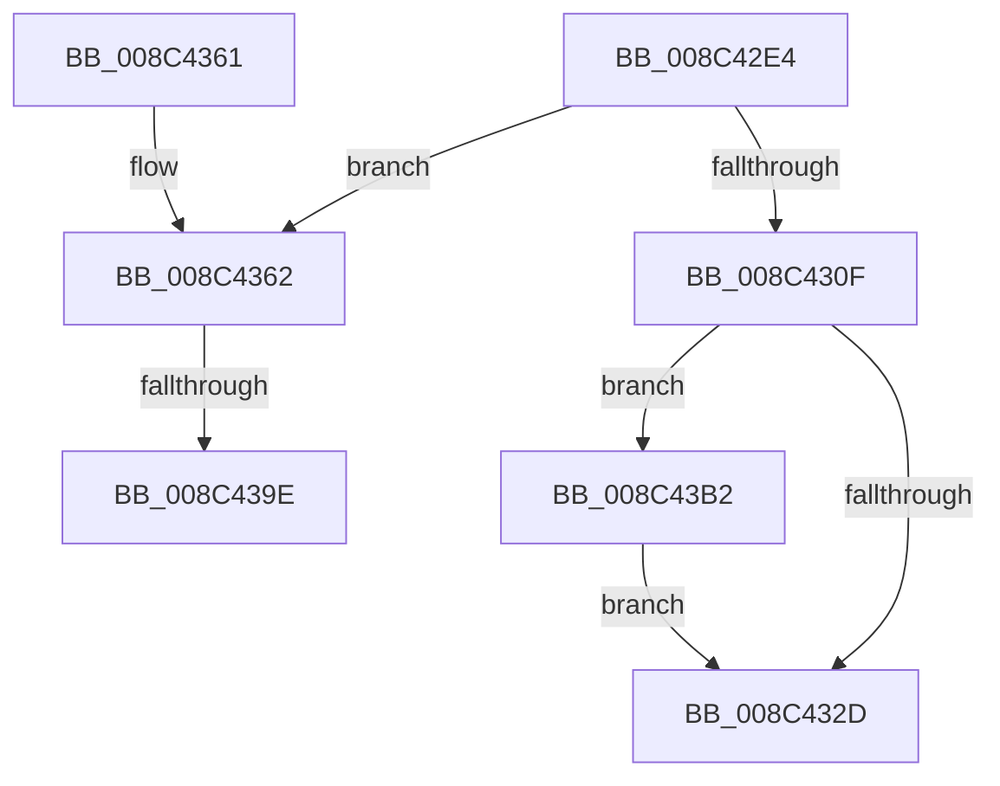

# EtwpFreeGuidEntry

- RVA: `0x008C42E4`–`0x008C43BE` (길이 `218` bytes)
- VA: `0x00000001408C42E4`
- 실행 섹션: `PAGE`
- PDB 이름 있음: `예`; PDB Function 태그: `예`
- unwind 정보 RVA: `0x00083990`
- 디코드: `52`개 명령, `218/218` bytes 표시
- 미해석 바이트: `0` (있으면 어셈블리에 `.byte`로 보존)

> 이 문서는 커널 이미지의 기계어와 PDB 기호를 분석해 생성했습니다. 4번과 5번은 함수 원형과 자료형을 바이너리 사용 방식에서 추정한 C 해석이며 원본 소스 복구 결과는 아닙니다.

## 1. Dependencies

- 직접 호출 지점: **5**; 고유 호출 대상: **4**
- 직접 호출자로 확인된 함수: **3**
- RIP 상대 이미지 참조: **0**

### Outgoing calls
- `0x008C4318` → [ObDereferenceSecurityDescriptor](../87/ObDereferenceSecurityDescriptor_function_008740A0.md) (function, `0x008740A0`)
- `0x008C4341` → [ExFreePoolWithTag](../../poolcode/B8/ExFreePoolWithTag_function_00B82870.md) (function, `0x00B82870`)
- `0x008C438A` → [KeAbPreAcquire](../../text/21/KeAbPreAcquire_function_00210230.md) (function, `0x00210230`)
- `0x008C43A7` → [ExfAcquirePushLockExclusiveEx](../../text/20/ExfAcquirePushLockExclusiveEx_function_0020FC90.md) (function, `0x0020FC90`)
- `0x008C43B4` → [ExFreePoolWithTag](../../poolcode/B8/ExFreePoolWithTag_function_00B82870.md) (function, `0x00B82870`)

### Direct callers
- [sub_008BFE0A](../8B/Unknown_function_008BFE0A.md) at `0x008BFE4D`
- [sub_008BFE54](../8B/Unknown_function_008BFE54.md) at `0x008BFF0D`
- [sub_008C33F4](Unknown_function_008C33F4.md) at `0x008C3432`

### Static image references
- 디코드된 RIP-relative 메모리 참조가 없습니다.

## 2. Other-region calls and transfers

- 다른 실행 섹션으로 향하는 call: **4**
  - `0x008C4341` → [ExFreePoolWithTag](../../poolcode/B8/ExFreePoolWithTag_function_00B82870.md) (`PAGE` → `POOLCODE`)
  - `0x008C438A` → [KeAbPreAcquire](../../text/21/KeAbPreAcquire_function_00210230.md) (`PAGE` → `.text`)
  - `0x008C43A7` → [ExfAcquirePushLockExclusiveEx](../../text/20/ExfAcquirePushLockExclusiveEx_function_0020FC90.md) (`PAGE` → `.text`)
  - `0x008C43B4` → [ExFreePoolWithTag](../../poolcode/B8/ExFreePoolWithTag_function_00B82870.md) (`PAGE` → `POOLCODE`)
- call이 아닌 외부 분기/꼬리 이동: **2**
  - `0x008C4398` → [sub_00B1AFDA](../B1/Unknown_function_00B1AFDA.md) (`tail-transfer`)
  - `0x008C43AD` → [sub_00B1AFDA](../B1/Unknown_function_00B1AFDA.md) (`tail-transfer`)

## 3. Assembly (complete function range)

```asm
008C42E4  48 8B C4                        mov rax, rsp
008C42E7  48 89 58 08                     mov qword ptr [rax + 8], rbx
008C42EB  48 89 68 10                     mov qword ptr [rax + 0x10], rbp
008C42EF  48 89 70 18                     mov qword ptr [rax + 0x18], rsi
008C42F3  48 89 78 20                     mov qword ptr [rax + 0x20], rdi
008C42F7  41 56                           push r14
008C42F9  48 83 EC 20                     sub rsp, 0x20
008C42FD  41 83 CE FF                     or r14d, 0xffffffff
008C4301  33 ED                           xor ebp, ebp
008C4303  48 8B D9                        mov rbx, rcx
008C4306  48 39 A9 90 02 00 00            cmp qword ptr [rcx + 0x290], rbp
008C430D  75 53                           jne 0x1408c4362
008C430F  48 8B 4B 48                     mov rcx, qword ptr [rbx + 0x48]
008C4313  BA 01 00 00 00                  mov edx, 1
008C4318  E8 83 FD FA FF                  call 0x1408740a0
008C431D  48 8B 8B 80 02 00 00            mov rcx, qword ptr [rbx + 0x280]
008C4324  48 85 C9                        test rcx, rcx
008C4327  0F 85 85 00 00 00               jne 0x1408c43b2
008C432D  48 8B 83 88 02 00 00            mov rax, qword ptr [rbx + 0x288]
008C4334  F0 44 01 B0 28 11 00 00         lock add dword ptr [rax + 0x1128], r14d
008C433C  33 D2                           xor edx, edx
008C433E  48 8B CB                        mov rcx, rbx
008C4341  E8 2A E5 2B 00                  call 0x140b82870
008C4346  48 8B 5C 24 30                  mov rbx, qword ptr [rsp + 0x30]
008C434B  48 8B 6C 24 38                  mov rbp, qword ptr [rsp + 0x38]
008C4350  48 8B 74 24 40                  mov rsi, qword ptr [rsp + 0x40]
008C4355  48 8B 7C 24 48                  mov rdi, qword ptr [rsp + 0x48]
008C435A  48 83 C4 20                     add rsp, 0x20
008C435E  41 5E                           pop r14
008C4360  C3                              ret
008C4361  CC                              int3
008C4362  65 48 8B 04 25 88 01 00 00      mov rax, qword ptr gs:[0x188]
008C436B  45 33 C0                        xor r8d, r8d
008C436E  33 D2                           xor edx, edx
008C4370  66 44 01 B0 E4 01 00 00         add word ptr [rax + 0x1e4], r14w
008C4378  90                              nop
008C4379  48 8B B9 90 02 00 00            mov rdi, qword ptr [rcx + 0x290]
008C4380  48 81 C7 98 02 00 00            add rdi, 0x298
008C4387  48 8B CF                        mov rcx, rdi
008C438A  E8 A1 BE 94 FF                  call 0x140210230
008C438F  F0 48 0F BA 2F 00               lock bts qword ptr [rdi], 0
008C4395  48 8B F0                        mov rsi, rax
008C4398  0F 83 3C 6C 25 00               jae 0x140b1afda
008C439E  4C 8B C7                        mov r8, rdi
008C43A1  48 8B D0                        mov rdx, rax
008C43A4  48 8B CF                        mov rcx, rdi
008C43A7  E8 E4 B8 94 FF                  call 0x14020fc90
008C43AC  90                              nop
008C43AD  E9 28 6C 25 00                  jmp 0x140b1afda
008C43B2  33 D2                           xor edx, edx
008C43B4  E8 B7 E4 2B 00                  call 0x140b82870
008C43B9  E9 6F FF FF FF                  jmp 0x1408c432d
```

## 4. C-style interpretation (structured pseudocode)

```c
__int64 __fastcall EtwpFreeGuidEntry(__int64 a1, __int64 a2, int a3)
{
    __int64 result;
    __int64 v_r14;
    __int64 v_rbp;
    __int64 v_rdi;
    __int64 v_rsp;
    unsigned __int64 v_stack_p10;
    unsigned __int64 v_stack_p18;
    unsigned __int64 v_stack_p20;
    unsigned __int64 v_stack_p8;

    *(unsigned __int64 *)(v_rsp + 8) = v_rbx;
    *(unsigned __int64 *)(v_rsp + 16) = v_rbp;
    *(unsigned __int64 *)(v_rsp + 24) = v_rsi;
    *(unsigned __int64 *)(v_rsp + 32) = v_rdi;
    v_rsp = (v_rsp) - (32);
    v_r14 = (unsigned int)((v_r14) | (0xFFFFFFFFULL));
    v_rbp = 0;
    if ((*(unsigned __int64 *)(a1 + 656)) != 0) goto loc_008C4362;
    result = ObDereferenceSecurityDescriptor(*(unsigned __int64 *)(a1 + 72), 1, a3, a4);
    if (*(unsigned __int64 *)(a1 + 640) != 0) goto loc_008C43B2;
loc_008C432D:
    a2 = 0;
    result = ExFreePoolWithTag(a1, a2, a3, a4);
    v_rsp = (v_rsp) + (32);
    return result;
loc_008C4362:
    a3 = 0;
    a2 = 0;
    v_rdi = (*(unsigned __int64 *)(a1 + 656)) + (664);
    result = KeAbPreAcquire(v_rdi, a2, a3, a4);
    result = ExfAcquirePushLockExclusiveEx(v_rdi, result, v_rdi, a4);
loc_008C43B2:
    a2 = 0;
    result = ExFreePoolWithTag(v_rdi, a2, v_rdi, a4);
    goto loc_008C432D;
}
```

## 5. (Beta) C Style

```c
int64_t EtwpFreeGuidEntry(void *Arg1, int64_t Arg2, int32_t Arg3)
{
    uint8_t *arg1 = (uint8_t *)Arg1;

    int64_t result;
    int64_t local_r14;
    int64_t local_rbp;
    int64_t local_rdi;
    int64_t local_rsp;
    uint64_t v_stack_p10;
    uint64_t v_stack_p18;
    uint64_t v_stack_p20;
    uint64_t v_stack_p8;

    *(uint64_t *)(local_rsp + 0x8) = local_rbx;
    *(uint64_t *)(local_rsp + 0x10) = local_rbp;
    *(uint64_t *)(local_rsp + 0x18) = local_rsi;
    *(uint64_t *)(local_rsp + 0x20) = local_rdi;
    local_rsp = (local_rsp) - (32);
    local_r14 = (uint32_t)((local_r14) | (0xFFFFFFFFULL));
    local_rbp = 0;
    if ((*(uint64_t *)(arg1 + 0x290)) != 0) goto loc_008C4362;
    result = ObDereferenceSecurityDescriptor(*(uint64_t *)(arg1 + 0x48), 1, Arg3, a4);
    if (*(uint64_t *)(arg1 + 0x280) != 0) goto loc_008C43B2;
loc_008C432D:
    Arg2 = 0;
    result = ExFreePoolWithTag(Arg1, Arg2, Arg3, a4);
    local_rsp = (local_rsp) + (32);
    return result;
loc_008C4362:
    Arg3 = 0;
    Arg2 = 0;
    local_rdi = (*(uint64_t *)(arg1 + 0x290)) + (664);
    result = KeAbPreAcquire(local_rdi, Arg2, Arg3, a4);
    result = ExfAcquirePushLockExclusiveEx(local_rdi, result, local_rdi, a4);
loc_008C43B2:
    Arg2 = 0;
    result = ExFreePoolWithTag(local_rdi, Arg2, local_rdi, a4);
    goto loc_008C432D;
}
```

### 관측된 메모리 오프셋

구조체 형식이 확인되지 않은 접근은 인자 기준의 오프셋으로만 기록했습니다.

| 기준 인자 | 오프셋 표현 | 폭 (bit) | 접근 |
|---|---:|---:|---|
| `Arg1` | `+ 0x48` | `64` | `R` |
| `Arg1` | `+ 0x280` | `64` | `R` |
| `Arg1` | `+ 0x288` | `64` | `R` |
| `Arg1` | `+ 0x290` | `64` | `R` |

## 6. Execution-region graph

[열기: 2D/3D 그래프와 함수 탐색 컨트롤 패널](../../../control-panel.html?section=page&rva=0x008C42E4&view=graph)

- 2D 그래프는 위에서 아래로 흐르고, 3D 그래프는 빈 공간을 드래그해 회전합니다. Shift+드래그는 이동, 휠은 확대·축소, 함수 노드 선택은 대상 보고서 이동입니다.

### Static fallback


