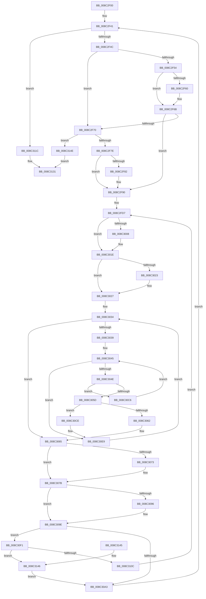

# EtwpGetGuidList

- RVA: `0x008C2F00`–`0x008C3160` (길이 `608` bytes)
- VA: `0x00000001408C2F00`
- 실행 섹션: `PAGE`
- PDB 이름 있음: `예`; PDB Function 태그: `아니요`
- unwind 정보 RVA: `0x0008379C`
- 디코드: `168`개 명령, `608/608` bytes 표시
- 미해석 바이트: `0` (있으면 어셈블리에 `.byte`로 보존)

> 이 문서는 커널 이미지의 기계어와 PDB 기호를 분석해 생성했습니다. 4번과 5번은 함수 원형과 자료형을 바이너리 사용 방식에서 추정한 C 해석이며 원본 소스 복구 결과는 아닙니다.

## 1. Dependencies

- 직접 호출 지점: **8**; 고유 호출 대상: **8**
- 직접 호출자로 확인된 함수: **2**
- RIP 상대 이미지 참조: **2**

### Outgoing calls
- `0x008C2F39` → [EtwpGetNextGuidEntry](EtwpGetNextGuidEntry_function_008C3170.md) (function, `0x008C3170`)
- `0x008C2FF0` → [KeAbPreAcquire](../../text/21/KeAbPreAcquire_function_00210230.md) (function, `0x00210230`)
- `0x008C3013` → [ExfAcquirePushLockSharedEx](../../text/21/ExfAcquirePushLockSharedEx_function_0021044C.md) (function, `0x0021044C`)
- `0x008C3076` → [ExfReleasePushLockShared](../../text/26/ExfReleasePushLockShared_function_00263440.md) (function, `0x00263440`)
- `0x008C307E` → [KeAbPostRelease](../../text/2E/KeAbPostRelease_function_002E1600.md) (function, `0x002E1600`)
- `0x008C308C` → [KeLeaveCriticalRegionThread](../../text/25/KeLeaveCriticalRegionThread_function_0025EFF0.md) (function, `0x0025EFF0`)
- `0x008C3099` → [EtwpUnreferenceGuidEntry](EtwpUnreferenceGuidEntry_function_008C3320.md) (function, `0x008C3320`)
- `0x008C30E3` → [KeBugCheckEx](../../text/4F/KeBugCheckEx_function_004FD660.md) (function, `0x004FD660`)

### Direct callers
- [EtwpGetTraceGuidList](../A5/EtwpGetTraceGuidList_function_00A5FEC4.md) at `0x00A5FEF2`
- [NtTraceControl](../A9/NtTraceControl_function_00A9ED40.md) at `0x00A9F4FF`

### Static image references
- `0x008C2F57` → RVA `0x00011380` (`.rdata`; read)
- `0x008C2F64` → RVA `0x00011388` (`.rdata`; read)

## 2. Other-region calls and transfers

- 다른 실행 섹션으로 향하는 call: **6**
  - `0x008C2FF0` → [KeAbPreAcquire](../../text/21/KeAbPreAcquire_function_00210230.md) (`PAGE` → `.text`)
  - `0x008C3013` → [ExfAcquirePushLockSharedEx](../../text/21/ExfAcquirePushLockSharedEx_function_0021044C.md) (`PAGE` → `.text`)
  - `0x008C3076` → [ExfReleasePushLockShared](../../text/26/ExfReleasePushLockShared_function_00263440.md) (`PAGE` → `.text`)
  - `0x008C307E` → [KeAbPostRelease](../../text/2E/KeAbPostRelease_function_002E1600.md) (`PAGE` → `.text`)
  - `0x008C308C` → [KeLeaveCriticalRegionThread](../../text/25/KeLeaveCriticalRegionThread_function_0025EFF0.md) (`PAGE` → `.text`)
  - `0x008C30E3` → [KeBugCheckEx](../../text/4F/KeBugCheckEx_function_004FD660.md) (`PAGE` → `.text`)
- 별도 외부 분기/꼬리 이동을 확인하지 못했습니다.

## 3. Assembly (complete function range)

```asm
008C2F00  44 89 4C 24 20                  mov dword ptr [rsp + 0x20], r9d
008C2F05  4C 89 44 24 18                  mov qword ptr [rsp + 0x18], r8
008C2F0A  89 54 24 10                     mov dword ptr [rsp + 0x10], edx
008C2F0E  48 89 4C 24 08                  mov qword ptr [rsp + 8], rcx
008C2F13  53                              push rbx
008C2F14  55                              push rbp
008C2F15  56                              push rsi
008C2F16  57                              push rdi
008C2F17  41 54                           push r12
008C2F19  41 55                           push r13
008C2F1B  41 56                           push r14
008C2F1D  41 57                           push r15
008C2F1F  48 83 EC 48                     sub rsp, 0x48
008C2F23  49 8B E8                        mov rbp, r8
008C2F26  8B DA                           mov ebx, edx
008C2F28  44 8B C2                        mov r8d, edx
008C2F2B  45 33 F6                        xor r14d, r14d
008C2F2E  33 D2                           xor edx, edx
008C2F30  41 8B F1                        mov esi, r9d
008C2F33  4C 8B E1                        mov r12, rcx
008C2F36  41 8B FE                        mov edi, r14d
008C2F39  E8 32 02 00 00                  call 0x1408c3170
008C2F3E  4C 8B E8                        mov r13, rax
008C2F41  8B D7                           mov edx, edi
008C2F43  4D 85 ED                        test r13, r13
008C2F46  0F 84 D0 01 00 00               je 0x1408c311c
008C2F4C  49 8D 4D 28                     lea rcx, [r13 + 0x28]
008C2F50  85 DB                           test ebx, ebx
008C2F52  75 1C                           jne 0x1408c2f70
008C2F54  48 8B 01                        mov rax, qword ptr [rcx]
008C2F57  48 2B 05 22 E4 74 FF            sub rax, qword ptr [rip - 0x8b1bde]
008C2F5E  75 0B                           jne 0x1408c2f6b
008C2F60  48 8B 41 08                     mov rax, qword ptr [rcx + 8]
008C2F64  48 2B 05 1D E4 74 FF            sub rax, qword ptr [rip - 0x8b1be3]
008C2F6B  48 85 C0                        test rax, rax
008C2F6E  74 20                           je 0x1408c2f90
008C2F70  FF C7                           inc edi
008C2F72  81 FF FF FF FF 0F               cmp edi, 0xfffffff
008C2F78  0F 87 D0 01 00 00               ja 0x1408c314e
008C2F7E  3B FE                           cmp edi, esi
008C2F80  77 0E                           ja 0x1408c2f90
008C2F82  0F 10 01                        movups xmm0, xmmword ptr [rcx]
008C2F85  48 8B C2                        mov rax, rdx
008C2F88  48 03 C0                        add rax, rax
008C2F8B  0F 11 44 C5 00                  movups xmmword ptr [rbp + rax*8], xmm0
008C2F90  8B 41 08                        mov eax, dword ptr [rcx + 8]
008C2F93  4D 8D 84 24 D0 02 00 00         lea r8, [r12 + 0x2d0]
008C2F9B  8B 51 0C                        mov edx, dword ptr [rcx + 0xc]
008C2F9E  49 8B F5                        mov rsi, r13
008C2FA1  48 33 D0                        xor rdx, rax
008C2FA4  45 32 FF                        xor r15b, r15b
008C2FA7  8B 41 04                        mov eax, dword ptr [rcx + 4]
008C2FAA  4D 8B EE                        mov r13, r14
008C2FAD  48 33 D0                        xor rdx, rax
008C2FB0  8B 01                           mov eax, dword ptr [rcx]
008C2FB2  48 33 D0                        xor rdx, rax
008C2FB5  8B C3                           mov eax, ebx
008C2FB7  83 E2 3F                        and edx, 0x3f
008C2FBA  48 C1 E0 04                     shl rax, 4
008C2FBE  4C 6B E2 38                     imul r12, rdx, 0x38
008C2FC2  4D 03 E0                        add r12, r8
008C2FC5  4E 8D 34 20                     lea r14, [rax + r12]
008C2FC9  48 83 C0 D0                     add rax, -0x30
008C2FCD  48 89 44 24 30                  mov qword ptr [rsp + 0x30], rax
008C2FD2  49 8D 6C 24 30                  lea rbp, [r12 + 0x30]
008C2FD7  65 48 8B 04 25 88 01 00 00      mov rax, qword ptr gs:[0x188]
008C2FE0  45 33 C0                        xor r8d, r8d
008C2FE3  33 D2                           xor edx, edx
008C2FE5  48 8B CD                        mov rcx, rbp
008C2FE8  66 FF 88 E4 01 00 00            dec word ptr [rax + 0x1e4]
008C2FEF  90                              nop
008C2FF0  E8 3B D2 94 FF                  call 0x140210230
008C2FF5  48 8B D8                        mov rbx, rax
008C2FF8  41 B9 11 00 00 00               mov r9d, 0x11
008C2FFE  33 C0                           xor eax, eax
008C3000  F0 4C 0F B1 4D 00               lock cmpxchg qword ptr [rbp], r9
008C3006  74 16                           je 0x1408c301e
008C3008  4C 8B CD                        mov r9, rbp
008C300B  4C 8B C3                        mov r8, rbx
008C300E  33 D2                           xor edx, edx
008C3010  48 8B CD                        mov rcx, rbp
008C3013  E8 34 D4 94 FF                  call 0x14021044c
008C3018  41 B9 11 00 00 00               mov r9d, 0x11
008C301E  48 85 DB                        test rbx, rbx
008C3021  74 04                           je 0x1408c3027
008C3023  C6 43 0A 01                     mov byte ptr [rbx + 0xa], 1
008C3027  48 85 F6                        test rsi, rsi
008C302A  49 8B C6                        mov rax, r14
008C302D  48 0F 45 C6                     cmovne rax, rsi
008C3031  4C 8B 00                        mov r8, qword ptr [rax]
008C3034  4D 3B C6                        cmp r8, r14
008C3037  74 2C                           je 0x1408c3065
008C3039  4D 8B E8                        mov r13, r8
008C303C  41 0F 0D 48 20                  prefetchw byte ptr [r8 + 0x20]
008C3041  49 8B 50 20                     mov rdx, qword ptr [r8 + 0x20]
008C3045  48 85 D2                        test rdx, rdx
008C3048  0F 84 9B 00 00 00               je 0x1408c30e9
008C304E  48 8D 4A 01                     lea rcx, [rdx + 1]
008C3052  48 8B C2                        mov rax, rdx
008C3055  F0 49 0F B1 48 20               lock cmpxchg qword ptr [r8 + 0x20], rcx
008C305B  75 69                           jne 0x1408c30c6
008C305D  48 85 D2                        test rdx, rdx
008C3060  78 6C                           js 0x1408c30ce
008C3062  41 B7 01                        mov r15b, 1
008C3065  49 8B C1                        mov rax, r9
008C3068  45 33 F6                        xor r14d, r14d
008C306B  F0 4C 0F B1 75 00               lock cmpxchg qword ptr [rbp], r14
008C3071  74 08                           je 0x1408c307b
008C3073  48 8B CD                        mov rcx, rbp
008C3076  E8 C5 03 9A FF                  call 0x140263440
008C307B  48 8B CD                        mov rcx, rbp
008C307E  E8 7D E5 A1 FF                  call 0x1402e1600
008C3083  65 48 8B 0C 25 88 01 00 00      mov rcx, qword ptr gs:[0x188]
008C308C  E8 5F BF 99 FF                  call 0x14025eff0
008C3091  48 85 F6                        test rsi, rsi
008C3094  74 08                           je 0x1408c309e
008C3096  48 8B CE                        mov rcx, rsi
008C3099  E8 82 02 00 00                  call 0x1408c3320
008C309E  45 84 FF                        test r15b, r15b
008C30A1  74 4E                           je 0x1408c30f1
008C30A3  8B 9C 24 98 00 00 00            mov ebx, dword ptr [rsp + 0x98]
008C30AA  8B B4 24 A8 00 00 00            mov esi, dword ptr [rsp + 0xa8]
008C30B1  48 8B AC 24 A0 00 00 00         mov rbp, qword ptr [rsp + 0xa0]
008C30B9  4C 8B A4 24 90 00 00 00         mov r12, qword ptr [rsp + 0x90]
008C30C1  E9 7B FE FF FF                  jmp 0x1408c2f41
008C30C6  48 8B D0                        mov rdx, rax
008C30C9  E9 77 FF FF FF                  jmp 0x1408c3045
008C30CE  45 33 C9                        xor r9d, r9d
008C30D1  48 C7 44 24 20 00 00 00 00      mov qword ptr [rsp + 0x20], 0
008C30DA  B9 1D 01 00 00                  mov ecx, 0x11d
008C30DF  41 8D 51 09                     lea edx, [r9 + 9]
008C30E3  E8 78 A5 C3 FF                  call 0x1404fd660
008C30E8  CC                              int3
008C30E9  4D 8B 00                        mov r8, qword ptr [r8]
008C30EC  E9 43 FF FF FF                  jmp 0x1408c3034
008C30F1  48 8B 84 24 90 00 00 00         mov rax, qword ptr [rsp + 0x90]
008C30F9  49 83 C4 38                     add r12, 0x38
008C30FD  48 05 D0 10 00 00               add rax, 0x10d0
008C3103  48 83 C5 38                     add rbp, 0x38
008C3107  4C 3B E0                        cmp r12, rax
008C310A  74 3A                           je 0x1408c3146
008C310C  49 8B F6                        mov rsi, r14
008C310F  4C 8B 74 24 30                  mov r14, qword ptr [rsp + 0x30]
008C3114  4C 03 F5                        add r14, rbp
008C3117  E9 BB FE FF FF                  jmp 0x1408c2fd7
008C311C  48 8B 84 24 B0 00 00 00         mov rax, qword ptr [rsp + 0xb0]
008C3124  3B FE                           cmp edi, esi
008C3126  89 38                           mov dword ptr [rax], edi
008C3128  B8 23 00 00 C0                  mov eax, 0xc0000023
008C312D  44 0F 47 F0                     cmova r14d, eax
008C3131  41 8B C6                        mov eax, r14d
008C3134  48 83 C4 48                     add rsp, 0x48
008C3138  41 5F                           pop r15
008C313A  41 5E                           pop r14
008C313C  41 5D                           pop r13
008C313E  41 5C                           pop r12
008C3140  5F                              pop rdi
008C3141  5E                              pop rsi
008C3142  5D                              pop rbp
008C3143  5B                              pop rbx
008C3144  C3                              ret
008C3145  CC                              int3
008C3146  4D 8B EE                        mov r13, r14
008C3149  E9 55 FF FF FF                  jmp 0x1408c30a3
008C314E  48 8B 84 24 B0 00 00 00         mov rax, qword ptr [rsp + 0xb0]
008C3156  41 BE 05 00 00 80               mov r14d, 0x80000005
008C315C  89 38                           mov dword ptr [rax], edi
008C315E  EB D1                           jmp 0x1408c3131
```

## 4. C-style interpretation (structured pseudocode)

```c
__int64 __fastcall EtwpGetGuidList(__int64 a1, int a2, __int64 a3, int a4, __int64 a5)
{
    __int64 result;
    __int64 v_r12;
    __int64 v_r14;
    __int64 v_r15;
    __int64 v_rbp;
    __int64 v_rdi;
    __int64 v_rsp;
    unsigned __int64 v_stack_m58;
    unsigned __int64 v_stack_m68;
    unsigned int v_stack_p10;
    unsigned __int64 v_stack_p18;
    unsigned int v_stack_p20;
    unsigned __int64 v_stack_p8;

    v_stack_p20 = a4;
    v_stack_p18 = a3;
    v_stack_p10 = a2;
    v_stack_p8 = a1;
    v_rsp = (v_rsp) - (72);
    v_r14 = 0;
    a2 = 0;
    result = EtwpGetNextGuidEntry(a1, a2, (unsigned int)(a2), a4);
loc_008C2F41:
    if (result == 0) goto loc_008C311C;
    if ((unsigned int)((unsigned int)(a2)) != 0) goto loc_008C2F70;
    result = (*(unsigned __int64 *)(result + 40)) - (*(unsigned __int64 *)(v_rip - 9116638));
    if (!(condition_is_not_equal)) {
        result = *(unsigned __int64 *)(result + 40 + 8);
        result = (result) - (*(unsigned __int64 *)(v_rip - 9116643));
    }
    if (result == 0) goto loc_008C2F90;
loc_008C2F70:
    v_rdi = (unsigned int)((0) + 1);
    if (((unsigned int)(v_rdi)) > 0xFFFFFFFULL) goto loc_008C314E;
    if (((unsigned int)(v_rdi)) <= ((unsigned int)((unsigned int)(a4)))) {
        result = 0;
        result = (result) + (result);
        *(unsigned __int64 *)(a3 + result * 8) = v_xmm0;
    }
    a2 = ((unsigned int)(*(unsigned int *)(result + 40 + 12))) ^ ((unsigned int)(*(unsigned int *)(result + 40 + 8)));
    v_r15 = 0;
    a2 = (a2) ^ ((unsigned int)(*(unsigned int *)(result + 40 + 4)));
    a2 = (a2) ^ ((unsigned int)(*(unsigned int *)(result + 40)));
    a2 = (unsigned int)((a2) & (63));
    result = ((unsigned int)((unsigned int)((unsigned int)(a2)))) << (4);
    v_r12 = (a1) * (a2);
    v_r12 = (v_r12) + (a1 + 720);
    result = (result) + (-48);
    v_stack_m58 = result;
loc_008C2FD7:
    a3 = 0;
    a2 = 0;
    result = KeAbPreAcquire(v_r12 + 48, a2, a3, a4);
    result = 0;
    if (!(condition_is_equal)) {
        a4 = v_r12 + 48;
        a3 = 0;
        a2 = 0;
        a1 = v_r12 + 48;
        result = ExfAcquirePushLockSharedEx(a1, a2, a3, a4);
        a4 = 17;
    }
    if (result != 0) {
        *(unsigned __int8 *)(result + 10) = 1;
    }
    result = result + v_r12 * 1;
    if (result != 0) { result = result; }
loc_008C3034:
    if ((*(unsigned __int64 *)(result)) == (result + v_r12 * 1)) goto loc_008C3065;
loc_008C3045:
    if (*(unsigned __int64 *)(*(unsigned __int64 *)(result) + 32) == 0) goto loc_008C30E9;
    if (*(unsigned __int64 *)(*(unsigned __int64 *)(result) + 32) != 0) goto loc_008C30C6;
    if (sign_flag) goto loc_008C30CE;
loc_008C3065:
    v_r14 = 0;
    result = a4;
    if (!(condition_is_equal)) {
        a1 = v_r12 + 48;
        result = ExfReleasePushLockShared(a1, *(unsigned __int64 *)(*(unsigned __int64 *)(result) + 32), *(unsigned __int64 *)(result), a4);
    }
    result = KeAbPostRelease(v_r12 + 48, *(unsigned __int64 *)(*(unsigned __int64 *)(result) + 32), *(unsigned __int64 *)(result), a4);
    result = KeLeaveCriticalRegionThread(*(unsigned __int64 *)(gs_base + (0 + 392)), *(unsigned __int64 *)(*(unsigned __int64 *)(result) + 32), *(unsigned __int64 *)(result), a4);
    if (result != 0) {
        a1 = result;
        result = EtwpUnreferenceGuidEntry(a1, *(unsigned __int64 *)(*(unsigned __int64 *)(result) + 32), *(unsigned __int64 *)(result), a4);
    }
    if (1 == 0) goto loc_008C30F1;
loc_008C30A3:
    goto loc_008C2F41;
loc_008C30C6:
    goto loc_008C3045;
loc_008C30CE:
    a4 = 0;
    v_stack_m68 = 0;
    result = KeBugCheckEx(285, a4 + 9, *(unsigned __int64 *)(result), a4);
loc_008C30E9:
    goto loc_008C3034;
loc_008C30F1:
    v_r12 = (v_stack_p8) + (56);
    result = (v_stack_p8) + (0x10D0ULL);
    v_rbp = (v_stack_p18) + (56);
    if (v_r12 == result) goto loc_008C3146;
    v_r14 = (v_stack_m58) + (v_rbp);
    goto loc_008C2FD7;
loc_008C311C:
    *(unsigned int *)(a5) = (unsigned int)(v_rdi);
    if (((unsigned int)(v_rdi)) > 0) { v_r14 = (unsigned int)((unsigned int)(0xC0000023ULL)); }
loc_008C3131:
    v_rsp = (v_rsp) + (72);
    return (unsigned int)((unsigned int)(v_r14));
loc_008C3146:
    goto loc_008C30A3;
loc_008C314E:
    *(unsigned int *)(a5) = (unsigned int)(v_rdi);
    goto loc_008C3131;
}
```

## 5. (Beta) C Style

```c
int64_t EtwpGetGuidList(int64_t Arg1, int32_t Arg2, int64_t Arg3, int32_t Arg4, void *Arg5)
{
    uint8_t *arg5 = (uint8_t *)Arg5;

    int64_t result;
    int64_t local_r12;
    int64_t local_r14;
    int64_t local_r15;
    int64_t local_rbp;
    int64_t local_rdi;
    int64_t local_rsp;
    uint64_t v_stack_m58;
    uint64_t v_stack_m68;
    uint32_t v_stack_p10;
    uint64_t v_stack_p18;
    uint32_t v_stack_p20;
    uint64_t v_stack_p8;

    v_stack_p20 = Arg4;
    v_stack_p18 = Arg3;
    v_stack_p10 = Arg2;
    v_stack_p8 = Arg1;
    local_rsp = (local_rsp) - (72);
    local_r14 = 0;
    Arg2 = 0;
    result = EtwpGetNextGuidEntry(Arg1, Arg2, (uint32_t)(Arg2), Arg4);
loc_008C2F41:
    if (result == 0) goto loc_008C311C;
    if ((uint32_t)((uint32_t)(Arg2)) != 0) goto loc_008C2F70;
    result = (*(uint64_t *)(result + 0x28)) - (*(uint64_t *)(v_rip - 0x8B1BDE));
    if (!(condition_is_not_equal)) {
        result = *(uint64_t *)(result + 0x28 + 0x8);
        result = (result) - (*(uint64_t *)(v_rip - 0x8B1BE3));
    }
    if (result == 0) goto loc_008C2F90;
loc_008C2F70:
    local_rdi = (uint32_t)((0) + 1);
    if (((uint32_t)(local_rdi)) > 0xFFFFFFFULL) goto loc_008C314E;
    if (((uint32_t)(local_rdi)) <= ((uint32_t)((uint32_t)(Arg4)))) {
        result = 0;
        result = (result) + (result);
        *(uint64_t *)(Arg3 + result * 8) = v_xmm0;
    }
    Arg2 = ((uint32_t)(*(uint32_t *)(result + 0x28 + 0xC))) ^ ((uint32_t)(*(uint32_t *)(result + 0x28 + 0x8)));
    local_r15 = 0;
    Arg2 = (Arg2) ^ ((uint32_t)(*(uint32_t *)(result + 0x28 + 0x4)));
    Arg2 = (Arg2) ^ ((uint32_t)(*(uint32_t *)(result + 0x28)));
    Arg2 = (uint32_t)((Arg2) & (63));
    result = ((uint32_t)((uint32_t)((uint32_t)(Arg2)))) << (4);
    local_r12 = (Arg1) * (Arg2);
    local_r12 = (local_r12) + (Arg1 + 720);
    result = (result) + (-48);
    v_stack_m58 = result;
loc_008C2FD7:
    Arg3 = 0;
    Arg2 = 0;
    result = KeAbPreAcquire(local_r12 + 48, Arg2, Arg3, Arg4);
    result = 0;
    if (!(condition_is_equal)) {
        Arg4 = local_r12 + 48;
        Arg3 = 0;
        Arg2 = 0;
        Arg1 = local_r12 + 48;
        result = ExfAcquirePushLockSharedEx(Arg1, Arg2, Arg3, Arg4);
        Arg4 = 17;
    }
    if (result != 0) {
        *(uint8_t *)(result + 0xA) = 1;
    }
    result = result + local_r12 * 1;
    if (result != 0) { result = result; }
loc_008C3034:
    if ((*(uint64_t *)(result)) == (result + local_r12 * 1)) goto loc_008C3065;
loc_008C3045:
    if (*(uint64_t *)(*(uint64_t *)(result) + 0x20) == 0) goto loc_008C30E9;
    if (*(uint64_t *)(*(uint64_t *)(result) + 0x20) != 0) goto loc_008C30C6;
    if (sign_flag) goto loc_008C30CE;
loc_008C3065:
    local_r14 = 0;
    result = Arg4;
    if (!(condition_is_equal)) {
        Arg1 = local_r12 + 48;
        result = ExfReleasePushLockShared(Arg1, *(uint64_t *)(*(uint64_t *)(result) + 0x20), *(uint64_t *)(result), Arg4);
    }
    result = KeAbPostRelease(local_r12 + 48, *(uint64_t *)(*(uint64_t *)(result) + 0x20), *(uint64_t *)(result), Arg4);
    result = KeLeaveCriticalRegionThread(*(uint64_t *)(gs_base + (0 + 0x188)), *(uint64_t *)(*(uint64_t *)(result) + 0x20), *(uint64_t *)(result), Arg4);
    if (result != 0) {
        Arg1 = result;
        result = EtwpUnreferenceGuidEntry(Arg1, *(uint64_t *)(*(uint64_t *)(result) + 0x20), *(uint64_t *)(result), Arg4);
    }
    if (1 == 0) goto loc_008C30F1;
loc_008C30A3:
    goto loc_008C2F41;
loc_008C30C6:
    goto loc_008C3045;
loc_008C30CE:
    Arg4 = 0;
    v_stack_m68 = 0;
    result = KeBugCheckEx(285, Arg4 + 9, *(uint64_t *)(result), Arg4);
loc_008C30E9:
    goto loc_008C3034;
loc_008C30F1:
    local_r12 = (v_stack_p8) + (56);
    result = (v_stack_p8) + (0x10D0ULL);
    local_rbp = (v_stack_p18) + (56);
    if (local_r12 == result) goto loc_008C3146;
    local_r14 = (v_stack_m58) + (local_rbp);
    goto loc_008C2FD7;
loc_008C311C:
    *(uint32_t *)(arg5) = (uint32_t)(local_rdi);
    if (((uint32_t)(local_rdi)) > 0) { local_r14 = (uint32_t)((uint32_t)(0xC0000023ULL)); }
loc_008C3131:
    local_rsp = (local_rsp) + (72);
    return (uint32_t)((uint32_t)(local_r14));
loc_008C3146:
    goto loc_008C30A3;
loc_008C314E:
    *(uint32_t *)(arg5) = (uint32_t)(local_rdi);
    goto loc_008C3131;
}
```

### 관측된 메모리 오프셋

구조체 형식이 확인되지 않은 접근은 인자 기준의 오프셋으로만 기록했습니다.

| 기준 인자 | 오프셋 표현 | 폭 (bit) | 접근 |
|---|---:|---:|---|
| `Arg5` | `+ 0x0` | `32` | `W` |

## 6. Execution-region graph

[열기: 2D/3D 그래프와 함수 탐색 컨트롤 패널](../../../control-panel.html?section=page&rva=0x008C2F00&view=graph)

- 2D 그래프는 위에서 아래로 흐르고, 3D 그래프는 빈 공간을 드래그해 회전합니다. Shift+드래그는 이동, 휠은 확대·축소, 함수 노드 선택은 대상 보고서 이동입니다.

### Static fallback


