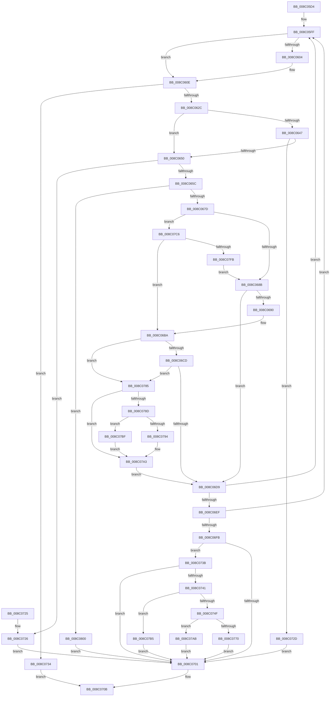

# EtwpGetGuidSecurityDescriptor

- RVA: `0x008C05D4`–`0x008C080A` (길이 `566` bytes)
- VA: `0x00000001408C05D4`
- 실행 섹션: `PAGE`
- PDB 이름 있음: `예`; PDB Function 태그: `아니요`
- unwind 정보 RVA: `0x00083480`
- 디코드: `150`개 명령, `566/566` bytes 표시
- 미해석 바이트: `0` (있으면 어셈블리에 `.byte`로 보존)

> 이 문서는 커널 이미지의 기계어와 PDB 기호를 분석해 생성했습니다. 4번과 5번은 함수 원형과 자료형을 바이너리 사용 방식에서 추정한 C 해석이며 원본 소스 복구 결과는 아닙니다.

## 1. Dependencies

- 직접 호출 지점: **11**; 고유 호출 대상: **5**
- 직접 호출자로 확인된 함수: **3**
- RIP 상대 이미지 참조: **2**

### Outgoing calls
- `0x008C0609` → [ExFreePoolWithTag](../../poolcode/B8/ExFreePoolWithTag_function_00B82870.md) (function, `0x00B82870`)
- `0x008C061B` → [ExAllocatePool2](../../poolcode/B8/ExAllocatePool2_function_00B820F0.md) (function, `0x00B820F0`)
- `0x008C066C` → [ExAllocatePool2](../../poolcode/B8/ExAllocatePool2_function_00B820F0.md) (function, `0x00B820F0`)
- `0x008C06B3` → [ZwQueryValueKey](../../text/6A/ZwQueryValueKey_function_006AD3B0.md) (function, `0x006AD3B0`)
- `0x008C06DE` → [ExFreePoolWithTag](../../poolcode/B8/ExFreePoolWithTag_function_00B82870.md) (function, `0x00B82870`)
- `0x008C0706` → [ExFreePoolWithTag](../../poolcode/B8/ExFreePoolWithTag_function_00B82870.md) (function, `0x00B82870`)
- `0x008C0746` → [SeValidSecurityDescriptor](../8B/SeValidSecurityDescriptor_function_008BED60.md) (function, `0x008BED60`)
- `0x008C075E` → [ExAllocatePool2](../../poolcode/B8/ExAllocatePool2_function_00B820F0.md) (function, `0x00B820F0`)
- `0x008C0779` → [memcpy](../../text/6C/memcpy_function_006C6840.md) (function, `0x006C6840`)
- `0x008C079E` → [memcpy](../../text/6C/memcpy_function_006C6840.md) (function, `0x006C6840`)
- `0x008C07E9` → [ZwQueryValueKey](../../text/6A/ZwQueryValueKey_function_006AD3B0.md) (function, `0x006AD3B0`)

### Direct callers
- [EtwpAccessCheckFromState](EtwpAccessCheckFromState_function_008C0350.md) at `0x008C0419`
- [EtwpGetSecurityDescriptorByGuid](EtwpGetSecurityDescriptorByGuid_function_008C04C0.md) at `0x008C0587`
- [EtwpInitializeSecurity](../../init/C4/EtwpInitializeSecurity_function_00C4EDF0.md) at `0x00C4EF45`

### Static image references
- `0x008C062C` → RVA `0x00EFF148` (`.data`; read)
- `0x008C063B` → RVA `0x00EFF140` (`.data`; read)

## 2. Other-region calls and transfers

- 다른 실행 섹션으로 향하는 call: **10**
  - `0x008C0609` → [ExFreePoolWithTag](../../poolcode/B8/ExFreePoolWithTag_function_00B82870.md) (`PAGE` → `POOLCODE`)
  - `0x008C061B` → [ExAllocatePool2](../../poolcode/B8/ExAllocatePool2_function_00B820F0.md) (`PAGE` → `POOLCODE`)
  - `0x008C066C` → [ExAllocatePool2](../../poolcode/B8/ExAllocatePool2_function_00B820F0.md) (`PAGE` → `POOLCODE`)
  - `0x008C06B3` → [ZwQueryValueKey](../../text/6A/ZwQueryValueKey_function_006AD3B0.md) (`PAGE` → `.text`)
  - `0x008C06DE` → [ExFreePoolWithTag](../../poolcode/B8/ExFreePoolWithTag_function_00B82870.md) (`PAGE` → `POOLCODE`)
  - `0x008C0706` → [ExFreePoolWithTag](../../poolcode/B8/ExFreePoolWithTag_function_00B82870.md) (`PAGE` → `POOLCODE`)
  - `0x008C075E` → [ExAllocatePool2](../../poolcode/B8/ExAllocatePool2_function_00B820F0.md) (`PAGE` → `POOLCODE`)
  - `0x008C0779` → [memcpy](../../text/6C/memcpy_function_006C6840.md) (`PAGE` → `.text`)
  - `0x008C079E` → [memcpy](../../text/6C/memcpy_function_006C6840.md) (`PAGE` → `.text`)
  - `0x008C07E9` → [ZwQueryValueKey](../../text/6A/ZwQueryValueKey_function_006AD3B0.md) (`PAGE` → `.text`)
- 별도 외부 분기/꼬리 이동을 확인하지 못했습니다.

## 3. Assembly (complete function range)

```asm
008C05D4  48 89 5C 24 20                  mov qword ptr [rsp + 0x20], rbx
008C05D9  48 89 54 24 10                  mov qword ptr [rsp + 0x10], rdx
008C05DE  48 89 4C 24 08                  mov qword ptr [rsp + 8], rcx
008C05E3  55                              push rbp
008C05E4  56                              push rsi
008C05E5  57                              push rdi
008C05E6  41 54                           push r12
008C05E8  41 55                           push r13
008C05EA  41 56                           push r14
008C05EC  41 57                           push r15
008C05EE  48 83 EC 30                     sub rsp, 0x30
008C05F2  33 ED                           xor ebp, ebp
008C05F4  45 33 F6                        xor r14d, r14d
008C05F7  48 21 2A                        and qword ptr [rdx], rbp
008C05FA  BE 00 02 00 00                  mov esi, 0x200
008C05FF  48 85 ED                        test rbp, rbp
008C0602  74 0A                           je 0x1408c060e
008C0604  33 D2                           xor edx, edx
008C0606  48 8B CD                        mov rcx, rbp
008C0609  E8 62 22 2C 00                  call 0x140b82870
008C060E  8B D6                           mov edx, esi
008C0610  B9 00 01 00 00                  mov ecx, 0x100
008C0615  41 B8 45 74 77 50               mov r8d, 0x50777445
008C061B  E8 D0 1A 2C 00                  call 0x140b820f0
008C0620  48 8B E8                        mov rbp, rax
008C0623  48 85 C0                        test rax, rax
008C0626  0F 84 08 01 00 00               je 0x1408c0734
008C062C  4C 8B 3D 15 EB 63 00            mov r15, qword ptr [rip + 0x63eb15]
008C0633  83 A4 24 80 00 00 00 00         and dword ptr [rsp + 0x80], 0
008C063B  4C 8B 25 FE EA 63 00            mov r12, qword ptr [rip + 0x63eafe]
008C0642  4D 85 FF                        test r15, r15
008C0645  75 09                           jne 0x1408c0650
008C0647  4D 85 E4                        test r12, r12
008C064A  0F 84 DD 00 00 00               je 0x1408c072d
008C0650  8D 46 10                        lea eax, [rsi + 0x10]
008C0653  83 F8 10                        cmp eax, 0x10
008C0656  0F 82 CA 00 00 00               jb 0x1408c0726
008C065C  8B D0                           mov edx, eax
008C065E  B9 00 01 00 00                  mov ecx, 0x100
008C0663  41 B8 72 74 6C 6D               mov r8d, 0x6d6c7472
008C0669  44 8B E8                        mov r13d, eax
008C066C  E8 7F 1A 2C 00                  call 0x140b820f0
008C0671  48 8B D8                        mov rbx, rax
008C0674  48 85 C0                        test rax, rax
008C0677  0F 84 83 01 00 00               je 0x1408c0800
008C067D  BF 34 00 00 C0                  mov edi, 0xc0000034
008C0682  4D 85 FF                        test r15, r15
008C0685  0F 85 3B 01 00 00               jne 0x1408c07c6
008C068B  4D 85 E4                        test r12, r12
008C068E  74 49                           je 0x1408c06d9
008C0690  48 8B 54 24 70                  mov rdx, qword ptr [rsp + 0x70]
008C0695  48 8D 84 24 80 00 00 00         lea rax, [rsp + 0x80]
008C069D  48 89 44 24 28                  mov qword ptr [rsp + 0x28], rax
008C06A2  4C 8B CB                        mov r9, rbx
008C06A5  41 B8 02 00 00 00               mov r8d, 2
008C06AB  44 89 6C 24 20                  mov dword ptr [rsp + 0x20], r13d
008C06B0  49 8B CC                        mov rcx, r12
008C06B3  E8 F8 CC DE FF                  call 0x1406ad3b0
008C06B8  8B F8                           mov edi, eax
008C06BA  41 BF 00 00 00 80               mov r15d, 0x80000000
008C06C0  42 8D 04 3F                     lea eax, [rdi + r15]
008C06C4  41 85 C7                        test r15d, eax
008C06C7  0F 85 B8 00 00 00               jne 0x1408c0785
008C06CD  81 FF 05 00 00 80               cmp edi, 0x80000005
008C06D3  0F 84 AC 00 00 00               je 0x1408c0785
008C06D9  33 D2                           xor edx, edx
008C06DB  48 8B CB                        mov rcx, rbx
008C06DE  E8 8D 21 2C 00                  call 0x140b82870
008C06E3  81 FF 05 00 00 80               cmp edi, 0x80000005
008C06E9  0F 84 10 FF FF FF               je 0x1408c05ff
008C06EF  81 FF 23 00 00 C0               cmp edi, 0xc0000023
008C06F5  0F 84 04 FF FF FF               je 0x1408c05ff
008C06FB  8B DF                           mov ebx, edi
008C06FD  85 FF                           test edi, edi
008C06FF  79 3A                           jns 0x1408c073b
008C0701  33 D2                           xor edx, edx
008C0703  48 8B CD                        mov rcx, rbp
008C0706  E8 65 21 2C 00                  call 0x140b82870
008C070B  8B C3                           mov eax, ebx
008C070D  48 8B 9C 24 88 00 00 00         mov rbx, qword ptr [rsp + 0x88]
008C0715  48 83 C4 30                     add rsp, 0x30
008C0719  41 5F                           pop r15
008C071B  41 5E                           pop r14
008C071D  41 5D                           pop r13
008C071F  41 5C                           pop r12
008C0721  5F                              pop rdi
008C0722  5E                              pop rsi
008C0723  5D                              pop rbp
008C0724  C3                              ret
008C0725  CC                              int3
008C0726  BB 95 00 00 C0                  mov ebx, 0xc0000095
008C072B  EB D4                           jmp 0x1408c0701
008C072D  BB 0D 00 00 C0                  mov ebx, 0xc000000d
008C0732  EB CD                           jmp 0x1408c0701
008C0734  BB 9A 00 00 C0                  mov ebx, 0xc000009a
008C0739  EB D0                           jmp 0x1408c070b
008C073B  41 83 FE 03                     cmp r14d, 3
008C073F  75 C0                           jne 0x1408c0701
008C0741  48 8B D5                        mov rdx, rbp
008C0744  8B CE                           mov ecx, esi
008C0746  E8 15 E6 FF FF                  call 0x1408bed60
008C074B  84 C0                           test al, al
008C074D  74 66                           je 0x1408c07b5
008C074F  41 B8 45 74 77 50               mov r8d, 0x50777445
008C0755  8B D6                           mov edx, esi
008C0757  B9 00 01 00 00                  mov ecx, 0x100
008C075C  8B DE                           mov ebx, esi
008C075E  E8 8D 19 2C 00                  call 0x140b820f0
008C0763  48 8B 4C 24 78                  mov rcx, qword ptr [rsp + 0x78]
008C0768  48 89 01                        mov qword ptr [rcx], rax
008C076B  48 85 C0                        test rax, rax
008C076E  74 3B                           je 0x1408c07ab
008C0770  44 8B C3                        mov r8d, ebx
008C0773  48 8B D5                        mov rdx, rbp
008C0776  48 8B C8                        mov rcx, rax
008C0779  E8 C2 60 E0 FF                  call 0x1406c6840
008C077E  8B DF                           mov ebx, edi
008C0780  E9 7C FF FF FF                  jmp 0x1408c0701
008C0785  44 8B 73 04                     mov r14d, dword ptr [rbx + 4]
008C0789  85 FF                           test edi, edi
008C078B  78 16                           js 0x1408c07a3
008C078D  8B 43 08                        mov eax, dword ptr [rbx + 8]
008C0790  3B F0                           cmp esi, eax
008C0792  72 2B                           jb 0x1408c07bf
008C0794  44 8B C0                        mov r8d, eax
008C0797  48 8D 53 0C                     lea rdx, [rbx + 0xc]
008C079B  48 8B CD                        mov rcx, rbp
008C079E  E8 9D 60 E0 FF                  call 0x1406c6840
008C07A3  8B 73 08                        mov esi, dword ptr [rbx + 8]
008C07A6  E9 2E FF FF FF                  jmp 0x1408c06d9
008C07AB  BB 9A 00 00 C0                  mov ebx, 0xc000009a
008C07B0  E9 4C FF FF FF                  jmp 0x1408c0701
008C07B5  BB 79 00 00 C0                  mov ebx, 0xc0000079
008C07BA  E9 42 FF FF FF                  jmp 0x1408c0701
008C07BF  BF 05 00 00 80                  mov edi, 0x80000005
008C07C4  EB DD                           jmp 0x1408c07a3
008C07C6  48 8B 54 24 70                  mov rdx, qword ptr [rsp + 0x70]
008C07CB  48 8D 84 24 80 00 00 00         lea rax, [rsp + 0x80]
008C07D3  48 89 44 24 28                  mov qword ptr [rsp + 0x28], rax
008C07D8  4C 8B CB                        mov r9, rbx
008C07DB  41 B8 02 00 00 00               mov r8d, 2
008C07E1  44 89 6C 24 20                  mov dword ptr [rsp + 0x20], r13d
008C07E6  49 8B CF                        mov rcx, r15
008C07E9  E8 C2 CB DE FF                  call 0x1406ad3b0
008C07EE  8B F8                           mov edi, eax
008C07F0  3D 34 00 00 C0                  cmp eax, 0xc0000034
008C07F5  0F 85 BF FE FF FF               jne 0x1408c06ba
008C07FB  E9 8B FE FF FF                  jmp 0x1408c068b
008C0800  BB 17 00 00 C0                  mov ebx, 0xc0000017
008C0805  E9 F7 FE FF FF                  jmp 0x1408c0701
```

## 4. C-style interpretation (structured pseudocode)

```c
__int64 __fastcall EtwpGetGuidSecurityDescriptor(__int64 a1, __int64 a2)
{
    __int64 result;
    __int64 v_r14;
    __int64 v_rbp;
    __int64 v_rsp;
    unsigned __int64 v_stack_m40;
    unsigned int v_stack_m48;
    unsigned __int64 v_stack_p10;
    unsigned int v_stack_p18;
    unsigned __int64 v_stack_p20;
    unsigned __int64 v_stack_p28;
    unsigned __int64 v_stack_p70;
    unsigned __int64 v_stack_p78;
    unsigned __int64 v_stack_p8;
    unsigned __int64 v_stack_p80;

    v_stack_p20 = v_rbx;
    v_stack_p10 = a2;
    v_stack_p8 = a1;
    v_rsp = (v_rsp) - (48);
    v_rbp = 0;
    v_r14 = 0;
loc_008C05FF:
    if (0 != 0) {
        a2 = 0;
        a1 = 0;
        result = ExFreePoolWithTag(a1, a2, a3, a4);
    }
    result = ExAllocatePool2(256, 512, (unsigned int)(0x50777445ULL), a4);
    if (result == 0) goto loc_008C0734;
    if (*(unsigned __int64 *)(v_rip + 6548245) != 0) goto loc_008C0650;
    if (*(unsigned __int64 *)(v_rip + 6548222) == 0) goto loc_008C072D;
loc_008C0650:
    if (((unsigned int)(512 + 16)) < 16) goto loc_008C0726;
    result = ExAllocatePool2(256, (unsigned int)((unsigned int)(512 + 16)), (unsigned int)(0x6D6C7472ULL), a4);
    if (result == 0) goto loc_008C0800;
    if (*(unsigned __int64 *)(v_rip + 6548245) != 0) goto loc_008C07C6;
loc_008C068B:
    if (*(unsigned __int64 *)(v_rip + 6548222) == 0) goto loc_008C06D9;
    v_stack_m40 = v_stack_p18;
    v_stack_m48 = (unsigned int)((unsigned int)((unsigned int)(512 + 16)));
    result = ZwQueryValueKey(*(unsigned __int64 *)(v_rip + 6548222), v_stack_p8, 2, result);
loc_008C06BA:
    if ((((unsigned int)((unsigned int)(0x80000000ULL))) & ((unsigned int)((unsigned int)((unsigned int)(result)) + (unsigned int)(0x80000000ULL) * 1))) != 0) goto loc_008C0785;
    if (((unsigned int)((unsigned int)((unsigned int)(result)))) == 0x80000005ULL) goto loc_008C0785;
loc_008C06D9:
    a2 = 0;
    result = ExFreePoolWithTag(result, a2, 2, result);
    if (((unsigned int)((unsigned int)((unsigned int)(result)))) == 0x80000005ULL) goto loc_008C05FF;
    if (((unsigned int)((unsigned int)((unsigned int)(result)))) == 0xC0000023ULL) goto loc_008C05FF;
    if (!sign_flag) goto loc_008C073B;
loc_008C0701:
    a2 = 0;
    result = ExFreePoolWithTag(result, a2, 2, result);
loc_008C070B:
    v_rsp = (v_rsp) + (48);
    return (unsigned int)((unsigned int)((unsigned int)((unsigned int)((unsigned int)((unsigned int)(result))))));
loc_008C0726:
    goto loc_008C0701;
loc_008C072D:
    goto loc_008C0701;
loc_008C0734:
    goto loc_008C070B;
loc_008C073B:
    if (0 != 3) goto loc_008C0701;
    result = SeValidSecurityDescriptor(512, result, 2, result);
    if ((unsigned __int8)(result) == 0) goto loc_008C07B5;
    result = ExAllocatePool2(256, 512, (unsigned int)(0x50777445ULL), result);
    *(unsigned __int64 *)(v_stack_p78) = result;
    if (result == 0) goto loc_008C07AB;
    result = memcpy(result, result, 512, result);
    goto loc_008C0701;
loc_008C0785:
    if (sign_flag) goto loc_008C07A3;
    if (512 < ((unsigned int)((unsigned int)(*(unsigned int *)((unsigned int)((unsigned int)((unsigned int)((unsigned int)(result)))) + 8))))) goto loc_008C07BF;
    result = memcpy(result, (unsigned int)((unsigned int)((unsigned int)((unsigned int)(result)))) + 12, (unsigned int)((unsigned int)((unsigned int)(*(unsigned int *)((unsigned int)((unsigned int)((unsigned int)((unsigned int)(result)))) + 8)))), result);
loc_008C07A3:
    goto loc_008C06D9;
loc_008C07AB:
    goto loc_008C0701;
loc_008C07B5:
    goto loc_008C0701;
loc_008C07BF:
    goto loc_008C07A3;
loc_008C07C6:
    v_stack_p28 = v_stack_p80;
    v_stack_p20 = (unsigned int)((unsigned int)((unsigned int)(512 + 16)));
    result = ZwQueryValueKey((unsigned int)(0x80000000ULL), v_stack_p70, 2, (unsigned int)(0xC0000079ULL));
    if (((unsigned int)(result)) != 0xC0000034ULL) goto loc_008C06BA;
    goto loc_008C068B;
loc_008C0800:
    goto loc_008C0701;
}
```

## 5. (Beta) C Style

```c
int64_t EtwpGetGuidSecurityDescriptor(int64_t Arg1, void *Arg2)
{
    uint8_t *arg2 = (uint8_t *)Arg2;

    int64_t result;
    int64_t local_r14;
    int64_t local_rbp;
    int64_t local_rsp;
    uint64_t v_stack_m40;
    uint32_t v_stack_m48;
    uint64_t v_stack_p10;
    uint32_t v_stack_p18;
    uint64_t v_stack_p20;
    uint64_t v_stack_p28;
    uint64_t v_stack_p70;
    uint64_t v_stack_p78;
    uint64_t v_stack_p8;
    uint64_t v_stack_p80;

    v_stack_p20 = local_rbx;
    v_stack_p10 = Arg2;
    v_stack_p8 = Arg1;
    local_rsp = (local_rsp) - (48);
    local_rbp = 0;
    local_r14 = 0;
loc_008C05FF:
    if (0 != 0) {
        Arg2 = 0;
        Arg1 = 0;
        result = ExFreePoolWithTag(Arg1, Arg2, a3, a4);
    }
    result = ExAllocatePool2(256, 512, (uint32_t)(0x50777445ULL), a4);
    if (result == 0) goto loc_008C0734;
    if (*(uint64_t *)(v_rip + 0x63EB15) != 0) goto loc_008C0650;
    if (*(uint64_t *)(v_rip + 0x63EAFE) == 0) goto loc_008C072D;
loc_008C0650:
    if (((uint32_t)(512 + 16)) < 16) goto loc_008C0726;
    result = ExAllocatePool2(256, (uint32_t)((uint32_t)(512 + 16)), (uint32_t)(0x6D6C7472ULL), a4);
    if (result == 0) goto loc_008C0800;
    if (*(uint64_t *)(v_rip + 0x63EB15) != 0) goto loc_008C07C6;
loc_008C068B:
    if (*(uint64_t *)(v_rip + 0x63EAFE) == 0) goto loc_008C06D9;
    v_stack_m40 = v_stack_p18;
    v_stack_m48 = (uint32_t)((uint32_t)((uint32_t)(512 + 16)));
    result = ZwQueryValueKey(*(uint64_t *)(v_rip + 0x63EAFE), v_stack_p8, 2, result);
loc_008C06BA:
    if ((((uint32_t)((uint32_t)(0x80000000ULL))) & ((uint32_t)((uint32_t)((uint32_t)(result)) + (uint32_t)(0x80000000ULL) * 1))) != 0) goto loc_008C0785;
    if (((uint32_t)((uint32_t)((uint32_t)(result)))) == 0x80000005ULL) goto loc_008C0785;
loc_008C06D9:
    Arg2 = 0;
    result = ExFreePoolWithTag(result, Arg2, 2, result);
    if (((uint32_t)((uint32_t)((uint32_t)(result)))) == 0x80000005ULL) goto loc_008C05FF;
    if (((uint32_t)((uint32_t)((uint32_t)(result)))) == 0xC0000023ULL) goto loc_008C05FF;
    if (!sign_flag) goto loc_008C073B;
loc_008C0701:
    Arg2 = 0;
    result = ExFreePoolWithTag(result, Arg2, 2, result);
loc_008C070B:
    local_rsp = (local_rsp) + (48);
    return (uint32_t)((uint32_t)((uint32_t)((uint32_t)((uint32_t)((uint32_t)(result))))));
loc_008C0726:
    goto loc_008C0701;
loc_008C072D:
    goto loc_008C0701;
loc_008C0734:
    goto loc_008C070B;
loc_008C073B:
    if (0 != 3) goto loc_008C0701;
    result = SeValidSecurityDescriptor(512, result, 2, result);
    if ((uint8_t)(result) == 0) goto loc_008C07B5;
    result = ExAllocatePool2(256, 512, (uint32_t)(0x50777445ULL), result);
    *(uint64_t *)(v_stack_p78) = result;
    if (result == 0) goto loc_008C07AB;
    result = memcpy(result, result, 512, result);
    goto loc_008C0701;
loc_008C0785:
    if (sign_flag) goto loc_008C07A3;
    if (512 < ((uint32_t)((uint32_t)(*(uint32_t *)((uint32_t)((uint32_t)((uint32_t)((uint32_t)(result)))) + 0x8))))) goto loc_008C07BF;
    result = memcpy(result, (uint32_t)((uint32_t)((uint32_t)((uint32_t)(result)))) + 12, (uint32_t)((uint32_t)((uint32_t)(*(uint32_t *)((uint32_t)((uint32_t)((uint32_t)((uint32_t)(result)))) + 0x8)))), result);
loc_008C07A3:
    goto loc_008C06D9;
loc_008C07AB:
    goto loc_008C0701;
loc_008C07B5:
    goto loc_008C0701;
loc_008C07BF:
    goto loc_008C07A3;
loc_008C07C6:
    v_stack_p28 = v_stack_p80;
    v_stack_p20 = (uint32_t)((uint32_t)((uint32_t)(512 + 16)));
    result = ZwQueryValueKey((uint32_t)(0x80000000ULL), v_stack_p70, 2, (uint32_t)(0xC0000079ULL));
    if (((uint32_t)(result)) != 0xC0000034ULL) goto loc_008C06BA;
    goto loc_008C068B;
loc_008C0800:
    goto loc_008C0701;
}
```

### 관측된 메모리 오프셋

구조체 형식이 확인되지 않은 접근은 인자 기준의 오프셋으로만 기록했습니다.

| 기준 인자 | 오프셋 표현 | 폭 (bit) | 접근 |
|---|---:|---:|---|
| `Arg2` | `+ 0x0` | `64` | `R/W` |

## 6. Execution-region graph

[열기: 2D/3D 그래프와 함수 탐색 컨트롤 패널](../../../control-panel.html?section=page&rva=0x008C05D4&view=graph)

- 2D 그래프는 위에서 아래로 흐르고, 3D 그래프는 빈 공간을 드래그해 회전합니다. Shift+드래그는 이동, 휠은 확대·축소, 함수 노드 선택은 대상 보고서 이동입니다.

### Static fallback


