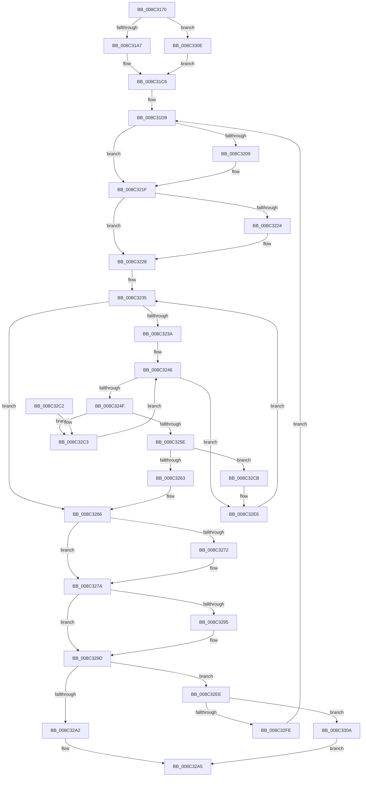

# EtwpGetNextGuidEntry

- RVA: `0x008C3170`–`0x008C3316` (길이 `422` bytes)
- VA: `0x00000001408C3170`
- 실행 섹션: `PAGE`
- PDB 이름 있음: `예`; PDB Function 태그: `아니요`
- unwind 정보 RVA: `0x000837B8`
- 디코드: `119`개 명령, `422/422` bytes 표시
- 미해석 바이트: `0` (있으면 어셈블리에 `.byte`로 보존)

> 이 문서는 커널 이미지의 기계어와 PDB 기호를 분석해 생성했습니다. 4번과 5번은 함수 원형과 자료형을 바이너리 사용 방식에서 추정한 C 해석이며 원본 소스 복구 결과는 아닙니다.

## 1. Dependencies

- 직접 호출 지점: **7**; 고유 호출 대상: **7**
- 직접 호출자로 확인된 함수: **6**
- RIP 상대 이미지 참조: **0**

### Outgoing calls
- `0x008C31F2` → [KeAbPreAcquire](../../text/21/KeAbPreAcquire_function_00210230.md) (function, `0x00210230`)
- `0x008C3214` → [ExfAcquirePushLockSharedEx](../../text/21/ExfAcquirePushLockSharedEx_function_0021044C.md) (function, `0x0021044C`)
- `0x008C3275` → [ExfReleasePushLockShared](../../text/26/ExfReleasePushLockShared_function_00263440.md) (function, `0x00263440`)
- `0x008C327D` → [KeAbPostRelease](../../text/2E/KeAbPostRelease_function_002E1600.md) (function, `0x002E1600`)
- `0x008C328B` → [KeLeaveCriticalRegionThread](../../text/25/KeLeaveCriticalRegionThread_function_0025EFF0.md) (function, `0x0025EFF0`)
- `0x008C3298` → [EtwpUnreferenceGuidEntry](EtwpUnreferenceGuidEntry_function_008C3320.md) (function, `0x008C3320`)
- `0x008C32E0` → [KeBugCheckEx](../../text/4F/KeBugCheckEx_function_004FD660.md) (function, `0x004FD660`)

### Direct callers
- [EtwpGetGuidList](EtwpGetGuidList_function_008C2F00.md) at `0x008C2F39`
- [EtwpSetProviderBinaryTracking](../A0/EtwpSetProviderBinaryTracking_function_00A03BF4.md) at `0x00A03C52`
- [EtwpSetProviderBinaryTracking](../A0/EtwpSetProviderBinaryTracking_function_00A03BF4.md) at `0x00A03C7D`
- [EtwpEventTracingCounterSetCallback](../A0/EtwpEventTracingCounterSetCallback_function_00A0E0C0.md) at `0x00A0E175`
- [EtwpDisableTraceProviders](../A2/EtwpDisableTraceProviders_function_00A22680.md) at `0x00A226C2`
- [EtwpDisableTraceProviders](../A2/EtwpDisableTraceProviders_function_00A22680.md) at `0x00A226E2`
- [EtwpDisableTraceProviders](../A2/EtwpDisableTraceProviders_function_00A22680.md) at `0x00A2270C`
- [EtwpEnumerateTraceGuids](../A5/EtwpEnumerateTraceGuids_function_00A5F6FC.md) at `0x00A5F729`
- [EtwpTracingProvEnableCallback](../AC/EtwpTracingProvEnableCallback_function_00AC28B0.md) at `0x00AC2A31`
- [EtwpTracingProvEnableCallback](../AC/EtwpTracingProvEnableCallback_function_00AC28B0.md) at `0x00AC2BAE`

### Static image references
- 디코드된 RIP-relative 메모리 참조가 없습니다.

## 2. Other-region calls and transfers

- 다른 실행 섹션으로 향하는 call: **6**
  - `0x008C31F2` → [KeAbPreAcquire](../../text/21/KeAbPreAcquire_function_00210230.md) (`PAGE` → `.text`)
  - `0x008C3214` → [ExfAcquirePushLockSharedEx](../../text/21/ExfAcquirePushLockSharedEx_function_0021044C.md) (`PAGE` → `.text`)
  - `0x008C3275` → [ExfReleasePushLockShared](../../text/26/ExfReleasePushLockShared_function_00263440.md) (`PAGE` → `.text`)
  - `0x008C327D` → [KeAbPostRelease](../../text/2E/KeAbPostRelease_function_002E1600.md) (`PAGE` → `.text`)
  - `0x008C328B` → [KeLeaveCriticalRegionThread](../../text/25/KeLeaveCriticalRegionThread_function_0025EFF0.md) (`PAGE` → `.text`)
  - `0x008C32E0` → [KeBugCheckEx](../../text/4F/KeBugCheckEx_function_004FD660.md) (`PAGE` → `.text`)
- 별도 외부 분기/꼬리 이동을 확인하지 못했습니다.

## 3. Assembly (complete function range)

```asm
008C3170  48 89 5C 24 10                  mov qword ptr [rsp + 0x10], rbx
008C3175  48 89 6C 24 18                  mov qword ptr [rsp + 0x18], rbp
008C317A  48 89 74 24 20                  mov qword ptr [rsp + 0x20], rsi
008C317F  57                              push rdi
008C3180  41 54                           push r12
008C3182  41 55                           push r13
008C3184  41 56                           push r14
008C3186  41 57                           push r15
008C3188  48 83 EC 30                     sub rsp, 0x30
008C318C  33 C0                           xor eax, eax
008C318E  4C 8D A9 D0 02 00 00            lea r13, [rcx + 0x2d0]
008C3195  45 32 F6                        xor r14b, r14b
008C3198  48 8B DA                        mov rbx, rdx
008C319B  44 8B F8                        mov r15d, eax
008C319E  48 85 D2                        test rdx, rdx
008C31A1  0F 84 67 01 00 00               je 0x1408c330e
008C31A7  8B 42 30                        mov eax, dword ptr [rdx + 0x30]
008C31AA  8B 4A 34                        mov ecx, dword ptr [rdx + 0x34]
008C31AD  48 33 C8                        xor rcx, rax
008C31B0  8B 42 2C                        mov eax, dword ptr [rdx + 0x2c]
008C31B3  48 33 C8                        xor rcx, rax
008C31B6  8B 42 28                        mov eax, dword ptr [rdx + 0x28]
008C31B9  48 33 C8                        xor rcx, rax
008C31BC  83 E1 3F                        and ecx, 0x3f
008C31BF  48 6B D1 38                     imul rdx, rcx, 0x38
008C31C3  49 03 D5                        add rdx, r13
008C31C6  41 8B C0                        mov eax, r8d
008C31C9  48 8D 72 30                     lea rsi, [rdx + 0x30]
008C31CD  48 C1 E0 04                     shl rax, 4
008C31D1  48 8D 2C 10                     lea rbp, [rax + rdx]
008C31D5  4C 8D 60 D0                     lea r12, [rax - 0x30]
008C31D9  65 48 8B 04 25 88 01 00 00      mov rax, qword ptr gs:[0x188]
008C31E2  45 33 C0                        xor r8d, r8d
008C31E5  33 D2                           xor edx, edx
008C31E7  48 8B CE                        mov rcx, rsi
008C31EA  66 FF 88 E4 01 00 00            dec word ptr [rax + 0x1e4]
008C31F1  90                              nop
008C31F2  E8 39 D0 94 FF                  call 0x140210230
008C31F7  48 8B F8                        mov rdi, rax
008C31FA  41 B9 11 00 00 00               mov r9d, 0x11
008C3200  33 C0                           xor eax, eax
008C3202  F0 4C 0F B1 0E                  lock cmpxchg qword ptr [rsi], r9
008C3207  74 16                           je 0x1408c321f
008C3209  4C 8B CE                        mov r9, rsi
008C320C  4C 8B C7                        mov r8, rdi
008C320F  33 D2                           xor edx, edx
008C3211  48 8B CE                        mov rcx, rsi
008C3214  E8 33 D2 94 FF                  call 0x14021044c
008C3219  41 B9 11 00 00 00               mov r9d, 0x11
008C321F  48 85 FF                        test rdi, rdi
008C3222  74 04                           je 0x1408c3228
008C3224  C6 47 0A 01                     mov byte ptr [rdi + 0xa], 1
008C3228  48 85 DB                        test rbx, rbx
008C322B  48 8B C5                        mov rax, rbp
008C322E  48 0F 45 C3                     cmovne rax, rbx
008C3232  4C 8B 00                        mov r8, qword ptr [rax]
008C3235  4C 3B C5                        cmp r8, rbp
008C3238  74 2C                           je 0x1408c3266
008C323A  4D 8B F8                        mov r15, r8
008C323D  41 0F 0D 48 20                  prefetchw byte ptr [r8 + 0x20]
008C3242  49 8B 48 20                     mov rcx, qword ptr [r8 + 0x20]
008C3246  48 85 C9                        test rcx, rcx
008C3249  0F 84 97 00 00 00               je 0x1408c32e6
008C324F  48 8D 51 01                     lea rdx, [rcx + 1]
008C3253  48 8B C1                        mov rax, rcx
008C3256  F0 49 0F B1 50 20               lock cmpxchg qword ptr [r8 + 0x20], rdx
008C325C  75 65                           jne 0x1408c32c3
008C325E  48 85 C9                        test rcx, rcx
008C3261  78 68                           js 0x1408c32cb
008C3263  41 B6 01                        mov r14b, 1
008C3266  49 8B C1                        mov rax, r9
008C3269  33 FF                           xor edi, edi
008C326B  F0 48 0F B1 3E                  lock cmpxchg qword ptr [rsi], rdi
008C3270  74 08                           je 0x1408c327a
008C3272  48 8B CE                        mov rcx, rsi
008C3275  E8 C6 01 9A FF                  call 0x140263440
008C327A  48 8B CE                        mov rcx, rsi
008C327D  E8 7E E3 A1 FF                  call 0x1402e1600
008C3282  65 48 8B 0C 25 88 01 00 00      mov rcx, qword ptr gs:[0x188]
008C328B  E8 60 BD 99 FF                  call 0x14025eff0
008C3290  48 85 DB                        test rbx, rbx
008C3293  74 08                           je 0x1408c329d
008C3295  48 8B CB                        mov rcx, rbx
008C3298  E8 83 00 00 00                  call 0x1408c3320
008C329D  45 84 F6                        test r14b, r14b
008C32A0  74 4C                           je 0x1408c32ee
008C32A2  49 8B C7                        mov rax, r15
008C32A5  48 8B 5C 24 68                  mov rbx, qword ptr [rsp + 0x68]
008C32AA  48 8B 6C 24 70                  mov rbp, qword ptr [rsp + 0x70]
008C32AF  48 8B 74 24 78                  mov rsi, qword ptr [rsp + 0x78]
008C32B4  48 83 C4 30                     add rsp, 0x30
008C32B8  41 5F                           pop r15
008C32BA  41 5E                           pop r14
008C32BC  41 5D                           pop r13
008C32BE  41 5C                           pop r12
008C32C0  5F                              pop rdi
008C32C1  C3                              ret
008C32C2  CC                              int3
008C32C3  48 8B C8                        mov rcx, rax
008C32C6  E9 7B FF FF FF                  jmp 0x1408c3246
008C32CB  45 33 C9                        xor r9d, r9d
008C32CE  48 C7 44 24 20 00 00 00 00      mov qword ptr [rsp + 0x20], 0
008C32D7  B9 1D 01 00 00                  mov ecx, 0x11d
008C32DC  41 8D 51 09                     lea edx, [r9 + 9]
008C32E0  E8 7B A3 C3 FF                  call 0x1404fd660
008C32E5  CC                              int3
008C32E6  4D 8B 00                        mov r8, qword ptr [r8]
008C32E9  E9 47 FF FF FF                  jmp 0x1408c3235
008C32EE  48 83 C6 38                     add rsi, 0x38
008C32F2  49 8D 85 30 0E 00 00            lea rax, [r13 + 0xe30]
008C32F9  48 3B F0                        cmp rsi, rax
008C32FC  74 0C                           je 0x1408c330a
008C32FE  48 8B DF                        mov rbx, rdi
008C3301  49 8D 2C 34                     lea rbp, [r12 + rsi]
008C3305  E9 CF FE FF FF                  jmp 0x1408c31d9
008C330A  33 C0                           xor eax, eax
008C330C  EB 97                           jmp 0x1408c32a5
008C330E  49 8B D5                        mov rdx, r13
008C3311  E9 B0 FE FF FF                  jmp 0x1408c31c6
```

## 4. C-style interpretation (structured pseudocode)

```c
__int64 __fastcall EtwpGetNextGuidEntry(__int64 a1, __int64 a2, int a3)
{
    __int64 result;
    __int64 v_r14;
    __int64 v_rdi;
    __int64 v_rsi;
    __int64 v_rsp;
    unsigned __int64 v_stack_p10;
    unsigned __int64 v_stack_p18;
    unsigned __int64 v_stack_p20;

    v_stack_p10 = v_rbx;
    v_stack_p18 = v_rbp;
    v_stack_p20 = v_rsi;
    v_rsp = (v_rsp) - (48);
    result = 0;
    v_r14 = 0;
    if (a2 == 0) goto loc_008C330E;
    a1 = ((unsigned int)(*(unsigned int *)(a2 + 52))) ^ ((unsigned int)(*(unsigned int *)(a2 + 48)));
    a1 = (a1) ^ ((unsigned int)(*(unsigned int *)(a2 + 44)));
    a1 = (a1) ^ ((unsigned int)(*(unsigned int *)(a2 + 40)));
    a1 = (unsigned int)((a1) & (63));
    a2 = (a2) * (a1);
    a2 = (a2) + (a1 + 720);
loc_008C31C6:
    result = ((unsigned int)(a3)) << (4);
loc_008C31D9:
    a3 = 0;
    a2 = 0;
    result = KeAbPreAcquire(a2 + 48, a2, a3, a4);
    result = 0;
    if (!(condition_is_equal)) {
        a4 = a2 + 48;
        a3 = 0;
        a2 = 0;
        a1 = a2 + 48;
        result = ExfAcquirePushLockSharedEx(a1, a2, a3, a4);
        a4 = 17;
    }
    if (result != 0) {
        *(unsigned __int8 *)(result + 10) = 1;
    }
    result = result + a2 * 1;
    if (0 != 0) { result = 0; }
loc_008C3235:
    if ((*(unsigned __int64 *)(result)) == (result + a2 * 1)) goto loc_008C3266;
loc_008C3246:
    if (*(unsigned __int64 *)(*(unsigned __int64 *)(result) + 32) == 0) goto loc_008C32E6;
    if (*(unsigned __int64 *)(*(unsigned __int64 *)(result) + 32) != 0) goto loc_008C32C3;
    if (sign_flag) goto loc_008C32CB;
loc_008C3266:
    v_rdi = 0;
    result = a4;
    if (!(condition_is_equal)) {
        a1 = a2 + 48;
        result = ExfReleasePushLockShared(a1, *(unsigned __int64 *)(*(unsigned __int64 *)(result) + 32) + 1, *(unsigned __int64 *)(result), a4);
    }
    result = KeAbPostRelease(a2 + 48, *(unsigned __int64 *)(*(unsigned __int64 *)(result) + 32) + 1, *(unsigned __int64 *)(result), a4);
    result = KeLeaveCriticalRegionThread(*(unsigned __int64 *)(gs_base + (0 + 392)), *(unsigned __int64 *)(*(unsigned __int64 *)(result) + 32) + 1, *(unsigned __int64 *)(result), a4);
    if (0 != 0) {
        a1 = 0;
        result = EtwpUnreferenceGuidEntry(a1, *(unsigned __int64 *)(*(unsigned __int64 *)(result) + 32) + 1, *(unsigned __int64 *)(result), a4);
    }
    if (1 == 0) goto loc_008C32EE;
loc_008C32A5:
    v_rsp = (v_rsp) + (48);
    return *(unsigned __int64 *)(result);
loc_008C32C3:
    goto loc_008C3246;
loc_008C32CB:
    a4 = 0;
    v_stack_p20 = 0;
    result = KeBugCheckEx(285, a4 + 9, *(unsigned __int64 *)(result), a4);
loc_008C32E6:
    goto loc_008C3235;
loc_008C32EE:
    v_rsi = (v_stack_p20) + (56);
    if (v_rsi == (a1 + 720 + 3632)) goto loc_008C330A;
    goto loc_008C31D9;
loc_008C330A:
    result = 0;
    goto loc_008C32A5;
loc_008C330E:
    goto loc_008C31C6;
}
```

## 5. (Beta) C Style

```c
int64_t EtwpGetNextGuidEntry(void *Arg1, int64_t Arg2, int32_t Arg3)
{
    uint8_t *arg1 = (uint8_t *)Arg1;

    int64_t result;
    int64_t local_r14;
    int64_t local_rdi;
    int64_t local_rsi;
    int64_t local_rsp;
    uint64_t v_stack_p10;
    uint64_t v_stack_p18;
    uint64_t v_stack_p20;

    v_stack_p10 = local_rbx;
    v_stack_p18 = local_rbp;
    v_stack_p20 = local_rsi;
    local_rsp = (local_rsp) - (48);
    result = 0;
    local_r14 = 0;
    if (Arg2 == 0) goto loc_008C330E;
    Arg1 = ((uint32_t)(*(uint32_t *)(Arg2 + 0x34))) ^ ((uint32_t)(*(uint32_t *)(Arg2 + 0x30)));
    Arg1 = (Arg1) ^ ((uint32_t)(*(uint32_t *)(Arg2 + 0x2C)));
    Arg1 = (Arg1) ^ ((uint32_t)(*(uint32_t *)(Arg2 + 0x28)));
    Arg1 = (uint32_t)((Arg1) & (63));
    Arg2 = (Arg2) * (Arg1);
    Arg2 = (Arg2) + (Arg1 + 720);
loc_008C31C6:
    result = ((uint32_t)(Arg3)) << (4);
loc_008C31D9:
    Arg3 = 0;
    Arg2 = 0;
    result = KeAbPreAcquire(Arg2 + 48, Arg2, Arg3, a4);
    result = 0;
    if (!(condition_is_equal)) {
        a4 = Arg2 + 48;
        Arg3 = 0;
        Arg2 = 0;
        Arg1 = Arg2 + 48;
        result = ExfAcquirePushLockSharedEx(Arg1, Arg2, Arg3, a4);
        a4 = 17;
    }
    if (result != 0) {
        *(uint8_t *)(result + 0xA) = 1;
    }
    result = result + Arg2 * 1;
    if (0 != 0) { result = 0; }
loc_008C3235:
    if ((*(uint64_t *)(result)) == (result + Arg2 * 1)) goto loc_008C3266;
loc_008C3246:
    if (*(uint64_t *)(*(uint64_t *)(result) + 0x20) == 0) goto loc_008C32E6;
    if (*(uint64_t *)(*(uint64_t *)(result) + 0x20) != 0) goto loc_008C32C3;
    if (sign_flag) goto loc_008C32CB;
loc_008C3266:
    local_rdi = 0;
    result = a4;
    if (!(condition_is_equal)) {
        Arg1 = Arg2 + 48;
        result = ExfReleasePushLockShared(Arg1, *(uint64_t *)(*(uint64_t *)(result) + 0x20) + 1, *(uint64_t *)(result), a4);
    }
    result = KeAbPostRelease(Arg2 + 48, *(uint64_t *)(*(uint64_t *)(result) + 0x20) + 1, *(uint64_t *)(result), a4);
    result = KeLeaveCriticalRegionThread(*(uint64_t *)(gs_base + (0 + 0x188)), *(uint64_t *)(*(uint64_t *)(result) + 0x20) + 1, *(uint64_t *)(result), a4);
    if (0 != 0) {
        Arg1 = 0;
        result = EtwpUnreferenceGuidEntry(Arg1, *(uint64_t *)(*(uint64_t *)(result) + 0x20) + 1, *(uint64_t *)(result), a4);
    }
    if (1 == 0) goto loc_008C32EE;
loc_008C32A5:
    local_rsp = (local_rsp) + (48);
    return *(uint64_t *)(result);
loc_008C32C3:
    goto loc_008C3246;
loc_008C32CB:
    a4 = 0;
    v_stack_p20 = 0;
    result = KeBugCheckEx(285, a4 + 9, *(uint64_t *)(result), a4);
loc_008C32E6:
    goto loc_008C3235;
loc_008C32EE:
    local_rsi = (v_stack_p20) + (56);
    if (local_rsi == (Arg1 + 720 + 3632)) goto loc_008C330A;
    goto loc_008C31D9;
loc_008C330A:
    result = 0;
    goto loc_008C32A5;
loc_008C330E:
    goto loc_008C31C6;
}
```

### 관측된 메모리 오프셋

구조체 형식이 확인되지 않은 접근은 인자 기준의 오프셋으로만 기록했습니다.

| 기준 인자 | 오프셋 표현 | 폭 (bit) | 접근 |
|---|---:|---:|---|
| `Arg1` | `+ 0x2D0` | `64` | `R` |
| `Arg1` | `+ 0xE30` | `64` | `R` |

## 6. Execution-region graph

[열기: 2D/3D 그래프와 함수 탐색 컨트롤 패널](../../../control-panel.html?section=page&rva=0x008C3170&view=graph)

- 2D 그래프는 위에서 아래로 흐르고, 3D 그래프는 빈 공간을 드래그해 회전합니다. Shift+드래그는 이동, 휠은 확대·축소, 함수 노드 선택은 대상 보고서 이동입니다.

### Static fallback


