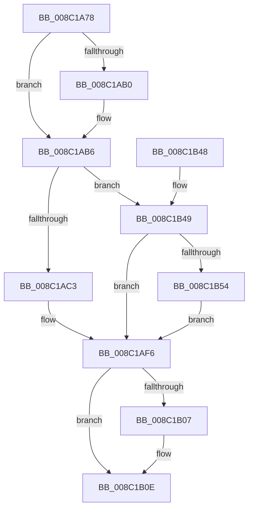

# EtwpInitializeRegEntry

- RVA: `0x008C1A78`–`0x008C1B5F` (길이 `231` bytes)
- VA: `0x00000001408C1A78`
- 실행 섹션: `PAGE`
- PDB 이름 있음: `예`; PDB Function 태그: `아니요`
- unwind 정보 RVA: `0x00083650`
- 디코드: `59`개 명령, `231/231` bytes 표시
- 미해석 바이트: `0` (있으면 어셈블리에 `.byte`로 보존)

> 이 문서는 커널 이미지의 기계어와 PDB 기호를 분석해 생성했습니다. 4번과 5번은 함수 원형과 자료형을 바이너리 사용 방식에서 추정한 C 해석이며 원본 소스 복구 결과는 아닙니다.

## 1. Dependencies

- 직접 호출 지점: **2**; 고유 호출 대상: **2**
- 직접 호출자로 확인된 함수: **1**
- RIP 상대 이미지 참조: **0**

### Outgoing calls
- `0x008C1A9D` → [EtwpReferenceGuidEntry](EtwpReferenceGuidEntry_function_008C1ED0.md) (function, `0x008C1ED0`)
- `0x008C1AE0` → [ObfReferenceObjectWithTag](../../text/21/ObfReferenceObjectWithTag_function_00210710.md) (function, `0x00210710`)

### Direct callers
- [EtwpAddKmRegEntry](../92/EtwpAddKmRegEntry_function_00920DB8.md) at `0x00920E11`

### Static image references
- 디코드된 RIP-relative 메모리 참조가 없습니다.

## 2. Other-region calls and transfers

- 다른 실행 섹션으로 향하는 call: **1**
  - `0x008C1AE0` → [ObfReferenceObjectWithTag](../../text/21/ObfReferenceObjectWithTag_function_00210710.md) (`PAGE` → `.text`)
- 별도 외부 분기/꼬리 이동을 확인하지 못했습니다.

## 3. Assembly (complete function range)

```asm
008C1A78  48 8B C4                        mov rax, rsp
008C1A7B  48 89 58 08                     mov qword ptr [rax + 8], rbx
008C1A7F  48 89 68 10                     mov qword ptr [rax + 0x10], rbp
008C1A83  48 89 70 18                     mov qword ptr [rax + 0x18], rsi
008C1A87  48 89 78 20                     mov qword ptr [rax + 0x20], rdi
008C1A8B  41 56                           push r14
008C1A8D  48 83 EC 20                     sub rsp, 0x20
008C1A91  49 8B F1                        mov rsi, r9
008C1A94  41 8B D8                        mov ebx, r8d
008C1A97  44 8B F2                        mov r14d, edx
008C1A9A  48 8B E9                        mov rbp, rcx
008C1A9D  E8 2E 04 00 00                  call 0x1408c1ed0
008C1AA2  48 8B 7C 24 60                  mov rdi, qword ptr [rsp + 0x60]
008C1AA7  B8 02 00 00 00                  mov eax, 2
008C1AAC  3B D8                           cmp ebx, eax
008C1AAE  75 06                           jne 0x1408c1ab6
008C1AB0  66 F0 83 4F 62 08               lock or word ptr [rdi + 0x62], 8
008C1AB6  48 89 77 58                     mov qword ptr [rdi + 0x58], rsi
008C1ABA  45 85 F6                        test r14d, r14d
008C1ABD  0F 84 86 00 00 00               je 0x1408c1b49
008C1AC3  66 F0 09 47 62                  lock or word ptr [rdi + 0x62], ax
008C1AC8  65 48 8B 04 25 88 01 00 00      mov rax, qword ptr gs:[0x188]
008C1AD1  BA 45 74 77 52                  mov edx, 0x52777445
008C1AD6  48 8B 98 B8 00 00 00            mov rbx, qword ptr [rax + 0xb8]
008C1ADD  48 8B CB                        mov rcx, rbx
008C1AE0  E8 2B EC 94 FF                  call 0x140210710
008C1AE5  0F B7 44 24 58                  movzx eax, word ptr [rsp + 0x58]
008C1AEA  66 89 47 60                     mov word ptr [rdi + 0x60], ax
008C1AEE  48 89 5F 50                     mov qword ptr [rdi + 0x50], rbx
008C1AF2  48 89 77 58                     mov qword ptr [rdi + 0x58], rsi
008C1AF6  48 8D 45 38                     lea rax, [rbp + 0x38]
008C1AFA  48 89 6F 20                     mov qword ptr [rdi + 0x20], rbp
008C1AFE  48 8B 08                        mov rcx, qword ptr [rax]
008C1B01  48 39 41 08                     cmp qword ptr [rcx + 8], rax
008C1B05  74 07                           je 0x1408c1b0e
008C1B07  B9 03 00 00 00                  mov ecx, 3
008C1B0C  CD 29                           int 0x29
008C1B0E  48 89 47 08                     mov qword ptr [rdi + 8], rax
008C1B12  48 89 0F                        mov qword ptr [rdi], rcx
008C1B15  48 89 79 08                     mov qword ptr [rcx + 8], rdi
008C1B19  48 89 38                        mov qword ptr [rax], rdi
008C1B1C  48 8D 47 10                     lea rax, [rdi + 0x10]
008C1B20  48 89 40 08                     mov qword ptr [rax + 8], rax
008C1B24  48 89 00                        mov qword ptr [rax], rax
008C1B27  66 F0 83 4F 62 40               lock or word ptr [rdi + 0x62], 0x40
008C1B2D  48 8B 5C 24 30                  mov rbx, qword ptr [rsp + 0x30]
008C1B32  48 8B 6C 24 38                  mov rbp, qword ptr [rsp + 0x38]
008C1B37  48 8B 74 24 40                  mov rsi, qword ptr [rsp + 0x40]
008C1B3C  48 8B 7C 24 48                  mov rdi, qword ptr [rsp + 0x48]
008C1B41  48 83 C4 20                     add rsp, 0x20
008C1B45  41 5E                           pop r14
008C1B47  C3                              ret
008C1B48  CC                              int3
008C1B49  66 F0 83 4F 62 01               lock or word ptr [rdi + 0x62], 1
008C1B4F  48 85 F6                        test rsi, rsi
008C1B52  74 A2                           je 0x1408c1af6
008C1B54  48 8B 44 24 50                  mov rax, qword ptr [rsp + 0x50]
008C1B59  48 89 47 50                     mov qword ptr [rdi + 0x50], rax
008C1B5D  EB 97                           jmp 0x1408c1af6
```

## 4. C-style interpretation (structured pseudocode)

```c
__int64 __fastcall EtwpInitializeRegEntry(__int64 a1, int a2, int a3, __int64 a4, __int64 a5, unsigned __int16 a6, __int64 a7)
{
    __int64 result;
    __int64 v_rsp;
    unsigned __int64 v_stack_p10;
    unsigned __int64 v_stack_p18;
    unsigned __int64 v_stack_p20;
    unsigned __int64 v_stack_p8;

    *(unsigned __int64 *)(v_rsp + 8) = v_rbx;
    *(unsigned __int64 *)(v_rsp + 16) = v_rbp;
    *(unsigned __int64 *)(v_rsp + 24) = v_rsi;
    *(unsigned __int64 *)(v_rsp + 32) = v_rdi;
    v_rsp = (v_rsp) - (32);
    result = EtwpReferenceGuidEntry(a1, a2, a3, a4);
    if (((unsigned int)((unsigned int)(a3))) == 2) {
    }
    *(unsigned __int64 *)(a7 + 88) = a4;
    if ((unsigned int)((unsigned int)(a2)) == 0) goto loc_008C1B49;
    result = ObfReferenceObjectWithTag(*(unsigned __int64 *)(*(unsigned __int64 *)(gs_base + (0 + 392)) + 184), (unsigned int)(0x52777445ULL), a3, a4);
    *(unsigned __int16 *)(a7 + 96) = a6;
    *(unsigned __int64 *)(a7 + 80) = *(unsigned __int64 *)(*(unsigned __int64 *)(gs_base + (0 + 392)) + 184);
    *(unsigned __int64 *)(a7 + 88) = a4;
loc_008C1AF6:
    *(unsigned __int64 *)(a7 + 32) = a1;
    if ((*(unsigned __int64 *)(*(unsigned __int64 *)(a1 + 56) + 8)) != (a1 + 56)) {
        a1 = 3;
    }
    *(unsigned __int64 *)(a7 + 8) = a1 + 56;
    *(unsigned __int64 *)(a7) = a1;
    *(unsigned __int64 *)(a1 + 8) = a7;
    *(unsigned __int64 *)(a1 + 56) = a7;
    *(unsigned __int64 *)(a7 + 16 + 8) = a7 + 16;
    *(unsigned __int64 *)(a7 + 16) = a7 + 16;
    v_rsp = (v_rsp) + (32);
    return a7 + 16;
loc_008C1B49:
    if (v_stack_p18 == 0) goto loc_008C1AF6;
    *(unsigned __int64 *)(v_stack_p20 + 80) = a5;
    goto loc_008C1AF6;
}
```

## 5. (Beta) C Style

```c
void *EtwpInitializeRegEntry(void *Arg1, int32_t Arg2, int32_t Arg3, int64_t Arg4, int64_t Arg5, uint16_t Arg6, void *Arg7)
{
    uint8_t *arg1 = (uint8_t *)Arg1;
    uint8_t *arg7 = (uint8_t *)Arg7;

    int64_t result;
    int64_t local_rsp;
    uint64_t v_stack_p10;
    uint64_t v_stack_p18;
    uint64_t v_stack_p20;
    uint64_t v_stack_p8;

    *(uint64_t *)(local_rsp + 0x8) = local_rbx;
    *(uint64_t *)(local_rsp + 0x10) = local_rbp;
    *(uint64_t *)(local_rsp + 0x18) = local_rsi;
    *(uint64_t *)(local_rsp + 0x20) = local_rdi;
    local_rsp = (local_rsp) - (32);
    result = EtwpReferenceGuidEntry(Arg1, Arg2, Arg3, Arg4);
    if (((uint32_t)((uint32_t)(Arg3))) == 2) {
    }
    *(uint64_t *)(arg7 + 0x58) = Arg4;
    if ((uint32_t)((uint32_t)(Arg2)) == 0) goto loc_008C1B49;
    result = ObfReferenceObjectWithTag(*(uint64_t *)(*(uint64_t *)(gs_base + (0 + 0x188)) + 0xB8), (uint32_t)(0x52777445ULL), Arg3, Arg4);
    *(uint16_t *)(arg7 + 0x60) = Arg6;
    *(uint64_t *)(arg7 + 0x50) = *(uint64_t *)(*(uint64_t *)(gs_base + (0 + 0x188)) + 0xB8);
    *(uint64_t *)(arg7 + 0x58) = Arg4;
loc_008C1AF6:
    *(void **)(arg7 + 0x20) = Arg1;
    if ((*(uint64_t *)(*(uint64_t *)(arg1 + 0x38) + 0x8)) != (Arg1 + 56)) {
        Arg1 = 3;
    }
    *(void **)(arg7 + 0x8) = Arg1 + 56;
    *(void **)(arg7) = Arg1;
    *(void **)(arg1 + 0x8) = Arg7;
    *(void **)(arg1 + 0x38) = Arg7;
    *(void **)(arg7 + 0x10 + 0x8) = Arg7 + 16;
    *(void **)(arg7 + 0x10) = Arg7 + 16;
    local_rsp = (local_rsp) + (32);
    return Arg7 + 16;
loc_008C1B49:
    if (v_stack_p18 == 0) goto loc_008C1AF6;
    *(uint64_t *)(v_stack_p20 + 0x50) = Arg5;
    goto loc_008C1AF6;
}
```

### 관측된 메모리 오프셋

구조체 형식이 확인되지 않은 접근은 인자 기준의 오프셋으로만 기록했습니다.

| 기준 인자 | 오프셋 표현 | 폭 (bit) | 접근 |
|---|---:|---:|---|
| `Arg1` | `+ 0x0` | `64` | `R` |
| `Arg1` | `+ 0x0` | `64` | `W` |
| `Arg1` | `+ 0x38` | `64` | `R` |
| `Arg7` | `+ 0x0` | `64` | `W` |
| `Arg7` | `+ 0x8` | `64` | `W` |
| `Arg7` | `+ 0x10` | `64` | `R` |
| `Arg7` | `+ 0x20` | `64` | `W` |
| `Arg7` | `+ 0x50` | `64` | `W` |
| `Arg7` | `+ 0x58` | `64` | `W` |
| `Arg7` | `+ 0x60` | `16` | `W` |
| `Arg7` | `+ 0x62` | `16` | `R/W` |

## 6. Execution-region graph

[열기: 2D/3D 그래프와 함수 탐색 컨트롤 패널](../../../control-panel.html?section=page&rva=0x008C1A78&view=graph)

- 2D 그래프는 위에서 아래로 흐르고, 3D 그래프는 빈 공간을 드래그해 회전합니다. Shift+드래그는 이동, 휠은 확대·축소, 함수 노드 선택은 대상 보고서 이동입니다.

### Static fallback


