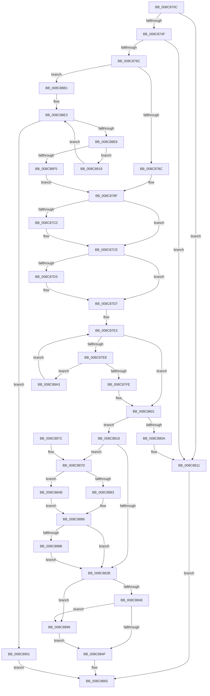

# EtwpQueueNotification

- RVA: `0x008C870C`–`0x008C891C` (길이 `528` bytes)
- VA: `0x00000001408C870C`
- 실행 섹션: `PAGE`
- PDB 이름 있음: `예`; PDB Function 태그: `아니요`
- unwind 정보 RVA: `0x0008408C`
- 디코드: `152`개 명령, `528/528` bytes 표시
- 미해석 바이트: `0` (있으면 어셈블리에 `.byte`로 보존)

> 이 문서는 커널 이미지의 기계어와 PDB 기호를 분석해 생성했습니다. 4번과 5번은 함수 원형과 자료형을 바이너리 사용 방식에서 추정한 C 해석이며 원본 소스 복구 결과는 아닙니다.

## 1. Dependencies

- 직접 호출 지점: **11**; 고유 호출 대상: **11**
- 직접 호출자로 확인된 함수: **1**
- RIP 상대 이미지 참조: **0**

### Outgoing calls
- `0x008C873E` → [EtwpAddDataSource](EtwpAddDataSource_function_008C8924.md) (function, `0x008C8924`)
- `0x008C875B` → [ExAllocatePool2](../../poolcode/B8/ExAllocatePool2_function_00B820F0.md) (function, `0x00B820F0`)
- `0x008C87B0` → [KeAbPreAcquire](../../text/21/KeAbPreAcquire_function_00210230.md) (function, `0x00210230`)
- `0x008C87C9` → [ExfAcquirePushLockExclusiveEx](../../text/20/ExfAcquirePushLockExclusiveEx_function_0020FC90.md) (function, `0x0020FC90`)
- `0x008C8852` → [KeAbPostRelease](../../text/2E/KeAbPostRelease_function_002E1600.md) (function, `0x002E1600`)
- `0x008C8860` → [KeLeaveCriticalRegionThread](../../text/25/KeLeaveCriticalRegionThread_function_0025EFF0.md) (function, `0x0025EFF0`)
- `0x008C8892` → [KeSetEvent](../../text/33/KeSetEvent_function_0033F310.md) (function, `0x0033F310`)
- `0x008C889C` → [ExfReleasePushLock](../../text/26/ExfReleasePushLock_function_002638D0.md) (function, `0x002638D0`)
- `0x008C88BC` → [ObfReferenceObject](../../text/20/ObfReferenceObject_function_0020FA20.md) (function, `0x0020FA20`)
- `0x008C88D4` → [PsChargeProcessWakeCounter](../88/PsChargeProcessWakeCounter_function_0088BCD0.md) (function, `0x0088BCD0`)
- `0x008C890E` → [EtwpReleaseQueueEntry](../9F/EtwpReleaseQueueEntry_function_009FED48.md) (function, `0x009FED48`)

### Direct callers
- [EtwpSendDataBlock](EtwpSendDataBlock_function_008C8530.md) at `0x008C8580`

### Static image references
- 디코드된 RIP-relative 메모리 참조가 없습니다.

## 2. Other-region calls and transfers

- 다른 실행 섹션으로 향하는 call: **8**
  - `0x008C875B` → [ExAllocatePool2](../../poolcode/B8/ExAllocatePool2_function_00B820F0.md) (`PAGE` → `POOLCODE`)
  - `0x008C87B0` → [KeAbPreAcquire](../../text/21/KeAbPreAcquire_function_00210230.md) (`PAGE` → `.text`)
  - `0x008C87C9` → [ExfAcquirePushLockExclusiveEx](../../text/20/ExfAcquirePushLockExclusiveEx_function_0020FC90.md) (`PAGE` → `.text`)
  - `0x008C8852` → [KeAbPostRelease](../../text/2E/KeAbPostRelease_function_002E1600.md) (`PAGE` → `.text`)
  - `0x008C8860` → [KeLeaveCriticalRegionThread](../../text/25/KeLeaveCriticalRegionThread_function_0025EFF0.md) (`PAGE` → `.text`)
  - `0x008C8892` → [KeSetEvent](../../text/33/KeSetEvent_function_0033F310.md) (`PAGE` → `.text`)
  - `0x008C889C` → [ExfReleasePushLock](../../text/26/ExfReleasePushLock_function_002638D0.md) (`PAGE` → `.text`)
  - `0x008C88BC` → [ObfReferenceObject](../../text/20/ObfReferenceObject_function_0020FA20.md) (`PAGE` → `.text`)
- 별도 외부 분기/꼬리 이동을 확인하지 못했습니다.

## 3. Assembly (complete function range)

```asm
008C870C  48 89 5C 24 08                  mov qword ptr [rsp + 8], rbx
008C8711  55                              push rbp
008C8712  56                              push rsi
008C8713  57                              push rdi
008C8714  41 54                           push r12
008C8716  41 55                           push r13
008C8718  41 56                           push r14
008C871A  41 57                           push r15
008C871C  48 83 EC 20                     sub rsp, 0x20
008C8720  33 DB                           xor ebx, ebx
008C8722  41 BC 80 00 00 00               mov r12d, 0x80
008C8728  66 45 23 60 62                  and r12w, word ptr [r8 + 0x62]
008C872D  49 8B F0                        mov rsi, r8
008C8730  48 8B EA                        mov rbp, rdx
008C8733  4C 8B F9                        mov r15, rcx
008C8736  0F 95 44 24 70                  setne byte ptr [rsp + 0x70]
008C873B  41 B5 01                        mov r13b, 1
008C873E  E8 E1 01 00 00                  call 0x1408c8924
008C8743  4C 8B F0                        mov r14, rax
008C8746  48 85 C0                        test rax, rax
008C8749  0F 84 C2 00 00 00               je 0x1408c8811
008C874F  8D 53 38                        lea edx, [rbx + 0x38]
008C8752  41 B8 45 74 77 72               mov r8d, 0x72777445
008C8758  8D 4B 40                        lea ecx, [rbx + 0x40]
008C875B  E8 90 99 2B 00                  call 0x140b820f0
008C8760  48 8B F8                        mov rdi, rax
008C8763  48 85 C0                        test rax, rax
008C8766  0F 84 A5 00 00 00               je 0x1408c8811
008C876C  48 89 68 10                     mov qword ptr [rax + 0x10], rbp
008C8770  48 89 70 18                     mov qword ptr [rax + 0x18], rsi
008C8774  0F B7 46 60                     movzx eax, word ptr [rsi + 0x60]
008C8778  66 89 47 30                     mov word ptr [rdi + 0x30], ax
008C877C  C7 47 34 01 00 00 00            mov dword ptr [rdi + 0x34], 1
008C8783  38 5D 0C                        cmp byte ptr [rbp + 0xc], bl
008C8786  0F 85 25 01 00 00               jne 0x1408c88b1
008C878C  45 33 FF                        xor r15d, r15d
008C878F  F0 FF 45 08                     lock inc dword ptr [rbp + 8]
008C8793  65 48 8B 04 25 88 01 00 00      mov rax, qword ptr gs:[0x188]
008C879C  49 8D 76 10                     lea rsi, [r14 + 0x10]
008C87A0  45 33 C0                        xor r8d, r8d
008C87A3  33 D2                           xor edx, edx
008C87A5  48 8B CE                        mov rcx, rsi
008C87A8  66 FF 88 E4 01 00 00            dec word ptr [rax + 0x1e4]
008C87AF  90                              nop
008C87B0  E8 7B 7A 94 FF                  call 0x140210230
008C87B5  F0 48 0F BA 2E 00               lock bts qword ptr [rsi], 0
008C87BB  48 8B E8                        mov rbp, rax
008C87BE  73 0E                           jae 0x1408c87ce
008C87C0  4C 8B C6                        mov r8, rsi
008C87C3  48 8B D0                        mov rdx, rax
008C87C6  48 8B CE                        mov rcx, rsi
008C87C9  E8 C2 74 94 FF                  call 0x14020fc90
008C87CE  48 85 ED                        test rbp, rbp
008C87D1  74 04                           je 0x1408c87d7
008C87D3  44 88 6D 0A                     mov byte ptr [rbp + 0xa], r13b
008C87D7  44 8A 4C 24 70                  mov r9b, byte ptr [rsp + 0x70]
008C87DC  49 8D 56 18                     lea rdx, [r14 + 0x18]
008C87E0  4C 8B 02                        mov r8, qword ptr [rdx]
008C87E3  4C 3B C2                        cmp r8, rdx
008C87E6  74 19                           je 0x1408c8801
008C87E8  49 8B 40 18                     mov rax, qword ptr [r8 + 0x18]
008C87EC  8A 48 62                        mov cl, byte ptr [rax + 0x62]
008C87EF  C0 E9 07                        shr cl, 7
008C87F2  41 22 CD                        and cl, r13b
008C87F5  44 3A C9                        cmp r9b, cl
008C87F8  0F 85 A5 00 00 00               jne 0x1408c88a3
008C87FE  45 8A EF                        mov r13b, r15b
008C8801  48 8B 42 08                     mov rax, qword ptr [rdx + 8]
008C8805  48 39 10                        cmp qword ptr [rax], rdx
008C8808  74 0E                           je 0x1408c8818
008C880A  B9 03 00 00 00                  mov ecx, 3
008C880F  CD 29                           int 0x29
008C8811  BB 17 00 00 C0                  mov ebx, 0xc0000017
008C8816  EB 4D                           jmp 0x1408c8865
008C8818  48 89 17                        mov qword ptr [rdi], rdx
008C881B  48 89 47 08                     mov qword ptr [rdi + 8], rax
008C881F  48 89 38                        mov qword ptr [rax], rdi
008C8822  48 89 7A 08                     mov qword ptr [rdx + 8], rdi
008C8826  45 84 ED                        test r13b, r13b
008C8829  75 52                           jne 0x1408c887d
008C882B  0F 0D 0E                        prefetchw byte ptr [rsi]
008C882E  48 8B 06                        mov rax, qword ptr [rsi]
008C8831  48 8B C8                        mov rcx, rax
008C8834  48 83 E1 F0                     and rcx, 0xfffffffffffffff0
008C8838  48 83 F9 10                     cmp rcx, 0x10
008C883C  48 8D 50 F0                     lea rdx, [rax - 0x10]
008C8840  49 0F 46 D7                     cmovbe rdx, r15
008C8844  A8 02                           test al, 2
008C8846  75 51                           jne 0x1408c8899
008C8848  F0 48 0F B1 16                  lock cmpxchg qword ptr [rsi], rdx
008C884D  75 4A                           jne 0x1408c8899
008C884F  48 8B CE                        mov rcx, rsi
008C8852  E8 A9 8D A1 FF                  call 0x1402e1600
008C8857  65 48 8B 0C 25 88 01 00 00      mov rcx, qword ptr gs:[0x188]
008C8860  E8 8B 67 99 FF                  call 0x14025eff0
008C8865  8B C3                           mov eax, ebx
008C8867  48 8B 5C 24 60                  mov rbx, qword ptr [rsp + 0x60]
008C886C  48 83 C4 20                     add rsp, 0x20
008C8870  41 5F                           pop r15
008C8872  41 5E                           pop r14
008C8874  41 5D                           pop r13
008C8876  41 5C                           pop r12
008C8878  5F                              pop rdi
008C8879  5E                              pop rsi
008C887A  5D                              pop rbp
008C887B  C3                              ret
008C887C  CC                              int3
008C887D  66 45 85 E4                     test r12w, r12w
008C8881  75 28                           jne 0x1408c88ab
008C8883  49 8B 0E                        mov rcx, qword ptr [r14]
008C8886  48 85 C9                        test rcx, rcx
008C8889  74 A0                           je 0x1408c882b
008C888B  45 33 C0                        xor r8d, r8d
008C888E  41 8D 50 01                     lea edx, [r8 + 1]
008C8892  E8 79 6A A7 FF                  call 0x14033f310
008C8897  EB 92                           jmp 0x1408c882b
008C8899  48 8B CE                        mov rcx, rsi
008C889C  E8 2F B0 99 FF                  call 0x1402638d0
008C88A1  EB AC                           jmp 0x1408c884f
008C88A3  4D 8B 00                        mov r8, qword ptr [r8]
008C88A6  E9 38 FF FF FF                  jmp 0x1408c87e3
008C88AB  49 8B 4E 08                     mov rcx, qword ptr [r14 + 8]
008C88AF  EB D5                           jmp 0x1408c8886
008C88B1  48 8B 5D 18                     mov rbx, qword ptr [rbp + 0x18]
008C88B5  83 4F 34 02                     or dword ptr [rdi + 0x34], 2
008C88B9  48 8B CB                        mov rcx, rbx
008C88BC  E8 5F 71 94 FF                  call 0x14020fa20
008C88C1  BA 01 00 00 00                  mov edx, 1
008C88C6  48 89 5F 20                     mov qword ptr [rdi + 0x20], rbx
008C88CA  4C 8B CE                        mov r9, rsi
008C88CD  49 8B CF                        mov rcx, r15
008C88D0  44 8D 42 02                     lea r8d, [rdx + 2]
008C88D4  E8 F7 33 FC FF                  call 0x14088bcd0
008C88D9  45 33 FF                        xor r15d, r15d
008C88DC  48 89 47 28                     mov qword ptr [rdi + 0x28], rax
008C88E0  41 8B D7                        mov edx, r15d
008C88E3  83 FA 04                        cmp edx, 4
008C88E6  73 19                           jae 0x1408c8901
008C88E8  8B CA                           mov ecx, edx
008C88EA  33 C0                           xor eax, eax
008C88EC  F0 48 0F B1 7C CE 30            lock cmpxchg qword ptr [rsi + rcx*8 + 0x30], rdi
008C88F3  75 23                           jne 0x1408c8918
008C88F5  66 89 57 32                     mov word ptr [rdi + 0x32], dx
008C88F9  41 8B DF                        mov ebx, r15d
008C88FC  E9 8E FE FF FF                  jmp 0x1408c878f
008C8901  BA 03 00 00 00                  mov edx, 3
008C8906  48 8B CF                        mov rcx, rdi
008C8909  BB 01 00 00 C0                  mov ebx, 0xc0000001
008C890E  E8 35 64 13 00                  call 0x1409fed48
008C8913  E9 4D FF FF FF                  jmp 0x1408c8865
008C8918  FF C2                           inc edx
008C891A  EB C7                           jmp 0x1408c88e3
```

## 4. C-style interpretation (structured pseudocode)

```c
__int64 __fastcall EtwpQueueNotification(__int64 a1, __int64 a2, __int64 a3)
{
    __int64 result;
    __int64 v_r12;
    __int64 v_r15;
    __int64 v_rbx;
    __int64 v_rsp;
    unsigned __int8 v_stack_p18;
    unsigned __int64 v_stack_p8;

    v_stack_p8 = v_rbx;
    v_rsp = (v_rsp) - (32);
    v_rbx = 0;
    v_r12 = (unsigned __int16)((128) & (*(unsigned __int16 *)(a3 + 98)));
    result = EtwpAddDataSource(a1, a2, a3, a4);
    if (result == 0) goto loc_008C8811;
    result = ExAllocatePool2(v_rbx + 64, v_rbx + 56, (unsigned int)(0x72777445ULL), a4);
    if (result == 0) goto loc_008C8811;
    *(unsigned __int64 *)(result + 16) = a2;
    *(unsigned __int64 *)(result + 24) = a3;
    *(unsigned __int16 *)(result + 48) = (unsigned __int16)(*(unsigned __int16 *)(a3 + 96));
    *(unsigned int *)(result + 52) = 1;
    if ((*(unsigned __int8 *)(a2 + 12)) != 0) goto loc_008C88B1;
    v_r15 = 0;
loc_008C878F:
    a3 = 0;
    a2 = 0;
    result = KeAbPreAcquire(result + 16, a2, a3, a4);
    if (!(condition_is_above_or_equal)) {
        a3 = result + 16;
        a2 = result;
        a1 = result + 16;
        result = ExfAcquirePushLockExclusiveEx(a1, a2, a3, a4);
    }
    if (result != 0) {
        *(unsigned __int8 *)(result + 10) = 1;
    }
loc_008C87E3:
    if ((*(unsigned __int64 *)(result + 24)) == (result + 24)) goto loc_008C8801;
    a1 = (unsigned __int8)((*(unsigned __int8 *)(*(unsigned __int64 *)(*(unsigned __int64 *)(result + 24) + 24) + 98)) >> (7));
    a1 = (unsigned __int8)((a1) & (1));
    if (((unsigned __int8)(v_stack_p18)) != ((unsigned __int8)(a1))) goto loc_008C88A3;
loc_008C8801:
    if ((*(unsigned __int64 *)(*(unsigned __int64 *)(result + 24 + 8))) == (result + 24)) goto loc_008C8818;
loc_008C8811:
    goto loc_008C8865;
loc_008C8818:
    *(unsigned __int64 *)(result) = result + 24;
    *(unsigned __int64 *)(result + 8) = *(unsigned __int64 *)(result + 24 + 8);
    *(unsigned __int64 *)(*(unsigned __int64 *)(result + 24 + 8)) = result;
    *(unsigned __int64 *)(result + 24 + 8) = result;
    if (0 != 0) goto loc_008C887D;
loc_008C882B:
    a1 = (*(unsigned __int64 *)(result + 16)) & (-16);
    a2 = *(unsigned __int64 *)(result + 16) - 16;
    if (a1 <= 16) { a2 = 0; }
    if ((((unsigned __int8)(*(unsigned __int64 *)(result + 16))) & (2)) != 0) goto loc_008C8899;
    if ((((unsigned __int8)(*(unsigned __int64 *)(result + 16))) & (2)) != 0) goto loc_008C8899;
loc_008C884F:
    result = KeAbPostRelease(result + 16, a2, *(unsigned __int64 *)(result + 24), v_stack_p18);
    result = KeLeaveCriticalRegionThread(*(unsigned __int64 *)(gs_base + (0 + 392)), a2, *(unsigned __int64 *)(result + 24), v_stack_p18);
loc_008C8865:
    v_rsp = (v_rsp) + (32);
    return (unsigned int)((unsigned int)((unsigned int)(0xC0000017ULL)));
loc_008C887D:
    if ((unsigned __int16)(v_r12) != 0) goto loc_008C88AB;
loc_008C8886:
    if (*(unsigned __int64 *)(result) == 0) goto loc_008C882B;
    a3 = 0;
    result = KeSetEvent(*(unsigned __int64 *)(result), a3 + 1, a3, v_stack_p18);
    goto loc_008C882B;
loc_008C8899:
    result = ExfReleasePushLock(result + 16, a3 + 1, a3, v_stack_p18);
    goto loc_008C884F;
loc_008C88A3:
    goto loc_008C87E3;
loc_008C88AB:
    goto loc_008C8886;
loc_008C88B1:
    result = ObfReferenceObject(*(unsigned __int64 *)(result + 24), a3 + 1, *(unsigned __int64 *)(a3), v_stack_p18);
    *(unsigned __int64 *)(result + 32) = *(unsigned __int64 *)(result + 24);
    result = PsChargeProcessWakeCounter(0, 1, 1 + 2, result + 16);
    v_r15 = 0;
    *(unsigned __int64 *)(result + 40) = result;
loc_008C88E3:
    if (0 >= 4) goto loc_008C8901;
    result = 0;
    if (condition_is_not_equal) goto loc_008C8918;
    *(unsigned __int16 *)(result + 50) = 0;
    goto loc_008C878F;
loc_008C8901:
    result = EtwpReleaseQueueEntry(0, 3, 1 + 2, result + 16);
    goto loc_008C8865;
loc_008C8918:
    a2 = (unsigned int)((3) + 1);
    goto loc_008C88E3;
}
```

## 5. (Beta) C Style

```c
int64_t EtwpQueueNotification(int64_t Arg1, void *Arg2, void *Arg3)
{
    uint8_t *arg2 = (uint8_t *)Arg2;
    uint8_t *arg3 = (uint8_t *)Arg3;

    int64_t result;
    int64_t local_r12;
    int64_t local_r15;
    int64_t local_rbx;
    int64_t local_rsp;
    uint8_t v_stack_p18;
    uint64_t v_stack_p8;

    v_stack_p8 = local_rbx;
    local_rsp = (local_rsp) - (32);
    local_rbx = 0;
    local_r12 = (uint16_t)((128) & (*(uint16_t *)(arg3 + 0x62)));
    result = EtwpAddDataSource(Arg1, Arg2, Arg3, a4);
    if (result == 0) goto loc_008C8811;
    result = ExAllocatePool2(local_rbx + 64, local_rbx + 56, (uint32_t)(0x72777445ULL), a4);
    if (result == 0) goto loc_008C8811;
    *(void **)(result + 0x10) = Arg2;
    *(void **)(result + 0x18) = Arg3;
    *(uint16_t *)(result + 0x30) = (uint16_t)(*(uint16_t *)(arg3 + 0x60));
    *(uint32_t *)(result + 0x34) = 1;
    if ((*(uint8_t *)(arg2 + 0xC)) != 0) goto loc_008C88B1;
    local_r15 = 0;
loc_008C878F:
    Arg3 = 0;
    Arg2 = 0;
    result = KeAbPreAcquire(result + 16, Arg2, Arg3, a4);
    if (!(condition_is_above_or_equal)) {
        Arg3 = result + 16;
        Arg2 = result;
        Arg1 = result + 16;
        result = ExfAcquirePushLockExclusiveEx(Arg1, Arg2, Arg3, a4);
    }
    if (result != 0) {
        *(uint8_t *)(result + 0xA) = 1;
    }
loc_008C87E3:
    if ((*(uint64_t *)(result + 0x18)) == (result + 24)) goto loc_008C8801;
    Arg1 = (uint8_t)((*(uint8_t *)(*(uint64_t *)(*(uint64_t *)(result + 0x18) + 0x18) + 0x62)) >> (7));
    Arg1 = (uint8_t)((Arg1) & (1));
    if (((uint8_t)(v_stack_p18)) != ((uint8_t)(Arg1))) goto loc_008C88A3;
loc_008C8801:
    if ((*(uint64_t *)(*(uint64_t *)(result + 0x18 + 0x8))) == (result + 24)) goto loc_008C8818;
loc_008C8811:
    goto loc_008C8865;
loc_008C8818:
    *(uint64_t *)(result) = result + 24;
    *(uint64_t *)(result + 0x8) = *(uint64_t *)(result + 0x18 + 0x8);
    *(uint64_t *)(*(uint64_t *)(result + 0x18 + 0x8)) = result;
    *(uint64_t *)(result + 0x18 + 0x8) = result;
    if (0 != 0) goto loc_008C887D;
loc_008C882B:
    Arg1 = (*(uint64_t *)(result + 0x10)) & (-16);
    Arg2 = *(uint64_t *)(result + 0x10) - 16;
    if (Arg1 <= 16) { Arg2 = 0; }
    if ((((uint8_t)(*(uint64_t *)(result + 0x10))) & (2)) != 0) goto loc_008C8899;
    if ((((uint8_t)(*(uint64_t *)(result + 0x10))) & (2)) != 0) goto loc_008C8899;
loc_008C884F:
    result = KeAbPostRelease(result + 16, Arg2, *(uint64_t *)(result + 0x18), v_stack_p18);
    result = KeLeaveCriticalRegionThread(*(uint64_t *)(gs_base + (0 + 0x188)), Arg2, *(uint64_t *)(result + 0x18), v_stack_p18);
loc_008C8865:
    local_rsp = (local_rsp) + (32);
    return (uint32_t)((uint32_t)((uint32_t)(0xC0000017ULL)));
loc_008C887D:
    if ((uint16_t)(local_r12) != 0) goto loc_008C88AB;
loc_008C8886:
    if (*(uint64_t *)(result) == 0) goto loc_008C882B;
    Arg3 = 0;
    result = KeSetEvent(*(uint64_t *)(result), Arg3 + 1, Arg3, v_stack_p18);
    goto loc_008C882B;
loc_008C8899:
    result = ExfReleasePushLock(result + 16, Arg3 + 1, Arg3, v_stack_p18);
    goto loc_008C884F;
loc_008C88A3:
    goto loc_008C87E3;
loc_008C88AB:
    goto loc_008C8886;
loc_008C88B1:
    result = ObfReferenceObject(*(uint64_t *)(result + 0x18), Arg3 + 1, *(uint64_t *)(arg3), v_stack_p18);
    *(uint64_t *)(result + 0x20) = *(uint64_t *)(result + 0x18);
    result = PsChargeProcessWakeCounter(0, 1, 1 + 2, result + 16);
    local_r15 = 0;
    *(uint64_t *)(result + 0x28) = result;
loc_008C88E3:
    if (0 >= 4) goto loc_008C8901;
    result = 0;
    if (condition_is_not_equal) goto loc_008C8918;
    *(uint16_t *)(result + 0x32) = 0;
    goto loc_008C878F;
loc_008C8901:
    result = EtwpReleaseQueueEntry(0, 3, 1 + 2, result + 16);
    goto loc_008C8865;
loc_008C8918:
    Arg2 = (uint32_t)((3) + 1);
    goto loc_008C88E3;
}
```

### 관측된 메모리 오프셋

구조체 형식이 확인되지 않은 접근은 인자 기준의 오프셋으로만 기록했습니다.

| 기준 인자 | 오프셋 표현 | 폭 (bit) | 접근 |
|---|---:|---:|---|
| `Arg2` | `+ 0x8` | `32` | `R/W` |
| `Arg2` | `+ 0xC` | `8` | `R` |
| `Arg2` | `+ 0x18` | `64` | `R` |
| `Arg3` | `+ 0x30 + rcx*8` | `64` | `R` |
| `Arg3` | `+ 0x60` | `16` | `R` |
| `Arg3` | `+ 0x62` | `16` | `R` |

## 6. Execution-region graph

[열기: 2D/3D 그래프와 함수 탐색 컨트롤 패널](../../../control-panel.html?section=page&rva=0x008C870C&view=graph)

- 2D 그래프는 위에서 아래로 흐르고, 3D 그래프는 빈 공간을 드래그해 회전합니다. Shift+드래그는 이동, 휠은 확대·축소, 함수 노드 선택은 대상 보고서 이동입니다.

### Static fallback


