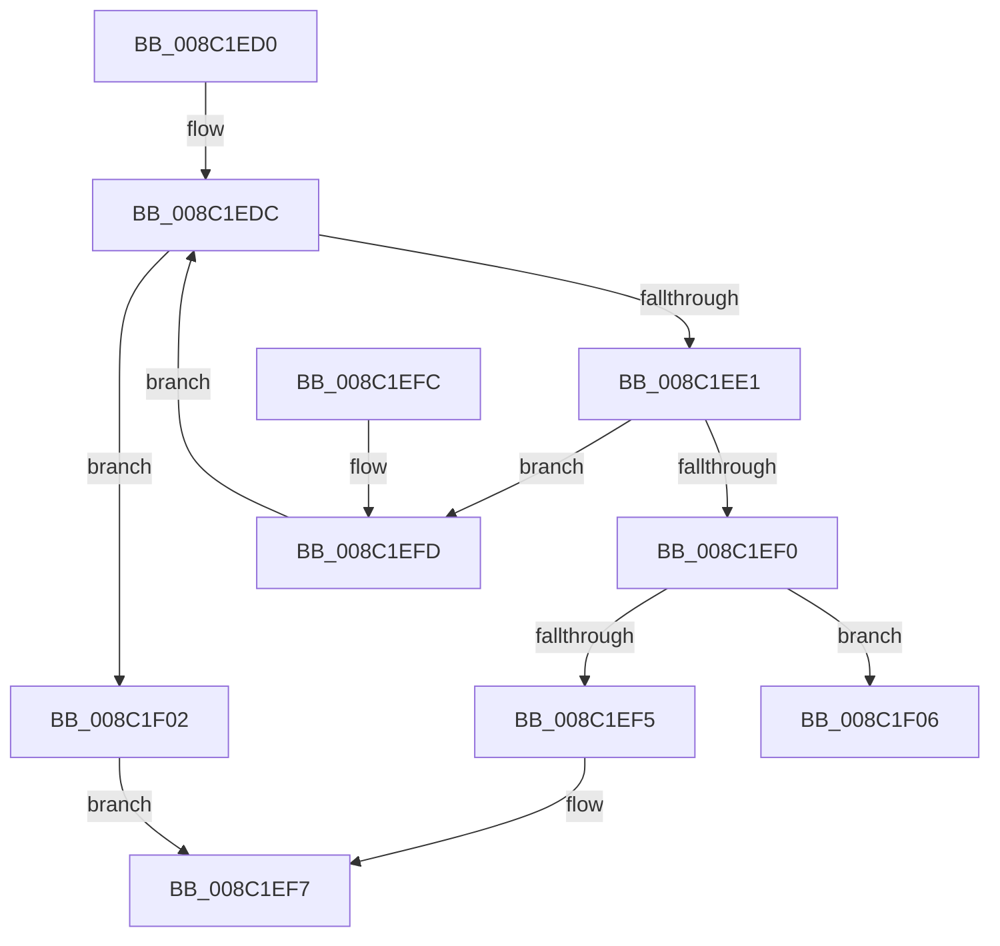

# EtwpReferenceGuidEntry

- RVA: `0x008C1ED0`–`0x008C1F24` (길이 `84` bytes)
- VA: `0x00000001408C1ED0`
- 실행 섹션: `PAGE`
- PDB 이름 있음: `예`; PDB Function 태그: `아니요`
- unwind 정보 RVA: `0x000836A4`
- 디코드: `26`개 명령, `84/84` bytes 표시
- 미해석 바이트: `0` (있으면 어셈블리에 `.byte`로 보존)

> 이 문서는 커널 이미지의 기계어와 PDB 기호를 분석해 생성했습니다. 4번과 5번은 함수 원형과 자료형을 바이너리 사용 방식에서 추정한 C 해석이며 원본 소스 복구 결과는 아닙니다.

## 1. Dependencies

- 직접 호출 지점: **1**; 고유 호출 대상: **1**
- 직접 호출자로 확인된 함수: **9**
- RIP 상대 이미지 참조: **0**

### Outgoing calls
- `0x008C1F1E` → [KeBugCheckEx](../../text/4F/KeBugCheckEx_function_004FD660.md) (function, `0x004FD660`)

### Direct callers
- [EtwGetProviderIdFromHandle](../../text/4B/EtwGetProviderIdFromHandle_function_004B8850.md) at `0x004B88D6`
- [sub_008BFCE3](../8B/Unknown_function_008BFCE3.md) at `0x008BFD7F`
- [EtwpInitializeRegEntry](EtwpInitializeRegEntry_function_008C1A78.md) at `0x008C1A9D`
- [EtwpFindOrCreateGuidEntry](EtwpFindOrCreateGuidEntry_function_008C1B70.md) at `0x008C1C3A`
- [EtwpFindGuidEntryByGuid](EtwpFindGuidEntryByGuid_function_008C1DB0.md) at `0x008C1E74`
- [sub_008C2328](Unknown_function_008C2328.md) at `0x008C23F3`
- [sub_008C2328](Unknown_function_008C2328.md) at `0x008C26E1`
- [EtwpAddRegEntryToGroup](../9F/EtwpAddRegEntryToGroup_function_009F39D4.md) at `0x009F3B6E`
- [EtwpUpdateGuidEnableInfo](../9F/EtwpUpdateGuidEnableInfo_function_009FCF48.md) at `0x009FD0AA`
- [EtwpCreateUmReplyObject](../A8/EtwpCreateUmReplyObject_function_00A8DBE4.md) at `0x00A8DCC0`

### Static image references
- 디코드된 RIP-relative 메모리 참조가 없습니다.

## 2. Other-region calls and transfers

- 다른 실행 섹션으로 향하는 call: **1**
  - `0x008C1F1E` → [KeBugCheckEx](../../text/4F/KeBugCheckEx_function_004FD660.md) (`PAGE` → `.text`)
- 별도 외부 분기/꼬리 이동을 확인하지 못했습니다.

## 3. Assembly (complete function range)

```asm
008C1ED0  48 83 EC 38                     sub rsp, 0x38
008C1ED4  0F 0D 49 20                     prefetchw byte ptr [rcx + 0x20]
008C1ED8  48 8B 51 20                     mov rdx, qword ptr [rcx + 0x20]
008C1EDC  48 85 D2                        test rdx, rdx
008C1EDF  74 21                           je 0x1408c1f02
008C1EE1  4C 8D 42 01                     lea r8, [rdx + 1]
008C1EE5  48 8B C2                        mov rax, rdx
008C1EE8  F0 4C 0F B1 41 20               lock cmpxchg qword ptr [rcx + 0x20], r8
008C1EEE  75 0D                           jne 0x1408c1efd
008C1EF0  48 85 D2                        test rdx, rdx
008C1EF3  78 11                           js 0x1408c1f06
008C1EF5  B0 01                           mov al, 1
008C1EF7  48 83 C4 38                     add rsp, 0x38
008C1EFB  C3                              ret
008C1EFC  CC                              int3
008C1EFD  48 8B D0                        mov rdx, rax
008C1F00  EB DA                           jmp 0x1408c1edc
008C1F02  32 C0                           xor al, al
008C1F04  EB F1                           jmp 0x1408c1ef7
008C1F06  45 33 C9                        xor r9d, r9d
008C1F09  48 C7 44 24 20 00 00 00 00      mov qword ptr [rsp + 0x20], 0
008C1F12  4C 8B C1                        mov r8, rcx
008C1F15  B9 1D 01 00 00                  mov ecx, 0x11d
008C1F1A  41 8D 51 09                     lea edx, [r9 + 9]
008C1F1E  E8 3D B7 C3 FF                  call 0x1404fd660
008C1F23  CC                              int3
```

## 4. C-style interpretation (structured pseudocode)

```c
__int64 __fastcall EtwpReferenceGuidEntry(__int64 a1, __int64 a2, __int64 a3, int a4)
{
    __int64 result;
    __int64 v_rsp;
    unsigned __int64 v_stack_p20;

    v_rsp = (v_rsp) - (56);
loc_008C1EDC:
    if (*(unsigned __int64 *)(a1 + 32) == 0) goto loc_008C1F02;
    if (*(unsigned __int64 *)(a1 + 32) != 0) goto loc_008C1EFD;
    if (sign_flag) goto loc_008C1F06;
loc_008C1EF7:
    v_rsp = (v_rsp) + (56);
    return 1;
loc_008C1EFD:
    goto loc_008C1EDC;
loc_008C1F02:
    result = 0;
    goto loc_008C1EF7;
loc_008C1F06:
    a4 = 0;
    v_stack_p20 = 0;
    result = KeBugCheckEx(285, a4 + 9, a1, a4);
    return result;
}
```

## 5. (Beta) C Style

```c
int64_t EtwpReferenceGuidEntry(void *Arg1, int64_t Arg2, int64_t Arg3, int32_t Arg4)
{
    uint8_t *arg1 = (uint8_t *)Arg1;

    int64_t result;
    int64_t local_rsp;
    uint64_t v_stack_p20;

    local_rsp = (local_rsp) - (56);
loc_008C1EDC:
    if (*(uint64_t *)(arg1 + 0x20) == 0) goto loc_008C1F02;
    if (*(uint64_t *)(arg1 + 0x20) != 0) goto loc_008C1EFD;
    if (sign_flag) goto loc_008C1F06;
loc_008C1EF7:
    local_rsp = (local_rsp) + (56);
    return 1;
loc_008C1EFD:
    goto loc_008C1EDC;
loc_008C1F02:
    result = 0;
    goto loc_008C1EF7;
loc_008C1F06:
    Arg4 = 0;
    v_stack_p20 = 0;
    result = KeBugCheckEx(285, Arg4 + 9, Arg1, Arg4);
    return result;
}
```

### 관측된 메모리 오프셋

구조체 형식이 확인되지 않은 접근은 인자 기준의 오프셋으로만 기록했습니다.

| 기준 인자 | 오프셋 표현 | 폭 (bit) | 접근 |
|---|---:|---:|---|
| `Arg1` | `+ 0x20` | `8` | `R` |
| `Arg1` | `+ 0x20` | `64` | `R` |

## 6. Execution-region graph

[열기: 2D/3D 그래프와 함수 탐색 컨트롤 패널](../../../control-panel.html?section=page&rva=0x008C1ED0&view=graph)

- 2D 그래프는 위에서 아래로 흐르고, 3D 그래프는 빈 공간을 드래그해 회전합니다. Shift+드래그는 이동, 휠은 확대·축소, 함수 노드 선택은 대상 보고서 이동입니다.

### Static fallback


