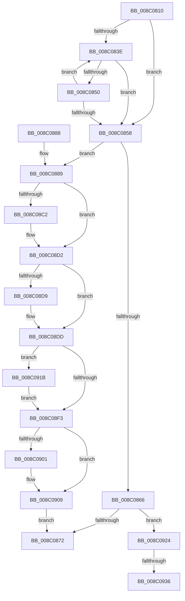

# EtwpReferenceLoggerSecurityDescriptor

- RVA: `0x008C0810`–`0x008C0942` (길이 `306` bytes)
- VA: `0x00000001408C0810`
- 실행 섹션: `PAGE`
- PDB 이름 있음: `예`; PDB Function 태그: `예`
- unwind 정보 RVA: `0x0008349C`
- 디코드: `82`개 명령, `306/306` bytes 표시
- 미해석 바이트: `0` (있으면 어셈블리에 `.byte`로 보존)

> 이 문서는 커널 이미지의 기계어와 PDB 기호를 분석해 생성했습니다. 4번과 5번은 함수 원형과 자료형을 바이너리 사용 방식에서 추정한 C 해석이며 원본 소스 복구 결과는 아닙니다.

## 1. Dependencies

- 직접 호출 지점: **5**; 고유 호출 대상: **5**
- 직접 호출자로 확인된 함수: **2**
- RIP 상대 이미지 참조: **1**

### Outgoing calls
- `0x008C08A9` → [KeAbPreAcquire](../../text/21/KeAbPreAcquire_function_00210230.md) (function, `0x00210230`)
- `0x008C08CD` → [ExfAcquirePushLockSharedEx](../../text/21/ExfAcquirePushLockSharedEx_function_0021044C.md) (function, `0x0021044C`)
- `0x008C0904` → [ExfReleasePushLockShared](../../text/26/ExfReleasePushLockShared_function_00263440.md) (function, `0x00263440`)
- `0x008C090C` → [KeAbPostRelease](../../text/2E/KeAbPostRelease_function_002E1600.md) (function, `0x002E1600`)
- `0x008C0911` → [KeLeaveCriticalRegion](../../text/25/KeLeaveCriticalRegion_function_0025D8B0.md) (function, `0x0025D8B0`)

### Direct callers
- [EtwpCheckLoggerControlAccess](EtwpCheckLoggerControlAccess_function_008C0AE0.md) at `0x008C0AF7`
- [EtwQueryPerformanceTraceInformation](../AF/EtwQueryPerformanceTraceInformation_function_00AF28A4.md) at `0x00AF29E7`

### Static image references
- `0x008C0892` → RVA `0x00EFF510` (`.data`; read)

## 2. Other-region calls and transfers

- 다른 실행 섹션으로 향하는 call: **5**
  - `0x008C08A9` → [KeAbPreAcquire](../../text/21/KeAbPreAcquire_function_00210230.md) (`PAGE` → `.text`)
  - `0x008C08CD` → [ExfAcquirePushLockSharedEx](../../text/21/ExfAcquirePushLockSharedEx_function_0021044C.md) (`PAGE` → `.text`)
  - `0x008C0904` → [ExfReleasePushLockShared](../../text/26/ExfReleasePushLockShared_function_00263440.md) (`PAGE` → `.text`)
  - `0x008C090C` → [KeAbPostRelease](../../text/2E/KeAbPostRelease_function_002E1600.md) (`PAGE` → `.text`)
  - `0x008C0911` → [KeLeaveCriticalRegion](../../text/25/KeLeaveCriticalRegion_function_0025D8B0.md) (`PAGE` → `.text`)
- call이 아닌 외부 분기/꼬리 이동: **2**
  - `0x008C0930` → [sub_00B1AEE4](../B1/Unknown_function_00B1AEE4.md) (`tail-transfer`)
  - `0x008C093D` → [sub_00B1AEE4](../B1/Unknown_function_00B1AEE4.md) (`tail-transfer`)

## 3. Assembly (complete function range)

```asm
008C0810  48 89 5C 24 10                  mov qword ptr [rsp + 0x10], rbx
008C0815  48 89 6C 24 18                  mov qword ptr [rsp + 0x18], rbp
008C081A  56                              push rsi
008C081B  57                              push rdi
008C081C  41 56                           push r14
008C081E  48 83 EC 20                     sub rsp, 0x20
008C0822  48 8B F9                        mov rdi, rcx
008C0825  0F 0D 89 10 03 00 00            prefetchw byte ptr [rcx + 0x310]
008C082C  48 8B 99 10 03 00 00            mov rbx, qword ptr [rcx + 0x310]
008C0833  41 B8 0F 00 00 00               mov r8d, 0xf
008C0839  41 84 D8                        test r8b, bl
008C083C  74 1A                           je 0x1408c0858
008C083E  48 8D 53 FF                     lea rdx, [rbx - 1]
008C0842  48 8B C3                        mov rax, rbx
008C0845  F0 48 0F B1 91 10 03 00 00      lock cmpxchg qword ptr [rcx + 0x310], rdx
008C084E  74 08                           je 0x1408c0858
008C0850  48 8B D8                        mov rbx, rax
008C0853  41 84 C0                        test r8b, al
008C0856  75 E6                           jne 0x1408c083e
008C0858  8B C3                           mov eax, ebx
008C085A  BE 01 00 00 00                  mov esi, 1
008C085F  41 23 C0                        and eax, r8d
008C0862  3B C6                           cmp eax, esi
008C0864  72 23                           jb 0x1408c0889
008C0866  48 83 E3 F0                     and rbx, 0xfffffffffffffff0
008C086A  3B C6                           cmp eax, esi
008C086C  0F 84 B2 00 00 00               je 0x1408c0924
008C0872  48 8B 6C 24 50                  mov rbp, qword ptr [rsp + 0x50]
008C0877  48 8B C3                        mov rax, rbx
008C087A  48 8B 5C 24 48                  mov rbx, qword ptr [rsp + 0x48]
008C087F  48 83 C4 20                     add rsp, 0x20
008C0883  41 5E                           pop r14
008C0885  5F                              pop rdi
008C0886  5E                              pop rsi
008C0887  C3                              ret
008C0888  CC                              int3
008C0889  65 48 8B 04 25 88 01 00 00      mov rax, qword ptr gs:[0x188]
008C0892  48 8D 2D 77 EC 63 00            lea rbp, [rip + 0x63ec77]
008C0899  45 33 C0                        xor r8d, r8d
008C089C  33 D2                           xor edx, edx
008C089E  48 8B CD                        mov rcx, rbp
008C08A1  66 FF 88 E4 01 00 00            dec word ptr [rax + 0x1e4]
008C08A8  90                              nop
008C08A9  E8 82 F9 94 FF                  call 0x140210230
008C08AE  48 8B D8                        mov rbx, rax
008C08B1  33 C0                           xor eax, eax
008C08B3  44 8D 70 11                     lea r14d, [rax + 0x11]
008C08B7  F0 4C 0F B1 35 50 EC 63 00      lock cmpxchg qword ptr [rip + 0x63ec50], r14
008C08C0  74 10                           je 0x1408c08d2
008C08C2  4C 8B CD                        mov r9, rbp
008C08C5  4C 8B C3                        mov r8, rbx
008C08C8  33 D2                           xor edx, edx
008C08CA  48 8B CD                        mov rcx, rbp
008C08CD  E8 7A FB 94 FF                  call 0x14021044c
008C08D2  33 D2                           xor edx, edx
008C08D4  48 85 DB                        test rbx, rbx
008C08D7  74 04                           je 0x1408c08dd
008C08D9  40 88 73 0A                     mov byte ptr [rbx + 0xa], sil
008C08DD  48 8B 9F 10 03 00 00            mov rbx, qword ptr [rdi + 0x310]
008C08E4  48 83 E3 F0                     and rbx, 0xfffffffffffffff0
008C08E8  F0 48 0F C1 73 E8               lock xadd qword ptr [rbx - 0x18], rsi
008C08EE  48 85 F6                        test rsi, rsi
008C08F1  7E 28                           jle 0x1408c091b
008C08F3  49 8B C6                        mov rax, r14
008C08F6  F0 48 0F B1 15 11 EC 63 00      lock cmpxchg qword ptr [rip + 0x63ec11], rdx
008C08FF  74 08                           je 0x1408c0909
008C0901  48 8B CD                        mov rcx, rbp
008C0904  E8 37 2B 9A FF                  call 0x140263440
008C0909  48 8B CD                        mov rcx, rbp
008C090C  E8 EF 0C A2 FF                  call 0x1402e1600
008C0911  E8 9A CF 99 FF                  call 0x14025d8b0
008C0916  E9 57 FF FF FF                  jmp 0x1408c0872
008C091B  B9 0E 00 00 00                  mov ecx, 0xe
008C0920  CD 29                           int 0x29
008C0922  EB CF                           jmp 0x1408c08f3
008C0924  49 8B C0                        mov rax, r8
008C0927  F0 48 0F C1 43 E8               lock xadd qword ptr [rbx - 0x18], rax
008C092D  48 85 C0                        test rax, rax
008C0930  0F 8F AE A5 25 00               jg 0x140b1aee4
008C0936  B9 0E 00 00 00                  mov ecx, 0xe
008C093B  CD 29                           int 0x29
008C093D  E9 A2 A5 25 00                  jmp 0x140b1aee4
```

## 4. C-style interpretation (structured pseudocode)

```c
__int64 __fastcall EtwpReferenceLoggerSecurityDescriptor(__int64 a1)
{
    __int64 result;
    __int64 v_rbx;
    __int64 v_rsp;
    unsigned __int64 v_stack_p10;
    unsigned __int64 v_stack_p18;

    v_stack_p10 = v_rbx;
    v_stack_p18 = v_rbp;
    v_rsp = (v_rsp) - (32);
    if (((15) & ((unsigned __int8)(*(unsigned __int64 *)(a1 + 784)))) == 0) goto loc_008C0858;
loc_008C083E:
    if (((15) & ((unsigned __int8)(*(unsigned __int64 *)(a1 + 784)))) == 0) goto loc_008C0858;
    if (((15) & ((unsigned __int8)(*(unsigned __int64 *)(a1 + 784)))) != 0) goto loc_008C083E;
loc_008C0858:
    result = (unsigned int)(((unsigned int)((unsigned int)(*(unsigned __int64 *)(a1 + 784)))) & (15));
    if (((unsigned int)(result)) < 1) goto loc_008C0889;
    v_rbx = (*(unsigned __int64 *)(a1 + 784)) & (-16);
    if (((unsigned int)(result)) == 1) goto loc_008C0924;
loc_008C0872:
    v_rsp = (v_rsp) + (32);
    return v_rbx;
loc_008C0889:
    a3 = 0;
    a2 = 0;
    result = KeAbPreAcquire(v_rip + 6548599, a2, a3, a4);
    result = 0;
    if (!(condition_is_equal)) {
        a4 = v_rip + 6548599;
        a3 = 0;
        a2 = 0;
        a1 = v_rip + 6548599;
        result = ExfAcquirePushLockSharedEx(a1, a2, a3, a4);
    }
    a2 = 0;
    if (result != 0) {
        *(unsigned __int8 *)(result + 10) = 1;
    }
    v_rbx = (*(unsigned __int64 *)(a1 + 784)) & (-16);
    if (condition_is_less_or_equal) goto loc_008C091B;
loc_008C08F3:
    result = result + 17;
    if (1 != 0) {
        a1 = v_rip + 6548599;
        result = ExfReleasePushLockShared(a1, a2, a3, a4);
    }
    result = KeAbPostRelease(v_rip + 6548599, a2, a3, a4);
    result = KeLeaveCriticalRegion(v_rip + 6548599, a2, a3, a4);
    goto loc_008C0872;
loc_008C091B:
    goto loc_008C08F3;
loc_008C0924:
}
```

## 5. (Beta) C Style

```c
int64_t EtwpReferenceLoggerSecurityDescriptor(void *Arg1)
{
    uint8_t *arg1 = (uint8_t *)Arg1;

    int64_t result;
    int64_t local_rbx;
    int64_t local_rsp;
    uint64_t v_stack_p10;
    uint64_t v_stack_p18;

    v_stack_p10 = local_rbx;
    v_stack_p18 = local_rbp;
    local_rsp = (local_rsp) - (32);
    if (((15) & ((uint8_t)(*(uint64_t *)(arg1 + 0x310)))) == 0) goto loc_008C0858;
loc_008C083E:
    if (((15) & ((uint8_t)(*(uint64_t *)(arg1 + 0x310)))) == 0) goto loc_008C0858;
    if (((15) & ((uint8_t)(*(uint64_t *)(arg1 + 0x310)))) != 0) goto loc_008C083E;
loc_008C0858:
    result = (uint32_t)(((uint32_t)((uint32_t)(*(uint64_t *)(arg1 + 0x310)))) & (15));
    if (((uint32_t)(result)) < 1) goto loc_008C0889;
    local_rbx = (*(uint64_t *)(arg1 + 0x310)) & (-16);
    if (((uint32_t)(result)) == 1) goto loc_008C0924;
loc_008C0872:
    local_rsp = (local_rsp) + (32);
    return local_rbx;
loc_008C0889:
    a3 = 0;
    a2 = 0;
    result = KeAbPreAcquire(v_rip + 6548599, a2, a3, a4);
    result = 0;
    if (!(condition_is_equal)) {
        a4 = v_rip + 6548599;
        a3 = 0;
        a2 = 0;
        Arg1 = v_rip + 6548599;
        result = ExfAcquirePushLockSharedEx(Arg1, a2, a3, a4);
    }
    a2 = 0;
    if (result != 0) {
        *(uint8_t *)(result + 0xA) = 1;
    }
    local_rbx = (*(uint64_t *)(arg1 + 0x310)) & (-16);
    if (condition_is_less_or_equal) goto loc_008C091B;
loc_008C08F3:
    result = result + 17;
    if (1 != 0) {
        Arg1 = v_rip + 6548599;
        result = ExfReleasePushLockShared(Arg1, a2, a3, a4);
    }
    result = KeAbPostRelease(v_rip + 6548599, a2, a3, a4);
    result = KeLeaveCriticalRegion(v_rip + 6548599, a2, a3, a4);
    goto loc_008C0872;
loc_008C091B:
    goto loc_008C08F3;
loc_008C0924:
}
```

### 관측된 메모리 오프셋

구조체 형식이 확인되지 않은 접근은 인자 기준의 오프셋으로만 기록했습니다.

| 기준 인자 | 오프셋 표현 | 폭 (bit) | 접근 |
|---|---:|---:|---|
| `Arg1` | `+ 0x310` | `8` | `R` |
| `Arg1` | `+ 0x310` | `64` | `R` |

## 6. Execution-region graph

[열기: 2D/3D 그래프와 함수 탐색 컨트롤 패널](../../../control-panel.html?section=page&rva=0x008C0810&view=graph)

- 2D 그래프는 위에서 아래로 흐르고, 3D 그래프는 빈 공간을 드래그해 회전합니다. Shift+드래그는 이동, 휠은 확대·축소, 함수 노드 선택은 대상 보고서 이동입니다.

### Static fallback


