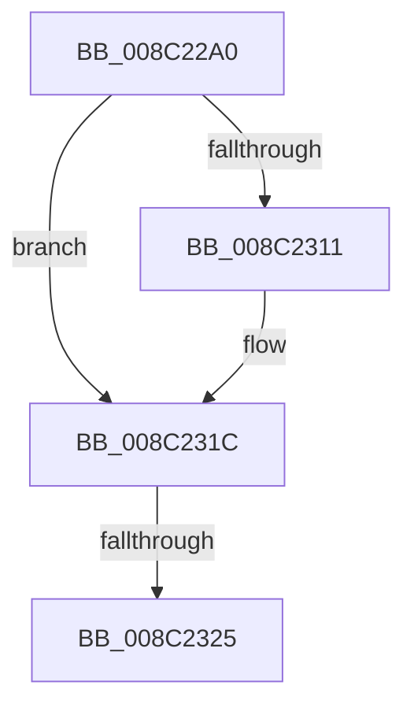

# EtwpRegisterUMProvider

- RVA: `0x008C22A0`–`0x008C2328` (길이 `136` bytes)
- VA: `0x00000001408C22A0`
- 실행 섹션: `PAGE`
- PDB 이름 있음: `예`; PDB Function 태그: `예`
- unwind 정보 RVA: `0x000836E0`
- 디코드: `33`개 명령, `136/136` bytes 표시
- 미해석 바이트: `0` (있으면 어셈블리에 `.byte`로 보존)

> 이 문서는 커널 이미지의 기계어와 PDB 기호를 분석해 생성했습니다. 4번과 5번은 함수 원형과 자료형을 바이너리 사용 방식에서 추정한 C 해석이며 원본 소스 복구 결과는 아닙니다.

## 1. Dependencies

- 직접 호출 지점: **0**; 고유 호출 대상: **0**
- 직접 호출자로 확인된 함수: **1**
- RIP 상대 이미지 참조: **3**

### Outgoing calls
- 직접 디코드된 call 명령이 없습니다.

### Direct callers
- [NtTraceControl](../A9/NtTraceControl_function_00A9ED40.md) at `0x00A9F27F`

### Static image references
- `0x008C22B3` → RVA `0x00E0A740` (`.data`; read)
- `0x008C22E9` → RVA `0x00011370` (`.rdata`; read)
- `0x008C2315` → RVA `0x00011378` (`.rdata`; read)

## 2. Other-region calls and transfers

- 다른 실행 섹션으로 향하는 call: **0**
- call이 아닌 외부 분기/꼬리 이동: **1**
  - `0x008C231F` → [sub_008C2DB8](Unknown_function_008C2DB8.md) (`tail-transfer`)

## 3. Assembly (complete function range)

```asm
008C22A0  40 55                           push rbp
008C22A2  57                              push rdi
008C22A3  41 54                           push r12
008C22A5  41 55                           push r13
008C22A7  48 8D 6C 24 98                  lea rbp, [rsp - 0x68]
008C22AC  48 81 EC 68 01 00 00            sub rsp, 0x168
008C22B3  48 8B 05 86 84 54 00            mov rax, qword ptr [rip + 0x548486]
008C22BA  48 33 C4                        xor rax, rsp
008C22BD  48 89 45 48                     mov qword ptr [rbp + 0x48], rax
008C22C1  48 8B 85 B0 00 00 00            mov rax, qword ptr [rbp + 0xb0]
008C22C8  4C 8B E1                        mov r12, rcx
008C22CB  8B 4A 10                        mov ecx, dword ptr [rdx + 0x10]
008C22CE  48 8B FA                        mov rdi, rdx
008C22D1  48 89 45 A0                     mov qword ptr [rbp - 0x60], rax
008C22D5  0F B7 42 14                     movzx eax, word ptr [rdx + 0x14]
008C22D9  66 89 44 24 58                  mov word ptr [rsp + 0x58], ax
008C22DE  48 8B 02                        mov rax, qword ptr [rdx]
008C22E1  44 89 44 24 68                  mov dword ptr [rsp + 0x68], r8d
008C22E6  45 33 C0                        xor r8d, r8d
008C22E9  48 2B 05 80 F0 74 FF            sub rax, qword ptr [rip - 0x8b0f80]
008C22F0  45 8B E8                        mov r13d, r8d
008C22F3  44 88 4C 24 50                  mov byte ptr [rsp + 0x50], r9b
008C22F8  48 89 55 C0                     mov qword ptr [rbp - 0x40], rdx
008C22FC  4C 89 45 98                     mov qword ptr [rbp - 0x68], r8
008C2300  4C 89 44 24 60                  mov qword ptr [rsp + 0x60], r8
008C2305  66 44 89 44 24 54               mov word ptr [rsp + 0x54], r8w
008C230B  89 4C 24 6C                     mov dword ptr [rsp + 0x6c], ecx
008C230F  75 0B                           jne 0x1408c231c
008C2311  48 8B 42 08                     mov rax, qword ptr [rdx + 8]
008C2315  48 2B 05 5C F0 74 FF            sub rax, qword ptr [rip - 0x8b0fa4]
008C231C  48 85 C0                        test rax, rax
008C231F  0F 84 93 0A 00 00               je 0x1408c2db8
008C2325  8D 41 FE                        lea eax, [rcx - 2]
```

## 4. C-style interpretation (structured pseudocode)

```c
__int64 __fastcall EtwpRegisterUMProvider(__int64 a1, __int64 a2, int a3, unsigned __int8 a4, __int64 a5)
{
    __int64 result;
    __int64 v_rsp;
    unsigned int v_stack_m11C;
    unsigned int v_stack_m120;
    unsigned __int64 v_stack_m128;
    unsigned __int16 v_stack_m130;
    unsigned __int16 v_stack_m134;
    unsigned __int8 v_stack_m138;
    unsigned __int64 v_stack_m40;
    unsigned __int64 v_stack_m88;
    unsigned __int64 v_stack_mC8;
    unsigned __int64 v_stack_mE8;
    unsigned __int64 v_stack_mF0;

    v_rsp = (v_rsp) - (360);
    result = (*(unsigned __int64 *)(v_rip + 5538950)) ^ (v_rsp);
    v_stack_m40 = result;
    v_stack_mE8 = a5;
    v_stack_m130 = (unsigned __int16)(*(unsigned __int16 *)(a2 + 20));
    v_stack_m120 = a3;
    a3 = 0;
    result = (*(unsigned __int64 *)(a2)) - (*(unsigned __int64 *)(v_rip - 9113472));
    v_stack_m138 = a4;
    v_stack_mC8 = a2;
    v_stack_mF0 = 0;
    v_stack_m128 = 0;
    v_stack_m134 = 0;
    v_stack_m11C = (unsigned int)((unsigned int)(*(unsigned int *)(a2 + 16)));
    if (!(condition_is_not_equal)) {
        result = *(unsigned __int64 *)(a2 + 8);
        result = (result) - (*(unsigned __int64 *)(v_rip - 9113508));
    }
    return (unsigned int)(*(unsigned int *)(a2 + 16)) - 2;
}
```

## 5. (Beta) C Style

```c
int64_t EtwpRegisterUMProvider(int64_t Arg1, void *Arg2, int32_t Arg3, uint8_t Arg4, int64_t Arg5)
{
    uint8_t *arg2 = (uint8_t *)Arg2;

    int64_t result;
    int64_t local_rsp;
    uint32_t v_stack_m11C;
    uint32_t v_stack_m120;
    uint64_t v_stack_m128;
    uint16_t v_stack_m130;
    uint16_t v_stack_m134;
    uint8_t v_stack_m138;
    uint64_t v_stack_m40;
    uint64_t v_stack_m88;
    uint64_t v_stack_mC8;
    uint64_t v_stack_mE8;
    uint64_t v_stack_mF0;

    local_rsp = (local_rsp) - (360);
    result = (*(uint64_t *)(v_rip + 0x548486)) ^ (local_rsp);
    v_stack_m40 = result;
    v_stack_mE8 = Arg5;
    v_stack_m130 = (uint16_t)(*(uint16_t *)(arg2 + 0x14));
    v_stack_m120 = Arg3;
    Arg3 = 0;
    result = (*(uint64_t *)(arg2)) - (*(uint64_t *)(v_rip - 0x8B0F80));
    v_stack_m138 = Arg4;
    v_stack_mC8 = Arg2;
    v_stack_mF0 = 0;
    v_stack_m128 = 0;
    v_stack_m134 = 0;
    v_stack_m11C = (uint32_t)((uint32_t)(*(uint32_t *)(arg2 + 0x10)));
    if (!(condition_is_not_equal)) {
        result = *(uint64_t *)(arg2 + 0x8);
        result = (result) - (*(uint64_t *)(v_rip - 0x8B0FA4));
    }
    return (uint32_t)(*(uint32_t *)(arg2 + 0x10)) - 2;
}
```

### 관측된 메모리 오프셋

구조체 형식이 확인되지 않은 접근은 인자 기준의 오프셋으로만 기록했습니다.

| 기준 인자 | 오프셋 표현 | 폭 (bit) | 접근 |
|---|---:|---:|---|
| `Arg2` | `+ 0x0` | `64` | `R` |
| `Arg2` | `+ 0x8` | `64` | `R` |
| `Arg2` | `+ 0x10` | `32` | `R` |
| `Arg2` | `+ 0x14` | `16` | `R` |

## 6. Execution-region graph

[열기: 2D/3D 그래프와 함수 탐색 컨트롤 패널](../../../control-panel.html?section=page&rva=0x008C22A0&view=graph)

- 2D 그래프는 위에서 아래로 흐르고, 3D 그래프는 빈 공간을 드래그해 회전합니다. Shift+드래그는 이동, 휠은 확대·축소, 함수 노드 선택은 대상 보고서 이동입니다.

### Static fallback


