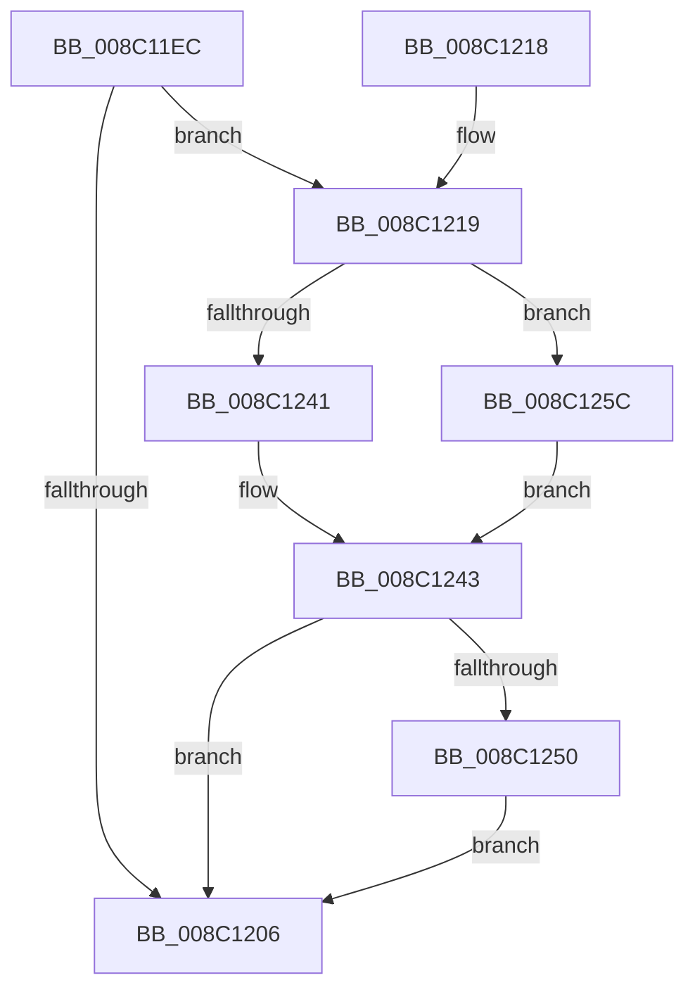

# EtwpReleaseProviderTraitsReference

- RVA: `0x008C11EC`–`0x008C127B` (길이 `143` bytes)
- VA: `0x00000001408C11EC`
- 실행 섹션: `PAGE`
- PDB 이름 있음: `예`; PDB Function 태그: `아니요`
- unwind 정보 RVA: `0x000835DC`
- 디코드: `40`개 명령, `143/143` bytes 표시
- 미해석 바이트: `0` (있으면 어셈블리에 `.byte`로 보존)

> 이 문서는 커널 이미지의 기계어와 PDB 기호를 분석해 생성했습니다. 4번과 5번은 함수 원형과 자료형을 바이너리 사용 방식에서 추정한 C 해석이며 원본 소스 복구 결과는 아닙니다.

## 1. Dependencies

- 직접 호출 지점: **4**; 고유 호출 대상: **4**
- 직접 호출자로 확인된 함수: **3**
- RIP 상대 이미지 참조: **4**

### Outgoing calls
- `0x008C1236` → [ExAcquireFastMutex](../../text/20/ExAcquireFastMutex_function_0020E5A0.md) (function, `0x0020E5A0`)
- `0x008C1246` → [ExReleaseFastMutex](../../text/25/ExReleaseFastMutex_function_002519C0.md) (function, `0x002519C0`)
- `0x008C1255` → [ExFreePoolWithTag](../../poolcode/B8/ExFreePoolWithTag_function_00B82870.md) (function, `0x00B82870`)
- `0x008C1274` → [RtlRbRemoveNode](../../text/2E/RtlRbRemoveNode_function_002E4C10.md) (function, `0x002E4C10`)

### Direct callers
- [EtwpDeleteRegistrationObject](EtwpDeleteRegistrationObject_function_008C1F30.md) at `0x008C21C6`
- [EtwpSetProviderTraitsCommon](../9F/EtwpSetProviderTraitsCommon_function_009F36EC.md) at `0x009F38C0`
- [EtwUnregister](../A7/EtwUnregister_function_00A723D0.md) at `0x00A725B3`

### Static image references
- `0x008C121D` → RVA `0x00EFF4C0` (`.data`; read)
- `0x008C1228` → RVA `0x00EFF460` (`.data`; read)
- `0x008C125F` → RVA `0x00EFF500` (`.data`; read)
- `0x008C1266` → RVA `0x00EFF4A0` (`.data`; read)

## 2. Other-region calls and transfers

- 다른 실행 섹션으로 향하는 call: **4**
  - `0x008C1236` → [ExAcquireFastMutex](../../text/20/ExAcquireFastMutex_function_0020E5A0.md) (`PAGE` → `.text`)
  - `0x008C1246` → [ExReleaseFastMutex](../../text/25/ExReleaseFastMutex_function_002519C0.md) (`PAGE` → `.text`)
  - `0x008C1255` → [ExFreePoolWithTag](../../poolcode/B8/ExFreePoolWithTag_function_00B82870.md) (`PAGE` → `POOLCODE`)
  - `0x008C1274` → [RtlRbRemoveNode](../../text/2E/RtlRbRemoveNode_function_002E4C10.md) (`PAGE` → `.text`)
- 별도 외부 분기/꼬리 이동을 확인하지 못했습니다.

## 3. Assembly (complete function range)

```asm
008C11EC  48 89 5C 24 08                  mov qword ptr [rsp + 8], rbx
008C11F1  48 89 74 24 10                  mov qword ptr [rsp + 0x10], rsi
008C11F6  57                              push rdi
008C11F7  48 83 EC 20                     sub rsp, 0x20
008C11FB  33 DB                           xor ebx, ebx
008C11FD  48 87 59 70                     xchg qword ptr [rcx + 0x70], rbx
008C1201  48 85 DB                        test rbx, rbx
008C1204  75 13                           jne 0x1408c1219
008C1206  48 8B 5C 24 30                  mov rbx, qword ptr [rsp + 0x30]
008C120B  33 C0                           xor eax, eax
008C120D  48 8B 74 24 38                  mov rsi, qword ptr [rsp + 0x38]
008C1212  48 83 C4 20                     add rsp, 0x20
008C1216  5F                              pop rdi
008C1217  C3                              ret
008C1218  CC                              int3
008C1219  40 8A 71 62                     mov sil, byte ptr [rcx + 0x62]
008C121D  48 8D 05 9C E2 63 00            lea rax, [rip + 0x63e29c]
008C1224  40 80 E6 01                     and sil, 1
008C1228  48 8D 3D 31 E2 63 00            lea rdi, [rip + 0x63e231]
008C122F  48 0F 44 F8                     cmove rdi, rax
008C1233  48 8B CF                        mov rcx, rdi
008C1236  E8 65 D3 94 FF                  call 0x14020e5a0
008C123B  83 43 18 FF                     add dword ptr [rbx + 0x18], -1
008C123F  74 1B                           je 0x1408c125c
008C1241  33 DB                           xor ebx, ebx
008C1243  48 8B CF                        mov rcx, rdi
008C1246  E8 75 07 99 FF                  call 0x1402519c0
008C124B  48 85 DB                        test rbx, rbx
008C124E  74 B6                           je 0x1408c1206
008C1250  33 D2                           xor edx, edx
008C1252  48 8B CB                        mov rcx, rbx
008C1255  E8 16 16 2C 00                  call 0x140b82870
008C125A  EB AA                           jmp 0x1408c1206
008C125C  40 84 F6                        test sil, sil
008C125F  48 8D 05 9A E2 63 00            lea rax, [rip + 0x63e29a]
008C1266  48 8D 0D 33 E2 63 00            lea rcx, [rip + 0x63e233]
008C126D  48 8B D3                        mov rdx, rbx
008C1270  48 0F 44 C8                     cmove rcx, rax
008C1274  E8 97 39 A2 FF                  call 0x1402e4c10
008C1279  EB C8                           jmp 0x1408c1243
```

## 4. C-style interpretation (structured pseudocode)

```c
__int64 __fastcall EtwpReleaseProviderTraitsReference(__int64 a1, int a2)
{
    __int64 result;
    __int64 v_rbx;
    __int64 v_rdi;
    __int64 v_rsi;
    __int64 v_rsp;
    unsigned __int64 v_stack_p10;
    unsigned __int64 v_stack_p8;

    v_stack_p8 = v_rbx;
    v_stack_p10 = v_rsi;
    v_rsp = (v_rsp) - (32);
    v_rbx = 0;
    if (0 != 0) goto loc_008C1219;
loc_008C1206:
    result = 0;
    v_rsp = (v_rsp) + (32);
    return result;
loc_008C1219:
    v_rsi = (unsigned __int8)((*(unsigned __int8 *)(a1 + 98)) & (1));
    v_rdi = v_rip + 6545969;
    if (condition_is_equal) { v_rdi = v_rip + 6546076; }
    result = ExAcquireFastMutex(v_rdi, a2, a3, a4);
    if (condition_is_equal) goto loc_008C125C;
    v_rbx = 0;
loc_008C1243:
    result = ExReleaseFastMutex(v_rdi, a2, a3, a4);
    if (0 == 0) goto loc_008C1206;
    a2 = 0;
    result = ExFreePoolWithTag(0, a2, a3, a4);
    goto loc_008C1206;
loc_008C125C:
    a1 = v_rip + 6545971;
    if ((unsigned __int8)(v_rsi) == 0) { a1 = v_rip + 6546074; }
    result = RtlRbRemoveNode(a1, 0, a3, a4);
    goto loc_008C1243;
}
```

## 5. (Beta) C Style

```c
int64_t EtwpReleaseProviderTraitsReference(void *Arg1, int32_t Arg2)
{
    uint8_t *arg1 = (uint8_t *)Arg1;

    int64_t result;
    int64_t local_rbx;
    int64_t local_rdi;
    int64_t local_rsi;
    int64_t local_rsp;
    uint64_t v_stack_p10;
    uint64_t v_stack_p8;

    v_stack_p8 = local_rbx;
    v_stack_p10 = local_rsi;
    local_rsp = (local_rsp) - (32);
    local_rbx = 0;
    if (0 != 0) goto loc_008C1219;
loc_008C1206:
    result = 0;
    local_rsp = (local_rsp) + (32);
    return result;
loc_008C1219:
    local_rsi = (uint8_t)((*(uint8_t *)(arg1 + 0x62)) & (1));
    local_rdi = v_rip + 6545969;
    if (condition_is_equal) { local_rdi = v_rip + 6546076; }
    result = ExAcquireFastMutex(local_rdi, Arg2, a3, a4);
    if (condition_is_equal) goto loc_008C125C;
    local_rbx = 0;
loc_008C1243:
    result = ExReleaseFastMutex(local_rdi, Arg2, a3, a4);
    if (0 == 0) goto loc_008C1206;
    Arg2 = 0;
    result = ExFreePoolWithTag(0, Arg2, a3, a4);
    goto loc_008C1206;
loc_008C125C:
    Arg1 = v_rip + 6545971;
    if ((uint8_t)(local_rsi) == 0) { Arg1 = v_rip + 6546074; }
    result = RtlRbRemoveNode(Arg1, 0, a3, a4);
    goto loc_008C1243;
}
```

### 관측된 메모리 오프셋

구조체 형식이 확인되지 않은 접근은 인자 기준의 오프셋으로만 기록했습니다.

| 기준 인자 | 오프셋 표현 | 폭 (bit) | 접근 |
|---|---:|---:|---|
| `Arg1` | `+ 0x62` | `8` | `R` |
| `Arg1` | `+ 0x70` | `64` | `R/W` |

## 6. Execution-region graph

[열기: 2D/3D 그래프와 함수 탐색 컨트롤 패널](../../../control-panel.html?section=page&rva=0x008C11EC&view=graph)

- 2D 그래프는 위에서 아래로 흐르고, 3D 그래프는 빈 공간을 드래그해 회전합니다. Shift+드래그는 이동, 휠은 확대·축소, 함수 노드 선택은 대상 보고서 이동입니다.

### Static fallback


