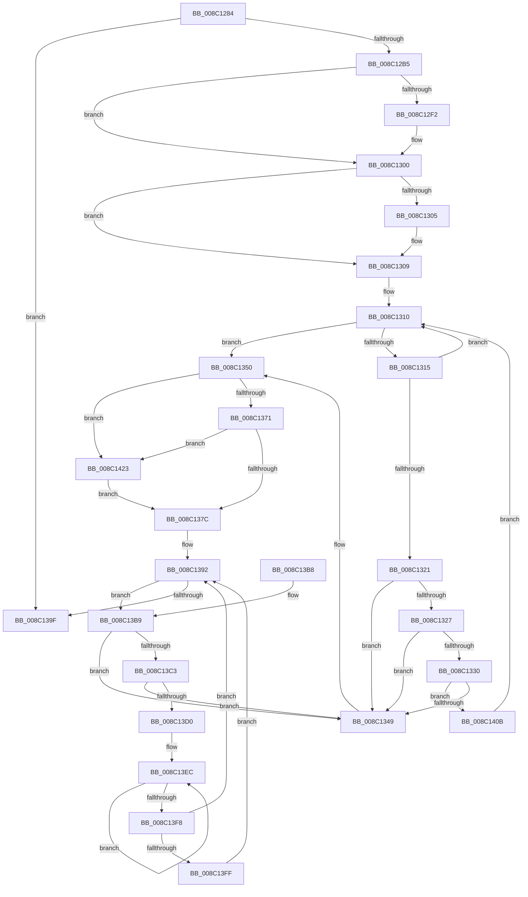

# EtwpRundownNotifications

- RVA: `0x008C1284`–`0x008C1430` (길이 `428` bytes)
- VA: `0x00000001408C1284`
- 실행 섹션: `PAGE`
- PDB 이름 있음: `예`; PDB Function 태그: `아니요`
- unwind 정보 RVA: `0x000835F0`
- 디코드: `116`개 명령, `428/428` bytes 표시
- 미해석 바이트: `0` (있으면 어셈블리에 `.byte`로 보존)

> 이 문서는 커널 이미지의 기계어와 PDB 기호를 분석해 생성했습니다. 4번과 5번은 함수 원형과 자료형을 바이너리 사용 방식에서 추정한 C 해석이며 원본 소스 복구 결과는 아닙니다.

## 1. Dependencies

- 직접 호출 지점: **7**; 고유 호출 대상: **7**
- 직접 호출자로 확인된 함수: **1**
- RIP 상대 이미지 참조: **0**

### Outgoing calls
- `0x008C12E2` → [KeAbPreAcquire](../../text/21/KeAbPreAcquire_function_00210230.md) (function, `0x00210230`)
- `0x008C12FB` → [ExfAcquirePushLockExclusiveEx](../../text/20/ExfAcquirePushLockExclusiveEx_function_0020FC90.md) (function, `0x0020FC90`)
- `0x008C137F` → [KeAbPostRelease](../../text/2E/KeAbPostRelease_function_002E1600.md) (function, `0x002E1600`)
- `0x008C138D` → [KeLeaveCriticalRegionThread](../../text/25/KeLeaveCriticalRegionThread_function_0025EFF0.md) (function, `0x0025EFF0`)
- `0x008C13E0` → [EtwpUnreferenceDataBlock](../8B/EtwpUnreferenceDataBlock_function_008BFC5C.md) (function, `0x008BFC5C`)
- `0x008C1404` → [ExFreePoolWithTag](../../poolcode/B8/ExFreePoolWithTag_function_00B82870.md) (function, `0x00B82870`)
- `0x008C1426` → [ExfReleasePushLock](../../text/26/ExfReleasePushLock_function_002638D0.md) (function, `0x002638D0`)

### Direct callers
- [EtwpDeleteRegistrationObject](EtwpDeleteRegistrationObject_function_008C1F30.md) at `0x008C21B0`

### Static image references
- 디코드된 RIP-relative 메모리 참조가 없습니다.

## 2. Other-region calls and transfers

- 다른 실행 섹션으로 향하는 call: **6**
  - `0x008C12E2` → [KeAbPreAcquire](../../text/21/KeAbPreAcquire_function_00210230.md) (`PAGE` → `.text`)
  - `0x008C12FB` → [ExfAcquirePushLockExclusiveEx](../../text/20/ExfAcquirePushLockExclusiveEx_function_0020FC90.md) (`PAGE` → `.text`)
  - `0x008C137F` → [KeAbPostRelease](../../text/2E/KeAbPostRelease_function_002E1600.md) (`PAGE` → `.text`)
  - `0x008C138D` → [KeLeaveCriticalRegionThread](../../text/25/KeLeaveCriticalRegionThread_function_0025EFF0.md) (`PAGE` → `.text`)
  - `0x008C1404` → [ExFreePoolWithTag](../../poolcode/B8/ExFreePoolWithTag_function_00B82870.md) (`PAGE` → `POOLCODE`)
  - `0x008C1426` → [ExfReleasePushLock](../../text/26/ExfReleasePushLock_function_002638D0.md) (`PAGE` → `.text`)
- 별도 외부 분기/꼬리 이동을 확인하지 못했습니다.

## 3. Assembly (complete function range)

```asm
008C1284  48 89 5C 24 08                  mov qword ptr [rsp + 8], rbx
008C1289  48 89 74 24 10                  mov qword ptr [rsp + 0x10], rsi
008C128E  48 89 7C 24 18                  mov qword ptr [rsp + 0x18], rdi
008C1293  55                              push rbp
008C1294  41 56                           push r14
008C1296  41 57                           push r15
008C1298  48 8B EC                        mov rbp, rsp
008C129B  48 83 EC 30                     sub rsp, 0x30
008C129F  48 8B B1 20 03 00 00            mov rsi, qword ptr [rcx + 0x320]
008C12A6  45 33 FF                        xor r15d, r15d
008C12A9  4C 8B F2                        mov r14, rdx
008C12AC  48 85 F6                        test rsi, rsi
008C12AF  0F 84 EA 00 00 00               je 0x1408c139f
008C12B5  48 8D 45 F0                     lea rax, [rbp - 0x10]
008C12B9  45 33 C0                        xor r8d, r8d
008C12BC  48 89 45 F8                     mov qword ptr [rbp - 8], rax
008C12C0  48 8D 5E 10                     lea rbx, [rsi + 0x10]
008C12C4  48 8D 45 F0                     lea rax, [rbp - 0x10]
008C12C8  33 D2                           xor edx, edx
008C12CA  48 89 45 F0                     mov qword ptr [rbp - 0x10], rax
008C12CE  48 8B CB                        mov rcx, rbx
008C12D1  65 48 8B 04 25 88 01 00 00      mov rax, qword ptr gs:[0x188]
008C12DA  66 FF 88 E4 01 00 00            dec word ptr [rax + 0x1e4]
008C12E1  90                              nop
008C12E2  E8 49 EF 94 FF                  call 0x140210230
008C12E7  F0 48 0F BA 2B 00               lock bts qword ptr [rbx], 0
008C12ED  48 8B F8                        mov rdi, rax
008C12F0  73 0E                           jae 0x1408c1300
008C12F2  4C 8B C3                        mov r8, rbx
008C12F5  48 8B D0                        mov rdx, rax
008C12F8  48 8B CB                        mov rcx, rbx
008C12FB  E8 90 E9 94 FF                  call 0x14020fc90
008C1300  48 85 FF                        test rdi, rdi
008C1303  74 04                           je 0x1408c1309
008C1305  C6 47 0A 01                     mov byte ptr [rdi + 0xa], 1
008C1309  48 8D 56 18                     lea rdx, [rsi + 0x18]
008C130D  48 8B 02                        mov rax, qword ptr [rdx]
008C1310  48 3B C2                        cmp rax, rdx
008C1313  74 3B                           je 0x1408c1350
008C1315  48 8B C8                        mov rcx, rax
008C1318  48 8B 00                        mov rax, qword ptr [rax]
008C131B  4C 39 71 18                     cmp qword ptr [rcx + 0x18], r14
008C131F  75 EF                           jne 0x1408c1310
008C1321  48 39 48 08                     cmp qword ptr [rax + 8], rcx
008C1325  75 22                           jne 0x1408c1349
008C1327  4C 8B 41 08                     mov r8, qword ptr [rcx + 8]
008C132B  49 39 08                        cmp qword ptr [r8], rcx
008C132E  75 19                           jne 0x1408c1349
008C1330  49 89 00                        mov qword ptr [r8], rax
008C1333  4C 8D 4D F0                     lea r9, [rbp - 0x10]
008C1337  4C 89 40 08                     mov qword ptr [rax + 8], r8
008C133B  4C 8B 45 F0                     mov r8, qword ptr [rbp - 0x10]
008C133F  4D 39 48 08                     cmp qword ptr [r8 + 8], r9
008C1343  0F 84 C2 00 00 00               je 0x1408c140b
008C1349  B9 03 00 00 00                  mov ecx, 3
008C134E  CD 29                           int 0x29
008C1350  0F 0D 0B                        prefetchw byte ptr [rbx]
008C1353  48 8B 03                        mov rax, qword ptr [rbx]
008C1356  48 8B C8                        mov rcx, rax
008C1359  48 83 E1 F0                     and rcx, 0xfffffffffffffff0
008C135D  48 83 F9 10                     cmp rcx, 0x10
008C1361  48 8D 50 F0                     lea rdx, [rax - 0x10]
008C1365  49 0F 46 D7                     cmovbe rdx, r15
008C1369  A8 02                           test al, 2
008C136B  0F 85 B2 00 00 00               jne 0x1408c1423
008C1371  F0 48 0F B1 13                  lock cmpxchg qword ptr [rbx], rdx
008C1376  0F 85 A7 00 00 00               jne 0x1408c1423
008C137C  48 8B CB                        mov rcx, rbx
008C137F  E8 7C 02 A2 FF                  call 0x1402e1600
008C1384  65 48 8B 0C 25 88 01 00 00      mov rcx, qword ptr gs:[0x188]
008C138D  E8 5E DC 99 FF                  call 0x14025eff0
008C1392  48 8B 5D F0                     mov rbx, qword ptr [rbp - 0x10]
008C1396  48 8D 45 F0                     lea rax, [rbp - 0x10]
008C139A  48 3B D8                        cmp rbx, rax
008C139D  75 1A                           jne 0x1408c13b9
008C139F  48 8B 5C 24 50                  mov rbx, qword ptr [rsp + 0x50]
008C13A4  48 8B 74 24 58                  mov rsi, qword ptr [rsp + 0x58]
008C13A9  48 8B 7C 24 60                  mov rdi, qword ptr [rsp + 0x60]
008C13AE  48 83 C4 30                     add rsp, 0x30
008C13B2  41 5F                           pop r15
008C13B4  41 5E                           pop r14
008C13B6  5D                              pop rbp
008C13B7  C3                              ret
008C13B8  CC                              int3
008C13B9  48 8D 45 F0                     lea rax, [rbp - 0x10]
008C13BD  48 39 43 08                     cmp qword ptr [rbx + 8], rax
008C13C1  75 86                           jne 0x1408c1349
008C13C3  48 8B 03                        mov rax, qword ptr [rbx]
008C13C6  48 39 58 08                     cmp qword ptr [rax + 8], rbx
008C13CA  0F 85 79 FF FF FF               jne 0x1408c1349
008C13D0  48 89 45 F0                     mov qword ptr [rbp - 0x10], rax
008C13D4  48 8D 4D F0                     lea rcx, [rbp - 0x10]
008C13D8  48 89 48 08                     mov qword ptr [rax + 8], rcx
008C13DC  48 8B 4B 10                     mov rcx, qword ptr [rbx + 0x10]
008C13E0  E8 77 E8 FF FF                  call 0x1408bfc5c
008C13E5  0F 0D 4B 34                     prefetchw byte ptr [rbx + 0x34]
008C13E9  8B 43 34                        mov eax, dword ptr [rbx + 0x34]
008C13EC  8B D0                           mov edx, eax
008C13EE  83 E2 FE                        and edx, 0xfffffffe
008C13F1  F0 0F B1 53 34                  lock cmpxchg dword ptr [rbx + 0x34], edx
008C13F6  75 F4                           jne 0x1408c13ec
008C13F8  A9 FE FF FF FF                  test eax, 0xfffffffe
008C13FD  75 93                           jne 0x1408c1392
008C13FF  33 D2                           xor edx, edx
008C1401  48 8B CB                        mov rcx, rbx
008C1404  E8 67 14 2C 00                  call 0x140b82870
008C1409  EB 87                           jmp 0x1408c1392
008C140B  4C 89 01                        mov qword ptr [rcx], r8
008C140E  4C 8D 4D F0                     lea r9, [rbp - 0x10]
008C1412  4C 89 49 08                     mov qword ptr [rcx + 8], r9
008C1416  49 89 48 08                     mov qword ptr [r8 + 8], rcx
008C141A  48 89 4D F0                     mov qword ptr [rbp - 0x10], rcx
008C141E  E9 ED FE FF FF                  jmp 0x1408c1310
008C1423  48 8B CB                        mov rcx, rbx
008C1426  E8 A5 24 9A FF                  call 0x1402638d0
008C142B  E9 4C FF FF FF                  jmp 0x1408c137c
```

## 4. C-style interpretation (structured pseudocode)

```c
__int64 __fastcall EtwpRundownNotifications(__int64 a1, __int64 a2, int a3)
{
    __int64 result;
    __int64 v_r15;
    __int64 v_rsp;
    unsigned __int64 v_stack_m20;
    unsigned __int64 v_stack_m28;
    unsigned __int64 v_stack_p10;
    unsigned __int64 v_stack_p18;
    unsigned __int64 v_stack_p8;

    v_stack_p8 = v_rbx;
    v_stack_p10 = v_rsi;
    v_stack_p18 = v_rdi;
    v_rsp = (v_rsp) - (48);
    v_r15 = 0;
    if (*(unsigned __int64 *)(a1 + 800) == 0) goto loc_008C139F;
    a3 = 0;
    v_stack_m20 = v_stack_m28;
    a2 = 0;
    v_stack_m28 = v_stack_m28;
    result = KeAbPreAcquire(*(unsigned __int64 *)(a1 + 800) + 16, a2, a3, a4);
    if (!(condition_is_above_or_equal)) {
        a3 = *(unsigned __int64 *)(a1 + 800) + 16;
        a2 = result;
        a1 = *(unsigned __int64 *)(a1 + 800) + 16;
        result = ExfAcquirePushLockExclusiveEx(a1, a2, a3, a4);
    }
    if (result != 0) {
        *(unsigned __int8 *)(result + 10) = 1;
    }
loc_008C1310:
    if ((*(unsigned __int64 *)(*(unsigned __int64 *)(a1 + 800) + 24)) == (*(unsigned __int64 *)(a1 + 800) + 24)) goto loc_008C1350;
    if ((*(unsigned __int64 *)(*(unsigned __int64 *)(*(unsigned __int64 *)(a1 + 800) + 24) + 24)) != a2) goto loc_008C1310;
    if ((*(unsigned __int64 *)(*(unsigned __int64 *)(*(unsigned __int64 *)(*(unsigned __int64 *)(a1 + 800) + 24)) + 8)) != (*(unsigned __int64 *)(*(unsigned __int64 *)(a1 + 800) + 24))) goto loc_008C1349;
    if ((*(unsigned __int64 *)(*(unsigned __int64 *)(*(unsigned __int64 *)(*(unsigned __int64 *)(a1 + 800) + 24) + 8))) != (*(unsigned __int64 *)(*(unsigned __int64 *)(a1 + 800) + 24))) goto loc_008C1349;
    *(unsigned __int64 *)(*(unsigned __int64 *)(*(unsigned __int64 *)(*(unsigned __int64 *)(a1 + 800) + 24) + 8)) = *(unsigned __int64 *)(*(unsigned __int64 *)(*(unsigned __int64 *)(a1 + 800) + 24));
    *(unsigned __int64 *)(*(unsigned __int64 *)(*(unsigned __int64 *)(*(unsigned __int64 *)(a1 + 800) + 24)) + 8) = *(unsigned __int64 *)(*(unsigned __int64 *)(*(unsigned __int64 *)(a1 + 800) + 24) + 8);
    if ((*(unsigned __int64 *)(v_stack_m28 + 8)) == v_stack_m28) goto loc_008C140B;
loc_008C1349:
loc_008C1350:
    a1 = (*(unsigned __int64 *)(*(unsigned __int64 *)(a1 + 800) + 16)) & (-16);
    a2 = *(unsigned __int64 *)(*(unsigned __int64 *)(a1 + 800) + 16) - 16;
    if (a1 <= 16) { a2 = 0; }
    if ((((unsigned __int8)(*(unsigned __int64 *)(*(unsigned __int64 *)(a1 + 800) + 16))) & (2)) != 0) goto loc_008C1423;
    if ((((unsigned __int8)(*(unsigned __int64 *)(*(unsigned __int64 *)(a1 + 800) + 16))) & (2)) != 0) goto loc_008C1423;
loc_008C137C:
    result = KeAbPostRelease(*(unsigned __int64 *)(a1 + 800) + 16, a2, v_stack_m28, v_stack_m28);
    result = KeLeaveCriticalRegionThread(*(unsigned __int64 *)(gs_base + (0 + 392)), a2, v_stack_m28, v_stack_m28);
loc_008C1392:
    if (v_stack_m28 != v_stack_m28) goto loc_008C13B9;
loc_008C139F:
    v_rsp = (v_rsp) + (48);
    return v_stack_m28;
loc_008C13B9:
    if ((*(unsigned __int64 *)(v_stack_p8 + 8)) != v_stack_m28) goto loc_008C1349;
    if ((*(unsigned __int64 *)(*(unsigned __int64 *)(v_stack_p8) + 8)) != v_stack_p8) goto loc_008C1349;
    v_stack_m28 = *(unsigned __int64 *)(v_stack_p8);
    *(unsigned __int64 *)(*(unsigned __int64 *)(v_stack_p8) + 8) = v_stack_m28;
    result = EtwpUnreferenceDataBlock(*(unsigned __int64 *)(v_stack_p8 + 16), a2, v_stack_m28, v_stack_m28);
loc_008C13EC:
    a2 = (unsigned int)(((unsigned int)((unsigned int)((unsigned int)(*(unsigned int *)(v_stack_p8 + 52))))) & (0xFFFFFFFEULL));
    if (condition_is_not_equal) goto loc_008C13EC;
    if ((((unsigned int)((unsigned int)(*(unsigned int *)(v_stack_p8 + 52)))) & (0xFFFFFFFEULL)) != 0) goto loc_008C1392;
    a2 = 0;
    result = ExFreePoolWithTag(v_stack_p8, a2, v_stack_m28, v_stack_m28);
    goto loc_008C1392;
loc_008C140B:
    *(unsigned __int64 *)(v_stack_p8) = v_stack_m28;
    *(unsigned __int64 *)(v_stack_p8 + 8) = v_stack_m28;
    *(unsigned __int64 *)(v_stack_m28 + 8) = v_stack_p8;
    v_stack_m28 = v_stack_p8;
    goto loc_008C1310;
loc_008C1423:
    result = ExfReleasePushLock(v_stack_p8, a2, v_stack_m28, v_stack_m28);
    goto loc_008C137C;
}
```

## 5. (Beta) C Style

```c
int64_t EtwpRundownNotifications(void *Arg1, int64_t Arg2, int32_t Arg3)
{
    uint8_t *arg1 = (uint8_t *)Arg1;

    int64_t result;
    int64_t local_r15;
    int64_t local_rsp;
    uint64_t v_stack_m20;
    uint64_t v_stack_m28;
    uint64_t v_stack_p10;
    uint64_t v_stack_p18;
    uint64_t v_stack_p8;

    v_stack_p8 = local_rbx;
    v_stack_p10 = local_rsi;
    v_stack_p18 = local_rdi;
    local_rsp = (local_rsp) - (48);
    local_r15 = 0;
    if (*(uint64_t *)(arg1 + 0x320) == 0) goto loc_008C139F;
    Arg3 = 0;
    v_stack_m20 = v_stack_m28;
    Arg2 = 0;
    v_stack_m28 = v_stack_m28;
    result = KeAbPreAcquire(*(uint64_t *)(arg1 + 0x320) + 16, Arg2, Arg3, a4);
    if (!(condition_is_above_or_equal)) {
        Arg3 = *(uint64_t *)(arg1 + 0x320) + 16;
        Arg2 = result;
        Arg1 = *(uint64_t *)(arg1 + 0x320) + 16;
        result = ExfAcquirePushLockExclusiveEx(Arg1, Arg2, Arg3, a4);
    }
    if (result != 0) {
        *(uint8_t *)(result + 0xA) = 1;
    }
loc_008C1310:
    if ((*(uint64_t *)(*(uint64_t *)(arg1 + 0x320) + 0x18)) == (*(uint64_t *)(arg1 + 0x320) + 24)) goto loc_008C1350;
    if ((*(uint64_t *)(*(uint64_t *)(*(uint64_t *)(arg1 + 0x320) + 0x18) + 0x18)) != Arg2) goto loc_008C1310;
    if ((*(uint64_t *)(*(uint64_t *)(*(uint64_t *)(*(uint64_t *)(arg1 + 0x320) + 0x18)) + 0x8)) != (*(uint64_t *)(*(uint64_t *)(arg1 + 0x320) + 0x18))) goto loc_008C1349;
    if ((*(uint64_t *)(*(uint64_t *)(*(uint64_t *)(*(uint64_t *)(arg1 + 0x320) + 0x18) + 0x8))) != (*(uint64_t *)(*(uint64_t *)(arg1 + 0x320) + 0x18))) goto loc_008C1349;
    *(uint64_t *)(*(uint64_t *)(*(uint64_t *)(*(uint64_t *)(arg1 + 0x320) + 0x18) + 0x8)) = *(uint64_t *)(*(uint64_t *)(*(uint64_t *)(arg1 + 0x320) + 0x18));
    *(uint64_t *)(*(uint64_t *)(*(uint64_t *)(*(uint64_t *)(arg1 + 0x320) + 0x18)) + 0x8) = *(uint64_t *)(*(uint64_t *)(*(uint64_t *)(arg1 + 0x320) + 0x18) + 0x8);
    if ((*(uint64_t *)(v_stack_m28 + 0x8)) == v_stack_m28) goto loc_008C140B;
loc_008C1349:
loc_008C1350:
    Arg1 = (*(uint64_t *)(*(uint64_t *)(arg1 + 0x320) + 0x10)) & (-16);
    Arg2 = *(uint64_t *)(*(uint64_t *)(arg1 + 0x320) + 0x10) - 16;
    if (Arg1 <= 16) { Arg2 = 0; }
    if ((((uint8_t)(*(uint64_t *)(*(uint64_t *)(arg1 + 0x320) + 0x10))) & (2)) != 0) goto loc_008C1423;
    if ((((uint8_t)(*(uint64_t *)(*(uint64_t *)(arg1 + 0x320) + 0x10))) & (2)) != 0) goto loc_008C1423;
loc_008C137C:
    result = KeAbPostRelease(*(uint64_t *)(arg1 + 0x320) + 16, Arg2, v_stack_m28, v_stack_m28);
    result = KeLeaveCriticalRegionThread(*(uint64_t *)(gs_base + (0 + 0x188)), Arg2, v_stack_m28, v_stack_m28);
loc_008C1392:
    if (v_stack_m28 != v_stack_m28) goto loc_008C13B9;
loc_008C139F:
    local_rsp = (local_rsp) + (48);
    return v_stack_m28;
loc_008C13B9:
    if ((*(uint64_t *)(v_stack_p8 + 0x8)) != v_stack_m28) goto loc_008C1349;
    if ((*(uint64_t *)(*(uint64_t *)(v_stack_p8) + 0x8)) != v_stack_p8) goto loc_008C1349;
    v_stack_m28 = *(uint64_t *)(v_stack_p8);
    *(uint64_t *)(*(uint64_t *)(v_stack_p8) + 0x8) = v_stack_m28;
    result = EtwpUnreferenceDataBlock(*(uint64_t *)(v_stack_p8 + 0x10), Arg2, v_stack_m28, v_stack_m28);
loc_008C13EC:
    Arg2 = (uint32_t)(((uint32_t)((uint32_t)((uint32_t)(*(uint32_t *)(v_stack_p8 + 0x34))))) & (0xFFFFFFFEULL));
    if (condition_is_not_equal) goto loc_008C13EC;
    if ((((uint32_t)((uint32_t)(*(uint32_t *)(v_stack_p8 + 0x34)))) & (0xFFFFFFFEULL)) != 0) goto loc_008C1392;
    Arg2 = 0;
    result = ExFreePoolWithTag(v_stack_p8, Arg2, v_stack_m28, v_stack_m28);
    goto loc_008C1392;
loc_008C140B:
    *(uint64_t *)(v_stack_p8) = v_stack_m28;
    *(uint64_t *)(v_stack_p8 + 0x8) = v_stack_m28;
    *(uint64_t *)(v_stack_m28 + 0x8) = v_stack_p8;
    v_stack_m28 = v_stack_p8;
    goto loc_008C1310;
loc_008C1423:
    result = ExfReleasePushLock(v_stack_p8, Arg2, v_stack_m28, v_stack_m28);
    goto loc_008C137C;
}
```

### 관측된 메모리 오프셋

구조체 형식이 확인되지 않은 접근은 인자 기준의 오프셋으로만 기록했습니다.

| 기준 인자 | 오프셋 표현 | 폭 (bit) | 접근 |
|---|---:|---:|---|
| `Arg1` | `+ 0x320` | `64` | `R` |

## 6. Execution-region graph

[열기: 2D/3D 그래프와 함수 탐색 컨트롤 패널](../../../control-panel.html?section=page&rva=0x008C1284&view=graph)

- 2D 그래프는 위에서 아래로 흐르고, 3D 그래프는 빈 공간을 드래그해 회전합니다. Shift+드래그는 이동, 휠은 확대·축소, 함수 노드 선택은 대상 보고서 이동입니다.

### Static fallback


