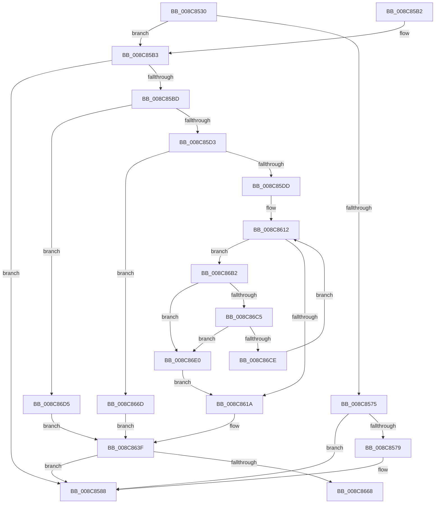

# EtwpSendDataBlock

- RVA: `0x008C8530`–`0x008C8704` (길이 `468` bytes)
- VA: `0x00000001408C8530`
- 실행 섹션: `PAGE`
- PDB 이름 있음: `예`; PDB Function 태그: `예`
- unwind 정보 RVA: `0x00084054`
- 디코드: `126`개 명령, `468/468` bytes 표시
- 미해석 바이트: `0` (있으면 어셈블리에 `.byte`로 보존)

> 이 문서는 커널 이미지의 기계어와 PDB 기호를 분석해 생성했습니다. 4번과 5번은 함수 원형과 자료형을 바이너리 사용 방식에서 추정한 C 해석이며 원본 소스 복구 결과는 아닙니다.

## 1. Dependencies

- 직접 호출 지점: **5**; 고유 호출 대상: **4**
- 직접 호출자로 확인된 함수: **6**
- RIP 상대 이미지 참조: **1**

### Outgoing calls
- `0x008C8580` → [EtwpQueueNotification](EtwpQueueNotification_function_008C870C.md) (function, `0x008C870C`)
- `0x008C8592` → [_security_check_cookie](../../text/6A/_security_check_cookie_function_006AC640.md) (function, `0x006AC640`)
- `0x008C863A` → [guard_dispatch_icall](../../text/6B/guard_dispatch_icall_function_006BAAD0.md) (function, `0x006BAAD0`)
- `0x008C864C` → [KeQueryTimeIncrement](../../text/44/KeQueryTimeIncrement_function_0044B4C0.md) (function, `0x0044B4C0`)
- `0x008C86AB` → [guard_dispatch_icall](../../text/6B/guard_dispatch_icall_function_006BAAD0.md) (function, `0x006BAAD0`)

### Direct callers
- [SendCaptureStateNotificationsWorker](../7B/SendCaptureStateNotificationsWorker_function_007BCF30.md) at `0x007BD177`
- [EtwpClearSessionAndUnreferenceEntry](EtwpClearSessionAndUnreferenceEntry_function_008C1438.md) at `0x008C17E3`
- [EtwpNotifyGuid](EtwpNotifyGuid_function_008C8110.md) at `0x008C82D8`
- [EtwpNotifyDisallowedGuidChange](../9E/EtwpNotifyDisallowedGuidChange_function_009EAD14.md) at `0x009EAF90`
- [EtwpEnableGuid](../A5/EtwpEnableGuid_function_00A5CD28.md) at `0x00A5D56D`
- [sub_00B2E69A](../B2/Unknown_function_00B2E69A.md) at `0x00B2E73D`

### Static image references
- `0x008C854C` → RVA `0x00E0A740` (`.data`; read)

## 2. Other-region calls and transfers

- 다른 실행 섹션으로 향하는 call: **4**
  - `0x008C8592` → [_security_check_cookie](../../text/6A/_security_check_cookie_function_006AC640.md) (`PAGE` → `.text`)
  - `0x008C863A` → [guard_dispatch_icall](../../text/6B/guard_dispatch_icall_function_006BAAD0.md) (`PAGE` → `.text`)
  - `0x008C864C` → [KeQueryTimeIncrement](../../text/44/KeQueryTimeIncrement_function_0044B4C0.md) (`PAGE` → `.text`)
  - `0x008C86AB` → [guard_dispatch_icall](../../text/6B/guard_dispatch_icall_function_006BAAD0.md) (`PAGE` → `.text`)
- call이 아닌 외부 분기/꼬리 이동: **1**
  - `0x008C8668` → [sub_00B1B106](../B1/Unknown_function_00B1B106.md) (`tail-transfer`)

## 3. Assembly (complete function range)

```asm
008C8530  48 89 5C 24 18                  mov qword ptr [rsp + 0x18], rbx
008C8535  55                              push rbp
008C8536  56                              push rsi
008C8537  57                              push rdi
008C8538  41 54                           push r12
008C853A  41 55                           push r13
008C853C  41 56                           push r14
008C853E  41 57                           push r15
008C8540  48 8D 6C 24 D9                  lea rbp, [rsp - 0x27]
008C8545  48 81 EC D0 00 00 00            sub rsp, 0xd0
008C854C  48 8B 05 ED 21 54 00            mov rax, qword ptr [rip + 0x5421ed]
008C8553  48 33 C4                        xor rax, rsp
008C8556  48 89 45 17                     mov qword ptr [rbp + 0x17], rax
008C855A  0F B7 41 62                     movzx eax, word ptr [rcx + 0x62]
008C855E  45 33 FF                        xor r15d, r15d
008C8561  0F 57 C0                        xorps xmm0, xmm0
008C8564  48 8B F1                        mov rsi, rcx
008C8567  45 8B DF                        mov r11d, r15d
008C856A  45 8B F7                        mov r14d, r15d
008C856D  0F 11 45 AF                     movups xmmword ptr [rbp - 0x51], xmm0
008C8571  A8 01                           test al, 1
008C8573  75 3E                           jne 0x1408c85b3
008C8575  A8 02                           test al, 2
008C8577  74 0F                           je 0x1408c8588
008C8579  4C 8B C1                        mov r8, rcx
008C857C  48 8B 49 50                     mov rcx, qword ptr [rcx + 0x50]
008C8580  E8 87 01 00 00                  call 0x1408c870c
008C8585  44 8B F0                        mov r14d, eax
008C8588  41 8B C6                        mov eax, r14d
008C858B  48 8B 4D 17                     mov rcx, qword ptr [rbp + 0x17]
008C858F  48 33 CC                        xor rcx, rsp
008C8592  E8 A9 40 DE FF                  call 0x1406ac640
008C8597  48 8B 9C 24 20 01 00 00         mov rbx, qword ptr [rsp + 0x120]
008C859F  48 81 C4 D0 00 00 00            add rsp, 0xd0
008C85A6  41 5F                           pop r15
008C85A8  41 5E                           pop r14
008C85AA  41 5D                           pop r13
008C85AC  41 5C                           pop r12
008C85AE  5F                              pop rdi
008C85AF  5E                              pop rsi
008C85B0  5D                              pop rbp
008C85B1  C3                              ret
008C85B2  CC                              int3
008C85B3  48 8B 59 50                     mov rbx, qword ptr [rcx + 0x50]
008C85B7  4C 39 79 58                     cmp qword ptr [rcx + 0x58], r15
008C85BB  74 CB                           je 0x1408c8588
008C85BD  48 BF 20 03 00 00 80 F7 FF FF   movabs rdi, 0xfffff78000000320
008C85C7  48 8B 3F                        mov rdi, qword ptr [rdi]
008C85CA  83 3A 03                        cmp dword ptr [rdx], 3
008C85CD  0F 85 02 01 00 00               jne 0x1408c86d5
008C85D3  F6 41 62 08                     test byte ptr [rcx + 0x62], 8
008C85D7  0F 85 90 00 00 00               jne 0x1408c866d
008C85DD  48 8B 41 58                     mov rax, qword ptr [rcx + 0x58]
008C85E1  44 8B 52 48                     mov r10d, dword ptr [rdx + 0x48]
008C85E5  8B 4A 74                        mov ecx, dword ptr [rdx + 0x74]
008C85E8  48 89 45 97                     mov qword ptr [rbp - 0x69], rax
008C85EC  41 8B C2                        mov eax, r10d
008C85EF  F7 D8                           neg eax
008C85F1  41 8B C2                        mov eax, r10d
008C85F4  45 1A FF                        sbb r15b, r15b
008C85F7  44 22 7A 4C                     and r15b, byte ptr [rdx + 0x4c]
008C85FB  F7 D8                           neg eax
008C85FD  41 8B C2                        mov eax, r10d
008C8600  4D 1B E4                        sbb r12, r12
008C8603  4C 23 62 60                     and r12, qword ptr [rdx + 0x60]
008C8607  F7 D8                           neg eax
008C8609  4D 1B ED                        sbb r13, r13
008C860C  4C 23 6A 58                     and r13, qword ptr [rdx + 0x58]
008C8610  33 C0                           xor eax, eax
008C8612  3B C1                           cmp eax, ecx
008C8614  0F 82 98 00 00 00               jb 0x1408c86b2
008C861A  48 8B 45 97                     mov rax, qword ptr [rbp - 0x69]
008C861E  48 8D 4A 38                     lea rcx, [rdx + 0x38]
008C8622  48 89 5C 24 30                  mov qword ptr [rsp + 0x30], rbx
008C8627  41 8B D2                        mov edx, r10d
008C862A  4C 89 5C 24 28                  mov qword ptr [rsp + 0x28], r11
008C862F  4D 8B CD                        mov r9, r13
008C8632  45 8A C7                        mov r8b, r15b
008C8635  4C 89 64 24 20                  mov qword ptr [rsp + 0x20], r12
008C863A  E8 91 24 DF FF                  call 0x1406baad0
008C863F  48 BB 20 03 00 00 80 F7 FF FF   movabs rbx, 0xfffff78000000320
008C8649  48 8B 1B                        mov rbx, qword ptr [rbx]
008C864C  E8 6F 2E B8 FF                  call 0x14044b4c0
008C8651  48 2B DF                        sub rbx, rdi
008C8654  44 8B C0                        mov r8d, eax
008C8657  4C 0F AF C3                     imul r8, rbx
008C865B  49 81 F8 10 6D C3 23            cmp r8, 0x23c36d10
008C8662  0F 8C 20 FF FF FF               jl 0x1408c8588
008C8668  E9 99 2A 25 00                  jmp 0x140b1b106
008C866D  4C 8B 59 20                     mov r11, qword ptr [rcx + 0x20]
008C8671  4C 8B CB                        mov r9, rbx
008C8674  8A 52 70                        mov dl, byte ptr [rdx + 0x70]
008C8677  41 8A 4B 5A                     mov cl, byte ptr [r11 + 0x5a]
008C867B  41 0F B7 43 58                  movzx eax, word ptr [r11 + 0x58]
008C8680  45 8B 43 50                     mov r8d, dword ptr [r11 + 0x50]
008C8684  45 8B 53 54                     mov r10d, dword ptr [r11 + 0x54]
008C8688  66 89 45 9F                     mov word ptr [rbp - 0x61], ax
008C868C  48 8B 46 58                     mov rax, qword ptr [rsi + 0x58]
008C8690  88 4D A1                        mov byte ptr [rbp - 0x5f], cl
008C8693  49 8D 4B 28                     lea rcx, [r11 + 0x28]
008C8697  44 89 45 A3                     mov dword ptr [rbp - 0x5d], r8d
008C869B  4C 8D 45 9F                     lea r8, [rbp - 0x61]
008C869F  44 88 7D A2                     mov byte ptr [rbp - 0x5e], r15b
008C86A3  44 89 55 A7                     mov dword ptr [rbp - 0x59], r10d
008C86A7  44 89 7D AB                     mov dword ptr [rbp - 0x55], r15d
008C86AB  E8 20 24 DF FF                  call 0x1406baad0
008C86B0  EB 8D                           jmp 0x1408c863f
008C86B2  44 8B C0                        mov r8d, eax
008C86B5  4D 03 C0                        add r8, r8
008C86B8  46 8B 8C C2 84 00 00 00         mov r9d, dword ptr [rdx + r8*8 + 0x84]
008C86C0  45 85 C9                        test r9d, r9d
008C86C3  79 1B                           jns 0x1408c86e0
008C86C5  41 81 F9 00 00 00 80            cmp r9d, 0x80000000
008C86CC  74 12                           je 0x1408c86e0
008C86CE  FF C0                           inc eax
008C86D0  E9 3D FF FF FF                  jmp 0x1408c8612
008C86D5  41 BE 0D 00 00 C0               mov r14d, 0xc000000d
008C86DB  E9 5F FF FF FF                  jmp 0x1408c863f
008C86E0  4A 8B 4C C2 78                  mov rcx, qword ptr [rdx + r8*8 + 0x78]
008C86E5  4C 8D 5D AF                     lea r11, [rbp - 0x51]
008C86E9  42 8B 84 C2 80 00 00 00         mov eax, dword ptr [rdx + r8*8 + 0x80]
008C86F1  48 03 CA                        add rcx, rdx
008C86F4  48 89 4D AF                     mov qword ptr [rbp - 0x51], rcx
008C86F8  89 45 B7                        mov dword ptr [rbp - 0x49], eax
008C86FB  44 89 4D BB                     mov dword ptr [rbp - 0x45], r9d
008C86FF  E9 16 FF FF FF                  jmp 0x1408c861a
```

## 4. C-style interpretation (structured pseudocode)

```c
__int64 __fastcall EtwpSendDataBlock(__int64 a1, __int64 a2)
{
    __int64 result;
    __int64 v_r12;
    __int64 v_r13;
    __int64 v_r14;
    __int64 v_r15;
    __int64 v_rbx;
    __int64 v_rsp;
    unsigned __int64 v_stack_m48;
    unsigned __int64 v_stack_m5F;
    unsigned int v_stack_mA4;
    unsigned int v_stack_mA8;
    unsigned __int64 v_stack_mB0;
    unsigned int v_stack_mB4;
    unsigned int v_stack_mB8;
    unsigned int v_stack_mBC;
    unsigned __int8 v_stack_mBD;
    unsigned __int8 v_stack_mBE;
    unsigned __int16 v_stack_mC0;
    unsigned __int64 v_stack_mC8;
    unsigned __int64 v_stack_p18;
    unsigned __int64 v_stack_p20;
    unsigned __int64 v_stack_p28;
    unsigned __int64 v_stack_p30;

    v_stack_p18 = v_rbx;
    v_rsp = (v_rsp) - (208);
    result = (*(unsigned __int64 *)(v_rip + 5513709)) ^ (v_rsp);
    v_stack_m48 = result;
    v_r15 = 0;
    v_stack_mB0 = v_xmm0;
    if ((((unsigned __int8)(*(unsigned __int16 *)(a1 + 98))) & (1)) != 0) goto loc_008C85B3;
    result = *(unsigned __int16 *)(a1 + 98);
    v_r14 = 0;
    if ((((unsigned __int8)(*(unsigned __int16 *)(a1 + 98))) & (2)) != 0) {
        a3 = a1;
        a1 = *(unsigned __int64 *)(a1 + 80);
        result = EtwpQueueNotification(a1, a2, a3, a4);
        v_r14 = (unsigned int)(result);
    }
    a1 = (v_stack_m48) ^ (v_rsp);
    result = _security_check_cookie(a1, a2, a3, a4);
    v_rsp = (v_rsp) + (208);
    return result;
loc_008C85B3:
    if ((*(unsigned __int64 *)(a1 + 88)) == 0) goto loc_008C8588;
    if ((*(unsigned int *)(a2)) != 3) goto loc_008C86D5;
    if (((*(unsigned __int8 *)(a1 + 98)) & (8)) != 0) goto loc_008C866D;
    v_stack_mC8 = *(unsigned __int64 *)(a1 + 88);
    result = (unsigned int)(-((unsigned int)((unsigned int)((unsigned int)(*(unsigned int *)(a2 + 72))))));
    v_r15 = (unsigned __int8)((v_r15) & (*(unsigned __int8 *)(a2 + 76)));
    result = (unsigned int)(-((unsigned int)((unsigned int)((unsigned int)(*(unsigned int *)(a2 + 72))))));
    v_r12 = (v_r12) & (*(unsigned __int64 *)(a2 + 96));
    result = (unsigned int)(-((unsigned int)((unsigned int)((unsigned int)(*(unsigned int *)(a2 + 72))))));
    v_r13 = (v_r13) & (*(unsigned __int64 *)(a2 + 88));
    result = 0;
loc_008C8612:
    if (0 < ((unsigned int)((unsigned int)(*(unsigned int *)(a2 + 116))))) goto loc_008C86B2;
loc_008C861A:
    v_stack_p30 = *(unsigned __int64 *)(a1 + 80);
    v_stack_p28 = 0;
    v_stack_p20 = v_r12;
    result = guard_dispatch_icall(a2 + 56, (unsigned int)((unsigned int)((unsigned int)(*(unsigned int *)(a2 + 72)))), (unsigned __int8)(v_r15), v_r13);
loc_008C863F:
    result = KeQueryTimeIncrement(a2 + 56, (unsigned int)((unsigned int)((unsigned int)(*(unsigned int *)(a2 + 72)))), (unsigned __int8)(v_r15), v_r13);
    v_rbx = (*(unsigned __int64 *)(*(unsigned __int64 *)(a1 + 80))) - (*(unsigned __int64 *)(v_rdi));
    a3 = ((unsigned int)((unsigned int)(result))) * (v_rbx);
    if (a3 < 0x23C36D10ULL) goto loc_008C8588;
loc_008C866D:
    v_stack_mC0 = (unsigned __int16)(*(unsigned __int16 *)(*(unsigned __int64 *)(a2 + 56 + 32) + 88));
    v_stack_mBE = (unsigned __int8)(*(unsigned __int8 *)(*(unsigned __int64 *)(a2 + 56 + 32) + 90));
    v_stack_mBC = (unsigned int)((unsigned int)(*(unsigned int *)(*(unsigned __int64 *)(a2 + 56 + 32) + 80)));
    v_stack_mBD = (unsigned __int8)(v_r15);
    v_stack_mB8 = (unsigned int)((unsigned int)(*(unsigned int *)(*(unsigned __int64 *)(a2 + 56 + 32) + 84)));
    v_stack_mB4 = (unsigned int)(v_r15);
    result = guard_dispatch_icall(*(unsigned __int64 *)(a2 + 56 + 32) + 40, *(unsigned __int8 *)((unsigned int)((unsigned int)((unsigned int)(*(unsigned int *)(a2 + 72)))) + 112), v_stack_mC0, v_rbx);
    goto loc_008C863F;
loc_008C86B2:
    a3 = ((unsigned int)((unsigned int)(result))) + ((unsigned int)((unsigned int)(result)));
    if (!sign_flag) goto loc_008C86E0;
    if (((unsigned int)((unsigned int)(*(unsigned int *)(*(unsigned __int8 *)((unsigned int)((unsigned int)((unsigned int)(*(unsigned int *)(a2 + 72)))) + 112) + a3 * 8 + 132)))) == 0x80000000ULL) goto loc_008C86E0;
    result = (unsigned int)((result) + 1);
    goto loc_008C8612;
loc_008C86D5:
    goto loc_008C863F;
loc_008C86E0:
    a1 = (*(unsigned __int64 *)(*(unsigned __int8 *)((unsigned int)((unsigned int)((unsigned int)(*(unsigned int *)(a2 + 72)))) + 112) + a3 * 8 + 120)) + (*(unsigned __int8 *)((unsigned int)((unsigned int)((unsigned int)(*(unsigned int *)(a2 + 72)))) + 112));
    v_stack_mB0 = a1;
    v_stack_mA8 = (unsigned int)((unsigned int)(*(unsigned int *)(*(unsigned __int8 *)((unsigned int)((unsigned int)((unsigned int)(*(unsigned int *)(a2 + 72)))) + 112) + a3 * 8 + 128)));
    v_stack_mA4 = (unsigned int)((unsigned int)(*(unsigned int *)(*(unsigned __int8 *)((unsigned int)((unsigned int)((unsigned int)(*(unsigned int *)(a2 + 72)))) + 112) + a3 * 8 + 132)));
    goto loc_008C861A;
}
```

## 5. (Beta) C Style

```c
int64_t EtwpSendDataBlock(void *Arg1, void *Arg2)
{
    uint8_t *arg1 = (uint8_t *)Arg1;
    uint8_t *arg2 = (uint8_t *)Arg2;

    int64_t result;
    int64_t local_r12;
    int64_t local_r13;
    int64_t local_r14;
    int64_t local_r15;
    int64_t local_rbx;
    int64_t local_rsp;
    uint64_t v_stack_m48;
    uint64_t v_stack_m5F;
    uint32_t v_stack_mA4;
    uint32_t v_stack_mA8;
    uint64_t v_stack_mB0;
    uint32_t v_stack_mB4;
    uint32_t v_stack_mB8;
    uint32_t v_stack_mBC;
    uint8_t v_stack_mBD;
    uint8_t v_stack_mBE;
    uint16_t v_stack_mC0;
    uint64_t v_stack_mC8;
    uint64_t v_stack_p18;
    uint64_t v_stack_p20;
    uint64_t v_stack_p28;
    uint64_t v_stack_p30;

    v_stack_p18 = local_rbx;
    local_rsp = (local_rsp) - (208);
    result = (*(uint64_t *)(v_rip + 0x5421ED)) ^ (local_rsp);
    v_stack_m48 = result;
    local_r15 = 0;
    v_stack_mB0 = v_xmm0;
    if ((((uint8_t)(*(uint16_t *)(arg1 + 0x62))) & (1)) != 0) goto loc_008C85B3;
    result = *(uint16_t *)(arg1 + 0x62);
    local_r14 = 0;
    if ((((uint8_t)(*(uint16_t *)(arg1 + 0x62))) & (2)) != 0) {
        a3 = Arg1;
        Arg1 = *(uint64_t *)(arg1 + 0x50);
        result = EtwpQueueNotification(Arg1, Arg2, a3, a4);
        local_r14 = (uint32_t)(result);
    }
    Arg1 = (v_stack_m48) ^ (local_rsp);
    result = _security_check_cookie(Arg1, Arg2, a3, a4);
    local_rsp = (local_rsp) + (208);
    return result;
loc_008C85B3:
    if ((*(uint64_t *)(arg1 + 0x58)) == 0) goto loc_008C8588;
    if ((*(uint32_t *)(arg2)) != 3) goto loc_008C86D5;
    if (((*(uint8_t *)(arg1 + 0x62)) & (8)) != 0) goto loc_008C866D;
    v_stack_mC8 = *(uint64_t *)(arg1 + 0x58);
    result = (uint32_t)(-((uint32_t)((uint32_t)((uint32_t)(*(uint32_t *)(arg2 + 0x48))))));
    local_r15 = (uint8_t)((local_r15) & (*(uint8_t *)(arg2 + 0x4C)));
    result = (uint32_t)(-((uint32_t)((uint32_t)((uint32_t)(*(uint32_t *)(arg2 + 0x48))))));
    local_r12 = (local_r12) & (*(uint64_t *)(arg2 + 0x60));
    result = (uint32_t)(-((uint32_t)((uint32_t)((uint32_t)(*(uint32_t *)(arg2 + 0x48))))));
    local_r13 = (local_r13) & (*(uint64_t *)(arg2 + 0x58));
    result = 0;
loc_008C8612:
    if (0 < ((uint32_t)((uint32_t)(*(uint32_t *)(arg2 + 0x74))))) goto loc_008C86B2;
loc_008C861A:
    v_stack_p30 = *(uint64_t *)(arg1 + 0x50);
    v_stack_p28 = 0;
    v_stack_p20 = local_r12;
    result = guard_dispatch_icall(Arg2 + 56, (uint32_t)((uint32_t)((uint32_t)(*(uint32_t *)(arg2 + 0x48)))), (uint8_t)(local_r15), local_r13);
loc_008C863F:
    result = KeQueryTimeIncrement(Arg2 + 56, (uint32_t)((uint32_t)((uint32_t)(*(uint32_t *)(arg2 + 0x48)))), (uint8_t)(local_r15), local_r13);
    local_rbx = (*(uint64_t *)(*(uint64_t *)(arg1 + 0x50))) - (*(uint64_t *)(local_rdi));
    a3 = ((uint32_t)((uint32_t)(result))) * (local_rbx);
    if (a3 < 0x23C36D10ULL) goto loc_008C8588;
loc_008C866D:
    v_stack_mC0 = (uint16_t)(*(uint16_t *)(*(uint64_t *)(arg2 + 0x38 + 0x20) + 0x58));
    v_stack_mBE = (uint8_t)(*(uint8_t *)(*(uint64_t *)(arg2 + 0x38 + 0x20) + 0x5A));
    v_stack_mBC = (uint32_t)((uint32_t)(*(uint32_t *)(*(uint64_t *)(arg2 + 0x38 + 0x20) + 0x50)));
    v_stack_mBD = (uint8_t)(local_r15);
    v_stack_mB8 = (uint32_t)((uint32_t)(*(uint32_t *)(*(uint64_t *)(arg2 + 0x38 + 0x20) + 0x54)));
    v_stack_mB4 = (uint32_t)(local_r15);
    result = guard_dispatch_icall(*(uint64_t *)(arg2 + 0x38 + 0x20) + 40, *(uint8_t *)((uint32_t)((uint32_t)((uint32_t)(*(uint32_t *)(arg2 + 0x48)))) + 0x70), v_stack_mC0, local_rbx);
    goto loc_008C863F;
loc_008C86B2:
    a3 = ((uint32_t)((uint32_t)(result))) + ((uint32_t)((uint32_t)(result)));
    if (!sign_flag) goto loc_008C86E0;
    if (((uint32_t)((uint32_t)(*(uint32_t *)(*(uint8_t *)((uint32_t)((uint32_t)((uint32_t)(*(uint32_t *)(arg2 + 0x48)))) + 0x70) + a3 * 8 + 0x84)))) == 0x80000000ULL) goto loc_008C86E0;
    result = (uint32_t)((result) + 1);
    goto loc_008C8612;
loc_008C86D5:
    goto loc_008C863F;
loc_008C86E0:
    Arg1 = (*(uint64_t *)(*(uint8_t *)((uint32_t)((uint32_t)((uint32_t)(*(uint32_t *)(arg2 + 0x48)))) + 0x70) + a3 * 8 + 0x78)) + (*(uint8_t *)((uint32_t)((uint32_t)((uint32_t)(*(uint32_t *)(arg2 + 0x48)))) + 0x70));
    v_stack_mB0 = Arg1;
    v_stack_mA8 = (uint32_t)((uint32_t)(*(uint32_t *)(*(uint8_t *)((uint32_t)((uint32_t)((uint32_t)(*(uint32_t *)(arg2 + 0x48)))) + 0x70) + a3 * 8 + 0x80)));
    v_stack_mA4 = (uint32_t)((uint32_t)(*(uint32_t *)(*(uint8_t *)((uint32_t)((uint32_t)((uint32_t)(*(uint32_t *)(arg2 + 0x48)))) + 0x70) + a3 * 8 + 0x84)));
    goto loc_008C861A;
}
```

### 관측된 메모리 오프셋

구조체 형식이 확인되지 않은 접근은 인자 기준의 오프셋으로만 기록했습니다.

| 기준 인자 | 오프셋 표현 | 폭 (bit) | 접근 |
|---|---:|---:|---|
| `Arg1` | `+ 0x20` | `64` | `R` |
| `Arg1` | `+ 0x50` | `64` | `R` |
| `Arg1` | `+ 0x58` | `64` | `R` |
| `Arg1` | `+ 0x62` | `8` | `R` |
| `Arg1` | `+ 0x62` | `16` | `R` |
| `Arg2` | `+ 0x0` | `32` | `R` |
| `Arg2` | `+ 0x38` | `64` | `R` |
| `Arg2` | `+ 0x48` | `32` | `R` |
| `Arg2` | `+ 0x4C` | `8` | `R` |
| `Arg2` | `+ 0x58` | `64` | `R` |
| `Arg2` | `+ 0x60` | `64` | `R` |
| `Arg2` | `+ 0x70` | `8` | `R` |
| `Arg2` | `+ 0x74` | `32` | `R` |
| `Arg2` | `+ 0x78 + r8*8` | `64` | `R` |
| `Arg2` | `+ 0x80 + r8*8` | `32` | `R` |
| `Arg2` | `+ 0x84 + r8*8` | `32` | `R` |

## 6. Execution-region graph

[열기: 2D/3D 그래프와 함수 탐색 컨트롤 패널](../../../control-panel.html?section=page&rva=0x008C8530&view=graph)

- 2D 그래프는 위에서 아래로 흐르고, 3D 그래프는 빈 공간을 드래그해 회전합니다. Shift+드래그는 이동, 휠은 확대·축소, 함수 노드 선택은 대상 보고서 이동입니다.

### Static fallback


