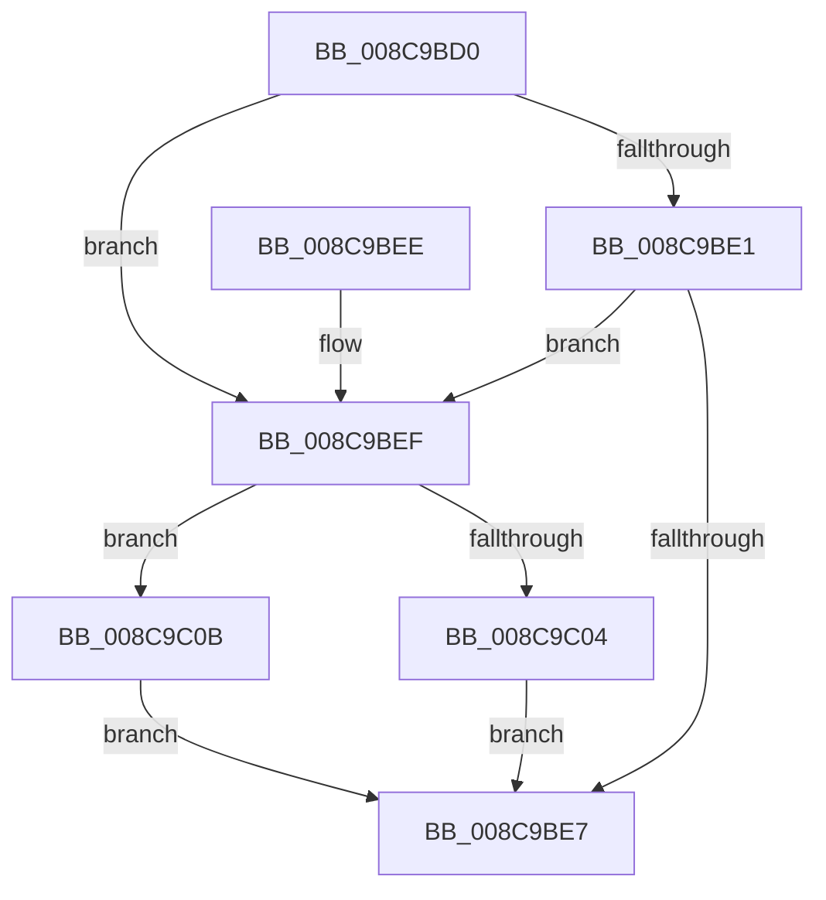

# EtwpThreadEnumCallback

- RVA: `0x008C9BD0`–`0x008C9C12` (길이 `66` bytes)
- VA: `0x00000001408C9BD0`
- 실행 섹션: `PAGE`
- PDB 이름 있음: `예`; PDB Function 태그: `아니요`
- unwind 정보 RVA: `0x000841D0`
- 디코드: `20`개 명령, `66/66` bytes 표시
- 미해석 바이트: `0` (있으면 어셈블리에 `.byte`로 보존)

> 이 문서는 커널 이미지의 기계어와 PDB 기호를 분석해 생성했습니다. 4번과 5번은 함수 원형과 자료형을 바이너리 사용 방식에서 추정한 C 해석이며 원본 소스 복구 결과는 아닙니다.

## 1. Dependencies

- 직접 호출 지점: **2**; 고유 호출 대상: **2**
- 직접 호출자로 확인된 함수: **2**
- RIP 상대 이미지 참조: **0**

### Outgoing calls
- `0x008C9C04` → [EtwpTraceThreadRundown](../../text/3C/EtwpTraceThreadRundown_function_003C370C.md) (function, `0x003C370C`)
- `0x008C9C0B` → [EtwpTraceThreadRundownWithStack](../../text/4A/EtwpTraceThreadRundownWithStack_function_004AB5A0.md) (function, `0x004AB5A0`)

### Direct callers
- [EtwpProcessEnumCallback](../8A/EtwpProcessEnumCallback_function_008A5F40.md) at `0x008A626F`
- [EtwpProcessEnumCallback](../8A/EtwpProcessEnumCallback_function_008A5F40.md) at `0x008A6289`
- [EtwpProcessEnumCallback](../8A/EtwpProcessEnumCallback_function_008A5F40.md) at `0x008A62BE`
- [PsEnumProcessThreads](PsEnumProcessThreads_function_008C9B30.md) at `0x008C9B78`

### Static image references
- 디코드된 RIP-relative 메모리 참조가 없습니다.

## 2. Other-region calls and transfers

- 다른 실행 섹션으로 향하는 call: **2**
  - `0x008C9C04` → [EtwpTraceThreadRundown](../../text/3C/EtwpTraceThreadRundown_function_003C370C.md) (`PAGE` → `.text`)
  - `0x008C9C0B` → [EtwpTraceThreadRundownWithStack](../../text/4A/EtwpTraceThreadRundownWithStack_function_004AB5A0.md) (`PAGE` → `.text`)
- 별도 외부 분기/꼬리 이동을 확인하지 못했습니다.

## 3. Assembly (complete function range)

```asm
008C9BD0  48 83 EC 28                     sub rsp, 0x28
008C9BD4  8B 82 A0 05 00 00               mov eax, dword ptr [rdx + 0x5a0]
008C9BDA  4C 8B CA                        mov r9, rdx
008C9BDD  A8 01                           test al, 1
008C9BDF  74 0E                           je 0x1408c9bef
008C9BE1  80 7A 04 00                     cmp byte ptr [rdx + 4], 0
008C9BE5  74 08                           je 0x1408c9bef
008C9BE7  33 C0                           xor eax, eax
008C9BE9  48 83 C4 28                     add rsp, 0x28
008C9BED  C3                              ret
008C9BEE  CC                              int3
008C9BEF  41 80 78 42 00                  cmp byte ptr [r8 + 0x42], 0
008C9BF4  49 8B D0                        mov rdx, r8
008C9BF7  41 C7 40 28 03 19 60 00         mov dword ptr [r8 + 0x28], 0x601903
008C9BFF  49 8B C9                        mov rcx, r9
008C9C02  75 07                           jne 0x1408c9c0b
008C9C04  E8 03 9B AF FF                  call 0x1403c370c
008C9C09  EB DC                           jmp 0x1408c9be7
008C9C0B  E8 90 19 BE FF                  call 0x1404ab5a0
008C9C10  EB D5                           jmp 0x1408c9be7
```

## 4. C-style interpretation (structured pseudocode)

```c
__int64 __fastcall EtwpThreadEnumCallback(__int64 a1, __int64 a2, __int64 a3)
{
    __int64 result;
    __int64 v_rsp;

    v_rsp = (v_rsp) - (40);
    if ((((unsigned __int8)((unsigned int)(*(unsigned int *)(a2 + 1440)))) & (1)) == 0) goto loc_008C9BEF;
    if ((*(unsigned __int8 *)(a2 + 4)) == 0) goto loc_008C9BEF;
loc_008C9BE7:
    result = 0;
    v_rsp = (v_rsp) + (40);
    return result;
loc_008C9BEF:
    *(unsigned int *)(a3 + 40) = 0x601903ULL;
    if ((*(unsigned __int8 *)(a3 + 66)) != 0) goto loc_008C9C0B;
    result = EtwpTraceThreadRundown(a2, a3, a3, a2);
    goto loc_008C9BE7;
loc_008C9C0B:
    result = EtwpTraceThreadRundownWithStack(a2, a3, a3, a2);
    goto loc_008C9BE7;
}
```

## 5. (Beta) C Style

```c
int64_t EtwpThreadEnumCallback(int64_t Arg1, void *Arg2, void *Arg3)
{
    uint8_t *arg2 = (uint8_t *)Arg2;
    uint8_t *arg3 = (uint8_t *)Arg3;

    int64_t result;
    int64_t local_rsp;

    local_rsp = (local_rsp) - (40);
    if ((((uint8_t)((uint32_t)(*(uint32_t *)(arg2 + 0x5A0)))) & (1)) == 0) goto loc_008C9BEF;
    if ((*(uint8_t *)(arg2 + 0x4)) == 0) goto loc_008C9BEF;
loc_008C9BE7:
    result = 0;
    local_rsp = (local_rsp) + (40);
    return result;
loc_008C9BEF:
    *(uint32_t *)(arg3 + 0x28) = 0x601903ULL;
    if ((*(uint8_t *)(arg3 + 0x42)) != 0) goto loc_008C9C0B;
    result = EtwpTraceThreadRundown(Arg2, Arg3, Arg3, Arg2);
    goto loc_008C9BE7;
loc_008C9C0B:
    result = EtwpTraceThreadRundownWithStack(Arg2, Arg3, Arg3, Arg2);
    goto loc_008C9BE7;
}
```

### 관측된 메모리 오프셋

구조체 형식이 확인되지 않은 접근은 인자 기준의 오프셋으로만 기록했습니다.

| 기준 인자 | 오프셋 표현 | 폭 (bit) | 접근 |
|---|---:|---:|---|
| `Arg2` | `+ 0x4` | `8` | `R` |
| `Arg2` | `+ 0x5A0` | `32` | `R` |
| `Arg3` | `+ 0x28` | `32` | `W` |
| `Arg3` | `+ 0x42` | `8` | `R` |

## 6. Execution-region graph

[열기: 2D/3D 그래프와 함수 탐색 컨트롤 패널](../../../control-panel.html?section=page&rva=0x008C9BD0&view=graph)

- 2D 그래프는 위에서 아래로 흐르고, 3D 그래프는 빈 공간을 드래그해 회전합니다. Shift+드래그는 이동, 휠은 확대·축소, 함수 노드 선택은 대상 보고서 이동입니다.

### Static fallback


