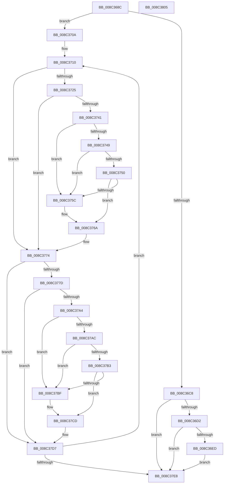

# EtwpTrackProviderRegistration

- RVA: `0x008C368C`–`0x008C3806` (길이 `378` bytes)
- VA: `0x00000001408C368C`
- 실행 섹션: `PAGE`
- PDB 이름 있음: `예`; PDB Function 태그: `아니요`
- unwind 정보 RVA: `0x00075C18`
- 디코드: `104`개 명령, `378/378` bytes 표시
- 미해석 바이트: `0` (있으면 어셈블리에 `.byte`로 보존)

> 이 문서는 커널 이미지의 기계어와 PDB 기호를 분석해 생성했습니다. 4번과 5번은 함수 원형과 자료형을 바이너리 사용 방식에서 추정한 C 해석이며 원본 소스 복구 결과는 아닙니다.

## 1. Dependencies

- 직접 호출 지점: **9**; 고유 호출 대상: **3**
- 직접 호출자로 확인된 함수: **2**
- RIP 상대 이미지 참조: **1**

### Outgoing calls
- `0x008C36DC` → [EtwpAcquireLoggerContextByLoggerId](../93/EtwpAcquireLoggerContextByLoggerId_function_00932920.md) (function, `0x00932920`)
- `0x008C36F6` → [EtwpProviderArrivalCallback](../A0/EtwpProviderArrivalCallback_function_00A03F94.md) (function, `0x00A03F94`)
- `0x008C3700` → [EtwpReleaseLoggerContext](../A0/EtwpReleaseLoggerContext_function_00A04160.md) (function, `0x00A04160`)
- `0x008C3734` → [EtwpAcquireLoggerContextByLoggerId](../93/EtwpAcquireLoggerContextByLoggerId_function_00932920.md) (function, `0x00932920`)
- `0x008C3765` → [EtwpProviderArrivalCallback](../A0/EtwpProviderArrivalCallback_function_00A03F94.md) (function, `0x00A03F94`)
- `0x008C376F` → [EtwpReleaseLoggerContext](../A0/EtwpReleaseLoggerContext_function_00A04160.md) (function, `0x00A04160`)
- `0x008C3797` → [EtwpAcquireLoggerContextByLoggerId](../93/EtwpAcquireLoggerContextByLoggerId_function_00932920.md) (function, `0x00932920`)
- `0x008C37C8` → [EtwpProviderArrivalCallback](../A0/EtwpProviderArrivalCallback_function_00A03F94.md) (function, `0x00A03F94`)
- `0x008C37D2` → [EtwpReleaseLoggerContext](../A0/EtwpReleaseLoggerContext_function_00A04160.md) (function, `0x00A04160`)

### Direct callers
- [sub_008C2328](Unknown_function_008C2328.md) at `0x008C27A7`
- [EtwpRegisterKMProvider](../92/EtwpRegisterKMProvider_function_009209A4.md) at `0x00920C2C`

### Static image references
- `0x008C3787` → RVA `0x00FC6AA8` (`ALMOSTRO`; read)

## 2. Other-region calls and transfers

- 다른 실행 섹션으로 향하는 call: **0**
- 별도 외부 분기/꼬리 이동을 확인하지 못했습니다.

## 3. Assembly (complete function range)

```asm
008C368C  48 89 5C 24 08                  mov qword ptr [rsp + 8], rbx
008C3691  48 89 6C 24 10                  mov qword ptr [rsp + 0x10], rbp
008C3696  48 89 74 24 18                  mov qword ptr [rsp + 0x18], rsi
008C369B  57                              push rdi
008C369C  41 54                           push r12
008C369E  41 55                           push r13
008C36A0  41 56                           push r14
008C36A2  41 57                           push r15
008C36A4  48 83 EC 20                     sub rsp, 0x20
008C36A8  0F B7 41 62                     movzx eax, word ptr [rcx + 0x62]
008C36AC  48 8B D9                        mov rbx, rcx
008C36AF  48 8B 79 20                     mov rdi, qword ptr [rcx + 0x20]
008C36B3  40 8A F0                        mov sil, al
008C36B6  40 F6 D6                        not sil
008C36B9  40 80 E6 01                     and sil, 1
008C36BD  4C 8B AF 88 02 00 00            mov r13, qword ptr [rdi + 0x288]
008C36C4  A8 08                           test al, 8
008C36C6  74 42                           je 0x1408c370a
008C36C8  F6 47 5B 01                     test byte ptr [rdi + 0x5b], 1
008C36CC  0F 84 16 01 00 00               je 0x1408c37e8
008C36D2  0F B7 57 58                     movzx edx, word ptr [rdi + 0x58]
008C36D6  45 33 C0                        xor r8d, r8d
008C36D9  49 8B CD                        mov rcx, r13
008C36DC  E8 3F F2 06 00                  call 0x140932920
008C36E1  48 8B F8                        mov rdi, rax
008C36E4  48 85 C0                        test rax, rax
008C36E7  0F 84 FB 00 00 00               je 0x1408c37e8
008C36ED  4C 8B C3                        mov r8, rbx
008C36F0  40 8A D6                        mov dl, sil
008C36F3  48 8B C8                        mov rcx, rax
008C36F6  E8 99 08 14 00                  call 0x140a03f94
008C36FB  33 D2                           xor edx, edx
008C36FD  48 8B CF                        mov rcx, rdi
008C3700  E8 5B 0A 14 00                  call 0x140a04160
008C3705  E9 DE 00 00 00                  jmp 0x1408c37e8
008C370A  45 33 FF                        xor r15d, r15d
008C370D  45 33 E4                        xor r12d, r12d
008C3710  0F B7 43 64                     movzx eax, word ptr [rbx + 0x64]
008C3714  41 8B CF                        mov ecx, r15d
008C3717  41 BE 01 00 00 00               mov r14d, 1
008C371D  41 D3 E6                        shl r14d, cl
008C3720  41 85 C6                        test r14d, eax
008C3723  74 4F                           je 0x1408c3774
008C3725  42 0F B7 94 27 86 00 00 00      movzx edx, word ptr [rdi + r12 + 0x86]
008C372E  45 33 C0                        xor r8d, r8d
008C3731  49 8B CD                        mov rcx, r13
008C3734  E8 E7 F1 06 00                  call 0x140932920
008C3739  48 8B E8                        mov rbp, rax
008C373C  48 85 C0                        test rax, rax
008C373F  74 33                           je 0x1408c3774
008C3741  0F B7 43 62                     movzx eax, word ptr [rbx + 0x62]
008C3745  A8 10                           test al, 0x10
008C3747  75 13                           jne 0x1408c375c
008C3749  66 0F BA E0 0A                  bt ax, 0xa
008C374E  72 0C                           jb 0x1408c375c
008C3750  F7 85 30 03 00 00 00 00 00 02   test dword ptr [rbp + 0x330], 0x2000000
008C375A  74 0E                           je 0x1408c376a
008C375C  4C 8B C3                        mov r8, rbx
008C375F  40 8A D6                        mov dl, sil
008C3762  48 8B CD                        mov rcx, rbp
008C3765  E8 2A 08 14 00                  call 0x140a03f94
008C376A  33 D2                           xor edx, edx
008C376C  48 8B CD                        mov rcx, rbp
008C376F  E8 EC 09 14 00                  call 0x140a04160
008C3774  0F B7 43 68                     movzx eax, word ptr [rbx + 0x68]
008C3778  41 85 C6                        test r14d, eax
008C377B  74 5A                           je 0x1408c37d7
008C377D  48 8B 87 90 02 00 00            mov rax, qword ptr [rdi + 0x290]
008C3784  45 33 C0                        xor r8d, r8d
008C3787  48 8B 0D 1A 33 70 00            mov rcx, qword ptr [rip + 0x70331a]
008C378E  42 0F B7 94 20 86 00 00 00      movzx edx, word ptr [rax + r12 + 0x86]
008C3797  E8 84 F1 06 00                  call 0x140932920
008C379C  48 8B E8                        mov rbp, rax
008C379F  48 85 C0                        test rax, rax
008C37A2  74 33                           je 0x1408c37d7
008C37A4  0F B7 43 62                     movzx eax, word ptr [rbx + 0x62]
008C37A8  A8 10                           test al, 0x10
008C37AA  75 13                           jne 0x1408c37bf
008C37AC  66 0F BA E0 0A                  bt ax, 0xa
008C37B1  72 0C                           jb 0x1408c37bf
008C37B3  F7 85 30 03 00 00 00 00 00 02   test dword ptr [rbp + 0x330], 0x2000000
008C37BD  74 0E                           je 0x1408c37cd
008C37BF  4C 8B C3                        mov r8, rbx
008C37C2  40 8A D6                        mov dl, sil
008C37C5  48 8B CD                        mov rcx, rbp
008C37C8  E8 C7 07 14 00                  call 0x140a03f94
008C37CD  33 D2                           xor edx, edx
008C37CF  48 8B CD                        mov rcx, rbp
008C37D2  E8 89 09 14 00                  call 0x140a04160
008C37D7  41 FF C7                        inc r15d
008C37DA  49 83 C4 20                     add r12, 0x20
008C37DE  41 83 FF 10                     cmp r15d, 0x10
008C37E2  0F 82 28 FF FF FF               jb 0x1408c3710
008C37E8  48 8B 5C 24 50                  mov rbx, qword ptr [rsp + 0x50]
008C37ED  48 8B 6C 24 58                  mov rbp, qword ptr [rsp + 0x58]
008C37F2  48 8B 74 24 60                  mov rsi, qword ptr [rsp + 0x60]
008C37F7  48 83 C4 20                     add rsp, 0x20
008C37FB  41 5F                           pop r15
008C37FD  41 5E                           pop r14
008C37FF  41 5D                           pop r13
008C3801  41 5C                           pop r12
008C3803  5F                              pop rdi
008C3804  C3                              ret
008C3805  CC                              int3
```

## 4. C-style interpretation (structured pseudocode)

```c
__int64 __fastcall EtwpTrackProviderRegistration(__int64 a1, __int64 a2, int a3)
{
    __int64 result;
    __int64 v_r12;
    __int64 v_r14;
    __int64 v_r15;
    __int64 v_rsi;
    __int64 v_rsp;
    unsigned __int64 v_stack_p10;
    unsigned __int64 v_stack_p18;
    unsigned __int64 v_stack_p8;

    v_stack_p8 = v_rbx;
    v_stack_p10 = v_rbp;
    v_stack_p18 = v_rsi;
    v_rsp = (v_rsp) - (32);
    v_rsi = (unsigned __int8)(~((unsigned __int8)(*(unsigned __int16 *)(a1 + 98))));
    v_rsi = (unsigned __int8)((v_rsi) & (1));
    if ((((unsigned __int8)(*(unsigned __int16 *)(a1 + 98))) & (8)) == 0) goto loc_008C370A;
    if (((*(unsigned __int8 *)(*(unsigned __int64 *)(a1 + 32) + 91)) & (1)) == 0) goto loc_008C37E8;
    a3 = 0;
    result = EtwpAcquireLoggerContextByLoggerId(*(unsigned __int64 *)(*(unsigned __int64 *)(a1 + 32) + 648), *(unsigned __int16 *)(*(unsigned __int64 *)(a1 + 32) + 88), a3, a4);
    if (result == 0) goto loc_008C37E8;
    result = EtwpProviderArrivalCallback(result, (unsigned __int8)(v_rsi), a1, a4);
    a2 = 0;
    result = EtwpReleaseLoggerContext(result, a2, a1, a4);
    goto loc_008C37E8;
loc_008C370A:
    v_r15 = 0;
    v_r12 = 0;
loc_008C3710:
    v_r14 = (unsigned int)((1) << (0));
    if ((((unsigned int)(v_r14)) & ((unsigned int)(*(unsigned __int16 *)(a1 + 100)))) == 0) goto loc_008C3774;
    a3 = 0;
    result = EtwpAcquireLoggerContextByLoggerId(*(unsigned __int64 *)(*(unsigned __int64 *)(a1 + 32) + 648), *(unsigned __int16 *)(result + v_r12 * 1 + 134), a3, a4);
    if (result == 0) goto loc_008C3774;
    if ((((unsigned __int8)(*(unsigned __int16 *)(a1 + 98))) & (16)) != 0) goto loc_008C375C;
    if (condition_is_below) goto loc_008C375C;
    result = *(unsigned __int16 *)(a1 + 98);
    if (((*(unsigned int *)(result + 816)) & (0x2000000ULL)) != 0) {
        a3 = a1;
        a2 = (unsigned __int8)(v_rsi);
        a1 = result;
        result = EtwpProviderArrivalCallback(a1, a2, a3, a4);
    }
    a2 = 0;
    result = EtwpReleaseLoggerContext(result, a2, a3, a4);
loc_008C3774:
    if ((((unsigned int)(v_r14)) & ((unsigned int)(*(unsigned __int16 *)(a1 + 104)))) == 0) goto loc_008C37D7;
    a3 = 0;
    result = EtwpAcquireLoggerContextByLoggerId(*(unsigned __int64 *)(v_rip + 7353114), *(unsigned __int16 *)(*(unsigned __int64 *)(result + 656) + v_r12 * 1 + 134), a3, a4);
    if (result == 0) goto loc_008C37D7;
    if ((((unsigned __int8)(*(unsigned __int16 *)(a1 + 98))) & (16)) != 0) goto loc_008C37BF;
    if (condition_is_below) goto loc_008C37BF;
    result = *(unsigned __int16 *)(a1 + 98);
    if (((*(unsigned int *)(result + 816)) & (0x2000000ULL)) != 0) {
        a3 = a1;
        a2 = (unsigned __int8)(v_rsi);
        a1 = result;
        result = EtwpProviderArrivalCallback(a1, a2, a3, a4);
    }
    a2 = 0;
    result = EtwpReleaseLoggerContext(result, a2, a3, a4);
loc_008C37D7:
    v_r15 = (unsigned int)((v_r15) + 1);
    v_r12 = (v_r12) + (32);
    if (((unsigned int)(v_r15)) < 16) goto loc_008C3710;
loc_008C37E8:
    v_rsp = (v_rsp) + (32);
    return result;
}
```

## 5. (Beta) C Style

```c
int64_t EtwpTrackProviderRegistration(void *Arg1, int64_t Arg2, int32_t Arg3)
{
    uint8_t *arg1 = (uint8_t *)Arg1;

    int64_t result;
    int64_t local_r12;
    int64_t local_r14;
    int64_t local_r15;
    int64_t local_rsi;
    int64_t local_rsp;
    uint64_t v_stack_p10;
    uint64_t v_stack_p18;
    uint64_t v_stack_p8;

    v_stack_p8 = local_rbx;
    v_stack_p10 = local_rbp;
    v_stack_p18 = local_rsi;
    local_rsp = (local_rsp) - (32);
    local_rsi = (uint8_t)(~((uint8_t)(*(uint16_t *)(arg1 + 0x62))));
    local_rsi = (uint8_t)((local_rsi) & (1));
    if ((((uint8_t)(*(uint16_t *)(arg1 + 0x62))) & (8)) == 0) goto loc_008C370A;
    if (((*(uint8_t *)(*(uint64_t *)(arg1 + 0x20) + 0x5B)) & (1)) == 0) goto loc_008C37E8;
    Arg3 = 0;
    result = EtwpAcquireLoggerContextByLoggerId(*(uint64_t *)(*(uint64_t *)(arg1 + 0x20) + 0x288), *(uint16_t *)(*(uint64_t *)(arg1 + 0x20) + 0x58), Arg3, a4);
    if (result == 0) goto loc_008C37E8;
    result = EtwpProviderArrivalCallback(result, (uint8_t)(local_rsi), Arg1, a4);
    Arg2 = 0;
    result = EtwpReleaseLoggerContext(result, Arg2, Arg1, a4);
    goto loc_008C37E8;
loc_008C370A:
    local_r15 = 0;
    local_r12 = 0;
loc_008C3710:
    local_r14 = (uint32_t)((1) << (0));
    if ((((uint32_t)(local_r14)) & ((uint32_t)(*(uint16_t *)(arg1 + 0x64)))) == 0) goto loc_008C3774;
    Arg3 = 0;
    result = EtwpAcquireLoggerContextByLoggerId(*(uint64_t *)(*(uint64_t *)(arg1 + 0x20) + 0x288), *(uint16_t *)(result + local_r12 * 1 + 0x86), Arg3, a4);
    if (result == 0) goto loc_008C3774;
    if ((((uint8_t)(*(uint16_t *)(arg1 + 0x62))) & (16)) != 0) goto loc_008C375C;
    if (condition_is_below) goto loc_008C375C;
    result = *(uint16_t *)(arg1 + 0x62);
    if (((*(uint32_t *)(result + 0x330)) & (0x2000000ULL)) != 0) {
        Arg3 = Arg1;
        Arg2 = (uint8_t)(local_rsi);
        Arg1 = result;
        result = EtwpProviderArrivalCallback(Arg1, Arg2, Arg3, a4);
    }
    Arg2 = 0;
    result = EtwpReleaseLoggerContext(result, Arg2, Arg3, a4);
loc_008C3774:
    if ((((uint32_t)(local_r14)) & ((uint32_t)(*(uint16_t *)(arg1 + 0x68)))) == 0) goto loc_008C37D7;
    Arg3 = 0;
    result = EtwpAcquireLoggerContextByLoggerId(*(uint64_t *)(v_rip + 0x70331A), *(uint16_t *)(*(uint64_t *)(result + 0x290) + local_r12 * 1 + 0x86), Arg3, a4);
    if (result == 0) goto loc_008C37D7;
    if ((((uint8_t)(*(uint16_t *)(arg1 + 0x62))) & (16)) != 0) goto loc_008C37BF;
    if (condition_is_below) goto loc_008C37BF;
    result = *(uint16_t *)(arg1 + 0x62);
    if (((*(uint32_t *)(result + 0x330)) & (0x2000000ULL)) != 0) {
        Arg3 = Arg1;
        Arg2 = (uint8_t)(local_rsi);
        Arg1 = result;
        result = EtwpProviderArrivalCallback(Arg1, Arg2, Arg3, a4);
    }
    Arg2 = 0;
    result = EtwpReleaseLoggerContext(result, Arg2, Arg3, a4);
loc_008C37D7:
    local_r15 = (uint32_t)((local_r15) + 1);
    local_r12 = (local_r12) + (32);
    if (((uint32_t)(local_r15)) < 16) goto loc_008C3710;
loc_008C37E8:
    local_rsp = (local_rsp) + (32);
    return result;
}
```

### 관측된 메모리 오프셋

구조체 형식이 확인되지 않은 접근은 인자 기준의 오프셋으로만 기록했습니다.

| 기준 인자 | 오프셋 표현 | 폭 (bit) | 접근 |
|---|---:|---:|---|
| `Arg1` | `+ 0x20` | `64` | `R` |
| `Arg1` | `+ 0x62` | `16` | `R` |
| `Arg1` | `+ 0x64` | `16` | `R` |
| `Arg1` | `+ 0x68` | `16` | `R` |

## 6. Execution-region graph

[열기: 2D/3D 그래프와 함수 탐색 컨트롤 패널](../../../control-panel.html?section=page&rva=0x008C368C&view=graph)

- 2D 그래프는 위에서 아래로 흐르고, 3D 그래프는 빈 공간을 드래그해 회전합니다. Shift+드래그는 이동, 휠은 확대·축소, 함수 노드 선택은 대상 보고서 이동입니다.

### Static fallback


