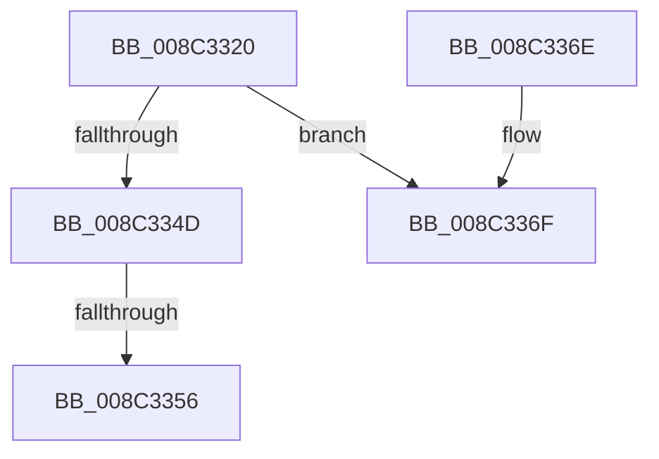

# EtwpUnreferenceGuidEntry

- RVA: `0x008C3320`–`0x008C3396` (길이 `118` bytes)
- VA: `0x00000001408C3320`
- 실행 섹션: `PAGE`
- PDB 이름 있음: `예`; PDB Function 태그: `아니요`
- unwind 정보 RVA: `0x000837D8`
- 디코드: `30`개 명령, `118/118` bytes 표시
- 미해석 바이트: `0` (있으면 어셈블리에 `.byte`로 보존)

> 이 문서는 커널 이미지의 기계어와 PDB 기호를 분석해 생성했습니다. 4번과 5번은 함수 원형과 자료형을 바이너리 사용 방식에서 추정한 C 해석이며 원본 소스 복구 결과는 아닙니다.

## 1. Dependencies

- 직접 호출 지점: **0**; 고유 호출 대상: **0**
- 직접 호출자로 확인된 함수: **20**
- RIP 상대 이미지 참조: **0**

### Outgoing calls
- 직접 디코드된 call 명령이 없습니다.

### Direct callers
- [NtTraceEvent](../../text/2F/NtTraceEvent_function_002FA6C0.md) at `0x002FB172`
- [NtTraceEvent](../../text/2F/NtTraceEvent_function_002FA6C0.md) at `0x002FB17F`
- [EtwGetProviderIdFromHandle](../../text/4B/EtwGetProviderIdFromHandle_function_004B8850.md) at `0x004B88EF`
- [SendCaptureStateNotificationsWorker](../7B/SendCaptureStateNotificationsWorker_function_007BCF30.md) at `0x007BD1DF`
- [EtwpClearSessionAndUnreferenceEntry](EtwpClearSessionAndUnreferenceEntry_function_008C1438.md) at `0x008C158B`
- [EtwpFindOrCreateGuidEntry](EtwpFindOrCreateGuidEntry_function_008C1B70.md) at `0x008C1D87`
- [EtwpDeleteRegistrationObject](EtwpDeleteRegistrationObject_function_008C1F30.md) at `0x008C21CE`
- [EtwpDeleteRegistrationObject](EtwpDeleteRegistrationObject_function_008C1F30.md) at `0x008C21DB`
- [sub_008C2328](Unknown_function_008C2328.md) at `0x008C286E`
- [EtwpGetGuidList](EtwpGetGuidList_function_008C2F00.md) at `0x008C3099`
- [EtwpGetNextGuidEntry](EtwpGetNextGuidEntry_function_008C3170.md) at `0x008C3298`
- [EtwpNotifyGuid](EtwpNotifyGuid_function_008C8110.md) at `0x008C81DE`
- [EtwpRegisterKMProvider](../92/EtwpRegisterKMProvider_function_009209A4.md) at `0x00920B1E`
- [sub_009AA100](../9A/Unknown_function_009AA100.md) at `0x009AA124`
- [sub_009E8C24](../9E/Unknown_function_009E8C24.md) at `0x009E8E89`
- [sub_009E8C24](../9E/Unknown_function_009E8C24.md) at `0x009E8F90`
- [sub_009E8C24](../9E/Unknown_function_009E8C24.md) at `0x009E9069`
- [EtwpNotifyDisallowedGuidChange](../9E/EtwpNotifyDisallowedGuidChange_function_009EAD14.md) at `0x009EB01B`
- [EtwpAddRegEntryToGroup](../9F/EtwpAddRegEntryToGroup_function_009F39D4.md) at `0x009F420E`
- [EtwpUpdateGuidEnableInfo](../9F/EtwpUpdateGuidEnableInfo_function_009FCF48.md) at `0x009FD186`
- [EtwpEnableGuid](../A5/EtwpEnableGuid_function_00A5CD28.md) at `0x00A5D9C5`
- [EtwUnregister](../A7/EtwUnregister_function_00A723D0.md) at `0x00A7259E`
- [EtwUnregister](../A7/EtwUnregister_function_00A723D0.md) at `0x00A72680`
- [sub_00B1AE6C](../B1/Unknown_function_00B1AE6C.md) at `0x00B1AED9`
- [sub_00B1AFDA](../B1/Unknown_function_00B1AFDA.md) at `0x00B1B073`

### Static image references
- 디코드된 RIP-relative 메모리 참조가 없습니다.

## 2. Other-region calls and transfers

- 다른 실행 섹션으로 향하는 call: **0**
- call이 아닌 외부 분기/꼬리 이동: **1**
  - `0x008C3350` → [sub_008C33F4 + 0x52](Unknown_function_008C33F4.md) (`tail-transfer`)

## 3. Assembly (complete function range)

```asm
008C3320  48 89 5C 24 10                  mov qword ptr [rsp + 0x10], rbx
008C3325  48 89 6C 24 18                  mov qword ptr [rsp + 0x18], rbp
008C332A  48 89 74 24 20                  mov qword ptr [rsp + 0x20], rsi
008C332F  57                              push rdi
008C3330  48 83 EC 30                     sub rsp, 0x30
008C3334  48 C7 C3 FF FF FF FF            mov rbx, 0xffffffffffffffff
008C333B  48 8B F1                        mov rsi, rcx
008C333E  48 8B FB                        mov rdi, rbx
008C3341  F0 48 0F C1 79 20               lock xadd qword ptr [rcx + 0x20], rdi
008C3347  48 83 EF 01                     sub rdi, 1
008C334B  74 22                           je 0x1408c336f
008C334D  48 85 FF                        test rdi, rdi
008C3350  0F 88 F0 00 00 00               js 0x1408c3446
008C3356  48 8B 5C 24 48                  mov rbx, qword ptr [rsp + 0x48]
008C335B  48 8B C7                        mov rax, rdi
008C335E  48 8B 6C 24 50                  mov rbp, qword ptr [rsp + 0x50]
008C3363  48 8B 74 24 58                  mov rsi, qword ptr [rsp + 0x58]
008C3368  48 83 C4 30                     add rsp, 0x30
008C336C  5F                              pop rdi
008C336D  C3                              ret
008C336E  CC                              int3
008C336F  8B 41 34                        mov eax, dword ptr [rcx + 0x34]
008C3372  8B 51 30                        mov edx, dword ptr [rcx + 0x30]
008C3375  44 8B 41 2C                     mov r8d, dword ptr [rcx + 0x2c]
008C3379  44 8B 51 28                     mov r10d, dword ptr [rcx + 0x28]
008C337D  4C 8B 89 88 02 00 00            mov r9, qword ptr [rcx + 0x288]
008C3384  4C 33 D0                        xor r10, rax
008C3387  65 48 8B 04 25 88 01 00 00      mov rax, qword ptr gs:[0x188]
008C3390  4C 33 D2                        xor r10, rdx
008C3393  4D 33 D0                        xor r10, r8
```

## 4. C-style interpretation (structured pseudocode)

```c
__int64 __fastcall EtwpUnreferenceGuidEntry(__int64 a1)
{
    __int64 v_r10;
    __int64 v_rdi;
    __int64 v_rsp;
    unsigned __int64 v_stack_p10;
    unsigned __int64 v_stack_p18;
    unsigned __int64 v_stack_p20;

    v_stack_p10 = v_rbx;
    v_stack_p18 = v_rbp;
    v_stack_p20 = v_rsi;
    v_rsp = (v_rsp) - (48);
    v_rdi = (-1) - (1);
    if (condition_is_equal) goto loc_008C336F;
    v_rsp = (v_rsp) + (48);
    return v_rdi;
loc_008C336F:
    v_r10 = ((unsigned int)(*(unsigned int *)(a1 + 40))) ^ ((unsigned int)(*(unsigned int *)(a1 + 52)));
    v_r10 = (v_r10) ^ ((unsigned int)(*(unsigned int *)(a1 + 48)));
    v_r10 = (v_r10) ^ ((unsigned int)(*(unsigned int *)(a1 + 44)));
    return *(unsigned __int64 *)(gs_base + (0 + 392));
}
```

## 5. (Beta) C Style

```c
int64_t EtwpUnreferenceGuidEntry(void *Arg1)
{
    uint8_t *arg1 = (uint8_t *)Arg1;

    int64_t local_r10;
    int64_t local_rdi;
    int64_t local_rsp;
    uint64_t v_stack_p10;
    uint64_t v_stack_p18;
    uint64_t v_stack_p20;

    v_stack_p10 = local_rbx;
    v_stack_p18 = local_rbp;
    v_stack_p20 = local_rsi;
    local_rsp = (local_rsp) - (48);
    local_rdi = (-1) - (1);
    if (condition_is_equal) goto loc_008C336F;
    local_rsp = (local_rsp) + (48);
    return local_rdi;
loc_008C336F:
    local_r10 = ((uint32_t)(*(uint32_t *)(arg1 + 0x28))) ^ ((uint32_t)(*(uint32_t *)(arg1 + 0x34)));
    local_r10 = (local_r10) ^ ((uint32_t)(*(uint32_t *)(arg1 + 0x30)));
    local_r10 = (local_r10) ^ ((uint32_t)(*(uint32_t *)(arg1 + 0x2C)));
    return *(uint64_t *)(gs_base + (0 + 0x188));
}
```

### 관측된 메모리 오프셋

구조체 형식이 확인되지 않은 접근은 인자 기준의 오프셋으로만 기록했습니다.

| 기준 인자 | 오프셋 표현 | 폭 (bit) | 접근 |
|---|---:|---:|---|
| `Arg1` | `+ 0x20` | `64` | `R/W` |
| `Arg1` | `+ 0x28` | `32` | `R` |
| `Arg1` | `+ 0x2C` | `32` | `R` |
| `Arg1` | `+ 0x30` | `32` | `R` |
| `Arg1` | `+ 0x34` | `32` | `R` |
| `Arg1` | `+ 0x288` | `64` | `R` |

## 6. Execution-region graph

[열기: 2D/3D 그래프와 함수 탐색 컨트롤 패널](../../../control-panel.html?section=page&rva=0x008C3320&view=graph)

- 2D 그래프는 위에서 아래로 흐르고, 3D 그래프는 빈 공간을 드래그해 회전합니다. Shift+드래그는 이동, 휠은 확대·축소, 함수 노드 선택은 대상 보고서 이동입니다.

### Static fallback


