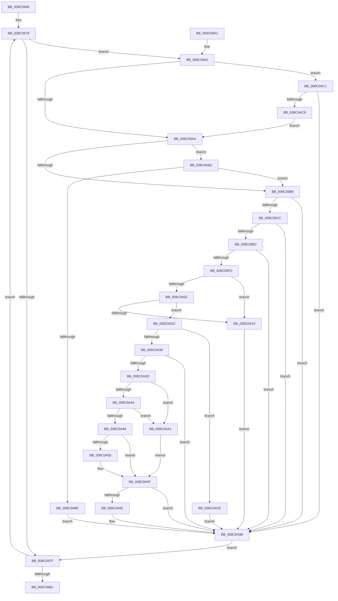

# EtwpUpdateEnableMask

- RVA: `0x008C0948`–`0x008C0ADA` (길이 `402` bytes)
- VA: `0x00000001408C0948`
- 실행 섹션: `PAGE`
- PDB 이름 있음: `예`; PDB Function 태그: `아니요`
- unwind 정보 RVA: `0x000834C4`
- 디코드: `110`개 명령, `402/402` bytes 표시
- 미해석 바이트: `0` (있으면 어셈블리에 `.byte`로 보존)

> 이 문서는 커널 이미지의 기계어와 PDB 기호를 분석해 생성했습니다. 4번과 5번은 함수 원형과 자료형을 바이너리 사용 방식에서 추정한 C 해석이며 원본 소스 복구 결과는 아닙니다.

## 1. Dependencies

- 직접 호출 지점: **5**; 고유 호출 대상: **4**
- 직접 호출자로 확인된 함수: **4**
- RIP 상대 이미지 참조: **0**

### Outgoing calls
- `0x008C09F0` → [ExAcquireRundownProtectionCacheAwareEx](../../text/41/ExAcquireRundownProtectionCacheAwareEx_function_00411F50.md) (function, `0x00411F50`)
- `0x008C0A25` → [ExReleaseRundownProtectionCacheAwareEx](../../text/25/ExReleaseRundownProtectionCacheAwareEx_function_0025F050.md) (function, `0x0025F050`)
- `0x008C0A58` → [EtwpCheckLoggerControlAccess](EtwpCheckLoggerControlAccess_function_008C0AE0.md) (function, `0x008C0AE0`)
- `0x008C0A79` → [ExReleaseRundownProtectionCacheAwareEx](../../text/25/ExReleaseRundownProtectionCacheAwareEx_function_0025F050.md) (function, `0x0025F050`)
- `0x008C0AD3` → [EtwpReleaseLoggerContext](../A0/EtwpReleaseLoggerContext_function_00A04160.md) (function, `0x00A04160`)

### Direct callers
- [NtTraceEvent](../../text/2F/NtTraceEvent_function_002FA6C0.md) at `0x002FB090`
- [sub_006DF40E](../../text/6D/Unknown_function_006DF40E.md) at `0x006DF579`
- [sub_008C2DC2](Unknown_function_008C2DC2.md) at `0x008C2EA0`
- [EtwpRegisterKMProvider](../92/EtwpRegisterKMProvider_function_009209A4.md) at `0x00920C7B`
- [EtwpRegisterKMProvider](../92/EtwpRegisterKMProvider_function_009209A4.md) at `0x00920D18`

### Static image references
- 디코드된 RIP-relative 메모리 참조가 없습니다.

## 2. Other-region calls and transfers

- 다른 실행 섹션으로 향하는 call: **3**
  - `0x008C09F0` → [ExAcquireRundownProtectionCacheAwareEx](../../text/41/ExAcquireRundownProtectionCacheAwareEx_function_00411F50.md) (`PAGE` → `.text`)
  - `0x008C0A25` → [ExReleaseRundownProtectionCacheAwareEx](../../text/25/ExReleaseRundownProtectionCacheAwareEx_function_0025F050.md) (`PAGE` → `.text`)
  - `0x008C0A79` → [ExReleaseRundownProtectionCacheAwareEx](../../text/25/ExReleaseRundownProtectionCacheAwareEx_function_0025F050.md) (`PAGE` → `.text`)
- 별도 외부 분기/꼬리 이동을 확인하지 못했습니다.

## 3. Assembly (complete function range)

```asm
008C0948  48 89 5C 24 08                  mov qword ptr [rsp + 8], rbx
008C094D  44 88 4C 24 20                  mov byte ptr [rsp + 0x20], r9b
008C0952  44 88 44 24 18                  mov byte ptr [rsp + 0x18], r8b
008C0957  55                              push rbp
008C0958  56                              push rsi
008C0959  57                              push rdi
008C095A  41 54                           push r12
008C095C  41 55                           push r13
008C095E  41 56                           push r14
008C0960  41 57                           push r15
008C0962  48 83 EC 20                     sub rsp, 0x20
008C0966  41 8A C0                        mov al, r8b
008C0969  48 8D B1 88 00 00 00            lea rsi, [rcx + 0x88]
008C0970  44 8A E2                        mov r12b, dl
008C0973  4C 8B E9                        mov r13, rcx
008C0976  45 33 F6                        xor r14d, r14d
008C0979  83 7E F8 00                     cmp dword ptr [rsi - 8], 0
008C097D  75 23                           jne 0x1408c09a2
008C097F  41 FF C6                        inc r14d
008C0982  48 83 C6 20                     add rsi, 0x20
008C0986  41 83 FE 10                     cmp r14d, 0x10
008C098A  72 ED                           jb 0x1408c0979
008C098C  48 8B 5C 24 60                  mov rbx, qword ptr [rsp + 0x60]
008C0991  48 83 C4 20                     add rsp, 0x20
008C0995  41 5F                           pop r15
008C0997  41 5E                           pop r14
008C0999  41 5D                           pop r13
008C099B  41 5C                           pop r12
008C099D  5F                              pop rdi
008C099E  5E                              pop rsi
008C099F  5D                              pop rbp
008C09A0  C3                              ret
008C09A1  CC                              int3
008C09A2  84 C0                           test al, al
008C09A4  0F 85 17 01 00 00               jne 0x1408c0ac1
008C09AA  0F B7 5E FE                     movzx ebx, word ptr [rsi - 2]
008C09AE  33 ED                           xor ebp, ebp
008C09B0  45 84 E4                        test r12b, r12b
008C09B3  0F 85 F9 00 00 00               jne 0x1408c0ab2
008C09B9  49 8B BD 88 02 00 00            mov rdi, qword ptr [r13 + 0x288]
008C09C0  4C 8B FB                        mov r15, rbx
008C09C3  3B 5F 10                        cmp ebx, dword ptr [rdi + 0x10]
008C09C6  0F 83 CC 00 00 00               jae 0x1408c0a98
008C09CC  48 8B 87 C8 02 00 00            mov rax, qword ptr [rdi + 0x2c8]
008C09D3  48 8B 0C D8                     mov rcx, qword ptr [rax + rbx*8]
008C09D7  F6 C1 01                        test cl, 1
008C09DA  0F 85 B8 00 00 00               jne 0x1408c0a98
008C09E0  48 8B 8F C0 02 00 00            mov rcx, qword ptr [rdi + 0x2c0]
008C09E7  BA 01 00 00 00                  mov edx, 1
008C09EC  48 8B 0C D9                     mov rcx, qword ptr [rcx + rbx*8]
008C09F0  E8 5B 15 B5 FF                  call 0x140411f50
008C09F5  84 C0                           test al, al
008C09F7  0F 84 9B 00 00 00               je 0x1408c0a98
008C09FD  3B 5F 10                        cmp ebx, dword ptr [rdi + 0x10]
008C0A00  73 13                           jae 0x1408c0a15
008C0A02  0F AE E8                        lfence
008C0A05  48 8B 87 C8 02 00 00            mov rax, qword ptr [rdi + 0x2c8]
008C0A0C  48 8B 1C D8                     mov rbx, qword ptr [rax + rbx*8]
008C0A10  F6 C3 01                        test bl, 1
008C0A13  74 17                           je 0x1408c0a2c
008C0A15  48 8B 8F C0 02 00 00            mov rcx, qword ptr [rdi + 0x2c0]
008C0A1C  BA 01 00 00 00                  mov edx, 1
008C0A21  4A 8B 0C F9                     mov rcx, qword ptr [rcx + r15*8]
008C0A25  E8 26 E6 99 FF                  call 0x14025f050
008C0A2A  EB 6C                           jmp 0x1408c0a98
008C0A2C  39 AB 40 01 00 00               cmp dword ptr [rbx + 0x140], ebp
008C0A32  0F 84 96 00 00 00               je 0x1408c0ace
008C0A38  48 85 DB                        test rbx, rbx
008C0A3B  74 5B                           je 0x1408c0a98
008C0A3D  40 38 6C 24 78                  cmp byte ptr [rsp + 0x78], bpl
008C0A42  74 5D                           je 0x1408c0aa1
008C0A44  45 84 E4                        test r12b, r12b
008C0A47  75 58                           jne 0x1408c0aa1
008C0A49  8B 43 0C                        mov eax, dword ptr [rbx + 0xc]
008C0A4C  84 C0                           test al, al
008C0A4E  79 0F                           jns 0x1408c0a5f
008C0A50  48 8B D3                        mov rdx, rbx
008C0A53  B9 00 02 00 00                  mov ecx, 0x200
008C0A58  E8 83 00 00 00                  call 0x1408c0ae0
008C0A5D  8B E8                           mov ebp, eax
008C0A5F  48 8B 83 50 05 00 00            mov rax, qword ptr [rbx + 0x550]
008C0A66  BA 01 00 00 00                  mov edx, 1
008C0A6B  44 8B 03                        mov r8d, dword ptr [rbx]
008C0A6E  48 8B 88 C0 02 00 00            mov rcx, qword ptr [rax + 0x2c0]
008C0A75  4A 8B 0C C1                     mov rcx, qword ptr [rcx + r8*8]
008C0A79  E8 D2 E5 99 FF                  call 0x14025f050
008C0A7E  85 ED                           test ebp, ebp
008C0A80  75 16                           jne 0x1408c0a98
008C0A82  48 8B 94 24 80 00 00 00         mov rdx, qword ptr [rsp + 0x80]
008C0A8A  41 0F B6 C6                     movzx eax, r14b
008C0A8E  0F B7 0A                        movzx ecx, word ptr [rdx]
008C0A91  66 0F AB C1                     bts cx, ax
008C0A95  66 89 0A                        mov word ptr [rdx], cx
008C0A98  8A 44 24 70                     mov al, byte ptr [rsp + 0x70]
008C0A9C  E9 DE FE FF FF                  jmp 0x1408c097f
008C0AA1  F7 43 0C 00 00 00 01            test dword ptr [rbx + 0xc], 0x1000000
008C0AA8  B8 22 00 00 C0                  mov eax, 0xc0000022
008C0AAD  0F 45 E8                        cmovne ebp, eax
008C0AB0  EB AD                           jmp 0x1408c0a5f
008C0AB2  41 0F B7 45 58                  movzx eax, word ptr [r13 + 0x58]
008C0AB7  3B D8                           cmp ebx, eax
008C0AB9  0F 84 FA FE FF FF               je 0x1408c09b9
008C0ABF  EB D7                           jmp 0x1408c0a98
008C0AC1  F7 06 00 04 00 00               test dword ptr [rsi], 0x400
008C0AC7  74 CF                           je 0x1408c0a98
008C0AC9  E9 DC FE FF FF                  jmp 0x1408c09aa
008C0ACE  33 D2                           xor edx, edx
008C0AD0  48 8B CB                        mov rcx, rbx
008C0AD3  E8 88 36 14 00                  call 0x140a04160
008C0AD8  EB BE                           jmp 0x1408c0a98
```

## 4. C-style interpretation (structured pseudocode)

```c
__int64 __fastcall EtwpUpdateEnableMask(__int64 a1, unsigned __int8 a2, unsigned __int8 a3, unsigned __int8 a4, __int64 a5)
{
    __int64 result;
    __int64 v_r14;
    __int64 v_rbp;
    __int64 v_rsi;
    __int64 v_rsp;
    unsigned __int8 v_stack_p18;
    unsigned __int8 v_stack_p20;
    unsigned __int8 v_stack_p70;
    unsigned __int8 v_stack_p78;
    unsigned __int64 v_stack_p8;

    v_stack_p8 = v_rbx;
    v_stack_p20 = a4;
    v_stack_p18 = a3;
    v_rsp = (v_rsp) - (32);
    v_r14 = 0;
loc_008C0979:
    if ((*(unsigned int *)(a1 + 136 - 8)) != 0) goto loc_008C09A2;
loc_008C097F:
    v_r14 = (unsigned int)((v_r14) + 1);
    v_rsi = (a1 + 136) + (32);
    if (((unsigned int)(v_r14)) < 16) goto loc_008C0979;
    v_rsp = (v_rsp) + (32);
    return a3;
loc_008C09A2:
    if (a3 != 0) goto loc_008C0AC1;
loc_008C09AA:
    v_rbp = 0;
    if (a2 != 0) goto loc_008C0AB2;
loc_008C09B9:
    if (((unsigned int)(*(unsigned __int16 *)(v_rsi - 2))) >= (*(unsigned int *)(*(unsigned __int64 *)(a1 + 648) + 16))) goto loc_008C0A98;
    if ((((unsigned __int8)(*(unsigned __int64 *)(*(unsigned __int64 *)(*(unsigned __int64 *)(a1 + 648) + 712) + *(unsigned __int16 *)(v_rsi - 2) * 8))) & (1)) != 0) goto loc_008C0A98;
    result = ExAcquireRundownProtectionCacheAwareEx(*(unsigned __int64 *)(*(unsigned __int64 *)(*(unsigned __int64 *)(a1 + 648) + 704) + *(unsigned __int16 *)(v_rsi - 2) * 8), 1, a3, a4);
    if ((unsigned __int8)(result) == 0) goto loc_008C0A98;
    if (((unsigned int)(*(unsigned __int16 *)(v_rsi - 2))) >= (*(unsigned int *)(*(unsigned __int64 *)(a1 + 648) + 16))) goto loc_008C0A15;
    if ((((unsigned __int8)(*(unsigned __int64 *)(*(unsigned __int64 *)(*(unsigned __int64 *)(a1 + 648) + 712) + *(unsigned __int16 *)(v_rsi - 2) * 8))) & (1)) == 0) goto loc_008C0A2C;
loc_008C0A15:
    result = ExReleaseRundownProtectionCacheAwareEx(*(unsigned __int64 *)(*(unsigned __int64 *)(*(unsigned __int64 *)(a1 + 648) + 704) + *(unsigned __int16 *)(v_rsi - 2) * 8), 1, a3, a4);
    goto loc_008C0A98;
loc_008C0A2C:
    if ((*(unsigned int *)(*(unsigned __int64 *)(*(unsigned __int64 *)(*(unsigned __int64 *)(a1 + 648) + 712) + *(unsigned __int16 *)(v_rsi - 2) * 8) + 320)) == 0) goto loc_008C0ACE;
    if (*(unsigned __int64 *)(*(unsigned __int64 *)(*(unsigned __int64 *)(a1 + 648) + 712) + *(unsigned __int16 *)(v_rsi - 2) * 8) == 0) goto loc_008C0A98;
    if (v_stack_p78 == 0) goto loc_008C0AA1;
    if (a2 != 0) goto loc_008C0AA1;
    result = (unsigned int)(*(unsigned int *)(*(unsigned __int64 *)(*(unsigned __int64 *)(*(unsigned __int64 *)(a1 + 648) + 712) + *(unsigned __int16 *)(v_rsi - 2) * 8) + 12));
    if (sign_flag) {
        a2 = *(unsigned __int64 *)(*(unsigned __int64 *)(*(unsigned __int64 *)(a1 + 648) + 712) + *(unsigned __int16 *)(v_rsi - 2) * 8);
        a1 = 512;
        result = EtwpCheckLoggerControlAccess(a1, a2, a3, a4);
        v_rbp = (unsigned int)(result);
    }
    result = ExReleaseRundownProtectionCacheAwareEx(*(unsigned __int64 *)(*(unsigned __int64 *)(*(unsigned __int64 *)(*(unsigned __int64 *)(*(unsigned __int64 *)(*(unsigned __int64 *)(a1 + 648) + 712) + *(unsigned __int16 *)(v_rsi - 2) * 8) + 1360) + 704) + (unsigned int)(*(unsigned int *)(*(unsigned __int64 *)(*(unsigned __int64 *)(*(unsigned __int64 *)(a1 + 648) + 712) + *(unsigned __int16 *)(v_rsi - 2) * 8))) * 8), 1, (unsigned int)(*(unsigned int *)(*(unsigned __int64 *)(*(unsigned __int64 *)(*(unsigned __int64 *)(a1 + 648) + 712) + *(unsigned __int16 *)(v_rsi - 2) * 8))), a4);
    if ((unsigned int)(v_rbp) == 0) {
        a2 = a5;
        result = (unsigned __int8)(v_r14);
        a1 = *(unsigned __int16 *)(a2);
        *(unsigned __int16 *)(a2) = (unsigned __int16)(a1);
    }
    goto loc_008C097F;
loc_008C0AA1:
    if (((*(unsigned int *)(*(unsigned __int64 *)(*(unsigned __int64 *)(*(unsigned __int64 *)(a1 + 648) + 712) + *(unsigned __int16 *)(v_rsi - 2) * 8) + 12)) & (0x1000000ULL)) != 0) { v_rbp = (unsigned int)((unsigned int)(0xC0000022ULL)); }
    goto loc_008C0A5F;
loc_008C0AB2:
    if (((unsigned int)(*(unsigned __int64 *)(*(unsigned __int64 *)(*(unsigned __int64 *)(a1 + 648) + 712) + *(unsigned __int16 *)(v_rsi - 2) * 8))) == ((unsigned int)(*(unsigned __int16 *)(a1 + 88)))) goto loc_008C09B9;
    goto loc_008C0A98;
loc_008C0AC1:
    if (((*(unsigned int *)(v_rsi)) & (0x400ULL)) == 0) goto loc_008C0A98;
    goto loc_008C09AA;
loc_008C0ACE:
    a2 = 0;
    result = EtwpReleaseLoggerContext(*(unsigned __int64 *)(*(unsigned __int64 *)(*(unsigned __int64 *)(a1 + 648) + 712) + *(unsigned __int16 *)(v_rsi - 2) * 8), a2, (unsigned int)(*(unsigned int *)(*(unsigned __int64 *)(*(unsigned __int64 *)(*(unsigned __int64 *)(a1 + 648) + 712) + *(unsigned __int16 *)(v_rsi - 2) * 8))), a4);
    goto loc_008C0A98;
}
```

## 5. (Beta) C Style

```c
int64_t EtwpUpdateEnableMask(void *Arg1, uint8_t Arg2, uint8_t Arg3, uint8_t Arg4, void *Arg5)
{
    uint8_t *arg1 = (uint8_t *)Arg1;
    uint8_t *arg5 = (uint8_t *)Arg5;

    int64_t result;
    int64_t local_r14;
    int64_t local_rbp;
    int64_t local_rsi;
    int64_t local_rsp;
    uint8_t v_stack_p18;
    uint8_t v_stack_p20;
    uint8_t v_stack_p70;
    uint8_t v_stack_p78;
    uint64_t v_stack_p8;

    v_stack_p8 = local_rbx;
    v_stack_p20 = Arg4;
    v_stack_p18 = Arg3;
    local_rsp = (local_rsp) - (32);
    local_r14 = 0;
loc_008C0979:
    if ((*(uint32_t *)(arg1 + 0x88 - 0x8)) != 0) goto loc_008C09A2;
loc_008C097F:
    local_r14 = (uint32_t)((local_r14) + 1);
    local_rsi = (Arg1 + 136) + (32);
    if (((uint32_t)(local_r14)) < 16) goto loc_008C0979;
    local_rsp = (local_rsp) + (32);
    return Arg3;
loc_008C09A2:
    if (Arg3 != 0) goto loc_008C0AC1;
loc_008C09AA:
    local_rbp = 0;
    if (Arg2 != 0) goto loc_008C0AB2;
loc_008C09B9:
    if (((uint32_t)(*(uint16_t *)(local_rsi - 0x2))) >= (*(uint32_t *)(*(uint64_t *)(arg1 + 0x288) + 0x10))) goto loc_008C0A98;
    if ((((uint8_t)(*(uint64_t *)(*(uint64_t *)(*(uint64_t *)(arg1 + 0x288) + 0x2C8) + *(uint16_t *)(local_rsi - 0x2) * 8))) & (1)) != 0) goto loc_008C0A98;
    result = ExAcquireRundownProtectionCacheAwareEx(*(uint64_t *)(*(uint64_t *)(*(uint64_t *)(arg1 + 0x288) + 0x2C0) + *(uint16_t *)(local_rsi - 0x2) * 8), 1, Arg3, Arg4);
    if ((uint8_t)(result) == 0) goto loc_008C0A98;
    if (((uint32_t)(*(uint16_t *)(local_rsi - 0x2))) >= (*(uint32_t *)(*(uint64_t *)(arg1 + 0x288) + 0x10))) goto loc_008C0A15;
    if ((((uint8_t)(*(uint64_t *)(*(uint64_t *)(*(uint64_t *)(arg1 + 0x288) + 0x2C8) + *(uint16_t *)(local_rsi - 0x2) * 8))) & (1)) == 0) goto loc_008C0A2C;
loc_008C0A15:
    result = ExReleaseRundownProtectionCacheAwareEx(*(uint64_t *)(*(uint64_t *)(*(uint64_t *)(arg1 + 0x288) + 0x2C0) + *(uint16_t *)(local_rsi - 0x2) * 8), 1, Arg3, Arg4);
    goto loc_008C0A98;
loc_008C0A2C:
    if ((*(uint32_t *)(*(uint64_t *)(*(uint64_t *)(*(uint64_t *)(arg1 + 0x288) + 0x2C8) + *(uint16_t *)(local_rsi - 0x2) * 8) + 0x140)) == 0) goto loc_008C0ACE;
    if (*(uint64_t *)(*(uint64_t *)(*(uint64_t *)(arg1 + 0x288) + 0x2C8) + *(uint16_t *)(local_rsi - 0x2) * 8) == 0) goto loc_008C0A98;
    if (v_stack_p78 == 0) goto loc_008C0AA1;
    if (Arg2 != 0) goto loc_008C0AA1;
    result = (uint32_t)(*(uint32_t *)(*(uint64_t *)(*(uint64_t *)(*(uint64_t *)(arg1 + 0x288) + 0x2C8) + *(uint16_t *)(local_rsi - 0x2) * 8) + 0xC));
    if (sign_flag) {
        Arg2 = *(uint64_t *)(*(uint64_t *)(*(uint64_t *)(arg1 + 0x288) + 0x2C8) + *(uint16_t *)(local_rsi - 0x2) * 8);
        Arg1 = 512;
        result = EtwpCheckLoggerControlAccess(Arg1, Arg2, Arg3, Arg4);
        local_rbp = (uint32_t)(result);
    }
    result = ExReleaseRundownProtectionCacheAwareEx(*(uint64_t *)(*(uint64_t *)(*(uint64_t *)(*(uint64_t *)(*(uint64_t *)(*(uint64_t *)(arg1 + 0x288) + 0x2C8) + *(uint16_t *)(local_rsi - 0x2) * 8) + 0x550) + 0x2C0) + (uint32_t)(*(uint32_t *)(*(uint64_t *)(*(uint64_t *)(*(uint64_t *)(arg1 + 0x288) + 0x2C8) + *(uint16_t *)(local_rsi - 0x2) * 8))) * 8), 1, (uint32_t)(*(uint32_t *)(*(uint64_t *)(*(uint64_t *)(*(uint64_t *)(arg1 + 0x288) + 0x2C8) + *(uint16_t *)(local_rsi - 0x2) * 8))), Arg4);
    if ((uint32_t)(local_rbp) == 0) {
        Arg2 = Arg5;
        result = (uint8_t)(local_r14);
        Arg1 = *(uint16_t *)(Arg2);
        *(uint16_t *)(Arg2) = (uint16_t)(Arg1);
    }
    goto loc_008C097F;
loc_008C0AA1:
    if (((*(uint32_t *)(*(uint64_t *)(*(uint64_t *)(*(uint64_t *)(arg1 + 0x288) + 0x2C8) + *(uint16_t *)(local_rsi - 0x2) * 8) + 0xC)) & (0x1000000ULL)) != 0) { local_rbp = (uint32_t)((uint32_t)(0xC0000022ULL)); }
    goto loc_008C0A5F;
loc_008C0AB2:
    if (((uint32_t)(*(uint64_t *)(*(uint64_t *)(*(uint64_t *)(arg1 + 0x288) + 0x2C8) + *(uint16_t *)(local_rsi - 0x2) * 8))) == ((uint32_t)(*(uint16_t *)(arg1 + 0x58)))) goto loc_008C09B9;
    goto loc_008C0A98;
loc_008C0AC1:
    if (((*(uint32_t *)(local_rsi)) & (0x400ULL)) == 0) goto loc_008C0A98;
    goto loc_008C09AA;
loc_008C0ACE:
    Arg2 = 0;
    result = EtwpReleaseLoggerContext(*(uint64_t *)(*(uint64_t *)(*(uint64_t *)(arg1 + 0x288) + 0x2C8) + *(uint16_t *)(local_rsi - 0x2) * 8), Arg2, (uint32_t)(*(uint32_t *)(*(uint64_t *)(*(uint64_t *)(*(uint64_t *)(arg1 + 0x288) + 0x2C8) + *(uint16_t *)(local_rsi - 0x2) * 8))), Arg4);
    goto loc_008C0A98;
}
```

### 관측된 메모리 오프셋

구조체 형식이 확인되지 않은 접근은 인자 기준의 오프셋으로만 기록했습니다.

| 기준 인자 | 오프셋 표현 | 폭 (bit) | 접근 |
|---|---:|---:|---|
| `Arg1` | `- 0x8` | `32` | `R` |
| `Arg1` | `- 0x2` | `16` | `R` |
| `Arg1` | `+ 0x0` | `32` | `R` |
| `Arg1` | `+ 0x58` | `16` | `R` |
| `Arg1` | `+ 0x88` | `64` | `R` |
| `Arg1` | `+ 0x288` | `64` | `R` |
| `Arg5` | `+ 0x0` | `16` | `R` |
| `Arg5` | `+ 0x0` | `16` | `W` |

## 6. Execution-region graph

[열기: 2D/3D 그래프와 함수 탐색 컨트롤 패널](../../../control-panel.html?section=page&rva=0x008C0948&view=graph)

- 2D 그래프는 위에서 아래로 흐르고, 3D 그래프는 빈 공간을 드래그해 회전합니다. Shift+드래그는 이동, 휠은 확대·축소, 함수 노드 선택은 대상 보고서 이동입니다.

### Static fallback


