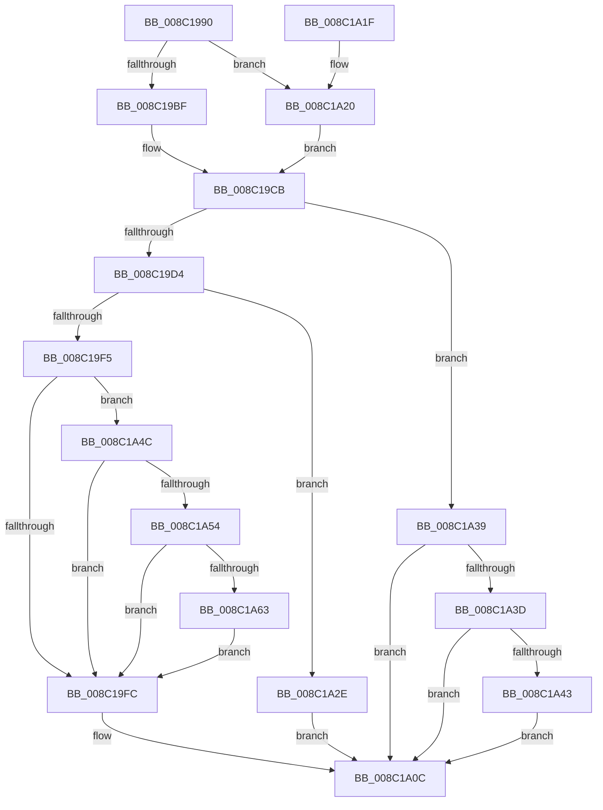

# EtwpUpdateRegEntryEnableMask

- RVA: `0x008C1990`–`0x008C1A6F` (길이 `223` bytes)
- VA: `0x00000001408C1990`
- 실행 섹션: `PAGE`
- PDB 이름 있음: `예`; PDB Function 태그: `예`
- unwind 정보 RVA: `0x00083638`
- 디코드: `70`개 명령, `223/223` bytes 표시
- 미해석 바이트: `0` (있으면 어셈블리에 `.byte`로 보존)

> 이 문서는 커널 이미지의 기계어와 PDB 기호를 분석해 생성했습니다. 4번과 5번은 함수 원형과 자료형을 바이너리 사용 방식에서 추정한 C 해석이며 원본 소스 복구 결과는 아닙니다.

## 1. Dependencies

- 직접 호출 지점: **2**; 고유 호출 대상: **2**
- 직접 호출자로 확인된 함수: **2**
- RIP 상대 이미지 참조: **0**

### Outgoing calls
- `0x008C19E8` → [EtwpApplyScopeFilters](EtwpApplyScopeFilters_function_008C3470.md) (function, `0x008C3470`)
- `0x008C1A5A` → [EtwpTrackDecodeGuidForSession](../A7/EtwpTrackDecodeGuidForSession_function_00A79B24.md) (function, `0x00A79B24`)

### Direct callers
- [EtwpNotifyDisallowedGuidChange](../9E/EtwpNotifyDisallowedGuidChange_function_009EAD14.md) at `0x009EAF25`
- [EtwpEnableGuid](../A5/EtwpEnableGuid_function_00A5CD28.md) at `0x00A5D4A0`

### Static image references
- 디코드된 RIP-relative 메모리 참조가 없습니다.

## 2. Other-region calls and transfers

- 다른 실행 섹션으로 향하는 call: **0**
- 별도 외부 분기/꼬리 이동을 확인하지 못했습니다.

## 3. Assembly (complete function range)

```asm
008C1990  48 89 5C 24 08                  mov qword ptr [rsp + 8], rbx
008C1995  48 89 6C 24 10                  mov qword ptr [rsp + 0x10], rbp
008C199A  56                              push rsi
008C199B  57                              push rdi
008C199C  41 56                           push r14
008C199E  48 83 EC 30                     sub rsp, 0x30
008C19A2  45 33 F6                        xor r14d, r14d
008C19A5  45 8A D1                        mov r10b, r9b
008C19A8  45 84 C9                        test r9b, r9b
008C19AB  41 0F B7 F8                     movzx edi, r8w
008C19AF  44 8A 4C 24 70                  mov r9b, byte ptr [rsp + 0x70]
008C19B4  48 8B EA                        mov rbp, rdx
008C19B7  41 8A C1                        mov al, r9b
008C19BA  48 8B F1                        mov rsi, rcx
008C19BD  75 61                           jne 0x1408c1a20
008C19BF  F6 D8                           neg al
008C19C1  48 1B DB                        sbb rbx, rbx
008C19C4  83 E3 04                        and ebx, 4
008C19C7  48 83 C3 64                     add rbx, 0x64
008C19CB  8B 44 24 78                     mov eax, dword ptr [rsp + 0x78]
008C19CF  83 F8 01                        cmp eax, 1
008C19D2  75 65                           jne 0x1408c1a39
008C19D4  48 8D 44 24 68                  lea rax, [rsp + 0x68]
008C19D9  66 89 7C 24 68                  mov word ptr [rsp + 0x68], di
008C19DE  45 8A C2                        mov r8b, r10b
008C19E1  48 89 44 24 20                  mov qword ptr [rsp + 0x20], rax
008C19E6  B2 01                           mov dl, 1
008C19E8  E8 83 1A 00 00                  call 0x1408c3470
008C19ED  0F B7 46 62                     movzx eax, word ptr [rsi + 0x62]
008C19F1  A8 08                           test al, 8
008C19F3  75 39                           jne 0x1408c1a2e
008C19F5  66 0F BA E0 09                  bt ax, 9
008C19FA  72 50                           jb 0x1408c1a4c
008C19FC  66 F7 D7                        not di
008C19FF  66 23 3C 33                     and di, word ptr [rbx + rsi]
008C1A03  66 0B 7C 24 68                  or di, word ptr [rsp + 0x68]
008C1A08  66 89 3C 33                     mov word ptr [rbx + rsi], di
008C1A0C  48 8B 5C 24 50                  mov rbx, qword ptr [rsp + 0x50]
008C1A11  48 8B 6C 24 58                  mov rbp, qword ptr [rsp + 0x58]
008C1A16  48 83 C4 30                     add rsp, 0x30
008C1A1A  41 5E                           pop r14
008C1A1C  5F                              pop rdi
008C1A1D  5E                              pop rsi
008C1A1E  C3                              ret
008C1A1F  CC                              int3
008C1A20  F6 D8                           neg al
008C1A22  48 1B DB                        sbb rbx, rbx
008C1A25  83 E3 04                        and ebx, 4
008C1A28  48 83 C3 66                     add rbx, 0x66
008C1A2C  EB 9D                           jmp 0x1408c19cb
008C1A2E  0F B7 44 24 68                  movzx eax, word ptr [rsp + 0x68]
008C1A33  66 89 46 64                     mov word ptr [rsi + 0x64], ax
008C1A37  EB D3                           jmp 0x1408c1a0c
008C1A39  85 C0                           test eax, eax
008C1A3B  75 CF                           jne 0x1408c1a0c
008C1A3D  F6 41 62 08                     test byte ptr [rcx + 0x62], 8
008C1A41  75 C9                           jne 0x1408c1a0c
008C1A43  66 F7 D7                        not di
008C1A46  66 21 3C 0B                     and word ptr [rbx + rcx], di
008C1A4A  EB C0                           jmp 0x1408c1a0c
008C1A4C  66 44 39 74 24 68               cmp word ptr [rsp + 0x68], r14w
008C1A52  74 A8                           je 0x1408c19fc
008C1A54  48 8B D6                        mov rdx, rsi
008C1A57  48 8B CD                        mov rcx, rbp
008C1A5A  E8 C5 80 1B 00                  call 0x140a79b24
008C1A5F  84 C0                           test al, al
008C1A61  75 99                           jne 0x1408c19fc
008C1A63  B8 FF FD FF FF                  mov eax, 0xfffffdff
008C1A68  66 F0 21 46 62                  lock and word ptr [rsi + 0x62], ax
008C1A6D  EB 8D                           jmp 0x1408c19fc
```

## 4. C-style interpretation (structured pseudocode)

```c
__int64 __fastcall EtwpUpdateRegEntryEnableMask(__int64 a1, __int64 a2, unsigned __int16 a3, unsigned __int8 a4, unsigned __int8 a5, unsigned int a6)
{
    __int64 result;
    __int64 v_r14;
    __int64 v_rbx;
    __int64 v_rdi;
    __int64 v_rsp;
    unsigned __int64 v_stack_m28;
    unsigned __int64 v_stack_p10;
    unsigned __int64 v_stack_p20;
    unsigned __int16 v_stack_p68;
    unsigned __int64 v_stack_p8;

    v_stack_p8 = v_rbx;
    v_stack_p10 = v_rbp;
    v_rsp = (v_rsp) - (48);
    v_r14 = 0;
    if (a4 != 0) goto loc_008C1A20;
    result = (unsigned __int8)(-(a5));
    v_rbx = (unsigned int)((v_rbx) & (4));
    v_rbx = (v_rbx) + (100);
loc_008C19CB:
    if (((unsigned int)((unsigned int)(a6))) != 1) goto loc_008C1A39;
    v_stack_p20 = a3;
    v_stack_m28 = v_stack_p20;
    result = EtwpApplyScopeFilters(a1, 1, a4, a5);
    if ((((unsigned __int8)(*(unsigned __int16 *)(a1 + 98))) & (8)) != 0) goto loc_008C1A2E;
    if (condition_is_below) goto loc_008C1A4C;
loc_008C19FC:
    v_rdi = (unsigned __int16)(~(a3));
    v_rdi = (unsigned __int16)((v_rdi) & (*(unsigned __int16 *)(v_rbx + a1 * 1)));
    v_rdi = (unsigned __int16)((v_rdi) | (v_stack_p20));
    *(unsigned __int16 *)(v_rbx + a1 * 1) = (unsigned __int16)(v_rdi);
loc_008C1A0C:
    v_rsp = (v_rsp) + (48);
    return *(unsigned __int16 *)(a1 + 98);
loc_008C1A20:
    result = (unsigned __int8)(-(*(unsigned __int16 *)(a1 + 98)));
    v_rbx = (unsigned int)((v_stack_p8) & (4));
    v_rbx = (v_rbx) + (102);
    goto loc_008C19CB;
loc_008C1A2E:
    *(unsigned __int16 *)(a1 + 100) = (unsigned __int16)(v_stack_p68);
    goto loc_008C1A0C;
loc_008C1A39:
    if ((unsigned int)(v_stack_p68) != 0) goto loc_008C1A0C;
    if (((*(unsigned __int8 *)(a1 + 98)) & (8)) != 0) goto loc_008C1A0C;
    v_rdi = (unsigned __int16)(~(v_rdi));
    goto loc_008C1A0C;
loc_008C1A4C:
    if (v_stack_p68 == 0) goto loc_008C19FC;
    result = EtwpTrackDecodeGuidForSession(v_stack_p10, a1, a4, a5);
    if ((unsigned __int8)(result) != 0) goto loc_008C19FC;
    goto loc_008C19FC;
}
```

## 5. (Beta) C Style

```c
int64_t EtwpUpdateRegEntryEnableMask(void *Arg1, int64_t Arg2, uint16_t Arg3, uint8_t Arg4, uint8_t Arg5, uint32_t Arg6)
{
    uint8_t *arg1 = (uint8_t *)Arg1;

    int64_t result;
    int64_t local_r14;
    int64_t local_rbx;
    int64_t local_rdi;
    int64_t local_rsp;
    uint64_t v_stack_m28;
    uint64_t v_stack_p10;
    uint64_t v_stack_p20;
    uint16_t v_stack_p68;
    uint64_t v_stack_p8;

    v_stack_p8 = local_rbx;
    v_stack_p10 = local_rbp;
    local_rsp = (local_rsp) - (48);
    local_r14 = 0;
    if (Arg4 != 0) goto loc_008C1A20;
    result = (uint8_t)(-(Arg5));
    local_rbx = (uint32_t)((local_rbx) & (4));
    local_rbx = (local_rbx) + (100);
loc_008C19CB:
    if (((uint32_t)((uint32_t)(Arg6))) != 1) goto loc_008C1A39;
    v_stack_p20 = Arg3;
    v_stack_m28 = v_stack_p20;
    result = EtwpApplyScopeFilters(Arg1, 1, Arg4, Arg5);
    if ((((uint8_t)(*(uint16_t *)(arg1 + 0x62))) & (8)) != 0) goto loc_008C1A2E;
    if (condition_is_below) goto loc_008C1A4C;
loc_008C19FC:
    local_rdi = (uint16_t)(~(Arg3));
    local_rdi = (uint16_t)((local_rdi) & (*(uint16_t *)(local_rbx + arg1 * 1)));
    local_rdi = (uint16_t)((local_rdi) | (v_stack_p20));
    *(uint16_t *)(local_rbx + arg1 * 1) = (uint16_t)(local_rdi);
loc_008C1A0C:
    local_rsp = (local_rsp) + (48);
    return *(uint16_t *)(arg1 + 0x62);
loc_008C1A20:
    result = (uint8_t)(-(*(uint16_t *)(arg1 + 0x62)));
    local_rbx = (uint32_t)((v_stack_p8) & (4));
    local_rbx = (local_rbx) + (102);
    goto loc_008C19CB;
loc_008C1A2E:
    *(uint16_t *)(arg1 + 0x64) = (uint16_t)(v_stack_p68);
    goto loc_008C1A0C;
loc_008C1A39:
    if ((uint32_t)(v_stack_p68) != 0) goto loc_008C1A0C;
    if (((*(uint8_t *)(arg1 + 0x62)) & (8)) != 0) goto loc_008C1A0C;
    local_rdi = (uint16_t)(~(local_rdi));
    goto loc_008C1A0C;
loc_008C1A4C:
    if (v_stack_p68 == 0) goto loc_008C19FC;
    result = EtwpTrackDecodeGuidForSession(v_stack_p10, Arg1, Arg4, Arg5);
    if ((uint8_t)(result) != 0) goto loc_008C19FC;
    goto loc_008C19FC;
}
```

### 관측된 메모리 오프셋

구조체 형식이 확인되지 않은 접근은 인자 기준의 오프셋으로만 기록했습니다.

| 기준 인자 | 오프셋 표현 | 폭 (bit) | 접근 |
|---|---:|---:|---|
| `Arg1` | `+ 0x62` | `8` | `R` |
| `Arg1` | `+ 0x62` | `16` | `R` |
| `Arg1` | `+ 0x62` | `16` | `R/W` |
| `Arg1` | `+ 0x64` | `16` | `W` |

## 6. Execution-region graph

[열기: 2D/3D 그래프와 함수 탐색 컨트롤 패널](../../../control-panel.html?section=page&rva=0x008C1990&view=graph)

- 2D 그래프는 위에서 아래로 흐르고, 3D 그래프는 빈 공간을 드래그해 회전합니다. Shift+드래그는 이동, 휠은 확대·축소, 함수 노드 선택은 대상 보고서 이동입니다.

### Static fallback


