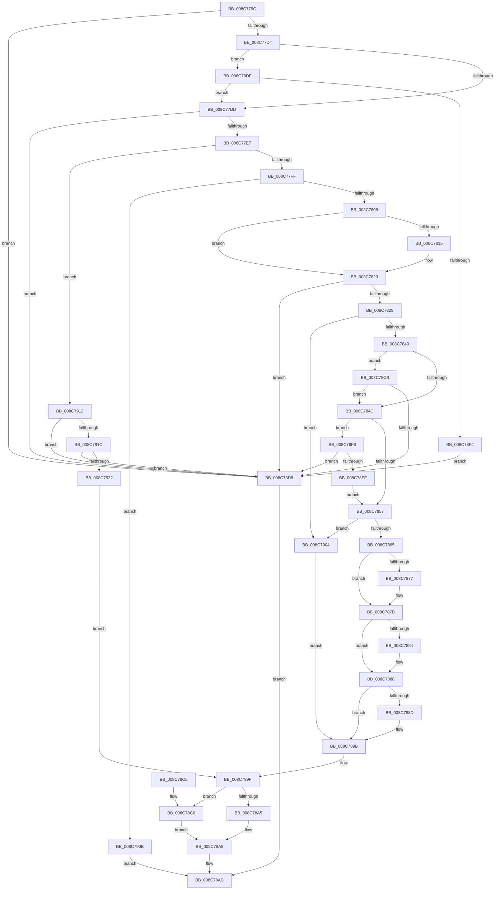

# EtwpValidateEnableNotification

- RVA: `0x008C779C`–`0x008C7927` (길이 `395` bytes)
- VA: `0x00000001408C779C`
- 실행 섹션: `PAGE`
- PDB 이름 있음: `예`; PDB Function 태그: `아니요`
- unwind 정보 RVA: `0x00083F38`
- 디코드: `107`개 명령, `395/395` bytes 표시
- 미해석 바이트: `0` (있으면 어셈블리에 `.byte`로 보존)

> 이 문서는 커널 이미지의 기계어와 PDB 기호를 분석해 생성했습니다. 4번과 5번은 함수 원형과 자료형을 바이너리 사용 방식에서 추정한 C 해석이며 원본 소스 복구 결과는 아닙니다.

## 1. Dependencies

- 직접 호출 지점: **3**; 고유 호출 대상: **3**
- 직접 호출자로 확인된 함수: **1**
- RIP 상대 이미지 참조: **3**

### Outgoing calls
- `0x008C782F` → [EtwpAcquireLoggerContextByLoggerId](../93/EtwpAcquireLoggerContextByLoggerId_function_00932920.md) (function, `0x00932920`)
- `0x008C7894` → [EtwpCheckNotificationAccess](EtwpCheckNotificationAccess_function_008C770C.md) (function, `0x008C770C`)
- `0x008C78E7` → [EtwpValidateFilterDescriptors](../9F/EtwpValidateFilterDescriptors_function_009FC7E4.md) (function, `0x009FC7E4`)

### Direct callers
- [EtwpEnableGuid](../A5/EtwpEnableGuid_function_00A5CD28.md) at `0x00A5CDFC`

### Static image references
- `0x008C7808` → RVA `0x00011380` (`.rdata`; read)
- `0x008C7815` → RVA `0x00011388` (`.rdata`; read)
- `0x008C7840` → RVA `0x00FC6AA8` (`ALMOSTRO`; read)

## 2. Other-region calls and transfers

- 다른 실행 섹션으로 향하는 call: **0**
- 별도 외부 분기/꼬리 이동을 확인하지 못했습니다.

## 3. Assembly (complete function range)

```asm
008C779C  48 89 5C 24 08                  mov qword ptr [rsp + 8], rbx
008C77A1  48 89 6C 24 10                  mov qword ptr [rsp + 0x10], rbp
008C77A6  48 89 74 24 18                  mov qword ptr [rsp + 0x18], rsi
008C77AB  57                              push rdi
008C77AC  41 56                           push r14
008C77AE  41 57                           push r15
008C77B0  48 83 EC 20                     sub rsp, 0x20
008C77B4  4C 8B 74 24 60                  mov r14, qword ptr [rsp + 0x60]
008C77B9  33 DB                           xor ebx, ebx
008C77BB  83 7A 04 78                     cmp dword ptr [rdx + 4], 0x78
008C77BF  49 8B F1                        mov rsi, r9
008C77C2  45 8A F8                        mov r15b, r8b
008C77C5  48 8B FA                        mov rdi, rdx
008C77C8  48 8B E9                        mov rbp, rcx
008C77CB  49 89 1E                        mov qword ptr [r14], rbx
008C77CE  0F 82 04 01 00 00               jb 0x1408c78d8
008C77D4  39 5A 74                        cmp dword ptr [rdx + 0x74], ebx
008C77D7  0F 87 02 01 00 00               ja 0x1408c78df
008C77DD  83 7F 48 02                     cmp dword ptr [rdi + 0x48], 2
008C77E1  0F 87 F1 00 00 00               ja 0x1408c78d8
008C77E7  0F B7 57 4E                     movzx edx, word ptr [rdi + 0x4e]
008C77EB  0F BA E2 0F                     bt edx, 0xf
008C77EF  0F 92 C0                        setb al
008C77F2  88 46 12                        mov byte ptr [rsi + 0x12], al
008C77F5  0F BA E2 0F                     bt edx, 0xf
008C77F9  0F 82 13 01 00 00               jb 0x1408c7912
008C77FF  83 FA 03                        cmp edx, 3
008C7802  0F 84 03 01 00 00               je 0x1408c790b
008C7808  48 8B 0D 71 9B 74 FF            mov rcx, qword ptr [rip - 0x8b648f]
008C780F  48 2B 4F 28                     sub rcx, qword ptr [rdi + 0x28]
008C7813  75 0B                           jne 0x1408c7820
008C7815  48 8B 0D 6C 9B 74 FF            mov rcx, qword ptr [rip - 0x8b6494]
008C781C  48 2B 4F 30                     sub rcx, qword ptr [rdi + 0x30]
008C7820  48 85 C9                        test rcx, rcx
008C7823  0F 84 AF 00 00 00               je 0x1408c78d8
008C7829  45 33 C0                        xor r8d, r8d
008C782C  48 8B CD                        mov rcx, rbp
008C782F  E8 EC B0 06 00                  call 0x140932920
008C7834  48 8B D0                        mov rdx, rax
008C7837  48 85 C0                        test rax, rax
008C783A  0F 84 C4 00 00 00               je 0x1408c7904
008C7840  48 3B 2D 61 F2 6F 00            cmp rbp, qword ptr [rip + 0x6ff261]
008C7847  49 89 06                        mov qword ptr [r14], rax
008C784A  75 7F                           jne 0x1408c78cb
008C784C  8B 47 50                        mov eax, dword ptr [rdi + 0x50]
008C784F  A8 20                           test al, 0x20
008C7851  0F 85 9F 00 00 00               jne 0x1408c78f6
008C7857  8B 82 30 03 00 00               mov eax, dword ptr [rdx + 0x330]
008C785D  A8 40                           test al, 0x40
008C785F  0F 85 9F 00 00 00               jne 0x1408c7904
008C7865  0F 10 82 14 01 00 00            movups xmm0, xmmword ptr [rdx + 0x114]
008C786C  F3 0F 7F 06                     movdqu xmmword ptr [rsi], xmm0
008C7870  8B 42 0C                        mov eax, dword ptr [rdx + 0xc]
008C7873  84 C0                           test al, al
008C7875  79 04                           jns 0x1408c787b
008C7877  C6 46 10 01                     mov byte ptr [rsi + 0x10], 1
008C787B  F7 42 0C 00 00 00 01            test dword ptr [rdx + 0xc], 0x1000000
008C7882  74 04                           je 0x1408c7888
008C7884  C6 46 11 01                     mov byte ptr [rsi + 0x11], 1
008C7888  45 84 FF                        test r15b, r15b
008C788B  74 0E                           je 0x1408c789b
008C788D  48 8D 4F 28                     lea rcx, [rdi + 0x28]
008C7891  48 8B D6                        mov rdx, rsi
008C7894  E8 73 FE FF FF                  call 0x1408c770c
008C7899  8B D8                           mov ebx, eax
008C789B  48 83 C7 50                     add rdi, 0x50
008C789F  8B 07                           mov eax, dword ptr [rdi]
008C78A1  A8 10                           test al, 0x10
008C78A3  74 21                           je 0x1408c78c6
008C78A5  83 E0 EF                        and eax, 0xffffffef
008C78A8  89 07                           mov dword ptr [rdi], eax
008C78AA  8B C3                           mov eax, ebx
008C78AC  48 8B 5C 24 40                  mov rbx, qword ptr [rsp + 0x40]
008C78B1  48 8B 6C 24 48                  mov rbp, qword ptr [rsp + 0x48]
008C78B6  48 8B 74 24 50                  mov rsi, qword ptr [rsp + 0x50]
008C78BB  48 83 C4 20                     add rsp, 0x20
008C78BF  41 5F                           pop r15
008C78C1  41 5E                           pop r14
008C78C3  5F                              pop rdi
008C78C4  C3                              ret
008C78C5  CC                              int3
008C78C6  83 C8 40                        or eax, 0x40
008C78C9  EB DD                           jmp 0x1408c78a8
008C78CB  F7 47 50 00 04 00 00            test dword ptr [rdi + 0x50], 0x400
008C78D2  0F 84 74 FF FF FF               je 0x1408c784c
008C78D8  B8 0D 00 00 C0                  mov eax, 0xc000000d
008C78DD  EB CD                           jmp 0x1408c78ac
008C78DF  48 8B 54 24 68                  mov rdx, qword ptr [rsp + 0x68]
008C78E4  48 8B CF                        mov rcx, rdi
008C78E7  E8 F8 4E 13 00                  call 0x1409fc7e4
008C78EC  85 C0                           test eax, eax
008C78EE  0F 84 E9 FE FF FF               je 0x1408c77dd
008C78F4  EB E2                           jmp 0x1408c78d8
008C78F6  F7 42 0C 00 08 03 01            test dword ptr [rdx + 0xc], 0x1030800
008C78FD  75 D9                           jne 0x1408c78d8
008C78FF  E9 53 FF FF FF                  jmp 0x1408c7857
008C7904  BB 96 02 00 C0                  mov ebx, 0xc0000296
008C7909  EB 90                           jmp 0x1408c789b
008C790B  B8 22 00 00 C0                  mov eax, 0xc0000022
008C7910  EB 9A                           jmp 0x1408c78ac
008C7912  48 83 C7 50                     add rdi, 0x50
008C7916  8B 07                           mov eax, dword ptr [rdi]
008C7918  A8 20                           test al, 0x20
008C791A  75 BC                           jne 0x1408c78d8
008C791C  0F BA E0 0A                     bt eax, 0xa
008C7920  72 B6                           jb 0x1408c78d8
008C7922  E9 78 FF FF FF                  jmp 0x1408c789f
```

## 4. C-style interpretation (structured pseudocode)

```c
__int64 __fastcall EtwpValidateEnableNotification(__int64 a1, __int64 a2, int a3, __int64 a4, __int64 a5, __int64 a6)
{
    __int64 result;
    __int64 v_rbx;
    __int64 v_rdi;
    __int64 v_rsp;
    unsigned __int64 v_stack_p10;
    unsigned __int64 v_stack_p18;
    unsigned __int64 v_stack_p8;

    v_stack_p8 = v_rbx;
    v_stack_p10 = v_rbp;
    v_stack_p18 = v_rsi;
    v_rsp = (v_rsp) - (32);
    v_rbx = 0;
    *(unsigned __int64 *)(a5) = 0;
    if ((*(unsigned int *)(a2 + 4)) < 120) goto loc_008C78D8;
    if ((*(unsigned int *)(a2 + 116)) > 0) goto loc_008C78DF;
loc_008C77DD:
    if ((*(unsigned int *)(a2 + 72)) > 2) goto loc_008C78D8;
    result = ((*(unsigned int *)(a2 + 72)) < 2) ? 1 : 0;
    *(unsigned __int8 *)(a4 + 18) = (unsigned __int8)(result);
    if ((*(unsigned int *)(a2 + 72)) < 2) goto loc_008C7912;
    if (((unsigned int)(*(unsigned __int16 *)(a2 + 78))) == 3) goto loc_008C790B;
    a1 = (*(unsigned __int64 *)(v_rip - 9135247)) - (*(unsigned __int64 *)(a2 + 40));
    if (!(condition_is_not_equal)) {
        a1 = *(unsigned __int64 *)(v_rip - 9135252);
        a1 = (a1) - (*(unsigned __int64 *)(a2 + 48));
    }
    if (a1 == 0) goto loc_008C78D8;
    a3 = 0;
    result = EtwpAcquireLoggerContextByLoggerId(a1, *(unsigned __int16 *)(a2 + 78), a3, a4);
    if (result == 0) goto loc_008C7904;
    *(unsigned __int64 *)(a5) = result;
    if (a1 != (*(unsigned __int64 *)(v_rip + 7336545))) goto loc_008C78CB;
loc_008C784C:
    if ((((unsigned __int8)((unsigned int)(*(unsigned int *)(a2 + 80)))) & (32)) != 0) goto loc_008C78F6;
loc_008C7857:
    if ((((unsigned __int8)((unsigned int)(*(unsigned int *)(result + 816)))) & (64)) != 0) goto loc_008C7904;
    *(unsigned __int64 *)(a4) = v_xmm0;
    if (sign_flag) {
        *(unsigned __int8 *)(a4 + 16) = 1;
    }
    if (((*(unsigned int *)(result + 12)) & (0x1000000ULL)) != 0) {
        *(unsigned __int8 *)(a4 + 17) = 1;
    }
    result = (unsigned int)(*(unsigned int *)(result + 12));
    if ((unsigned __int8)((unsigned __int8)(a3)) != 0) {
        a1 = a2 + 40;
        a2 = a4;
        result = EtwpCheckNotificationAccess(a1, a2, a3, a4);
        v_rbx = (unsigned int)(result);
    }
    v_rdi = (a2) + (80);
loc_008C789F:
    if ((((unsigned __int8)((unsigned int)(*(unsigned int *)(v_rdi)))) & (16)) == 0) goto loc_008C78C6;
    result = (unsigned int)(((unsigned int)(*(unsigned int *)(v_rdi))) & (0xFFFFFFEFULL));
loc_008C78A8:
    *(unsigned int *)(v_rdi) = (unsigned int)(result);
loc_008C78AC:
    v_rsp = (v_rsp) + (32);
    return (unsigned int)((unsigned int)(v_rbx));
loc_008C78C6:
    result = (unsigned int)(((unsigned int)((unsigned int)(v_rbx))) | (64));
    goto loc_008C78A8;
loc_008C78CB:
    if (((*(unsigned int *)(v_rdi + 80)) & (0x400ULL)) == 0) goto loc_008C784C;
loc_008C78D8:
    goto loc_008C78AC;
loc_008C78DF:
    result = EtwpValidateFilterDescriptors(v_rdi, a6, a3, a4);
    if ((unsigned int)(result) == 0) goto loc_008C77DD;
    goto loc_008C78D8;
loc_008C78F6:
    if (((*(unsigned int *)(a6 + 12)) & (0x1030800ULL)) != 0) goto loc_008C78D8;
    goto loc_008C7857;
loc_008C7904:
    goto loc_008C789B;
loc_008C790B:
    goto loc_008C78AC;
loc_008C7912:
    v_rdi = (v_rdi) + (80);
    if ((((unsigned __int8)((unsigned int)(*(unsigned int *)(v_rdi)))) & (32)) != 0) goto loc_008C78D8;
    if (condition_is_below) goto loc_008C78D8;
    goto loc_008C789F;
}
```

## 5. (Beta) C Style

```c
int64_t EtwpValidateEnableNotification(int64_t Arg1, void *Arg2, int32_t Arg3, void *Arg4, void *Arg5, int64_t Arg6)
{
    uint8_t *arg2 = (uint8_t *)Arg2;
    uint8_t *arg4 = (uint8_t *)Arg4;
    uint8_t *arg5 = (uint8_t *)Arg5;

    int64_t result;
    int64_t local_rbx;
    int64_t local_rdi;
    int64_t local_rsp;
    uint64_t v_stack_p10;
    uint64_t v_stack_p18;
    uint64_t v_stack_p8;

    v_stack_p8 = local_rbx;
    v_stack_p10 = local_rbp;
    v_stack_p18 = local_rsi;
    local_rsp = (local_rsp) - (32);
    local_rbx = 0;
    *(uint64_t *)(arg5) = 0;
    if ((*(uint32_t *)(arg2 + 0x4)) < 120) goto loc_008C78D8;
    if ((*(uint32_t *)(arg2 + 0x74)) > 0) goto loc_008C78DF;
loc_008C77DD:
    if ((*(uint32_t *)(arg2 + 0x48)) > 2) goto loc_008C78D8;
    result = ((*(uint32_t *)(arg2 + 0x48)) < 2) ? 1 : 0;
    *(uint8_t *)(arg4 + 0x12) = (uint8_t)(result);
    if ((*(uint32_t *)(arg2 + 0x48)) < 2) goto loc_008C7912;
    if (((uint32_t)(*(uint16_t *)(arg2 + 0x4E))) == 3) goto loc_008C790B;
    Arg1 = (*(uint64_t *)(v_rip - 0x8B648F)) - (*(uint64_t *)(arg2 + 0x28));
    if (!(condition_is_not_equal)) {
        Arg1 = *(uint64_t *)(v_rip - 0x8B6494);
        Arg1 = (Arg1) - (*(uint64_t *)(arg2 + 0x30));
    }
    if (Arg1 == 0) goto loc_008C78D8;
    Arg3 = 0;
    result = EtwpAcquireLoggerContextByLoggerId(Arg1, *(uint16_t *)(arg2 + 0x4E), Arg3, Arg4);
    if (result == 0) goto loc_008C7904;
    *(uint64_t *)(arg5) = result;
    if (Arg1 != (*(uint64_t *)(v_rip + 0x6FF261))) goto loc_008C78CB;
loc_008C784C:
    if ((((uint8_t)((uint32_t)(*(uint32_t *)(arg2 + 0x50)))) & (32)) != 0) goto loc_008C78F6;
loc_008C7857:
    if ((((uint8_t)((uint32_t)(*(uint32_t *)(result + 0x330)))) & (64)) != 0) goto loc_008C7904;
    *(uint64_t *)(arg4) = v_xmm0;
    if (sign_flag) {
        *(uint8_t *)(arg4 + 0x10) = 1;
    }
    if (((*(uint32_t *)(result + 0xC)) & (0x1000000ULL)) != 0) {
        *(uint8_t *)(arg4 + 0x11) = 1;
    }
    result = (uint32_t)(*(uint32_t *)(result + 0xC));
    if ((uint8_t)((uint8_t)(Arg3)) != 0) {
        Arg1 = Arg2 + 40;
        Arg2 = Arg4;
        result = EtwpCheckNotificationAccess(Arg1, Arg2, Arg3, Arg4);
        local_rbx = (uint32_t)(result);
    }
    local_rdi = (Arg2) + (80);
loc_008C789F:
    if ((((uint8_t)((uint32_t)(*(uint32_t *)(local_rdi)))) & (16)) == 0) goto loc_008C78C6;
    result = (uint32_t)(((uint32_t)(*(uint32_t *)(local_rdi))) & (0xFFFFFFEFULL));
loc_008C78A8:
    *(uint32_t *)(local_rdi) = (uint32_t)(result);
loc_008C78AC:
    local_rsp = (local_rsp) + (32);
    return (uint32_t)((uint32_t)(local_rbx));
loc_008C78C6:
    result = (uint32_t)(((uint32_t)((uint32_t)(local_rbx))) | (64));
    goto loc_008C78A8;
loc_008C78CB:
    if (((*(uint32_t *)(local_rdi + 0x50)) & (0x400ULL)) == 0) goto loc_008C784C;
loc_008C78D8:
    goto loc_008C78AC;
loc_008C78DF:
    result = EtwpValidateFilterDescriptors(local_rdi, Arg6, Arg3, Arg4);
    if ((uint32_t)(result) == 0) goto loc_008C77DD;
    goto loc_008C78D8;
loc_008C78F6:
    if (((*(uint32_t *)(Arg6 + 0xC)) & (0x1030800ULL)) != 0) goto loc_008C78D8;
    goto loc_008C7857;
loc_008C7904:
    goto loc_008C789B;
loc_008C790B:
    goto loc_008C78AC;
loc_008C7912:
    local_rdi = (local_rdi) + (80);
    if ((((uint8_t)((uint32_t)(*(uint32_t *)(local_rdi)))) & (32)) != 0) goto loc_008C78D8;
    if (condition_is_below) goto loc_008C78D8;
    goto loc_008C789F;
}
```

### 관측된 메모리 오프셋

구조체 형식이 확인되지 않은 접근은 인자 기준의 오프셋으로만 기록했습니다.

| 기준 인자 | 오프셋 표현 | 폭 (bit) | 접근 |
|---|---:|---:|---|
| `Arg2` | `+ 0x0` | `32` | `R` |
| `Arg2` | `+ 0x0` | `32` | `W` |
| `Arg2` | `+ 0x4` | `32` | `R` |
| `Arg2` | `+ 0x28` | `64` | `R` |
| `Arg2` | `+ 0x30` | `64` | `R` |
| `Arg2` | `+ 0x48` | `32` | `R` |
| `Arg2` | `+ 0x4E` | `16` | `R` |
| `Arg2` | `+ 0x50` | `32` | `R` |
| `Arg2` | `+ 0x74` | `32` | `R` |
| `Arg4` | `+ 0x0` | `128` | `W` |
| `Arg4` | `+ 0x10` | `8` | `W` |
| `Arg4` | `+ 0x11` | `8` | `W` |
| `Arg4` | `+ 0x12` | `8` | `W` |
| `Arg5` | `+ 0x0` | `64` | `W` |

## 6. Execution-region graph

[열기: 2D/3D 그래프와 함수 탐색 컨트롤 패널](../../../control-panel.html?section=page&rva=0x008C779C&view=graph)

- 2D 그래프는 위에서 아래로 흐르고, 3D 그래프는 빈 공간을 드래그해 회전합니다. Shift+드래그는 이동, 휠은 확대·축소, 함수 노드 선택은 대상 보고서 이동입니다.

### Static fallback


