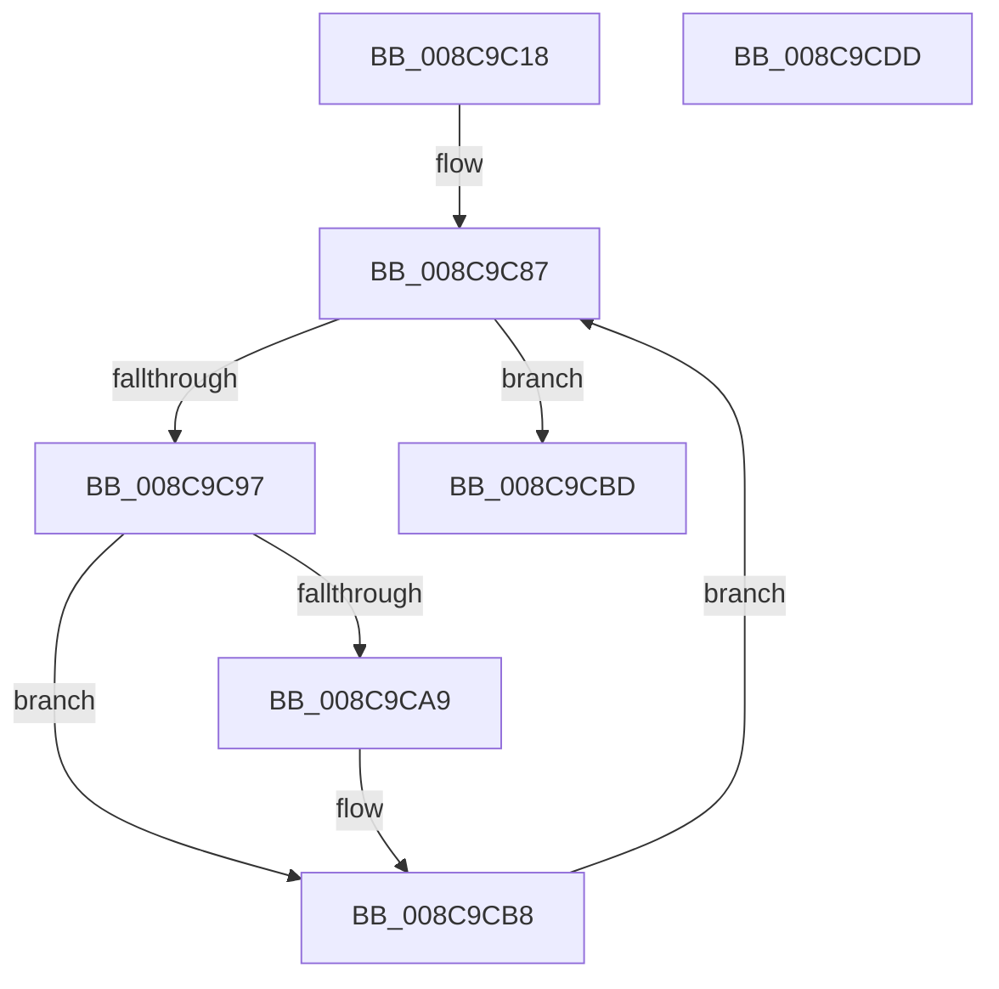

# IopCancelIrpsInThreadListForCurrentProcess

- RVA: `0x008C9C18`–`0x008C9CDE` (길이 `198` bytes)
- VA: `0x00000001408C9C18`
- 실행 섹션: `PAGE`
- PDB 이름 있음: `예`; PDB Function 태그: `아니요`
- unwind 정보 RVA: `0x0005DD2C`
- 디코드: `51`개 명령, `198/198` bytes 표시
- 미해석 바이트: `0` (있으면 어셈블리에 `.byte`로 보존)

> 이 문서는 커널 이미지의 기계어와 PDB 기호를 분석해 생성했습니다. 4번과 5번은 함수 원형과 자료형을 바이너리 사용 방식에서 추정한 C 해석이며 원본 소스 복구 결과는 아닙니다.

## 1. Dependencies

- 직접 호출 지점: **5**; 고유 호출 대상: **5**
- 직접 호출자로 확인된 함수: **2**
- RIP 상대 이미지 참조: **0**

### Outgoing calls
- `0x008C9C59` → [memset](../../text/6C/memset_function_006C6C40.md) (function, `0x006C6C40`)
- `0x008C9C80` → [KeInitializeEvent](../../text/40/KeInitializeEvent_function_0040DD10.md) (function, `0x0040DD10`)
- `0x008C9C8A` → [PsGetNextProcessThread](PsGetNextProcessThread_function_008C9CF0.md) (function, `0x008C9CF0`)
- `0x008C9CA0` → [IopCancelApcRequired](../../text/45/IopCancelApcRequired_function_00456BB0.md) (function, `0x00456BB0`)
- `0x008C9CB1` → [IopCancelIrpsInThreadList](IopCancelIrpsInThreadList_function_008C9E18.md) (function, `0x008C9E18`)

### Direct callers
- [IopCheckHandleForRevocation](../../text/59/IopCheckHandleForRevocation_function_00598340.md) at `0x005983D3`
- [IopCancelIoFile](../A4/IopCancelIoFile_function_00A4481C.md) at `0x00A4487F`

### Static image references
- 디코드된 RIP-relative 메모리 참조가 없습니다.

## 2. Other-region calls and transfers

- 다른 실행 섹션으로 향하는 call: **3**
  - `0x008C9C59` → [memset](../../text/6C/memset_function_006C6C40.md) (`PAGE` → `.text`)
  - `0x008C9C80` → [KeInitializeEvent](../../text/40/KeInitializeEvent_function_0040DD10.md) (`PAGE` → `.text`)
  - `0x008C9CA0` → [IopCancelApcRequired](../../text/45/IopCancelApcRequired_function_00456BB0.md) (`PAGE` → `.text`)
- 별도 외부 분기/꼬리 이동을 확인하지 못했습니다.

## 3. Assembly (complete function range)

```asm
008C9C18  48 8B C4                        mov rax, rsp
008C9C1B  48 89 58 08                     mov qword ptr [rax + 8], rbx
008C9C1F  48 89 68 10                     mov qword ptr [rax + 0x10], rbp
008C9C23  48 89 70 18                     mov qword ptr [rax + 0x18], rsi
008C9C27  48 89 78 20                     mov qword ptr [rax + 0x20], rdi
008C9C2B  41 56                           push r14
008C9C2D  48 81 EC B0 00 00 00            sub rsp, 0xb0
008C9C34  65 48 8B 04 25 88 01 00 00      mov rax, qword ptr gs:[0x188]
008C9C3D  48 8B EA                        mov rbp, rdx
008C9C40  4C 8B F1                        mov r14, rcx
008C9C43  33 D2                           xor edx, edx
008C9C45  41 B8 88 00 00 00               mov r8d, 0x88
008C9C4B  48 8D 4C 24 20                  lea rcx, [rsp + 0x20]
008C9C50  33 FF                           xor edi, edi
008C9C52  48 8B B0 B8 00 00 00            mov rsi, qword ptr [rax + 0xb8]
008C9C59  E8 E2 CF DF FF                  call 0x1406c6c40
008C9C5E  45 33 C0                        xor r8d, r8d
008C9C61  4C 89 74 24 78                  mov qword ptr [rsp + 0x78], r14
008C9C66  33 D2                           xor edx, edx
008C9C68  48 89 AC 24 80 00 00 00         mov qword ptr [rsp + 0x80], rbp
008C9C70  48 8D 8C 24 88 00 00 00         lea rcx, [rsp + 0x88]
008C9C78  40 88 BC 24 A0 00 00 00         mov byte ptr [rsp + 0xa0], dil
008C9C80  E8 8B 40 B4 FF                  call 0x14040dd10
008C9C85  33 D2                           xor edx, edx
008C9C87  48 8B CE                        mov rcx, rsi
008C9C8A  E8 61 00 00 00                  call 0x1408c9cf0
008C9C8F  48 8B D8                        mov rbx, rax
008C9C92  48 85 C0                        test rax, rax
008C9C95  74 26                           je 0x1408c9cbd
008C9C97  4C 8B C5                        mov r8, rbp
008C9C9A  49 8B D6                        mov rdx, r14
008C9C9D  48 8B C8                        mov rcx, rax
008C9CA0  E8 0B CF B8 FF                  call 0x140456bb0
008C9CA5  85 C0                           test eax, eax
008C9CA7  74 0F                           je 0x1408c9cb8
008C9CA9  48 8D 54 24 20                  lea rdx, [rsp + 0x20]
008C9CAE  48 8B CB                        mov rcx, rbx
008C9CB1  E8 62 01 00 00                  call 0x1408c9e18
008C9CB6  0B F8                           or edi, eax
008C9CB8  48 8B D3                        mov rdx, rbx
008C9CBB  EB CA                           jmp 0x1408c9c87
008C9CBD  4C 8D 9C 24 B0 00 00 00         lea r11, [rsp + 0xb0]
008C9CC5  8B C7                           mov eax, edi
008C9CC7  49 8B 5B 10                     mov rbx, qword ptr [r11 + 0x10]
008C9CCB  49 8B 6B 18                     mov rbp, qword ptr [r11 + 0x18]
008C9CCF  49 8B 73 20                     mov rsi, qword ptr [r11 + 0x20]
008C9CD3  49 8B 7B 28                     mov rdi, qword ptr [r11 + 0x28]
008C9CD7  49 8B E3                        mov rsp, r11
008C9CDA  41 5E                           pop r14
008C9CDC  C3                              ret
008C9CDD  CC                              int3
```

## 4. C-style interpretation (structured pseudocode)

```c
__int64 __fastcall IopCancelIrpsInThreadListForCurrentProcess(__int64 a1, __int64 a2)
{
    __int64 result;
    __int64 v_rdi;
    __int64 v_rsp;
    unsigned __int8 v_stack_m18;
    unsigned __int64 v_stack_m30;
    unsigned __int64 v_stack_m38;
    unsigned __int64 v_stack_m40;
    unsigned __int64 v_stack_m8;
    unsigned __int64 v_stack_m98;

    *(unsigned __int64 *)(v_rsp + 8) = v_rbx;
    *(unsigned __int64 *)(v_rsp + 16) = v_rbp;
    *(unsigned __int64 *)(v_rsp + 24) = v_rsi;
    *(unsigned __int64 *)(v_rsp + 32) = v_rdi;
    v_rsp = (v_rsp) - (176);
    a2 = 0;
    v_rdi = 0;
    result = memset(v_stack_m98, a2, 136, a4);
    a3 = 0;
    v_stack_m40 = a1;
    a2 = 0;
    v_stack_m38 = 0;
    v_stack_m18 = 0;
    result = KeInitializeEvent(v_stack_m30, a2, a3, a4);
    a2 = 0;
loc_008C9C87:
    result = PsGetNextProcessThread(*(unsigned __int64 *)(*(unsigned __int64 *)(gs_base + (0 + 392)) + 184), a2, a3, a4);
    if (result == 0) goto loc_008C9CBD;
    result = IopCancelApcRequired(result, a1, 0, a4);
    if ((unsigned int)(result) != 0) {
        a2 = v_stack_m98;
        a1 = result;
        result = IopCancelIrpsInThreadList(a1, a2, 0, a4);
        v_rdi = (unsigned int)((v_rdi) | ((unsigned int)(result)));
    }
    goto loc_008C9C87;
loc_008C9CBD:
    return (unsigned int)((unsigned int)(v_rdi));
}
```

## 5. (Beta) C Style

```c
int64_t IopCancelIrpsInThreadListForCurrentProcess(int64_t Arg1, int64_t Arg2)
{
    int64_t result;
    int64_t local_rdi;
    int64_t local_rsp;
    uint8_t v_stack_m18;
    uint64_t v_stack_m30;
    uint64_t v_stack_m38;
    uint64_t v_stack_m40;
    uint64_t v_stack_m8;
    uint64_t v_stack_m98;

    *(uint64_t *)(local_rsp + 0x8) = local_rbx;
    *(uint64_t *)(local_rsp + 0x10) = local_rbp;
    *(uint64_t *)(local_rsp + 0x18) = local_rsi;
    *(uint64_t *)(local_rsp + 0x20) = local_rdi;
    local_rsp = (local_rsp) - (176);
    Arg2 = 0;
    local_rdi = 0;
    result = memset(v_stack_m98, Arg2, 136, a4);
    a3 = 0;
    v_stack_m40 = Arg1;
    Arg2 = 0;
    v_stack_m38 = 0;
    v_stack_m18 = 0;
    result = KeInitializeEvent(v_stack_m30, Arg2, a3, a4);
    Arg2 = 0;
loc_008C9C87:
    result = PsGetNextProcessThread(*(uint64_t *)(*(uint64_t *)(gs_base + (0 + 0x188)) + 0xB8), Arg2, a3, a4);
    if (result == 0) goto loc_008C9CBD;
    result = IopCancelApcRequired(result, Arg1, 0, a4);
    if ((uint32_t)(result) != 0) {
        Arg2 = v_stack_m98;
        Arg1 = result;
        result = IopCancelIrpsInThreadList(Arg1, Arg2, 0, a4);
        local_rdi = (uint32_t)((local_rdi) | ((uint32_t)(result)));
    }
    goto loc_008C9C87;
loc_008C9CBD:
    return (uint32_t)((uint32_t)(local_rdi));
}
```

## 6. Execution-region graph

[열기: 2D/3D 그래프와 함수 탐색 컨트롤 패널](../../../control-panel.html?section=page&rva=0x008C9C18&view=graph)

- 2D 그래프는 위에서 아래로 흐르고, 3D 그래프는 빈 공간을 드래그해 회전합니다. Shift+드래그는 이동, 휠은 확대·축소, 함수 노드 선택은 대상 보고서 이동입니다.

### Static fallback


