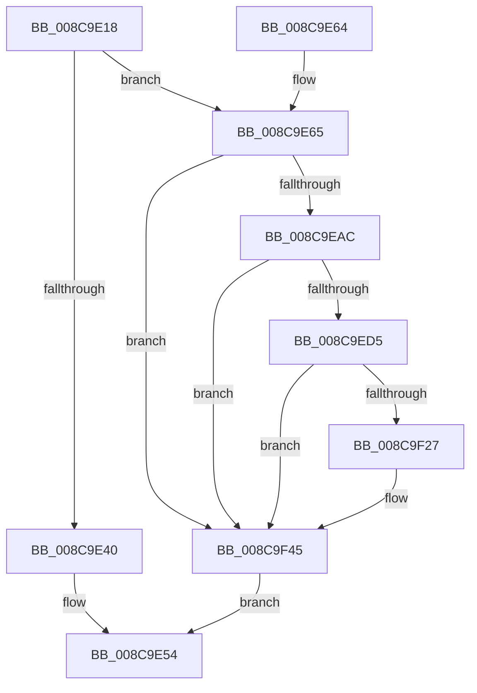

# IopCancelIrpsInThreadList

- RVA: `0x008C9E18`–`0x008C9F50` (길이 `312` bytes)
- VA: `0x00000001408C9E18`
- 실행 섹션: `PAGE`
- PDB 이름 있음: `예`; PDB Function 태그: `아니요`
- unwind 정보 RVA: `0x000841FC`
- 디코드: `78`개 명령, `312/312` bytes 표시
- 미해석 바이트: `0` (있으면 어셈블리에 `.byte`로 보존)

> 이 문서는 커널 이미지의 기계어와 PDB 기호를 분석해 생성했습니다. 4번과 5번은 함수 원형과 자료형을 바이너리 사용 방식에서 추정한 C 해석이며 원본 소스 복구 결과는 아닙니다.

## 1. Dependencies

- 직접 호출 지점: **10**; 고유 호출 대상: **6**
- 직접 호출자로 확인된 함수: **2**
- RIP 상대 이미지 참조: **3**

### Outgoing calls
- `0x008C9E4F` → [IopCancelIrpsInCurrentThreadList](../../text/47/IopCancelIrpsInCurrentThreadList_function_0047AB14.md) (function, `0x0047AB14`)
- `0x008C9E8C` → [KeInitializeApc](../../text/42/KeInitializeApc_function_00428510.md) (function, `0x00428510`)
- `0x008C9E9F` → [KeInsertQueueApc](../../text/20/KeInsertQueueApc_function_00203F10.md) (function, `0x00203F10`)
- `0x008C9EC1` → [KeWaitForSingleObject](../../text/20/KeWaitForSingleObject_function_0020E6B0.md) (function, `0x0020E6B0`)
- `0x008C9EC9` → [KeResetEvent](../../text/24/KeResetEvent_function_00248350.md) (function, `0x00248350`)
- `0x008C9EDD` → [KeInitializeEvent](../../text/40/KeInitializeEvent_function_0040DD10.md) (function, `0x0040DD10`)
- `0x008C9F0E` → [KeInitializeApc](../../text/42/KeInitializeApc_function_00428510.md) (function, `0x00428510`)
- `0x008C9F1E` → [KeInsertQueueApc](../../text/20/KeInsertQueueApc_function_00203F10.md) (function, `0x00203F10`)
- `0x008C9F38` → [KeWaitForSingleObject](../../text/20/KeWaitForSingleObject_function_0020E6B0.md) (function, `0x0020E6B0`)
- `0x008C9F40` → [KeResetEvent](../../text/24/KeResetEvent_function_00248350.md) (function, `0x00248350`)

### Direct callers
- [IopCancelIrpsInThreadListForCurrentProcess](IopCancelIrpsInThreadListForCurrentProcess_function_008C9C18.md) at `0x008C9CB1`
- [IopCancelSynchronousIrpsForThread](../AB/IopCancelSynchronousIrpsForThread_function_00AB5DC4.md) at `0x00AB5E21`

### Static image references
- `0x008C9E6B` → RVA `0x00497B40` (`IopCancelIrpsInCurrentThreadListSpecialApc`; read)
- `0x008C9EE7` → RVA `0x00A88700` (`IopCancelIrpsInCurrentThreadListApcRoutine`; read)
- `0x008C9EF3` → RVA `0x00A64D60` (`AlpcConnectionCleanupProcedure`; read)

## 2. Other-region calls and transfers

- 다른 실행 섹션으로 향하는 call: **10**
  - `0x008C9E4F` → [IopCancelIrpsInCurrentThreadList](../../text/47/IopCancelIrpsInCurrentThreadList_function_0047AB14.md) (`PAGE` → `.text`)
  - `0x008C9E8C` → [KeInitializeApc](../../text/42/KeInitializeApc_function_00428510.md) (`PAGE` → `.text`)
  - `0x008C9E9F` → [KeInsertQueueApc](../../text/20/KeInsertQueueApc_function_00203F10.md) (`PAGE` → `.text`)
  - `0x008C9EC1` → [KeWaitForSingleObject](../../text/20/KeWaitForSingleObject_function_0020E6B0.md) (`PAGE` → `.text`)
  - `0x008C9EC9` → [KeResetEvent](../../text/24/KeResetEvent_function_00248350.md) (`PAGE` → `.text`)
  - `0x008C9EDD` → [KeInitializeEvent](../../text/40/KeInitializeEvent_function_0040DD10.md) (`PAGE` → `.text`)
  - `0x008C9F0E` → [KeInitializeApc](../../text/42/KeInitializeApc_function_00428510.md) (`PAGE` → `.text`)
  - `0x008C9F1E` → [KeInsertQueueApc](../../text/20/KeInsertQueueApc_function_00203F10.md) (`PAGE` → `.text`)
  - `0x008C9F38` → [KeWaitForSingleObject](../../text/20/KeWaitForSingleObject_function_0020E6B0.md) (`PAGE` → `.text`)
  - `0x008C9F40` → [KeResetEvent](../../text/24/KeResetEvent_function_00248350.md) (`PAGE` → `.text`)
- 별도 외부 분기/꼬리 이동을 확인하지 못했습니다.

## 3. Assembly (complete function range)

```asm
008C9E18  48 89 5C 24 10                  mov qword ptr [rsp + 0x10], rbx
008C9E1D  48 89 74 24 18                  mov qword ptr [rsp + 0x18], rsi
008C9E22  57                              push rdi
008C9E23  48 83 EC 40                     sub rsp, 0x40
008C9E27  48 8B DA                        mov rbx, rdx
008C9E2A  C6 44 24 50 00                  mov byte ptr [rsp + 0x50], 0
008C9E2F  65 48 8B 14 25 88 01 00 00      mov rdx, qword ptr gs:[0x188]
008C9E38  48 8B F1                        mov rsi, rcx
008C9E3B  48 3B CA                        cmp rcx, rdx
008C9E3E  75 25                           jne 0x1408c9e65
008C9E40  44 8A 8B 80 00 00 00            mov r9b, byte ptr [rbx + 0x80]
008C9E47  4C 8B 43 60                     mov r8, qword ptr [rbx + 0x60]
008C9E4B  48 8B 4B 58                     mov rcx, qword ptr [rbx + 0x58]
008C9E4F  E8 C0 0C BB FF                  call 0x14047ab14
008C9E54  48 8B 5C 24 58                  mov rbx, qword ptr [rsp + 0x58]
008C9E59  48 8B 74 24 60                  mov rsi, qword ptr [rsp + 0x60]
008C9E5E  48 83 C4 40                     add rsp, 0x40
008C9E62  5F                              pop rdi
008C9E63  C3                              ret
008C9E64  CC                              int3
008C9E65  48 83 64 24 38 00               and qword ptr [rsp + 0x38], 0
008C9E6B  4C 8D 0D CE DC BC FF            lea r9, [rip - 0x432332]
008C9E72  C6 44 24 30 00                  mov byte ptr [rsp + 0x30], 0
008C9E77  45 33 C0                        xor r8d, r8d
008C9E7A  48 83 64 24 28 00               and qword ptr [rsp + 0x28], 0
008C9E80  48 8B D6                        mov rdx, rsi
008C9E83  48 83 64 24 20 00               and qword ptr [rsp + 0x20], 0
008C9E89  48 8B CB                        mov rcx, rbx
008C9E8C  E8 7F E6 B5 FF                  call 0x140428510
008C9E91  45 33 C9                        xor r9d, r9d
008C9E94  48 8D 54 24 50                  lea rdx, [rsp + 0x50]
008C9E99  45 33 C0                        xor r8d, r8d
008C9E9C  48 8B CB                        mov rcx, rbx
008C9E9F  E8 6C A0 93 FF                  call 0x140203f10
008C9EA4  84 C0                           test al, al
008C9EA6  0F 84 99 00 00 00               je 0x1408c9f45
008C9EAC  48 83 64 24 20 00               and qword ptr [rsp + 0x20], 0
008C9EB2  48 8D 7B 68                     lea rdi, [rbx + 0x68]
008C9EB6  48 8B CF                        mov rcx, rdi
008C9EB9  45 33 C9                        xor r9d, r9d
008C9EBC  45 33 C0                        xor r8d, r8d
008C9EBF  33 D2                           xor edx, edx
008C9EC1  E8 EA 47 94 FF                  call 0x14020e6b0
008C9EC6  48 8B CF                        mov rcx, rdi
008C9EC9  E8 82 E4 97 FF                  call 0x140248350
008C9ECE  80 7C 24 50 00                  cmp byte ptr [rsp + 0x50], 0
008C9ED3  74 70                           je 0x1408c9f45
008C9ED5  45 33 C0                        xor r8d, r8d
008C9ED8  33 D2                           xor edx, edx
008C9EDA  48 8B CF                        mov rcx, rdi
008C9EDD  E8 2E 3E B4 FF                  call 0x14040dd10
008C9EE2  48 89 5C 24 38                  mov qword ptr [rsp + 0x38], rbx
008C9EE7  48 8D 05 12 E8 1B 00            lea rax, [rip + 0x1be812]
008C9EEE  C6 44 24 30 00                  mov byte ptr [rsp + 0x30], 0
008C9EF3  4C 8D 0D 66 AE 19 00            lea r9, [rip + 0x19ae66]
008C9EFA  48 89 44 24 28                  mov qword ptr [rsp + 0x28], rax
008C9EFF  45 33 C0                        xor r8d, r8d
008C9F02  48 83 64 24 20 00               and qword ptr [rsp + 0x20], 0
008C9F08  48 8B D6                        mov rdx, rsi
008C9F0B  48 8B CB                        mov rcx, rbx
008C9F0E  E8 FD E5 B5 FF                  call 0x140428510
008C9F13  45 33 C9                        xor r9d, r9d
008C9F16  45 33 C0                        xor r8d, r8d
008C9F19  33 D2                           xor edx, edx
008C9F1B  48 8B CB                        mov rcx, rbx
008C9F1E  E8 ED 9F 93 FF                  call 0x140203f10
008C9F23  84 C0                           test al, al
008C9F25  74 1E                           je 0x1408c9f45
008C9F27  48 83 64 24 20 00               and qword ptr [rsp + 0x20], 0
008C9F2D  45 33 C9                        xor r9d, r9d
008C9F30  45 33 C0                        xor r8d, r8d
008C9F33  33 D2                           xor edx, edx
008C9F35  48 8B CF                        mov rcx, rdi
008C9F38  E8 73 47 94 FF                  call 0x14020e6b0
008C9F3D  48 8B CF                        mov rcx, rdi
008C9F40  E8 0B E4 97 FF                  call 0x140248350
008C9F45  8B 83 84 00 00 00               mov eax, dword ptr [rbx + 0x84]
008C9F4B  E9 04 FF FF FF                  jmp 0x1408c9e54
```

## 4. C-style interpretation (structured pseudocode)

```c
__int64 __fastcall IopCancelIrpsInThreadList(__int64 a1, __int64 a2)
{
    __int64 result;
    __int64 v_rsp;
    unsigned __int64 v_stack_p10;
    unsigned __int64 v_stack_p18;
    unsigned __int64 v_stack_p20;
    unsigned __int64 v_stack_p28;
    unsigned __int8 v_stack_p30;
    unsigned __int64 v_stack_p38;
    unsigned __int64 v_stack_p50;
    unsigned __int8 v_stack_p8;

    v_stack_p10 = v_rbx;
    v_stack_p18 = v_rsi;
    v_rsp = (v_rsp) - (64);
    v_stack_p8 = 0;
    if (a1 != (*(unsigned __int64 *)(gs_base + (0 + 392)))) goto loc_008C9E65;
    result = IopCancelIrpsInCurrentThreadList(*(unsigned __int64 *)(a2 + 88), *(unsigned __int64 *)(gs_base + (0 + 392)), *(unsigned __int64 *)(a2 + 96), *(unsigned __int8 *)(a2 + 128));
loc_008C9E54:
    v_rsp = (v_rsp) + (64);
    return result;
loc_008C9E65:
    v_stack_p30 = 0;
    a3 = 0;
    result = KeInitializeApc(v_stack_p10, v_stack_p18, a3, v_rip - 4399922);
    a4 = 0;
    a3 = 0;
    result = KeInsertQueueApc(v_stack_p10, v_stack_p50, a3, a4);
    if ((unsigned __int8)(result) == 0) goto loc_008C9F45;
    a4 = 0;
    a3 = 0;
    a2 = 0;
    result = KeWaitForSingleObject(v_stack_p10 + 104, a2, a3, a4);
    result = KeResetEvent(v_stack_p10 + 104, a2, a3, a4);
    if (v_stack_p50 == 0) goto loc_008C9F45;
    a3 = 0;
    a2 = 0;
    result = KeInitializeEvent(v_stack_p10 + 104, a2, a3, a4);
    v_stack_p38 = v_stack_p10;
    v_stack_p30 = 0;
    v_stack_p28 = v_rip + 1828882;
    a3 = 0;
    result = KeInitializeApc(v_stack_p10, v_stack_p18, a3, v_rip + 1683046);
    a4 = 0;
    a3 = 0;
    a2 = 0;
    result = KeInsertQueueApc(v_stack_p10, a2, a3, a4);
    if ((unsigned __int8)(result) != 0) {
        a4 = 0;
        a3 = 0;
        a2 = 0;
        a1 = v_stack_p10 + 104;
        result = KeWaitForSingleObject(a1, a2, a3, a4);
        a1 = v_stack_p10 + 104;
        result = KeResetEvent(a1, a2, a3, a4);
    }
    goto loc_008C9E54;
}
```

## 5. (Beta) C Style

```c
int64_t IopCancelIrpsInThreadList(int64_t Arg1, void *Arg2)
{
    uint8_t *arg2 = (uint8_t *)Arg2;

    int64_t result;
    int64_t local_rsp;
    uint64_t v_stack_p10;
    uint64_t v_stack_p18;
    uint64_t v_stack_p20;
    uint64_t v_stack_p28;
    uint8_t v_stack_p30;
    uint64_t v_stack_p38;
    uint64_t v_stack_p50;
    uint8_t v_stack_p8;

    v_stack_p10 = local_rbx;
    v_stack_p18 = local_rsi;
    local_rsp = (local_rsp) - (64);
    v_stack_p8 = 0;
    if (Arg1 != (*(uint64_t *)(gs_base + (0 + 0x188)))) goto loc_008C9E65;
    result = IopCancelIrpsInCurrentThreadList(*(uint64_t *)(arg2 + 0x58), *(uint64_t *)(gs_base + (0 + 0x188)), *(uint64_t *)(arg2 + 0x60), *(uint8_t *)(arg2 + 0x80));
loc_008C9E54:
    local_rsp = (local_rsp) + (64);
    return result;
loc_008C9E65:
    v_stack_p30 = 0;
    a3 = 0;
    result = KeInitializeApc(v_stack_p10, v_stack_p18, a3, v_rip - 4399922);
    a4 = 0;
    a3 = 0;
    result = KeInsertQueueApc(v_stack_p10, v_stack_p50, a3, a4);
    if ((uint8_t)(result) == 0) goto loc_008C9F45;
    a4 = 0;
    a3 = 0;
    Arg2 = 0;
    result = KeWaitForSingleObject(v_stack_p10 + 104, Arg2, a3, a4);
    result = KeResetEvent(v_stack_p10 + 104, Arg2, a3, a4);
    if (v_stack_p50 == 0) goto loc_008C9F45;
    a3 = 0;
    Arg2 = 0;
    result = KeInitializeEvent(v_stack_p10 + 104, Arg2, a3, a4);
    v_stack_p38 = v_stack_p10;
    v_stack_p30 = 0;
    v_stack_p28 = v_rip + 1828882;
    a3 = 0;
    result = KeInitializeApc(v_stack_p10, v_stack_p18, a3, v_rip + 1683046);
    a4 = 0;
    a3 = 0;
    Arg2 = 0;
    result = KeInsertQueueApc(v_stack_p10, Arg2, a3, a4);
    if ((uint8_t)(result) != 0) {
        a4 = 0;
        a3 = 0;
        Arg2 = 0;
        Arg1 = v_stack_p10 + 104;
        result = KeWaitForSingleObject(Arg1, Arg2, a3, a4);
        Arg1 = v_stack_p10 + 104;
        result = KeResetEvent(Arg1, Arg2, a3, a4);
    }
    goto loc_008C9E54;
}
```

### 관측된 메모리 오프셋

구조체 형식이 확인되지 않은 접근은 인자 기준의 오프셋으로만 기록했습니다.

| 기준 인자 | 오프셋 표현 | 폭 (bit) | 접근 |
|---|---:|---:|---|
| `Arg2` | `+ 0x58` | `64` | `R` |
| `Arg2` | `+ 0x60` | `64` | `R` |
| `Arg2` | `+ 0x68` | `64` | `R` |
| `Arg2` | `+ 0x80` | `8` | `R` |
| `Arg2` | `+ 0x84` | `32` | `R` |

## 6. Execution-region graph

[열기: 2D/3D 그래프와 함수 탐색 컨트롤 패널](../../../control-panel.html?section=page&rva=0x008C9E18&view=graph)

- 2D 그래프는 위에서 아래로 흐르고, 3D 그래프는 빈 공간을 드래그해 회전합니다. Shift+드래그는 이동, 휠은 확대·축소, 함수 노드 선택은 대상 보고서 이동입니다.

### Static fallback


