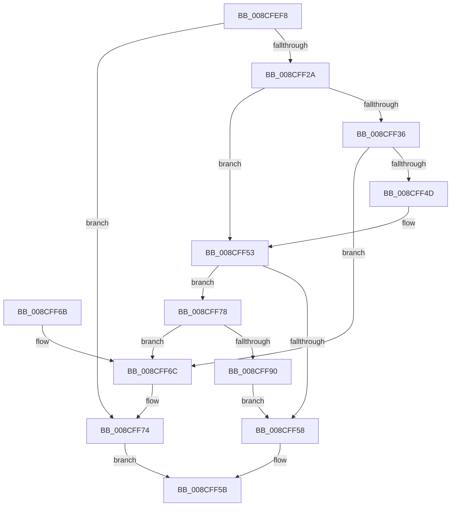

# MiAllocateProcessVads

- RVA: `0x008CFEF8`–`0x008CFF98` (길이 `160` bytes)
- VA: `0x00000001408CFEF8`
- 실행 섹션: `PAGE`
- PDB 이름 있음: `예`; PDB Function 태그: `아니요`
- unwind 정보 RVA: `0x00084A08`
- 디코드: `45`개 명령, `160/160` bytes 표시
- 미해석 바이트: `0` (있으면 어셈블리에 `.byte`로 보존)

> 이 문서는 커널 이미지의 기계어와 PDB 기호를 분석해 생성했습니다. 4번과 5번은 함수 원형과 자료형을 바이너리 사용 방식에서 추정한 C 해석이며 원본 소스 복구 결과는 아닙니다.

## 1. Dependencies

- 직접 호출 지점: **4**; 고유 호출 대상: **2**
- 직접 호출자로 확인된 함수: **2**
- RIP 상대 이미지 참조: **1**

### Outgoing calls
- `0x008CFF1D` → [MiAllocateVad](MiAllocateVad_function_008CF3F8.md) (function, `0x008CF3F8`)
- `0x008CFF43` → [MiAllocateVad](MiAllocateVad_function_008CF3F8.md) (function, `0x008CF3F8`)
- `0x008CFF6F` → [MiReturnProcessVads](MiReturnProcessVads_function_008CF54C.md) (function, `0x008CF54C`)
- `0x008CFF86` → [MiAllocateVad](MiAllocateVad_function_008CF3F8.md) (function, `0x008CF3F8`)

### Direct callers
- [MmInitializeProcessAddressSpace](MmInitializeProcessAddressSpace_function_008CF6B0.md) at `0x008CF80C`
- [MmInitializeHandBuiltProcess2](../AC/MmInitializeHandBuiltProcess2_function_00AC1138.md) at `0x00AC119D`

### Static image references
- `0x008CFF2A` → RVA `0x00E2DB78` (`.data`; read)

## 2. Other-region calls and transfers

- 다른 실행 섹션으로 향하는 call: **0**
- 별도 외부 분기/꼬리 이동을 확인하지 못했습니다.

## 3. Assembly (complete function range)

```asm
008CFEF8  48 89 5C 24 08                  mov qword ptr [rsp + 8], rbx
008CFEFD  48 89 74 24 10                  mov qword ptr [rsp + 0x10], rsi
008CFF02  57                              push rdi
008CFF03  48 83 EC 20                     sub rsp, 0x20
008CFF07  48 8B FA                        mov rdi, rdx
008CFF0A  48 8B F1                        mov rsi, rcx
008CFF0D  BA FF 0F FE 7F                  mov edx, 0x7ffe0fff
008CFF12  B9 00 00 FE 7F                  mov ecx, 0x7ffe0000
008CFF17  41 B8 01 00 00 00               mov r8d, 1
008CFF1D  E8 D6 F4 FF FF                  call 0x1408cf3f8
008CFF22  48 8B D8                        mov rbx, rax
008CFF25  48 85 C0                        test rax, rax
008CFF28  74 4A                           je 0x1408cff74
008CFF2A  48 8B 0D 47 DC 55 00            mov rcx, qword ptr [rip + 0x55dc47]
008CFF31  48 85 C9                        test rcx, rcx
008CFF34  74 1D                           je 0x1408cff53
008CFF36  48 8D 91 FF 0F 00 00            lea rdx, [rcx + 0xfff]
008CFF3D  41 B8 01 00 00 00               mov r8d, 1
008CFF43  E8 B0 F4 FF FF                  call 0x1408cf3f8
008CFF48  48 85 C0                        test rax, rax
008CFF4B  74 1F                           je 0x1408cff6c
008CFF4D  48 89 18                        mov qword ptr [rax], rbx
008CFF50  48 8B D8                        mov rbx, rax
008CFF53  48 85 FF                        test rdi, rdi
008CFF56  75 20                           jne 0x1408cff78
008CFF58  48 8B C3                        mov rax, rbx
008CFF5B  48 8B 5C 24 30                  mov rbx, qword ptr [rsp + 0x30]
008CFF60  48 8B 74 24 38                  mov rsi, qword ptr [rsp + 0x38]
008CFF65  48 83 C4 20                     add rsp, 0x20
008CFF69  5F                              pop rdi
008CFF6A  C3                              ret
008CFF6B  CC                              int3
008CFF6C  48 8B CB                        mov rcx, rbx
008CFF6F  E8 D8 F5 FF FF                  call 0x1408cf54c
008CFF74  33 C0                           xor eax, eax
008CFF76  EB E3                           jmp 0x1408cff5b
008CFF78  48 8B 8E 68 03 00 00            mov rcx, qword ptr [rsi + 0x368]
008CFF7F  48 8D 57 FF                     lea rdx, [rdi - 1]
008CFF83  45 33 C0                        xor r8d, r8d
008CFF86  E8 6D F4 FF FF                  call 0x1408cf3f8
008CFF8B  48 85 C0                        test rax, rax
008CFF8E  74 DC                           je 0x1408cff6c
008CFF90  48 89 18                        mov qword ptr [rax], rbx
008CFF93  48 8B D8                        mov rbx, rax
008CFF96  EB C0                           jmp 0x1408cff58
```

## 4. C-style interpretation (structured pseudocode)

```c
__int64 __fastcall MiAllocateProcessVads(__int64 a1, __int64 a2)
{
    __int64 result;
    __int64 v_rsp;
    unsigned __int64 v_stack_p10;
    unsigned __int64 v_stack_p8;

    v_stack_p8 = v_rbx;
    v_stack_p10 = v_rsi;
    v_rsp = (v_rsp) - (32);
    result = MiAllocateVad((unsigned int)(0x7FFE0000ULL), (unsigned int)(0x7FFE0FFFULL), 1, a4);
    if (result == 0) goto loc_008CFF74;
    if (*(unsigned __int64 *)(v_rip + 5626951) == 0) goto loc_008CFF53;
    result = MiAllocateVad(*(unsigned __int64 *)(v_rip + 5626951), *(unsigned __int64 *)(v_rip + 5626951) + 4095, 1, a4);
    if (result == 0) goto loc_008CFF6C;
    *(unsigned __int64 *)(result) = result;
loc_008CFF53:
    if (a2 != 0) goto loc_008CFF78;
loc_008CFF58:
loc_008CFF5B:
    v_rsp = (v_rsp) + (32);
    return result;
loc_008CFF6C:
    result = MiReturnProcessVads(v_stack_p8, *(unsigned __int64 *)(v_rip + 5626951) + 4095, 1, a4);
loc_008CFF74:
    result = 0;
    goto loc_008CFF5B;
loc_008CFF78:
    a3 = 0;
    result = MiAllocateVad(*(unsigned __int64 *)(v_stack_p10 + 872), a2 - 1, a3, a4);
    if (result == 0) goto loc_008CFF6C;
    *(unsigned __int64 *)(result) = v_stack_p8;
    goto loc_008CFF58;
}
```

## 5. (Beta) C Style

```c
int64_t MiAllocateProcessVads(void *Arg1, int64_t Arg2)
{
    uint8_t *arg1 = (uint8_t *)Arg1;

    int64_t result;
    int64_t local_rsp;
    uint64_t v_stack_p10;
    uint64_t v_stack_p8;

    v_stack_p8 = local_rbx;
    v_stack_p10 = local_rsi;
    local_rsp = (local_rsp) - (32);
    result = MiAllocateVad((uint32_t)(0x7FFE0000ULL), (uint32_t)(0x7FFE0FFFULL), 1, a4);
    if (result == 0) goto loc_008CFF74;
    if (*(uint64_t *)(v_rip + 0x55DC47) == 0) goto loc_008CFF53;
    result = MiAllocateVad(*(uint64_t *)(v_rip + 0x55DC47), *(uint64_t *)(v_rip + 0x55DC47) + 4095, 1, a4);
    if (result == 0) goto loc_008CFF6C;
    *(uint64_t *)(result) = result;
loc_008CFF53:
    if (Arg2 != 0) goto loc_008CFF78;
loc_008CFF58:
loc_008CFF5B:
    local_rsp = (local_rsp) + (32);
    return result;
loc_008CFF6C:
    result = MiReturnProcessVads(v_stack_p8, *(uint64_t *)(v_rip + 0x55DC47) + 4095, 1, a4);
loc_008CFF74:
    result = 0;
    goto loc_008CFF5B;
loc_008CFF78:
    a3 = 0;
    result = MiAllocateVad(*(uint64_t *)(v_stack_p10 + 0x368), Arg2 - 1, a3, a4);
    if (result == 0) goto loc_008CFF6C;
    *(uint64_t *)(result) = v_stack_p8;
    goto loc_008CFF58;
}
```

### 관측된 메모리 오프셋

구조체 형식이 확인되지 않은 접근은 인자 기준의 오프셋으로만 기록했습니다.

| 기준 인자 | 오프셋 표현 | 폭 (bit) | 접근 |
|---|---:|---:|---|
| `Arg1` | `+ 0x368` | `64` | `R` |

## 6. Execution-region graph

[열기: 2D/3D 그래프와 함수 탐색 컨트롤 패널](../../../control-panel.html?section=page&rva=0x008CFEF8&view=graph)

- 2D 그래프는 위에서 아래로 흐르고, 3D 그래프는 빈 공간을 드래그해 회전합니다. Shift+드래그는 이동, 휠은 확대·축소, 함수 노드 선택은 대상 보고서 이동입니다.

### Static fallback


