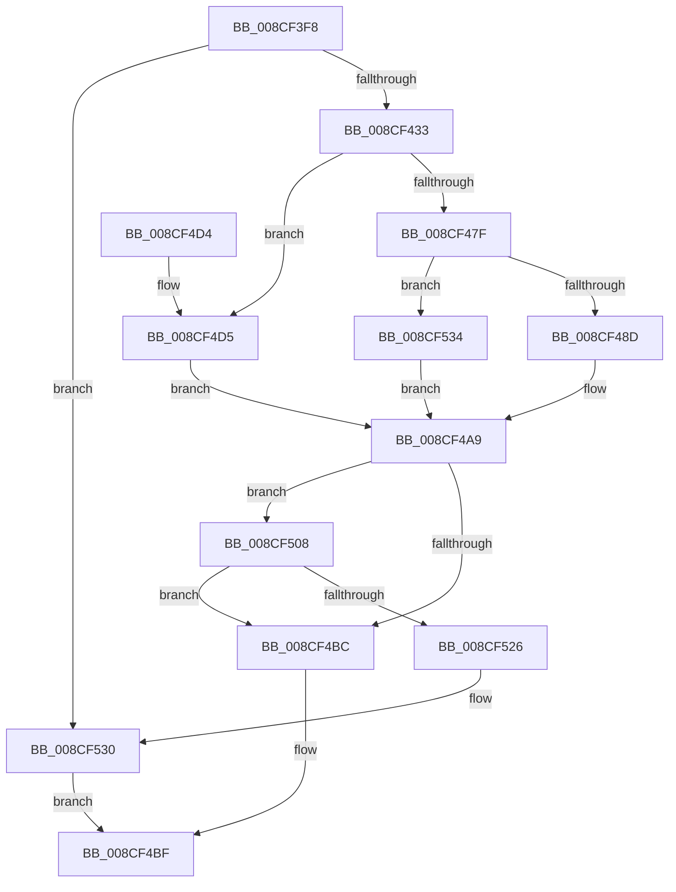

# MiAllocateVad

- RVA: `0x008CF3F8`–`0x008CF543` (길이 `331` bytes)
- VA: `0x00000001408CF3F8`
- 실행 섹션: `PAGE`
- PDB 이름 있음: `예`; PDB Function 태그: `아니요`
- unwind 정보 RVA: `0x00084900`
- 디코드: `84`개 명령, `331/331` bytes 표시
- 미해석 바이트: `0` (있으면 어셈블리에 `.byte`로 보존)

> 이 문서는 커널 이미지의 기계어와 PDB 기호를 분석해 생성했습니다. 4번과 5번은 함수 원형과 자료형을 바이너리 사용 방식에서 추정한 C 해석이며 원본 소스 복구 결과는 아닙니다.

## 1. Dependencies

- 직접 호출 지점: **4**; 고유 호출 대상: **4**
- 직접 호출자로 확인된 함수: **3**
- RIP 상대 이미지 참조: **0**

### Outgoing calls
- `0x008CF422` → [MiAllocatePool](../../text/35/MiAllocatePool_function_0035B540.md) (function, `0x0035B540`)
- `0x008CF445` → [MiUpdateVadStartVpn](../../text/45/MiUpdateVadStartVpn_function_00450ED4.md) (function, `0x00450ED4`)
- `0x008CF51C` → [MiAddSecureEntry](../98/MiAddSecureEntry_function_00980250.md) (function, `0x00980250`)
- `0x008CF52B` → [ExFreePoolWithTag](../../poolcode/B8/ExFreePoolWithTag_function_00B82870.md) (function, `0x00B82870`)

### Direct callers
- [MiFreeVadRange](../../text/2A/MiFreeVadRange_function_002A77AC.md) at `0x002A7971`
- [MiCreatePlaceholderStorage](MiCreatePlaceholderStorage_function_008CF330.md) at `0x008CF394`
- [MiAllocateProcessVads](MiAllocateProcessVads_function_008CFEF8.md) at `0x008CFF1D`
- [MiAllocateProcessVads](MiAllocateProcessVads_function_008CFEF8.md) at `0x008CFF43`
- [MiAllocateProcessVads](MiAllocateProcessVads_function_008CFEF8.md) at `0x008CFF86`

### Static image references
- 디코드된 RIP-relative 메모리 참조가 없습니다.

## 2. Other-region calls and transfers

- 다른 실행 섹션으로 향하는 call: **3**
  - `0x008CF422` → [MiAllocatePool](../../text/35/MiAllocatePool_function_0035B540.md) (`PAGE` → `.text`)
  - `0x008CF445` → [MiUpdateVadStartVpn](../../text/45/MiUpdateVadStartVpn_function_00450ED4.md) (`PAGE` → `.text`)
  - `0x008CF52B` → [ExFreePoolWithTag](../../poolcode/B8/ExFreePoolWithTag_function_00B82870.md) (`PAGE` → `POOLCODE`)
- 별도 외부 분기/꼬리 이동을 확인하지 못했습니다.

## 3. Assembly (complete function range)

```asm
008CF3F8  48 89 5C 24 08                  mov qword ptr [rsp + 8], rbx
008CF3FD  48 89 6C 24 10                  mov qword ptr [rsp + 0x10], rbp
008CF402  48 89 74 24 18                  mov qword ptr [rsp + 0x18], rsi
008CF407  57                              push rdi
008CF408  48 83 EC 30                     sub rsp, 0x30
008CF40C  48 8B E9                        mov rbp, rcx
008CF40F  41 8B F8                        mov edi, r8d
008CF412  B9 40 00 00 00                  mov ecx, 0x40
008CF417  48 8B F2                        mov rsi, rdx
008CF41A  8B D1                           mov edx, ecx
008CF41C  41 B8 56 61 64 53               mov r8d, 0x53646156
008CF422  E8 19 C1 A8 FF                  call 0x14035b540
008CF427  48 8B D8                        mov rbx, rax
008CF42A  48 85 C0                        test rax, rax
008CF42D  0F 84 FD 00 00 00               je 0x1408cf530
008CF433  48 8B D5                        mov rdx, rbp
008CF436  48 C7 40 10 FE FF FF FF         mov qword ptr [rax + 0x10], 0xfffffffffffffffe
008CF43E  48 C1 EA 0C                     shr rdx, 0xc
008CF442  48 8B C8                        mov rcx, rax
008CF445  E8 8A 1A B8 FF                  call 0x140450ed4
008CF44A  44 8B 40 30                     mov r8d, dword ptr [rax + 0x30]
008CF44E  4C 8B CE                        mov r9, rsi
008CF451  48 83 60 28 00                  and qword ptr [rax + 0x28], 0
008CF456  41 81 E0 FF F0 FF FF            and r8d, 0xfffff0ff
008CF45D  49 C1 E9 0C                     shr r9, 0xc
008CF461  44 89 48 1C                     mov dword ptr [rax + 0x1c], r9d
008CF465  49 8B D1                        mov rdx, r9
008CF468  48 C1 EA 20                     shr rdx, 0x20
008CF46C  88 50 21                        mov byte ptr [rax + 0x21], dl
008CF46F  41 8B C0                        mov eax, r8d
008CF472  0F BA E8 07                     bts eax, 7
008CF476  89 41 30                        mov dword ptr [rcx + 0x30], eax
008CF479  40 F6 C7 01                     test dil, 1
008CF47D  75 56                           jne 0x1408cf4d5
008CF47F  B8 02 00 00 00                  mov eax, 2
008CF484  40 84 F8                        test al, dil
008CF487  0F 84 A7 00 00 00               je 0x1408cf534
008CF48D  41 81 E0 7F FC FF FF            and r8d, 0xfffffc7f
008CF494  48 BA FD FF FF FF 07 00 00 00   movabs rdx, 0x7fffffffd
008CF49E  41 81 C8 00 0C 00 00            or r8d, 0xc00
008CF4A5  44 89 41 30                     mov dword ptr [rcx + 0x30], r8d
008CF4A9  89 53 34                        mov dword ptr [rbx + 0x34], edx
008CF4AC  48 C1 EA 20                     shr rdx, 0x20
008CF4B0  88 53 22                        mov byte ptr [rbx + 0x22], dl
008CF4B3  0F BA 6B 30 15                  bts dword ptr [rbx + 0x30], 0x15
008CF4B8  85 C7                           test edi, eax
008CF4BA  74 4C                           je 0x1408cf508
008CF4BC  48 8B C3                        mov rax, rbx
008CF4BF  48 8B 5C 24 40                  mov rbx, qword ptr [rsp + 0x40]
008CF4C4  48 8B 6C 24 48                  mov rbp, qword ptr [rsp + 0x48]
008CF4C9  48 8B 74 24 50                  mov rsi, qword ptr [rsp + 0x50]
008CF4CE  48 83 C4 30                     add rsp, 0x30
008CF4D2  5F                              pop rdi
008CF4D3  C3                              ret
008CF4D4  CC                              int3
008CF4D5  8B 43 18                        mov eax, dword ptr [rbx + 0x18]
008CF4D8  0F B6 4B 20                     movzx ecx, byte ptr [rbx + 0x20]
008CF4DC  0F B6 D2                        movzx edx, dl
008CF4DF  48 C1 E2 20                     shl rdx, 0x20
008CF4E3  48 C1 E1 20                     shl rcx, 0x20
008CF4E7  48 0B C8                        or rcx, rax
008CF4EA  41 8B C1                        mov eax, r9d
008CF4ED  48 0B D0                        or rdx, rax
008CF4F0  B8 02 00 00 00                  mov eax, 2
008CF4F5  48 2B D1                        sub rdx, rcx
008CF4F8  48 FF C2                        inc rdx
008CF4FB  41 81 C8 80 00 00 02            or r8d, 0x2000080
008CF502  44 89 43 30                     mov dword ptr [rbx + 0x30], r8d
008CF506  EB A1                           jmp 0x1408cf4a9
008CF508  83 64 24 20 00                  and dword ptr [rsp + 0x20], 0
008CF50D  41 B9 01 00 00 80               mov r9d, 0x80000001
008CF513  4C 8B C6                        mov r8, rsi
008CF516  48 8B D5                        mov rdx, rbp
008CF519  48 8B CB                        mov rcx, rbx
008CF51C  E8 2F 0D 0B 00                  call 0x140980250
008CF521  48 85 C0                        test rax, rax
008CF524  75 96                           jne 0x1408cf4bc
008CF526  33 D2                           xor edx, edx
008CF528  48 8B CB                        mov rcx, rbx
008CF52B  E8 40 33 2B 00                  call 0x140b82870
008CF530  33 C0                           xor eax, eax
008CF532  EB 8B                           jmp 0x1408cf4bf
008CF534  48 BA FF FF FF FF 07 00 00 00   movabs rdx, 0x7ffffffff
008CF53E  E9 66 FF FF FF                  jmp 0x1408cf4a9
```

## 4. C-style interpretation (structured pseudocode)

```c
__int64 __fastcall MiAllocateVad(__int64 a1, __int64 a2, int a3)
{
    __int64 result;
    __int64 v_rsp;
    unsigned __int64 v_stack_p10;
    unsigned __int64 v_stack_p18;
    unsigned int v_stack_p20;
    unsigned __int64 v_stack_p8;

    v_stack_p8 = v_rbx;
    v_stack_p10 = v_rbp;
    v_stack_p18 = v_rsi;
    v_rsp = (v_rsp) - (48);
    result = MiAllocatePool(64, 64, (unsigned int)(0x53646156ULL), a4);
    if (result == 0) goto loc_008CF530;
    *(unsigned __int64 *)(result + 16) = -2;
    a2 = (a1) >> (12);
    result = MiUpdateVadStartVpn(result, a2, (unsigned int)(0x53646156ULL), a4);
    a3 = (unsigned int)(((unsigned int)(*(unsigned int *)(result + 48))) & (0xFFFFF0FFULL));
    a4 = (a2) >> (12);
    *(unsigned int *)(result + 28) = (unsigned int)(a4);
    a2 = (a4) >> (32);
    *(unsigned __int8 *)(result + 33) = (unsigned __int8)(a2);
    *(unsigned int *)(result + 48) = (unsigned int)((unsigned int)(a3));
    if ((((unsigned __int8)((unsigned int)(a3))) & (1)) != 0) goto loc_008CF4D5;
    if (((2) & ((unsigned __int8)((unsigned int)(a3)))) == 0) goto loc_008CF534;
    a3 = (unsigned int)((a3) & (0xFFFFFC7FULL));
    a3 = (unsigned int)((a3) | (0xC00ULL));
    *(unsigned int *)(result + 48) = a3;
loc_008CF4A9:
    *(unsigned int *)(result + 52) = (unsigned int)(a2);
    a2 = (a2) >> (32);
    *(unsigned __int8 *)(result + 34) = (unsigned __int8)(a2);
    if ((((unsigned int)((unsigned int)(a3))) & (2)) == 0) goto loc_008CF508;
loc_008CF4BC:
loc_008CF4BF:
    v_rsp = (v_rsp) + (48);
    return result;
loc_008CF4D5:
    a2 = ((unsigned __int8)(a2)) << (32);
    a1 = (*(unsigned __int8 *)(v_stack_p8 + 32)) << (32);
    a1 = (a1) | ((unsigned int)(*(unsigned int *)(v_stack_p8 + 24)));
    a2 = (a2) | ((unsigned int)((unsigned int)(a4)));
    a2 = (a2) - (a1);
    a2 = (a2) + 1;
    a3 = (unsigned int)((a3) | (0x2000080ULL));
    *(unsigned int *)(v_stack_p8 + 48) = a3;
    goto loc_008CF4A9;
loc_008CF508:
    result = MiAddSecureEntry(v_stack_p8, v_stack_p10, v_stack_p18, (unsigned int)(0x80000001ULL));
    if (result != 0) goto loc_008CF4BC;
    a2 = 0;
    result = ExFreePoolWithTag(v_stack_p8, a2, v_stack_p18, (unsigned int)(0x80000001ULL));
loc_008CF530:
    result = 0;
    goto loc_008CF4BF;
loc_008CF534:
    goto loc_008CF4A9;
}
```

## 5. (Beta) C Style

```c
int64_t MiAllocateVad(int64_t Arg1, int64_t Arg2, int32_t Arg3)
{
    int64_t result;
    int64_t local_rsp;
    uint64_t v_stack_p10;
    uint64_t v_stack_p18;
    uint32_t v_stack_p20;
    uint64_t v_stack_p8;

    v_stack_p8 = local_rbx;
    v_stack_p10 = local_rbp;
    v_stack_p18 = local_rsi;
    local_rsp = (local_rsp) - (48);
    result = MiAllocatePool(64, 64, (uint32_t)(0x53646156ULL), a4);
    if (result == 0) goto loc_008CF530;
    *(uint64_t *)(result + 0x10) = -2;
    Arg2 = (Arg1) >> (12);
    result = MiUpdateVadStartVpn(result, Arg2, (uint32_t)(0x53646156ULL), a4);
    Arg3 = (uint32_t)(((uint32_t)(*(uint32_t *)(result + 0x30))) & (0xFFFFF0FFULL));
    a4 = (Arg2) >> (12);
    *(uint32_t *)(result + 0x1C) = (uint32_t)(a4);
    Arg2 = (a4) >> (32);
    *(uint8_t *)(result + 0x21) = (uint8_t)(Arg2);
    *(uint32_t *)(result + 0x30) = (uint32_t)((uint32_t)(Arg3));
    if ((((uint8_t)((uint32_t)(Arg3))) & (1)) != 0) goto loc_008CF4D5;
    if (((2) & ((uint8_t)((uint32_t)(Arg3)))) == 0) goto loc_008CF534;
    Arg3 = (uint32_t)((Arg3) & (0xFFFFFC7FULL));
    Arg3 = (uint32_t)((Arg3) | (0xC00ULL));
    *(uint32_t *)(result + 0x30) = Arg3;
loc_008CF4A9:
    *(uint32_t *)(result + 0x34) = (uint32_t)(Arg2);
    Arg2 = (Arg2) >> (32);
    *(uint8_t *)(result + 0x22) = (uint8_t)(Arg2);
    if ((((uint32_t)((uint32_t)(Arg3))) & (2)) == 0) goto loc_008CF508;
loc_008CF4BC:
loc_008CF4BF:
    local_rsp = (local_rsp) + (48);
    return result;
loc_008CF4D5:
    Arg2 = ((uint8_t)(Arg2)) << (32);
    Arg1 = (*(uint8_t *)(v_stack_p8 + 0x20)) << (32);
    Arg1 = (Arg1) | ((uint32_t)(*(uint32_t *)(v_stack_p8 + 0x18)));
    Arg2 = (Arg2) | ((uint32_t)((uint32_t)(a4)));
    Arg2 = (Arg2) - (Arg1);
    Arg2 = (Arg2) + 1;
    Arg3 = (uint32_t)((Arg3) | (0x2000080ULL));
    *(uint32_t *)(v_stack_p8 + 0x30) = Arg3;
    goto loc_008CF4A9;
loc_008CF508:
    result = MiAddSecureEntry(v_stack_p8, v_stack_p10, v_stack_p18, (uint32_t)(0x80000001ULL));
    if (result != 0) goto loc_008CF4BC;
    Arg2 = 0;
    result = ExFreePoolWithTag(v_stack_p8, Arg2, v_stack_p18, (uint32_t)(0x80000001ULL));
loc_008CF530:
    result = 0;
    goto loc_008CF4BF;
loc_008CF534:
    goto loc_008CF4A9;
}
```

## 6. Execution-region graph

[열기: 2D/3D 그래프와 함수 탐색 컨트롤 패널](../../../control-panel.html?section=page&rva=0x008CF3F8&view=graph)

- 2D 그래프는 위에서 아래로 흐르고, 3D 그래프는 빈 공간을 드래그해 회전합니다. Shift+드래그는 이동, 휠은 확대·축소, 함수 노드 선택은 대상 보고서 이동입니다.

### Static fallback


