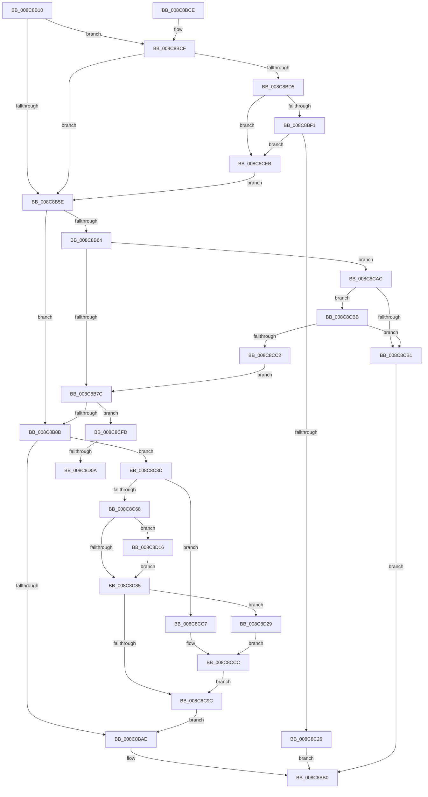

# MiAllowImageMap

- RVA: `0x008C8B10`–`0x008C8D31` (길이 `545` bytes)
- VA: `0x00000001408C8B10`
- 실행 섹션: `PAGE`
- PDB 이름 있음: `예`; PDB Function 태그: `예`
- unwind 정보 RVA: `0x000840C4`
- 디코드: `146`개 명령, `545/545` bytes 표시
- 미해석 바이트: `0` (있으면 어셈블리에 `.byte`로 보존)

> 이 문서는 커널 이미지의 기계어와 PDB 기호를 분석해 생성했습니다. 4번과 5번은 함수 원형과 자료형을 바이너리 사용 방식에서 추정한 C 해석이며 원본 소스 복구 결과는 아닙니다.

## 1. Dependencies

- 직접 호출 지점: **12**; 고유 호출 대상: **11**
- 직접 호출자로 확인된 함수: **1**
- RIP 상대 이미지 참조: **2**

### Outgoing calls
- `0x008C8B67` → [MiGetControlAreaLoadConfig](../../text/46/MiGetControlAreaLoadConfig_function_0046E9D4.md) (function, `0x0046E9D4`)
- `0x008C8BD8` → [MiReferenceFileObjectForMap](../88/MiReferenceFileObjectForMap_function_00885C00.md) (function, `0x00885C00`)
- `0x008C8C19` → [EtwpTimLogMitigationForProcess](../A8/EtwpTimLogMitigationForProcess_function_00A81E6C.md) (function, `0x00A81E6C`)
- `0x008C8C2E` → [ObfDereferenceObjectWithTag](../../text/2F/ObfDereferenceObjectWithTag_function_002F78E0.md) (function, `0x002F78E0`)
- `0x008C8C45` → [MiReferenceControlAreaFile](../../text/43/MiReferenceControlAreaFile_function_00431554.md) (function, `0x00431554`)
- `0x008C8C5D` → [ObpGetObjectSecurity](../87/ObpGetObjectSecurity_function_008717E0.md) (function, `0x008717E0`)
- `0x008C8C70` → [SeQueryMandatoryLabel](SeQueryMandatoryLabel_function_008C8D38.md) (function, `0x008C8D38`)
- `0x008C8C8F` → [ObReleaseObjectSecurityEx](ObReleaseObjectSecurityEx_function_008C6E30.md) (function, `0x008C6E30`)
- `0x008C8CA2` → [MiDereferenceControlAreaFile](../../text/43/MiDereferenceControlAreaFile_function_004345E0.md) (function, `0x004345E0`)
- `0x008C8CDE` → [EtwTimLogProhibitLowILImageMap](../7B/EtwTimLogProhibitLowILImageMap_function_007BB1F4.md) (function, `0x007BB1F4`)
- `0x008C8CF3` → [ObfDereferenceObjectWithTag](../../text/2F/ObfDereferenceObjectWithTag_function_002F78E0.md) (function, `0x002F78E0`)
- `0x008C8D19` → [SeGetTrustLabelAce](../../text/3F/SeGetTrustLabelAce_function_003FDB20.md) (function, `0x003FDB20`)

### Direct callers
- [MiMapViewOfImageSection](../97/MiMapViewOfImageSection_function_0097E92C.md) at `0x0097F22D`

### Static image references
- `0x008C8BFB` → RVA `0x000113D0` (`.rdata`; read)
- `0x008C8C02` → RVA `0x000113C0` (`.rdata`; read)

## 2. Other-region calls and transfers

- 다른 실행 섹션으로 향하는 call: **6**
  - `0x008C8B67` → [MiGetControlAreaLoadConfig](../../text/46/MiGetControlAreaLoadConfig_function_0046E9D4.md) (`PAGE` → `.text`)
  - `0x008C8C2E` → [ObfDereferenceObjectWithTag](../../text/2F/ObfDereferenceObjectWithTag_function_002F78E0.md) (`PAGE` → `.text`)
  - `0x008C8C45` → [MiReferenceControlAreaFile](../../text/43/MiReferenceControlAreaFile_function_00431554.md) (`PAGE` → `.text`)
  - `0x008C8CA2` → [MiDereferenceControlAreaFile](../../text/43/MiDereferenceControlAreaFile_function_004345E0.md) (`PAGE` → `.text`)
  - `0x008C8CF3` → [ObfDereferenceObjectWithTag](../../text/2F/ObfDereferenceObjectWithTag_function_002F78E0.md) (`PAGE` → `.text`)
  - `0x008C8D19` → [SeGetTrustLabelAce](../../text/3F/SeGetTrustLabelAce_function_003FDB20.md) (`PAGE` → `.text`)
- call이 아닌 외부 분기/꼬리 이동: **2**
  - `0x008C8D04` → [sub_00B1B1BE](../B1/Unknown_function_00B1B1BE.md) (`tail-transfer`)
  - `0x008C8D11` → [sub_00B1B1BE](../B1/Unknown_function_00B1B1BE.md) (`tail-transfer`)

## 3. Assembly (complete function range)

```asm
008C8B10  48 8B C4                        mov rax, rsp
008C8B13  48 89 58 10                     mov qword ptr [rax + 0x10], rbx
008C8B17  48 89 68 18                     mov qword ptr [rax + 0x18], rbp
008C8B1B  48 89 70 20                     mov qword ptr [rax + 0x20], rsi
008C8B1F  57                              push rdi
008C8B20  41 54                           push r12
008C8B22  41 55                           push r13
008C8B24  41 56                           push r14
008C8B26  41 57                           push r15
008C8B28  48 83 EC 40                     sub rsp, 0x40
008C8B2C  8B B1 50 07 00 00               mov esi, dword ptr [rcx + 0x750]
008C8B32  45 33 ED                        xor r13d, r13d
008C8B35  4C 89 68 C8                     mov qword ptr [rax - 0x38], r13
008C8B39  8B FE                           mov edi, esi
008C8B3B  8B C6                           mov eax, esi
008C8B3D  49 8B E9                        mov rbp, r9
008C8B40  C1 E8 14                        shr eax, 0x14
008C8B43  4D 8B E0                        mov r12, r8
008C8B46  45 8D 75 01                     lea r14d, [r13 + 1]
008C8B4A  4C 8B F9                        mov r15, rcx
008C8B4D  41 22 C6                        and al, r14b
008C8B50  81 E7 00 00 08 00               and edi, 0x80000
008C8B56  41 0F 45 C6                     cmovne eax, r14d
008C8B5A  84 C0                           test al, al
008C8B5C  75 71                           jne 0x1408c8bcf
008C8B5E  44 38 6D 32                     cmp byte ptr [rbp + 0x32], r13b
008C8B62  74 29                           je 0x1408c8b8d
008C8B64  49 8B CC                        mov rcx, r12
008C8B67  E8 68 5E BA FF                  call 0x14046e9d4
008C8B6C  41 8B 8F 50 07 00 00            mov ecx, dword ptr [r15 + 0x750]
008C8B73  F6 C1 04                        test cl, 4
008C8B76  0F 85 30 01 00 00               jne 0x1408c8cac
008C8B7C  41 F7 87 54 07 00 00 00 00 20 00  test dword ptr [r15 + 0x754], 0x200000
008C8B87  0F 85 70 01 00 00               jne 0x1408c8cfd
008C8B8D  8B EE                           mov ebp, esi
008C8B8F  41 8B DD                        mov ebx, r13d
008C8B92  C1 EE 16                        shr esi, 0x16
008C8B95  41 22 F6                        and sil, r14b
008C8B98  81 E5 00 00 20 00               and ebp, 0x200000
008C8B9E  40 0F B6 C6                     movzx eax, sil
008C8BA2  41 0F 45 C6                     cmovne eax, r14d
008C8BA6  84 C0                           test al, al
008C8BA8  0F 85 8F 00 00 00               jne 0x1408c8c3d
008C8BAE  8B C3                           mov eax, ebx
008C8BB0  4C 8D 5C 24 40                  lea r11, [rsp + 0x40]
008C8BB5  49 8B 5B 38                     mov rbx, qword ptr [r11 + 0x38]
008C8BB9  49 8B 6B 40                     mov rbp, qword ptr [r11 + 0x40]
008C8BBD  49 8B 73 48                     mov rsi, qword ptr [r11 + 0x48]
008C8BC1  49 8B E3                        mov rsp, r11
008C8BC4  41 5F                           pop r15
008C8BC6  41 5E                           pop r14
008C8BC8  41 5D                           pop r13
008C8BCA  41 5C                           pop r12
008C8BCC  5F                              pop rdi
008C8BCD  C3                              ret
008C8BCE  CC                              int3
008C8BCF  F6 42 28 03                     test byte ptr [rdx + 0x28], 3
008C8BD3  74 89                           je 0x1408c8b5e
008C8BD5  48 8B CA                        mov rcx, rdx
008C8BD8  E8 23 D0 FB FF                  call 0x140885c00
008C8BDD  48 8B D8                        mov rbx, rax
008C8BE0  48 8B 48 08                     mov rcx, qword ptr [rax + 8]
008C8BE4  F7 41 34 00 00 08 00            test dword ptr [rcx + 0x34], 0x80000
008C8BEB  0F 85 FA 00 00 00               jne 0x1408c8ceb
008C8BF1  41 8B D5                        mov edx, r13d
008C8BF4  44 88 74 24 20                  mov byte ptr [rsp + 0x20], r14b
008C8BF9  85 FF                           test edi, edi
008C8BFB  48 8D 05 CE 87 74 FF            lea rax, [rip - 0x8b7832]
008C8C02  4C 8D 05 B7 87 74 FF            lea r8, [rip - 0x8b7849]
008C8C09  4D 8B CF                        mov r9, r15
008C8C0C  0F 95 C2                        setne dl
008C8C0F  4C 0F 45 C0                     cmovne r8, rax
008C8C13  41 03 D6                        add edx, r14d
008C8C16  41 8B CE                        mov ecx, r14d
008C8C19  E8 4E 92 1B 00                  call 0x140a81e6c
008C8C1E  85 FF                           test edi, edi
008C8C20  0F 84 C5 00 00 00               je 0x1408c8ceb
008C8C26  BA 4D 6D 53 63                  mov edx, 0x63536d4d
008C8C2B  48 8B CB                        mov rcx, rbx
008C8C2E  E8 AD EC A2 FF                  call 0x1402f78e0
008C8C33  B8 22 00 00 C0                  mov eax, 0xc0000022
008C8C38  E9 73 FF FF FF                  jmp 0x1408c8bb0
008C8C3D  49 8B CC                        mov rcx, r12
008C8C40  44 88 6C 24 70                  mov byte ptr [rsp + 0x70], r13b
008C8C45  E8 0A 89 B6 FF                  call 0x140431554
008C8C4A  45 33 C9                        xor r9d, r9d
008C8C4D  4C 8D 44 24 70                  lea r8, [rsp + 0x70]
008C8C52  48 8D 54 24 30                  lea rdx, [rsp + 0x30]
008C8C57  48 8B C8                        mov rcx, rax
008C8C5A  48 8B F0                        mov rsi, rax
008C8C5D  E8 7E 8B FA FF                  call 0x1408717e0
008C8C62  8B D8                           mov ebx, eax
008C8C64  85 C0                           test eax, eax
008C8C66  78 5F                           js 0x1408c8cc7
008C8C68  4C 8B 74 24 30                  mov r14, qword ptr [rsp + 0x30]
008C8C6D  49 8B CE                        mov rcx, r14
008C8C70  E8 C3 00 00 00                  call 0x1408c8d38
008C8C75  BF 22 00 00 C0                  mov edi, 0xc0000022
008C8C7A  3D 00 10 00 00                  cmp eax, 0x1000
008C8C7F  0F 86 91 00 00 00               jbe 0x1408c8d16
008C8C85  8A 54 24 70                     mov dl, byte ptr [rsp + 0x70]
008C8C89  4C 8B C6                        mov r8, rsi
008C8C8C  49 8B CE                        mov rcx, r14
008C8C8F  E8 9C E1 FF FF                  call 0x1408c6e30
008C8C94  3B DF                           cmp ebx, edi
008C8C96  0F 84 8D 00 00 00               je 0x1408c8d29
008C8C9C  48 8B D6                        mov rdx, rsi
008C8C9F  49 8B CC                        mov rcx, r12
008C8CA2  E8 39 B9 B6 FF                  call 0x1404345e0
008C8CA7  E9 02 FF FF FF                  jmp 0x1408c8bae
008C8CAC  48 85 C0                        test rax, rax
008C8CAF  75 0A                           jne 0x1408c8cbb
008C8CB1  B8 06 06 00 C0                  mov eax, 0xc0000606
008C8CB6  E9 F5 FE FF FF                  jmp 0x1408c8bb0
008C8CBB  8B 08                           mov ecx, dword ptr [rax]
008C8CBD  41 84 CE                        test r14b, cl
008C8CC0  74 EF                           je 0x1408c8cb1
008C8CC2  E9 B5 FE FF FF                  jmp 0x1408c8b7c
008C8CC7  BB 22 00 00 C0                  mov ebx, 0xc0000022
008C8CCC  41 8B CD                        mov ecx, r13d
008C8CCF  4C 8D 46 58                     lea r8, [rsi + 0x58]
008C8CD3  85 ED                           test ebp, ebp
008C8CD5  49 8B D7                        mov rdx, r15
008C8CD8  0F 95 C1                        setne cl
008C8CDB  41 03 CE                        add ecx, r14d
008C8CDE  E8 11 25 EF FF                  call 0x1407bb1f4
008C8CE3  85 ED                           test ebp, ebp
008C8CE5  41 0F 44 DD                     cmove ebx, r13d
008C8CE9  EB B1                           jmp 0x1408c8c9c
008C8CEB  BA 4D 6D 53 63                  mov edx, 0x63536d4d
008C8CF0  48 8B CB                        mov rcx, rbx
008C8CF3  E8 E8 EB A2 FF                  call 0x1402f78e0
008C8CF8  E9 61 FE FF FF                  jmp 0x1408c8b5e
008C8CFD  41 0F B6 FD                     movzx edi, r13b
008C8D01  48 85 C0                        test rax, rax
008C8D04  0F 84 B4 24 25 00               je 0x140b1b1be
008C8D0A  F6 00 40                        test byte ptr [rax], 0x40
008C8D0D  41 0F 45 FE                     cmovne edi, r14d
008C8D11  E9 A8 24 25 00                  jmp 0x140b1b1be
008C8D16  49 8B CE                        mov rcx, r14
008C8D19  E8 02 4E B3 FF                  call 0x1403fdb20
008C8D1E  48 85 C0                        test rax, rax
008C8D21  0F 44 DF                        cmove ebx, edi
008C8D24  E9 5C FF FF FF                  jmp 0x1408c8c85
008C8D29  41 BE 01 00 00 00               mov r14d, 1
008C8D2F  EB 9B                           jmp 0x1408c8ccc
```

## 4. C-style interpretation (structured pseudocode)

```c
__int64 __fastcall MiAllowImageMap(__int64 a1, __int64 a2, __int64 a3, __int64 a4)
{
    __int64 result;
    __int64 v_r13;
    __int64 v_rbp;
    __int64 v_rbx;
    __int64 v_rdi;
    __int64 v_rsi;
    __int64 v_rsp;
    unsigned __int64 v_stack_m10;
    unsigned __int8 v_stack_m20;
    unsigned __int64 v_stack_m28;
    unsigned __int8 v_stack_p30;

    *(unsigned __int64 *)(v_rsp + 16) = v_rbx;
    *(unsigned __int64 *)(v_rsp + 24) = v_rbp;
    *(unsigned __int64 *)(v_rsp + 32) = v_rsi;
    v_rsp = (v_rsp) - (64);
    v_r13 = 0;
    *(unsigned __int64 *)(v_rsp - 56) = 0;
    result = (unsigned int)(((unsigned int)((unsigned int)((unsigned int)(*(unsigned int *)(a1 + 1872))))) >> (20));
    result = (unsigned __int8)((result) & ((unsigned __int8)(v_r13 + 1)));
    v_rdi = (unsigned int)(((unsigned int)((unsigned int)((unsigned int)(*(unsigned int *)(a1 + 1872))))) & (0x80000ULL));
    if (condition_is_not_equal) { result = (unsigned int)(v_r13 + 1); }
    if ((unsigned __int8)(result) != 0) goto loc_008C8BCF;
loc_008C8B5E:
    if ((*(unsigned __int8 *)(a4 + 50)) == 0) goto loc_008C8B8D;
    result = MiGetControlAreaLoadConfig(a3, a2, a3, a4);
    if ((((unsigned __int8)((unsigned int)(*(unsigned int *)(a1 + 1872)))) & (4)) != 0) goto loc_008C8CAC;
loc_008C8B7C:
    if (((*(unsigned int *)(a1 + 1876)) & (0x200000ULL)) != 0) goto loc_008C8CFD;
loc_008C8B8D:
    v_rsi = (unsigned int)(((unsigned int)(*(unsigned int *)(a1 + 1872))) >> (22));
    v_rsi = (unsigned __int8)((v_rsi) & ((unsigned __int8)(v_r13 + 1)));
    v_rbp = (unsigned int)(((unsigned int)((unsigned int)((unsigned int)(*(unsigned int *)(a1 + 1872))))) & (0x200000ULL));
    result = (unsigned __int8)(v_rsi);
    if (condition_is_not_equal) { result = (unsigned int)(v_r13 + 1); }
    if ((unsigned __int8)(result) != 0) goto loc_008C8C3D;
loc_008C8BAE:
loc_008C8BB0:
    return 0;
loc_008C8BCF:
    if (((*(unsigned __int8 *)(a2 + 40)) & (3)) == 0) goto loc_008C8B5E;
    result = MiReferenceFileObjectForMap(a2, a2, a3, a4);
    if (((*(unsigned int *)(*(unsigned __int64 *)(result + 8) + 52)) & (0x80000ULL)) != 0) goto loc_008C8CEB;
    v_stack_m20 = (unsigned __int8)(v_r13 + 1);
    a2 = ((unsigned int)(v_rdi) != 0) ? 1 : 0;
    a3 = v_rip - 9140297;
    if ((unsigned int)(v_rdi) != 0) { a3 = v_rip - 9140274; }
    a2 = (unsigned int)((a2) + ((unsigned int)(v_r13 + 1)));
    result = EtwpTimLogMitigationForProcess((unsigned int)((unsigned int)(v_r13 + 1)), a2, a3, a1);
    if ((unsigned int)(v_rdi) == 0) goto loc_008C8CEB;
    result = ObfDereferenceObjectWithTag(result, (unsigned int)(0x63536D4DULL), a3, a1);
    goto loc_008C8BB0;
loc_008C8C3D:
    v_stack_p30 = 0;
    result = MiReferenceControlAreaFile(a3, (unsigned int)(0x63536D4DULL), a3, a1);
    a4 = 0;
    result = ObpGetObjectSecurity(result, v_stack_m10, v_stack_p30, a4);
    if (sign_flag) goto loc_008C8CC7;
    result = SeQueryMandatoryLabel(v_stack_m10, v_stack_m10, v_stack_p30, a4);
    if (((unsigned int)(result)) <= 0x1000ULL) goto loc_008C8D16;
loc_008C8C85:
    result = ObReleaseObjectSecurityEx(v_stack_m10, v_stack_p30, result, a4);
    if (((unsigned int)((unsigned int)((unsigned int)(result)))) == ((unsigned int)((unsigned int)(0xC0000022ULL)))) goto loc_008C8D29;
loc_008C8C9C:
    result = MiDereferenceControlAreaFile(a3, result, result, a4);
    goto loc_008C8BAE;
loc_008C8CAC:
    if (result != 0) goto loc_008C8CBB;
loc_008C8CB1:
    goto loc_008C8BB0;
loc_008C8CBB:
    if ((((unsigned __int8)(v_stack_m10)) & ((unsigned __int8)((unsigned int)(*(unsigned int *)((unsigned int)(0xC0000606ULL)))))) == 0) goto loc_008C8CB1;
    goto loc_008C8B7C;
loc_008C8CC7:
loc_008C8CCC:
    a1 = ((unsigned int)(*(unsigned __int64 *)(v_stack_m28 + 64)) != 0) ? 1 : 0;
    a1 = (unsigned int)((a1) + ((unsigned int)(v_stack_m10)));
    result = EtwTimLogProhibitLowILImageMap(a1, a1, result + 88, a4);
    v_rbx = (unsigned int)(0xC0000022ULL);
    if ((unsigned int)(*(unsigned __int64 *)(v_stack_m28 + 64)) == 0) { v_rbx = 0; }
    goto loc_008C8C9C;
loc_008C8CEB:
    result = ObfDereferenceObjectWithTag(v_rbx, (unsigned int)(0x63536D4DULL), result + 88, a4);
    goto loc_008C8B5E;
loc_008C8CFD:
    v_rdi = 0;
    if (((*(unsigned __int8 *)(result)) & (64)) != 0) { v_rdi = (unsigned int)(v_stack_m10); }
loc_008C8D16:
    result = SeGetTrustLabelAce(v_stack_m10, (unsigned int)(0x63536D4DULL), result + 88, a4);
    if (result == 0) { v_rbx = (unsigned int)(v_rdi); }
    goto loc_008C8C85;
loc_008C8D29:
    goto loc_008C8CCC;
}
```

## 5. (Beta) C Style

```c
int64_t MiAllowImageMap(void *Arg1, void *Arg2, int64_t Arg3, void *Arg4)
{
    uint8_t *arg1 = (uint8_t *)Arg1;
    uint8_t *arg2 = (uint8_t *)Arg2;
    uint8_t *arg4 = (uint8_t *)Arg4;

    int64_t result;
    int64_t local_r13;
    int64_t local_rbp;
    int64_t local_rbx;
    int64_t local_rdi;
    int64_t local_rsi;
    int64_t local_rsp;
    uint64_t v_stack_m10;
    uint8_t v_stack_m20;
    uint64_t v_stack_m28;
    uint8_t v_stack_p30;

    *(uint64_t *)(local_rsp + 0x10) = local_rbx;
    *(uint64_t *)(local_rsp + 0x18) = local_rbp;
    *(uint64_t *)(local_rsp + 0x20) = local_rsi;
    local_rsp = (local_rsp) - (64);
    local_r13 = 0;
    *(uint64_t *)(local_rsp - 0x38) = 0;
    result = (uint32_t)(((uint32_t)((uint32_t)((uint32_t)(*(uint32_t *)(arg1 + 0x750))))) >> (20));
    result = (uint8_t)((result) & ((uint8_t)(local_r13 + 1)));
    local_rdi = (uint32_t)(((uint32_t)((uint32_t)((uint32_t)(*(uint32_t *)(arg1 + 0x750))))) & (0x80000ULL));
    if (condition_is_not_equal) { result = (uint32_t)(local_r13 + 1); }
    if ((uint8_t)(result) != 0) goto loc_008C8BCF;
loc_008C8B5E:
    if ((*(uint8_t *)(arg4 + 0x32)) == 0) goto loc_008C8B8D;
    result = MiGetControlAreaLoadConfig(Arg3, Arg2, Arg3, Arg4);
    if ((((uint8_t)((uint32_t)(*(uint32_t *)(arg1 + 0x750)))) & (4)) != 0) goto loc_008C8CAC;
loc_008C8B7C:
    if (((*(uint32_t *)(arg1 + 0x754)) & (0x200000ULL)) != 0) goto loc_008C8CFD;
loc_008C8B8D:
    local_rsi = (uint32_t)(((uint32_t)(*(uint32_t *)(arg1 + 0x750))) >> (22));
    local_rsi = (uint8_t)((local_rsi) & ((uint8_t)(local_r13 + 1)));
    local_rbp = (uint32_t)(((uint32_t)((uint32_t)((uint32_t)(*(uint32_t *)(arg1 + 0x750))))) & (0x200000ULL));
    result = (uint8_t)(local_rsi);
    if (condition_is_not_equal) { result = (uint32_t)(local_r13 + 1); }
    if ((uint8_t)(result) != 0) goto loc_008C8C3D;
loc_008C8BAE:
loc_008C8BB0:
    return 0;
loc_008C8BCF:
    if (((*(uint8_t *)(arg2 + 0x28)) & (3)) == 0) goto loc_008C8B5E;
    result = MiReferenceFileObjectForMap(Arg2, Arg2, Arg3, Arg4);
    if (((*(uint32_t *)(*(uint64_t *)(result + 0x8) + 0x34)) & (0x80000ULL)) != 0) goto loc_008C8CEB;
    v_stack_m20 = (uint8_t)(local_r13 + 1);
    Arg2 = ((uint32_t)(local_rdi) != 0) ? 1 : 0;
    Arg3 = v_rip - 9140297;
    if ((uint32_t)(local_rdi) != 0) { Arg3 = v_rip - 9140274; }
    Arg2 = (uint32_t)((Arg2) + ((uint32_t)(local_r13 + 1)));
    result = EtwpTimLogMitigationForProcess((uint32_t)((uint32_t)(local_r13 + 1)), Arg2, Arg3, Arg1);
    if ((uint32_t)(local_rdi) == 0) goto loc_008C8CEB;
    result = ObfDereferenceObjectWithTag(result, (uint32_t)(0x63536D4DULL), Arg3, Arg1);
    goto loc_008C8BB0;
loc_008C8C3D:
    v_stack_p30 = 0;
    result = MiReferenceControlAreaFile(Arg3, (uint32_t)(0x63536D4DULL), Arg3, Arg1);
    Arg4 = 0;
    result = ObpGetObjectSecurity(result, v_stack_m10, v_stack_p30, Arg4);
    if (sign_flag) goto loc_008C8CC7;
    result = SeQueryMandatoryLabel(v_stack_m10, v_stack_m10, v_stack_p30, Arg4);
    if (((uint32_t)(result)) <= 0x1000ULL) goto loc_008C8D16;
loc_008C8C85:
    result = ObReleaseObjectSecurityEx(v_stack_m10, v_stack_p30, result, Arg4);
    if (((uint32_t)((uint32_t)((uint32_t)(result)))) == ((uint32_t)((uint32_t)(0xC0000022ULL)))) goto loc_008C8D29;
loc_008C8C9C:
    result = MiDereferenceControlAreaFile(Arg3, result, result, Arg4);
    goto loc_008C8BAE;
loc_008C8CAC:
    if (result != 0) goto loc_008C8CBB;
loc_008C8CB1:
    goto loc_008C8BB0;
loc_008C8CBB:
    if ((((uint8_t)(v_stack_m10)) & ((uint8_t)((uint32_t)(*(uint32_t *)((uint32_t)(0xC0000606ULL)))))) == 0) goto loc_008C8CB1;
    goto loc_008C8B7C;
loc_008C8CC7:
loc_008C8CCC:
    Arg1 = ((uint32_t)(*(uint64_t *)(v_stack_m28 + 0x40)) != 0) ? 1 : 0;
    Arg1 = (uint32_t)((Arg1) + ((uint32_t)(v_stack_m10)));
    result = EtwTimLogProhibitLowILImageMap(Arg1, Arg1, result + 88, Arg4);
    local_rbx = (uint32_t)(0xC0000022ULL);
    if ((uint32_t)(*(uint64_t *)(v_stack_m28 + 0x40)) == 0) { local_rbx = 0; }
    goto loc_008C8C9C;
loc_008C8CEB:
    result = ObfDereferenceObjectWithTag(local_rbx, (uint32_t)(0x63536D4DULL), result + 88, Arg4);
    goto loc_008C8B5E;
loc_008C8CFD:
    local_rdi = 0;
    if (((*(uint8_t *)(result)) & (64)) != 0) { local_rdi = (uint32_t)(v_stack_m10); }
loc_008C8D16:
    result = SeGetTrustLabelAce(v_stack_m10, (uint32_t)(0x63536D4DULL), result + 88, Arg4);
    if (result == 0) { local_rbx = (uint32_t)(local_rdi); }
    goto loc_008C8C85;
loc_008C8D29:
    goto loc_008C8CCC;
}
```

### 관측된 메모리 오프셋

구조체 형식이 확인되지 않은 접근은 인자 기준의 오프셋으로만 기록했습니다.

| 기준 인자 | 오프셋 표현 | 폭 (bit) | 접근 |
|---|---:|---:|---|
| `Arg1` | `+ 0x750` | `32` | `R` |
| `Arg1` | `+ 0x754` | `32` | `R` |
| `Arg2` | `+ 0x28` | `8` | `R` |
| `Arg4` | `+ 0x32` | `8` | `R` |

## 6. Execution-region graph

[열기: 2D/3D 그래프와 함수 탐색 컨트롤 패널](../../../control-panel.html?section=page&rva=0x008C8B10&view=graph)

- 2D 그래프는 위에서 아래로 흐르고, 3D 그래프는 빈 공간을 드래그해 회전합니다. Shift+드래그는 이동, 휠은 확대·축소, 함수 노드 선택은 대상 보고서 이동입니다.

### Static fallback


