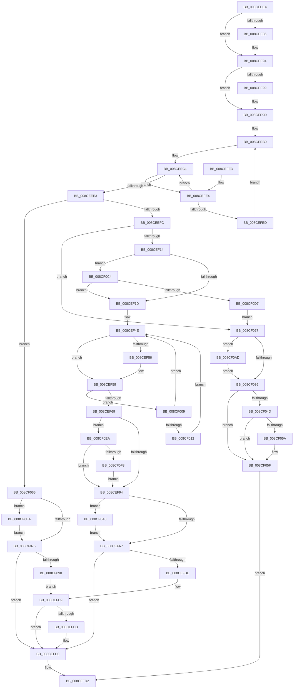

# MiChargeSegmentCommit

- RVA: `0x008CEDE4`–`0x008CF105` (길이 `801` bytes)
- VA: `0x00000001408CEDE4`
- 실행 섹션: `PAGE`
- PDB 이름 있음: `예`; PDB Function 태그: `아니요`
- unwind 정보 RVA: `0x00084888`
- 디코드: `209`개 명령, `801/801` bytes 표시
- 미해석 바이트: `0` (있으면 어셈블리에 `.byte`로 보존)

> 이 문서는 커널 이미지의 기계어와 PDB 기호를 분석해 생성했습니다. 4번과 5번은 함수 원형과 자료형을 바이너리 사용 방식에서 추정한 C 해석이며 원본 소스 복구 결과는 아닙니다.

## 1. Dependencies

- 직접 호출 지점: **19**; 고유 호출 대상: **14**
- 직접 호출자로 확인된 함수: **4**
- RIP 상대 이미지 참조: **0**

### Outgoing calls
- `0x008CEE2B` → [MiGetControlAreaPartition](../../text/43/MiGetControlAreaPartition_function_0043E560.md) (function, `0x0043E560`)
- `0x008CEE76` → [KeAbPreAcquire](../../text/21/KeAbPreAcquire_function_00210230.md) (function, `0x00210230`)
- `0x008CEE8F` → [ExfAcquirePushLockExclusiveEx](../../text/20/ExfAcquirePushLockExclusiveEx_function_0020FC90.md) (function, `0x0020FC90`)
- `0x008CEEA5` → [MiGetSubsectionCrossPartitionReferences](../../text/45/MiGetSubsectionCrossPartitionReferences_function_004589C4.md) (function, `0x004589C4`)
- `0x008CEF07` → [MiChargeCommit](../../text/28/MiChargeCommit_function_00286EB0.md) (function, `0x00286EB0`)
- `0x008CEF29` → [MiMakeDemandZeroPte](../../text/33/MiMakeDemandZeroPte_function_00337A00.md) (function, `0x00337A00`)
- `0x008CEF71` → [MiUpdateProcessSharedCommit](MiUpdateProcessSharedCommit_function_008CF10C.md) (function, `0x008CF10C`)
- `0x008CEF7E` → [MiUpdateControlAreaCommitCount](../../text/45/MiUpdateControlAreaCommitCount_function_004588E8.md) (function, `0x004588E8`)
- `0x008CEFAA` → [KeAbPostRelease](../../text/2E/KeAbPostRelease_function_002E1600.md) (function, `0x002E1600`)
- `0x008CEFCB` → [KiCheckForKernelApcDelivery](../../text/2E/KiCheckForKernelApcDelivery_function_002E2C80.md) (function, `0x002E2C80`)
- `0x008CF039` → [KeAbPostRelease](../../text/2E/KeAbPostRelease_function_002E1600.md) (function, `0x002E1600`)
- `0x008CF05A` → [KiCheckForKernelApcDelivery](../../text/2E/KiCheckForKernelApcDelivery_function_002E2C80.md) (function, `0x002E2C80`)
- `0x008CF078` → [KeAbPostRelease](../../text/2E/KeAbPostRelease_function_002E1600.md) (function, `0x002E1600`)
- `0x008CF0A3` → [ExfTryToWakePushLock](../../text/26/ExfTryToWakePushLock_function_00265DD0.md) (function, `0x00265DD0`)
- `0x008CF0B0` → [ExfTryToWakePushLock](../../text/26/ExfTryToWakePushLock_function_00265DD0.md) (function, `0x00265DD0`)
- `0x008CF0BD` → [ExfTryToWakePushLock](../../text/26/ExfTryToWakePushLock_function_00265DD0.md) (function, `0x00265DD0`)
- `0x008CF0CA` → [MiGetSubsectionCharges](../../text/45/MiGetSubsectionCharges_function_00458A04.md) (function, `0x00458A04`)
- `0x008CF0E0` → [MiReturnCommit](../../text/24/MiReturnCommit_function_00248410.md) (function, `0x00248410`)
- `0x008CF0FB` → [MiReturnCrossPartitionSectionCharges](../../text/4B/MiReturnCrossPartitionSectionCharges_function_004BA61C.md) (function, `0x004BA61C`)

### Direct callers
- [sub_0088535F](../88/Unknown_function_0088535F.md) at `0x0088542D`
- [MiUpdateCfgSystemWideBitmapWorker](MiUpdateCfgSystemWideBitmapWorker_function_008CE650.md) at `0x008CE7A6`
- [MmCommitSessionMappedView](MmCommitSessionMappedView_function_008CEA60.md) at `0x008CEC1B`
- [MiCommitPagefileBackedSection](MiCommitPagefileBackedSection_function_008CECC0.md) at `0x008CED78`

### Static image references
- 디코드된 RIP-relative 메모리 참조가 없습니다.

## 2. Other-region calls and transfers

- 다른 실행 섹션으로 향하는 call: **18**
  - `0x008CEE2B` → [MiGetControlAreaPartition](../../text/43/MiGetControlAreaPartition_function_0043E560.md) (`PAGE` → `.text`)
  - `0x008CEE76` → [KeAbPreAcquire](../../text/21/KeAbPreAcquire_function_00210230.md) (`PAGE` → `.text`)
  - `0x008CEE8F` → [ExfAcquirePushLockExclusiveEx](../../text/20/ExfAcquirePushLockExclusiveEx_function_0020FC90.md) (`PAGE` → `.text`)
  - `0x008CEEA5` → [MiGetSubsectionCrossPartitionReferences](../../text/45/MiGetSubsectionCrossPartitionReferences_function_004589C4.md) (`PAGE` → `.text`)
  - `0x008CEF07` → [MiChargeCommit](../../text/28/MiChargeCommit_function_00286EB0.md) (`PAGE` → `.text`)
  - `0x008CEF29` → [MiMakeDemandZeroPte](../../text/33/MiMakeDemandZeroPte_function_00337A00.md) (`PAGE` → `.text`)
  - `0x008CEF7E` → [MiUpdateControlAreaCommitCount](../../text/45/MiUpdateControlAreaCommitCount_function_004588E8.md) (`PAGE` → `.text`)
  - `0x008CEFAA` → [KeAbPostRelease](../../text/2E/KeAbPostRelease_function_002E1600.md) (`PAGE` → `.text`)
  - `0x008CEFCB` → [KiCheckForKernelApcDelivery](../../text/2E/KiCheckForKernelApcDelivery_function_002E2C80.md) (`PAGE` → `.text`)
  - `0x008CF039` → [KeAbPostRelease](../../text/2E/KeAbPostRelease_function_002E1600.md) (`PAGE` → `.text`)
  - `0x008CF05A` → [KiCheckForKernelApcDelivery](../../text/2E/KiCheckForKernelApcDelivery_function_002E2C80.md) (`PAGE` → `.text`)
  - `0x008CF078` → [KeAbPostRelease](../../text/2E/KeAbPostRelease_function_002E1600.md) (`PAGE` → `.text`)
  - `0x008CF0A3` → [ExfTryToWakePushLock](../../text/26/ExfTryToWakePushLock_function_00265DD0.md) (`PAGE` → `.text`)
  - `0x008CF0B0` → [ExfTryToWakePushLock](../../text/26/ExfTryToWakePushLock_function_00265DD0.md) (`PAGE` → `.text`)
  - `0x008CF0BD` → [ExfTryToWakePushLock](../../text/26/ExfTryToWakePushLock_function_00265DD0.md) (`PAGE` → `.text`)
  - `0x008CF0CA` → [MiGetSubsectionCharges](../../text/45/MiGetSubsectionCharges_function_00458A04.md) (`PAGE` → `.text`)
  - `0x008CF0E0` → [MiReturnCommit](../../text/24/MiReturnCommit_function_00248410.md) (`PAGE` → `.text`)
  - `0x008CF0FB` → [MiReturnCrossPartitionSectionCharges](../../text/4B/MiReturnCrossPartitionSectionCharges_function_004BA61C.md) (`PAGE` → `.text`)
- 별도 외부 분기/꼬리 이동을 확인하지 못했습니다.

## 3. Assembly (complete function range)

```asm
008CEDE4  4C 89 44 24 18                  mov qword ptr [rsp + 0x18], r8
008CEDE9  53                              push rbx
008CEDEA  55                              push rbp
008CEDEB  56                              push rsi
008CEDEC  57                              push rdi
008CEDED  41 54                           push r12
008CEDEF  41 55                           push r13
008CEDF1  41 56                           push r14
008CEDF3  41 57                           push r15
008CEDF5  48 83 EC 58                     sub rsp, 0x58
008CEDF9  65 48 8B 3C 25 88 01 00 00      mov rdi, qword ptr gs:[0x188]
008CEE02  4C 8B F9                        mov r15, rcx
008CEE05  48 8B 01                        mov rax, qword ptr [rcx]
008CEE08  4C 8B F2                        mov r14, rdx
008CEE0B  48 89 8C 24 B8 00 00 00         mov qword ptr [rsp + 0xb8], rcx
008CEE13  48 8B C8                        mov rcx, rax
008CEE16  48 89 BC 24 A0 00 00 00         mov qword ptr [rsp + 0xa0], rdi
008CEE1E  48 89 44 24 40                  mov qword ptr [rsp + 0x40], rax
008CEE23  4C 8B 00                        mov r8, qword ptr [rax]
008CEE26  4C 89 44 24 28                  mov qword ptr [rsp + 0x28], r8
008CEE2B  E8 30 F7 B6 FF                  call 0x14043e560
008CEE30  48 89 44 24 20                  mov qword ptr [rsp + 0x20], rax
008CEE35  49 8D 58 28                     lea rbx, [r8 + 0x28]
008CEE39  49 8D 47 2C                     lea rax, [r15 + 0x2c]
008CEE3D  41 BC 01 00 00 00               mov r12d, 1
008CEE43  8B 10                           mov edx, dword ptr [rax]
008CEE45  49 8D 4F 08                     lea rcx, [r15 + 8]
008CEE49  48 89 4C 24 38                  mov qword ptr [rsp + 0x38], rcx
008CEE4E  45 33 C0                        xor r8d, r8d
008CEE51  48 8B 09                        mov rcx, qword ptr [rcx]
008CEE54  49 8B EE                        mov rbp, r14
008CEE57  66 44 29 A7 E6 01 00 00         sub word ptr [rdi + 0x1e6], r12w
008CEE5F  90                              nop
008CEE60  48 89 44 24 30                  mov qword ptr [rsp + 0x30], rax
008CEE65  48 8D 04 D1                     lea rax, [rcx + rdx*8]
008CEE69  33 D2                           xor edx, edx
008CEE6B  48 8B CB                        mov rcx, rbx
008CEE6E  48 89 84 24 A8 00 00 00         mov qword ptr [rsp + 0xa8], rax
008CEE76  E8 B5 13 94 FF                  call 0x140210230
008CEE7B  F0 48 0F BA 2B 00               lock bts qword ptr [rbx], 0
008CEE81  48 8B F0                        mov rsi, rax
008CEE84  73 0E                           jae 0x1408cee94
008CEE86  4C 8B C3                        mov r8, rbx
008CEE89  48 8B D0                        mov rdx, rax
008CEE8C  48 8B CB                        mov rcx, rbx
008CEE8F  E8 FC 0D 94 FF                  call 0x14020fc90
008CEE94  48 85 F6                        test rsi, rsi
008CEE97  74 04                           je 0x1408cee9d
008CEE99  44 88 66 0A                     mov byte ptr [rsi + 0xa], r12b
008CEE9D  45 33 C0                        xor r8d, r8d
008CEEA0  33 F6                           xor esi, esi
008CEEA2  49 8B CF                        mov rcx, r15
008CEEA5  E8 1A 9B B8 FF                  call 0x1404589c4
008CEEAA  48 8B BC 24 A8 00 00 00         mov rdi, qword ptr [rsp + 0xa8]
008CEEB2  45 8D 68 01                     lea r13d, [r8 + 1]
008CEEB6  44 8B E0                        mov r12d, eax
008CEEB9  48 8B 84 24 B0 00 00 00         mov rax, qword ptr [rsp + 0xb0]
008CEEC1  48 8B 4D 00                     mov rcx, qword ptr [rbp]
008CEEC5  48 8D 56 01                     lea rdx, [rsi + 1]
008CEEC9  48 85 C9                        test rcx, rcx
008CEECC  48 0F 45 D6                     cmovne rdx, rsi
008CEED0  4D 03 C5                        add r8, r13
008CEED3  48 83 C5 08                     add rbp, 8
008CEED7  48 8B F2                        mov rsi, rdx
008CEEDA  4C 3B C0                        cmp r8, rax
008CEEDD  0F 85 01 01 00 00               jne 0x1408cefe4
008CEEE3  48 8B BC 24 A0 00 00 00         mov rdi, qword ptr [rsp + 0xa0]
008CEEEB  4C 8B AC 24 B8 00 00 00         mov r13, qword ptr [rsp + 0xb8]
008CEEF3  48 85 D2                        test rdx, rdx
008CEEF6  0F 84 6A 01 00 00               je 0x1408cf066
008CEEFC  48 8B 6C 24 20                  mov rbp, qword ptr [rsp + 0x20]
008CEF01  45 33 C0                        xor r8d, r8d
008CEF04  48 8B CD                        mov rcx, rbp
008CEF07  E8 A4 7F 9B FF                  call 0x140286eb0
008CEF0C  85 C0                           test eax, eax
008CEF0E  0F 84 13 01 00 00               je 0x1408cf027
008CEF14  45 85 E4                        test r12d, r12d
008CEF17  0F 85 A7 01 00 00               jne 0x1408cf0c4
008CEF1D  48 8B 44 24 28                  mov rax, qword ptr [rsp + 0x28]
008CEF22  0F B6 48 0E                     movzx ecx, byte ptr [rax + 0xe]
008CEF26  83 E1 1F                        and ecx, 0x1f
008CEF29  E8 D2 8A A6 FF                  call 0x140337a00
008CEF2E  48 8B 4C 24 30                  mov rcx, qword ptr [rsp + 0x30]
008CEF33  4C 8B 8C 24 B0 00 00 00         mov r9, qword ptr [rsp + 0xb0]
008CEF3B  8B 11                           mov edx, dword ptr [rcx]
008CEF3D  48 8B 4C 24 38                  mov rcx, qword ptr [rsp + 0x38]
008CEF42  48 8B 09                        mov rcx, qword ptr [rcx]
008CEF45  4C 8D 04 D1                     lea r8, [rcx + rdx*8]
008CEF49  33 D2                           xor edx, edx
008CEF4B  8D 7A 01                        lea edi, [rdx + 1]
008CEF4E  49 8B 0E                        mov rcx, qword ptr [r14]
008CEF51  48 85 C9                        test rcx, rcx
008CEF54  75 03                           jne 0x1408cef59
008CEF56  49 89 06                        mov qword ptr [r14], rax
008CEF59  48 03 D7                        add rdx, rdi
008CEF5C  49 83 C6 08                     add r14, 8
008CEF60  49 3B D1                        cmp rdx, r9
008CEF63  0F 85 A0 00 00 00               jne 0x1408cf009
008CEF69  48 8B 4C 24 40                  mov rcx, qword ptr [rsp + 0x40]
008CEF6E  48 8B D6                        mov rdx, rsi
008CEF71  E8 96 01 00 00                  call 0x1408cf10c
008CEF76  48 8B 4C 24 40                  mov rcx, qword ptr [rsp + 0x40]
008CEF7B  48 8B D6                        mov rdx, rsi
008CEF7E  E8 65 99 B8 FF                  call 0x1404588e8
008CEF83  48 8B BC 24 A0 00 00 00         mov rdi, qword ptr [rsp + 0xa0]
008CEF8B  45 85 E4                        test r12d, r12d
008CEF8E  0F 85 56 01 00 00               jne 0x1408cf0ea
008CEF94  48 83 C8 FF                     or rax, 0xffffffffffffffff
008CEF98  F0 48 0F C1 03                  lock xadd qword ptr [rbx], rax
008CEF9D  24 06                           and al, 6
008CEF9F  3C 02                           cmp al, 2
008CEFA1  0F 84 F9 00 00 00               je 0x1408cf0a0
008CEFA7  48 8B CB                        mov rcx, rbx
008CEFAA  E8 51 26 A1 FF                  call 0x1402e1600
008CEFAF  BB 01 00 00 00                  mov ebx, 1
008CEFB4  90                              nop
008CEFB5  66 01 9F E6 01 00 00            add word ptr [rdi + 0x1e6], bx
008CEFBC  75 12                           jne 0x1408cefd0
008CEFBE  48 8D 8F 98 00 00 00            lea rcx, [rdi + 0x98]
008CEFC5  90                              nop
008CEFC6  48 39 09                        cmp qword ptr [rcx], rcx
008CEFC9  74 05                           je 0x1408cefd0
008CEFCB  E8 B0 3C A1 FF                  call 0x1402e2c80
008CEFD0  8B C3                           mov eax, ebx
008CEFD2  48 83 C4 58                     add rsp, 0x58
008CEFD6  41 5F                           pop r15
008CEFD8  41 5E                           pop r14
008CEFDA  41 5D                           pop r13
008CEFDC  41 5C                           pop r12
008CEFDE  5F                              pop rdi
008CEFDF  5E                              pop rsi
008CEFE0  5D                              pop rbp
008CEFE1  5B                              pop rbx
008CEFE2  C3                              ret
008CEFE3  CC                              int3
008CEFE4  48 3B EF                        cmp rbp, rdi
008CEFE7  0F 85 D4 FE FF FF               jne 0x1408ceec1
008CEFED  4D 8B 7F 10                     mov r15, qword ptr [r15 + 0x10]
008CEFF1  41 8B 47 2C                     mov eax, dword ptr [r15 + 0x2c]
008CEFF5  49 8B 6F 08                     mov rbp, qword ptr [r15 + 8]
008CEFF9  48 8D 3C C5 00 00 00 00         lea rdi, [rax*8]
008CF001  48 03 FD                        add rdi, rbp
008CF004  E9 B0 FE FF FF                  jmp 0x1408ceeb9
008CF009  4D 3B F0                        cmp r14, r8
008CF00C  0F 85 3C FF FF FF               jne 0x1408cef4e
008CF012  4D 8B 6D 10                     mov r13, qword ptr [r13 + 0x10]
008CF016  4D 8B 75 08                     mov r14, qword ptr [r13 + 8]
008CF01A  41 8B 4D 2C                     mov ecx, dword ptr [r13 + 0x2c]
008CF01E  4D 8D 04 CE                     lea r8, [r14 + rcx*8]
008CF022  E9 27 FF FF FF                  jmp 0x1408cef4e
008CF027  48 83 C8 FF                     or rax, 0xffffffffffffffff
008CF02B  F0 48 0F C1 03                  lock xadd qword ptr [rbx], rax
008CF030  24 06                           and al, 6
008CF032  3C 02                           cmp al, 2
008CF034  74 77                           je 0x1408cf0ad
008CF036  48 8B CB                        mov rcx, rbx
008CF039  E8 C2 25 A1 FF                  call 0x1402e1600
008CF03E  B9 01 00 00 00                  mov ecx, 1
008CF043  90                              nop
008CF044  66 01 8F E6 01 00 00            add word ptr [rdi + 0x1e6], cx
008CF04B  75 12                           jne 0x1408cf05f
008CF04D  48 8D 87 98 00 00 00            lea rax, [rdi + 0x98]
008CF054  90                              nop
008CF055  48 39 00                        cmp qword ptr [rax], rax
008CF058  74 05                           je 0x1408cf05f
008CF05A  E8 21 3C A1 FF                  call 0x1402e2c80
008CF05F  33 C0                           xor eax, eax
008CF061  E9 6C FF FF FF                  jmp 0x1408cefd2
008CF066  48 83 C8 FF                     or rax, 0xffffffffffffffff
008CF06A  F0 48 0F C1 03                  lock xadd qword ptr [rbx], rax
008CF06F  24 06                           and al, 6
008CF071  3C 02                           cmp al, 2
008CF073  74 45                           je 0x1408cf0ba
008CF075  48 8B CB                        mov rcx, rbx
008CF078  E8 83 25 A1 FF                  call 0x1402e1600
008CF07D  BB 01 00 00 00                  mov ebx, 1
008CF082  90                              nop
008CF083  66 01 9F E6 01 00 00            add word ptr [rdi + 0x1e6], bx
008CF08A  0F 85 40 FF FF FF               jne 0x1408cefd0
008CF090  48 8D 87 98 00 00 00            lea rax, [rdi + 0x98]
008CF097  90                              nop
008CF098  48 39 00                        cmp qword ptr [rax], rax
008CF09B  E9 29 FF FF FF                  jmp 0x1408cefc9
008CF0A0  48 8B CB                        mov rcx, rbx
008CF0A3  E8 28 6D 99 FF                  call 0x140265dd0
008CF0A8  E9 FA FE FF FF                  jmp 0x1408cefa7
008CF0AD  48 8B CB                        mov rcx, rbx
008CF0B0  E8 1B 6D 99 FF                  call 0x140265dd0
008CF0B5  E9 7C FF FF FF                  jmp 0x1408cf036
008CF0BA  48 8B CB                        mov rcx, rbx
008CF0BD  E8 0E 6D 99 FF                  call 0x140265dd0
008CF0C2  EB B1                           jmp 0x1408cf075
008CF0C4  48 8B D6                        mov rdx, rsi
008CF0C7  49 8B CF                        mov rcx, r15
008CF0CA  E8 35 99 B8 FF                  call 0x140458a04
008CF0CF  85 C0                           test eax, eax
008CF0D1  0F 89 46 FE FF FF               jns 0x1408cef1d
008CF0D7  45 33 C0                        xor r8d, r8d
008CF0DA  48 8B D6                        mov rdx, rsi
008CF0DD  48 8B CD                        mov rcx, rbp
008CF0E0  E8 2B 93 97 FF                  call 0x140248410
008CF0E5  E9 3D FF FF FF                  jmp 0x1408cf027
008CF0EA  48 85 C0                        test rax, rax
008CF0ED  0F 85 A1 FE FF FF               jne 0x1408cef94
008CF0F3  4C 8B C6                        mov r8, rsi
008CF0F6  33 D2                           xor edx, edx
008CF0F8  48 8B CD                        mov rcx, rbp
008CF0FB  E8 1C B5 BE FF                  call 0x1404ba61c
008CF100  E9 8F FE FF FF                  jmp 0x1408cef94
```

## 4. C-style interpretation (structured pseudocode)

```c
__int64 __fastcall MiChargeSegmentCommit(__int64 a1, __int64 a2, __int64 a3)
{
    __int64 result;
    __int64 v_r14;
    __int64 v_rbp;
    __int64 v_rdi;
    __int64 v_rsi;
    __int64 v_rsp;
    unsigned __int64 v_stack_m58;
    unsigned __int64 v_stack_m60;
    unsigned __int64 v_stack_m68;
    unsigned __int64 v_stack_m70;
    unsigned __int64 v_stack_m78;
    unsigned __int64 v_stack_p10;
    unsigned __int64 v_stack_p18;
    unsigned __int64 v_stack_p20;
    unsigned __int64 v_stack_p8;

    v_stack_p18 = a3;
    v_rsp = (v_rsp) - (88);
    v_stack_p20 = a1;
    v_stack_p8 = *(unsigned __int64 *)(gs_base + (0 + 392));
    v_stack_m58 = *(unsigned __int64 *)(a1);
    v_stack_m70 = *(unsigned __int64 *)(*(unsigned __int64 *)(a1));
    result = MiGetControlAreaPartition(*(unsigned __int64 *)(a1), a2, *(unsigned __int64 *)(*(unsigned __int64 *)(a1)), a4);
    v_stack_m78 = result;
    v_stack_m60 = a1 + 8;
    a3 = 0;
    v_stack_m68 = a1 + 44;
    a2 = 0;
    v_stack_p10 = *(unsigned __int64 *)(a1 + 8) + (unsigned int)(*(unsigned int *)(a1 + 44)) * 8;
    result = KeAbPreAcquire(*(unsigned __int64 *)(*(unsigned __int64 *)(a1)) + 40, a2, a3, a4);
    if (!(condition_is_above_or_equal)) {
        a3 = *(unsigned __int64 *)(*(unsigned __int64 *)(a1)) + 40;
        a2 = result;
        a1 = *(unsigned __int64 *)(*(unsigned __int64 *)(a1)) + 40;
        result = ExfAcquirePushLockExclusiveEx(a1, a2, a3, a4);
    }
    if (result != 0) {
        *(unsigned __int8 *)(result + 10) = 1;
    }
    a3 = 0;
    v_rsi = 0;
    result = MiGetSubsectionCrossPartitionReferences(a1, a2, a3, a4);
loc_008CEEB9:
loc_008CEEC1:
    a2 = v_rsi + 1;
    if (*(unsigned __int64 *)(a2) != 0) { a2 = 0; }
    a3 = (a3) + (a3 + 1);
    v_rbp = (a2) + (8);
    if (a3 != v_stack_p18) goto loc_008CEFE4;
    if (a2 == 0) goto loc_008CF066;
    a3 = 0;
    result = MiChargeCommit(v_stack_m78, a2, a3, a4);
    if ((unsigned int)(result) == 0) goto loc_008CF027;
    if ((unsigned int)((unsigned int)((unsigned int)(result))) != 0) goto loc_008CF0C4;
loc_008CEF1D:
    a1 = (unsigned int)((*(unsigned __int8 *)(v_stack_m70 + 14)) & (31));
    result = MiMakeDemandZeroPte(a1, a2, a3, a4);
    a2 = 0;
loc_008CEF4E:
    if (*(unsigned __int64 *)(a2) == 0) {
        *(unsigned __int64 *)(a2) = result;
    }
    a2 = (a2) + (a2 + 1);
    v_r14 = (a2) + (8);
    if (a2 != v_stack_p18) goto loc_008CF009;
    result = MiUpdateProcessSharedCommit(v_stack_m58, a2, *(unsigned __int64 *)(v_stack_m60) + (unsigned int)(*(unsigned int *)(v_stack_m68)) * 8, v_stack_p18);
    result = MiUpdateControlAreaCommitCount(v_stack_m58, a2, *(unsigned __int64 *)(v_stack_m60) + (unsigned int)(*(unsigned int *)(v_stack_m68)) * 8, v_stack_p18);
    if ((unsigned int)((unsigned int)((unsigned int)(result))) != 0) goto loc_008CF0EA;
loc_008CEF94:
    result = (result) | (-1);
    result = (unsigned __int8)((result) & (6));
    if (((unsigned __int8)(result)) == 2) goto loc_008CF0A0;
loc_008CEFA7:
    result = KeAbPostRelease(*(unsigned __int64 *)(*(unsigned __int64 *)(a1)) + 40, a2, *(unsigned __int64 *)(v_stack_m60) + (unsigned int)(*(unsigned int *)(v_stack_m68)) * 8, v_stack_p18);
    if (((unsigned __int8)(result)) != 2) goto loc_008CEFD0;
loc_008CEFC9:
    if ((*(unsigned __int64 *)(v_stack_p8 + 152)) != (v_stack_p8 + 152)) {
        result = KiCheckForKernelApcDelivery(v_stack_p8 + 152, a2, *(unsigned __int64 *)(v_stack_m60) + (unsigned int)(*(unsigned int *)(v_stack_m68)) * 8, v_stack_p18);
    }
loc_008CEFD2:
    v_rsp = (v_rsp) + (88);
    return 1;
loc_008CEFE4:
    if (v_stack_m78 != v_stack_p8) goto loc_008CEEC1;
    v_rdi = ((unsigned int)(*(unsigned int *)(*(unsigned __int64 *)(a1 + 16) + 44)) * 8) + (*(unsigned __int64 *)(*(unsigned __int64 *)(a1 + 16) + 8));
    goto loc_008CEEB9;
loc_008CF009:
    if (v_r14 != (*(unsigned __int64 *)(v_stack_m60) + (unsigned int)(*(unsigned int *)(v_stack_m68)) * 8)) goto loc_008CEF4E;
    goto loc_008CEF4E;
loc_008CF027:
    result = ((unsigned int)(*(unsigned int *)(*(unsigned __int64 *)(a1 + 16) + 44))) | (-1);
    result = (unsigned __int8)((result) & (6));
    if (((unsigned __int8)(result)) == 2) goto loc_008CF0AD;
loc_008CF036:
    result = KeAbPostRelease(1, a2, *(unsigned __int64 *)(*(unsigned __int64 *)(v_stack_p20 + 16) + 8) + (unsigned int)(*(unsigned int *)(*(unsigned __int64 *)(v_stack_p20 + 16) + 44)) * 8, v_stack_p18);
    if (((unsigned __int8)(result)) != 2) goto loc_008CF05F;
    result = v_rdi + 152;
    if ((*(unsigned __int64 *)(v_rdi + 152)) != (v_rdi + 152)) {
        result = KiCheckForKernelApcDelivery(1, a2, *(unsigned __int64 *)(*(unsigned __int64 *)(v_stack_p20 + 16) + 8) + (unsigned int)(*(unsigned int *)(*(unsigned __int64 *)(v_stack_p20 + 16) + 44)) * 8, v_stack_p18);
    }
    result = 0;
    goto loc_008CEFD2;
loc_008CF066:
    result = (result) | (-1);
    result = (unsigned __int8)((result) & (6));
    if (((unsigned __int8)(result)) == 2) goto loc_008CF0BA;
loc_008CF075:
    result = KeAbPostRelease(1, a2, *(unsigned __int64 *)(*(unsigned __int64 *)(v_stack_p20 + 16) + 8) + (unsigned int)(*(unsigned int *)(*(unsigned __int64 *)(v_stack_p20 + 16) + 44)) * 8, v_stack_p18);
    if (((unsigned __int8)(result)) != 2) goto loc_008CEFD0;
    goto loc_008CEFC9;
loc_008CF0A0:
    result = ExfTryToWakePushLock(1, a2, *(unsigned __int64 *)(*(unsigned __int64 *)(v_stack_p20 + 16) + 8) + (unsigned int)(*(unsigned int *)(*(unsigned __int64 *)(v_stack_p20 + 16) + 44)) * 8, v_stack_p18);
    goto loc_008CEFA7;
loc_008CF0AD:
    result = ExfTryToWakePushLock(1, a2, *(unsigned __int64 *)(*(unsigned __int64 *)(v_stack_p20 + 16) + 8) + (unsigned int)(*(unsigned int *)(*(unsigned __int64 *)(v_stack_p20 + 16) + 44)) * 8, v_stack_p18);
    goto loc_008CF036;
loc_008CF0BA:
    result = ExfTryToWakePushLock(1, a2, *(unsigned __int64 *)(*(unsigned __int64 *)(v_stack_p20 + 16) + 8) + (unsigned int)(*(unsigned int *)(*(unsigned __int64 *)(v_stack_p20 + 16) + 44)) * 8, v_stack_p18);
    goto loc_008CF075;
loc_008CF0C4:
    result = MiGetSubsectionCharges(*(unsigned __int64 *)(a1 + 16), a2, *(unsigned __int64 *)(*(unsigned __int64 *)(v_stack_p20 + 16) + 8) + (unsigned int)(*(unsigned int *)(*(unsigned __int64 *)(v_stack_p20 + 16) + 44)) * 8, v_stack_p18);
    if (!sign_flag) goto loc_008CEF1D;
    a3 = 0;
    result = MiReturnCommit(*(unsigned __int64 *)(*(unsigned __int64 *)(a1 + 16) + 8), a2, a3, v_stack_p18);
    goto loc_008CF027;
loc_008CF0EA:
    if (result != 0) goto loc_008CEF94;
    a2 = 0;
    result = MiReturnCrossPartitionSectionCharges(*(unsigned __int64 *)(*(unsigned __int64 *)(a1 + 16) + 8), a2, a2, v_stack_p18);
    goto loc_008CEF94;
}
```

## 5. (Beta) C Style

```c
int64_t MiChargeSegmentCommit(void *Arg1, int64_t Arg2, int64_t Arg3)
{
    uint8_t *arg1 = (uint8_t *)Arg1;

    int64_t result;
    int64_t local_r14;
    int64_t local_rbp;
    int64_t local_rdi;
    int64_t local_rsi;
    int64_t local_rsp;
    uint64_t v_stack_m58;
    uint64_t v_stack_m60;
    uint64_t v_stack_m68;
    uint64_t v_stack_m70;
    uint64_t v_stack_m78;
    uint64_t v_stack_p10;
    uint64_t v_stack_p18;
    uint64_t v_stack_p20;
    uint64_t v_stack_p8;

    v_stack_p18 = Arg3;
    local_rsp = (local_rsp) - (88);
    v_stack_p20 = Arg1;
    v_stack_p8 = *(uint64_t *)(gs_base + (0 + 0x188));
    v_stack_m58 = *(uint64_t *)(arg1);
    v_stack_m70 = *(uint64_t *)(*(uint64_t *)(arg1));
    result = MiGetControlAreaPartition(*(uint64_t *)(arg1), Arg2, *(uint64_t *)(*(uint64_t *)(arg1)), a4);
    v_stack_m78 = result;
    v_stack_m60 = Arg1 + 8;
    Arg3 = 0;
    v_stack_m68 = Arg1 + 44;
    Arg2 = 0;
    v_stack_p10 = *(uint64_t *)(arg1 + 0x8) + (uint32_t)(*(uint32_t *)(arg1 + 0x2C)) * 8;
    result = KeAbPreAcquire(*(uint64_t *)(*(uint64_t *)(arg1)) + 40, Arg2, Arg3, a4);
    if (!(condition_is_above_or_equal)) {
        Arg3 = *(uint64_t *)(*(uint64_t *)(arg1)) + 40;
        Arg2 = result;
        Arg1 = *(uint64_t *)(*(uint64_t *)(arg1)) + 40;
        result = ExfAcquirePushLockExclusiveEx(Arg1, Arg2, Arg3, a4);
    }
    if (result != 0) {
        *(uint8_t *)(result + 0xA) = 1;
    }
    Arg3 = 0;
    local_rsi = 0;
    result = MiGetSubsectionCrossPartitionReferences(Arg1, Arg2, Arg3, a4);
loc_008CEEB9:
loc_008CEEC1:
    Arg2 = local_rsi + 1;
    if (*(uint64_t *)(Arg2) != 0) { Arg2 = 0; }
    Arg3 = (Arg3) + (Arg3 + 1);
    local_rbp = (Arg2) + (8);
    if (Arg3 != v_stack_p18) goto loc_008CEFE4;
    if (Arg2 == 0) goto loc_008CF066;
    Arg3 = 0;
    result = MiChargeCommit(v_stack_m78, Arg2, Arg3, a4);
    if ((uint32_t)(result) == 0) goto loc_008CF027;
    if ((uint32_t)((uint32_t)((uint32_t)(result))) != 0) goto loc_008CF0C4;
loc_008CEF1D:
    Arg1 = (uint32_t)((*(uint8_t *)(v_stack_m70 + 0xE)) & (31));
    result = MiMakeDemandZeroPte(Arg1, Arg2, Arg3, a4);
    Arg2 = 0;
loc_008CEF4E:
    if (*(uint64_t *)(Arg2) == 0) {
        *(uint64_t *)(Arg2) = result;
    }
    Arg2 = (Arg2) + (Arg2 + 1);
    local_r14 = (Arg2) + (8);
    if (Arg2 != v_stack_p18) goto loc_008CF009;
    result = MiUpdateProcessSharedCommit(v_stack_m58, Arg2, *(uint64_t *)(v_stack_m60) + (uint32_t)(*(uint32_t *)(v_stack_m68)) * 8, v_stack_p18);
    result = MiUpdateControlAreaCommitCount(v_stack_m58, Arg2, *(uint64_t *)(v_stack_m60) + (uint32_t)(*(uint32_t *)(v_stack_m68)) * 8, v_stack_p18);
    if ((uint32_t)((uint32_t)((uint32_t)(result))) != 0) goto loc_008CF0EA;
loc_008CEF94:
    result = (result) | (-1);
    result = (uint8_t)((result) & (6));
    if (((uint8_t)(result)) == 2) goto loc_008CF0A0;
loc_008CEFA7:
    result = KeAbPostRelease(*(uint64_t *)(*(uint64_t *)(arg1)) + 40, Arg2, *(uint64_t *)(v_stack_m60) + (uint32_t)(*(uint32_t *)(v_stack_m68)) * 8, v_stack_p18);
    if (((uint8_t)(result)) != 2) goto loc_008CEFD0;
loc_008CEFC9:
    if ((*(uint64_t *)(v_stack_p8 + 0x98)) != (v_stack_p8 + 152)) {
        result = KiCheckForKernelApcDelivery(v_stack_p8 + 152, Arg2, *(uint64_t *)(v_stack_m60) + (uint32_t)(*(uint32_t *)(v_stack_m68)) * 8, v_stack_p18);
    }
loc_008CEFD2:
    local_rsp = (local_rsp) + (88);
    return 1;
loc_008CEFE4:
    if (v_stack_m78 != v_stack_p8) goto loc_008CEEC1;
    local_rdi = ((uint32_t)(*(uint32_t *)(*(uint64_t *)(arg1 + 0x10) + 0x2C)) * 8) + (*(uint64_t *)(*(uint64_t *)(arg1 + 0x10) + 0x8));
    goto loc_008CEEB9;
loc_008CF009:
    if (local_r14 != (*(uint64_t *)(v_stack_m60) + (uint32_t)(*(uint32_t *)(v_stack_m68)) * 8)) goto loc_008CEF4E;
    goto loc_008CEF4E;
loc_008CF027:
    result = ((uint32_t)(*(uint32_t *)(*(uint64_t *)(arg1 + 0x10) + 0x2C))) | (-1);
    result = (uint8_t)((result) & (6));
    if (((uint8_t)(result)) == 2) goto loc_008CF0AD;
loc_008CF036:
    result = KeAbPostRelease(1, Arg2, *(uint64_t *)(*(uint64_t *)(v_stack_p20 + 0x10) + 0x8) + (uint32_t)(*(uint32_t *)(*(uint64_t *)(v_stack_p20 + 0x10) + 0x2C)) * 8, v_stack_p18);
    if (((uint8_t)(result)) != 2) goto loc_008CF05F;
    result = local_rdi + 152;
    if ((*(uint64_t *)(local_rdi + 0x98)) != (local_rdi + 152)) {
        result = KiCheckForKernelApcDelivery(1, Arg2, *(uint64_t *)(*(uint64_t *)(v_stack_p20 + 0x10) + 0x8) + (uint32_t)(*(uint32_t *)(*(uint64_t *)(v_stack_p20 + 0x10) + 0x2C)) * 8, v_stack_p18);
    }
    result = 0;
    goto loc_008CEFD2;
loc_008CF066:
    result = (result) | (-1);
    result = (uint8_t)((result) & (6));
    if (((uint8_t)(result)) == 2) goto loc_008CF0BA;
loc_008CF075:
    result = KeAbPostRelease(1, Arg2, *(uint64_t *)(*(uint64_t *)(v_stack_p20 + 0x10) + 0x8) + (uint32_t)(*(uint32_t *)(*(uint64_t *)(v_stack_p20 + 0x10) + 0x2C)) * 8, v_stack_p18);
    if (((uint8_t)(result)) != 2) goto loc_008CEFD0;
    goto loc_008CEFC9;
loc_008CF0A0:
    result = ExfTryToWakePushLock(1, Arg2, *(uint64_t *)(*(uint64_t *)(v_stack_p20 + 0x10) + 0x8) + (uint32_t)(*(uint32_t *)(*(uint64_t *)(v_stack_p20 + 0x10) + 0x2C)) * 8, v_stack_p18);
    goto loc_008CEFA7;
loc_008CF0AD:
    result = ExfTryToWakePushLock(1, Arg2, *(uint64_t *)(*(uint64_t *)(v_stack_p20 + 0x10) + 0x8) + (uint32_t)(*(uint32_t *)(*(uint64_t *)(v_stack_p20 + 0x10) + 0x2C)) * 8, v_stack_p18);
    goto loc_008CF036;
loc_008CF0BA:
    result = ExfTryToWakePushLock(1, Arg2, *(uint64_t *)(*(uint64_t *)(v_stack_p20 + 0x10) + 0x8) + (uint32_t)(*(uint32_t *)(*(uint64_t *)(v_stack_p20 + 0x10) + 0x2C)) * 8, v_stack_p18);
    goto loc_008CF075;
loc_008CF0C4:
    result = MiGetSubsectionCharges(*(uint64_t *)(arg1 + 0x10), Arg2, *(uint64_t *)(*(uint64_t *)(v_stack_p20 + 0x10) + 0x8) + (uint32_t)(*(uint32_t *)(*(uint64_t *)(v_stack_p20 + 0x10) + 0x2C)) * 8, v_stack_p18);
    if (!sign_flag) goto loc_008CEF1D;
    Arg3 = 0;
    result = MiReturnCommit(*(uint64_t *)(*(uint64_t *)(arg1 + 0x10) + 0x8), Arg2, Arg3, v_stack_p18);
    goto loc_008CF027;
loc_008CF0EA:
    if (result != 0) goto loc_008CEF94;
    Arg2 = 0;
    result = MiReturnCrossPartitionSectionCharges(*(uint64_t *)(*(uint64_t *)(arg1 + 0x10) + 0x8), Arg2, Arg2, v_stack_p18);
    goto loc_008CEF94;
}
```

### 관측된 메모리 오프셋

구조체 형식이 확인되지 않은 접근은 인자 기준의 오프셋으로만 기록했습니다.

| 기준 인자 | 오프셋 표현 | 폭 (bit) | 접근 |
|---|---:|---:|---|
| `Arg1` | `+ 0x0` | `32` | `R` |
| `Arg1` | `+ 0x0` | `64` | `R` |
| `Arg1` | `+ 0x8` | `64` | `R` |
| `Arg1` | `+ 0x2C` | `64` | `R` |

## 6. Execution-region graph

[열기: 2D/3D 그래프와 함수 탐색 컨트롤 패널](../../../control-panel.html?section=page&rva=0x008CEDE4&view=graph)

- 2D 그래프는 위에서 아래로 흐르고, 3D 그래프는 빈 공간을 드래그해 회전합니다. Shift+드래그는 이동, 휠은 확대·축소, 함수 노드 선택은 대상 보고서 이동입니다.

### Static fallback


