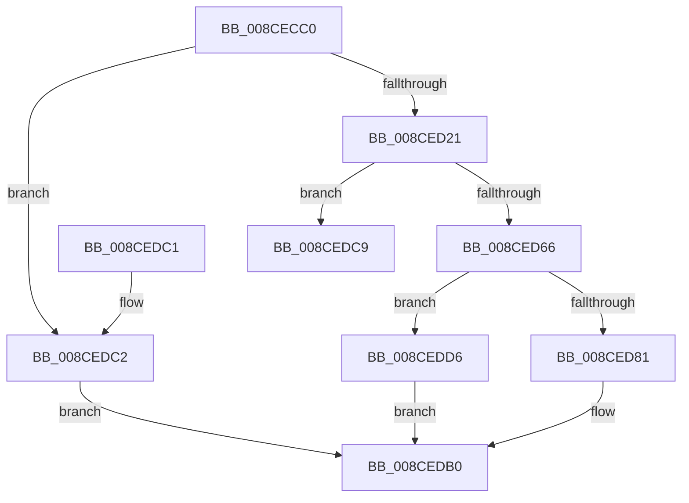

# MiCommitPagefileBackedSection

- RVA: `0x008CECC0`–`0x008CEDDD` (길이 `285` bytes)
- VA: `0x00000001408CECC0`
- 실행 섹션: `PAGE`
- PDB 이름 있음: `예`; PDB Function 태그: `예`
- unwind 정보 RVA: `0x0008485C`
- 디코드: `83`개 명령, `285/285` bytes 표시
- 미해석 바이트: `0` (있으면 어셈블리에 `.byte`로 보존)

> 이 문서는 커널 이미지의 기계어와 PDB 기호를 분석해 생성했습니다. 4번과 5번은 함수 원형과 자료형을 바이너리 사용 방식에서 추정한 C 해석이며 원본 소스 복구 결과는 아닙니다.

## 1. Dependencies

- 직접 호출 지점: **5**; 고유 호출 대상: **4**
- 직접 호출자로 확인된 함수: **1**
- RIP 상대 이미지 참조: **1**

### Outgoing calls
- `0x008CED3C` → [MiGetProtoPteAddress](../../text/32/MiGetProtoPteAddress_function_0032E970.md) (function, `0x0032E970`)
- `0x008CED55` → [MiGetProtoPteAddress](../../text/32/MiGetProtoPteAddress_function_0032E970.md) (function, `0x0032E970`)
- `0x008CED5D` → [MiVadPureReserve](../../text/2C/MiVadPureReserve_function_002C34C0.md) (function, `0x002C34C0`)
- `0x008CED78` → [MiChargeSegmentCommit](MiChargeSegmentCommit_function_008CEDE4.md) (function, `0x008CEDE4`)
- `0x008CEDAB` → [MiSetProtectionOnSection](../../text/2C/MiSetProtectionOnSection_function_002C3770.md) (function, `0x002C3770`)

### Direct callers
- [MiAllocateVirtualMemory](../88/MiAllocateVirtualMemory_function_00883B40.md) at `0x00884071`

### Static image references
- `0x008CECF5` → RVA `0x00014710` (`.rdata`; read)

## 2. Other-region calls and transfers

- 다른 실행 섹션으로 향하는 call: **4**
  - `0x008CED3C` → [MiGetProtoPteAddress](../../text/32/MiGetProtoPteAddress_function_0032E970.md) (`PAGE` → `.text`)
  - `0x008CED55` → [MiGetProtoPteAddress](../../text/32/MiGetProtoPteAddress_function_0032E970.md) (`PAGE` → `.text`)
  - `0x008CED5D` → [MiVadPureReserve](../../text/2C/MiVadPureReserve_function_002C34C0.md) (`PAGE` → `.text`)
  - `0x008CEDAB` → [MiSetProtectionOnSection](../../text/2C/MiSetProtectionOnSection_function_002C3770.md) (`PAGE` → `.text`)
- call이 아닌 외부 분기/꼬리 이동: **1**
  - `0x008CEDD1` → [sub_00B1B86E](../B1/Unknown_function_00B1B86E.md) (`tail-transfer`)

## 3. Assembly (complete function range)

```asm
008CECC0  4C 8B DC                        mov r11, rsp
008CECC3  53                              push rbx
008CECC4  55                              push rbp
008CECC5  56                              push rsi
008CECC6  57                              push rdi
008CECC7  41 54                           push r12
008CECC9  41 55                           push r13
008CECCB  41 56                           push r14
008CECCD  41 57                           push r15
008CECCF  48 83 EC 48                     sub rsp, 0x48
008CECD3  44 8B 61 2C                     mov r12d, dword ptr [rcx + 0x2c]
008CECD7  33 C0                           xor eax, eax
008CECD9  48 8B 59 08                     mov rbx, qword ptr [rcx + 8]
008CECDD  48 8B F2                        mov rsi, rdx
008CECE0  4C 8B 29                        mov r13, qword ptr [rcx]
008CECE3  4C 8B F1                        mov r14, rcx
008CECE6  49 89 43 10                     mov qword ptr [r11 + 0x10], rax
008CECEA  49 89 43 18                     mov qword ptr [r11 + 0x18], rax
008CECEE  41 89 43 08                     mov dword ptr [r11 + 8], eax
008CECF2  8B 42 30                        mov eax, dword ptr [rdx + 0x30]
008CECF5  48 8D 15 14 5A 74 FF            lea rdx, [rip - 0x8ba5ec]
008CECFC  48 C1 E8 07                     shr rax, 7
008CED00  83 E0 07                        and eax, 7
008CED03  48 89 9C 24 A8 00 00 00         mov qword ptr [rsp + 0xa8], rbx
008CED0B  8B 14 82                        mov edx, dword ptr [rdx + rax*4]
008CED0E  81 CA 00 07 00 00               or edx, 0x700
008CED14  8B C2                           mov eax, edx
008CED16  41 0B C4                        or eax, r12d
008CED19  3B C2                           cmp eax, edx
008CED1B  0F 85 A1 00 00 00               jne 0x1408cedc2
008CED21  4D 8B FD                        mov r15, r13
008CED24  4D 8D 4B 10                     lea r9, [r11 + 0x10]
008CED28  49 C1 EF 0C                     shr r15, 0xc
008CED2C  48 8B FB                        mov rdi, rbx
008CED2F  49 8B D7                        mov rdx, r15
008CED32  48 C1 EF 0C                     shr rdi, 0xc
008CED36  45 33 C0                        xor r8d, r8d
008CED39  48 8B CE                        mov rcx, rsi
008CED3C  E8 2F FC A5 FF                  call 0x14032e970
008CED41  4C 8D 8C 24 A0 00 00 00         lea r9, [rsp + 0xa0]
008CED49  45 33 C0                        xor r8d, r8d
008CED4C  48 8B D7                        mov rdx, rdi
008CED4F  48 8B CE                        mov rcx, rsi
008CED52  48 8B E8                        mov rbp, rax
008CED55  E8 16 FC A5 FF                  call 0x14032e970
008CED5A  48 8B CE                        mov rcx, rsi
008CED5D  E8 5E 47 9F FF                  call 0x1402c34c0
008CED62  85 C0                           test eax, eax
008CED64  75 63                           jne 0x1408cedc9
008CED66  48 8B 8C 24 98 00 00 00         mov rcx, qword ptr [rsp + 0x98]
008CED6E  49 2B FF                        sub rdi, r15
008CED71  48 8B D5                        mov rdx, rbp
008CED74  4C 8D 47 01                     lea r8, [rdi + 1]
008CED78  E8 67 00 00 00                  call 0x1408cede4
008CED7D  85 C0                           test eax, eax
008CED7F  74 55                           je 0x1408cedd6
008CED81  48 83 64 24 38 00               and qword ptr [rsp + 0x38], 0
008CED87  48 8D 84 24 90 00 00 00         lea rax, [rsp + 0x90]
008CED8F  49 8B 4E 58                     mov rcx, qword ptr [r14 + 0x58]
008CED93  4C 8B CB                        mov r9, rbx
008CED96  48 89 44 24 30                  mov qword ptr [rsp + 0x30], rax
008CED9B  4D 8B C5                        mov r8, r13
008CED9E  83 64 24 28 00                  and dword ptr [rsp + 0x28], 0
008CEDA3  48 8B D6                        mov rdx, rsi
008CEDA6  44 89 64 24 20                  mov dword ptr [rsp + 0x20], r12d
008CEDAB  E8 C0 49 9F FF                  call 0x1402c3770
008CEDB0  48 83 C4 48                     add rsp, 0x48
008CEDB4  41 5F                           pop r15
008CEDB6  41 5E                           pop r14
008CEDB8  41 5D                           pop r13
008CEDBA  41 5C                           pop r12
008CEDBC  5F                              pop rdi
008CEDBD  5E                              pop rsi
008CEDBE  5D                              pop rbp
008CEDBF  5B                              pop rbx
008CEDC0  C3                              ret
008CEDC1  CC                              int3
008CEDC2  B8 4E 00 00 C0                  mov eax, 0xc000004e
008CEDC7  EB E7                           jmp 0x1408cedb0
008CEDC9  48 8B 9C 24 98 00 00 00         mov rbx, qword ptr [rsp + 0x98]
008CEDD1  E9 98 CA 24 00                  jmp 0x140b1b86e
008CEDD6  B8 2D 01 00 C0                  mov eax, 0xc000012d
008CEDDB  EB D3                           jmp 0x1408cedb0
```

## 4. C-style interpretation (structured pseudocode)

```c
__int64 __fastcall MiCommitPagefileBackedSection(__int64 a1, __int64 a2, int a3)
{
    __int64 result;
    __int64 v_r15;
    __int64 v_rdi;
    __int64 v_rsp;
    unsigned __int64 v_stack_m50;
    unsigned __int64 v_stack_m58;
    unsigned int v_stack_m60;
    unsigned int v_stack_m68;
    unsigned __int64 v_stack_p10;
    unsigned __int64 v_stack_p18;
    unsigned __int64 v_stack_p20;
    unsigned __int64 v_stack_p8;
    unsigned __int64 v_stack_p98;

    v_rsp = (v_rsp) - (72);
    result = 0;
    *(unsigned __int64 *)(v_rsp + 16) = 0;
    *(unsigned __int64 *)(v_rsp + 24) = 0;
    *(unsigned int *)(v_rsp + 8) = 0;
    result = ((unsigned int)(*(unsigned int *)(a2 + 48))) >> (7);
    result = (unsigned int)((result) & (7));
    v_stack_p20 = *(unsigned __int64 *)(a1 + 8);
    a2 = (unsigned int)(((unsigned int)(*(unsigned int *)(v_rip - 9151980 + result * 4))) | (0x700ULL));
    result = (unsigned int)(((unsigned int)((unsigned int)(a2))) | ((unsigned int)((unsigned int)(*(unsigned int *)(a1 + 44)))));
    if (((unsigned int)(result)) != ((unsigned int)(a2))) goto loc_008CEDC2;
    v_r15 = (*(unsigned __int64 *)(a1)) >> (12);
    v_rdi = (*(unsigned __int64 *)(a1 + 8)) >> (12);
    a3 = 0;
    result = MiGetProtoPteAddress(a2, v_r15, a3, v_rsp + 16);
    a3 = 0;
    result = MiGetProtoPteAddress(a2, v_rdi, a3, v_stack_p18);
    result = MiVadPureReserve(a2, v_rdi, a3, v_stack_p18);
    if ((unsigned int)(result) != 0) goto loc_008CEDC9;
    v_rdi = (v_rdi) - (v_r15);
    result = MiChargeSegmentCommit(v_stack_p10, result, v_rdi + 1, v_stack_p18);
    if ((unsigned int)(result) == 0) goto loc_008CEDD6;
    v_stack_m58 = v_stack_p8;
    v_stack_m68 = (unsigned int)((unsigned int)(*(unsigned int *)(a1 + 44)));
    result = MiSetProtectionOnSection(*(unsigned __int64 *)(a1 + 88), a2, *(unsigned __int64 *)(a1), *(unsigned __int64 *)(a1 + 8));
loc_008CEDB0:
    v_rsp = (v_rsp) + (72);
    return result;
loc_008CEDC2:
    goto loc_008CEDB0;
loc_008CEDC9:
loc_008CEDD6:
    goto loc_008CEDB0;
}
```

## 5. (Beta) C Style

```c
int64_t MiCommitPagefileBackedSection(void *Arg1, void *Arg2, int32_t Arg3)
{
    uint8_t *arg1 = (uint8_t *)Arg1;
    uint8_t *arg2 = (uint8_t *)Arg2;

    int64_t result;
    int64_t local_r15;
    int64_t local_rdi;
    int64_t local_rsp;
    uint64_t v_stack_m50;
    uint64_t v_stack_m58;
    uint32_t v_stack_m60;
    uint32_t v_stack_m68;
    uint64_t v_stack_p10;
    uint64_t v_stack_p18;
    uint64_t v_stack_p20;
    uint64_t v_stack_p8;
    uint64_t v_stack_p98;

    local_rsp = (local_rsp) - (72);
    result = 0;
    *(uint64_t *)(local_rsp + 0x10) = 0;
    *(uint64_t *)(local_rsp + 0x18) = 0;
    *(uint32_t *)(local_rsp + 0x8) = 0;
    result = ((uint32_t)(*(uint32_t *)(arg2 + 0x30))) >> (7);
    result = (uint32_t)((result) & (7));
    v_stack_p20 = *(uint64_t *)(arg1 + 0x8);
    Arg2 = (uint32_t)(((uint32_t)(*(uint32_t *)(v_rip - 0x8BA5EC + result * 4))) | (0x700ULL));
    result = (uint32_t)(((uint32_t)((uint32_t)(Arg2))) | ((uint32_t)((uint32_t)(*(uint32_t *)(arg1 + 0x2C)))));
    if (((uint32_t)(result)) != ((uint32_t)(Arg2))) goto loc_008CEDC2;
    local_r15 = (*(uint64_t *)(arg1)) >> (12);
    local_rdi = (*(uint64_t *)(arg1 + 0x8)) >> (12);
    Arg3 = 0;
    result = MiGetProtoPteAddress(Arg2, local_r15, Arg3, local_rsp + 16);
    Arg3 = 0;
    result = MiGetProtoPteAddress(Arg2, local_rdi, Arg3, v_stack_p18);
    result = MiVadPureReserve(Arg2, local_rdi, Arg3, v_stack_p18);
    if ((uint32_t)(result) != 0) goto loc_008CEDC9;
    local_rdi = (local_rdi) - (local_r15);
    result = MiChargeSegmentCommit(v_stack_p10, result, local_rdi + 1, v_stack_p18);
    if ((uint32_t)(result) == 0) goto loc_008CEDD6;
    v_stack_m58 = v_stack_p8;
    v_stack_m68 = (uint32_t)((uint32_t)(*(uint32_t *)(arg1 + 0x2C)));
    result = MiSetProtectionOnSection(*(uint64_t *)(arg1 + 0x58), Arg2, *(uint64_t *)(arg1), *(uint64_t *)(arg1 + 0x8));
loc_008CEDB0:
    local_rsp = (local_rsp) + (72);
    return result;
loc_008CEDC2:
    goto loc_008CEDB0;
loc_008CEDC9:
loc_008CEDD6:
    goto loc_008CEDB0;
}
```

### 관측된 메모리 오프셋

구조체 형식이 확인되지 않은 접근은 인자 기준의 오프셋으로만 기록했습니다.

| 기준 인자 | 오프셋 표현 | 폭 (bit) | 접근 |
|---|---:|---:|---|
| `Arg1` | `+ 0x0` | `64` | `R` |
| `Arg1` | `+ 0x8` | `64` | `R` |
| `Arg1` | `+ 0x2C` | `32` | `R` |
| `Arg1` | `+ 0x58` | `64` | `R` |
| `Arg2` | `+ 0x30` | `32` | `R` |

## 6. Execution-region graph

[열기: 2D/3D 그래프와 함수 탐색 컨트롤 패널](../../../control-panel.html?section=page&rva=0x008CECC0&view=graph)

- 2D 그래프는 위에서 아래로 흐르고, 3D 그래프는 빈 공간을 드래그해 회전합니다. Shift+드래그는 이동, 휠은 확대·축소, 함수 노드 선택은 대상 보고서 이동입니다.

### Static fallback


