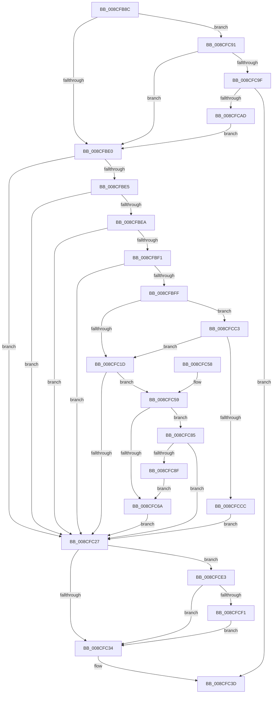

# MiComputeProcessUserVa

- RVA: `0x008CFB8C`–`0x008CFD01` (길이 `373` bytes)
- VA: `0x00000001408CFB8C`
- 실행 섹션: `PAGE`
- PDB 이름 있음: `예`; PDB Function 태그: `아니요`
- unwind 정보 RVA: `0x000849A4`
- 디코드: `86`개 명령, `373/373` bytes 표시
- 미해석 바이트: `0` (있으면 어셈블리에 `.byte`로 보존)

> 이 문서는 커널 이미지의 기계어와 PDB 기호를 분석해 생성했습니다. 4번과 5번은 함수 원형과 자료형을 바이너리 사용 방식에서 추정한 C 해석이며 원본 소스 복구 결과는 아닙니다.

## 1. Dependencies

- 직접 호출 지점: **4**; 고유 호출 대상: **4**
- 직접 호출자로 확인된 함수: **1**
- RIP 상대 이미지 참조: **1**

### Outgoing calls
- `0x008CFBD3` → [Feature_Servicing_AutoBoostEtwEventingFixes__private_IsEnabledPreCheckWithReporting](../../text/22/Feature_Servicing_AutoBoostEtwEventingFixes__private_IsEnabledPreCheckWithReporting_function_00222FE0.md) (function, `0x00222FE0`)
- `0x008CFC02` → [MiSectionControlArea](../../text/29/MiSectionControlArea_function_00294CB0.md) (function, `0x00294CB0`)
- `0x008CFCA4` → [MiChargeFullProcessCommitment](../88/MiChargeFullProcessCommitment_function_00887630.md) (function, `0x00887630`)
- `0x008CFCB9` → [MiUpdateChargedWsles](../../text/4F/MiUpdateChargedWsles_function_004F6EA0.md) (function, `0x004F6EA0`)

### Direct callers
- [MmInitializeProcessAddressSpace](MmInitializeProcessAddressSpace_function_008CF6B0.md) at `0x008CF7E6`

### Static image references
- `0x008CFC27` → RVA `0x00FC5210` (`ALMOSTRO`; read)

## 2. Other-region calls and transfers

- 다른 실행 섹션으로 향하는 call: **3**
  - `0x008CFBD3` → [Feature_Servicing_AutoBoostEtwEventingFixes__private_IsEnabledPreCheckWithReporting](../../text/22/Feature_Servicing_AutoBoostEtwEventingFixes__private_IsEnabledPreCheckWithReporting_function_00222FE0.md) (`PAGE` → `.text`)
  - `0x008CFC02` → [MiSectionControlArea](../../text/29/MiSectionControlArea_function_00294CB0.md) (`PAGE` → `.text`)
  - `0x008CFCB9` → [MiUpdateChargedWsles](../../text/4F/MiUpdateChargedWsles_function_004F6EA0.md) (`PAGE` → `.text`)
- 별도 외부 분기/꼬리 이동을 확인하지 못했습니다.

## 3. Assembly (complete function range)

```asm
008CFB8C  48 8B C4                        mov rax, rsp
008CFB8F  48 89 58 08                     mov qword ptr [rax + 8], rbx
008CFB93  48 89 68 10                     mov qword ptr [rax + 0x10], rbp
008CFB97  48 89 70 18                     mov qword ptr [rax + 0x18], rsi
008CFB9B  48 89 78 20                     mov qword ptr [rax + 0x20], rdi
008CFB9F  41 56                           push r14
008CFBA1  48 83 EC 20                     sub rsp, 0x20
008CFBA5  48 8B 81 10 04 00 00            mov rax, qword ptr [rcx + 0x410]
008CFBAC  4D 8B F1                        mov r14, r9
008CFBAF  49 83 21 00                     and qword ptr [r9], 0
008CFBB3  48 05 08 04 00 00               add rax, 0x408
008CFBB9  49 8B F0                        mov rsi, r8
008CFBBC  48 8B EA                        mov rbp, rdx
008CFBBF  48 8B D9                        mov rbx, rcx
008CFBC2  48 BF 00 00 FF FF FF 7F 00 00   movabs rdi, 0x7fffffff0000
008CFBCC  48 89 40 08                     mov qword ptr [rax + 8], rax
008CFBD0  48 89 00                        mov qword ptr [rax], rax
008CFBD3  E8 08 34 95 FF                  call 0x140222fe0
008CFBD8  85 C0                           test eax, eax
008CFBDA  0F 84 B1 00 00 00               je 0x1408cfc91
008CFBE0  48 85 ED                        test rbp, rbp
008CFBE3  75 42                           jne 0x1408cfc27
008CFBE5  48 85 F6                        test rsi, rsi
008CFBE8  74 3D                           je 0x1408cfc27
008CFBEA  8B 46 38                        mov eax, dword ptr [rsi + 0x38]
008CFBED  A8 20                           test al, 0x20
008CFBEF  74 36                           je 0x1408cfc27
008CFBF1  44 8B 83 F4 01 00 00            mov r8d, dword ptr [rbx + 0x1f4]
008CFBF8  41 0F BA E0 11                  bt r8d, 0x11
008CFBFD  72 28                           jb 0x1408cfc27
008CFBFF  48 8B CE                        mov rcx, rsi
008CFC02  E8 A9 50 9C FF                  call 0x140294cb0
008CFC07  BA 00 02 00 00                  mov edx, 0x200
008CFC0C  48 8B 08                        mov rcx, qword ptr [rax]
008CFC0F  48 8B 41 38                     mov rax, qword ptr [rcx + 0x38]
008CFC13  F6 40 2C 20                     test byte ptr [rax + 0x2c], 0x20
008CFC17  0F 84 A6 00 00 00               je 0x1408cfcc3
008CFC1D  48 83 BB 10 03 00 00 00         cmp qword ptr [rbx + 0x310], 0
008CFC25  75 32                           jne 0x1408cfc59
008CFC27  83 3D E2 55 6F 00 00            cmp dword ptr [rip + 0x6f55e2], 0
008CFC2E  0F 85 AF 00 00 00               jne 0x1408cfce3
008CFC34  48 89 BB 68 03 00 00            mov qword ptr [rbx + 0x368], rdi
008CFC3B  33 C0                           xor eax, eax
008CFC3D  48 8B 5C 24 30                  mov rbx, qword ptr [rsp + 0x30]
008CFC42  48 8B 6C 24 38                  mov rbp, qword ptr [rsp + 0x38]
008CFC47  48 8B 74 24 40                  mov rsi, qword ptr [rsp + 0x40]
008CFC4C  48 8B 7C 24 48                  mov rdi, qword ptr [rsp + 0x48]
008CFC51  48 83 C4 20                     add rsp, 0x20
008CFC55  41 5E                           pop r14
008CFC57  C3                              ret
008CFC58  CC                              int3
008CFC59  0F B7 83 EC 06 00 00            movzx eax, word ptr [rbx + 0x6ec]
008CFC60  B9 4C 01 00 00                  mov ecx, 0x14c
008CFC65  66 3B C1                        cmp ax, cx
008CFC68  75 1B                           jne 0x1408cfc85
008CFC6A  48 B8 00 00 00 00 01 00 00 00   movabs rax, 0x100000000
008CFC74  BF 00 00 FF FF                  mov edi, 0xffff0000
008CFC79  49 89 06                        mov qword ptr [r14], rax
008CFC7C  F0 09 93 F4 01 00 00            lock or dword ptr [rbx + 0x1f4], edx
008CFC83  EB A2                           jmp 0x1408cfc27
008CFC85  B9 C4 01 00 00                  mov ecx, 0x1c4
008CFC8A  66 3B C1                        cmp ax, cx
008CFC8D  75 98                           jne 0x1408cfc27
008CFC8F  EB D9                           jmp 0x1408cfc6a
008CFC91  8B 81 FC 05 00 00               mov eax, dword ptr [rcx + 0x5fc]
008CFC97  A8 01                           test al, 1
008CFC99  0F 85 41 FF FF FF               jne 0x1408cfbe0
008CFC9F  BA 04 00 00 00                  mov edx, 4
008CFCA4  E8 87 79 FB FF                  call 0x140887630
008CFCA9  85 C0                           test eax, eax
008CFCAB  78 90                           js 0x1408cfc3d
008CFCAD  48 8D 8B 00 04 00 00            lea rcx, [rbx + 0x400]
008CFCB4  BA 04 00 00 00                  mov edx, 4
008CFCB9  E8 E2 71 C2 FF                  call 0x1404f6ea0
008CFCBE  E9 1D FF FF FF                  jmp 0x1408cfbe0
008CFCC3  44 85 C2                        test edx, r8d
008CFCC6  0F 85 51 FF FF FF               jne 0x1408cfc1d
008CFCCC  48 B8 00 00 00 00 01 00 00 00   movabs rax, 0x100000000
008CFCD6  BF 00 00 FF 7F                  mov edi, 0x7fff0000
008CFCDB  49 89 06                        mov qword ptr [r14], rax
008CFCDE  E9 44 FF FF FF                  jmp 0x1408cfc27
008CFCE3  B8 00 00 00 80                  mov eax, 0x80000000
008CFCE8  48 3B F8                        cmp rdi, rax
008CFCEB  0F 86 43 FF FF FF               jbe 0x1408cfc34
008CFCF1  F0 81 8B F4 01 00 00 00 00 20 00  lock or dword ptr [rbx + 0x1f4], 0x200000
008CFCFC  E9 33 FF FF FF                  jmp 0x1408cfc34
```

## 4. C-style interpretation (structured pseudocode)

```c
__int64 __fastcall MiComputeProcessUserVa(__int64 a1, __int64 a2, __int64 a3, __int64 a4)
{
    __int64 result;
    __int64 v_rsp;
    unsigned __int64 v_stack_p10;
    unsigned __int64 v_stack_p18;
    unsigned __int64 v_stack_p20;
    unsigned __int64 v_stack_p8;

    *(unsigned __int64 *)(v_rsp + 8) = v_rbx;
    *(unsigned __int64 *)(v_rsp + 16) = v_rbp;
    *(unsigned __int64 *)(v_rsp + 24) = v_rsi;
    *(unsigned __int64 *)(v_rsp + 32) = v_rdi;
    v_rsp = (v_rsp) - (32);
    result = (*(unsigned __int64 *)(a1 + 1040)) + (0x408ULL);
    *(unsigned __int64 *)(result + 8) = result;
    *(unsigned __int64 *)(result) = result;
    result = Feature_Servicing_AutoBoostEtwEventingFixes__private_IsEnabledPreCheckWithReporting(a1, a2, a3, a4);
    if ((unsigned int)(result) == 0) goto loc_008CFC91;
loc_008CFBE0:
    if (a2 != 0) goto loc_008CFC27;
    if (a3 == 0) goto loc_008CFC27;
    if ((((unsigned __int8)((unsigned int)(*(unsigned int *)(a3 + 56)))) & (32)) == 0) goto loc_008CFC27;
    if (condition_is_below) goto loc_008CFC27;
    result = MiSectionControlArea(a3, a2, (unsigned int)(*(unsigned int *)(a1 + 500)), a4);
    if (((*(unsigned __int8 *)(*(unsigned __int64 *)(*(unsigned __int64 *)(result) + 56) + 44)) & (32)) == 0) goto loc_008CFCC3;
loc_008CFC1D:
    if ((*(unsigned __int64 *)(a1 + 784)) != 0) goto loc_008CFC59;
loc_008CFC27:
    if ((*(unsigned int *)(v_rip + 7296482)) != 0) goto loc_008CFCE3;
loc_008CFC34:
    *(unsigned __int64 *)(a1 + 872) = v_rdi;
    result = 0;
loc_008CFC3D:
    v_rsp = (v_rsp) + (32);
    return result;
loc_008CFC59:
    if (((unsigned __int16)(*(unsigned __int16 *)(v_stack_p8 + 1772))) != 332) goto loc_008CFC85;
loc_008CFC6A:
    *(unsigned __int64 *)(a4) = *(unsigned __int16 *)(v_stack_p8 + 1772);
    goto loc_008CFC27;
loc_008CFC85:
    if (((unsigned __int16)(*(unsigned __int16 *)(v_stack_p8 + 1772))) != 452) goto loc_008CFC27;
    goto loc_008CFC6A;
loc_008CFC91:
    if ((((unsigned __int8)((unsigned int)(*(unsigned int *)(452 + 1532)))) & (1)) != 0) goto loc_008CFBE0;
    result = MiChargeFullProcessCommitment(452, 4, (unsigned int)(*(unsigned int *)(a1 + 500)), a4);
    if (sign_flag) goto loc_008CFC3D;
    result = MiUpdateChargedWsles(v_stack_p8 + 1024, 4, (unsigned int)(*(unsigned int *)(a1 + 500)), a4);
    goto loc_008CFBE0;
loc_008CFCC3:
    if (((4) & ((unsigned int)((unsigned int)(*(unsigned int *)(a1 + 500))))) != 0) goto loc_008CFC1D;
    *(unsigned __int64 *)(a4) = result;
    goto loc_008CFC27;
loc_008CFCE3:
    if (((unsigned int)(0x7FFF0000ULL)) <= ((unsigned int)(0x80000000ULL))) goto loc_008CFC34;
    goto loc_008CFC34;
}
```

## 5. (Beta) C Style

```c
int64_t MiComputeProcessUserVa(void *Arg1, int64_t Arg2, int64_t Arg3, void *Arg4)
{
    uint8_t *arg1 = (uint8_t *)Arg1;
    uint8_t *arg4 = (uint8_t *)Arg4;

    int64_t result;
    int64_t local_rsp;
    uint64_t v_stack_p10;
    uint64_t v_stack_p18;
    uint64_t v_stack_p20;
    uint64_t v_stack_p8;

    *(uint64_t *)(local_rsp + 0x8) = local_rbx;
    *(uint64_t *)(local_rsp + 0x10) = local_rbp;
    *(uint64_t *)(local_rsp + 0x18) = local_rsi;
    *(uint64_t *)(local_rsp + 0x20) = local_rdi;
    local_rsp = (local_rsp) - (32);
    result = (*(uint64_t *)(arg1 + 0x410)) + (0x408ULL);
    *(uint64_t *)(result + 0x8) = result;
    *(uint64_t *)(result) = result;
    result = Feature_Servicing_AutoBoostEtwEventingFixes__private_IsEnabledPreCheckWithReporting(Arg1, Arg2, Arg3, Arg4);
    if ((uint32_t)(result) == 0) goto loc_008CFC91;
loc_008CFBE0:
    if (Arg2 != 0) goto loc_008CFC27;
    if (Arg3 == 0) goto loc_008CFC27;
    if ((((uint8_t)((uint32_t)(*(uint32_t *)(Arg3 + 0x38)))) & (32)) == 0) goto loc_008CFC27;
    if (condition_is_below) goto loc_008CFC27;
    result = MiSectionControlArea(Arg3, Arg2, (uint32_t)(*(uint32_t *)(arg1 + 0x1F4)), Arg4);
    if (((*(uint8_t *)(*(uint64_t *)(*(uint64_t *)(result) + 0x38) + 0x2C)) & (32)) == 0) goto loc_008CFCC3;
loc_008CFC1D:
    if ((*(uint64_t *)(arg1 + 0x310)) != 0) goto loc_008CFC59;
loc_008CFC27:
    if ((*(uint32_t *)(v_rip + 0x6F55E2)) != 0) goto loc_008CFCE3;
loc_008CFC34:
    *(uint64_t *)(arg1 + 0x368) = local_rdi;
    result = 0;
loc_008CFC3D:
    local_rsp = (local_rsp) + (32);
    return result;
loc_008CFC59:
    if (((uint16_t)(*(uint16_t *)(v_stack_p8 + 0x6EC))) != 332) goto loc_008CFC85;
loc_008CFC6A:
    *(uint64_t *)(arg4) = *(uint16_t *)(v_stack_p8 + 0x6EC);
    goto loc_008CFC27;
loc_008CFC85:
    if (((uint16_t)(*(uint16_t *)(v_stack_p8 + 0x6EC))) != 452) goto loc_008CFC27;
    goto loc_008CFC6A;
loc_008CFC91:
    if ((((uint8_t)((uint32_t)(*(uint32_t *)(452 + 0x5FC)))) & (1)) != 0) goto loc_008CFBE0;
    result = MiChargeFullProcessCommitment(452, 4, (uint32_t)(*(uint32_t *)(arg1 + 0x1F4)), Arg4);
    if (sign_flag) goto loc_008CFC3D;
    result = MiUpdateChargedWsles(v_stack_p8 + 1024, 4, (uint32_t)(*(uint32_t *)(arg1 + 0x1F4)), Arg4);
    goto loc_008CFBE0;
loc_008CFCC3:
    if (((4) & ((uint32_t)((uint32_t)(*(uint32_t *)(arg1 + 0x1F4))))) != 0) goto loc_008CFC1D;
    *(uint64_t *)(arg4) = result;
    goto loc_008CFC27;
loc_008CFCE3:
    if (((uint32_t)(0x7FFF0000ULL)) <= ((uint32_t)(0x80000000ULL))) goto loc_008CFC34;
    goto loc_008CFC34;
}
```

### 관측된 메모리 오프셋

구조체 형식이 확인되지 않은 접근은 인자 기준의 오프셋으로만 기록했습니다.

| 기준 인자 | 오프셋 표현 | 폭 (bit) | 접근 |
|---|---:|---:|---|
| `Arg1` | `+ 0x1F4` | `32` | `R` |
| `Arg1` | `+ 0x1F4` | `32` | `R/W` |
| `Arg1` | `+ 0x310` | `64` | `R` |
| `Arg1` | `+ 0x368` | `64` | `W` |
| `Arg1` | `+ 0x400` | `64` | `R` |
| `Arg1` | `+ 0x410` | `64` | `R` |
| `Arg1` | `+ 0x6EC` | `16` | `R` |
| `Arg4` | `+ 0x0` | `64` | `R/W` |
| `Arg4` | `+ 0x0` | `64` | `W` |

## 6. Execution-region graph

[열기: 2D/3D 그래프와 함수 탐색 컨트롤 패널](../../../control-panel.html?section=page&rva=0x008CFB8C&view=graph)

- 2D 그래프는 위에서 아래로 흐르고, 3D 그래프는 빈 공간을 드래그해 회전합니다. Shift+드래그는 이동, 휠은 확대·축소, 함수 노드 선택은 대상 보고서 이동입니다.

### Static fallback


