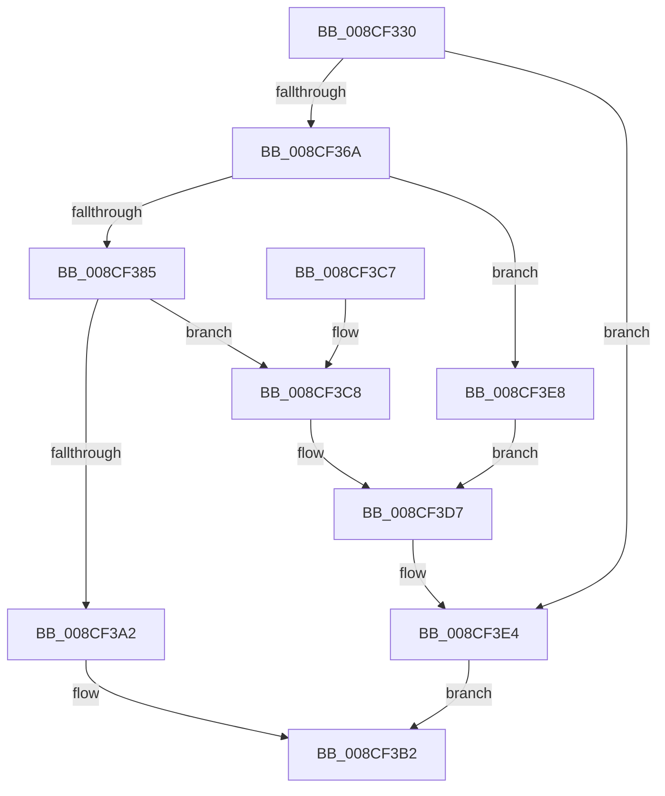

# MiCreatePlaceholderStorage

- RVA: `0x008CF330`–`0x008CF3EF` (길이 `191` bytes)
- VA: `0x00000001408CF330`
- 실행 섹션: `PAGE`
- PDB 이름 있음: `예`; PDB Function 태그: `아니요`
- unwind 정보 RVA: `0x000848E8`
- 디코드: `52`개 명령, `191/191` bytes 표시
- 미해석 바이트: `0` (있으면 어셈블리에 `.byte`로 보존)

> 이 문서는 커널 이미지의 기계어와 PDB 기호를 분석해 생성했습니다. 4번과 5번은 함수 원형과 자료형을 바이너리 사용 방식에서 추정한 C 해석이며 원본 소스 복구 결과는 아닙니다.

## 1. Dependencies

- 직접 호출 지점: **6**; 고유 호출 대상: **6**
- 직접 호출자로 확인된 함수: **4**
- RIP 상대 이미지 참조: **0**

### Outgoing calls
- `0x008CF35F` → [PsChargeProcessNonPagedPoolQuota](../../text/2A/PsChargeProcessNonPagedPoolQuota_function_002A7B80.md) (function, `0x002A7B80`)
- `0x008CF378` → [MiAllocatePool](../../text/35/MiAllocatePool_function_0035B540.md) (function, `0x0035B540`)
- `0x008CF394` → [MiAllocateVad](MiAllocateVad_function_008CF3F8.md) (function, `0x008CF3F8`)
- `0x008CF3AB` → [MiInsertVadEvent](../../text/43/MiInsertVadEvent_function_00430E74.md) (function, `0x00430E74`)
- `0x008CF3D2` → [ExFreePoolWithTag](../../poolcode/B8/ExFreePoolWithTag_function_00B82870.md) (function, `0x00B82870`)
- `0x008CF3DF` → [PsReturnProcessNonPagedPoolQuota](../../text/41/PsReturnProcessNonPagedPoolQuota_function_0041C200.md) (function, `0x0041C200`)

### Direct callers
- [MiReserveUserMemory](../88/MiReserveUserMemory_function_00884498.md) at `0x00884AAC`
- [sub_008857C1](../88/Unknown_function_008857C1.md) at `0x00885902`
- [MiInitializePartialVad](../88/MiInitializePartialVad_function_00887954.md) at `0x00887B0B`
- [sub_00B2A0A2](../B2/Unknown_function_00B2A0A2.md) at `0x00B2A0A5`

### Static image references
- 디코드된 RIP-relative 메모리 참조가 없습니다.

## 2. Other-region calls and transfers

- 다른 실행 섹션으로 향하는 call: **5**
  - `0x008CF35F` → [PsChargeProcessNonPagedPoolQuota](../../text/2A/PsChargeProcessNonPagedPoolQuota_function_002A7B80.md) (`PAGE` → `.text`)
  - `0x008CF378` → [MiAllocatePool](../../text/35/MiAllocatePool_function_0035B540.md) (`PAGE` → `.text`)
  - `0x008CF3AB` → [MiInsertVadEvent](../../text/43/MiInsertVadEvent_function_00430E74.md) (`PAGE` → `.text`)
  - `0x008CF3D2` → [ExFreePoolWithTag](../../poolcode/B8/ExFreePoolWithTag_function_00B82870.md) (`PAGE` → `POOLCODE`)
  - `0x008CF3DF` → [PsReturnProcessNonPagedPoolQuota](../../text/41/PsReturnProcessNonPagedPoolQuota_function_0041C200.md) (`PAGE` → `.text`)
- 별도 외부 분기/꼬리 이동을 확인하지 못했습니다.

## 3. Assembly (complete function range)

```asm
008CF330  48 89 5C 24 08                  mov qword ptr [rsp + 8], rbx
008CF335  48 89 6C 24 10                  mov qword ptr [rsp + 0x10], rbp
008CF33A  48 89 74 24 18                  mov qword ptr [rsp + 0x18], rsi
008CF33F  57                              push rdi
008CF340  48 83 EC 20                     sub rsp, 0x20
008CF344  65 48 8B 04 25 88 01 00 00      mov rax, qword ptr gs:[0x188]
008CF34D  48 8B E9                        mov rbp, rcx
008CF350  BA 98 00 00 00                  mov edx, 0x98
008CF355  48 8B B0 B8 00 00 00            mov rsi, qword ptr [rax + 0xb8]
008CF35C  48 8B CE                        mov rcx, rsi
008CF35F  E8 1C 88 9D FF                  call 0x1402a7b80
008CF364  8B D8                           mov ebx, eax
008CF366  85 C0                           test eax, eax
008CF368  78 7A                           js 0x1408cf3e4
008CF36A  BA 58 00 00 00                  mov edx, 0x58
008CF36F  41 B8 4D 6D 70 73               mov r8d, 0x73706d4d
008CF375  8D 4A E8                        lea ecx, [rdx - 0x18]
008CF378  E8 C3 C1 A8 FF                  call 0x14035b540
008CF37D  48 8B F8                        mov rdi, rax
008CF380  48 85 C0                        test rax, rax
008CF383  74 63                           je 0x1408cf3e8
008CF385  33 D2                           xor edx, edx
008CF387  C7 40 50 80 00 00 00            mov dword ptr [rax + 0x50], 0x80
008CF38E  33 C9                           xor ecx, ecx
008CF390  44 8D 42 02                     lea r8d, [rdx + 2]
008CF394  E8 5F 00 00 00                  call 0x1408cf3f8
008CF399  48 89 47 08                     mov qword ptr [rdi + 8], rax
008CF39D  48 85 C0                        test rax, rax
008CF3A0  74 26                           je 0x1408cf3c8
008CF3A2  45 33 C0                        xor r8d, r8d
008CF3A5  48 8B D7                        mov rdx, rdi
008CF3A8  48 8B CD                        mov rcx, rbp
008CF3AB  E8 C4 1A B6 FF                  call 0x140430e74
008CF3B0  33 C0                           xor eax, eax
008CF3B2  48 8B 5C 24 30                  mov rbx, qword ptr [rsp + 0x30]
008CF3B7  48 8B 6C 24 38                  mov rbp, qword ptr [rsp + 0x38]
008CF3BC  48 8B 74 24 40                  mov rsi, qword ptr [rsp + 0x40]
008CF3C1  48 83 C4 20                     add rsp, 0x20
008CF3C5  5F                              pop rdi
008CF3C6  C3                              ret
008CF3C7  CC                              int3
008CF3C8  BB 9A 00 00 C0                  mov ebx, 0xc000009a
008CF3CD  33 D2                           xor edx, edx
008CF3CF  48 8B CF                        mov rcx, rdi
008CF3D2  E8 99 34 2B 00                  call 0x140b82870
008CF3D7  BA 98 00 00 00                  mov edx, 0x98
008CF3DC  48 8B CE                        mov rcx, rsi
008CF3DF  E8 1C CE B4 FF                  call 0x14041c200
008CF3E4  8B C3                           mov eax, ebx
008CF3E6  EB CA                           jmp 0x1408cf3b2
008CF3E8  BB 9A 00 00 C0                  mov ebx, 0xc000009a
008CF3ED  EB E8                           jmp 0x1408cf3d7
```

## 4. C-style interpretation (structured pseudocode)

```c
__int64 __fastcall MiCreatePlaceholderStorage(__int64 a1)
{
    __int64 result;
    __int64 v_rsp;
    unsigned __int64 v_stack_p10;
    unsigned __int64 v_stack_p18;
    unsigned __int64 v_stack_p8;

    v_stack_p8 = v_rbx;
    v_stack_p10 = v_rbp;
    v_stack_p18 = v_rsi;
    v_rsp = (v_rsp) - (32);
    result = PsChargeProcessNonPagedPoolQuota(*(unsigned __int64 *)(*(unsigned __int64 *)(gs_base + (0 + 392)) + 184), 152, a3, a4);
    if (sign_flag) goto loc_008CF3E4;
    result = MiAllocatePool(88 - 24, 88, (unsigned int)(0x73706D4DULL), a4);
    if (result == 0) goto loc_008CF3E8;
    a2 = 0;
    *(unsigned int *)(result + 80) = 128;
    a1 = 0;
    result = MiAllocateVad(a1, a2, a2 + 2, a4);
    *(unsigned __int64 *)(result + 8) = result;
    if (result == 0) goto loc_008CF3C8;
    a3 = 0;
    result = MiInsertVadEvent(0, result, a3, a4);
    result = 0;
loc_008CF3B2:
    v_rsp = (v_rsp) + (32);
    return result;
loc_008CF3C8:
    a2 = 0;
    result = ExFreePoolWithTag(0, a2, a3, a4);
loc_008CF3D7:
    result = PsReturnProcessNonPagedPoolQuota(v_stack_p18, 152, a3, a4);
loc_008CF3E4:
    goto loc_008CF3B2;
loc_008CF3E8:
    goto loc_008CF3D7;
}
```

## 5. (Beta) C Style

```c
int64_t MiCreatePlaceholderStorage(int64_t Arg1)
{
    int64_t result;
    int64_t local_rsp;
    uint64_t v_stack_p10;
    uint64_t v_stack_p18;
    uint64_t v_stack_p8;

    v_stack_p8 = local_rbx;
    v_stack_p10 = local_rbp;
    v_stack_p18 = local_rsi;
    local_rsp = (local_rsp) - (32);
    result = PsChargeProcessNonPagedPoolQuota(*(uint64_t *)(*(uint64_t *)(gs_base + (0 + 0x188)) + 0xB8), 152, a3, a4);
    if (sign_flag) goto loc_008CF3E4;
    result = MiAllocatePool(88 - 24, 88, (uint32_t)(0x73706D4DULL), a4);
    if (result == 0) goto loc_008CF3E8;
    a2 = 0;
    *(uint32_t *)(result + 0x50) = 128;
    Arg1 = 0;
    result = MiAllocateVad(Arg1, a2, a2 + 2, a4);
    *(uint64_t *)(result + 0x8) = result;
    if (result == 0) goto loc_008CF3C8;
    a3 = 0;
    result = MiInsertVadEvent(0, result, a3, a4);
    result = 0;
loc_008CF3B2:
    local_rsp = (local_rsp) + (32);
    return result;
loc_008CF3C8:
    a2 = 0;
    result = ExFreePoolWithTag(0, a2, a3, a4);
loc_008CF3D7:
    result = PsReturnProcessNonPagedPoolQuota(v_stack_p18, 152, a3, a4);
loc_008CF3E4:
    goto loc_008CF3B2;
loc_008CF3E8:
    goto loc_008CF3D7;
}
```

## 6. Execution-region graph

[열기: 2D/3D 그래프와 함수 탐색 컨트롤 패널](../../../control-panel.html?section=page&rva=0x008CF330&view=graph)

- 2D 그래프는 위에서 아래로 흐르고, 3D 그래프는 빈 공간을 드래그해 회전합니다. Shift+드래그는 이동, 휠은 확대·축소, 함수 노드 선택은 대상 보고서 이동입니다.

### Static fallback


