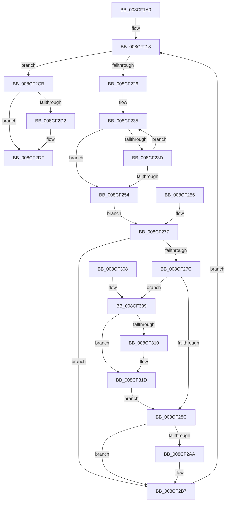

# MiEliminateZeroPages

- RVA: `0x008CF1A0`–`0x008CF32A` (길이 `394` bytes)
- VA: `0x00000001408CF1A0`
- 실행 섹션: `PAGE`
- PDB 이름 있음: `예`; PDB Function 태그: `아니요`
- unwind 정보 RVA: `0x000848B0`
- 디코드: `97`개 명령, `394/394` bytes 표시
- 미해석 바이트: `0` (있으면 어셈블리에 `.byte`로 보존)

> 이 문서는 커널 이미지의 기계어와 PDB 기호를 분석해 생성했습니다. 4번과 5번은 함수 원형과 자료형을 바이너리 사용 방식에서 추정한 C 해석이며 원본 소스 복구 결과는 아닙니다.

## 1. Dependencies

- 직접 호출 지점: **8**; 고유 호출 대상: **6**
- 직접 호출자로 확인된 함수: **2**
- RIP 상대 이미지 참조: **1**

### Outgoing calls
- `0x008CF1E8` → [memset](../../text/6C/memset_function_006C6C40.md) (function, `0x006C6C40`)
- `0x008CF207` → [MiInitializeTbFlushList](../../text/29/MiInitializeTbFlushList_function_00294F00.md) (function, `0x00294F00`)
- `0x008CF27F` → [MiGetPdeAddress](../../text/41/MiGetPdeAddress_function_0041AFC0.md) (function, `0x0041AFC0`)
- `0x008CF29B` → [MiInsertTbFlushEntry](../../text/29/MiInsertTbFlushEntry_function_00293670.md) (function, `0x00293670`)
- `0x008CF2B2` → [MiConvertAndFlushWsleVas](../../text/49/MiConvertAndFlushWsleVas_function_00492CB4.md) (function, `0x00492CB4`)
- `0x008CF2DA` → [MiConvertAndFlushWsleVas](../../text/49/MiConvertAndFlushWsleVas_function_00492CB4.md) (function, `0x00492CB4`)
- `0x008CF2EA` → [_security_check_cookie](../../text/6A/_security_check_cookie_function_006AC640.md) (function, `0x006AC640`)
- `0x008CF318` → [MiConvertAndFlushWsleVas](../../text/49/MiConvertAndFlushWsleVas_function_00492CB4.md) (function, `0x00492CB4`)

### Direct callers
- [MiUpdateCfgSystemWideBitmapWorker](MiUpdateCfgSystemWideBitmapWorker_function_008CE650.md) at `0x008CE94A`
- [MiCopyToCfgBitMap](../8D/MiCopyToCfgBitMap_function_008D1140.md) at `0x008D14B8`

### Static image references
- `0x008CF1B6` → RVA `0x00E0A740` (`.data`; read)

## 2. Other-region calls and transfers

- 다른 실행 섹션으로 향하는 call: **8**
  - `0x008CF1E8` → [memset](../../text/6C/memset_function_006C6C40.md) (`PAGE` → `.text`)
  - `0x008CF207` → [MiInitializeTbFlushList](../../text/29/MiInitializeTbFlushList_function_00294F00.md) (`PAGE` → `.text`)
  - `0x008CF27F` → [MiGetPdeAddress](../../text/41/MiGetPdeAddress_function_0041AFC0.md) (`PAGE` → `.text`)
  - `0x008CF29B` → [MiInsertTbFlushEntry](../../text/29/MiInsertTbFlushEntry_function_00293670.md) (`PAGE` → `.text`)
  - `0x008CF2B2` → [MiConvertAndFlushWsleVas](../../text/49/MiConvertAndFlushWsleVas_function_00492CB4.md) (`PAGE` → `.text`)
  - `0x008CF2DA` → [MiConvertAndFlushWsleVas](../../text/49/MiConvertAndFlushWsleVas_function_00492CB4.md) (`PAGE` → `.text`)
  - `0x008CF2EA` → [_security_check_cookie](../../text/6A/_security_check_cookie_function_006AC640.md) (`PAGE` → `.text`)
  - `0x008CF318` → [MiConvertAndFlushWsleVas](../../text/49/MiConvertAndFlushWsleVas_function_00492CB4.md) (`PAGE` → `.text`)
- 별도 외부 분기/꼬리 이동을 확인하지 못했습니다.

## 3. Assembly (complete function range)

```asm
008CF1A0  48 89 5C 24 18                  mov qword ptr [rsp + 0x18], rbx
008CF1A5  48 89 74 24 20                  mov qword ptr [rsp + 0x20], rsi
008CF1AA  57                              push rdi
008CF1AB  41 56                           push r14
008CF1AD  41 57                           push r15
008CF1AF  48 81 EC 40 01 00 00            sub rsp, 0x140
008CF1B6  48 8B 05 83 B5 53 00            mov rax, qword ptr [rip + 0x53b583]
008CF1BD  48 33 C4                        xor rax, rsp
008CF1C0  48 89 84 24 30 01 00 00         mov qword ptr [rsp + 0x130], rax
008CF1C8  49 8B F0                        mov rsi, r8
008CF1CB  48 8B FA                        mov rdi, rdx
008CF1CE  4C 8B F1                        mov r14, rcx
008CF1D1  48 89 4C 24 58                  mov qword ptr [rsp + 0x58], rcx
008CF1D6  48 89 54 24 40                  mov qword ptr [rsp + 0x40], rdx
008CF1DB  33 D2                           xor edx, edx
008CF1DD  41 B8 C8 00 00 00               mov r8d, 0xc8
008CF1E3  48 8D 4C 24 60                  lea rcx, [rsp + 0x60]
008CF1E8  E8 53 7A DF FF                  call 0x1406c6c40
008CF1ED  C7 44 24 20 01 00 00 00         mov dword ptr [rsp + 0x20], 1
008CF1F5  41 B9 0A 00 00 00               mov r9d, 0xa
008CF1FB  45 8D 41 0A                     lea r8d, [r9 + 0xa]
008CF1FF  49 8B D6                        mov rdx, r14
008CF202  48 8D 4C 24 60                  lea rcx, [rsp + 0x60]
008CF207  E8 F4 5C 9C FF                  call 0x140294f00
008CF20C  48 C1 EE 0C                     shr rsi, 0xc
008CF210  45 33 FF                        xor r15d, r15d
008CF213  4C 89 7C 24 38                  mov qword ptr [rsp + 0x38], r15
008CF218  48 89 74 24 48                  mov qword ptr [rsp + 0x48], rsi
008CF21D  48 85 F6                        test rsi, rsi
008CF220  0F 84 A5 00 00 00               je 0x1408cf2cb
008CF226  4C 8B C7                        mov r8, rdi
008CF229  48 8D 97 F8 0F 00 00            lea rdx, [rdi + 0xff8]
008CF230  48 89 54 24 30                  mov qword ptr [rsp + 0x30], rdx
008CF235  48 8B 02                        mov rax, qword ptr [rdx]
008CF238  49 0B 00                        or rax, qword ptr [r8]
008CF23B  75 17                           jne 0x1408cf254
008CF23D  49 83 C0 08                     add r8, 8
008CF241  4C 89 44 24 50                  mov qword ptr [rsp + 0x50], r8
008CF246  48 83 EA 08                     sub rdx, 8
008CF24A  48 89 54 24 30                  mov qword ptr [rsp + 0x30], rdx
008CF24F  4C 3B C2                        cmp r8, rdx
008CF252  76 E1                           jbe 0x1408cf235
008CF254  EB 21                           jmp 0x1408cf277
008CF256  48 8B 7C 24 40                  mov rdi, qword ptr [rsp + 0x40]
008CF25B  4C 8B C7                        mov r8, rdi
008CF25E  48 89 7C 24 50                  mov qword ptr [rsp + 0x50], rdi
008CF263  48 8B 54 24 30                  mov rdx, qword ptr [rsp + 0x30]
008CF268  4C 8B 7C 24 38                  mov r15, qword ptr [rsp + 0x38]
008CF26D  48 8B 74 24 48                  mov rsi, qword ptr [rsp + 0x48]
008CF272  4C 8B 74 24 58                  mov r14, qword ptr [rsp + 0x58]
008CF277  4C 3B C2                        cmp r8, rdx
008CF27A  76 3B                           jbe 0x1408cf2b7
008CF27C  48 8B CF                        mov rcx, rdi
008CF27F  E8 3C BD B4 FF                  call 0x14041afc0
008CF284  48 8B D8                        mov rbx, rax
008CF287  4C 3B F8                        cmp r15, rax
008CF28A  75 7D                           jne 0x1408cf309
008CF28C  45 33 C9                        xor r9d, r9d
008CF28F  45 8D 41 01                     lea r8d, [r9 + 1]
008CF293  48 8B D7                        mov rdx, rdi
008CF296  48 8D 4C 24 60                  lea rcx, [rsp + 0x60]
008CF29B  E8 D0 43 9C FF                  call 0x140293670
008CF2A0  8B 44 24 6C                     mov eax, dword ptr [rsp + 0x6c]
008CF2A4  39 44 24 7C                     cmp dword ptr [rsp + 0x7c], eax
008CF2A8  75 0D                           jne 0x1408cf2b7
008CF2AA  48 8D 54 24 60                  lea rdx, [rsp + 0x60]
008CF2AF  49 8B CE                        mov rcx, r14
008CF2B2  E8 FD 39 BC FF                  call 0x140492cb4
008CF2B7  48 81 C7 00 10 00 00            add rdi, 0x1000
008CF2BE  48 89 7C 24 40                  mov qword ptr [rsp + 0x40], rdi
008CF2C3  48 FF CE                        dec rsi
008CF2C6  E9 4D FF FF FF                  jmp 0x1408cf218
008CF2CB  83 7C 24 7C 00                  cmp dword ptr [rsp + 0x7c], 0
008CF2D0  74 0D                           je 0x1408cf2df
008CF2D2  48 8D 54 24 60                  lea rdx, [rsp + 0x60]
008CF2D7  49 8B CE                        mov rcx, r14
008CF2DA  E8 D5 39 BC FF                  call 0x140492cb4
008CF2DF  48 8B 8C 24 30 01 00 00         mov rcx, qword ptr [rsp + 0x130]
008CF2E7  48 33 CC                        xor rcx, rsp
008CF2EA  E8 51 D3 DD FF                  call 0x1406ac640
008CF2EF  4C 8D 9C 24 40 01 00 00         lea r11, [rsp + 0x140]
008CF2F7  49 8B 5B 30                     mov rbx, qword ptr [r11 + 0x30]
008CF2FB  49 8B 73 38                     mov rsi, qword ptr [r11 + 0x38]
008CF2FF  49 8B E3                        mov rsp, r11
008CF302  41 5F                           pop r15
008CF304  41 5E                           pop r14
008CF306  5F                              pop rdi
008CF307  C3                              ret
008CF308  CC                              int3
008CF309  83 7C 24 7C 00                  cmp dword ptr [rsp + 0x7c], 0
008CF30E  74 0D                           je 0x1408cf31d
008CF310  48 8D 54 24 60                  lea rdx, [rsp + 0x60]
008CF315  49 8B CE                        mov rcx, r14
008CF318  E8 97 39 BC FF                  call 0x140492cb4
008CF31D  4C 8B FB                        mov r15, rbx
008CF320  48 89 5C 24 38                  mov qword ptr [rsp + 0x38], rbx
008CF325  E9 62 FF FF FF                  jmp 0x1408cf28c
```

## 4. C-style interpretation (structured pseudocode)

```c
__int64 __fastcall MiEliminateZeroPages(__int64 a1, __int64 a2, __int64 a3)
{
    __int64 result;
    __int64 v_r15;
    __int64 v_rdi;
    __int64 v_rsi;
    __int64 v_rsp;
    unsigned __int64 v_stack_m100;
    unsigned __int64 v_stack_m108;
    unsigned __int64 v_stack_m110;
    unsigned __int64 v_stack_m118;
    unsigned __int64 v_stack_m120;
    unsigned __int64 v_stack_m128;
    unsigned int v_stack_m138;
    unsigned __int64 v_stack_m18;
    unsigned __int64 v_stack_m28;
    unsigned int v_stack_mC4;
    unsigned int v_stack_mDC;
    unsigned __int64 v_stack_mE0;
    unsigned int v_stack_mEC;
    unsigned __int64 v_stack_mF8;
    unsigned __int64 v_stack_p18;
    unsigned __int64 v_stack_p20;

    v_stack_p18 = v_rbx;
    v_stack_p20 = v_rsi;
    v_rsp = (v_rsp) - (320);
    result = (*(unsigned __int64 *)(v_rip + 5485955)) ^ (v_rsp);
    v_stack_m28 = result;
    v_stack_m100 = a1;
    v_stack_m118 = a2;
    a2 = 0;
    result = memset(v_stack_mF8, a2, 200, a4);
    v_stack_m138 = 1;
    result = MiInitializeTbFlushList(v_stack_mF8, a1, 10 + 10, 10);
    v_rsi = (a3) >> (12);
    v_r15 = 0;
    v_stack_m120 = 0;
loc_008CF218:
    v_stack_m110 = v_rsi;
    if (v_rsi == 0) goto loc_008CF2CB;
    v_stack_m128 = a2 + 4088;
loc_008CF235:
    result = (*(unsigned __int64 *)(a2 + 4088)) | (*(unsigned __int64 *)(0));
    if (condition_is_not_equal) goto loc_008CF254;
    a3 = (0) + (8);
    v_stack_m108 = a3;
    a2 = (a2 + 4088) - (8);
    v_stack_m128 = a2;
    if (a3 <= a2) goto loc_008CF235;
loc_008CF254:
    goto loc_008CF277;
loc_008CF277:
    if (a3 <= a2) goto loc_008CF2B7;
    result = MiGetPdeAddress(a2, a2, a3, 10);
    if (0 != result) goto loc_008CF309;
loc_008CF28C:
    a4 = 0;
    result = MiInsertTbFlushEntry(v_stack_mF8, a2, a4 + 1, a4);
    result = (unsigned int)(v_stack_mEC);
    if (v_stack_mDC == ((unsigned int)((unsigned int)(v_stack_mEC)))) {
        a2 = v_stack_mF8;
        a1 = a1;
        result = MiConvertAndFlushWsleVas(a1, a2, a4 + 1, a4);
    }
    v_rdi = (a2) + (0x1000ULL);
    v_stack_m118 = v_rdi;
    v_rsi = (v_rsi) - 1;
    goto loc_008CF218;
loc_008CF2CB:
    if (v_stack_mDC != 0) {
        a2 = v_stack_mF8;
        a1 = a1;
        result = MiConvertAndFlushWsleVas(a1, a2, a4 + 1, a4);
    }
    a1 = (v_stack_m28) ^ (v_rsp);
    result = _security_check_cookie(a1, a2, a4 + 1, a4);
    return result;
loc_008CF309:
    if (v_stack_mC4 != 0) {
        a2 = v_stack_mE0;
        a1 = a1;
        result = MiConvertAndFlushWsleVas(a1, a2, a4 + 1, a4);
    }
    v_stack_m108 = *(unsigned __int64 *)(v_stack_m18 + 48);
    goto loc_008CF28C;
}
```

## 5. (Beta) C Style

```c
int64_t MiEliminateZeroPages(int64_t Arg1, void *Arg2, int64_t Arg3)
{
    uint8_t *arg2 = (uint8_t *)Arg2;

    int64_t result;
    int64_t local_r15;
    int64_t local_rdi;
    int64_t local_rsi;
    int64_t local_rsp;
    uint64_t v_stack_m100;
    uint64_t v_stack_m108;
    uint64_t v_stack_m110;
    uint64_t v_stack_m118;
    uint64_t v_stack_m120;
    uint64_t v_stack_m128;
    uint32_t v_stack_m138;
    uint64_t v_stack_m18;
    uint64_t v_stack_m28;
    uint32_t v_stack_mC4;
    uint32_t v_stack_mDC;
    uint64_t v_stack_mE0;
    uint32_t v_stack_mEC;
    uint64_t v_stack_mF8;
    uint64_t v_stack_p18;
    uint64_t v_stack_p20;

    v_stack_p18 = local_rbx;
    v_stack_p20 = local_rsi;
    local_rsp = (local_rsp) - (320);
    result = (*(uint64_t *)(v_rip + 0x53B583)) ^ (local_rsp);
    v_stack_m28 = result;
    v_stack_m100 = Arg1;
    v_stack_m118 = Arg2;
    Arg2 = 0;
    result = memset(v_stack_mF8, Arg2, 200, a4);
    v_stack_m138 = 1;
    result = MiInitializeTbFlushList(v_stack_mF8, Arg1, 10 + 10, 10);
    local_rsi = (Arg3) >> (12);
    local_r15 = 0;
    v_stack_m120 = 0;
loc_008CF218:
    v_stack_m110 = local_rsi;
    if (local_rsi == 0) goto loc_008CF2CB;
    v_stack_m128 = Arg2 + 4088;
loc_008CF235:
    result = (*(uint64_t *)(arg2 + 0xFF8)) | (*(uint64_t *)(0));
    if (condition_is_not_equal) goto loc_008CF254;
    Arg3 = (0) + (8);
    v_stack_m108 = Arg3;
    Arg2 = (Arg2 + 4088) - (8);
    v_stack_m128 = Arg2;
    if (Arg3 <= Arg2) goto loc_008CF235;
loc_008CF254:
    goto loc_008CF277;
loc_008CF277:
    if (Arg3 <= Arg2) goto loc_008CF2B7;
    result = MiGetPdeAddress(Arg2, Arg2, Arg3, 10);
    if (0 != result) goto loc_008CF309;
loc_008CF28C:
    a4 = 0;
    result = MiInsertTbFlushEntry(v_stack_mF8, Arg2, a4 + 1, a4);
    result = (uint32_t)(v_stack_mEC);
    if (v_stack_mDC == ((uint32_t)((uint32_t)(v_stack_mEC)))) {
        Arg2 = v_stack_mF8;
        Arg1 = Arg1;
        result = MiConvertAndFlushWsleVas(Arg1, Arg2, a4 + 1, a4);
    }
    local_rdi = (Arg2) + (0x1000ULL);
    v_stack_m118 = local_rdi;
    local_rsi = (local_rsi) - 1;
    goto loc_008CF218;
loc_008CF2CB:
    if (v_stack_mDC != 0) {
        Arg2 = v_stack_mF8;
        Arg1 = Arg1;
        result = MiConvertAndFlushWsleVas(Arg1, Arg2, a4 + 1, a4);
    }
    Arg1 = (v_stack_m28) ^ (local_rsp);
    result = _security_check_cookie(Arg1, Arg2, a4 + 1, a4);
    return result;
loc_008CF309:
    if (v_stack_mC4 != 0) {
        Arg2 = v_stack_mE0;
        Arg1 = Arg1;
        result = MiConvertAndFlushWsleVas(Arg1, Arg2, a4 + 1, a4);
    }
    v_stack_m108 = *(uint64_t *)(v_stack_m18 + 0x30);
    goto loc_008CF28C;
}
```

### 관측된 메모리 오프셋

구조체 형식이 확인되지 않은 접근은 인자 기준의 오프셋으로만 기록했습니다.

| 기준 인자 | 오프셋 표현 | 폭 (bit) | 접근 |
|---|---:|---:|---|
| `Arg2` | `+ 0x0` | `64` | `R` |
| `Arg2` | `+ 0xFF8` | `64` | `R` |

## 6. Execution-region graph

[열기: 2D/3D 그래프와 함수 탐색 컨트롤 패널](../../../control-panel.html?section=page&rva=0x008CF1A0&view=graph)

- 2D 그래프는 위에서 아래로 흐르고, 3D 그래프는 빈 공간을 드래그해 회전합니다. Shift+드래그는 이동, 휠은 확대·축소, 함수 노드 선택은 대상 보고서 이동입니다.

### Static fallback


