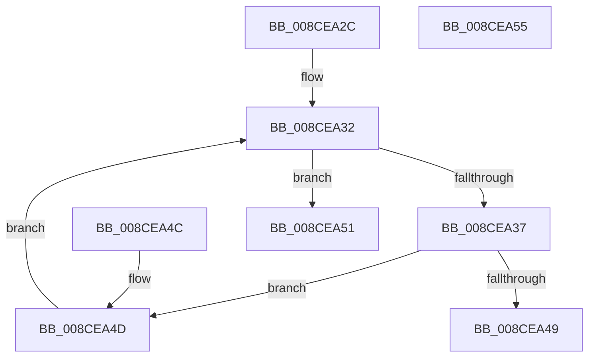

# MiGetImageWowSubsystemIndex

- RVA: `0x008CEA2C`–`0x008CEA56` (길이 `42` bytes)
- VA: `0x00000001408CEA2C`
- 실행 섹션: `PAGE`
- PDB 이름 있음: `예`; PDB Function 태그: `아니요`
- unwind 정보 RVA: `0x000DB714`
- 디코드: `16`개 명령, `42/42` bytes 표시
- 미해석 바이트: `0` (있으면 어셈블리에 `.byte`로 보존)

> 이 문서는 커널 이미지의 기계어와 PDB 기호를 분석해 생성했습니다. 4번과 5번은 함수 원형과 자료형을 바이너리 사용 방식에서 추정한 C 해석이며 원본 소스 복구 결과는 아닙니다.

## 1. Dependencies

- 직접 호출 지점: **0**; 고유 호출 대상: **0**
- 직접 호출자로 확인된 함수: **2**
- RIP 상대 이미지 참조: **1**

### Outgoing calls
- 직접 디코드된 call 명령이 없습니다.

### Direct callers
- [MiUpdateCfgSystemWideBitmap](MiUpdateCfgSystemWideBitmap_function_008CE568.md) at `0x008CE5ED`
- [MiSelectImageBase](../98/MiSelectImageBase_function_009887B0.md) at `0x0098881C`

### Static image references
- `0x008CEA37` → RVA `0x000113E0` (`.rdata`; read)

## 2. Other-region calls and transfers

- 다른 실행 섹션으로 향하는 call: **0**
- 별도 외부 분기/꼬리 이동을 확인하지 못했습니다.

## 3. Assembly (complete function range)

```asm
008CEA2C  4C 8B 41 38                     mov r8, qword ptr [rcx + 0x38]
008CEA30  33 D2                           xor edx, edx
008CEA32  83 FA 01                        cmp edx, 1
008CEA35  73 1A                           jae 0x1408cea51
008CEA37  48 8D 0D A2 29 74 FF            lea rcx, [rip - 0x8bd65e]
008CEA3E  0F B7 04 51                     movzx eax, word ptr [rcx + rdx*2]
008CEA42  66 41 39 40 30                  cmp word ptr [r8 + 0x30], ax
008CEA47  75 04                           jne 0x1408cea4d
008CEA49  8B C2                           mov eax, edx
008CEA4B  C3                              ret
008CEA4C  CC                              int3
008CEA4D  FF C2                           inc edx
008CEA4F  EB E1                           jmp 0x1408cea32
008CEA51  83 C8 FF                        or eax, 0xffffffff
008CEA54  C3                              ret
008CEA55  CC                              int3
```

## 4. C-style interpretation (structured pseudocode)

```c
__int64 __fastcall MiGetImageWowSubsystemIndex(__int64 a1, int a2)
{
    __int64 result;

    a2 = 0;
loc_008CEA32:
    if (0 >= 1) goto loc_008CEA51;
    if ((*(unsigned __int16 *)(*(unsigned __int64 *)(a1 + 56) + 48)) != ((unsigned __int16)(*(unsigned __int16 *)(v_rip - 9164382 + a2 * 2)))) goto loc_008CEA4D;
    return 0;
loc_008CEA4D:
    a2 = (unsigned int)((a2) + 1);
    goto loc_008CEA32;
loc_008CEA51:
    result = (unsigned int)((0) | (0xFFFFFFFFULL));
    return result;
}
```

## 5. (Beta) C Style

```c
int64_t MiGetImageWowSubsystemIndex(void *Arg1, int32_t Arg2)
{
    uint8_t *arg1 = (uint8_t *)Arg1;

    int64_t result;

    Arg2 = 0;
loc_008CEA32:
    if (0 >= 1) goto loc_008CEA51;
    if ((*(uint16_t *)(*(uint64_t *)(arg1 + 0x38) + 0x30)) != ((uint16_t)(*(uint16_t *)(v_rip - 0x8BD65E + Arg2 * 2)))) goto loc_008CEA4D;
    return 0;
loc_008CEA4D:
    Arg2 = (uint32_t)((Arg2) + 1);
    goto loc_008CEA32;
loc_008CEA51:
    result = (uint32_t)((0) | (0xFFFFFFFFULL));
    return result;
}
```

### 관측된 메모리 오프셋

구조체 형식이 확인되지 않은 접근은 인자 기준의 오프셋으로만 기록했습니다.

| 기준 인자 | 오프셋 표현 | 폭 (bit) | 접근 |
|---|---:|---:|---|
| `Arg1` | `+ 0x38` | `64` | `R` |

## 6. Execution-region graph

[열기: 2D/3D 그래프와 함수 탐색 컨트롤 패널](../../../control-panel.html?section=page&rva=0x008CEA2C&view=graph)

- 2D 그래프는 위에서 아래로 흐르고, 3D 그래프는 빈 공간을 드래그해 회전합니다. Shift+드래그는 이동, 휠은 확대·축소, 함수 노드 선택은 대상 보고서 이동입니다.

### Static fallback


