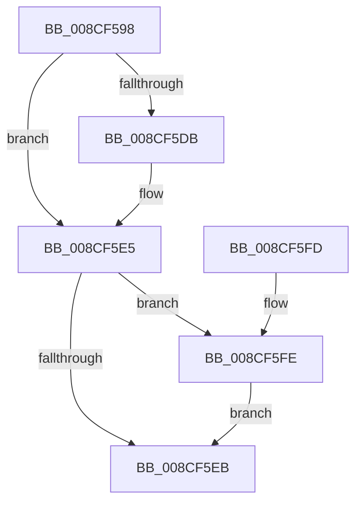

# MiImageCfgEnumRvaListFirst

- RVA: `0x008CF598`–`0x008CF608` (길이 `112` bytes)
- VA: `0x00000001408CF598`
- 실행 섹션: `PAGE`
- PDB 이름 있음: `예`; PDB Function 태그: `아니요`
- unwind 정보 RVA: `0x0005C748`
- 디코드: `35`개 명령, `112/112` bytes 표시
- 미해석 바이트: `0` (있으면 어셈블리에 `.byte`로 보존)

> 이 문서는 커널 이미지의 기계어와 PDB 기호를 분석해 생성했습니다. 4번과 5번은 함수 원형과 자료형을 바이너리 사용 방식에서 추정한 C 해석이며 원본 소스 복구 결과는 아닙니다.

## 1. Dependencies

- 직접 호출 지점: **2**; 고유 호출 대상: **2**
- 직접 호출자로 확인된 함수: **2**
- RIP 상대 이미지 참조: **0**

### Outgoing calls
- `0x008CF5DE` → [RtlGetRvaListIteratorState](RtlGetRvaListIteratorState_function_008CF610.md) (function, `0x008CF610`)
- `0x008CF601` → [MiImageCfgEnumNextImageExtensionRva](../8D/MiImageCfgEnumNextImageExtensionRva_function_008D1860.md) (function, `0x008D1860`)

### Direct callers
- [MiUpdateCfgSystemWideBitmapWorker](MiUpdateCfgSystemWideBitmapWorker_function_008CE650.md) at `0x008CE7F4`
- [MiCopyToCfgBitMap](../8D/MiCopyToCfgBitMap_function_008D1140.md) at `0x008D138C`

### Static image references
- 디코드된 RIP-relative 메모리 참조가 없습니다.

## 2. Other-region calls and transfers

- 다른 실행 섹션으로 향하는 call: **0**
- 별도 외부 분기/꼬리 이동을 확인하지 못했습니다.

## 3. Assembly (complete function range)

```asm
008CF598  48 89 5C 24 08                  mov qword ptr [rsp + 8], rbx
008CF59D  48 89 74 24 10                  mov qword ptr [rsp + 0x10], rsi
008CF5A2  57                              push rdi
008CF5A3  48 83 EC 20                     sub rsp, 0x20
008CF5A7  83 62 18 00                     and dword ptr [rdx + 0x18], 0
008CF5AB  48 8D 7A 08                     lea rdi, [rdx + 8]
008CF5AF  44 89 42 14                     mov dword ptr [rdx + 0x14], r8d
008CF5B3  48 8D 72 04                     lea rsi, [rdx + 4]
008CF5B7  33 C0                           xor eax, eax
008CF5B9  48 8B DA                        mov rbx, rdx
008CF5BC  48 89 07                        mov qword ptr [rdi], rax
008CF5BF  89 47 08                        mov dword ptr [rdi + 8], eax
008CF5C2  21 47 04                        and dword ptr [rdi + 4], eax
008CF5C5  48 8B 41 10                     mov rax, qword ptr [rcx + 0x10]
008CF5C9  44 8B 00                        mov r8d, dword ptr [rax]
008CF5CC  44 89 07                        mov dword ptr [rdi], r8d
008CF5CF  C7 47 08 04 00 00 00            mov dword ptr [rdi + 8], 4
008CF5D6  48 85 F6                        test rsi, rsi
008CF5D9  74 0A                           je 0x1408cf5e5
008CF5DB  48 8B D7                        mov rdx, rdi
008CF5DE  E8 2D 00 00 00                  call 0x1408cf610
008CF5E3  89 06                           mov dword ptr [rsi], eax
008CF5E5  8B 07                           mov eax, dword ptr [rdi]
008CF5E7  85 C0                           test eax, eax
008CF5E9  74 13                           je 0x1408cf5fe
008CF5EB  48 8B 74 24 38                  mov rsi, qword ptr [rsp + 0x38]
008CF5F0  89 03                           mov dword ptr [rbx], eax
008CF5F2  48 8B 5C 24 30                  mov rbx, qword ptr [rsp + 0x30]
008CF5F7  48 83 C4 20                     add rsp, 0x20
008CF5FB  5F                              pop rdi
008CF5FC  C3                              ret
008CF5FD  CC                              int3
008CF5FE  48 8B CB                        mov rcx, rbx
008CF601  E8 5A 22 00 00                  call 0x1408d1860
008CF606  EB E3                           jmp 0x1408cf5eb
```

## 4. C-style interpretation (structured pseudocode)

```c
__int64 __fastcall MiImageCfgEnumRvaListFirst(__int64 a1, __int64 a2, int a3)
{
    __int64 result;
    __int64 v_rsp;
    unsigned __int64 v_stack_p10;
    unsigned __int64 v_stack_p8;

    v_stack_p8 = v_rbx;
    v_stack_p10 = v_rsi;
    v_rsp = (v_rsp) - (32);
    *(unsigned int *)(a2 + 20) = a3;
    result = 0;
    *(unsigned __int64 *)(a2 + 8) = 0;
    *(unsigned int *)(a2 + 8 + 8) = 0;
    *(unsigned int *)(a2 + 8) = (unsigned int)((unsigned int)(*(unsigned int *)(*(unsigned __int64 *)(a1 + 16))));
    *(unsigned int *)(a2 + 8 + 8) = 4;
    result = *(unsigned __int64 *)(a1 + 16);
    if (a2 + 4 != 0) {
        a2 = a2 + 8;
        result = RtlGetRvaListIteratorState(a1, a2, (unsigned int)(*(unsigned int *)(*(unsigned __int64 *)(a1 + 16))), a4);
        *(unsigned int *)(a2 + 4) = (unsigned int)(result);
    }
    if ((unsigned int)((unsigned int)(*(unsigned int *)(a2 + 8))) == 0) goto loc_008CF5FE;
loc_008CF5EB:
    *(unsigned int *)(a2) = (unsigned int)((unsigned int)(*(unsigned int *)(a2 + 8)));
    v_rsp = (v_rsp) + (32);
    return (unsigned int)(*(unsigned int *)(a2 + 8));
loc_008CF5FE:
    result = MiImageCfgEnumNextImageExtensionRva(v_stack_p8, a2, (unsigned int)(*(unsigned int *)(*(unsigned __int64 *)(a1 + 16))), a4);
    goto loc_008CF5EB;
}
```

## 5. (Beta) C Style

```c
int64_t MiImageCfgEnumRvaListFirst(void *Arg1, void *Arg2, int32_t Arg3)
{
    uint8_t *arg1 = (uint8_t *)Arg1;
    uint8_t *arg2 = (uint8_t *)Arg2;

    int64_t result;
    int64_t local_rsp;
    uint64_t v_stack_p10;
    uint64_t v_stack_p8;

    v_stack_p8 = local_rbx;
    v_stack_p10 = local_rsi;
    local_rsp = (local_rsp) - (32);
    *(uint32_t *)(arg2 + 0x14) = Arg3;
    result = 0;
    *(uint64_t *)(arg2 + 0x8) = 0;
    *(uint32_t *)(arg2 + 0x8 + 0x8) = 0;
    *(uint32_t *)(arg2 + 0x8) = (uint32_t)((uint32_t)(*(uint32_t *)(*(uint64_t *)(arg1 + 0x10))));
    *(uint32_t *)(arg2 + 0x8 + 0x8) = 4;
    result = *(uint64_t *)(arg1 + 0x10);
    if (Arg2 + 4 != 0) {
        Arg2 = Arg2 + 8;
        result = RtlGetRvaListIteratorState(Arg1, Arg2, (uint32_t)(*(uint32_t *)(*(uint64_t *)(arg1 + 0x10))), a4);
        *(uint32_t *)(arg2 + 0x4) = (uint32_t)(result);
    }
    if ((uint32_t)((uint32_t)(*(uint32_t *)(arg2 + 0x8))) == 0) goto loc_008CF5FE;
loc_008CF5EB:
    *(uint32_t *)(arg2) = (uint32_t)((uint32_t)(*(uint32_t *)(arg2 + 0x8)));
    local_rsp = (local_rsp) + (32);
    return (uint32_t)(*(uint32_t *)(arg2 + 0x8));
loc_008CF5FE:
    result = MiImageCfgEnumNextImageExtensionRva(v_stack_p8, Arg2, (uint32_t)(*(uint32_t *)(*(uint64_t *)(arg1 + 0x10))), a4);
    goto loc_008CF5EB;
}
```

### 관측된 메모리 오프셋

구조체 형식이 확인되지 않은 접근은 인자 기준의 오프셋으로만 기록했습니다.

| 기준 인자 | 오프셋 표현 | 폭 (bit) | 접근 |
|---|---:|---:|---|
| `Arg1` | `+ 0x10` | `64` | `R` |
| `Arg2` | `+ 0x0` | `32` | `R` |
| `Arg2` | `+ 0x0` | `32` | `W` |
| `Arg2` | `+ 0x0` | `64` | `W` |
| `Arg2` | `+ 0x4` | `32` | `R/W` |
| `Arg2` | `+ 0x4` | `64` | `R` |
| `Arg2` | `+ 0x8` | `32` | `W` |
| `Arg2` | `+ 0x8` | `64` | `R` |
| `Arg2` | `+ 0x14` | `32` | `W` |
| `Arg2` | `+ 0x18` | `32` | `R/W` |

## 6. Execution-region graph

[열기: 2D/3D 그래프와 함수 탐색 컨트롤 패널](../../../control-panel.html?section=page&rva=0x008CF598&view=graph)

- 2D 그래프는 위에서 아래로 흐르고, 3D 그래프는 빈 공간을 드래그해 회전합니다. Shift+드래그는 이동, 휠은 확대·축소, 함수 노드 선택은 대상 보고서 이동입니다.

### Static fallback


