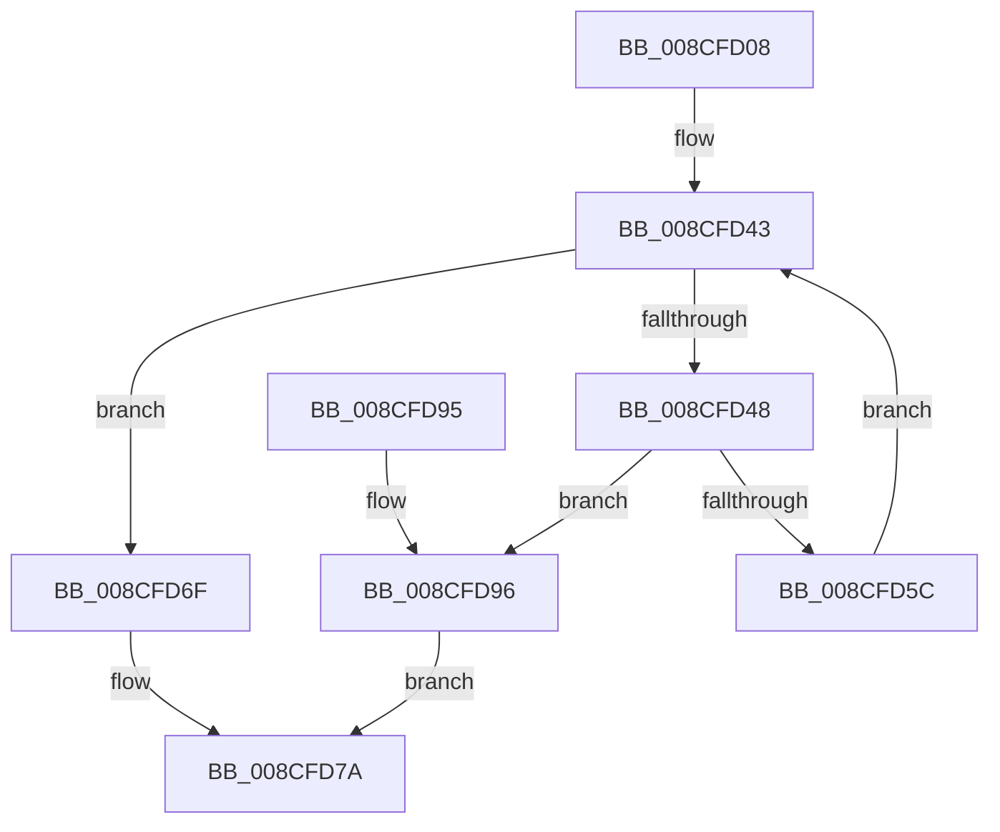

# MiInsertProcessVads

- RVA: `0x008CFD08`–`0x008CFDAB` (길이 `163` bytes)
- VA: `0x00000001408CFD08`
- 실행 섹션: `PAGE`
- PDB 이름 있음: `예`; PDB Function 태그: `아니요`
- unwind 정보 RVA: `0x000849C0`
- 디코드: `49`개 명령, `163/163` bytes 표시
- 미해석 바이트: `0` (있으면 어셈블리에 `.byte`로 보존)

> 이 문서는 커널 이미지의 기계어와 PDB 기호를 분석해 생성했습니다. 4번과 5번은 함수 원형과 자료형을 바이너리 사용 방식에서 추정한 C 해석이며 원본 소스 복구 결과는 아닙니다.

## 1. Dependencies

- 직접 호출 지점: **6**; 고유 호출 대상: **5**
- 직접 호출자로 확인된 함수: **2**
- RIP 상대 이미지 참조: **0**

### Outgoing calls
- `0x008CFD3E` → [LOCK_ADDRESS_SPACE](../../text/2A/LOCK_ADDRESS_SPACE_function_002A4944.md) (function, `0x002A4944`)
- `0x008CFD51` → [MiInsertVadCharges](../88/MiInsertVadCharges_function_00886AA8.md) (function, `0x00886AA8`)
- `0x008CFD65` → [MiInsertVad](../../text/26/MiInsertVad_function_00265540.md) (function, `0x00265540`)
- `0x008CFD75` → [UNLOCK_ADDRESS_SPACE](../../text/2A/UNLOCK_ADDRESS_SPACE_function_002A4844.md) (function, `0x002A4844`)
- `0x008CFD9C` → [UNLOCK_ADDRESS_SPACE](../../text/2A/UNLOCK_ADDRESS_SPACE_function_002A4844.md) (function, `0x002A4844`)
- `0x008CFDA4` → [MiReturnProcessVads](MiReturnProcessVads_function_008CF54C.md) (function, `0x008CF54C`)

### Direct callers
- [MmInitializeProcessAddressSpace](MmInitializeProcessAddressSpace_function_008CF6B0.md) at `0x008CF853`
- [MmInitializeHandBuiltProcess2](../AC/MmInitializeHandBuiltProcess2_function_00AC1138.md) at `0x00AC11B4`

### Static image references
- 디코드된 RIP-relative 메모리 참조가 없습니다.

## 2. Other-region calls and transfers

- 다른 실행 섹션으로 향하는 call: **4**
  - `0x008CFD3E` → [LOCK_ADDRESS_SPACE](../../text/2A/LOCK_ADDRESS_SPACE_function_002A4944.md) (`PAGE` → `.text`)
  - `0x008CFD65` → [MiInsertVad](../../text/26/MiInsertVad_function_00265540.md) (`PAGE` → `.text`)
  - `0x008CFD75` → [UNLOCK_ADDRESS_SPACE](../../text/2A/UNLOCK_ADDRESS_SPACE_function_002A4844.md) (`PAGE` → `.text`)
  - `0x008CFD9C` → [UNLOCK_ADDRESS_SPACE](../../text/2A/UNLOCK_ADDRESS_SPACE_function_002A4844.md) (`PAGE` → `.text`)
- 별도 외부 분기/꼬리 이동을 확인하지 못했습니다.

## 3. Assembly (complete function range)

```asm
008CFD08  48 89 5C 24 08                  mov qword ptr [rsp + 8], rbx
008CFD0D  48 89 6C 24 10                  mov qword ptr [rsp + 0x10], rbp
008CFD12  48 89 74 24 18                  mov qword ptr [rsp + 0x18], rsi
008CFD17  57                              push rdi
008CFD18  41 56                           push r14
008CFD1A  41 57                           push r15
008CFD1C  48 83 EC 20                     sub rsp, 0x20
008CFD20  65 48 8B 34 25 88 01 00 00      mov rsi, qword ptr gs:[0x188]
008CFD29  48 8B DA                        mov rbx, rdx
008CFD2C  4C 8B F1                        mov r14, rcx
008CFD2F  33 FF                           xor edi, edi
008CFD31  48 8B CE                        mov rcx, rsi
008CFD34  48 8B AE B8 00 00 00            mov rbp, qword ptr [rsi + 0xb8]
008CFD3B  48 8B D5                        mov rdx, rbp
008CFD3E  E8 01 4C 9D FF                  call 0x1402a4944
008CFD43  48 85 DB                        test rbx, rbx
008CFD46  74 27                           je 0x1408cfd6f
008CFD48  4C 8B 3B                        mov r15, qword ptr [rbx]
008CFD4B  49 8B D6                        mov rdx, r14
008CFD4E  48 8B CB                        mov rcx, rbx
008CFD51  E8 52 6D FB FF                  call 0x140886aa8
008CFD56  8B F8                           mov edi, eax
008CFD58  85 C0                           test eax, eax
008CFD5A  78 3A                           js 0x1408cfd96
008CFD5C  45 33 C0                        xor r8d, r8d
008CFD5F  49 8B D6                        mov rdx, r14
008CFD62  48 8B CB                        mov rcx, rbx
008CFD65  E8 D6 57 99 FF                  call 0x140265540
008CFD6A  49 8B DF                        mov rbx, r15
008CFD6D  EB D4                           jmp 0x1408cfd43
008CFD6F  48 8B D5                        mov rdx, rbp
008CFD72  48 8B CE                        mov rcx, rsi
008CFD75  E8 CA 4A 9D FF                  call 0x1402a4844
008CFD7A  48 8B 5C 24 40                  mov rbx, qword ptr [rsp + 0x40]
008CFD7F  8B C7                           mov eax, edi
008CFD81  48 8B 6C 24 48                  mov rbp, qword ptr [rsp + 0x48]
008CFD86  48 8B 74 24 50                  mov rsi, qword ptr [rsp + 0x50]
008CFD8B  48 83 C4 20                     add rsp, 0x20
008CFD8F  41 5F                           pop r15
008CFD91  41 5E                           pop r14
008CFD93  5F                              pop rdi
008CFD94  C3                              ret
008CFD95  CC                              int3
008CFD96  48 8B D5                        mov rdx, rbp
008CFD99  48 8B CE                        mov rcx, rsi
008CFD9C  E8 A3 4A 9D FF                  call 0x1402a4844
008CFDA1  48 8B CB                        mov rcx, rbx
008CFDA4  E8 A3 F7 FF FF                  call 0x1408cf54c
008CFDA9  EB CF                           jmp 0x1408cfd7a
```

## 4. C-style interpretation (structured pseudocode)

```c
__int64 __fastcall MiInsertProcessVads(__int64 a1, __int64 a2, int a3)
{
    __int64 result;
    __int64 v_rdi;
    __int64 v_rsp;
    unsigned __int64 v_stack_p10;
    unsigned __int64 v_stack_p18;
    unsigned __int64 v_stack_p8;

    v_stack_p8 = v_rbx;
    v_stack_p10 = v_rbp;
    v_stack_p18 = v_rsi;
    v_rsp = (v_rsp) - (32);
    v_rdi = 0;
    result = LOCK_ADDRESS_SPACE(*(unsigned __int64 *)(gs_base + (0 + 392)), *(unsigned __int64 *)(*(unsigned __int64 *)(gs_base + (0 + 392)) + 184), a3, a4);
loc_008CFD43:
    if (a2 == 0) goto loc_008CFD6F;
    result = MiInsertVadCharges(a2, a1, a3, a4);
    if (sign_flag) goto loc_008CFD96;
    a3 = 0;
    result = MiInsertVad(a2, a1, a3, a4);
    goto loc_008CFD43;
loc_008CFD6F:
    result = UNLOCK_ADDRESS_SPACE(*(unsigned __int64 *)(gs_base + (0 + 392)), *(unsigned __int64 *)(*(unsigned __int64 *)(gs_base + (0 + 392)) + 184), a3, a4);
loc_008CFD7A:
    v_rsp = (v_rsp) + (32);
    return (unsigned int)((unsigned int)((unsigned int)((unsigned int)(result))));
loc_008CFD96:
    result = UNLOCK_ADDRESS_SPACE(v_stack_p18, v_stack_p10, a3, a4);
    result = MiReturnProcessVads(v_stack_p8, v_stack_p10, a3, a4);
    goto loc_008CFD7A;
}
```

## 5. (Beta) C Style

```c
int64_t MiInsertProcessVads(int64_t Arg1, int64_t Arg2, int32_t Arg3)
{
    int64_t result;
    int64_t local_rdi;
    int64_t local_rsp;
    uint64_t v_stack_p10;
    uint64_t v_stack_p18;
    uint64_t v_stack_p8;

    v_stack_p8 = local_rbx;
    v_stack_p10 = local_rbp;
    v_stack_p18 = local_rsi;
    local_rsp = (local_rsp) - (32);
    local_rdi = 0;
    result = LOCK_ADDRESS_SPACE(*(uint64_t *)(gs_base + (0 + 0x188)), *(uint64_t *)(*(uint64_t *)(gs_base + (0 + 0x188)) + 0xB8), Arg3, a4);
loc_008CFD43:
    if (Arg2 == 0) goto loc_008CFD6F;
    result = MiInsertVadCharges(Arg2, Arg1, Arg3, a4);
    if (sign_flag) goto loc_008CFD96;
    Arg3 = 0;
    result = MiInsertVad(Arg2, Arg1, Arg3, a4);
    goto loc_008CFD43;
loc_008CFD6F:
    result = UNLOCK_ADDRESS_SPACE(*(uint64_t *)(gs_base + (0 + 0x188)), *(uint64_t *)(*(uint64_t *)(gs_base + (0 + 0x188)) + 0xB8), Arg3, a4);
loc_008CFD7A:
    local_rsp = (local_rsp) + (32);
    return (uint32_t)((uint32_t)((uint32_t)((uint32_t)(result))));
loc_008CFD96:
    result = UNLOCK_ADDRESS_SPACE(v_stack_p18, v_stack_p10, Arg3, a4);
    result = MiReturnProcessVads(v_stack_p8, v_stack_p10, Arg3, a4);
    goto loc_008CFD7A;
}
```

## 6. Execution-region graph

[열기: 2D/3D 그래프와 함수 탐색 컨트롤 패널](../../../control-panel.html?section=page&rva=0x008CFD08&view=graph)

- 2D 그래프는 위에서 아래로 흐르고, 3D 그래프는 빈 공간을 드래그해 회전합니다. Shift+드래그는 이동, 휠은 확대·축소, 함수 노드 선택은 대상 보고서 이동입니다.

### Static fallback


