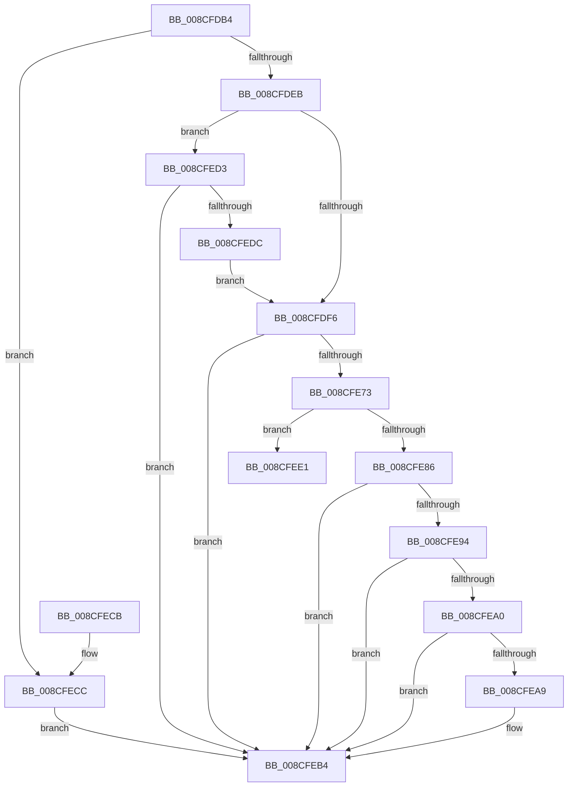

# MiMapProcessExecutable

- RVA: `0x008CFDB4`–`0x008CFEF0` (길이 `316` bytes)
- VA: `0x00000001408CFDB4`
- 실행 섹션: `PAGE`
- PDB 이름 있음: `예`; PDB Function 태그: `예`
- unwind 정보 RVA: `0x000849DC`
- 디코드: `87`개 명령, `316/316` bytes 표시
- 미해석 바이트: `0` (있으면 어셈블리에 `.byte`로 보존)

> 이 문서는 커널 이미지의 기계어와 PDB 기호를 분석해 생성했습니다. 4번과 5번은 함수 원형과 자료형을 바이너리 사용 방식에서 추정한 C 해석이며 원본 소스 복구 결과는 아닙니다.

## 1. Dependencies

- 직접 호출 지점: **7**; 고유 호출 대상: **7**
- 직접 호출자로 확인된 함수: **1**
- RIP 상대 이미지 참조: **0**

### Outgoing calls
- `0x008CFE67` → [MmMapViewOfSectionEx](../../text/48/MmMapViewOfSectionEx_function_0048E244.md) (function, `0x0048E244`)
- `0x008CFE8B` → [PsMapSystemDlls](PsMapSystemDlls_function_008CFFA0.md) (function, `0x008CFFA0`)
- `0x008CFE97` → [MiCfgInitializeProcess](../8D/MiCfgInitializeProcess_function_008D0364.md) (function, `0x008D0364`)
- `0x008CFEA0` → [MiCommitInitialVadMetadataBits](../8D/MiCommitInitialVadMetadataBits_function_008D09CC.md) (function, `0x008D09CC`)
- `0x008CFEAC` → [MiMapAllImageScpPages](../8D/MiMapAllImageScpPages_function_008D0534.md) (function, `0x008D0534`)
- `0x008CFED3` → [PsSessionCreate](../70/PsSessionCreate_function_00700438.md) (function, `0x00700438`)
- `0x008CFEE5` → [MiFillPteHierarchy](../../text/3F/MiFillPteHierarchy_function_003F7F90.md) (function, `0x003F7F90`)

### Direct callers
- [MmInitializeProcessAddressSpace](MmInitializeProcessAddressSpace_function_008CF6B0.md) at `0x008CF879`

### Static image references
- 디코드된 RIP-relative 메모리 참조가 없습니다.

## 2. Other-region calls and transfers

- 다른 실행 섹션으로 향하는 call: **2**
  - `0x008CFE67` → [MmMapViewOfSectionEx](../../text/48/MmMapViewOfSectionEx_function_0048E244.md) (`PAGE` → `.text`)
  - `0x008CFEE5` → [MiFillPteHierarchy](../../text/3F/MiFillPteHierarchy_function_003F7F90.md) (`PAGE` → `.text`)
- call이 아닌 외부 분기/꼬리 이동: **1**
  - `0x008CFEEB` → [sub_00B1B8C2](../B1/Unknown_function_00B1B8C2.md) (`tail-transfer`)

## 3. Assembly (complete function range)

```asm
008CFDB4  48 89 5C 24 08                  mov qword ptr [rsp + 8], rbx
008CFDB9  55                              push rbp
008CFDBA  56                              push rsi
008CFDBB  57                              push rdi
008CFDBC  41 56                           push r14
008CFDBE  41 57                           push r15
008CFDC0  48 8D 6C 24 C9                  lea rbp, [rsp - 0x37]
008CFDC5  48 81 EC B0 00 00 00            sub rsp, 0xb0
008CFDCC  8B 42 38                        mov eax, dword ptr [rdx + 0x38]
008CFDCF  0F 57 C0                        xorps xmm0, xmm0
008CFDD2  49 8B D8                        mov rbx, r8
008CFDD5  48 8B FA                        mov rdi, rdx
008CFDD8  48 8B F1                        mov rsi, rcx
008CFDDB  0F 11 45 0F                     movups xmmword ptr [rbp + 0xf], xmm0
008CFDDF  0F 11 45 1F                     movups xmmword ptr [rbp + 0x1f], xmm0
008CFDE3  A8 20                           test al, 0x20
008CFDE5  0F 84 E1 00 00 00               je 0x1408cfecc
008CFDEB  41 8B 00                        mov eax, dword ptr [r8]
008CFDEE  84 C0                           test al, al
008CFDF0  0F 88 DD 00 00 00               js 0x1408cfed3
008CFDF6  8B 03                           mov eax, dword ptr [rbx]
008CFDF8  48 8D 4D FF                     lea rcx, [rbp - 1]
008CFDFC  48 83 65 7F 00                  and qword ptr [rbp + 0x7f], 0
008CFE01  4C 8D 4D F7                     lea r9, [rbp - 9]
008CFE05  48 83 65 6F 00                  and qword ptr [rbp + 0x6f], 0
008CFE0A  4C 8D 45 6F                     lea r8, [rbp + 0x6f]
008CFE0E  48 83 65 F7 00                  and qword ptr [rbp - 9], 0
008CFE13  83 E0 10                        and eax, 0x10
008CFE16  C7 44 24 60 00 00 00 02         mov dword ptr [rsp + 0x60], 0x2000000
008CFE1E  41 BE 04 00 00 00               mov r14d, 4
008CFE24  48 83 64 24 50 00               and qword ptr [rsp + 0x50], 0
008CFE2A  48 8B D6                        mov rdx, rsi
008CFE2D  83 64 24 48 00                  and dword ptr [rsp + 0x48], 0
008CFE32  C7 44 24 40 01 00 00 00         mov dword ptr [rsp + 0x40], 1
008CFE3A  48 89 4C 24 38                  mov qword ptr [rsp + 0x38], rcx
008CFE3F  48 8B CF                        mov rcx, rdi
008CFE42  C1 E0 19                        shl eax, 0x19
008CFE45  44 89 74 24 30                  mov dword ptr [rsp + 0x30], r14d
008CFE4A  89 44 24 28                     mov dword ptr [rsp + 0x28], eax
008CFE4E  48 8D 45 7F                     lea rax, [rbp + 0x7f]
008CFE52  48 89 44 24 20                  mov qword ptr [rsp + 0x20], rax
008CFE57  48 C7 45 FF 05 00 00 00         mov qword ptr [rbp - 1], 5
008CFE5F  48 C7 45 07 20 00 00 00         mov qword ptr [rbp + 7], 0x20
008CFE67  E8 D8 E3 BB FF                  call 0x14048e244
008CFE6C  44 8B F8                        mov r15d, eax
008CFE6F  85 C0                           test eax, eax
008CFE71  78 41                           js 0x1408cfeb4
008CFE73  48 8B 4D 6F                     mov rcx, qword ptr [rbp + 0x6f]
008CFE77  33 FF                           xor edi, edi
008CFE79  48 89 8E B0 02 00 00            mov qword ptr [rsi + 0x2b0], rcx
008CFE80  8B 03                           mov eax, dword ptr [rbx]
008CFE82  A8 10                           test al, 0x10
008CFE84  75 5B                           jne 0x1408cfee1
008CFE86  8B D7                           mov edx, edi
008CFE88  48 8B CE                        mov rcx, rsi
008CFE8B  E8 10 01 00 00                  call 0x1408cffa0
008CFE90  85 C0                           test eax, eax
008CFE92  78 20                           js 0x1408cfeb4
008CFE94  48 8B CE                        mov rcx, rsi
008CFE97  E8 C8 04 00 00                  call 0x1408d0364
008CFE9C  85 C0                           test eax, eax
008CFE9E  78 14                           js 0x1408cfeb4
008CFEA0  E8 27 0B 00 00                  call 0x1408d09cc
008CFEA5  85 C0                           test eax, eax
008CFEA7  78 0B                           js 0x1408cfeb4
008CFEA9  48 8B CE                        mov rcx, rsi
008CFEAC  E8 83 06 00 00                  call 0x1408d0534
008CFEB1  41 8B C7                        mov eax, r15d
008CFEB4  48 8B 9C 24 E0 00 00 00         mov rbx, qword ptr [rsp + 0xe0]
008CFEBC  48 81 C4 B0 00 00 00            add rsp, 0xb0
008CFEC3  41 5F                           pop r15
008CFEC5  41 5E                           pop r14
008CFEC7  5F                              pop rdi
008CFEC8  5E                              pop rsi
008CFEC9  5D                              pop rbp
008CFECA  C3                              ret
008CFECB  CC                              int3
008CFECC  B8 49 00 00 C0                  mov eax, 0xc0000049
008CFED1  EB E1                           jmp 0x1408cfeb4
008CFED3  E8 60 05 E3 FF                  call 0x140700438
008CFED8  85 C0                           test eax, eax
008CFEDA  78 D8                           js 0x1408cfeb4
008CFEDC  E9 15 FF FF FF                  jmp 0x1408cfdf6
008CFEE1  48 8D 55 0F                     lea rdx, [rbp + 0xf]
008CFEE5  E8 A6 80 B2 FF                  call 0x1403f7f90
008CFEEA  90                              nop
008CFEEB  E9 D2 B9 24 00                  jmp 0x140b1b8c2
```

## 4. C-style interpretation (structured pseudocode)

```c
__int64 __fastcall MiMapProcessExecutable(__int64 a1, __int64 a2, __int64 a3)
{
    __int64 result;
    __int64 v_rdi;
    __int64 v_rsp;
    unsigned __int64 v_stack_m40;
    unsigned __int64 v_stack_m50;
    unsigned __int64 v_stack_m58;
    unsigned __int64 v_stack_m5F;
    unsigned __int64 v_stack_m60;
    unsigned __int64 v_stack_m68;
    unsigned int v_stack_m78;
    unsigned __int64 v_stack_m88;
    unsigned int v_stack_m90;
    unsigned int v_stack_m98;
    unsigned __int64 v_stack_mA0;
    unsigned int v_stack_mA8;
    unsigned int v_stack_mB0;
    unsigned __int64 v_stack_mB8;
    unsigned __int64 v_stack_p10;
    unsigned __int64 v_stack_p20;
    unsigned __int64 v_stack_p8;

    v_stack_p8 = v_rbx;
    v_rsp = (v_rsp) - (176);
    v_stack_m50 = v_xmm0;
    v_stack_m40 = v_xmm0;
    if ((((unsigned __int8)((unsigned int)(*(unsigned int *)(a2 + 56)))) & (32)) == 0) goto loc_008CFECC;
    if (sign_flag) goto loc_008CFED3;
loc_008CFDF6:
    result = (unsigned int)(((unsigned int)(*(unsigned int *)(a3))) & (16));
    v_stack_m78 = 0x2000000ULL;
    v_stack_m98 = 1;
    v_stack_mA0 = v_stack_m60;
    result = (unsigned int)((result) << (25));
    v_stack_mA8 = 4;
    v_stack_mB0 = (unsigned int)(result);
    v_stack_mB8 = v_stack_p20;
    v_stack_m60 = 5;
    v_stack_m58 = 32;
    result = MmMapViewOfSectionEx(a2, a1, v_stack_p10, v_stack_m68);
    if (sign_flag) goto loc_008CFEB4;
    v_rdi = 0;
    *(unsigned __int64 *)(a1 + 688) = v_stack_p10;
    if ((((unsigned __int8)((unsigned int)(*(unsigned int *)(a3)))) & (16)) != 0) goto loc_008CFEE1;
    result = PsMapSystemDlls(a1, 0, v_stack_p10, v_stack_m68);
    if (sign_flag) goto loc_008CFEB4;
    result = MiCfgInitializeProcess(a1, 0, v_stack_p10, v_stack_m68);
    if (sign_flag) goto loc_008CFEB4;
    result = MiCommitInitialVadMetadataBits(a1, 0, v_stack_p10, v_stack_m68);
    if (!(sign_flag)) {
        a1 = a1;
        result = MiMapAllImageScpPages(a1, 0, v_stack_p10, v_stack_m68);
        result = (unsigned int)((unsigned int)((unsigned int)(result)));
    }
    v_rsp = (v_rsp) + (176);
    return result;
loc_008CFECC:
    goto loc_008CFEB4;
loc_008CFED3:
    result = PsSessionCreate(a1, 0, v_stack_p10, v_stack_m68);
    if (sign_flag) goto loc_008CFEB4;
    goto loc_008CFDF6;
loc_008CFEE1:
    result = MiFillPteHierarchy(a1, v_stack_m50, v_stack_p10, v_stack_m68);
}
```

## 5. (Beta) C Style

```c
int64_t MiMapProcessExecutable(void *Arg1, void *Arg2, void *Arg3)
{
    uint8_t *arg1 = (uint8_t *)Arg1;
    uint8_t *arg2 = (uint8_t *)Arg2;
    uint8_t *arg3 = (uint8_t *)Arg3;

    int64_t result;
    int64_t local_rdi;
    int64_t local_rsp;
    uint64_t v_stack_m40;
    uint64_t v_stack_m50;
    uint64_t v_stack_m58;
    uint64_t v_stack_m5F;
    uint64_t v_stack_m60;
    uint64_t v_stack_m68;
    uint32_t v_stack_m78;
    uint64_t v_stack_m88;
    uint32_t v_stack_m90;
    uint32_t v_stack_m98;
    uint64_t v_stack_mA0;
    uint32_t v_stack_mA8;
    uint32_t v_stack_mB0;
    uint64_t v_stack_mB8;
    uint64_t v_stack_p10;
    uint64_t v_stack_p20;
    uint64_t v_stack_p8;

    v_stack_p8 = local_rbx;
    local_rsp = (local_rsp) - (176);
    v_stack_m50 = v_xmm0;
    v_stack_m40 = v_xmm0;
    if ((((uint8_t)((uint32_t)(*(uint32_t *)(arg2 + 0x38)))) & (32)) == 0) goto loc_008CFECC;
    if (sign_flag) goto loc_008CFED3;
loc_008CFDF6:
    result = (uint32_t)(((uint32_t)(*(uint32_t *)(arg3))) & (16));
    v_stack_m78 = 0x2000000ULL;
    v_stack_m98 = 1;
    v_stack_mA0 = v_stack_m60;
    result = (uint32_t)((result) << (25));
    v_stack_mA8 = 4;
    v_stack_mB0 = (uint32_t)(result);
    v_stack_mB8 = v_stack_p20;
    v_stack_m60 = 5;
    v_stack_m58 = 32;
    result = MmMapViewOfSectionEx(Arg2, Arg1, v_stack_p10, v_stack_m68);
    if (sign_flag) goto loc_008CFEB4;
    local_rdi = 0;
    *(uint64_t *)(arg1 + 0x2B0) = v_stack_p10;
    if ((((uint8_t)((uint32_t)(*(uint32_t *)(arg3)))) & (16)) != 0) goto loc_008CFEE1;
    result = PsMapSystemDlls(Arg1, 0, v_stack_p10, v_stack_m68);
    if (sign_flag) goto loc_008CFEB4;
    result = MiCfgInitializeProcess(Arg1, 0, v_stack_p10, v_stack_m68);
    if (sign_flag) goto loc_008CFEB4;
    result = MiCommitInitialVadMetadataBits(Arg1, 0, v_stack_p10, v_stack_m68);
    if (!(sign_flag)) {
        Arg1 = Arg1;
        result = MiMapAllImageScpPages(Arg1, 0, v_stack_p10, v_stack_m68);
        result = (uint32_t)((uint32_t)((uint32_t)(result)));
    }
    local_rsp = (local_rsp) + (176);
    return result;
loc_008CFECC:
    goto loc_008CFEB4;
loc_008CFED3:
    result = PsSessionCreate(Arg1, 0, v_stack_p10, v_stack_m68);
    if (sign_flag) goto loc_008CFEB4;
    goto loc_008CFDF6;
loc_008CFEE1:
    result = MiFillPteHierarchy(Arg1, v_stack_m50, v_stack_p10, v_stack_m68);
}
```

### 관측된 메모리 오프셋

구조체 형식이 확인되지 않은 접근은 인자 기준의 오프셋으로만 기록했습니다.

| 기준 인자 | 오프셋 표현 | 폭 (bit) | 접근 |
|---|---:|---:|---|
| `Arg1` | `+ 0x2B0` | `64` | `W` |
| `Arg2` | `+ 0x38` | `32` | `R` |
| `Arg3` | `+ 0x0` | `32` | `R` |

## 6. Execution-region graph

[열기: 2D/3D 그래프와 함수 탐색 컨트롤 패널](../../../control-panel.html?section=page&rva=0x008CFDB4&view=graph)

- 2D 그래프는 위에서 아래로 흐르고, 3D 그래프는 빈 공간을 드래그해 회전합니다. Shift+드래그는 이동, 휠은 확대·축소, 함수 노드 선택은 대상 보고서 이동입니다.

### Static fallback


