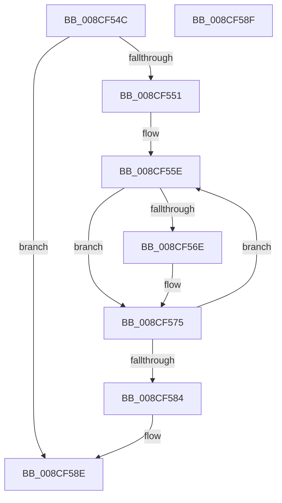

# MiReturnProcessVads

- RVA: `0x008CF54C`–`0x008CF590` (길이 `68` bytes)
- VA: `0x00000001408CF54C`
- 실행 섹션: `PAGE`
- PDB 이름 있음: `예`; PDB Function 태그: `아니요`
- unwind 정보 RVA: `0x00084918`
- 디코드: `23`개 명령, `68/68` bytes 표시
- 미해석 바이트: `0` (있으면 어셈블리에 `.byte`로 보존)

> 이 문서는 커널 이미지의 기계어와 PDB 기호를 분석해 생성했습니다. 4번과 5번은 함수 원형과 자료형을 바이너리 사용 방식에서 추정한 C 해석이며 원본 소스 복구 결과는 아닙니다.

## 1. Dependencies

- 직접 호출 지점: **2**; 고유 호출 대상: **1**
- 직접 호출자로 확인된 함수: **3**
- RIP 상대 이미지 참조: **0**

### Outgoing calls
- `0x008CF570` → [ExFreePoolWithTag](../../poolcode/B8/ExFreePoolWithTag_function_00B82870.md) (function, `0x00B82870`)
- `0x008CF57A` → [ExFreePoolWithTag](../../poolcode/B8/ExFreePoolWithTag_function_00B82870.md) (function, `0x00B82870`)

### Direct callers
- [MmInitializeProcessAddressSpace](MmInitializeProcessAddressSpace_function_008CF6B0.md) at `0x008CFB16`
- [MiInsertProcessVads](MiInsertProcessVads_function_008CFD08.md) at `0x008CFDA4`
- [MiAllocateProcessVads](MiAllocateProcessVads_function_008CFEF8.md) at `0x008CFF6F`

### Static image references
- 디코드된 RIP-relative 메모리 참조가 없습니다.

## 2. Other-region calls and transfers

- 다른 실행 섹션으로 향하는 call: **2**
  - `0x008CF570` → [ExFreePoolWithTag](../../poolcode/B8/ExFreePoolWithTag_function_00B82870.md) (`PAGE` → `POOLCODE`)
  - `0x008CF57A` → [ExFreePoolWithTag](../../poolcode/B8/ExFreePoolWithTag_function_00B82870.md) (`PAGE` → `POOLCODE`)
- 별도 외부 분기/꼬리 이동을 확인하지 못했습니다.

## 3. Assembly (complete function range)

```asm
008CF54C  48 85 C9                        test rcx, rcx
008CF54F  74 3D                           je 0x1408cf58e
008CF551  48 89 5C 24 08                  mov qword ptr [rsp + 8], rbx
008CF556  57                              push rdi
008CF557  48 83 EC 20                     sub rsp, 0x20
008CF55B  48 8B D9                        mov rbx, rcx
008CF55E  48 8B FB                        mov rdi, rbx
008CF561  48 8B 1B                        mov rbx, qword ptr [rbx]
008CF564  48 8B 4F 38                     mov rcx, qword ptr [rdi + 0x38]
008CF568  48 83 E1 F0                     and rcx, 0xfffffffffffffff0
008CF56C  74 07                           je 0x1408cf575
008CF56E  33 D2                           xor edx, edx
008CF570  E8 FB 32 2B 00                  call 0x140b82870
008CF575  33 D2                           xor edx, edx
008CF577  48 8B CF                        mov rcx, rdi
008CF57A  E8 F1 32 2B 00                  call 0x140b82870
008CF57F  48 85 DB                        test rbx, rbx
008CF582  75 DA                           jne 0x1408cf55e
008CF584  48 8B 5C 24 30                  mov rbx, qword ptr [rsp + 0x30]
008CF589  48 83 C4 20                     add rsp, 0x20
008CF58D  5F                              pop rdi
008CF58E  C3                              ret
008CF58F  CC                              int3
```

## 4. C-style interpretation (structured pseudocode)

```c
__int64 __fastcall MiReturnProcessVads(__int64 a1, int a2)
{
    __int64 result;
    __int64 v_rsp;
    unsigned __int64 v_stack_p8;

    if (a1 == 0) goto loc_008CF58E;
    v_stack_p8 = v_rbx;
    v_rsp = (v_rsp) - (32);
loc_008CF55E:
    a1 = (*(unsigned __int64 *)(a1 + 56)) & (-16);
    if (!(condition_is_equal)) {
        a2 = 0;
        result = ExFreePoolWithTag(a1, a2, a3, a4);
    }
    a2 = 0;
    result = ExFreePoolWithTag(a1, a2, a3, a4);
    if (*(unsigned __int64 *)(a1) != 0) goto loc_008CF55E;
    v_rsp = (v_rsp) + (32);
loc_008CF58E:
    return result;
}
```

## 5. (Beta) C Style

```c
int64_t MiReturnProcessVads(int64_t Arg1, int32_t Arg2)
{
    int64_t result;
    int64_t local_rsp;
    uint64_t v_stack_p8;

    if (Arg1 == 0) goto loc_008CF58E;
    v_stack_p8 = local_rbx;
    local_rsp = (local_rsp) - (32);
loc_008CF55E:
    Arg1 = (*(uint64_t *)(Arg1 + 0x38)) & (-16);
    if (!(condition_is_equal)) {
        Arg2 = 0;
        result = ExFreePoolWithTag(Arg1, Arg2, a3, a4);
    }
    Arg2 = 0;
    result = ExFreePoolWithTag(Arg1, Arg2, a3, a4);
    if (*(uint64_t *)(Arg1) != 0) goto loc_008CF55E;
    local_rsp = (local_rsp) + (32);
loc_008CF58E:
    return result;
}
```

## 6. Execution-region graph

[열기: 2D/3D 그래프와 함수 탐색 컨트롤 패널](../../../control-panel.html?section=page&rva=0x008CF54C&view=graph)

- 2D 그래프는 위에서 아래로 흐르고, 3D 그래프는 빈 공간을 드래그해 회전합니다. Shift+드래그는 이동, 휠은 확대·축소, 함수 노드 선택은 대상 보고서 이동입니다.

### Static fallback


