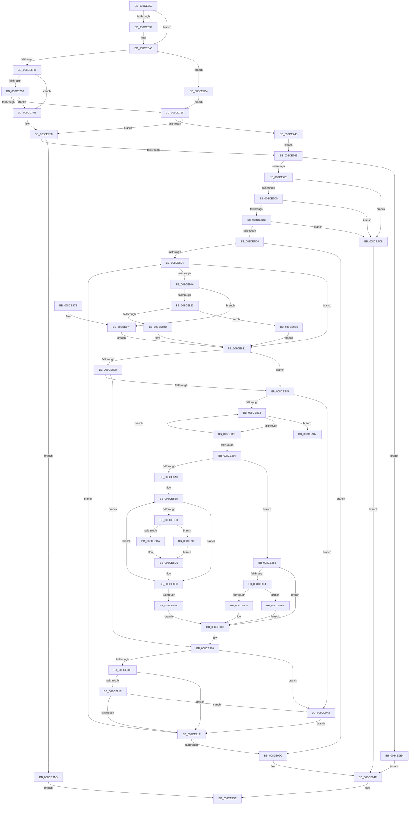

# MiUpdateCfgSystemWideBitmapWorker

- RVA: `0x008CE650`–`0x008CEA26` (길이 `982` bytes)
- VA: `0x00000001408CE650`
- 실행 섹션: `PAGE`
- PDB 이름 있음: `예`; PDB Function 태그: `아니요`
- unwind 정보 RVA: `0x0008480C`
- 디코드: `268`개 명령, `982/982` bytes 표시
- 미해석 바이트: `0` (있으면 어셈블리에 `.byte`로 보존)

> 이 문서는 커널 이미지의 기계어와 PDB 기호를 분석해 생성했습니다. 4번과 5번은 함수 원형과 자료형을 바이너리 사용 방식에서 추정한 C 해석이며 원본 소스 복구 결과는 아닙니다.

## 1. Dependencies

- 직접 호출 지점: **17**; 고유 호출 대상: **16**
- 직접 호출자로 확인된 함수: **1**
- RIP 상대 이미지 참조: **2**

### Outgoing calls
- `0x008CE6E2` → [MiSectionControlArea](../../text/29/MiSectionControlArea_function_00294CB0.md) (function, `0x00294CB0`)
- `0x008CE6ED` → [MiCheckPurgeAndUpMapCount](../../text/41/MiCheckPurgeAndUpMapCount_function_004186B0.md) (function, `0x004186B0`)
- `0x008CE73A` → [MiInsertInSystemSpace](../../text/3B/MiInsertInSystemSpace_function_003B2F5C.md) (function, `0x003B2F5C`)
- `0x008CE753` → [MiDereferenceControlArea](../../text/47/MiDereferenceControlArea_function_00479A20.md) (function, `0x00479A20`)
- `0x008CE770` → [MiSectionControlArea](../../text/29/MiSectionControlArea_function_00294CB0.md) (function, `0x00294CB0`)
- `0x008CE788` → [MiLocatePagefileSubsection](../../text/36/MiLocatePagefileSubsection_function_00367AC0.md) (function, `0x00367AC0`)
- `0x008CE7A6` → [MiChargeSegmentCommit](MiChargeSegmentCommit_function_008CEDE4.md) (function, `0x008CEDE4`)
- `0x008CE7E4` → [RtlClearAllBitsEx](../../text/47/RtlClearAllBitsEx_function_00477DC0.md) (function, `0x00477DC0`)
- `0x008CE7F4` → [MiImageCfgEnumRvaListFirst](MiImageCfgEnumRvaListFirst_function_008CF598.md) (function, `0x008CF598`)
- `0x008CE93C` → [MiGetAnyMultiplexedVm](../../text/44/MiGetAnyMultiplexedVm_function_00448BD0.md) (function, `0x00448BD0`)
- `0x008CE94A` → [MiEliminateZeroPages](MiEliminateZeroPages_function_008CF1A0.md) (function, `0x008CF1A0`)
- `0x008CE957` → [MiRemoveFromSystemSpace](../../text/29/MiRemoveFromSystemSpace_function_002962FC.md) (function, `0x002962FC`)
- `0x008CE965` → [_security_check_cookie](../../text/6A/_security_check_cookie_function_006AC640.md) (function, `0x006AC640`)
- `0x008CE98C` → [RtlSetBitsEx](../../text/3B/RtlSetBitsEx_function_003B6570.md) (function, `0x003B6570`)
- `0x008CE9A7` → [MiImageCfgEnumNextImageExtensionRva](../8D/MiImageCfgEnumNextImageExtensionRva_function_008D1860.md) (function, `0x008D1860`)
- `0x008CE9D3` → [memset](../../text/6C/memset_function_006C6C40.md) (function, `0x006C6C40`)
- `0x008CEA20` → [KeBugCheckEx](../../text/4F/KeBugCheckEx_function_004FD660.md) (function, `0x004FD660`)

### Direct callers
- [MiUpdateCfgSystemWideBitmap](MiUpdateCfgSystemWideBitmap_function_008CE568.md) at `0x008CE612`

### Static image references
- `0x008CE669` → RVA `0x00E0A740` (`.data`; read)
- `0x008CE870` → RVA `0x00012D10` (`.rdata`; read)

## 2. Other-region calls and transfers

- 다른 실행 섹션으로 향하는 call: **13**
  - `0x008CE6E2` → [MiSectionControlArea](../../text/29/MiSectionControlArea_function_00294CB0.md) (`PAGE` → `.text`)
  - `0x008CE6ED` → [MiCheckPurgeAndUpMapCount](../../text/41/MiCheckPurgeAndUpMapCount_function_004186B0.md) (`PAGE` → `.text`)
  - `0x008CE73A` → [MiInsertInSystemSpace](../../text/3B/MiInsertInSystemSpace_function_003B2F5C.md) (`PAGE` → `.text`)
  - `0x008CE753` → [MiDereferenceControlArea](../../text/47/MiDereferenceControlArea_function_00479A20.md) (`PAGE` → `.text`)
  - `0x008CE770` → [MiSectionControlArea](../../text/29/MiSectionControlArea_function_00294CB0.md) (`PAGE` → `.text`)
  - `0x008CE788` → [MiLocatePagefileSubsection](../../text/36/MiLocatePagefileSubsection_function_00367AC0.md) (`PAGE` → `.text`)
  - `0x008CE7E4` → [RtlClearAllBitsEx](../../text/47/RtlClearAllBitsEx_function_00477DC0.md) (`PAGE` → `.text`)
  - `0x008CE93C` → [MiGetAnyMultiplexedVm](../../text/44/MiGetAnyMultiplexedVm_function_00448BD0.md) (`PAGE` → `.text`)
  - `0x008CE957` → [MiRemoveFromSystemSpace](../../text/29/MiRemoveFromSystemSpace_function_002962FC.md) (`PAGE` → `.text`)
  - `0x008CE965` → [_security_check_cookie](../../text/6A/_security_check_cookie_function_006AC640.md) (`PAGE` → `.text`)
  - `0x008CE98C` → [RtlSetBitsEx](../../text/3B/RtlSetBitsEx_function_003B6570.md) (`PAGE` → `.text`)
  - `0x008CE9D3` → [memset](../../text/6C/memset_function_006C6C40.md) (`PAGE` → `.text`)
  - `0x008CEA20` → [KeBugCheckEx](../../text/4F/KeBugCheckEx_function_004FD660.md) (`PAGE` → `.text`)
- 별도 외부 분기/꼬리 이동을 확인하지 못했습니다.

## 3. Assembly (complete function range)

```asm
008CE650  40 55                           push rbp
008CE652  53                              push rbx
008CE653  56                              push rsi
008CE654  57                              push rdi
008CE655  41 54                           push r12
008CE657  41 55                           push r13
008CE659  41 56                           push r14
008CE65B  41 57                           push r15
008CE65D  48 8D 6C 24 F1                  lea rbp, [rsp - 0xf]
008CE662  48 81 EC 98 00 00 00            sub rsp, 0x98
008CE669  48 8B 05 D0 C0 53 00            mov rax, qword ptr [rip + 0x53c0d0]
008CE670  48 33 C4                        xor rax, rsp
008CE673  48 89 45 FF                     mov qword ptr [rbp - 1], rax
008CE677  33 DB                           xor ebx, ebx
008CE679  4C 89 4D D7                     mov qword ptr [rbp - 0x29], r9
008CE67D  4C 8B F9                        mov r15, rcx
008CE680  48 89 55 C7                     mov qword ptr [rbp - 0x39], rdx
008CE684  33 C9                           xor ecx, ecx
008CE686  0F 57 C0                        xorps xmm0, xmm0
008CE689  48 89 4D EF                     mov qword ptr [rbp - 0x11], rcx
008CE68D  4D 8B E0                        mov r12, r8
008CE690  89 4D F7                        mov dword ptr [rbp - 9], ecx
008CE693  44 8B F3                        mov r14d, ebx
008CE696  0F 11 45 DF                     movups xmmword ptr [rbp - 0x21], xmm0
008CE69A  48 85 D2                        test rdx, rdx
008CE69D  74 04                           je 0x1408ce6a3
008CE69F  4C 8B 72 08                     mov r14, qword ptr [rdx + 8]
008CE6A3  BA FF 0F 00 00                  mov edx, 0xfff
008CE6A8  49 C1 EC 03                     shr r12, 3
008CE6AC  49 8B F9                        mov rdi, r9
008CE6AF  4C 89 65 A7                     mov qword ptr [rbp - 0x59], r12
008CE6B3  48 C1 EF 03                     shr rdi, 3
008CE6B7  49 8B C4                        mov rax, r12
008CE6BA  48 23 C2                        and rax, rdx
008CE6BD  48 89 5D AF                     mov qword ptr [rbp - 0x51], rbx
008CE6C1  48 03 C2                        add rax, rdx
008CE6C4  48 8B CF                        mov rcx, rdi
008CE6C7  48 23 CA                        and rcx, rdx
008CE6CA  48 03 C8                        add rcx, rax
008CE6CD  48 8B C7                        mov rax, rdi
008CE6D0  48 C1 E8 0C                     shr rax, 0xc
008CE6D4  48 C1 E9 0C                     shr rcx, 0xc
008CE6D8  48 03 C8                        add rcx, rax
008CE6DB  48 89 4D BF                     mov qword ptr [rbp - 0x41], rcx
008CE6DF  49 8B CF                        mov rcx, r15
008CE6E2  E8 C9 65 9C FF                  call 0x140294cb0
008CE6E7  48 8B C8                        mov rcx, rax
008CE6EA  4C 8B E8                        mov r13, rax
008CE6ED  E8 BE 9F B4 FF                  call 0x1404186b0
008CE6F2  48 85 FF                        test rdi, rdi
008CE6F5  0F 84 B9 02 00 00               je 0x1408ce9b4
008CE6FB  0F B7 45 A7                     movzx eax, word ptr [rbp - 0x59]
008CE6FF  48 8D 0C 38                     lea rcx, [rax + rdi]
008CE703  48 3B C8                        cmp rcx, rax
008CE706  72 43                           jb 0x1408ce74b
008CE708  81 65 A7 00 00 FF FF            and dword ptr [rbp - 0x59], 0xffff0000
008CE70F  48 8B F9                        mov rdi, rcx
008CE712  49 8B 47 30                     mov rax, qword ptr [r15 + 0x30]
008CE716  48 2B 45 A7                     sub rax, qword ptr [rbp - 0x59]
008CE71A  48 3B C8                        cmp rcx, rax
008CE71D  77 2C                           ja 0x1408ce74b
008CE71F  48 8D 45 AF                     lea rax, [rbp - 0x51]
008CE723  45 33 C9                        xor r9d, r9d
008CE726  48 89 44 24 28                  mov qword ptr [rsp + 0x28], rax
008CE72B  4C 8D 45 A7                     lea r8, [rbp - 0x59]
008CE72F  49 8B D7                        mov rdx, r15
008CE732  48 89 5C 24 20                  mov qword ptr [rsp + 0x20], rbx
008CE737  48 8B CF                        mov rcx, rdi
008CE73A  E8 1D 48 AE FF                  call 0x1403b2f5c
008CE73F  8B F0                           mov esi, eax
008CE741  85 C0                           test eax, eax
008CE743  78 0B                           js 0x1408ce750
008CE745  4C 8B 6D AF                     mov r13, qword ptr [rbp - 0x51]
008CE749  EB 18                           jmp 0x1408ce763
008CE74B  BE 1F 00 00 C0                  mov esi, 0xc000001f
008CE750  49 8B CD                        mov rcx, r13
008CE753  E8 C8 B2 BA FF                  call 0x140479a20
008CE758  4C 8B EB                        mov r13, rbx
008CE75B  85 F6                           test esi, esi
008CE75D  0F 88 7A 02 00 00               js 0x1408ce9dd
008CE763  41 0F B7 F4                     movzx esi, r12w
008CE767  49 8B CF                        mov rcx, r15
008CE76A  48 2B FE                        sub rdi, rsi
008CE76D  49 0B F5                        or rsi, r13
008CE770  E8 3B 65 9C FF                  call 0x140294cb0
008CE775  49 C1 EC 0C                     shr r12, 0xc
008CE779  48 8D 55 B7                     lea rdx, [rbp - 0x49]
008CE77D  4C 89 65 B7                     mov qword ptr [rbp - 0x49], r12
008CE781  48 8D 88 80 00 00 00            lea rcx, [rax + 0x80]
008CE788  E8 33 93 A9 FF                  call 0x140367ac0
008CE78D  4C 8B 65 BF                     mov r12, qword ptr [rbp - 0x41]
008CE791  4C 8B C8                        mov r9, rax
008CE794  4D 8B C4                        mov r8, r12
008CE797  48 8B 48 08                     mov rcx, qword ptr [rax + 8]
008CE79B  48 8B 45 B7                     mov rax, qword ptr [rbp - 0x49]
008CE79F  48 8D 14 C1                     lea rdx, [rcx + rax*8]
008CE7A3  49 8B C9                        mov rcx, r9
008CE7A6  E8 39 06 00 00                  call 0x1408cede4
008CE7AB  85 C0                           test eax, eax
008CE7AD  0F 84 31 02 00 00               je 0x1408ce9e4
008CE7B3  4C 8B 7D C7                     mov r15, qword ptr [rbp - 0x39]
008CE7B7  4D 85 FF                        test r15, r15
008CE7BA  0F 84 08 02 00 00               je 0x1408ce9c8
008CE7C0  41 8B 07                        mov eax, dword ptr [r15]
008CE7C3  A8 01                           test al, 1
008CE7C5  0F 84 FD 01 00 00               je 0x1408ce9c8
008CE7CB  4D 85 F6                        test r14, r14
008CE7CE  0F 84 F4 01 00 00               je 0x1408ce9c8
008CE7D4  48 8B 45 D7                     mov rax, qword ptr [rbp - 0x29]
008CE7D8  48 8D 4D C7                     lea rcx, [rbp - 0x39]
008CE7DC  48 89 45 C7                     mov qword ptr [rbp - 0x39], rax
008CE7E0  48 89 75 CF                     mov qword ptr [rbp - 0x31], rsi
008CE7E4  E8 D7 95 BA FF                  call 0x140477dc0
008CE7E9  44 8B 45 7F                     mov r8d, dword ptr [rbp + 0x7f]
008CE7ED  48 8D 55 DF                     lea rdx, [rbp - 0x21]
008CE7F1  49 8B CE                        mov rcx, r14
008CE7F4  E8 9F 0D 00 00                  call 0x1408cf598
008CE7F9  44 8B C0                        mov r8d, eax
008CE7FC  85 C0                           test eax, eax
008CE7FE  0F 84 28 01 00 00               je 0x1408ce92c
008CE804  F6 45 E3 01                     test byte ptr [rbp - 0x1d], 1
008CE808  74 27                           je 0x1408ce831
008CE80A  41 8B C8                        mov ecx, r8d
008CE80D  41 83 E0 0F                     and r8d, 0xf
008CE811  48 C1 E9 04                     shr rcx, 4
008CE815  48 03 C9                        add rcx, rcx
008CE818  66 45 3B 47 04                  cmp r8w, word ptr [r15 + 4]
008CE81D  0F 85 5C 01 00 00               jne 0x1408ce97f
008CE823  F6 45 E3 04                     test byte ptr [rbp - 0x1d], 4
008CE827  0F 85 69 01 00 00               jne 0x1408ce996
008CE82D  48 0F AB 0E                     bts qword ptr [rsi], rcx
008CE831  44 8B 45 DF                     mov r8d, dword ptr [rbp - 0x21]
008CE835  8B 45 F3                        mov eax, dword ptr [rbp - 0xd]
008CE838  44 3B C0                        cmp r8d, eax
008CE83B  72 08                           jb 0x1408ce845
008CE83D  85 C0                           test eax, eax
008CE83F  0F 85 C1 00 00 00               jne 0x1408ce906
008CE845  FF 45 EB                        inc dword ptr [rbp - 0x15]
008CE848  8B 4D EF                        mov ecx, dword ptr [rbp - 0x11]
008CE84B  4D 8B 4E 10                     mov r9, qword ptr [r14 + 0x10]
008CE84F  4D 8B 56 18                     mov r10, qword ptr [r14 + 0x18]
008CE853  4C 03 C9                        add r9, rcx
008CE856  44 8B 45 E7                     mov r8d, dword ptr [rbp - 0x19]
008CE85A  4C 2B D1                        sub r10, rcx
008CE85D  0F 84 40 01 00 00               je 0x1408ce9a3
008CE863  4D 85 D2                        test r10, r10
008CE866  0F 84 9B 01 00 00               je 0x1408cea07
008CE86C  41 0F B6 01                     movzx eax, byte ptr [r9]
008CE870  4C 8D 1D 99 44 74 FF            lea r11, [rip - 0x8bbb67]
008CE877  8B C8                           mov ecx, eax
008CE879  8B D0                           mov edx, eax
008CE87B  C1 E9 06                        shr ecx, 6
008CE87E  83 E2 3F                        and edx, 0x3f
008CE881  49 FF C1                        inc r9
008CE884  49 FF CA                        dec r10
008CE887  41 0F AF 14 8B                  imul edx, dword ptr [r11 + rcx*4]
008CE88C  44 03 C2                        add r8d, edx
008CE88F  83 F9 03                        cmp ecx, 3
008CE892  75 CF                           jne 0x1408ce863
008CE894  44 89 45 E7                     mov dword ptr [rbp - 0x19], r8d
008CE898  8B D3                           mov edx, ebx
008CE89A  45 2B 4E 10                     sub r9d, dword ptr [r14 + 0x10]
008CE89E  44 89 4D EF                     mov dword ptr [rbp - 0x11], r9d
008CE8A2  45 8B 4E 08                     mov r9d, dword ptr [r14 + 8]
008CE8A6  41 83 F9 01                     cmp r9d, 1
008CE8AA  76 46                           jbe 0x1408ce8f2
008CE8AC  4D 8B 66 28                     mov r12, qword ptr [r14 + 0x28]
008CE8B0  41 8B F9                        mov edi, r9d
008CE8B3  0F AF 7D EB                     imul edi, dword ptr [rbp - 0x15]
008CE8B7  44 8B D3                        mov r10d, ebx
008CE8BA  4C 8B DB                        mov r11, rbx
008CE8BD  42 8D 0C 17                     lea ecx, [rdi + r10]
008CE8C1  49 0F A3 0C 24                  bt qword ptr [r12], rcx
008CE8C6  0F 92 C0                        setb al
008CE8C9  84 C0                           test al, al
008CE8CB  74 13                           je 0x1408ce8e0
008CE8CD  49 8B 46 30                     mov rax, qword ptr [r14 + 0x30]
008CE8D1  48 85 C0                        test rax, rax
008CE8D4  0F 84 1E 01 00 00               je 0x1408ce9f8
008CE8DA  41 8B 04 03                     mov eax, dword ptr [r11 + rax]
008CE8DE  0B D0                           or edx, eax
008CE8E0  41 FF C2                        inc r10d
008CE8E3  49 83 C3 04                     add r11, 4
008CE8E7  45 3B D1                        cmp r10d, r9d
008CE8EA  72 D1                           jb 0x1408ce8bd
008CE8EC  4C 8B 65 BF                     mov r12, qword ptr [rbp - 0x41]
008CE8F0  EB 11                           jmp 0x1408ce903
008CE8F2  75 0F                           jne 0x1408ce903
008CE8F4  49 8B 56 30                     mov rdx, qword ptr [r14 + 0x30]
008CE8F8  48 85 D2                        test rdx, rdx
008CE8FB  0F 84 ED 00 00 00               je 0x1408ce9ee
008CE901  8B 12                           mov edx, dword ptr [rdx]
008CE903  89 55 E3                        mov dword ptr [rbp - 0x1d], edx
008CE906  45 85 C0                        test r8d, r8d
008CE909  0F 84 94 00 00 00               je 0x1408ce9a3
008CE90F  8B 45 F3                        mov eax, dword ptr [rbp - 0xd]
008CE912  44 3B C0                        cmp r8d, eax
008CE915  72 08                           jb 0x1408ce91f
008CE917  85 C0                           test eax, eax
008CE919  0F 85 84 00 00 00               jne 0x1408ce9a3
008CE91F  44 89 45 DF                     mov dword ptr [rbp - 0x21], r8d
008CE923  45 85 C0                        test r8d, r8d
008CE926  0F 85 D8 FE FF FF               jne 0x1408ce804
008CE92C  B9 02 00 00 00                  mov ecx, 2
008CE931  49 C1 E4 0C                     shl r12, 0xc
008CE935  48 81 E6 00 F0 FF FF            and rsi, 0xfffffffffffff000
008CE93C  E8 8F A2 B7 FF                  call 0x140448bd0
008CE941  48 8B C8                        mov rcx, rax
008CE944  4D 8B C4                        mov r8, r12
008CE947  48 8B D6                        mov rdx, rsi
008CE94A  E8 51 08 00 00                  call 0x1408cf1a0
008CE94F  BA 01 00 00 00                  mov edx, 1
008CE954  49 8B CD                        mov rcx, r13
008CE957  E8 A0 79 9C FF                  call 0x1402962fc
008CE95C  8B C3                           mov eax, ebx
008CE95E  48 8B 4D FF                     mov rcx, qword ptr [rbp - 1]
008CE962  48 33 CC                        xor rcx, rsp
008CE965  E8 D6 DC DD FF                  call 0x1406ac640
008CE96A  48 81 C4 98 00 00 00            add rsp, 0x98
008CE971  41 5F                           pop r15
008CE973  41 5E                           pop r14
008CE975  41 5D                           pop r13
008CE977  41 5C                           pop r12
008CE979  5F                              pop rdi
008CE97A  5E                              pop rsi
008CE97B  5B                              pop rbx
008CE97C  5D                              pop rbp
008CE97D  C3                              ret
008CE97E  CC                              int3
008CE97F  48 8B D1                        mov rdx, rcx
008CE982  41 B8 02 00 00 00               mov r8d, 2
008CE988  48 8D 4D C7                     lea rcx, [rbp - 0x39]
008CE98C  E8 DF 7B AE FF                  call 0x1403b6570
008CE991  E9 9B FE FF FF                  jmp 0x1408ce831
008CE996  48 8D 41 01                     lea rax, [rcx + 1]
008CE99A  48 0F AB 06                     bts qword ptr [rsi], rax
008CE99E  E9 8E FE FF FF                  jmp 0x1408ce831
008CE9A3  48 8D 4D DF                     lea rcx, [rbp - 0x21]
008CE9A7  E8 B4 2E 00 00                  call 0x1408d1860
008CE9AC  44 8B C0                        mov r8d, eax
008CE9AF  E9 6B FF FF FF                  jmp 0x1408ce91f
008CE9B4  81 65 A7 00 00 FF FF            and dword ptr [rbp - 0x59], 0xffff0000
008CE9BB  49 8B 7F 30                     mov rdi, qword ptr [r15 + 0x30]
008CE9BF  48 2B 7D A7                     sub rdi, qword ptr [rbp - 0x59]
008CE9C3  E9 57 FD FF FF                  jmp 0x1408ce71f
008CE9C8  4C 8B C7                        mov r8, rdi
008CE9CB  BA FF 00 00 00                  mov edx, 0xff
008CE9D0  48 8B CE                        mov rcx, rsi
008CE9D3  E8 68 82 DF FF                  call 0x1406c6c40
008CE9D8  E9 72 FF FF FF                  jmp 0x1408ce94f
008CE9DD  8B C6                           mov eax, esi
008CE9DF  E9 7A FF FF FF                  jmp 0x1408ce95e
008CE9E4  BB 2D 01 00 C0                  mov ebx, 0xc000012d
008CE9E9  E9 61 FF FF FF                  jmp 0x1408ce94f
008CE9EE  BA 01 00 00 00                  mov edx, 1
008CE9F3  E9 0B FF FF FF                  jmp 0x1408ce903
008CE9F8  41 8B CA                        mov ecx, r10d
008CE9FB  B8 01 00 00 00                  mov eax, 1
008CEA00  D3 E0                           shl eax, cl
008CEA02  E9 D7 FE FF FF                  jmp 0x1408ce8de
008CEA07  41 8B C0                        mov eax, r8d
008CEA0A  4C 8D 4D E7                     lea r9, [rbp - 0x19]
008CEA0E  4D 8B C6                        mov r8, r14
008CEA11  48 89 44 24 20                  mov qword ptr [rsp + 0x20], rax
008CEA16  BA 20 67 66 43                  mov edx, 0x43666720
008CEA1B  B9 1A 00 00 00                  mov ecx, 0x1a
008CEA20  E8 3B EC C2 FF                  call 0x1404fd660
008CEA25  CC                              int3
```

## 4. C-style interpretation (structured pseudocode)

```c
__int64 __fastcall MiUpdateCfgSystemWideBitmapWorker(__int64 a1, __int64 a2, __int64 a3, __int64 a4, __int64 a5, unsigned int a6)
{
    __int64 result;
    __int64 v_r10;
    __int64 v_r11;
    __int64 v_r12;
    __int64 v_r14;
    __int64 v_rbx;
    __int64 v_rdi;
    __int64 v_rsi;
    __int64 v_rsp;
    unsigned __int64 v_stack_m4F;
    unsigned __int64 v_stack_m50;
    unsigned int v_stack_m58;
    unsigned int v_stack_m5C;
    unsigned __int64 v_stack_m60;
    unsigned int v_stack_m64;
    unsigned int v_stack_m68;
    unsigned __int8 v_stack_m6C;
    unsigned __int64 v_stack_m70;
    unsigned __int64 v_stack_m78;
    unsigned __int64 v_stack_m80;
    unsigned __int64 v_stack_m88;
    unsigned __int64 v_stack_m90;
    unsigned __int64 v_stack_m98;
    unsigned __int64 v_stack_mA0;
    unsigned __int64 v_stack_mA8;
    unsigned __int64 v_stack_mB0;
    unsigned __int64 v_stack_mB8;
    unsigned __int64 v_stack_p20;

    v_rsp = (v_rsp) - (152);
    result = (*(unsigned __int64 *)(v_rip + 5488848)) ^ (v_rsp);
    v_stack_m50 = result;
    v_rbx = 0;
    v_stack_m78 = a4;
    v_stack_m88 = a2;
    a1 = 0;
    v_stack_m60 = 0;
    v_stack_m58 = 0;
    v_stack_m70 = v_xmm0;
    v_r14 = 0;
    if (a2 != 0) {
        v_r14 = *(unsigned __int64 *)(a2 + 8);
    }
    v_r12 = (a3) >> (3);
    v_stack_mA8 = v_r12;
    v_rdi = (a4) >> (3);
    result = (v_r12) & ((unsigned int)(0xFFFULL));
    v_stack_mA0 = 0;
    result = (result) + ((unsigned int)(0xFFFULL));
    a1 = (v_rdi) & ((unsigned int)(0xFFFULL));
    a1 = (a1) + (result);
    result = (v_rdi) >> (12);
    a1 = (a1) >> (12);
    a1 = (a1) + (result);
    v_stack_m90 = a1;
    result = MiSectionControlArea(a1, (unsigned int)(0xFFFULL), a3, a4);
    result = MiCheckPurgeAndUpMapCount(result, (unsigned int)(0xFFFULL), a3, a4);
    if (v_rdi == 0) goto loc_008CE9B4;
    if ((v_stack_mA8 + v_rdi * 1) < v_stack_mA8) goto loc_008CE74B;
    result = (*(unsigned __int64 *)(a1 + 48)) - (v_stack_mA8);
    if ((v_stack_mA8 + v_rdi * 1) > result) goto loc_008CE74B;
loc_008CE71F:
    a4 = 0;
    v_stack_mB0 = v_stack_mA0;
    v_stack_mB8 = 0;
    result = MiInsertInSystemSpace(v_stack_mA8 + v_rdi * 1, a1, v_stack_mA8, a4);
    if (sign_flag) goto loc_008CE750;
    goto loc_008CE763;
loc_008CE74B:
loc_008CE750:
    result = MiDereferenceControlArea(v_stack_mA0, a1, v_stack_mA8, a4);
    if (sign_flag) goto loc_008CE9DD;
loc_008CE763:
    v_rdi = (v_stack_mA8 + v_rdi * 1) - ((unsigned __int16)(v_r12));
    v_rsi = ((unsigned __int16)(v_r12)) | (0);
    result = MiSectionControlArea(a1, a1, v_stack_mA8, a4);
    v_r12 = (v_r12) >> (12);
    v_stack_m98 = v_r12;
    result = MiLocatePagefileSubsection(result + 128, v_stack_m98, v_stack_mA8, a4);
    result = MiChargeSegmentCommit(result, *(unsigned __int64 *)(result + 8) + v_stack_m98 * 8, v_stack_m90, result);
    if ((unsigned int)(result) == 0) goto loc_008CE9E4;
    if (v_stack_m88 == 0) goto loc_008CE9C8;
    if ((((unsigned __int8)((unsigned int)(*(unsigned int *)(v_stack_m88)))) & (1)) == 0) goto loc_008CE9C8;
    if (v_r14 == 0) goto loc_008CE9C8;
    v_stack_m88 = v_stack_m78;
    v_stack_m80 = v_rsi;
    result = RtlClearAllBitsEx(v_stack_m88, *(unsigned __int64 *)(result + 8) + v_stack_m98 * 8, v_stack_m90, result);
    result = MiImageCfgEnumRvaListFirst(v_r14, v_stack_m70, (unsigned int)(a6), result);
    if ((unsigned int)(result) == 0) goto loc_008CE92C;
loc_008CE804:
    if (((v_stack_m6C) & (1)) == 0) goto loc_008CE831;
    a3 = (unsigned int)(((unsigned int)((unsigned int)(result))) & (15));
    a1 = ((unsigned int)((unsigned int)((unsigned int)((unsigned int)(result))))) >> (4);
    a1 = (a1) + (a1);
    if (((unsigned __int16)(a3)) != (*(unsigned __int16 *)(v_stack_m88 + 4))) goto loc_008CE97F;
    if (((v_stack_m6C) & (4)) != 0) goto loc_008CE996;
loc_008CE831:
    if (((unsigned int)((unsigned int)(v_stack_m70))) < ((unsigned int)((unsigned int)(v_stack_m5C)))) goto loc_008CE845;
    if ((unsigned int)((unsigned int)(v_stack_m5C)) != 0) goto loc_008CE906;
loc_008CE845:
    a4 = (*(unsigned __int64 *)(v_r14 + 16)) + ((unsigned int)(v_stack_m60));
    v_r10 = (*(unsigned __int64 *)(v_r14 + 24)) - ((unsigned int)(v_stack_m60));
    if (condition_is_equal) goto loc_008CE9A3;
loc_008CE863:
    if (v_r10 == 0) goto loc_008CEA07;
    a1 = (unsigned int)(((unsigned int)((unsigned int)(*(unsigned __int8 *)(a4)))) >> (6));
    a2 = (unsigned int)(((unsigned int)((unsigned int)(*(unsigned __int8 *)(a4)))) & (63));
    a4 = (a4) + 1;
    v_r10 = (v_r10) - 1;
    a2 = (unsigned int)((a2) * (*(unsigned int *)(v_rip - 9157479 + a1 * 4)));
    a3 = (unsigned int)(((unsigned int)(v_stack_m68)) + ((unsigned int)(a2)));
    if (((unsigned int)(a1)) != 3) goto loc_008CE863;
    v_stack_m68 = (unsigned int)(a3);
    a4 = (unsigned int)((a4) - (*(unsigned int *)(v_r14 + 16)));
    v_stack_m60 = (unsigned int)(a4);
    if (((unsigned int)((unsigned int)(*(unsigned int *)(v_r14 + 8)))) <= 1) goto loc_008CE8F2;
    v_rdi = (unsigned int)(((unsigned int)((unsigned int)((unsigned int)(*(unsigned int *)(v_r14 + 8))))) * (v_stack_m64));
loc_008CE8BD:
    result = (condition_is_below) ? 1 : 0;
    if ((unsigned __int8)(result) == 0) goto loc_008CE8E0;
    if (*(unsigned __int64 *)(v_r14 + 48) == 0) goto loc_008CE9F8;
loc_008CE8DE:
    a2 = (unsigned int)((0) | ((unsigned int)((unsigned int)(*(unsigned int *)(0 + *(unsigned __int64 *)(v_r14 + 48) * 1)))));
loc_008CE8E0:
    v_r10 = (unsigned int)((0) + 1);
    v_r11 = (0) + (4);
    if (((unsigned int)(v_r10)) < ((unsigned int)((unsigned int)(*(unsigned int *)(v_r14 + 8))))) goto loc_008CE8BD;
    goto loc_008CE903;
loc_008CE8F2:
    if (((unsigned int)(v_r10)) != ((unsigned int)((unsigned int)(*(unsigned int *)(v_r14 + 8))))) goto loc_008CE903;
    if (*(unsigned __int64 *)(v_r14 + 48) == 0) goto loc_008CE9EE;
loc_008CE903:
    v_stack_m6C = (unsigned int)((unsigned int)(*(unsigned int *)(*(unsigned __int64 *)(v_r14 + 48))));
loc_008CE906:
    if ((unsigned int)(a3) == 0) goto loc_008CE9A3;
    if (((unsigned int)(a3)) < ((unsigned int)((unsigned int)(v_stack_m5C)))) goto loc_008CE91F;
    if ((unsigned int)((unsigned int)(v_stack_m5C)) != 0) goto loc_008CE9A3;
loc_008CE91F:
    v_stack_m70 = (unsigned int)(a3);
    if ((unsigned int)(a3) != 0) goto loc_008CE804;
loc_008CE92C:
    v_r12 = (v_stack_m90) << (12);
    v_rsi = (v_rsi) & (0xFFFFFFFFFFFFF000ULL);
    result = MiGetAnyMultiplexedVm(2, (unsigned int)(*(unsigned int *)(*(unsigned __int64 *)(v_r14 + 48))), a3, (unsigned int)(*(unsigned int *)(v_r14 + 8)));
    result = MiEliminateZeroPages(result, v_rsi, v_r12, (unsigned int)(*(unsigned int *)(v_r14 + 8)));
loc_008CE94F:
    result = MiRemoveFromSystemSpace(0, 1, v_r12, (unsigned int)(*(unsigned int *)(v_r14 + 8)));
loc_008CE95E:
    a1 = (v_stack_m50) ^ (v_rsp);
    result = _security_check_cookie(a1, 1, v_r12, (unsigned int)(*(unsigned int *)(v_r14 + 8)));
    v_rsp = (v_rsp) + (152);
    return result;
loc_008CE97F:
    result = RtlSetBitsEx(v_stack_m88, a1, 2, (unsigned int)(*(unsigned int *)(v_r14 + 8)));
    goto loc_008CE831;
loc_008CE996:
    goto loc_008CE831;
loc_008CE9A3:
    result = MiImageCfgEnumNextImageExtensionRva(v_stack_m70, a1, 2, (unsigned int)(*(unsigned int *)(v_r14 + 8)));
    goto loc_008CE91F;
loc_008CE9B4:
    v_rdi = (*(unsigned __int64 *)(v_stack_m88 + 48)) - (v_stack_mA8);
    goto loc_008CE71F;
loc_008CE9C8:
    result = memset(v_rsi, 255, v_rdi, (unsigned int)(*(unsigned int *)(v_r14 + 8)));
    goto loc_008CE94F;
loc_008CE9DD:
    goto loc_008CE95E;
loc_008CE9E4:
    goto loc_008CE94F;
loc_008CE9EE:
    goto loc_008CE903;
loc_008CE9F8:
    result = (unsigned int)((1) << ((unsigned __int8)((unsigned int)((unsigned int)(v_r10)))));
    goto loc_008CE8DE;
loc_008CEA07:
    v_stack_p20 = (unsigned int)((unsigned int)(v_rdi));
    result = KeBugCheckEx(26, (unsigned int)(0x43666720ULL), v_r14, v_stack_m68);
    return result;
}
```

## 5. (Beta) C Style

```c
int64_t MiUpdateCfgSystemWideBitmapWorker(void *Arg1, int64_t Arg2, int64_t Arg3, int64_t Arg4, uint64_t Arg5, uint32_t Arg6)
{
    uint8_t *arg1 = (uint8_t *)Arg1;

    int64_t result;
    int64_t local_r10;
    int64_t local_r11;
    int64_t local_r12;
    int64_t local_r14;
    int64_t local_rbx;
    int64_t local_rdi;
    int64_t local_rsi;
    int64_t local_rsp;
    uint64_t v_stack_m4F;
    uint64_t v_stack_m50;
    uint32_t v_stack_m58;
    uint32_t v_stack_m5C;
    uint64_t v_stack_m60;
    uint32_t v_stack_m64;
    uint32_t v_stack_m68;
    uint8_t v_stack_m6C;
    uint64_t v_stack_m70;
    uint64_t v_stack_m78;
    uint64_t v_stack_m80;
    uint64_t v_stack_m88;
    uint64_t v_stack_m90;
    uint64_t v_stack_m98;
    uint64_t v_stack_mA0;
    uint64_t v_stack_mA8;
    uint64_t v_stack_mB0;
    uint64_t v_stack_mB8;
    uint64_t v_stack_p20;

    local_rsp = (local_rsp) - (152);
    result = (*(uint64_t *)(v_rip + 0x53C0D0)) ^ (local_rsp);
    v_stack_m50 = result;
    local_rbx = 0;
    v_stack_m78 = Arg4;
    v_stack_m88 = Arg2;
    Arg1 = 0;
    v_stack_m60 = 0;
    v_stack_m58 = 0;
    v_stack_m70 = v_xmm0;
    local_r14 = 0;
    if (Arg2 != 0) {
        local_r14 = *(uint64_t *)(Arg2 + 0x8);
    }
    local_r12 = (Arg3) >> (3);
    v_stack_mA8 = local_r12;
    local_rdi = (Arg4) >> (3);
    result = (local_r12) & ((uint32_t)(0xFFFULL));
    v_stack_mA0 = 0;
    result = (result) + ((uint32_t)(0xFFFULL));
    Arg1 = (local_rdi) & ((uint32_t)(0xFFFULL));
    Arg1 = (Arg1) + (result);
    result = (local_rdi) >> (12);
    Arg1 = (Arg1) >> (12);
    Arg1 = (Arg1) + (result);
    v_stack_m90 = Arg1;
    result = MiSectionControlArea(Arg1, (uint32_t)(0xFFFULL), Arg3, Arg4);
    result = MiCheckPurgeAndUpMapCount(result, (uint32_t)(0xFFFULL), Arg3, Arg4);
    if (local_rdi == 0) goto loc_008CE9B4;
    if ((v_stack_mA8 + local_rdi * 1) < v_stack_mA8) goto loc_008CE74B;
    result = (*(uint64_t *)(arg1 + 0x30)) - (v_stack_mA8);
    if ((v_stack_mA8 + local_rdi * 1) > result) goto loc_008CE74B;
loc_008CE71F:
    Arg4 = 0;
    v_stack_mB0 = v_stack_mA0;
    v_stack_mB8 = 0;
    result = MiInsertInSystemSpace(v_stack_mA8 + local_rdi * 1, Arg1, v_stack_mA8, Arg4);
    if (sign_flag) goto loc_008CE750;
    goto loc_008CE763;
loc_008CE74B:
loc_008CE750:
    result = MiDereferenceControlArea(v_stack_mA0, Arg1, v_stack_mA8, Arg4);
    if (sign_flag) goto loc_008CE9DD;
loc_008CE763:
    local_rdi = (v_stack_mA8 + local_rdi * 1) - ((uint16_t)(local_r12));
    local_rsi = ((uint16_t)(local_r12)) | (0);
    result = MiSectionControlArea(Arg1, Arg1, v_stack_mA8, Arg4);
    local_r12 = (local_r12) >> (12);
    v_stack_m98 = local_r12;
    result = MiLocatePagefileSubsection(result + 128, v_stack_m98, v_stack_mA8, Arg4);
    result = MiChargeSegmentCommit(result, *(uint64_t *)(result + 0x8) + v_stack_m98 * 8, v_stack_m90, result);
    if ((uint32_t)(result) == 0) goto loc_008CE9E4;
    if (v_stack_m88 == 0) goto loc_008CE9C8;
    if ((((uint8_t)((uint32_t)(*(uint32_t *)(v_stack_m88)))) & (1)) == 0) goto loc_008CE9C8;
    if (local_r14 == 0) goto loc_008CE9C8;
    v_stack_m88 = v_stack_m78;
    v_stack_m80 = local_rsi;
    result = RtlClearAllBitsEx(v_stack_m88, *(uint64_t *)(result + 0x8) + v_stack_m98 * 8, v_stack_m90, result);
    result = MiImageCfgEnumRvaListFirst(local_r14, v_stack_m70, (uint32_t)(Arg6), result);
    if ((uint32_t)(result) == 0) goto loc_008CE92C;
loc_008CE804:
    if (((v_stack_m6C) & (1)) == 0) goto loc_008CE831;
    Arg3 = (uint32_t)(((uint32_t)((uint32_t)(result))) & (15));
    Arg1 = ((uint32_t)((uint32_t)((uint32_t)((uint32_t)(result))))) >> (4);
    Arg1 = (Arg1) + (Arg1);
    if (((uint16_t)(Arg3)) != (*(uint16_t *)(v_stack_m88 + 0x4))) goto loc_008CE97F;
    if (((v_stack_m6C) & (4)) != 0) goto loc_008CE996;
loc_008CE831:
    if (((uint32_t)((uint32_t)(v_stack_m70))) < ((uint32_t)((uint32_t)(v_stack_m5C)))) goto loc_008CE845;
    if ((uint32_t)((uint32_t)(v_stack_m5C)) != 0) goto loc_008CE906;
loc_008CE845:
    Arg4 = (*(uint64_t *)(local_r14 + 0x10)) + ((uint32_t)(v_stack_m60));
    local_r10 = (*(uint64_t *)(local_r14 + 0x18)) - ((uint32_t)(v_stack_m60));
    if (condition_is_equal) goto loc_008CE9A3;
loc_008CE863:
    if (local_r10 == 0) goto loc_008CEA07;
    Arg1 = (uint32_t)(((uint32_t)((uint32_t)(*(uint8_t *)(Arg4)))) >> (6));
    Arg2 = (uint32_t)(((uint32_t)((uint32_t)(*(uint8_t *)(Arg4)))) & (63));
    Arg4 = (Arg4) + 1;
    local_r10 = (local_r10) - 1;
    Arg2 = (uint32_t)((Arg2) * (*(uint32_t *)(v_rip - 0x8BBB67 + arg1 * 4)));
    Arg3 = (uint32_t)(((uint32_t)(v_stack_m68)) + ((uint32_t)(Arg2)));
    if (((uint32_t)(Arg1)) != 3) goto loc_008CE863;
    v_stack_m68 = (uint32_t)(Arg3);
    Arg4 = (uint32_t)((Arg4) - (*(uint32_t *)(local_r14 + 0x10)));
    v_stack_m60 = (uint32_t)(Arg4);
    if (((uint32_t)((uint32_t)(*(uint32_t *)(local_r14 + 0x8)))) <= 1) goto loc_008CE8F2;
    local_rdi = (uint32_t)(((uint32_t)((uint32_t)((uint32_t)(*(uint32_t *)(local_r14 + 0x8))))) * (v_stack_m64));
loc_008CE8BD:
    result = (condition_is_below) ? 1 : 0;
    if ((uint8_t)(result) == 0) goto loc_008CE8E0;
    if (*(uint64_t *)(local_r14 + 0x30) == 0) goto loc_008CE9F8;
loc_008CE8DE:
    Arg2 = (uint32_t)((0) | ((uint32_t)((uint32_t)(*(uint32_t *)(0 + *(uint64_t *)(local_r14 + 0x30) * 1)))));
loc_008CE8E0:
    local_r10 = (uint32_t)((0) + 1);
    local_r11 = (0) + (4);
    if (((uint32_t)(local_r10)) < ((uint32_t)((uint32_t)(*(uint32_t *)(local_r14 + 0x8))))) goto loc_008CE8BD;
    goto loc_008CE903;
loc_008CE8F2:
    if (((uint32_t)(local_r10)) != ((uint32_t)((uint32_t)(*(uint32_t *)(local_r14 + 0x8))))) goto loc_008CE903;
    if (*(uint64_t *)(local_r14 + 0x30) == 0) goto loc_008CE9EE;
loc_008CE903:
    v_stack_m6C = (uint32_t)((uint32_t)(*(uint32_t *)(*(uint64_t *)(local_r14 + 0x30))));
loc_008CE906:
    if ((uint32_t)(Arg3) == 0) goto loc_008CE9A3;
    if (((uint32_t)(Arg3)) < ((uint32_t)((uint32_t)(v_stack_m5C)))) goto loc_008CE91F;
    if ((uint32_t)((uint32_t)(v_stack_m5C)) != 0) goto loc_008CE9A3;
loc_008CE91F:
    v_stack_m70 = (uint32_t)(Arg3);
    if ((uint32_t)(Arg3) != 0) goto loc_008CE804;
loc_008CE92C:
    local_r12 = (v_stack_m90) << (12);
    local_rsi = (local_rsi) & (0xFFFFFFFFFFFFF000ULL);
    result = MiGetAnyMultiplexedVm(2, (uint32_t)(*(uint32_t *)(*(uint64_t *)(local_r14 + 0x30))), Arg3, (uint32_t)(*(uint32_t *)(local_r14 + 0x8)));
    result = MiEliminateZeroPages(result, local_rsi, local_r12, (uint32_t)(*(uint32_t *)(local_r14 + 0x8)));
loc_008CE94F:
    result = MiRemoveFromSystemSpace(0, 1, local_r12, (uint32_t)(*(uint32_t *)(local_r14 + 0x8)));
loc_008CE95E:
    Arg1 = (v_stack_m50) ^ (local_rsp);
    result = _security_check_cookie(Arg1, 1, local_r12, (uint32_t)(*(uint32_t *)(local_r14 + 0x8)));
    local_rsp = (local_rsp) + (152);
    return result;
loc_008CE97F:
    result = RtlSetBitsEx(v_stack_m88, Arg1, 2, (uint32_t)(*(uint32_t *)(local_r14 + 0x8)));
    goto loc_008CE831;
loc_008CE996:
    goto loc_008CE831;
loc_008CE9A3:
    result = MiImageCfgEnumNextImageExtensionRva(v_stack_m70, Arg1, 2, (uint32_t)(*(uint32_t *)(local_r14 + 0x8)));
    goto loc_008CE91F;
loc_008CE9B4:
    local_rdi = (*(uint64_t *)(v_stack_m88 + 0x30)) - (v_stack_mA8);
    goto loc_008CE71F;
loc_008CE9C8:
    result = memset(local_rsi, 255, local_rdi, (uint32_t)(*(uint32_t *)(local_r14 + 0x8)));
    goto loc_008CE94F;
loc_008CE9DD:
    goto loc_008CE95E;
loc_008CE9E4:
    goto loc_008CE94F;
loc_008CE9EE:
    goto loc_008CE903;
loc_008CE9F8:
    result = (uint32_t)((1) << ((uint8_t)((uint32_t)((uint32_t)(local_r10)))));
    goto loc_008CE8DE;
loc_008CEA07:
    v_stack_p20 = (uint32_t)((uint32_t)(local_rdi));
    result = KeBugCheckEx(26, (uint32_t)(0x43666720ULL), local_r14, v_stack_m68);
    return result;
}
```

### 관측된 메모리 오프셋

구조체 형식이 확인되지 않은 접근은 인자 기준의 오프셋으로만 기록했습니다.

| 기준 인자 | 오프셋 표현 | 폭 (bit) | 접근 |
|---|---:|---:|---|
| `Arg1` | `+ 0x30` | `64` | `R` |

## 6. Execution-region graph

[열기: 2D/3D 그래프와 함수 탐색 컨트롤 패널](../../../control-panel.html?section=page&rva=0x008CE650&view=graph)

- 2D 그래프는 위에서 아래로 흐르고, 3D 그래프는 빈 공간을 드래그해 회전합니다. Shift+드래그는 이동, 휠은 확대·축소, 함수 노드 선택은 대상 보고서 이동입니다.

### Static fallback


