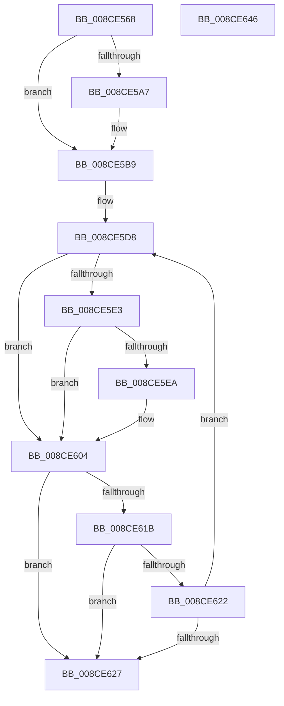

# MiUpdateCfgSystemWideBitmap

- RVA: `0x008CE568`–`0x008CE647` (길이 `223` bytes)
- VA: `0x00000001408CE568`
- 실행 섹션: `PAGE`
- PDB 이름 있음: `예`; PDB Function 태그: `아니요`
- unwind 정보 RVA: `0x000847EC`
- 디코드: `66`개 명령, `223/223` bytes 표시
- 미해석 바이트: `0` (있으면 어셈블리에 `.byte`로 보존)

> 이 문서는 커널 이미지의 기계어와 PDB 기호를 분석해 생성했습니다. 4번과 5번은 함수 원형과 자료형을 바이너리 사용 방식에서 추정한 C 해석이며 원본 소스 복구 결과는 아닙니다.

## 1. Dependencies

- 직접 호출 지점: **2**; 고유 호출 대상: **2**
- 직접 호출자로 확인된 함수: **1**
- RIP 상대 이미지 참조: **3**

### Outgoing calls
- `0x008CE5ED` → [MiGetImageWowSubsystemIndex](MiGetImageWowSubsystemIndex_function_008CEA2C.md) (function, `0x008CEA2C`)
- `0x008CE612` → [MiUpdateCfgSystemWideBitmapWorker](MiUpdateCfgSystemWideBitmapWorker_function_008CE650.md) (function, `0x008CE650`)

### Direct callers
- [MiUpdateImageSystemWideBitmaps](MiUpdateImageSystemWideBitmaps_function_008CE540.md) at `0x008CE55B`

### Static image references
- `0x008CE5A7` → RVA `0x00E2D8B0` (`.data`; read)
- `0x008CE5D8` → RVA `0x00E2D800` (`.data`; read)
- `0x008CE5F5` → RVA `0x00E2D798` (`.data`; read)

## 2. Other-region calls and transfers

- 다른 실행 섹션으로 향하는 call: **0**
- 별도 외부 분기/꼬리 이동을 확인하지 못했습니다.

## 3. Assembly (complete function range)

```asm
008CE568  48 8B C4                        mov rax, rsp
008CE56B  48 89 58 08                     mov qword ptr [rax + 8], rbx
008CE56F  48 89 68 10                     mov qword ptr [rax + 0x10], rbp
008CE573  48 89 70 18                     mov qword ptr [rax + 0x18], rsi
008CE577  48 89 78 20                     mov qword ptr [rax + 0x20], rdi
008CE57B  41 54                           push r12
008CE57D  41 56                           push r14
008CE57F  41 57                           push r15
008CE581  48 83 EC 30                     sub rsp, 0x30
008CE585  48 8B 19                        mov rbx, qword ptr [rcx]
008CE588  45 33 E4                        xor r12d, r12d
008CE58B  4D 8B F0                        mov r14, r8
008CE58E  48 8B EA                        mov rbp, rdx
008CE591  49 83 C8 FF                     or r8, 0xffffffffffffffff
008CE595  45 8B FC                        mov r15d, r12d
008CE598  41 8B D4                        mov edx, r12d
008CE59B  48 8B 43 38                     mov rax, qword ptr [rbx + 0x38]
008CE59F  8B 48 4C                        mov ecx, dword ptr [rax + 0x4c]
008CE5A2  F6 C1 40                        test cl, 0x40
008CE5A5  74 12                           je 0x1408ce5b9
008CE5A7  8B 15 03 F3 55 00               mov edx, dword ptr [rip + 0x55f303]
008CE5AD  49 8B C0                        mov rax, r8
008CE5B0  F0 4C 0F B1 43 18               lock cmpxchg qword ptr [rbx + 0x18], r8
008CE5B6  4C 8B F8                        mov r15, rax
008CE5B9  48 C1 ED 04                     shr rbp, 4
008CE5BD  49 8B C0                        mov rax, r8
008CE5C0  48 03 ED                        add rbp, rbp
008CE5C3  F0 4C 0F B1 43 18               lock cmpxchg qword ptr [rbx + 0x18], r8
008CE5C9  8B F2                           mov esi, edx
008CE5CB  41 8B FC                        mov edi, r12d
008CE5CE  48 03 F0                        add rsi, rax
008CE5D1  48 C1 EE 04                     shr rsi, 4
008CE5D5  48 03 F6                        add rsi, rsi
008CE5D8  48 8B 0D 21 F2 55 00            mov rcx, qword ptr [rip + 0x55f221]
008CE5DF  85 FF                           test edi, edi
008CE5E1  75 21                           jne 0x1408ce604
008CE5E3  66 44 39 63 0C                  cmp word ptr [rbx + 0xc], r12w
008CE5E8  7D 1A                           jge 0x1408ce604
008CE5EA  48 8B CB                        mov rcx, rbx
008CE5ED  E8 3A 04 00 00                  call 0x1408cea2c
008CE5F2  44 8B C8                        mov r9d, eax
008CE5F5  48 8D 0D 9C F1 55 00            lea rcx, [rip + 0x55f19c]
008CE5FC  49 C1 E1 06                     shl r9, 6
008CE600  49 8B 0C 09                     mov rcx, qword ptr [r9 + rcx]
008CE604  4C 8B CE                        mov r9, rsi
008CE607  44 89 7C 24 28                  mov dword ptr [rsp + 0x28], r15d
008CE60C  4C 8B C5                        mov r8, rbp
008CE60F  49 8B D6                        mov rdx, r14
008CE612  E8 39 00 00 00                  call 0x1408ce650
008CE617  85 C0                           test eax, eax
008CE619  78 0C                           js 0x1408ce627
008CE61B  FF C7                           inc edi
008CE61D  4D 85 F6                        test r14, r14
008CE620  74 05                           je 0x1408ce627
008CE622  83 FF 01                        cmp edi, 1
008CE625  7C B1                           jl 0x1408ce5d8
008CE627  48 8B 5C 24 50                  mov rbx, qword ptr [rsp + 0x50]
008CE62C  48 8B 6C 24 58                  mov rbp, qword ptr [rsp + 0x58]
008CE631  48 8B 74 24 60                  mov rsi, qword ptr [rsp + 0x60]
008CE636  48 8B 7C 24 68                  mov rdi, qword ptr [rsp + 0x68]
008CE63B  48 83 C4 30                     add rsp, 0x30
008CE63F  41 5F                           pop r15
008CE641  41 5E                           pop r14
008CE643  41 5C                           pop r12
008CE645  C3                              ret
008CE646  CC                              int3
```

## 4. C-style interpretation (structured pseudocode)

```c
__int64 __fastcall MiUpdateCfgSystemWideBitmap(__int64 a1, __int64 a2, __int64 a3)
{
    __int64 result;
    __int64 v_r12;
    __int64 v_r15;
    __int64 v_rbp;
    __int64 v_rdi;
    __int64 v_rsi;
    __int64 v_rsp;
    unsigned int v_stack_m20;
    unsigned __int64 v_stack_p10;
    unsigned __int64 v_stack_p18;
    unsigned __int64 v_stack_p20;
    unsigned __int64 v_stack_p8;

    *(unsigned __int64 *)(v_rsp + 8) = v_rbx;
    *(unsigned __int64 *)(v_rsp + 16) = v_rbp;
    *(unsigned __int64 *)(v_rsp + 24) = v_rsi;
    *(unsigned __int64 *)(v_rsp + 32) = v_rdi;
    v_rsp = (v_rsp) - (48);
    v_r12 = 0;
    a3 = (a3) | (-1);
    result = *(unsigned __int64 *)(*(unsigned __int64 *)(a1) + 56);
    v_r15 = 0;
    if ((((unsigned __int8)((unsigned int)(*(unsigned int *)(*(unsigned __int64 *)(*(unsigned __int64 *)(a1) + 56) + 76)))) & (64)) != 0) {
        a2 = *(unsigned int *)(v_rip + 5632771);
        result = a3;
        v_r15 = result;
    }
    v_rbp = (a2) >> (4);
    v_rbp = (v_rbp) + (v_rbp);
    v_rsi = ((unsigned int)((unsigned int)(a2))) + (a3);
    v_rsi = (v_rsi) >> (4);
    v_rsi = (v_rsi) + (v_rsi);
loc_008CE5D8:
    if (0 != 0) goto loc_008CE604;
    result = a3;
    if ((*(unsigned __int16 *)(*(unsigned __int64 *)(a1) + 12)) < 0) {
        a1 = *(unsigned __int64 *)(a1);
        result = MiGetImageWowSubsystemIndex(a1, a2, a3, a4);
        a4 = (unsigned int)(result);
        a1 = v_rip + 5632412;
        a4 = (a4) << (6);
        a1 = *(unsigned __int64 *)(a4 + a1 * 1);
    }
    v_stack_m20 = (unsigned int)(v_r15);
    result = MiUpdateCfgSystemWideBitmapWorker(a1, a3, v_rbp, v_rsi);
    if (sign_flag) goto loc_008CE627;
    v_rdi = (unsigned int)((0) + 1);
    if (a3 == 0) goto loc_008CE627;
    if (((unsigned int)(v_rdi)) < 1) goto loc_008CE5D8;
loc_008CE627:
    v_rsp = (v_rsp) + (48);
    return result;
}
```

## 5. (Beta) C Style

```c
int64_t MiUpdateCfgSystemWideBitmap(void *Arg1, int64_t Arg2, int64_t Arg3)
{
    uint8_t *arg1 = (uint8_t *)Arg1;

    int64_t result;
    int64_t local_r12;
    int64_t local_r15;
    int64_t local_rbp;
    int64_t local_rdi;
    int64_t local_rsi;
    int64_t local_rsp;
    uint32_t v_stack_m20;
    uint64_t v_stack_p10;
    uint64_t v_stack_p18;
    uint64_t v_stack_p20;
    uint64_t v_stack_p8;

    *(uint64_t *)(local_rsp + 0x8) = local_rbx;
    *(uint64_t *)(local_rsp + 0x10) = local_rbp;
    *(uint64_t *)(local_rsp + 0x18) = local_rsi;
    *(uint64_t *)(local_rsp + 0x20) = local_rdi;
    local_rsp = (local_rsp) - (48);
    local_r12 = 0;
    Arg3 = (Arg3) | (-1);
    result = *(uint64_t *)(*(uint64_t *)(arg1) + 0x38);
    local_r15 = 0;
    if ((((uint8_t)((uint32_t)(*(uint32_t *)(*(uint64_t *)(*(uint64_t *)(arg1) + 0x38) + 0x4C)))) & (64)) != 0) {
        Arg2 = *(uint32_t *)(v_rip + 0x55F303);
        result = Arg3;
        local_r15 = result;
    }
    local_rbp = (Arg2) >> (4);
    local_rbp = (local_rbp) + (local_rbp);
    local_rsi = ((uint32_t)((uint32_t)(Arg2))) + (Arg3);
    local_rsi = (local_rsi) >> (4);
    local_rsi = (local_rsi) + (local_rsi);
loc_008CE5D8:
    if (0 != 0) goto loc_008CE604;
    result = Arg3;
    if ((*(uint16_t *)(*(uint64_t *)(arg1) + 0xC)) < 0) {
        Arg1 = *(uint64_t *)(arg1);
        result = MiGetImageWowSubsystemIndex(Arg1, Arg2, Arg3, a4);
        a4 = (uint32_t)(result);
        Arg1 = v_rip + 5632412;
        a4 = (a4) << (6);
        Arg1 = *(uint64_t *)(a4 + arg1 * 1);
    }
    v_stack_m20 = (uint32_t)(local_r15);
    result = MiUpdateCfgSystemWideBitmapWorker(Arg1, Arg3, local_rbp, local_rsi);
    if (sign_flag) goto loc_008CE627;
    local_rdi = (uint32_t)((0) + 1);
    if (Arg3 == 0) goto loc_008CE627;
    if (((uint32_t)(local_rdi)) < 1) goto loc_008CE5D8;
loc_008CE627:
    local_rsp = (local_rsp) + (48);
    return result;
}
```

### 관측된 메모리 오프셋

구조체 형식이 확인되지 않은 접근은 인자 기준의 오프셋으로만 기록했습니다.

| 기준 인자 | 오프셋 표현 | 폭 (bit) | 접근 |
|---|---:|---:|---|
| `Arg1` | `+ 0x0` | `64` | `R` |

## 6. Execution-region graph

[열기: 2D/3D 그래프와 함수 탐색 컨트롤 패널](../../../control-panel.html?section=page&rva=0x008CE568&view=graph)

- 2D 그래프는 위에서 아래로 흐르고, 3D 그래프는 빈 공간을 드래그해 회전합니다. Shift+드래그는 이동, 휠은 확대·축소, 함수 노드 선택은 대상 보고서 이동입니다.

### Static fallback


