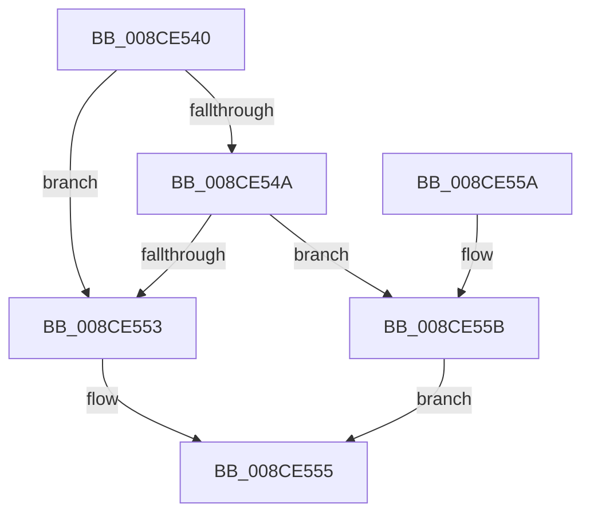

# MiUpdateImageSystemWideBitmaps

- RVA: `0x008CE540`–`0x008CE562` (길이 `34` bytes)
- VA: `0x00000001408CE540`
- 실행 섹션: `PAGE`
- PDB 이름 있음: `예`; PDB Function 태그: `아니요`
- unwind 정보 RVA: `0x0005CEE8`
- 디코드: `11`개 명령, `34/34` bytes 표시
- 미해석 바이트: `0` (있으면 어셈블리에 `.byte`로 보존)

> 이 문서는 커널 이미지의 기계어와 PDB 기호를 분석해 생성했습니다. 4번과 5번은 함수 원형과 자료형을 바이너리 사용 방식에서 추정한 C 해석이며 원본 소스 복구 결과는 아닙니다.

## 1. Dependencies

- 직접 호출 지점: **1**; 고유 호출 대상: **1**
- 직접 호출자로 확인된 함수: **2**
- RIP 상대 이미지 참조: **0**

### Outgoing calls
- `0x008CE55B` → [MiUpdateCfgSystemWideBitmap](MiUpdateCfgSystemWideBitmap_function_008CE568.md) (function, `0x008CE568`)

### Direct callers
- [MiRelocateImageAgain](../98/MiRelocateImageAgain_function_009885C8.md) at `0x009886C4`
- [MiRelocateImage](../98/MiRelocateImage_function_00988E14.md) at `0x00989115`

### Static image references
- 디코드된 RIP-relative 메모리 참조가 없습니다.

## 2. Other-region calls and transfers

- 다른 실행 섹션으로 향하는 call: **0**
- 별도 외부 분기/꼬리 이동을 확인하지 못했습니다.

## 3. Assembly (complete function range)

```asm
008CE540  48 83 EC 28                     sub rsp, 0x28
008CE544  83 79 58 FF                     cmp dword ptr [rcx + 0x58], -1
008CE548  74 09                           je 0x1408ce553
008CE54A  F7 41 38 00 00 00 20            test dword ptr [rcx + 0x38], 0x20000000
008CE551  74 08                           je 0x1408ce55b
008CE553  33 C0                           xor eax, eax
008CE555  48 83 C4 28                     add rsp, 0x28
008CE559  C3                              ret
008CE55A  CC                              int3
008CE55B  E8 08 00 00 00                  call 0x1408ce568
008CE560  EB F3                           jmp 0x1408ce555
```

## 4. C-style interpretation (structured pseudocode)

```c
__int64 __fastcall MiUpdateImageSystemWideBitmaps(__int64 a1)
{
    __int64 result;
    __int64 v_rsp;

    v_rsp = (v_rsp) - (40);
    if ((*(unsigned int *)(a1 + 88)) == -1) goto loc_008CE553;
    if (((*(unsigned int *)(a1 + 56)) & (0x20000000ULL)) == 0) goto loc_008CE55B;
loc_008CE553:
    result = 0;
loc_008CE555:
    v_rsp = (v_rsp) + (40);
    return result;
loc_008CE55B:
    result = MiUpdateCfgSystemWideBitmap(a1, a2, a3, a4);
    goto loc_008CE555;
}
```

## 5. (Beta) C Style

```c
int64_t MiUpdateImageSystemWideBitmaps(void *Arg1)
{
    uint8_t *arg1 = (uint8_t *)Arg1;

    int64_t result;
    int64_t local_rsp;

    local_rsp = (local_rsp) - (40);
    if ((*(uint32_t *)(arg1 + 0x58)) == -1) goto loc_008CE553;
    if (((*(uint32_t *)(arg1 + 0x38)) & (0x20000000ULL)) == 0) goto loc_008CE55B;
loc_008CE553:
    result = 0;
loc_008CE555:
    local_rsp = (local_rsp) + (40);
    return result;
loc_008CE55B:
    result = MiUpdateCfgSystemWideBitmap(Arg1, a2, a3, a4);
    goto loc_008CE555;
}
```

### 관측된 메모리 오프셋

구조체 형식이 확인되지 않은 접근은 인자 기준의 오프셋으로만 기록했습니다.

| 기준 인자 | 오프셋 표현 | 폭 (bit) | 접근 |
|---|---:|---:|---|
| `Arg1` | `+ 0x38` | `32` | `R` |
| `Arg1` | `+ 0x58` | `32` | `R` |

## 6. Execution-region graph

[열기: 2D/3D 그래프와 함수 탐색 컨트롤 패널](../../../control-panel.html?section=page&rva=0x008CE540&view=graph)

- 2D 그래프는 위에서 아래로 흐르고, 3D 그래프는 빈 공간을 드래그해 회전합니다. Shift+드래그는 이동, 휠은 확대·축소, 함수 노드 선택은 대상 보고서 이동입니다.

### Static fallback


