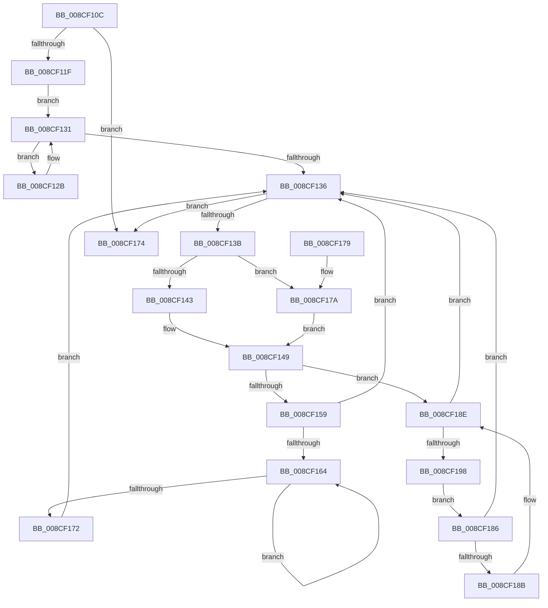

# MiUpdateProcessSharedCommit

- RVA: `0x008CF10C`–`0x008CF19A` (길이 `142` bytes)
- VA: `0x00000001408CF10C`
- 실행 섹션: `PAGE`
- PDB 이름 있음: `예`; PDB Function 태그: `아니요`
- unwind 정보 RVA: `0x000848A4`
- 디코드: `48`개 명령, `142/142` bytes 표시
- 미해석 바이트: `0` (있으면 어셈블리에 `.byte`로 보존)

> 이 문서는 커널 이미지의 기계어와 PDB 기호를 분석해 생성했습니다. 4번과 5번은 함수 원형과 자료형을 바이너리 사용 방식에서 추정한 C 해석이며 원본 소스 복구 결과는 아닙니다.

## 1. Dependencies

- 직접 호출 지점: **1**; 고유 호출 대상: **1**
- 직접 호출자로 확인된 함수: **1**
- RIP 상대 이미지 참조: **0**

### Outgoing calls
- `0x008CF116` → [MiIncludeSharedCommit](../../text/42/MiIncludeSharedCommit_function_00428010.md) (function, `0x00428010`)

### Direct callers
- [MiChargeSegmentCommit](MiChargeSegmentCommit_function_008CEDE4.md) at `0x008CEF71`

### Static image references
- 디코드된 RIP-relative 메모리 참조가 없습니다.

## 2. Other-region calls and transfers

- 다른 실행 섹션으로 향하는 call: **1**
  - `0x008CF116` → [MiIncludeSharedCommit](../../text/42/MiIncludeSharedCommit_function_00428010.md) (`PAGE` → `.text`)
- 별도 외부 분기/꼬리 이동을 확인하지 못했습니다.

## 3. Assembly (complete function range)

```asm
008CF10C  48 83 EC 28                     sub rsp, 0x28
008CF110  4C 8B D2                        mov r10, rdx
008CF113  4C 8B C9                        mov r9, rcx
008CF116  E8 F5 8E B5 FF                  call 0x140428010
008CF11B  85 C0                           test eax, eax
008CF11D  74 55                           je 0x1408cf174
008CF11F  49 8B 01                        mov rax, qword ptr [r9]
008CF122  45 33 C0                        xor r8d, r8d
008CF125  48 8B 48 48                     mov rcx, qword ptr [rax + 0x48]
008CF129  EB 06                           jmp 0x1408cf131
008CF12B  4C 8B C1                        mov r8, rcx
008CF12E  48 8B 09                        mov rcx, qword ptr [rcx]
008CF131  48 85 C9                        test rcx, rcx
008CF134  75 F5                           jne 0x1408cf12b
008CF136  4D 85 C0                        test r8, r8
008CF139  74 39                           je 0x1408cf174
008CF13B  49 8B 40 18                     mov rax, qword ptr [r8 + 0x18]
008CF13F  A8 01                           test al, 1
008CF141  75 37                           jne 0x1408cf17a
008CF143  48 05 A8 06 00 00               add rax, 0x6a8
008CF149  F0 4C 01 10                     lock add qword ptr [rax], r10
008CF14D  49 8B 40 08                     mov rax, qword ptr [r8 + 8]
008CF151  49 8B C8                        mov rcx, r8
008CF154  48 85 C0                        test rax, rax
008CF157  74 35                           je 0x1408cf18e
008CF159  48 8B 08                        mov rcx, qword ptr [rax]
008CF15C  4C 8B C0                        mov r8, rax
008CF15F  48 85 C9                        test rcx, rcx
008CF162  74 D2                           je 0x1408cf136
008CF164  48 8B 01                        mov rax, qword ptr [rcx]
008CF167  4C 8B C1                        mov r8, rcx
008CF16A  48 8B C8                        mov rcx, rax
008CF16D  48 85 C0                        test rax, rax
008CF170  75 F2                           jne 0x1408cf164
008CF172  EB C2                           jmp 0x1408cf136
008CF174  48 83 C4 28                     add rsp, 0x28
008CF178  C3                              ret
008CF179  CC                              int3
008CF17A  48 83 E0 FE                     and rax, 0xfffffffffffffffe
008CF17E  48 05 20 06 00 00               add rax, 0x620
008CF184  EB C3                           jmp 0x1408cf149
008CF186  49 39 08                        cmp qword ptr [r8], rcx
008CF189  74 AB                           je 0x1408cf136
008CF18B  49 8B C8                        mov rcx, r8
008CF18E  4D 8B 40 10                     mov r8, qword ptr [r8 + 0x10]
008CF192  49 83 E0 FC                     and r8, 0xfffffffffffffffc
008CF196  74 9E                           je 0x1408cf136
008CF198  EB EC                           jmp 0x1408cf186
```

## 4. C-style interpretation (structured pseudocode)

```c
__int64 __fastcall MiUpdateProcessSharedCommit(__int64 a1, __int64 a2, int a3)
{
    __int64 result;
    __int64 v_rsp;

    v_rsp = (v_rsp) - (40);
    result = MiIncludeSharedCommit(a1, a2, a3, a1);
    if ((unsigned int)(result) == 0) goto loc_008CF174;
    a3 = 0;
    goto loc_008CF131;
loc_008CF12B:
loc_008CF131:
    if (*(unsigned __int64 *)(*(unsigned __int64 *)(*(unsigned __int64 *)(a1) + 72)) != 0) goto loc_008CF12B;
loc_008CF136:
    if (*(unsigned __int64 *)(*(unsigned __int64 *)(a1) + 72) == 0) goto loc_008CF174;
    if ((((unsigned __int8)(*(unsigned __int64 *)(*(unsigned __int64 *)(*(unsigned __int64 *)(a1) + 72) + 24))) & (1)) != 0) goto loc_008CF17A;
    result = (*(unsigned __int64 *)(*(unsigned __int64 *)(*(unsigned __int64 *)(a1) + 72) + 24)) + (0x6A8ULL);
loc_008CF149:
    if (*(unsigned __int64 *)(*(unsigned __int64 *)(*(unsigned __int64 *)(a1) + 72) + 8) == 0) goto loc_008CF18E;
    if (*(unsigned __int64 *)(*(unsigned __int64 *)(*(unsigned __int64 *)(*(unsigned __int64 *)(a1) + 72) + 8)) == 0) goto loc_008CF136;
loc_008CF164:
    if (*(unsigned __int64 *)(*(unsigned __int64 *)(*(unsigned __int64 *)(*(unsigned __int64 *)(*(unsigned __int64 *)(a1) + 72) + 8))) != 0) goto loc_008CF164;
    goto loc_008CF136;
loc_008CF174:
    v_rsp = (v_rsp) + (40);
    return *(unsigned __int64 *)(*(unsigned __int64 *)(*(unsigned __int64 *)(*(unsigned __int64 *)(*(unsigned __int64 *)(a1) + 72) + 8)));
loc_008CF17A:
    result = (*(unsigned __int64 *)(*(unsigned __int64 *)(*(unsigned __int64 *)(*(unsigned __int64 *)(*(unsigned __int64 *)(a1) + 72) + 8)))) & (-2);
    result = (result) + (0x620ULL);
    goto loc_008CF149;
loc_008CF186:
    if ((*(unsigned __int64 *)(*(unsigned __int64 *)(*(unsigned __int64 *)(*(unsigned __int64 *)(*(unsigned __int64 *)(a1) + 72) + 8)))) == (*(unsigned __int64 *)(*(unsigned __int64 *)(*(unsigned __int64 *)(*(unsigned __int64 *)(*(unsigned __int64 *)(a1) + 72) + 8))))) goto loc_008CF136;
loc_008CF18E:
    a3 = (*(unsigned __int64 *)(*(unsigned __int64 *)(*(unsigned __int64 *)(*(unsigned __int64 *)(*(unsigned __int64 *)(a1) + 72) + 8)) + 16)) & (-4);
    if (condition_is_equal) goto loc_008CF136;
    goto loc_008CF186;
}
```

## 5. (Beta) C Style

```c
int64_t MiUpdateProcessSharedCommit(int64_t Arg1, int64_t Arg2, int32_t Arg3)
{
    int64_t result;
    int64_t local_rsp;

    local_rsp = (local_rsp) - (40);
    result = MiIncludeSharedCommit(Arg1, Arg2, Arg3, Arg1);
    if ((uint32_t)(result) == 0) goto loc_008CF174;
    Arg3 = 0;
    goto loc_008CF131;
loc_008CF12B:
loc_008CF131:
    if (*(uint64_t *)(*(uint64_t *)(*(uint64_t *)(Arg1) + 0x48)) != 0) goto loc_008CF12B;
loc_008CF136:
    if (*(uint64_t *)(*(uint64_t *)(Arg1) + 0x48) == 0) goto loc_008CF174;
    if ((((uint8_t)(*(uint64_t *)(*(uint64_t *)(*(uint64_t *)(Arg1) + 0x48) + 0x18))) & (1)) != 0) goto loc_008CF17A;
    result = (*(uint64_t *)(*(uint64_t *)(*(uint64_t *)(Arg1) + 0x48) + 0x18)) + (0x6A8ULL);
loc_008CF149:
    if (*(uint64_t *)(*(uint64_t *)(*(uint64_t *)(Arg1) + 0x48) + 0x8) == 0) goto loc_008CF18E;
    if (*(uint64_t *)(*(uint64_t *)(*(uint64_t *)(*(uint64_t *)(Arg1) + 0x48) + 0x8)) == 0) goto loc_008CF136;
loc_008CF164:
    if (*(uint64_t *)(*(uint64_t *)(*(uint64_t *)(*(uint64_t *)(*(uint64_t *)(Arg1) + 0x48) + 0x8))) != 0) goto loc_008CF164;
    goto loc_008CF136;
loc_008CF174:
    local_rsp = (local_rsp) + (40);
    return *(uint64_t *)(*(uint64_t *)(*(uint64_t *)(*(uint64_t *)(*(uint64_t *)(Arg1) + 0x48) + 0x8)));
loc_008CF17A:
    result = (*(uint64_t *)(*(uint64_t *)(*(uint64_t *)(*(uint64_t *)(*(uint64_t *)(Arg1) + 0x48) + 0x8)))) & (-2);
    result = (result) + (0x620ULL);
    goto loc_008CF149;
loc_008CF186:
    if ((*(uint64_t *)(*(uint64_t *)(*(uint64_t *)(*(uint64_t *)(*(uint64_t *)(Arg1) + 0x48) + 0x8)))) == (*(uint64_t *)(*(uint64_t *)(*(uint64_t *)(*(uint64_t *)(*(uint64_t *)(Arg1) + 0x48) + 0x8))))) goto loc_008CF136;
loc_008CF18E:
    Arg3 = (*(uint64_t *)(*(uint64_t *)(*(uint64_t *)(*(uint64_t *)(*(uint64_t *)(Arg1) + 0x48) + 0x8)) + 0x10)) & (-4);
    if (condition_is_equal) goto loc_008CF136;
    goto loc_008CF186;
}
```

## 6. Execution-region graph

[열기: 2D/3D 그래프와 함수 탐색 컨트롤 패널](../../../control-panel.html?section=page&rva=0x008CF10C&view=graph)

- 2D 그래프는 위에서 아래로 흐르고, 3D 그래프는 빈 공간을 드래그해 회전합니다. Shift+드래그는 이동, 휠은 확대·축소, 함수 노드 선택은 대상 보고서 이동입니다.

### Static fallback


