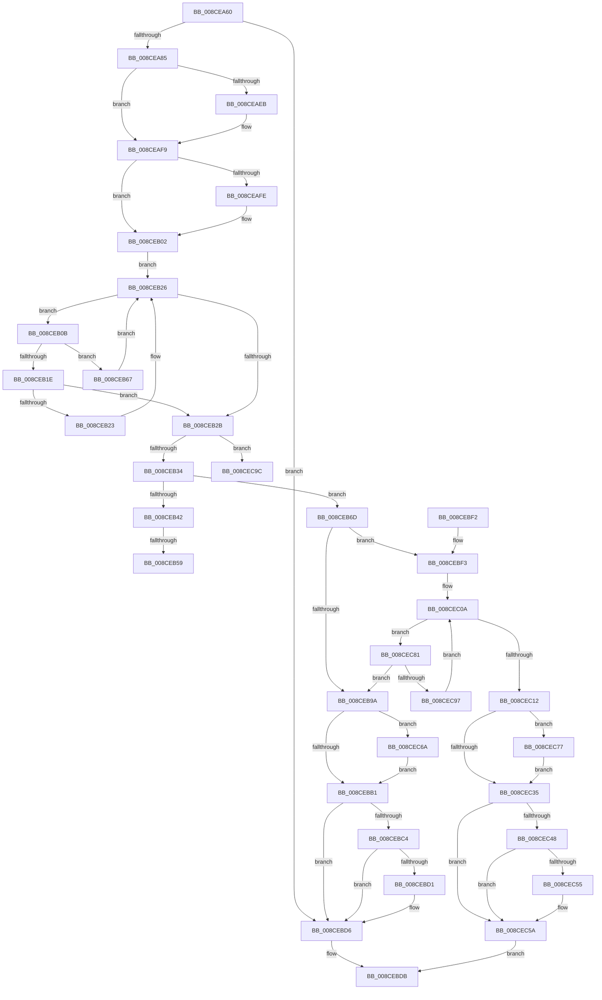

# MmCommitSessionMappedView

- RVA: `0x008CEA60`–`0x008CECB7` (길이 `599` bytes)
- VA: `0x00000001408CEA60`
- 실행 섹션: `PAGE`
- PDB 이름 있음: `예`; PDB Function 태그: `예`
- unwind 정보 RVA: `0x00084830`
- 디코드: `164`개 명령, `599/599` bytes 표시
- 미해석 바이트: `0` (있으면 어셈블리에 `.byte`로 보존)

> 이 문서는 커널 이미지의 기계어와 PDB 기호를 분석해 생성했습니다. 4번과 5번은 함수 원형과 자료형을 바이너리 사용 방식에서 추정한 C 해석이며 원본 소스 복구 결과는 아닙니다.

## 1. Dependencies

- 직접 호출 지점: **14**; 고유 호출 대상: **9**
- 직접 호출자로 확인된 함수: **0**
- RIP 상대 이미지 참조: **3**

### Outgoing calls
- `0x008CEAA2` → [MiGetPteAddress](../../text/43/MiGetPteAddress_function_0043E130.md) (function, `0x0043E130`)
- `0x008CEAAD` → [MiGetPteAddress](../../text/43/MiGetPteAddress_function_0043E130.md) (function, `0x0043E130`)
- `0x008CEADA` → [KeAbPreAcquire](../../text/21/KeAbPreAcquire_function_00210230.md) (function, `0x00210230`)
- `0x008CEAF4` → [ExfAcquirePushLockExclusiveEx](../../text/20/ExfAcquirePushLockExclusiveEx_function_0020FC90.md) (function, `0x0020FC90`)
- `0x008CEB5C` → [ExfTryToWakePushLock](../../text/26/ExfTryToWakePushLock_function_00265DD0.md) (function, `0x00265DD0`)
- `0x008CEB8D` → [MiLocatePagefileSubsection](../../text/36/MiLocatePagefileSubsection_function_00367AC0.md) (function, `0x00367AC0`)
- `0x008CEBB4` → [KeAbPostRelease](../../text/2E/KeAbPostRelease_function_002E1600.md) (function, `0x002E1600`)
- `0x008CEBD1` → [KiCheckForKernelApcDelivery](../../text/2E/KiCheckForKernelApcDelivery_function_002E2C80.md) (function, `0x002E2C80`)
- `0x008CEC1B` → [MiChargeSegmentCommit](MiChargeSegmentCommit_function_008CEDE4.md) (function, `0x008CEDE4`)
- `0x008CEC38` → [KeAbPostRelease](../../text/2E/KeAbPostRelease_function_002E1600.md) (function, `0x002E1600`)
- `0x008CEC55` → [KiCheckForKernelApcDelivery](../../text/2E/KiCheckForKernelApcDelivery_function_002E2C80.md) (function, `0x002E2C80`)
- `0x008CEC6D` → [ExfTryToWakePushLock](../../text/26/ExfTryToWakePushLock_function_00265DD0.md) (function, `0x00265DD0`)
- `0x008CEC7A` → [ExfTryToWakePushLock](../../text/26/ExfTryToWakePushLock_function_00265DD0.md) (function, `0x00265DD0`)
- `0x008CECB1` → [KeBugCheckEx](../../text/4F/KeBugCheckEx_function_004FD660.md) (function, `0x004FD660`)

### Direct callers
- 이 함수 시작 RVA로 연결되는 직접 call은 확인되지 않았습니다. 간접 호출은 완전히 역산할 수 없습니다.

### Static image references
- `0x008CEAB5` → RVA `0x00E36040` (`.data`; read)
- `0x008CEB02` → RVA `0x00E36048` (`.data`; read)
- `0x008CEB46` → RVA `0x00E36040` (`.data`; read/write)

## 2. Other-region calls and transfers

- 다른 실행 섹션으로 향하는 call: **13**
  - `0x008CEAA2` → [MiGetPteAddress](../../text/43/MiGetPteAddress_function_0043E130.md) (`PAGE` → `.text`)
  - `0x008CEAAD` → [MiGetPteAddress](../../text/43/MiGetPteAddress_function_0043E130.md) (`PAGE` → `.text`)
  - `0x008CEADA` → [KeAbPreAcquire](../../text/21/KeAbPreAcquire_function_00210230.md) (`PAGE` → `.text`)
  - `0x008CEAF4` → [ExfAcquirePushLockExclusiveEx](../../text/20/ExfAcquirePushLockExclusiveEx_function_0020FC90.md) (`PAGE` → `.text`)
  - `0x008CEB5C` → [ExfTryToWakePushLock](../../text/26/ExfTryToWakePushLock_function_00265DD0.md) (`PAGE` → `.text`)
  - `0x008CEB8D` → [MiLocatePagefileSubsection](../../text/36/MiLocatePagefileSubsection_function_00367AC0.md) (`PAGE` → `.text`)
  - `0x008CEBB4` → [KeAbPostRelease](../../text/2E/KeAbPostRelease_function_002E1600.md) (`PAGE` → `.text`)
  - `0x008CEBD1` → [KiCheckForKernelApcDelivery](../../text/2E/KiCheckForKernelApcDelivery_function_002E2C80.md) (`PAGE` → `.text`)
  - `0x008CEC38` → [KeAbPostRelease](../../text/2E/KeAbPostRelease_function_002E1600.md) (`PAGE` → `.text`)
  - `0x008CEC55` → [KiCheckForKernelApcDelivery](../../text/2E/KiCheckForKernelApcDelivery_function_002E2C80.md) (`PAGE` → `.text`)
  - `0x008CEC6D` → [ExfTryToWakePushLock](../../text/26/ExfTryToWakePushLock_function_00265DD0.md) (`PAGE` → `.text`)
  - `0x008CEC7A` → [ExfTryToWakePushLock](../../text/26/ExfTryToWakePushLock_function_00265DD0.md) (`PAGE` → `.text`)
  - `0x008CECB1` → [KeBugCheckEx](../../text/4F/KeBugCheckEx_function_004FD660.md) (`PAGE` → `.text`)
- call이 아닌 외부 분기/꼬리 이동: **2**
  - `0x008CEB53` → [sub_00B1B83E](../B1/Unknown_function_00B1B83E.md) (`tail-transfer`)
  - `0x008CEB62` → [sub_00B1B83E](../B1/Unknown_function_00B1B83E.md) (`tail-transfer`)

## 3. Assembly (complete function range)

```asm
008CEA60  48 89 5C 24 10                  mov qword ptr [rsp + 0x10], rbx
008CEA65  48 89 6C 24 18                  mov qword ptr [rsp + 0x18], rbp
008CEA6A  56                              push rsi
008CEA6B  57                              push rdi
008CEA6C  41 54                           push r12
008CEA6E  41 56                           push r14
008CEA70  41 57                           push r15
008CEA72  48 83 EC 30                     sub rsp, 0x30
008CEA76  48 8B F9                        mov rdi, rcx
008CEA79  48 03 CA                        add rcx, rdx
008CEA7C  48 3B CF                        cmp rcx, rdi
008CEA7F  0F 86 51 01 00 00               jbe 0x1408cebd6
008CEA85  65 48 8B 1C 25 88 01 00 00      mov rbx, qword ptr gs:[0x188]
008CEA8E  49 C7 C4 00 F0 FF FF            mov r12, 0xfffffffffffff000
008CEA95  49 23 FC                        and rdi, r12
008CEA98  48 FF C9                        dec rcx
008CEA9B  48 81 C9 FF 0F 00 00            or rcx, 0xfff
008CEAA2  E8 89 F6 B6 FF                  call 0x14043e130
008CEAA7  48 8B CF                        mov rcx, rdi
008CEAAA  4C 8B F0                        mov r14, rax
008CEAAD  E8 7E F6 B6 FF                  call 0x14043e130
008CEAB2  4C 2B F0                        sub r14, rax
008CEAB5  48 8D 2D 84 75 56 00            lea rbp, [rip + 0x567584]
008CEABC  41 BF 01 00 00 00               mov r15d, 1
008CEAC2  49 C1 FE 03                     sar r14, 3
008CEAC6  66 44 29 BB E6 01 00 00         sub word ptr [rbx + 0x1e6], r15w
008CEACE  45 33 C0                        xor r8d, r8d
008CEAD1  33 D2                           xor edx, edx
008CEAD3  48 8B CD                        mov rcx, rbp
008CEAD6  4D 03 F7                        add r14, r15
008CEAD9  90                              nop
008CEADA  E8 51 17 94 FF                  call 0x140210230
008CEADF  F0 48 0F BA 6D 00 00            lock bts qword ptr [rbp], 0
008CEAE6  48 8B F0                        mov rsi, rax
008CEAE9  73 0E                           jae 0x1408ceaf9
008CEAEB  4C 8B C5                        mov r8, rbp
008CEAEE  48 8B D0                        mov rdx, rax
008CEAF1  48 8B CD                        mov rcx, rbp
008CEAF4  E8 97 11 94 FF                  call 0x14020fc90
008CEAF9  48 85 F6                        test rsi, rsi
008CEAFC  74 04                           je 0x1408ceb02
008CEAFE  44 88 7E 0A                     mov byte ptr [rsi + 0xa], r15b
008CEB02  48 8B 15 3F 75 56 00            mov rdx, qword ptr [rip + 0x56753f]
008CEB09  EB 1B                           jmp 0x1408ceb26
008CEB0B  4C 8B 42 58                     mov r8, qword ptr [rdx + 0x58]
008CEB0F  48 8B 4A 20                     mov rcx, qword ptr [rdx + 0x20]
008CEB13  4D 23 C4                        and r8, r12
008CEB16  49 03 C8                        add rcx, r8
008CEB19  48 3B F9                        cmp rdi, rcx
008CEB1C  73 49                           jae 0x1408ceb67
008CEB1E  49 3B F8                        cmp rdi, r8
008CEB21  73 08                           jae 0x1408ceb2b
008CEB23  48 8B 12                        mov rdx, qword ptr [rdx]
008CEB26  48 85 D2                        test rdx, rdx
008CEB29  75 E0                           jne 0x1408ceb0b
008CEB2B  48 85 D2                        test rdx, rdx
008CEB2E  0F 84 68 01 00 00               je 0x1408cec9c
008CEB34  48 8B 42 30                     mov rax, qword ptr [rdx + 0x30]
008CEB38  48 8B 08                        mov rcx, qword ptr [rax]
008CEB3B  48 83 79 40 00                  cmp qword ptr [rcx + 0x40], 0
008CEB40  74 2B                           je 0x1408ceb6d
008CEB42  48 83 C8 FF                     or rax, 0xffffffffffffffff
008CEB46  F0 48 0F C1 05 F1 74 56 00      lock xadd qword ptr [rip + 0x5674f1], rax
008CEB4F  24 06                           and al, 6
008CEB51  3C 02                           cmp al, 2
008CEB53  0F 85 E5 CC 24 00               jne 0x140b1b83e
008CEB59  48 8B CD                        mov rcx, rbp
008CEB5C  E8 6F 72 99 FF                  call 0x140265dd0
008CEB61  90                              nop
008CEB62  E9 D7 CC 24 00                  jmp 0x140b1b83e
008CEB67  48 8B 52 08                     mov rdx, qword ptr [rdx + 8]
008CEB6B  EB B9                           jmp 0x1408ceb26
008CEB6D  48 8B 42 58                     mov rax, qword ptr [rdx + 0x58]
008CEB71  48 83 E9 80                     sub rcx, -0x80
008CEB75  49 23 C4                        and rax, r12
008CEB78  48 2B F8                        sub rdi, rax
008CEB7B  48 C1 EF 0C                     shr rdi, 0xc
008CEB7F  48 03 7A 18                     add rdi, qword ptr [rdx + 0x18]
008CEB83  48 8D 54 24 60                  lea rdx, [rsp + 0x60]
008CEB88  48 89 7C 24 60                  mov qword ptr [rsp + 0x60], rdi
008CEB8D  E8 2E 8F A9 FF                  call 0x140367ac0
008CEB92  4C 8B C8                        mov r9, rax
008CEB95  48 85 C0                        test rax, rax
008CEB98  75 59                           jne 0x1408cebf3
008CEB9A  48 83 C8 FF                     or rax, 0xffffffffffffffff
008CEB9E  F0 48 0F C1 05 99 74 56 00      lock xadd qword ptr [rip + 0x567499], rax
008CEBA7  24 06                           and al, 6
008CEBA9  3C 02                           cmp al, 2
008CEBAB  0F 84 B9 00 00 00               je 0x1408cec6a
008CEBB1  48 8B CD                        mov rcx, rbp
008CEBB4  E8 47 2A A1 FF                  call 0x1402e1600
008CEBB9  90                              nop
008CEBBA  66 44 01 BB E6 01 00 00         add word ptr [rbx + 0x1e6], r15w
008CEBC2  75 12                           jne 0x1408cebd6
008CEBC4  48 8D 83 98 00 00 00            lea rax, [rbx + 0x98]
008CEBCB  90                              nop
008CEBCC  48 39 00                        cmp qword ptr [rax], rax
008CEBCF  74 05                           je 0x1408cebd6
008CEBD1  E8 AA 40 A1 FF                  call 0x1402e2c80
008CEBD6  B8 F0 00 00 C0                  mov eax, 0xc00000f0
008CEBDB  48 8B 5C 24 68                  mov rbx, qword ptr [rsp + 0x68]
008CEBE0  48 8B 6C 24 70                  mov rbp, qword ptr [rsp + 0x70]
008CEBE5  48 83 C4 30                     add rsp, 0x30
008CEBE9  41 5F                           pop r15
008CEBEB  41 5E                           pop r14
008CEBED  41 5C                           pop r12
008CEBEF  5F                              pop rdi
008CEBF0  5E                              pop rsi
008CEBF1  C3                              ret
008CEBF2  CC                              int3
008CEBF3  48 8B 4C 24 60                  mov rcx, qword ptr [rsp + 0x60]
008CEBF8  48 8B 40 08                     mov rax, qword ptr [rax + 8]
008CEBFC  4C 8D 14 C8                     lea r10, [rax + rcx*8]
008CEC00  49 8D 04 0E                     lea rax, [r14 + rcx]
008CEC04  49 8B C9                        mov rcx, r9
008CEC07  4C 8B C0                        mov r8, rax
008CEC0A  8B 51 2C                        mov edx, dword ptr [rcx + 0x2c]
008CEC0D  48 3B C2                        cmp rax, rdx
008CEC10  77 6F                           ja 0x1408cec81
008CEC12  4D 8B C6                        mov r8, r14
008CEC15  49 8B D2                        mov rdx, r10
008CEC18  49 8B C9                        mov rcx, r9
008CEC1B  E8 C4 01 00 00                  call 0x1408cede4
008CEC20  8B F8                           mov edi, eax
008CEC22  48 83 C8 FF                     or rax, 0xffffffffffffffff
008CEC26  F0 48 0F C1 05 11 74 56 00      lock xadd qword ptr [rip + 0x567411], rax
008CEC2F  24 06                           and al, 6
008CEC31  3C 02                           cmp al, 2
008CEC33  74 42                           je 0x1408cec77
008CEC35  48 8B CD                        mov rcx, rbp
008CEC38  E8 C3 29 A1 FF                  call 0x1402e1600
008CEC3D  90                              nop
008CEC3E  66 44 01 BB E6 01 00 00         add word ptr [rbx + 0x1e6], r15w
008CEC46  75 12                           jne 0x1408cec5a
008CEC48  48 8D 83 98 00 00 00            lea rax, [rbx + 0x98]
008CEC4F  90                              nop
008CEC50  48 39 00                        cmp qword ptr [rax], rax
008CEC53  74 05                           je 0x1408cec5a
008CEC55  E8 26 40 A1 FF                  call 0x1402e2c80
008CEC5A  F7 DF                           neg edi
008CEC5C  1B C0                           sbb eax, eax
008CEC5E  F7 D0                           not eax
008CEC60  25 2D 01 00 C0                  and eax, 0xc000012d
008CEC65  E9 71 FF FF FF                  jmp 0x1408cebdb
008CEC6A  48 8B CD                        mov rcx, rbp
008CEC6D  E8 5E 71 99 FF                  call 0x140265dd0
008CEC72  E9 3A FF FF FF                  jmp 0x1408cebb1
008CEC77  48 8B CD                        mov rcx, rbp
008CEC7A  E8 51 71 99 FF                  call 0x140265dd0
008CEC7F  EB B4                           jmp 0x1408cec35
008CEC81  48 8B 49 10                     mov rcx, qword ptr [rcx + 0x10]
008CEC85  49 8B C0                        mov rax, r8
008CEC88  48 2B C2                        sub rax, rdx
008CEC8B  4C 8B C0                        mov r8, rax
008CEC8E  48 85 C9                        test rcx, rcx
008CEC91  0F 84 03 FF FF FF               je 0x1408ceb9a
008CEC97  E9 6E FF FF FF                  jmp 0x1408cec0a
008CEC9C  48 83 64 24 20 00               and qword ptr [rsp + 0x20], 0
008CECA2  45 33 C9                        xor r9d, r9d
008CECA5  48 8B D7                        mov rdx, rdi
008CECA8  B9 D7 00 00 00                  mov ecx, 0xd7
008CECAD  45 8D 41 02                     lea r8d, [r9 + 2]
008CECB1  E8 AA E9 C2 FF                  call 0x1404fd660
008CECB6  CC                              int3
```

## 4. C-style interpretation (structured pseudocode)

```c
__int64 __fastcall MmCommitSessionMappedView(__int64 a1, __int64 a2, int a3)
{
    __int64 result;
    __int64 v_r14;
    __int64 v_rdi;
    __int64 v_rsp;
    unsigned __int64 v_stack_p10;
    unsigned __int64 v_stack_p18;
    unsigned __int64 v_stack_p20;
    unsigned __int64 v_stack_p60;
    unsigned __int64 v_stack_p8;

    v_stack_p10 = v_rbx;
    v_stack_p18 = v_rbp;
    v_rsp = (v_rsp) - (48);
    a1 = (a1) + (a2);
    if (a1 <= a1) goto loc_008CEBD6;
    v_rdi = (a1) & (0xFFFFFFFFFFFFF000ULL);
    a1 = (a1) - 1;
    a1 = (a1) | (0xFFFULL);
    result = MiGetPteAddress(a1, a2, a3, a4);
    result = MiGetPteAddress(v_rdi, a2, a3, a4);
    v_r14 = (result) - (result);
    v_r14 = (v_r14) >> (3);
    a3 = 0;
    a2 = 0;
    v_r14 = (v_r14) + (1);
    result = KeAbPreAcquire(v_rip + 5666180, a2, a3, a4);
    if (!(condition_is_above_or_equal)) {
        a3 = v_rip + 5666180;
        a2 = result;
        a1 = v_rip + 5666180;
        result = ExfAcquirePushLockExclusiveEx(a1, a2, a3, a4);
    }
    if (result != 0) {
        *(unsigned __int8 *)(result + 10) = 1;
    }
    goto loc_008CEB26;
loc_008CEB0B:
    a3 = (*(unsigned __int64 *)(*(unsigned __int64 *)(v_rip + 5666111) + 88)) & (0xFFFFFFFFFFFFF000ULL);
    a1 = (*(unsigned __int64 *)(*(unsigned __int64 *)(v_rip + 5666111) + 32)) + (a3);
    if (v_rdi >= a1) goto loc_008CEB67;
    if (v_rdi >= a3) goto loc_008CEB2B;
loc_008CEB26:
    if (*(unsigned __int64 *)(*(unsigned __int64 *)(v_rip + 5666111)) != 0) goto loc_008CEB0B;
loc_008CEB2B:
    if (*(unsigned __int64 *)(*(unsigned __int64 *)(v_rip + 5666111)) == 0) goto loc_008CEC9C;
    if ((*(unsigned __int64 *)(*(unsigned __int64 *)(*(unsigned __int64 *)(*(unsigned __int64 *)(*(unsigned __int64 *)(v_rip + 5666111)) + 48)) + 64)) == 0) goto loc_008CEB6D;
    result = (*(unsigned __int64 *)(*(unsigned __int64 *)(*(unsigned __int64 *)(v_rip + 5666111)) + 48)) | (-1);
    result = (unsigned __int8)((result) & (6));
    result = ExfTryToWakePushLock(v_rip + 5666180, *(unsigned __int64 *)(*(unsigned __int64 *)(v_rip + 5666111)), a3, a4);
loc_008CEB67:
    goto loc_008CEB26;
loc_008CEB6D:
    a1 = (v_rip + 5666180) - (-128);
    result = (*(unsigned __int64 *)(*(unsigned __int64 *)(*(unsigned __int64 *)(*(unsigned __int64 *)(v_rip + 5666111)) + 8) + 88)) & (0xFFFFFFFFFFFFF000ULL);
    v_rdi = (v_rdi) - (result);
    v_rdi = (v_rdi) >> (12);
    v_rdi = (v_rdi) + (*(unsigned __int64 *)(*(unsigned __int64 *)(*(unsigned __int64 *)(*(unsigned __int64 *)(v_rip + 5666111)) + 8) + 24));
    v_stack_p8 = v_rdi;
    result = MiLocatePagefileSubsection(a1, v_stack_p8, a3, a4);
    if (result != 0) goto loc_008CEBF3;
loc_008CEB9A:
    result = (result) | (-1);
    result = (unsigned __int8)((result) & (6));
    if (((unsigned __int8)(result)) == 2) goto loc_008CEC6A;
loc_008CEBB1:
    result = KeAbPostRelease(v_rip + 5666180, v_stack_p8, a3, result);
    if (((unsigned __int8)(result)) != 2) goto loc_008CEBD6;
    result = *(unsigned __int64 *)(gs_base + (0 + 392)) + 152;
    if ((*(unsigned __int64 *)(*(unsigned __int64 *)(gs_base + (0 + 392)) + 152)) != (*(unsigned __int64 *)(gs_base + (0 + 392)) + 152)) {
        result = KiCheckForKernelApcDelivery(v_rip + 5666180, v_stack_p8, a3, result);
    }
loc_008CEBDB:
    v_rsp = (v_rsp) + (48);
    return (unsigned int)(0xC00000F0ULL);
loc_008CEBF3:
loc_008CEC0A:
    if ((v_r14 + v_stack_p60 * 1) > ((unsigned int)(*(unsigned int *)(result + 44)))) goto loc_008CEC81;
    result = MiChargeSegmentCommit(result, *(unsigned __int64 *)((unsigned int)(0xC00000F0ULL) + 8) + v_stack_p60 * 8, v_r14, result);
    result = (result) | (-1);
    result = (unsigned __int8)((result) & (6));
    if (((unsigned __int8)(result)) == 2) goto loc_008CEC77;
loc_008CEC35:
    result = KeAbPostRelease(v_stack_p18, *(unsigned __int64 *)((unsigned int)(0xC00000F0ULL) + 8) + v_stack_p60 * 8, v_r14, result);
    if (((unsigned __int8)(result)) != 2) goto loc_008CEC5A;
    result = v_stack_p10 + 152;
    if ((*(unsigned __int64 *)(v_stack_p10 + 152)) != (v_stack_p10 + 152)) {
        result = KiCheckForKernelApcDelivery(v_stack_p18, *(unsigned __int64 *)((unsigned int)(0xC00000F0ULL) + 8) + v_stack_p60 * 8, v_r14, result);
    }
    v_rdi = (unsigned int)(-((unsigned int)((unsigned int)(result))));
    result = (unsigned int)(~(result));
    result = (unsigned int)((result) & (0xC000012DULL));
    goto loc_008CEBDB;
loc_008CEC6A:
    result = ExfTryToWakePushLock(v_stack_p18, *(unsigned __int64 *)((unsigned int)(0xC00000F0ULL) + 8) + v_stack_p60 * 8, v_r14, result);
    goto loc_008CEBB1;
loc_008CEC77:
    result = ExfTryToWakePushLock(v_stack_p18, *(unsigned __int64 *)((unsigned int)(0xC00000F0ULL) + 8) + v_stack_p60 * 8, v_r14, result);
    goto loc_008CEC35;
loc_008CEC81:
    result = (v_r14) - (*(unsigned __int64 *)((unsigned int)(0xC00000F0ULL) + 8) + v_stack_p60 * 8);
    if (*(unsigned __int64 *)(v_stack_p18 + 16) == 0) goto loc_008CEB9A;
    goto loc_008CEC0A;
loc_008CEC9C:
    a4 = 0;
    result = KeBugCheckEx(215, v_rdi, a4 + 2, a4);
    return result;
}
```

## 5. (Beta) C Style

```c
int64_t MmCommitSessionMappedView(int64_t Arg1, int64_t Arg2, int32_t Arg3)
{
    int64_t result;
    int64_t local_r14;
    int64_t local_rdi;
    int64_t local_rsp;
    uint64_t v_stack_p10;
    uint64_t v_stack_p18;
    uint64_t v_stack_p20;
    uint64_t v_stack_p60;
    uint64_t v_stack_p8;

    v_stack_p10 = local_rbx;
    v_stack_p18 = local_rbp;
    local_rsp = (local_rsp) - (48);
    Arg1 = (Arg1) + (Arg2);
    if (Arg1 <= Arg1) goto loc_008CEBD6;
    local_rdi = (Arg1) & (0xFFFFFFFFFFFFF000ULL);
    Arg1 = (Arg1) - 1;
    Arg1 = (Arg1) | (0xFFFULL);
    result = MiGetPteAddress(Arg1, Arg2, Arg3, a4);
    result = MiGetPteAddress(local_rdi, Arg2, Arg3, a4);
    local_r14 = (result) - (result);
    local_r14 = (local_r14) >> (3);
    Arg3 = 0;
    Arg2 = 0;
    local_r14 = (local_r14) + (1);
    result = KeAbPreAcquire(v_rip + 5666180, Arg2, Arg3, a4);
    if (!(condition_is_above_or_equal)) {
        Arg3 = v_rip + 5666180;
        Arg2 = result;
        Arg1 = v_rip + 5666180;
        result = ExfAcquirePushLockExclusiveEx(Arg1, Arg2, Arg3, a4);
    }
    if (result != 0) {
        *(uint8_t *)(result + 0xA) = 1;
    }
    goto loc_008CEB26;
loc_008CEB0B:
    Arg3 = (*(uint64_t *)(*(uint64_t *)(v_rip + 0x56753F) + 0x58)) & (0xFFFFFFFFFFFFF000ULL);
    Arg1 = (*(uint64_t *)(*(uint64_t *)(v_rip + 0x56753F) + 0x20)) + (Arg3);
    if (local_rdi >= Arg1) goto loc_008CEB67;
    if (local_rdi >= Arg3) goto loc_008CEB2B;
loc_008CEB26:
    if (*(uint64_t *)(*(uint64_t *)(v_rip + 0x56753F)) != 0) goto loc_008CEB0B;
loc_008CEB2B:
    if (*(uint64_t *)(*(uint64_t *)(v_rip + 0x56753F)) == 0) goto loc_008CEC9C;
    if ((*(uint64_t *)(*(uint64_t *)(*(uint64_t *)(*(uint64_t *)(*(uint64_t *)(v_rip + 0x56753F)) + 0x30)) + 0x40)) == 0) goto loc_008CEB6D;
    result = (*(uint64_t *)(*(uint64_t *)(*(uint64_t *)(v_rip + 0x56753F)) + 0x30)) | (-1);
    result = (uint8_t)((result) & (6));
    result = ExfTryToWakePushLock(v_rip + 5666180, *(uint64_t *)(*(uint64_t *)(v_rip + 0x56753F)), Arg3, a4);
loc_008CEB67:
    goto loc_008CEB26;
loc_008CEB6D:
    Arg1 = (v_rip + 5666180) - (-128);
    result = (*(uint64_t *)(*(uint64_t *)(*(uint64_t *)(*(uint64_t *)(v_rip + 0x56753F)) + 0x8) + 0x58)) & (0xFFFFFFFFFFFFF000ULL);
    local_rdi = (local_rdi) - (result);
    local_rdi = (local_rdi) >> (12);
    local_rdi = (local_rdi) + (*(uint64_t *)(*(uint64_t *)(*(uint64_t *)(*(uint64_t *)(v_rip + 0x56753F)) + 0x8) + 0x18));
    v_stack_p8 = local_rdi;
    result = MiLocatePagefileSubsection(Arg1, v_stack_p8, Arg3, a4);
    if (result != 0) goto loc_008CEBF3;
loc_008CEB9A:
    result = (result) | (-1);
    result = (uint8_t)((result) & (6));
    if (((uint8_t)(result)) == 2) goto loc_008CEC6A;
loc_008CEBB1:
    result = KeAbPostRelease(v_rip + 5666180, v_stack_p8, Arg3, result);
    if (((uint8_t)(result)) != 2) goto loc_008CEBD6;
    result = *(uint64_t *)(gs_base + (0 + 0x188)) + 152;
    if ((*(uint64_t *)(*(uint64_t *)(gs_base + (0 + 0x188)) + 0x98)) != (*(uint64_t *)(gs_base + (0 + 0x188)) + 152)) {
        result = KiCheckForKernelApcDelivery(v_rip + 5666180, v_stack_p8, Arg3, result);
    }
loc_008CEBDB:
    local_rsp = (local_rsp) + (48);
    return (uint32_t)(0xC00000F0ULL);
loc_008CEBF3:
loc_008CEC0A:
    if ((local_r14 + v_stack_p60 * 1) > ((uint32_t)(*(uint32_t *)(result + 0x2C)))) goto loc_008CEC81;
    result = MiChargeSegmentCommit(result, *(uint64_t *)((uint32_t)(0xC00000F0ULL) + 0x8) + v_stack_p60 * 8, local_r14, result);
    result = (result) | (-1);
    result = (uint8_t)((result) & (6));
    if (((uint8_t)(result)) == 2) goto loc_008CEC77;
loc_008CEC35:
    result = KeAbPostRelease(v_stack_p18, *(uint64_t *)((uint32_t)(0xC00000F0ULL) + 0x8) + v_stack_p60 * 8, local_r14, result);
    if (((uint8_t)(result)) != 2) goto loc_008CEC5A;
    result = v_stack_p10 + 152;
    if ((*(uint64_t *)(v_stack_p10 + 0x98)) != (v_stack_p10 + 152)) {
        result = KiCheckForKernelApcDelivery(v_stack_p18, *(uint64_t *)((uint32_t)(0xC00000F0ULL) + 0x8) + v_stack_p60 * 8, local_r14, result);
    }
    local_rdi = (uint32_t)(-((uint32_t)((uint32_t)(result))));
    result = (uint32_t)(~(result));
    result = (uint32_t)((result) & (0xC000012DULL));
    goto loc_008CEBDB;
loc_008CEC6A:
    result = ExfTryToWakePushLock(v_stack_p18, *(uint64_t *)((uint32_t)(0xC00000F0ULL) + 0x8) + v_stack_p60 * 8, local_r14, result);
    goto loc_008CEBB1;
loc_008CEC77:
    result = ExfTryToWakePushLock(v_stack_p18, *(uint64_t *)((uint32_t)(0xC00000F0ULL) + 0x8) + v_stack_p60 * 8, local_r14, result);
    goto loc_008CEC35;
loc_008CEC81:
    result = (local_r14) - (*(uint64_t *)((uint32_t)(0xC00000F0ULL) + 0x8) + v_stack_p60 * 8);
    if (*(uint64_t *)(v_stack_p18 + 0x10) == 0) goto loc_008CEB9A;
    goto loc_008CEC0A;
loc_008CEC9C:
    a4 = 0;
    result = KeBugCheckEx(215, local_rdi, a4 + 2, a4);
    return result;
}
```

## 6. Execution-region graph

[열기: 2D/3D 그래프와 함수 탐색 컨트롤 패널](../../../control-panel.html?section=page&rva=0x008CEA60&view=graph)

- 2D 그래프는 위에서 아래로 흐르고, 3D 그래프는 빈 공간을 드래그해 회전합니다. Shift+드래그는 이동, 휠은 확대·축소, 함수 노드 선택은 대상 보고서 이동입니다.

### Static fallback


