# MmInitializeProcessAddressSpace

- RVA: `0x008CF6B0`–`0x008CFB86` (길이 `1,238` bytes)
- VA: `0x00000001408CF6B0`
- 실행 섹션: `PAGE`
- PDB 이름 있음: `예`; PDB Function 태그: `아니요`
- unwind 정보 RVA: `0x00084980`
- 디코드: `281`개 명령, `1,238/1,238` bytes 표시
- 미해석 바이트: `0` (있으면 어셈블리에 `.byte`로 보존)

> 이 문서는 커널 이미지의 기계어와 PDB 기호를 분석해 생성했습니다. 4번과 5번은 함수 원형과 자료형을 바이너리 사용 방식에서 추정한 C 해석이며 원본 소스 복구 결과는 아닙니다.

## 1. Dependencies

- 직접 호출 지점: **32**; 고유 호출 대상: **23**
- 직접 호출자로 확인된 함수: **2**
- RIP 상대 이미지 참조: **2**

### Outgoing calls
- `0x008CF704` → [memset](../../text/6C/memset_function_006C6C40.md) (function, `0x006C6C40`)
- `0x008CF718` → [MiGetSharedVm](../../text/41/MiGetSharedVm_function_00414A20.md) (function, `0x00414A20`)
- `0x008CF72C` → [ExInitializeAutoExpandPushLock](../../text/44/ExInitializeAutoExpandPushLock_function_004489C0.md) (function, `0x004489C0`)
- `0x008CF752` → [memset](../../text/6C/memset_function_006C6C40.md) (function, `0x006C6C40`)
- `0x008CF760` → [KiStackAttachProcess](../../text/21/KiStackAttachProcess_function_00216820.md) (function, `0x00216820`)
- `0x008CF798` → [MiInitializeWorkingSetList](../../text/4A/MiInitializeWorkingSetList_function_004AE640.md) (function, `0x004AE640`)
- `0x008CF7C2` → [MiInitializeProcessPageTableCommitmentBitMaps](../../text/49/MiInitializeProcessPageTableCommitmentBitMaps_function_00495EF0.md) (function, `0x00495EF0`)
- `0x008CF7E6` → [MiComputeProcessUserVa](MiComputeProcessUserVa_function_008CFB8C.md) (function, `0x008CFB8C`)
- `0x008CF80C` → [MiAllocateProcessVads](MiAllocateProcessVads_function_008CFEF8.md) (function, `0x008CFEF8`)
- `0x008CF824` → [InitializeSListHead](../../text/46/InitializeSListHead_function_00468A90.md) (function, `0x00468A90`)
- `0x008CF831` → [MiInitializeProcessBottomUpEntropy](../8D/MiInitializeProcessBottomUpEntropy_function_008D01B4.md) (function, `0x008D01B4`)
- `0x008CF839` → [MiInitializeProcessTopDownEntropy](../8D/MiInitializeProcessTopDownEntropy_function_008D00F0.md) (function, `0x008D00F0`)
- `0x008CF83E` → [MiInitializeVadBitMap](../A4/MiInitializeVadBitMap_function_00A4869C.md) (function, `0x00A4869C`)
- `0x008CF853` → [MiInsertProcessVads](MiInsertProcessVads_function_008CFD08.md) (function, `0x008CFD08`)
- `0x008CF879` → [MiMapProcessExecutable](MiMapProcessExecutable_function_008CFDB4.md) (function, `0x008CFDB4`)
- `0x008CF885` → [MiAllowWorkingSetExpansion](../../text/35/MiAllowWorkingSetExpansion_function_00350490.md) (function, `0x00350490`)
- `0x008CF890` → [KiUnstackDetachProcess](../../text/21/KiUnstackDetachProcess_function_00217D30.md) (function, `0x00217D30`)
- `0x008CF8A1` → [_security_check_cookie](../../text/6A/_security_check_cookie_function_006AC640.md) (function, `0x006AC640`)
- `0x008CF8DD` → [memcpy](../../text/6C/memcpy_function_006C6840.md) (function, `0x006C6840`)
- `0x008CF9D6` → [memcpy](../../text/6C/memcpy_function_006C6840.md) (function, `0x006C6840`)
- `0x008CFA17` → [MiInitializeVadBitMap](../A4/MiInitializeVadBitMap_function_00A4869C.md) (function, `0x00A4869C`)
- `0x008CFA4A` → [PsSessionCreate](../70/PsSessionCreate_function_00700438.md) (function, `0x00700438`)
- `0x008CFA88` → [KiUnstackDetachProcess](../../text/21/KiUnstackDetachProcess_function_00217D30.md) (function, `0x00217D30`)
- `0x008CFA9E` → [MiCloneProcessAddressSpace](../AD/MiCloneProcessAddressSpace_function_00AD6F7C.md) (function, `0x00AD6F7C`)
- `0x008CFAB2` → [KiStackAttachProcess](../../text/21/KiStackAttachProcess_function_00216820.md) (function, `0x00216820`)
- `0x008CFADA` → [KiUnstackDetachProcess](../../text/21/KiUnstackDetachProcess_function_00217D30.md) (function, `0x00217D30`)
- `0x008CFAE4` → [MiAllowWorkingSetExpansion](../../text/35/MiAllowWorkingSetExpansion_function_00350490.md) (function, `0x00350490`)
- `0x008CFB09` → [MiInitializeLockedPagesTracking](../7F/MiInitializeLockedPagesTracking_function_007F83A4.md) (function, `0x007F83A4`)
- `0x008CFB16` → [MiReturnProcessVads](MiReturnProcessVads_function_008CF54C.md) (function, `0x008CF54C`)
- `0x008CFB55` → [MiReferenceCfgVad](../AA/MiReferenceCfgVad_function_00AABD28.md) (function, `0x00AABD28`)
- `0x008CFB6A` → [MiReferenceCfgVad](../AA/MiReferenceCfgVad_function_00AABD28.md) (function, `0x00AABD28`)
- `0x008CFB7A` → [KiUnstackDetachProcess](../../text/21/KiUnstackDetachProcess_function_00217D30.md) (function, `0x00217D30`)

### Direct callers
- [PspAllocateProcess](../A1/PspAllocateProcess_function_00A13B3C.md) at `0x00A15BD7`
- [PspAllocateProcess](../A1/PspAllocateProcess_function_00A13B3C.md) at `0x00A15C55`
- [MiInitializeBootProcess](../../init/C5/MiInitializeBootProcess_function_00C5EEFC.md) at `0x00C5F080`

### Static image references
- `0x008CF6CC` → RVA `0x00E0A740` (`.data`; read)
- `0x008CF77A` → RVA `0x00FC6BBC` (`ALMOSTRO`; read)

## 2. Other-region calls and transfers

- 다른 실행 섹션으로 향하는 call: **18**
  - `0x008CF704` → [memset](../../text/6C/memset_function_006C6C40.md) (`PAGE` → `.text`)
  - `0x008CF718` → [MiGetSharedVm](../../text/41/MiGetSharedVm_function_00414A20.md) (`PAGE` → `.text`)
  - `0x008CF72C` → [ExInitializeAutoExpandPushLock](../../text/44/ExInitializeAutoExpandPushLock_function_004489C0.md) (`PAGE` → `.text`)
  - `0x008CF752` → [memset](../../text/6C/memset_function_006C6C40.md) (`PAGE` → `.text`)
  - `0x008CF760` → [KiStackAttachProcess](../../text/21/KiStackAttachProcess_function_00216820.md) (`PAGE` → `.text`)
  - `0x008CF798` → [MiInitializeWorkingSetList](../../text/4A/MiInitializeWorkingSetList_function_004AE640.md) (`PAGE` → `.text`)
  - `0x008CF7C2` → [MiInitializeProcessPageTableCommitmentBitMaps](../../text/49/MiInitializeProcessPageTableCommitmentBitMaps_function_00495EF0.md) (`PAGE` → `.text`)
  - `0x008CF824` → [InitializeSListHead](../../text/46/InitializeSListHead_function_00468A90.md) (`PAGE` → `.text`)
  - `0x008CF885` → [MiAllowWorkingSetExpansion](../../text/35/MiAllowWorkingSetExpansion_function_00350490.md) (`PAGE` → `.text`)
  - `0x008CF890` → [KiUnstackDetachProcess](../../text/21/KiUnstackDetachProcess_function_00217D30.md) (`PAGE` → `.text`)
  - `0x008CF8A1` → [_security_check_cookie](../../text/6A/_security_check_cookie_function_006AC640.md) (`PAGE` → `.text`)
  - `0x008CF8DD` → [memcpy](../../text/6C/memcpy_function_006C6840.md) (`PAGE` → `.text`)
  - `0x008CF9D6` → [memcpy](../../text/6C/memcpy_function_006C6840.md) (`PAGE` → `.text`)
  - `0x008CFA88` → [KiUnstackDetachProcess](../../text/21/KiUnstackDetachProcess_function_00217D30.md) (`PAGE` → `.text`)
  - `0x008CFAB2` → [KiStackAttachProcess](../../text/21/KiStackAttachProcess_function_00216820.md) (`PAGE` → `.text`)
  - `0x008CFADA` → [KiUnstackDetachProcess](../../text/21/KiUnstackDetachProcess_function_00217D30.md) (`PAGE` → `.text`)
  - `0x008CFAE4` → [MiAllowWorkingSetExpansion](../../text/35/MiAllowWorkingSetExpansion_function_00350490.md) (`PAGE` → `.text`)
  - `0x008CFB7A` → [KiUnstackDetachProcess](../../text/21/KiUnstackDetachProcess_function_00217D30.md) (`PAGE` → `.text`)
- 별도 외부 분기/꼬리 이동을 확인하지 못했습니다.

## 3. Assembly (complete function range)

```asm
008CF6B0  40 55                           push rbp
008CF6B2  53                              push rbx
008CF6B3  56                              push rsi
008CF6B4  57                              push rdi
008CF6B5  41 54                           push r12
008CF6B7  41 55                           push r13
008CF6B9  41 56                           push r14
008CF6BB  41 57                           push r15
008CF6BD  48 8D AC 24 58 FF FF FF         lea rbp, [rsp - 0xa8]
008CF6C5  48 81 EC A8 01 00 00            sub rsp, 0x1a8
008CF6CC  48 8B 05 6D B0 53 00            mov rax, qword ptr [rip + 0x53b06d]
008CF6D3  48 33 C4                        xor rax, rsp
008CF6D6  48 89 85 90 00 00 00            mov qword ptr [rbp + 0x90], rax
008CF6DD  0F 57 C0                        xorps xmm0, xmm0
008CF6E0  4D 8B E8                        mov r13, r8
008CF6E3  4C 8B F2                        mov r14, rdx
008CF6E6  48 8B F9                        mov rdi, rcx
008CF6E9  33 D2                           xor edx, edx
008CF6EB  48 8D 4D B0                     lea rcx, [rbp - 0x50]
008CF6EF  41 B8 D8 00 00 00               mov r8d, 0xd8
008CF6F5  4D 8B E1                        mov r12, r9
008CF6F8  0F 11 45 80                     movups xmmword ptr [rbp - 0x80], xmm0
008CF6FC  0F 11 45 90                     movups xmmword ptr [rbp - 0x70], xmm0
008CF700  0F 11 45 A0                     movups xmmword ptr [rbp - 0x60], xmm0
008CF704  E8 37 75 DF FF                  call 0x1406c6c40
008CF709  48 8D 9F 00 04 00 00            lea rbx, [rdi + 0x400]
008CF710  48 8B CB                        mov rcx, rbx
008CF713  48 89 5C 24 38                  mov qword ptr [rsp + 0x38], rbx
008CF718  E8 03 53 B4 FF                  call 0x140414a20
008CF71D  BA 01 00 00 00                  mov edx, 1
008CF722  48 8B 30                        mov rsi, qword ptr [rax]
008CF725  48 8D 8E 58 03 00 00            lea rcx, [rsi + 0x358]
008CF72C  E8 8F 92 B7 FF                  call 0x1404489c0
008CF731  45 33 FF                        xor r15d, r15d
008CF734  4D 85 F6                        test r14, r14
008CF737  0F 85 85 01 00 00               jne 0x1408cf8c2
008CF73D  33 D2                           xor edx, edx
008CF73F  4C 89 7C 24 28                  mov qword ptr [rsp + 0x28], r15
008CF744  45 8D 47 40                     lea r8d, [r15 + 0x40]
008CF748  4C 89 7C 24 30                  mov qword ptr [rsp + 0x30], r15
008CF74D  48 8D 4C 24 40                  lea rcx, [rsp + 0x40]
008CF752  E8 E9 74 DF FF                  call 0x1406c6c40
008CF757  4C 8D 45 80                     lea r8, [rbp - 0x80]
008CF75B  33 D2                           xor edx, edx
008CF75D  48 8B CF                        mov rcx, rdi
008CF760  E8 BB 70 94 FF                  call 0x140216820
008CF765  4C 89 BF 58 02 00 00            mov qword ptr [rdi + 0x258], r15
008CF76C  4C 89 BF 60 02 00 00            mov qword ptr [rdi + 0x260], r15
008CF773  4C 89 BF 58 05 00 00            mov qword ptr [rdi + 0x558], r15
008CF77A  8B 05 3C 74 6F 00               mov eax, dword ptr [rip + 0x6f743c]
008CF780  A8 01                           test al, 1
008CF782  0F 85 74 03 00 00               jne 0x1408cfafc
008CF788  45 33 C9                        xor r9d, r9d
008CF78B  48 8D 96 00 FF FF FF            lea rdx, [rsi - 0x100]
008CF792  45 33 C0                        xor r8d, r8d
008CF795  48 8B CB                        mov rcx, rbx
008CF798  E8 A3 EE BD FF                  call 0x1404ae640
008CF79D  8B D8                           mov ebx, eax
008CF79F  85 C0                           test eax, eax
008CF7A1  0F 88 E3 00 00 00               js 0x1408cf88a
008CF7A7  48 8B B7 10 04 00 00            mov rsi, qword ptr [rdi + 0x410]
008CF7AE  48 8B CF                        mov rcx, rdi
008CF7B1  48 81 C6 00 03 00 00            add rsi, 0x300
008CF7B8  C7 86 E8 00 00 00 01 00 00 00   mov dword ptr [rsi + 0xe8], 1
008CF7C2  E8 29 67 BC FF                  call 0x140495ef0
008CF7C7  F0 81 8F F4 01 00 00 00 04 00 00  lock or dword ptr [rdi + 0x1f4], 0x400
008CF7D2  48 83 64 24 20 00               and qword ptr [rsp + 0x20], 0
008CF7D8  4C 8D 4C 24 20                  lea r9, [rsp + 0x20]
008CF7DD  4D 8B C5                        mov r8, r13
008CF7E0  49 8B D6                        mov rdx, r14
008CF7E3  48 8B CF                        mov rcx, rdi
008CF7E6  E8 A1 03 00 00                  call 0x1408cfb8c
008CF7EB  8B D8                           mov ebx, eax
008CF7ED  85 C0                           test eax, eax
008CF7EF  0F 88 95 00 00 00               js 0x1408cf88a
008CF7F5  4D 85 F6                        test r14, r14
008CF7F8  75 23                           jne 0x1408cf81d
008CF7FA  8B 87 FC 05 00 00               mov eax, dword ptr [rdi + 0x5fc]
008CF800  A8 01                           test al, 1
008CF802  75 19                           jne 0x1408cf81d
008CF804  48 8B 54 24 20                  mov rdx, qword ptr [rsp + 0x20]
008CF809  48 8B CF                        mov rcx, rdi
008CF80C  E8 E7 06 00 00                  call 0x1408cfef8
008CF811  4C 8B F8                        mov r15, rax
008CF814  48 85 C0                        test rax, rax
008CF817  0F 84 9E 00 00 00               je 0x1408cf8bb
008CF81D  48 8D 8E 30 01 00 00            lea rcx, [rsi + 0x130]
008CF824  E8 67 92 B9 FF                  call 0x140468a90
008CF829  4D 85 F6                        test r14, r14
008CF82C  75 1F                           jne 0x1408cf84d
008CF82E  48 8B CF                        mov rcx, rdi
008CF831  E8 7E 09 00 00                  call 0x1408d01b4
008CF836  48 8B CF                        mov rcx, rdi
008CF839  E8 B2 08 00 00                  call 0x1408d00f0
008CF83E  E8 59 8E 17 00                  call 0x140a4869c
008CF843  8B D8                           mov ebx, eax
008CF845  85 C0                           test eax, eax
008CF847  0F 88 C6 02 00 00               js 0x1408cfb13
008CF84D  49 8B D7                        mov rdx, r15
008CF850  48 8B CF                        mov rcx, rdi
008CF853  E8 B0 04 00 00                  call 0x1408cfd08
008CF858  8B D8                           mov ebx, eax
008CF85A  85 C0                           test eax, eax
008CF85C  78 2C                           js 0x1408cf88a
008CF85E  4D 85 ED                        test r13, r13
008CF861  0F 84 E9 00 00 00               je 0x1408cf950
008CF867  F6 87 70 01 00 00 01            test byte ptr [rdi + 0x170], 1
008CF86E  75 10                           jne 0x1408cf880
008CF870  4D 8B C4                        mov r8, r12
008CF873  49 8B D5                        mov rdx, r13
008CF876  48 8B CF                        mov rcx, rdi
008CF879  E8 36 05 00 00                  call 0x1408cfdb4
008CF87E  8B D8                           mov ebx, eax
008CF880  48 8B 4C 24 38                  mov rcx, qword ptr [rsp + 0x38]
008CF885  E8 06 0C A8 FF                  call 0x140350490
008CF88A  33 D2                           xor edx, edx
008CF88C  48 8D 4D 80                     lea rcx, [rbp - 0x80]
008CF890  E8 9B 84 94 FF                  call 0x140217d30
008CF895  8B C3                           mov eax, ebx
008CF897  48 8B 8D 90 00 00 00            mov rcx, qword ptr [rbp + 0x90]
008CF89E  48 33 CC                        xor rcx, rsp
008CF8A1  E8 9A CD DD FF                  call 0x1406ac640
008CF8A6  48 81 C4 A8 01 00 00            add rsp, 0x1a8
008CF8AD  41 5F                           pop r15
008CF8AF  41 5E                           pop r14
008CF8B1  41 5D                           pop r13
008CF8B3  41 5C                           pop r12
008CF8B5  5F                              pop rdi
008CF8B6  5E                              pop rsi
008CF8B7  5B                              pop rbx
008CF8B8  5D                              pop rbp
008CF8B9  C3                              ret
008CF8BA  CC                              int3
008CF8BB  BB 9A 00 00 C0                  mov ebx, 0xc000009a
008CF8C0  EB C8                           jmp 0x1408cf88a
008CF8C2  49 8B 9E 10 04 00 00            mov rbx, qword ptr [r14 + 0x410]
008CF8C9  48 8D 4D B0                     lea rcx, [rbp - 0x50]
008CF8CD  48 81 C3 00 03 00 00            add rbx, 0x300
008CF8D4  41 B8 D8 00 00 00               mov r8d, 0xd8
008CF8DA  48 8B D3                        mov rdx, rbx
008CF8DD  E8 5E 6F DF FF                  call 0x1406c6840
008CF8E2  0F 10 83 A0 01 00 00            movups xmm0, xmmword ptr [rbx + 0x1a0]
008CF8E9  48 8B 83 D8 00 00 00            mov rax, qword ptr [rbx + 0xd8]
008CF8F0  B9 02 00 00 00                  mov ecx, 2
008CF8F5  0F 10 8B B0 01 00 00            movups xmm1, xmmword ptr [rbx + 0x1b0]
008CF8FC  4C 8B BB 28 01 00 00            mov r15, qword ptr [rbx + 0x128]
008CF903  0F 29 44 24 40                  movaps xmmword ptr [rsp + 0x40], xmm0
008CF908  0F 10 83 C0 01 00 00            movups xmm0, xmmword ptr [rbx + 0x1c0]
008CF90F  48 89 44 24 28                  mov qword ptr [rsp + 0x28], rax
008CF914  48 8D 44 24 50                  lea rax, [rsp + 0x50]
008CF919  0F 29 4C 24 50                  movaps xmmword ptr [rsp + 0x50], xmm1
008CF91E  0F 10 8B D0 01 00 00            movups xmm1, xmmword ptr [rbx + 0x1d0]
008CF925  4C 89 7C 24 30                  mov qword ptr [rsp + 0x30], r15
008CF92A  45 33 FF                        xor r15d, r15d
008CF92D  0F 29 44 24 60                  movaps xmmword ptr [rsp + 0x60], xmm0
008CF932  0F 29 4C 24 70                  movaps xmmword ptr [rsp + 0x70], xmm1
008CF937  4C 89 38                        mov qword ptr [rax], r15
008CF93A  48 8D 40 20                     lea rax, [rax + 0x20]
008CF93E  48 83 E9 01                     sub rcx, 1
008CF942  75 F3                           jne 0x1408cf937
008CF944  48 8D 9F 00 04 00 00            lea rbx, [rdi + 0x400]
008CF94B  E9 07 FE FF FF                  jmp 0x1408cf757
008CF950  80 8E 25 01 00 00 04            or byte ptr [rsi + 0x125], 4
008CF957  8B 87 FC 05 00 00               mov eax, dword ptr [rdi + 0x5fc]
008CF95D  A8 01                           test al, 1
008CF95F  0F 85 BB 01 00 00               jne 0x1408cfb20
008CF965  41 83 24 24 EF                  and dword ptr [r12], 0xffffffef
008CF96A  4D 85 F6                        test r14, r14
008CF96D  0F 84 01 02 00 00               je 0x1408cfb74
008CF973  41 F6 86 70 01 00 00 01         test byte ptr [r14 + 0x170], 1
008CF97B  0F 85 AD 01 00 00               jne 0x1408cfb2e
008CF981  F2 41 0F 10 86 38 03 00 00      movsd xmm0, qword ptr [r14 + 0x338]
008CF98A  48 8D 55 B0                     lea rdx, [rbp - 0x50]
008CF98E  F2 0F 11 87 38 03 00 00         movsd qword ptr [rdi + 0x338], xmm0
008CF996  41 B8 D8 00 00 00               mov r8d, 0xd8
008CF99C  41 8B 86 40 03 00 00            mov eax, dword ptr [r14 + 0x340]
008CF9A3  48 8B CE                        mov rcx, rsi
008CF9A6  89 87 40 03 00 00               mov dword ptr [rdi + 0x340], eax
008CF9AC  41 0F B7 86 44 03 00 00         movzx eax, word ptr [r14 + 0x344]
008CF9B4  66 89 87 44 03 00 00            mov word ptr [rdi + 0x344], ax
008CF9BB  41 8A 86 46 03 00 00            mov al, byte ptr [r14 + 0x346]
008CF9C2  88 87 46 03 00 00               mov byte ptr [rdi + 0x346], al
008CF9C8  49 8B 86 68 03 00 00            mov rax, qword ptr [r14 + 0x368]
008CF9CF  48 89 87 68 03 00 00            mov qword ptr [rdi + 0x368], rax
008CF9D6  E8 65 6E DF FF                  call 0x1406c6840
008CF9DB  0F 28 44 24 40                  movaps xmm0, xmmword ptr [rsp + 0x40]
008CF9E0  0F 28 4C 24 50                  movaps xmm1, xmmword ptr [rsp + 0x50]
008CF9E5  48 8B 44 24 28                  mov rax, qword ptr [rsp + 0x28]
008CF9EA  0F 11 86 A0 01 00 00            movups xmmword ptr [rsi + 0x1a0], xmm0
008CF9F1  48 89 86 D8 00 00 00            mov qword ptr [rsi + 0xd8], rax
008CF9F8  0F 28 44 24 60                  movaps xmm0, xmmword ptr [rsp + 0x60]
008CF9FD  0F 11 8E B0 01 00 00            movups xmmword ptr [rsi + 0x1b0], xmm1
008CFA04  0F 28 4C 24 70                  movaps xmm1, xmmword ptr [rsp + 0x70]
008CFA09  0F 11 86 C0 01 00 00            movups xmmword ptr [rsi + 0x1c0], xmm0
008CFA10  0F 11 8E D0 01 00 00            movups xmmword ptr [rsi + 0x1d0], xmm1
008CFA17  E8 80 8C 17 00                  call 0x140a4869c
008CFA1C  8B D8                           mov ebx, eax
008CFA1E  85 C0                           test eax, eax
008CFA20  0F 88 64 FE FF FF               js 0x1408cf88a
008CFA26  49 8B 86 10 03 00 00            mov rax, qword ptr [r14 + 0x310]
008CFA2D  48 85 C0                        test rax, rax
008CFA30  74 0C                           je 0x1408cfa3e
008CFA32  48 8B 08                        mov rcx, qword ptr [rax]
008CFA35  48 85 C9                        test rcx, rcx
008CFA38  0F 85 FA 00 00 00               jne 0x1408cfb38
008CFA3E  41 8B 04 24                     mov eax, dword ptr [r12]
008CFA42  84 C0                           test al, al
008CFA44  0F 89 A4 00 00 00               jns 0x1408cfaee
008CFA4A  E8 E9 09 E3 FF                  call 0x140700438
008CFA4F  8B D8                           mov ebx, eax
008CFA51  F6 85 10 01 00 00 01            test byte ptr [rbp + 0x110], 1
008CFA58  0F 84 97 00 00 00               je 0x1408cfaf5
008CFA5E  48 8B 44 24 30                  mov rax, qword ptr [rsp + 0x30]
008CFA63  48 FF C0                        inc rax
008CFA66  48 89 86 28 01 00 00            mov qword ptr [rsi + 0x128], rax
008CFA6D  48 8D 4D 80                     lea rcx, [rbp - 0x80]
008CFA71  48 8D 86 08 01 00 00            lea rax, [rsi + 0x108]
008CFA78  33 D2                           xor edx, edx
008CFA7A  48 89 40 08                     mov qword ptr [rax + 8], rax
008CFA7E  48 89 00                        mov qword ptr [rax], rax
008CFA81  80 8E 25 01 00 00 02            or byte ptr [rsi + 0x125], 2
008CFA88  E8 A3 82 94 FF                  call 0x140217d30
008CFA8D  85 DB                           test ebx, ebx
008CFA8F  78 4E                           js 0x1408cfadf
008CFA91  44 8B 85 10 01 00 00            mov r8d, dword ptr [rbp + 0x110]
008CFA98  48 8B D7                        mov rdx, rdi
008CFA9B  49 8B CE                        mov rcx, r14
008CFA9E  E8 D9 74 20 00                  call 0x140ad6f7c
008CFAA3  8B D8                           mov ebx, eax
008CFAA5  85 C0                           test eax, eax
008CFAA7  78 36                           js 0x1408cfadf
008CFAA9  4C 8D 45 80                     lea r8, [rbp - 0x80]
008CFAAD  33 D2                           xor edx, edx
008CFAAF  48 8B CF                        mov rcx, rdi
008CFAB2  E8 69 6D 94 FF                  call 0x140216820
008CFAB7  65 48 8B 3C 25 88 01 00 00      mov rdi, qword ptr gs:[0x188]
008CFAC0  48 83 7C 24 68 00               cmp qword ptr [rsp + 0x68], 0
008CFAC6  75 7F                           jne 0x1408cfb47
008CFAC8  48 83 7C 24 48 00               cmp qword ptr [rsp + 0x48], 0
008CFACE  0F 85 8B 00 00 00               jne 0x1408cfb5f
008CFAD4  33 D2                           xor edx, edx
008CFAD6  48 8D 4D 80                     lea rcx, [rbp - 0x80]
008CFADA  E8 51 82 94 FF                  call 0x140217d30
008CFADF  48 8B 4C 24 38                  mov rcx, qword ptr [rsp + 0x38]
008CFAE4  E8 A7 09 A8 FF                  call 0x140350490
008CFAE9  E9 A7 FD FF FF                  jmp 0x1408cf895
008CFAEE  33 DB                           xor ebx, ebx
008CFAF0  E9 5C FF FF FF                  jmp 0x1408cfa51
008CFAF5  33 C0                           xor eax, eax
008CFAF7  E9 6A FF FF FF                  jmp 0x1408cfa66
008CFAFC  0F BA E0 1C                     bt eax, 0x1c
008CFB00  0F 82 82 FC FF FF               jb 0x1408cf788
008CFB06  48 8B CF                        mov rcx, rdi
008CFB09  E8 96 88 F2 FF                  call 0x1407f83a4
008CFB0E  E9 75 FC FF FF                  jmp 0x1408cf788
008CFB13  49 8B CF                        mov rcx, r15
008CFB16  E8 31 FA FF FF                  call 0x1408cf54c
008CFB1B  E9 6A FD FF FF                  jmp 0x1408cf88a
008CFB20  4D 85 F6                        test r14, r14
008CFB23  0F 85 3C FE FF FF               jne 0x1408cf965
008CFB29  E9 52 FD FF FF                  jmp 0x1408cf880
008CFB2E  BB E5 00 00 C0                  mov ebx, 0xc00000e5
008CFB33  E9 52 FD FF FF                  jmp 0x1408cf88a
008CFB38  48 8B 87 10 03 00 00            mov rax, qword ptr [rdi + 0x310]
008CFB3F  48 89 08                        mov qword ptr [rax], rcx
008CFB42  E9 F7 FE FF FF                  jmp 0x1408cfa3e
008CFB47  48 8B 54 24 60                  mov rdx, qword ptr [rsp + 0x60]
008CFB4C  41 B8 01 00 00 00               mov r8d, 1
008CFB52  48 8B CF                        mov rcx, rdi
008CFB55  E8 CE C1 1D 00                  call 0x140aabd28
008CFB5A  E9 69 FF FF FF                  jmp 0x1408cfac8
008CFB5F  48 8B 54 24 40                  mov rdx, qword ptr [rsp + 0x40]
008CFB64  45 33 C0                        xor r8d, r8d
008CFB67  48 8B CF                        mov rcx, rdi
008CFB6A  E8 B9 C1 1D 00                  call 0x140aabd28
008CFB6F  E9 60 FF FF FF                  jmp 0x1408cfad4
008CFB74  33 D2                           xor edx, edx
008CFB76  48 8D 4D 80                     lea rcx, [rbp - 0x80]
008CFB7A  E8 B1 81 94 FF                  call 0x140217d30
008CFB7F  33 DB                           xor ebx, ebx
008CFB81  E9 0F FD FF FF                  jmp 0x1408cf895
```

## 4. C-style interpretation (structured pseudocode)

```c
__int64 __fastcall MmInitializeProcessAddressSpace(__int64 a1, __int64 a2, __int64 a3, __int64 a4, unsigned __int8 a5)
{
    __int64 result;
    __int64 v_r15;
    __int64 v_rbx;
    __int64 v_rsi;
    __int64 v_rsp;
    unsigned __int64 v_stack_m138;
    unsigned __int64 v_stack_m148;
    unsigned __int64 v_stack_m158;
    unsigned __int64 v_stack_m168;
    unsigned __int64 v_stack_m1A8;
    unsigned __int64 v_stack_m1B0;
    unsigned __int64 v_stack_m1B8;
    unsigned __int64 v_stack_m1C0;
    unsigned __int64 v_stack_m1C8;
    unsigned __int64 v_stack_m58;
    unsigned __int64 v_stack_mE8;
    unsigned __int64 v_stack_p28;
    unsigned __int64 v_stack_p30;
    unsigned __int64 v_stack_p38;
    unsigned __int64 v_stack_p40;
    unsigned __int64 v_stack_p48;
    unsigned __int64 v_stack_p50;
    unsigned __int64 v_stack_p60;
    unsigned __int64 v_stack_p68;
    unsigned __int64 v_stack_p70;

    v_rsp = (v_rsp) - (424);
    result = (*(unsigned __int64 *)(v_rip + 5484653)) ^ (v_rsp);
    v_stack_m58 = result;
    a2 = 0;
    v_stack_m168 = v_xmm0;
    v_stack_m158 = v_xmm0;
    v_stack_m148 = v_xmm0;
    result = memset(v_stack_m138, a2, 216, a4);
    v_stack_m1B0 = a1 + 1024;
    result = MiGetSharedVm(a1 + 1024, a2, 216, a4);
    result = ExInitializeAutoExpandPushLock(*(unsigned __int64 *)(result) + 856, 1, 216, a4);
    v_r15 = 0;
    if (0 != 0) goto loc_008CF8C2;
    a2 = 0;
    v_stack_m1C0 = 0;
    v_stack_m1B8 = 0;
    result = memset(v_stack_m1A8, a2, v_r15 + 64, a4);
loc_008CF757:
    a2 = 0;
    result = KiStackAttachProcess(a1, a2, v_stack_m168, a4);
    *(unsigned __int64 *)(a1 + 600) = 0;
    *(unsigned __int64 *)(a1 + 608) = 0;
    *(unsigned __int64 *)(a1 + 1368) = 0;
    if ((((unsigned __int8)((unsigned int)(*(unsigned int *)(v_rip + 7304252)))) & (1)) != 0) goto loc_008CFAFC;
loc_008CF788:
    a4 = 0;
    a3 = 0;
    result = MiInitializeWorkingSetList(a1 + 1024, *(unsigned __int64 *)(result) - 256, a3, a4);
    if (sign_flag) goto loc_008CF88A;
    v_rsi = (*(unsigned __int64 *)(a1 + 1040)) + (768);
    *(unsigned int *)(v_rsi + 232) = 1;
    result = MiInitializeProcessPageTableCommitmentBitMaps(a1, *(unsigned __int64 *)(result) - 256, a3, a4);
    result = MiComputeProcessUserVa(a1, 0, 0, v_stack_m1C8);
    if (sign_flag) goto loc_008CF88A;
    if (0 != 0) goto loc_008CF81D;
    if ((((unsigned __int8)((unsigned int)(*(unsigned int *)(a1 + 1532)))) & (1)) != 0) goto loc_008CF81D;
    result = MiAllocateProcessVads(a1, v_stack_m1C8, 0, v_stack_m1C8);
    if (result == 0) goto loc_008CF8BB;
loc_008CF81D:
    result = InitializeSListHead(v_rsi + 304, v_stack_m1C8, 0, v_stack_m1C8);
    if (0 != 0) goto loc_008CF84D;
    result = MiInitializeProcessBottomUpEntropy(a1, v_stack_m1C8, 0, v_stack_m1C8);
    result = MiInitializeProcessTopDownEntropy(a1, v_stack_m1C8, 0, v_stack_m1C8);
    result = MiInitializeVadBitMap(a1, v_stack_m1C8, 0, v_stack_m1C8);
    if (sign_flag) goto loc_008CFB13;
loc_008CF84D:
    result = MiInsertProcessVads(a1, result, 0, v_stack_m1C8);
    if (sign_flag) goto loc_008CF88A;
    if (0 == 0) goto loc_008CF950;
    v_rbx = (unsigned int)((unsigned int)(result));
    if (((*(unsigned __int8 *)(a1 + 368)) & (1)) == 0) {
        a3 = 0;
        a2 = a3;
        a1 = a1;
        result = MiMapProcessExecutable(a1, a2, a3, v_stack_m1C8);
        v_rbx = (unsigned int)(result);
    }
    result = MiAllowWorkingSetExpansion(v_stack_m1B0, a2, a3, v_stack_m1C8);
loc_008CF88A:
    a2 = 0;
    result = KiUnstackDetachProcess(v_stack_m168, a2, a3, v_stack_m1C8);
loc_008CF895:
    a1 = (v_stack_m58) ^ (v_rsp);
    result = _security_check_cookie(a1, a2, a3, v_stack_m1C8);
    v_rsp = (v_rsp) + (424);
    return result;
loc_008CF8BB:
    goto loc_008CF88A;
loc_008CF8C2:
    v_rbx = (*(unsigned __int64 *)(a2 + 1040)) + (768);
    result = memcpy(v_stack_m138, v_rbx, 216, v_stack_m1C8);
    v_stack_p40 = v_xmm0;
    v_stack_p28 = *(unsigned __int64 *)(v_rbx + 216);
    v_stack_p50 = v_xmm1;
    v_stack_p30 = *(unsigned __int64 *)(v_rbx + 296);
    v_r15 = 0;
    v_stack_p60 = v_xmm0;
    v_stack_p70 = v_xmm1;
loc_008CF937:
    *(unsigned __int64 *)(v_stack_p50) = 0;
    a1 = (2) - (1);
    if (condition_is_not_equal) goto loc_008CF937;
    goto loc_008CF757;
loc_008CF950:
    if ((((unsigned __int8)((unsigned int)(*(unsigned int *)(a1 + 1532)))) & (1)) != 0) goto loc_008CFB20;
loc_008CF965:
    if (0 == 0) goto loc_008CFB74;
    if (((*(unsigned __int8 *)(a2 + 368)) & (1)) != 0) goto loc_008CFB2E;
    *(unsigned __int64 *)(a1 + 824) = v_xmm0;
    *(unsigned int *)(a1 + 832) = (unsigned int)((unsigned int)(*(unsigned int *)(a2 + 832)));
    *(unsigned __int16 *)(a1 + 836) = (unsigned __int16)(*(unsigned __int16 *)(a2 + 836));
    *(unsigned __int8 *)(a1 + 838) = (unsigned __int8)(*(unsigned __int8 *)(a2 + 838));
    *(unsigned __int64 *)(a1 + 872) = *(unsigned __int64 *)(a2 + 872);
    result = memcpy(v_rsi, v_stack_m138, 216, v_stack_m1C8);
    *(unsigned __int64 *)(v_rsi + 416) = v_xmm0;
    *(unsigned __int64 *)(v_rsi + 216) = v_stack_p28;
    *(unsigned __int64 *)(v_rsi + 432) = v_xmm1;
    *(unsigned __int64 *)(v_rsi + 448) = v_xmm0;
    *(unsigned __int64 *)(v_rsi + 464) = v_xmm1;
    result = MiInitializeVadBitMap(v_rsi, v_stack_m138, 216, v_stack_m1C8);
    if (sign_flag) goto loc_008CF88A;
    if (*(unsigned __int64 *)(a2 + 784) == 0) goto loc_008CFA3E;
    if (*(unsigned __int64 *)(*(unsigned __int64 *)(a2 + 784)) != 0) goto loc_008CFB38;
loc_008CFA3E:
    if (!sign_flag) goto loc_008CFAEE;
    result = PsSessionCreate(*(unsigned __int64 *)(*(unsigned __int64 *)(a2 + 784)), v_stack_m138, 216, v_stack_m1C8);
loc_008CFA51:
    if (((a5) & (1)) == 0) goto loc_008CFAF5;
    result = (v_stack_p30) + 1;
loc_008CFA66:
    *(unsigned __int64 *)(v_rsi + 296) = result;
    a2 = 0;
    *(unsigned __int64 *)(v_rsi + 264 + 8) = v_rsi + 264;
    *(unsigned __int64 *)(v_rsi + 264) = v_rsi + 264;
    result = KiUnstackDetachProcess(v_stack_m168, a2, 216, v_stack_m1C8);
    if (sign_flag) goto loc_008CFADF;
    result = MiCloneProcessAddressSpace(0, a1, (unsigned int)(a5), v_stack_m1C8);
    if (sign_flag) goto loc_008CFADF;
    a2 = 0;
    result = KiStackAttachProcess(a1, a2, v_stack_m168, v_stack_m1C8);
    if (v_stack_p68 != 0) goto loc_008CFB47;
loc_008CFAC8:
    if (v_stack_p48 != 0) goto loc_008CFB5F;
loc_008CFAD4:
    a2 = 0;
    result = KiUnstackDetachProcess(v_stack_m168, a2, v_stack_m168, v_stack_m1C8);
loc_008CFADF:
    result = MiAllowWorkingSetExpansion(v_stack_p38, a2, v_stack_m168, v_stack_m1C8);
    goto loc_008CF895;
loc_008CFAEE:
    v_rbx = 0;
    goto loc_008CFA51;
loc_008CFAF5:
    result = 0;
    goto loc_008CFA66;
loc_008CFAFC:
    if (condition_is_below) goto loc_008CF788;
    result = MiInitializeLockedPagesTracking(*(unsigned __int64 *)(gs_base + (0 + 392)), a2, v_stack_m168, v_stack_m1C8);
    goto loc_008CF788;
loc_008CFB13:
    result = MiReturnProcessVads(0, a2, v_stack_m168, v_stack_m1C8);
    goto loc_008CF88A;
loc_008CFB20:
    if (0 != 0) goto loc_008CF965;
    goto loc_008CF880;
loc_008CFB2E:
    goto loc_008CF88A;
loc_008CFB38:
    *(unsigned __int64 *)(*(unsigned __int64 *)(*(unsigned __int64 *)(gs_base + (0 + 392)) + 784)) = 0;
    goto loc_008CFA3E;
loc_008CFB47:
    result = MiReferenceCfgVad(*(unsigned __int64 *)(gs_base + (0 + 392)), v_stack_p60, 1, v_stack_m1C8);
    goto loc_008CFAC8;
loc_008CFB5F:
    a3 = 0;
    result = MiReferenceCfgVad(*(unsigned __int64 *)(gs_base + (0 + 392)), v_stack_p40, a3, v_stack_m1C8);
    goto loc_008CFAD4;
loc_008CFB74:
    a2 = 0;
    result = KiUnstackDetachProcess(v_stack_m168, a2, a3, v_stack_m1C8);
    v_rbx = 0;
    goto loc_008CF895;
}
```

## 5. (Beta) C Style

```c
int64_t MmInitializeProcessAddressSpace(void *Arg1, int64_t Arg2, int64_t Arg3, void *Arg4, uint8_t Arg5)
{
    uint8_t *arg1 = (uint8_t *)Arg1;
    uint8_t *arg4 = (uint8_t *)Arg4;

    int64_t result;
    int64_t local_r15;
    int64_t local_rbx;
    int64_t local_rsi;
    int64_t local_rsp;
    uint64_t v_stack_m138;
    uint64_t v_stack_m148;
    uint64_t v_stack_m158;
    uint64_t v_stack_m168;
    uint64_t v_stack_m1A8;
    uint64_t v_stack_m1B0;
    uint64_t v_stack_m1B8;
    uint64_t v_stack_m1C0;
    uint64_t v_stack_m1C8;
    uint64_t v_stack_m58;
    uint64_t v_stack_mE8;
    uint64_t v_stack_p28;
    uint64_t v_stack_p30;
    uint64_t v_stack_p38;
    uint64_t v_stack_p40;
    uint64_t v_stack_p48;
    uint64_t v_stack_p50;
    uint64_t v_stack_p60;
    uint64_t v_stack_p68;
    uint64_t v_stack_p70;

    local_rsp = (local_rsp) - (424);
    result = (*(uint64_t *)(v_rip + 0x53B06D)) ^ (local_rsp);
    v_stack_m58 = result;
    Arg2 = 0;
    v_stack_m168 = v_xmm0;
    v_stack_m158 = v_xmm0;
    v_stack_m148 = v_xmm0;
    result = memset(v_stack_m138, Arg2, 216, Arg4);
    v_stack_m1B0 = Arg1 + 1024;
    result = MiGetSharedVm(Arg1 + 1024, Arg2, 216, Arg4);
    result = ExInitializeAutoExpandPushLock(*(uint64_t *)(result) + 856, 1, 216, Arg4);
    local_r15 = 0;
    if (0 != 0) goto loc_008CF8C2;
    Arg2 = 0;
    v_stack_m1C0 = 0;
    v_stack_m1B8 = 0;
    result = memset(v_stack_m1A8, Arg2, local_r15 + 64, Arg4);
loc_008CF757:
    Arg2 = 0;
    result = KiStackAttachProcess(Arg1, Arg2, v_stack_m168, Arg4);
    *(uint64_t *)(arg1 + 0x258) = 0;
    *(uint64_t *)(arg1 + 0x260) = 0;
    *(uint64_t *)(arg1 + 0x558) = 0;
    if ((((uint8_t)((uint32_t)(*(uint32_t *)(v_rip + 0x6F743C)))) & (1)) != 0) goto loc_008CFAFC;
loc_008CF788:
    Arg4 = 0;
    Arg3 = 0;
    result = MiInitializeWorkingSetList(Arg1 + 1024, *(uint64_t *)(result) - 256, Arg3, Arg4);
    if (sign_flag) goto loc_008CF88A;
    local_rsi = (*(uint64_t *)(arg1 + 0x410)) + (768);
    *(uint32_t *)(local_rsi + 0xE8) = 1;
    result = MiInitializeProcessPageTableCommitmentBitMaps(Arg1, *(uint64_t *)(result) - 256, Arg3, Arg4);
    result = MiComputeProcessUserVa(Arg1, 0, 0, v_stack_m1C8);
    if (sign_flag) goto loc_008CF88A;
    if (0 != 0) goto loc_008CF81D;
    if ((((uint8_t)((uint32_t)(*(uint32_t *)(arg1 + 0x5FC)))) & (1)) != 0) goto loc_008CF81D;
    result = MiAllocateProcessVads(Arg1, v_stack_m1C8, 0, v_stack_m1C8);
    if (result == 0) goto loc_008CF8BB;
loc_008CF81D:
    result = InitializeSListHead(local_rsi + 304, v_stack_m1C8, 0, v_stack_m1C8);
    if (0 != 0) goto loc_008CF84D;
    result = MiInitializeProcessBottomUpEntropy(Arg1, v_stack_m1C8, 0, v_stack_m1C8);
    result = MiInitializeProcessTopDownEntropy(Arg1, v_stack_m1C8, 0, v_stack_m1C8);
    result = MiInitializeVadBitMap(Arg1, v_stack_m1C8, 0, v_stack_m1C8);
    if (sign_flag) goto loc_008CFB13;
loc_008CF84D:
    result = MiInsertProcessVads(Arg1, result, 0, v_stack_m1C8);
    if (sign_flag) goto loc_008CF88A;
    if (0 == 0) goto loc_008CF950;
    local_rbx = (uint32_t)((uint32_t)(result));
    if (((*(uint8_t *)(arg1 + 0x170)) & (1)) == 0) {
        Arg3 = 0;
        Arg2 = Arg3;
        Arg1 = Arg1;
        result = MiMapProcessExecutable(Arg1, Arg2, Arg3, v_stack_m1C8);
        local_rbx = (uint32_t)(result);
    }
    result = MiAllowWorkingSetExpansion(v_stack_m1B0, Arg2, Arg3, v_stack_m1C8);
loc_008CF88A:
    Arg2 = 0;
    result = KiUnstackDetachProcess(v_stack_m168, Arg2, Arg3, v_stack_m1C8);
loc_008CF895:
    Arg1 = (v_stack_m58) ^ (local_rsp);
    result = _security_check_cookie(Arg1, Arg2, Arg3, v_stack_m1C8);
    local_rsp = (local_rsp) + (424);
    return result;
loc_008CF8BB:
    goto loc_008CF88A;
loc_008CF8C2:
    local_rbx = (*(uint64_t *)(Arg2 + 0x410)) + (768);
    result = memcpy(v_stack_m138, local_rbx, 216, v_stack_m1C8);
    v_stack_p40 = v_xmm0;
    v_stack_p28 = *(uint64_t *)(local_rbx + 0xD8);
    v_stack_p50 = v_xmm1;
    v_stack_p30 = *(uint64_t *)(local_rbx + 0x128);
    local_r15 = 0;
    v_stack_p60 = v_xmm0;
    v_stack_p70 = v_xmm1;
loc_008CF937:
    *(uint64_t *)(v_stack_p50) = 0;
    Arg1 = (2) - (1);
    if (condition_is_not_equal) goto loc_008CF937;
    goto loc_008CF757;
loc_008CF950:
    if ((((uint8_t)((uint32_t)(*(uint32_t *)(arg1 + 0x5FC)))) & (1)) != 0) goto loc_008CFB20;
loc_008CF965:
    if (0 == 0) goto loc_008CFB74;
    if (((*(uint8_t *)(Arg2 + 0x170)) & (1)) != 0) goto loc_008CFB2E;
    *(uint64_t *)(arg1 + 0x338) = v_xmm0;
    *(uint32_t *)(arg1 + 0x340) = (uint32_t)((uint32_t)(*(uint32_t *)(Arg2 + 0x340)));
    *(uint16_t *)(arg1 + 0x344) = (uint16_t)(*(uint16_t *)(Arg2 + 0x344));
    *(uint8_t *)(arg1 + 0x346) = (uint8_t)(*(uint8_t *)(Arg2 + 0x346));
    *(uint64_t *)(arg1 + 0x368) = *(uint64_t *)(Arg2 + 0x368);
    result = memcpy(local_rsi, v_stack_m138, 216, v_stack_m1C8);
    *(uint64_t *)(local_rsi + 0x1A0) = v_xmm0;
    *(uint64_t *)(local_rsi + 0xD8) = v_stack_p28;
    *(uint64_t *)(local_rsi + 0x1B0) = v_xmm1;
    *(uint64_t *)(local_rsi + 0x1C0) = v_xmm0;
    *(uint64_t *)(local_rsi + 0x1D0) = v_xmm1;
    result = MiInitializeVadBitMap(local_rsi, v_stack_m138, 216, v_stack_m1C8);
    if (sign_flag) goto loc_008CF88A;
    if (*(uint64_t *)(Arg2 + 0x310) == 0) goto loc_008CFA3E;
    if (*(uint64_t *)(*(uint64_t *)(Arg2 + 0x310)) != 0) goto loc_008CFB38;
loc_008CFA3E:
    if (!sign_flag) goto loc_008CFAEE;
    result = PsSessionCreate(*(uint64_t *)(*(uint64_t *)(Arg2 + 0x310)), v_stack_m138, 216, v_stack_m1C8);
loc_008CFA51:
    if (((Arg5) & (1)) == 0) goto loc_008CFAF5;
    result = (v_stack_p30) + 1;
loc_008CFA66:
    *(uint64_t *)(local_rsi + 0x128) = result;
    Arg2 = 0;
    *(uint64_t *)(local_rsi + 0x108 + 0x8) = local_rsi + 264;
    *(uint64_t *)(local_rsi + 0x108) = local_rsi + 264;
    result = KiUnstackDetachProcess(v_stack_m168, Arg2, 216, v_stack_m1C8);
    if (sign_flag) goto loc_008CFADF;
    result = MiCloneProcessAddressSpace(0, Arg1, (uint32_t)(Arg5), v_stack_m1C8);
    if (sign_flag) goto loc_008CFADF;
    Arg2 = 0;
    result = KiStackAttachProcess(Arg1, Arg2, v_stack_m168, v_stack_m1C8);
    if (v_stack_p68 != 0) goto loc_008CFB47;
loc_008CFAC8:
    if (v_stack_p48 != 0) goto loc_008CFB5F;
loc_008CFAD4:
    Arg2 = 0;
    result = KiUnstackDetachProcess(v_stack_m168, Arg2, v_stack_m168, v_stack_m1C8);
loc_008CFADF:
    result = MiAllowWorkingSetExpansion(v_stack_p38, Arg2, v_stack_m168, v_stack_m1C8);
    goto loc_008CF895;
loc_008CFAEE:
    local_rbx = 0;
    goto loc_008CFA51;
loc_008CFAF5:
    result = 0;
    goto loc_008CFA66;
loc_008CFAFC:
    if (condition_is_below) goto loc_008CF788;
    result = MiInitializeLockedPagesTracking(*(uint64_t *)(gs_base + (0 + 0x188)), Arg2, v_stack_m168, v_stack_m1C8);
    goto loc_008CF788;
loc_008CFB13:
    result = MiReturnProcessVads(0, Arg2, v_stack_m168, v_stack_m1C8);
    goto loc_008CF88A;
loc_008CFB20:
    if (0 != 0) goto loc_008CF965;
    goto loc_008CF880;
loc_008CFB2E:
    goto loc_008CF88A;
loc_008CFB38:
    *(uint64_t *)(*(uint64_t *)(*(uint64_t *)(gs_base + (0 + 0x188)) + 0x310)) = 0;
    goto loc_008CFA3E;
loc_008CFB47:
    result = MiReferenceCfgVad(*(uint64_t *)(gs_base + (0 + 0x188)), v_stack_p60, 1, v_stack_m1C8);
    goto loc_008CFAC8;
loc_008CFB5F:
    Arg3 = 0;
    result = MiReferenceCfgVad(*(uint64_t *)(gs_base + (0 + 0x188)), v_stack_p40, Arg3, v_stack_m1C8);
    goto loc_008CFAD4;
loc_008CFB74:
    Arg2 = 0;
    result = KiUnstackDetachProcess(v_stack_m168, Arg2, Arg3, v_stack_m1C8);
    local_rbx = 0;
    goto loc_008CF895;
}
```

### 관측된 메모리 오프셋

구조체 형식이 확인되지 않은 접근은 인자 기준의 오프셋으로만 기록했습니다.

| 기준 인자 | 오프셋 표현 | 폭 (bit) | 접근 |
|---|---:|---:|---|
| `Arg1` | `+ 0x170` | `8` | `R` |
| `Arg1` | `+ 0x1F4` | `32` | `R/W` |
| `Arg1` | `+ 0x258` | `64` | `W` |
| `Arg1` | `+ 0x260` | `64` | `W` |
| `Arg1` | `+ 0x310` | `64` | `R` |
| `Arg1` | `+ 0x338` | `64` | `W` |
| `Arg1` | `+ 0x340` | `32` | `W` |
| `Arg1` | `+ 0x344` | `16` | `W` |
| `Arg1` | `+ 0x346` | `8` | `W` |
| `Arg1` | `+ 0x368` | `64` | `W` |
| `Arg1` | `+ 0x400` | `64` | `R` |
| `Arg1` | `+ 0x410` | `64` | `R` |
| `Arg1` | `+ 0x558` | `64` | `W` |
| `Arg1` | `+ 0x5FC` | `32` | `R` |
| `Arg4` | `+ 0x0` | `32` | `R` |
| `Arg4` | `+ 0x0` | `32` | `R/W` |

## 6. Execution-region graph

[열기: 2D/3D 그래프와 함수 탐색 컨트롤 패널](../../../control-panel.html?section=page&rva=0x008CF6B0&view=graph)

- 2D 그래프는 위에서 아래로 흐르고, 3D 그래프는 빈 공간을 드래그해 회전합니다. Shift+드래그는 이동, 휠은 확대·축소, 함수 노드 선택은 대상 보고서 이동입니다.

### Static fallback

```mermaid
flowchart TD
  bb_008CF6B0[BB_008CF6B0]
  bb_008CF73D[BB_008CF73D]
  bb_008CF757[BB_008CF757]
  bb_008CF788[BB_008CF788]
  bb_008CF7A7[BB_008CF7A7]
  bb_008CF7F5[BB_008CF7F5]
  bb_008CF7FA[BB_008CF7FA]
  bb_008CF804[BB_008CF804]
  bb_008CF81D[BB_008CF81D]
  bb_008CF82E[BB_008CF82E]
  bb_008CF84D[BB_008CF84D]
  bb_008CF85E[BB_008CF85E]
  bb_008CF867[BB_008CF867]
  bb_008CF870[BB_008CF870]
  bb_008CF880[BB_008CF880]
  bb_008CF88A[BB_008CF88A]
  bb_008CF895[BB_008CF895]
  bb_008CF8BA[BB_008CF8BA]
  bb_008CF8BB[BB_008CF8BB]
  bb_008CF8C2[BB_008CF8C2]
  bb_008CF937[BB_008CF937]
  bb_008CF944[BB_008CF944]
  bb_008CF950[BB_008CF950]
  bb_008CF965[BB_008CF965]
  bb_008CF973[BB_008CF973]
  bb_008CF981[BB_008CF981]
  bb_008CFA26[BB_008CFA26]
  bb_008CFA32[BB_008CFA32]
  bb_008CFA3E[BB_008CFA3E]
  bb_008CFA4A[BB_008CFA4A]
  bb_008CFA51[BB_008CFA51]
  bb_008CFA5E[BB_008CFA5E]
  bb_008CFA66[BB_008CFA66]
  bb_008CFA91[BB_008CFA91]
  bb_008CFAA9[BB_008CFAA9]
  bb_008CFAC8[BB_008CFAC8]
  bb_008CFAD4[BB_008CFAD4]
  bb_008CFADF[BB_008CFADF]
  bb_008CFAEE[BB_008CFAEE]
  bb_008CFAF5[BB_008CFAF5]
  bb_008CFAFC[BB_008CFAFC]
  bb_008CFB06[BB_008CFB06]
  bb_008CFB13[BB_008CFB13]
  bb_008CFB20[BB_008CFB20]
  bb_008CFB29[BB_008CFB29]
  bb_008CFB2E[BB_008CFB2E]
  bb_008CFB38[BB_008CFB38]
  bb_008CFB47[BB_008CFB47]
  bb_008CFB5F[BB_008CFB5F]
  bb_008CFB74[BB_008CFB74]
  bb_008CF6B0 -->|branch| bb_008CF8C2
  bb_008CF6B0 -->|fallthrough| bb_008CF73D
  bb_008CF73D -->|flow| bb_008CF757
  bb_008CF757 -->|branch| bb_008CFAFC
  bb_008CF757 -->|fallthrough| bb_008CF788
  bb_008CF788 -->|branch| bb_008CF88A
  bb_008CF788 -->|fallthrough| bb_008CF7A7
  bb_008CF7A7 -->|branch| bb_008CF88A
  bb_008CF7A7 -->|fallthrough| bb_008CF7F5
  bb_008CF7F5 -->|branch| bb_008CF81D
  bb_008CF7F5 -->|fallthrough| bb_008CF7FA
  bb_008CF7FA -->|branch| bb_008CF81D
  bb_008CF7FA -->|fallthrough| bb_008CF804
  bb_008CF804 -->|branch| bb_008CF8BB
  bb_008CF804 -->|fallthrough| bb_008CF81D
  bb_008CF81D -->|branch| bb_008CF84D
  bb_008CF81D -->|fallthrough| bb_008CF82E
  bb_008CF82E -->|branch| bb_008CFB13
  bb_008CF82E -->|fallthrough| bb_008CF84D
  bb_008CF84D -->|branch| bb_008CF88A
  bb_008CF84D -->|fallthrough| bb_008CF85E
  bb_008CF85E -->|branch| bb_008CF950
  bb_008CF85E -->|fallthrough| bb_008CF867
  bb_008CF867 -->|branch| bb_008CF880
  bb_008CF867 -->|fallthrough| bb_008CF870
  bb_008CF870 -->|flow| bb_008CF880
  bb_008CF880 -->|flow| bb_008CF88A
  bb_008CF88A -->|flow| bb_008CF895
  bb_008CF8BA -->|flow| bb_008CF8BB
  bb_008CF8BB -->|branch| bb_008CF88A
  bb_008CF8C2 -->|flow| bb_008CF937
  bb_008CF937 -->|branch| bb_008CF937
  bb_008CF937 -->|fallthrough| bb_008CF944
  bb_008CF944 -->|branch| bb_008CF757
  bb_008CF950 -->|branch| bb_008CFB20
  bb_008CF950 -->|fallthrough| bb_008CF965
  bb_008CF965 -->|branch| bb_008CFB74
  bb_008CF965 -->|fallthrough| bb_008CF973
  bb_008CF973 -->|branch| bb_008CFB2E
  bb_008CF973 -->|fallthrough| bb_008CF981
  bb_008CF981 -->|branch| bb_008CF88A
  bb_008CF981 -->|fallthrough| bb_008CFA26
  bb_008CFA26 -->|branch| bb_008CFA3E
  bb_008CFA26 -->|fallthrough| bb_008CFA32
  bb_008CFA32 -->|branch| bb_008CFB38
  bb_008CFA32 -->|fallthrough| bb_008CFA3E
  bb_008CFA3E -->|branch| bb_008CFAEE
  bb_008CFA3E -->|fallthrough| bb_008CFA4A
  bb_008CFA4A -->|flow| bb_008CFA51
  bb_008CFA51 -->|branch| bb_008CFAF5
  bb_008CFA51 -->|fallthrough| bb_008CFA5E
  bb_008CFA5E -->|flow| bb_008CFA66
  bb_008CFA66 -->|branch| bb_008CFADF
  bb_008CFA66 -->|fallthrough| bb_008CFA91
  bb_008CFA91 -->|branch| bb_008CFADF
  bb_008CFA91 -->|fallthrough| bb_008CFAA9
  bb_008CFAA9 -->|branch| bb_008CFB47
  bb_008CFAA9 -->|fallthrough| bb_008CFAC8
  bb_008CFAC8 -->|branch| bb_008CFB5F
  bb_008CFAC8 -->|fallthrough| bb_008CFAD4
  bb_008CFAD4 -->|flow| bb_008CFADF
  bb_008CFADF -->|branch| bb_008CF895
  bb_008CFAEE -->|branch| bb_008CFA51
  bb_008CFAF5 -->|branch| bb_008CFA66
  bb_008CFAFC -->|branch| bb_008CF788
  bb_008CFAFC -->|fallthrough| bb_008CFB06
  bb_008CFB06 -->|branch| bb_008CF788
  bb_008CFB13 -->|branch| bb_008CF88A
  bb_008CFB20 -->|branch| bb_008CF965
  bb_008CFB20 -->|fallthrough| bb_008CFB29
  bb_008CFB29 -->|branch| bb_008CF880
  bb_008CFB2E -->|branch| bb_008CF88A
  bb_008CFB38 -->|branch| bb_008CFA3E
  bb_008CFB47 -->|branch| bb_008CFAC8
  bb_008CFB5F -->|branch| bb_008CFAD4
  bb_008CFB74 -->|branch| bb_008CF895
```


