# NtCreateMutant

- RVA: `0x008C43D0`–`0x008C46F9` (길이 `809` bytes)
- VA: `0x00000001408C43D0`
- 실행 섹션: `PAGE`
- PDB 이름 있음: `예`; PDB Function 태그: `아니요`
- unwind 정보 RVA: `0x000839BC`
- 디코드: `202`개 명령, `809/809` bytes 표시
- 미해석 바이트: `0` (있으면 어셈블리에 `.byte`로 보존)

> 이 문서는 커널 이미지의 기계어와 PDB 기호를 분석해 생성했습니다. 4번과 5번은 함수 원형과 자료형을 바이너리 사용 방식에서 추정한 C 해석이며 원본 소스 복구 결과는 아닙니다.

## 1. Dependencies

- 직접 호출 지점: **15**; 고유 호출 대상: **13**
- 직접 호출자로 확인된 함수: **0**
- RIP 상대 이미지 참조: **5**

### Outgoing calls
- `0x008C4458` → [ExpInterlockedPopEntrySList](../../text/6B/ExpInterlockedPopEntrySList_function_006BA570.md) (function, `0x006BA570`)
- `0x008C4475` → [ExpInterlockedPopEntrySList](../../text/6B/ExpInterlockedPopEntrySList_function_006BA570.md) (function, `0x006BA570`)
- `0x008C4493` → [guard_dispatch_icall](../../text/6B/guard_dispatch_icall_function_006BAAD0.md) (function, `0x006BAAD0`)
- `0x008C44C7` → [ObpCaptureObjectCreateInformation](../89/ObpCaptureObjectCreateInformation_function_0089B930.md) (function, `0x0089B930`)
- `0x008C451E` → [ObpAllocateObject](../89/ObpAllocateObject_function_00899FF0.md) (function, `0x00899FF0`)
- `0x008C4539` → [ObpFreeObjectNameBuffer](ObpFreeObjectNameBuffer_function_008C4250.md) (function, `0x008C4250`)
- `0x008C4555` → [ExFreePoolWithTag](../../poolcode/B8/ExFreePoolWithTag_function_00B82870.md) (function, `0x00B82870`)
- `0x008C4582` → [ExpInterlockedPushEntrySList](../../text/6B/ExpInterlockedPushEntrySList_function_006BA5B0.md) (function, `0x006BA5B0`)
- `0x008C45A5` → [KeInitializeMutantEx](../../text/44/KeInitializeMutantEx_function_0044DBA4.md) (function, `0x0044DBA4`)
- `0x008C45CD` → [ObInsertObjectEx](../8B/ObInsertObjectEx_function_008B97A0.md) (function, `0x008B97A0`)
- `0x008C461B` → [SeSinglePrivilegeCheck](../87/SeSinglePrivilegeCheck_function_00871E20.md) (function, `0x00871E20`)
- `0x008C468C` → [ExFreePool](../../poolcode/B8/ExFreePool_function_00B82850.md) (function, `0x00B82850`)
- `0x008C46AC` → [guard_dispatch_icall](../../text/6B/guard_dispatch_icall_function_006BAAD0.md) (function, `0x006BAAD0`)
- `0x008C46C5` → [ObpRegisterObject](../AC/ObpRegisterObject_function_00ACF3EC.md) (function, `0x00ACF3EC`)
- `0x008C46E1` → [ObpPushStackInfo](../../text/21/ObpPushStackInfo_function_002109E4.md) (function, `0x002109E4`)

### Direct callers
- 이 함수 시작 RVA로 연결되는 직접 call은 확인되지 않았습니다. 간접 호출은 완전히 역산할 수 없습니다.

### Static image references
- `0x008C442E` → RVA `0x00FC52B8` (`ALMOSTRO`; read)
- `0x008C4591` → RVA `0x00EFA138` (`.data`; read)
- `0x008C4614` → RVA `0x00FD9BD0` (`PAGEDATA`; read)
- `0x008C463D` → RVA `0x00FC5010` (`ALMOSTRO`; read)
- `0x008C4679` → RVA `0x00B82850` (`ExFreePool`; read)

## 2. Other-region calls and transfers

- 다른 실행 섹션으로 향하는 call: **9**
  - `0x008C4458` → [ExpInterlockedPopEntrySList](../../text/6B/ExpInterlockedPopEntrySList_function_006BA570.md) (`PAGE` → `.text`)
  - `0x008C4475` → [ExpInterlockedPopEntrySList](../../text/6B/ExpInterlockedPopEntrySList_function_006BA570.md) (`PAGE` → `.text`)
  - `0x008C4493` → [guard_dispatch_icall](../../text/6B/guard_dispatch_icall_function_006BAAD0.md) (`PAGE` → `.text`)
  - `0x008C4555` → [ExFreePoolWithTag](../../poolcode/B8/ExFreePoolWithTag_function_00B82870.md) (`PAGE` → `POOLCODE`)
  - `0x008C4582` → [ExpInterlockedPushEntrySList](../../text/6B/ExpInterlockedPushEntrySList_function_006BA5B0.md) (`PAGE` → `.text`)
  - `0x008C45A5` → [KeInitializeMutantEx](../../text/44/KeInitializeMutantEx_function_0044DBA4.md) (`PAGE` → `.text`)
  - `0x008C468C` → [ExFreePool](../../poolcode/B8/ExFreePool_function_00B82850.md) (`PAGE` → `POOLCODE`)
  - `0x008C46AC` → [guard_dispatch_icall](../../text/6B/guard_dispatch_icall_function_006BAAD0.md) (`PAGE` → `.text`)
  - `0x008C46E1` → [ObpPushStackInfo](../../text/21/ObpPushStackInfo_function_002109E4.md) (`PAGE` → `.text`)
- 별도 외부 분기/꼬리 이동을 확인하지 못했습니다.

## 3. Assembly (complete function range)

```asm
008C43D0  48 8B C4                        mov rax, rsp
008C43D3  48 89 58 08                     mov qword ptr [rax + 8], rbx
008C43D7  48 89 70 18                     mov qword ptr [rax + 0x18], rsi
008C43DB  44 88 48 20                     mov byte ptr [rax + 0x20], r9b
008C43DF  89 50 10                        mov dword ptr [rax + 0x10], edx
008C43E2  57                              push rdi
008C43E3  41 54                           push r12
008C43E5  41 55                           push r13
008C43E7  41 56                           push r14
008C43E9  41 57                           push r15
008C43EB  48 83 EC 70                     sub rsp, 0x70
008C43EF  4D 8B E8                        mov r13, r8
008C43F2  4C 8B E1                        mov r12, rcx
008C43F5  33 D2                           xor edx, edx
008C43F7  48 89 50 B8                     mov qword ptr [rax - 0x48], rdx
008C43FB  65 48 8B 04 25 88 01 00 00      mov rax, qword ptr gs:[0x188]
008C4404  44 8A B8 32 02 00 00            mov r15b, byte ptr [rax + 0x232]
008C440B  45 84 FF                        test r15b, r15b
008C440E  74 1E                           je 0x1408c442e
008C4410  48 B9 00 00 FF FF FF 7F 00 00   movabs rcx, 0x7fffffff0000
008C441A  4C 3B E1                        cmp r12, rcx
008C441D  49 0F 42 CC                     cmovb rcx, r12
008C4421  48 8B 01                        mov rax, qword ptr [rcx]
008C4424  48 89 01                        mov qword ptr [rcx], rax
008C4427  EB 05                           jmp 0x1408c442e
008C4429  E9 C8 01 00 00                  jmp 0x1408c45f6
008C442E  4C 8B 35 83 0E 70 00            mov r14, qword ptr [rip + 0x700e83]
008C4435  0F 57 C0                        xorps xmm0, xmm0
008C4438  0F 11 44 24 58                  movups xmmword ptr [rsp + 0x58], xmm0
008C443D  48 89 54 24 40                  mov qword ptr [rsp + 0x40], rdx
008C4442  65 48 8B 34 25 20 00 00 00      mov rsi, qword ptr gs:[0x20]
008C444B  48 8B BE 40 08 00 00            mov rdi, qword ptr [rsi + 0x840]
008C4452  FF 47 14                        inc dword ptr [rdi + 0x14]
008C4455  48 8B CF                        mov rcx, rdi
008C4458  E8 13 61 DF FF                  call 0x1406ba570
008C445D  48 8B D8                        mov rbx, rax
008C4460  48 85 C0                        test rax, rax
008C4463  75 36                           jne 0x1408c449b
008C4465  FF 47 18                        inc dword ptr [rdi + 0x18]
008C4468  48 8B BE 48 08 00 00            mov rdi, qword ptr [rsi + 0x848]
008C446F  FF 47 14                        inc dword ptr [rdi + 0x14]
008C4472  48 8B CF                        mov rcx, rdi
008C4475  E8 F6 60 DF FF                  call 0x1406ba570
008C447A  48 8B D8                        mov rbx, rax
008C447D  48 85 C0                        test rax, rax
008C4480  75 19                           jne 0x1408c449b
008C4482  FF 47 18                        inc dword ptr [rdi + 0x18]
008C4485  8B 57 2C                        mov edx, dword ptr [rdi + 0x2c]
008C4488  48 8B 47 30                     mov rax, qword ptr [rdi + 0x30]
008C448C  44 8B 47 28                     mov r8d, dword ptr [rdi + 0x28]
008C4490  8B 4F 24                        mov ecx, dword ptr [rdi + 0x24]
008C4493  E8 38 66 DF FF                  call 0x1406baad0
008C4498  48 8B D8                        mov rbx, rax
008C449B  48 85 DB                        test rbx, rbx
008C449E  74 05                           je 0x1408c44a5
008C44A0  8B 46 24                        mov eax, dword ptr [rsi + 0x24]
008C44A3  89 03                           mov dword ptr [rbx], eax
008C44A5  33 F6                           xor esi, esi
008C44A7  48 85 DB                        test rbx, rbx
008C44AA  0F 84 E6 01 00 00               je 0x1408c4696
008C44B0  89 74 24 28                     mov dword ptr [rsp + 0x28], esi
008C44B4  48 89 5C 24 20                  mov qword ptr [rsp + 0x20], rbx
008C44B9  4C 8D 4C 24 58                  lea r9, [rsp + 0x58]
008C44BE  4D 8B C5                        mov r8, r13
008C44C1  41 8A D7                        mov dl, r15b
008C44C4  41 8A CF                        mov cl, r15b
008C44C7  E8 64 74 FD FF                  call 0x14089b930
008C44CC  8B F8                           mov edi, eax
008C44CE  85 C0                           test eax, eax
008C44D0  0F 88 5C 01 00 00               js 0x1408c4632
008C44D6  8B 0B                           mov ecx, dword ptr [rbx]
008C44D8  41 85 4E 48                     test dword ptr [r14 + 0x48], ecx
008C44DC  0F 85 D4 01 00 00               jne 0x1408c46b6
008C44E2  F6 C1 10                        test cl, 0x10
008C44E5  0F 85 26 01 00 00               jne 0x1408c4611
008C44EB  41 8B 46 68                     mov eax, dword ptr [r14 + 0x68]
008C44EF  41 8B 4E 6C                     mov ecx, dword ptr [r14 + 0x6c]
008C44F3  89 43 14                        mov dword ptr [rbx + 0x14], eax
008C44F6  89 4B 18                        mov dword ptr [rbx + 0x18], ecx
008C44F9  48 89 74 24 30                  mov qword ptr [rsp + 0x30], rsi
008C44FE  48 8D 44 24 40                  lea rax, [rsp + 0x40]
008C4503  48 89 44 24 28                  mov qword ptr [rsp + 0x28], rax
008C4508  C7 44 24 20 38 00 00 00         mov dword ptr [rsp + 0x20], 0x38
008C4510  4C 8D 4C 24 58                  lea r9, [rsp + 0x58]
008C4515  4D 8B C6                        mov r8, r14
008C4518  41 8A D7                        mov dl, r15b
008C451B  48 8B CB                        mov rcx, rbx
008C451E  E8 CD 5A FD FF                  call 0x140899ff0
008C4523  8B F8                           mov edi, eax
008C4525  85 C0                           test eax, eax
008C4527  0F 89 10 01 00 00               jns 0x1408c463d
008C452D  48 39 74 24 60                  cmp qword ptr [rsp + 0x60], rsi
008C4532  74 0A                           je 0x1408c453e
008C4534  48 8D 4C 24 58                  lea rcx, [rsp + 0x58]
008C4539  E8 12 FD FF FF                  call 0x1408c4250
008C453E  48 8B 4B 20                     mov rcx, qword ptr [rbx + 0x20]
008C4542  41 BE 01 00 00 00               mov r14d, 1
008C4548  48 85 C9                        test rcx, rcx
008C454B  74 11                           je 0x1408c455e
008C454D  44 38 73 10                     cmp byte ptr [rbx + 0x10], r14b
008C4551  77 07                           ja 0x1408c455a
008C4553  33 D2                           xor edx, edx
008C4555  E8 16 E3 2B 00                  call 0x140b82870
008C455A  48 89 73 20                     mov qword ptr [rbx + 0x20], rsi
008C455E  65 48 8B 14 25 20 00 00 00      mov rdx, qword ptr gs:[0x20]
008C4567  48 8B 8A 40 08 00 00            mov rcx, qword ptr [rdx + 0x840]
008C456E  44 01 71 1C                     add dword ptr [rcx + 0x1c], r14d
008C4572  0F B7 41 10                     movzx eax, word ptr [rcx + 0x10]
008C4576  66 39 01                        cmp word ptr [rcx], ax
008C4579  0F 83 DA 00 00 00               jae 0x1408c4659
008C457F  48 8B D3                        mov rdx, rbx
008C4582  E8 29 60 DF FF                  call 0x1406ba5b0
008C4587  48 8B DE                        mov rbx, rsi
008C458A  85 FF                           test edi, edi
008C458C  78 66                           js 0x1408c45f4
008C458E  44 8B C6                        mov r8d, esi
008C4591  39 35 A1 5B 63 00               cmp dword ptr [rip + 0x635ba1], esi
008C4597  45 0F 45 C6                     cmovne r8d, r14d
008C459B  8A 94 24 B8 00 00 00            mov dl, byte ptr [rsp + 0xb8]
008C45A2  48 8B CB                        mov rcx, rbx
008C45A5  E8 FA 95 B8 FF                  call 0x14044dba4
008C45AA  48 8D 44 24 50                  lea rax, [rsp + 0x50]
008C45AF  48 89 44 24 30                  mov qword ptr [rsp + 0x30], rax
008C45B4  48 89 74 24 28                  mov qword ptr [rsp + 0x28], rsi
008C45B9  89 74 24 20                     mov dword ptr [rsp + 0x20], esi
008C45BD  45 33 C9                        xor r9d, r9d
008C45C0  44 8B 84 24 A8 00 00 00         mov r8d, dword ptr [rsp + 0xa8]
008C45C8  33 D2                           xor edx, edx
008C45CA  48 8B CB                        mov rcx, rbx
008C45CD  E8 CE 51 FF FF                  call 0x1408b97a0
008C45D2  8B F8                           mov edi, eax
008C45D4  89 44 24 40                     mov dword ptr [rsp + 0x40], eax
008C45D8  85 C0                           test eax, eax
008C45DA  78 18                           js 0x1408c45f4
008C45DC  45 84 FF                        test r15b, r15b
008C45DF  0F 84 06 01 00 00               je 0x1408c46eb
008C45E5  48 8B 4C 24 50                  mov rcx, qword ptr [rsp + 0x50]
008C45EA  49 89 0C 24                     mov qword ptr [r12], rcx
008C45EE  EB 04                           jmp 0x1408c45f4
008C45F0  8B 7C 24 40                     mov edi, dword ptr [rsp + 0x40]
008C45F4  8B C7                           mov eax, edi
008C45F6  4C 8D 5C 24 70                  lea r11, [rsp + 0x70]
008C45FB  49 8B 5B 30                     mov rbx, qword ptr [r11 + 0x30]
008C45FF  49 8B 73 40                     mov rsi, qword ptr [r11 + 0x40]
008C4603  49 8B E3                        mov rsp, r11
008C4606  41 5F                           pop r15
008C4608  41 5E                           pop r14
008C460A  41 5D                           pop r13
008C460C  41 5C                           pop r12
008C460E  5F                              pop rdi
008C460F  C3                              ret
008C4610  CC                              int3
008C4611  41 8A D7                        mov dl, r15b
008C4614  48 8B 0D B5 55 71 00            mov rcx, qword ptr [rip + 0x7155b5]
008C461B  E8 00 D8 FA FF                  call 0x140871e20
008C4620  84 C0                           test al, al
008C4622  0F 85 C3 FE FF FF               jne 0x1408c44eb
008C4628  BF 61 00 00 C0                  mov edi, 0xc0000061
008C462D  E9 FB FE FF FF                  jmp 0x1408c452d
008C4632  41 BE 01 00 00 00               mov r14d, 1
008C4638  E9 21 FF FF FF                  jmp 0x1408c455e
008C463D  39 35 CD 09 70 00               cmp dword ptr [rip + 0x7009cd], esi
008C4643  75 7B                           jne 0x1408c46c0
008C4645  41 BE 01 00 00 00               mov r14d, 1
008C464B  48 8B 5C 24 40                  mov rbx, qword ptr [rsp + 0x40]
008C4650  48 83 C3 30                     add rbx, 0x30
008C4654  E9 31 FF FF FF                  jmp 0x1408c458a
008C4659  44 01 71 20                     add dword ptr [rcx + 0x20], r14d
008C465D  48 8B 8A 48 08 00 00            mov rcx, qword ptr [rdx + 0x848]
008C4664  44 01 71 1C                     add dword ptr [rcx + 0x1c], r14d
008C4668  0F B7 41 10                     movzx eax, word ptr [rcx + 0x10]
008C466C  66 39 01                        cmp word ptr [rcx], ax
008C466F  0F 82 0A FF FF FF               jb 0x1408c457f
008C4675  44 01 71 20                     add dword ptr [rcx + 0x20], r14d
008C4679  48 8D 05 D0 E1 2B 00            lea rax, [rip + 0x2be1d0]
008C4680  48 8B 51 38                     mov rdx, qword ptr [rcx + 0x38]
008C4684  48 3B D0                        cmp rdx, rax
008C4687  48 8B CB                        mov rcx, rbx
008C468A  75 1D                           jne 0x1408c46a9
008C468C  E8 BF E1 2B 00                  call 0x140b82850
008C4691  E9 F1 FE FF FF                  jmp 0x1408c4587
008C4696  BF 9A 00 00 C0                  mov edi, 0xc000009a
008C469B  48 8B DE                        mov rbx, rsi
008C469E  41 BE 01 00 00 00               mov r14d, 1
008C46A4  E9 E1 FE FF FF                  jmp 0x1408c458a
008C46A9  48 8B C2                        mov rax, rdx
008C46AC  E8 1F 64 DF FF                  call 0x1406baad0
008C46B1  E9 D1 FE FF FF                  jmp 0x1408c4587
008C46B6  BF 0D 00 00 C0                  mov edi, 0xc000000d
008C46BB  E9 6D FE FF FF                  jmp 0x1408c452d
008C46C0  48 8B 4C 24 40                  mov rcx, qword ptr [rsp + 0x40]
008C46C5  E8 22 AD 20 00                  call 0x140acf3ec
008C46CA  41 B9 44 66 6C 74               mov r9d, 0x746c6644
008C46D0  41 BE 01 00 00 00               mov r14d, 1
008C46D6  45 8B C6                        mov r8d, r14d
008C46D9  41 8A D6                        mov dl, r14b
008C46DC  48 8B 4C 24 40                  mov rcx, qword ptr [rsp + 0x40]
008C46E1  E8 FE C2 94 FF                  call 0x1402109e4
008C46E6  E9 60 FF FF FF                  jmp 0x1408c464b
008C46EB  48 8B 44 24 50                  mov rax, qword ptr [rsp + 0x50]
008C46F0  49 89 04 24                     mov qword ptr [r12], rax
008C46F4  E9 FB FE FF FF                  jmp 0x1408c45f4
```

## 4. C-style interpretation (structured pseudocode)

```c
__int64 __fastcall NtCreateMutant(__int64 a1, int a2, __int64 a3, unsigned __int8 a4)
{
    __int64 result;
    __int64 v_rbx;
    __int64 v_rsi;
    __int64 v_rsp;
    unsigned __int64 v_stack_m20;
    unsigned __int64 v_stack_m28;
    unsigned __int64 v_stack_m30;
    unsigned __int64 v_stack_m38;
    unsigned __int64 v_stack_m40;
    unsigned __int64 v_stack_m48;
    unsigned __int64 v_stack_m58;
    unsigned __int64 v_stack_m68;
    unsigned int v_stack_m70;
    unsigned __int64 v_stack_m78;
    unsigned int v_stack_p10;
    unsigned __int8 v_stack_p20;

    *(unsigned __int64 *)(v_rsp + 8) = v_rbx;
    *(unsigned __int64 *)(v_rsp + 24) = v_rsi;
    *(unsigned __int8 *)(v_rsp + 32) = a4;
    *(unsigned int *)(v_rsp + 16) = a2;
    v_rsp = (v_rsp) - (112);
    a2 = 0;
    *(unsigned __int64 *)(v_rsp - 72) = 0;
    if ((unsigned __int8)(*(unsigned __int8 *)(*(unsigned __int64 *)(gs_base + (0 + 392)) + 562)) == 0) goto loc_008C442E;
    if (a1 < a1) { a1 = a1; }
    *(unsigned __int64 *)(a1) = *(unsigned __int64 *)(a1);
    goto loc_008C442E;
loc_008C442E:
    v_stack_m40 = v_xmm0;
    v_stack_m58 = 0;
    result = ExpInterlockedPopEntrySList(*(unsigned __int64 *)(*(unsigned __int64 *)(gs_base + (0 + 32)) + 2112), a2, a3, a4);
    if (result != 0) goto loc_008C449B;
    result = ExpInterlockedPopEntrySList(*(unsigned __int64 *)(*(unsigned __int64 *)(gs_base + (0 + 32)) + 2120), a2, a3, a4);
    v_rbx = result;
    if (result == 0) {
        a2 = *(unsigned int *)(*(unsigned __int64 *)(*(unsigned __int64 *)(gs_base + (0 + 32)) + 2120) + 44);
        result = *(unsigned __int64 *)(*(unsigned __int64 *)(*(unsigned __int64 *)(gs_base + (0 + 32)) + 2120) + 48);
        a3 = *(unsigned int *)(*(unsigned __int64 *)(*(unsigned __int64 *)(gs_base + (0 + 32)) + 2120) + 40);
        a1 = *(unsigned int *)(*(unsigned __int64 *)(*(unsigned __int64 *)(gs_base + (0 + 32)) + 2120) + 36);
        result = guard_dispatch_icall(a1, a2, a3, a4);
        v_rbx = result;
    }
    if (v_rbx != 0) {
        result = *(unsigned int *)(*(unsigned __int64 *)(gs_base + (0 + 32)) + 36);
        *(unsigned int *)(v_rbx) = (unsigned int)(result);
    }
    v_rsi = 0;
    if (v_rbx == 0) goto loc_008C4696;
    v_stack_m70 = 0;
    v_stack_m78 = v_rbx;
    result = ObpCaptureObjectCreateInformation((unsigned __int8)(*(unsigned __int8 *)(*(unsigned __int64 *)(gs_base + (0 + 392)) + 562)), (unsigned __int8)(*(unsigned __int8 *)(*(unsigned __int64 *)(gs_base + (0 + 392)) + 562)), a3, v_stack_m40);
    if (sign_flag) goto loc_008C4632;
    if (((*(unsigned int *)(*(unsigned __int64 *)(v_rip + 7343747) + 72)) & ((unsigned int)((unsigned int)(*(unsigned int *)(v_rbx))))) != 0) goto loc_008C46B6;
    if ((((unsigned __int8)((unsigned int)(*(unsigned int *)(v_rbx)))) & (16)) != 0) goto loc_008C4611;
loc_008C44EB:
    *(unsigned int *)(v_rbx + 20) = (unsigned int)((unsigned int)(*(unsigned int *)(*(unsigned __int64 *)(v_rip + 7343747) + 104)));
    *(unsigned int *)(v_rbx + 24) = (unsigned int)((unsigned int)(*(unsigned int *)(*(unsigned __int64 *)(v_rip + 7343747) + 108)));
    v_stack_m68 = 0;
    v_stack_m70 = v_stack_m58;
    v_stack_m78 = 56;
    result = ObpAllocateObject(v_rbx, (unsigned __int8)(*(unsigned __int8 *)(*(unsigned __int64 *)(gs_base + (0 + 392)) + 562)), *(unsigned __int64 *)(v_rip + 7343747), v_stack_m40);
    if (!sign_flag) goto loc_008C463D;
loc_008C452D:
    if (v_stack_m38 != 0) {
        a1 = v_stack_m40;
        result = ObpFreeObjectNameBuffer(a1, (unsigned __int8)(*(unsigned __int8 *)(*(unsigned __int64 *)(gs_base + (0 + 392)) + 562)), *(unsigned __int64 *)(v_rip + 7343747), v_stack_m40);
    }
    if (*(unsigned __int64 *)(v_rbx + 32) == 0) goto loc_008C455E;
    if ((*(unsigned __int8 *)(v_rbx + 16)) <= 1) {
        a2 = 0;
        result = ExFreePoolWithTag(*(unsigned __int64 *)(v_rbx + 32), a2, *(unsigned __int64 *)(v_rip + 7343747), v_stack_m40);
    }
    *(unsigned __int64 *)(v_rbx + 32) = 0;
loc_008C455E:
    if ((*(unsigned __int16 *)(*(unsigned __int64 *)(*(unsigned __int64 *)(gs_base + (0 + 32)) + 2112))) >= ((unsigned __int16)(*(unsigned __int16 *)(*(unsigned __int64 *)(*(unsigned __int64 *)(gs_base + (0 + 32)) + 2112) + 16)))) goto loc_008C4659;
loc_008C457F:
    result = ExpInterlockedPushEntrySList(*(unsigned __int64 *)(*(unsigned __int64 *)(gs_base + (0 + 32)) + 2112), v_rbx, *(unsigned __int64 *)(v_rip + 7343747), v_stack_m40);
loc_008C4587:
loc_008C458A:
    if (sign_flag) goto loc_008C45F4;
    a3 = 0;
    if ((*(unsigned int *)(v_rip + 6511521)) != 0) { a3 = 1; }
    result = KeInitializeMutantEx(0, v_stack_p20, a3, v_stack_m40);
    v_stack_m68 = v_stack_m48;
    v_stack_m70 = 0;
    v_stack_m78 = 0;
    a4 = 0;
    a2 = 0;
    result = ObInsertObjectEx(0, a2, (unsigned int)(v_stack_p10), a4);
    v_stack_m58 = (unsigned int)(result);
    if (sign_flag) goto loc_008C45F4;
    if ((unsigned __int8)(*(unsigned __int8 *)(*(unsigned __int64 *)(gs_base + (0 + 392)) + 562)) == 0) goto loc_008C46EB;
    *(unsigned __int64 *)(a1) = v_stack_m48;
    goto loc_008C45F4;
loc_008C45F4:
loc_008C45F6:
    return (unsigned int)((unsigned int)((unsigned int)((unsigned int)(result))));
loc_008C4611:
    result = SeSinglePrivilegeCheck(*(unsigned __int64 *)(v_rip + 7427509), (unsigned __int8)(*(unsigned __int8 *)(*(unsigned __int64 *)(gs_base + (0 + 392)) + 562)), (unsigned int)(v_stack_p10), a4);
    if ((unsigned __int8)(result) != 0) goto loc_008C44EB;
    goto loc_008C452D;
loc_008C4632:
    goto loc_008C455E;
loc_008C463D:
    if ((*(unsigned int *)(v_rip + 7342541)) != ((unsigned int)(*(unsigned __int64 *)(v_stack_m28 + 64)))) goto loc_008C46C0;
loc_008C464B:
    v_rbx = (v_stack_m30) + (48);
    goto loc_008C458A;
loc_008C4659:
    if ((*(unsigned __int16 *)(*(unsigned __int64 *)((unsigned __int8)(*(unsigned __int8 *)(*(unsigned __int64 *)(gs_base + (0 + 392)) + 562)) + 2120))) < ((unsigned __int16)(*(unsigned __int16 *)(*(unsigned __int64 *)((unsigned __int8)(*(unsigned __int8 *)(*(unsigned __int64 *)(gs_base + (0 + 392)) + 562)) + 2120) + 16)))) goto loc_008C457F;
    if ((*(unsigned __int64 *)(*(unsigned __int64 *)((unsigned __int8)(*(unsigned __int8 *)(*(unsigned __int64 *)(gs_base + (0 + 392)) + 562)) + 2120) + 56)) != (v_rip + 2875856)) goto loc_008C46A9;
    result = ExFreePool(v_rbx, *(unsigned __int64 *)(*(unsigned __int64 *)((unsigned __int8)(*(unsigned __int8 *)(*(unsigned __int64 *)(gs_base + (0 + 392)) + 562)) + 2120) + 56), (unsigned int)(v_stack_p10), a4);
    goto loc_008C4587;
loc_008C4696:
    goto loc_008C458A;
loc_008C46A9:
    result = guard_dispatch_icall(v_rbx, *(unsigned __int64 *)(*(unsigned __int64 *)((unsigned __int8)(*(unsigned __int8 *)(*(unsigned __int64 *)(gs_base + (0 + 392)) + 562)) + 2120) + 56), (unsigned int)(v_stack_p10), a4);
    goto loc_008C4587;
loc_008C46B6:
    goto loc_008C452D;
loc_008C46C0:
    result = ObpRegisterObject(v_stack_m30, *(unsigned __int64 *)(*(unsigned __int64 *)((unsigned __int8)(*(unsigned __int8 *)(*(unsigned __int64 *)(gs_base + (0 + 392)) + 562)) + 2120) + 56), (unsigned int)(v_stack_p10), a4);
    result = ObpPushStackInfo(v_stack_m30, 1, 1, (unsigned int)(0x746C6644ULL));
    goto loc_008C464B;
loc_008C46EB:
    *(unsigned __int64 *)(a1) = v_stack_m20;
    goto loc_008C45F4;
}
```

## 5. (Beta) C Style

```c
int64_t NtCreateMutant(int64_t Arg1, int32_t Arg2, int64_t Arg3, uint8_t Arg4)
{
    int64_t result;
    int64_t local_rbx;
    int64_t local_rsi;
    int64_t local_rsp;
    uint64_t v_stack_m20;
    uint64_t v_stack_m28;
    uint64_t v_stack_m30;
    uint64_t v_stack_m38;
    uint64_t v_stack_m40;
    uint64_t v_stack_m48;
    uint64_t v_stack_m58;
    uint64_t v_stack_m68;
    uint32_t v_stack_m70;
    uint64_t v_stack_m78;
    uint32_t v_stack_p10;
    uint8_t v_stack_p20;

    *(uint64_t *)(local_rsp + 0x8) = local_rbx;
    *(uint64_t *)(local_rsp + 0x18) = local_rsi;
    *(uint8_t *)(local_rsp + 0x20) = Arg4;
    *(uint32_t *)(local_rsp + 0x10) = Arg2;
    local_rsp = (local_rsp) - (112);
    Arg2 = 0;
    *(uint64_t *)(local_rsp - 0x48) = 0;
    if ((uint8_t)(*(uint8_t *)(*(uint64_t *)(gs_base + (0 + 0x188)) + 0x232)) == 0) goto loc_008C442E;
    if (Arg1 < Arg1) { Arg1 = Arg1; }
    *(uint64_t *)(Arg1) = *(uint64_t *)(Arg1);
    goto loc_008C442E;
loc_008C442E:
    v_stack_m40 = v_xmm0;
    v_stack_m58 = 0;
    result = ExpInterlockedPopEntrySList(*(uint64_t *)(*(uint64_t *)(gs_base + (0 + 0x20)) + 0x840), Arg2, Arg3, Arg4);
    if (result != 0) goto loc_008C449B;
    result = ExpInterlockedPopEntrySList(*(uint64_t *)(*(uint64_t *)(gs_base + (0 + 0x20)) + 0x848), Arg2, Arg3, Arg4);
    local_rbx = result;
    if (result == 0) {
        Arg2 = *(uint32_t *)(*(uint64_t *)(*(uint64_t *)(gs_base + (0 + 0x20)) + 0x848) + 0x2C);
        result = *(uint64_t *)(*(uint64_t *)(*(uint64_t *)(gs_base + (0 + 0x20)) + 0x848) + 0x30);
        Arg3 = *(uint32_t *)(*(uint64_t *)(*(uint64_t *)(gs_base + (0 + 0x20)) + 0x848) + 0x28);
        Arg1 = *(uint32_t *)(*(uint64_t *)(*(uint64_t *)(gs_base + (0 + 0x20)) + 0x848) + 0x24);
        result = guard_dispatch_icall(Arg1, Arg2, Arg3, Arg4);
        local_rbx = result;
    }
    if (local_rbx != 0) {
        result = *(uint32_t *)(*(uint64_t *)(gs_base + (0 + 0x20)) + 0x24);
        *(uint32_t *)(local_rbx) = (uint32_t)(result);
    }
    local_rsi = 0;
    if (local_rbx == 0) goto loc_008C4696;
    v_stack_m70 = 0;
    v_stack_m78 = local_rbx;
    result = ObpCaptureObjectCreateInformation((uint8_t)(*(uint8_t *)(*(uint64_t *)(gs_base + (0 + 0x188)) + 0x232)), (uint8_t)(*(uint8_t *)(*(uint64_t *)(gs_base + (0 + 0x188)) + 0x232)), Arg3, v_stack_m40);
    if (sign_flag) goto loc_008C4632;
    if (((*(uint32_t *)(*(uint64_t *)(v_rip + 0x700E83) + 0x48)) & ((uint32_t)((uint32_t)(*(uint32_t *)(local_rbx))))) != 0) goto loc_008C46B6;
    if ((((uint8_t)((uint32_t)(*(uint32_t *)(local_rbx)))) & (16)) != 0) goto loc_008C4611;
loc_008C44EB:
    *(uint32_t *)(local_rbx + 0x14) = (uint32_t)((uint32_t)(*(uint32_t *)(*(uint64_t *)(v_rip + 0x700E83) + 0x68)));
    *(uint32_t *)(local_rbx + 0x18) = (uint32_t)((uint32_t)(*(uint32_t *)(*(uint64_t *)(v_rip + 0x700E83) + 0x6C)));
    v_stack_m68 = 0;
    v_stack_m70 = v_stack_m58;
    v_stack_m78 = 56;
    result = ObpAllocateObject(local_rbx, (uint8_t)(*(uint8_t *)(*(uint64_t *)(gs_base + (0 + 0x188)) + 0x232)), *(uint64_t *)(v_rip + 0x700E83), v_stack_m40);
    if (!sign_flag) goto loc_008C463D;
loc_008C452D:
    if (v_stack_m38 != 0) {
        Arg1 = v_stack_m40;
        result = ObpFreeObjectNameBuffer(Arg1, (uint8_t)(*(uint8_t *)(*(uint64_t *)(gs_base + (0 + 0x188)) + 0x232)), *(uint64_t *)(v_rip + 0x700E83), v_stack_m40);
    }
    if (*(uint64_t *)(local_rbx + 0x20) == 0) goto loc_008C455E;
    if ((*(uint8_t *)(local_rbx + 0x10)) <= 1) {
        Arg2 = 0;
        result = ExFreePoolWithTag(*(uint64_t *)(local_rbx + 0x20), Arg2, *(uint64_t *)(v_rip + 0x700E83), v_stack_m40);
    }
    *(uint64_t *)(local_rbx + 0x20) = 0;
loc_008C455E:
    if ((*(uint16_t *)(*(uint64_t *)(*(uint64_t *)(gs_base + (0 + 0x20)) + 0x840))) >= ((uint16_t)(*(uint16_t *)(*(uint64_t *)(*(uint64_t *)(gs_base + (0 + 0x20)) + 0x840) + 0x10)))) goto loc_008C4659;
loc_008C457F:
    result = ExpInterlockedPushEntrySList(*(uint64_t *)(*(uint64_t *)(gs_base + (0 + 0x20)) + 0x840), local_rbx, *(uint64_t *)(v_rip + 0x700E83), v_stack_m40);
loc_008C4587:
loc_008C458A:
    if (sign_flag) goto loc_008C45F4;
    Arg3 = 0;
    if ((*(uint32_t *)(v_rip + 0x635BA1)) != 0) { Arg3 = 1; }
    result = KeInitializeMutantEx(0, v_stack_p20, Arg3, v_stack_m40);
    v_stack_m68 = v_stack_m48;
    v_stack_m70 = 0;
    v_stack_m78 = 0;
    Arg4 = 0;
    Arg2 = 0;
    result = ObInsertObjectEx(0, Arg2, (uint32_t)(v_stack_p10), Arg4);
    v_stack_m58 = (uint32_t)(result);
    if (sign_flag) goto loc_008C45F4;
    if ((uint8_t)(*(uint8_t *)(*(uint64_t *)(gs_base + (0 + 0x188)) + 0x232)) == 0) goto loc_008C46EB;
    *(uint64_t *)(Arg1) = v_stack_m48;
    goto loc_008C45F4;
loc_008C45F4:
loc_008C45F6:
    return (uint32_t)((uint32_t)((uint32_t)((uint32_t)(result))));
loc_008C4611:
    result = SeSinglePrivilegeCheck(*(uint64_t *)(v_rip + 0x7155B5), (uint8_t)(*(uint8_t *)(*(uint64_t *)(gs_base + (0 + 0x188)) + 0x232)), (uint32_t)(v_stack_p10), Arg4);
    if ((uint8_t)(result) != 0) goto loc_008C44EB;
    goto loc_008C452D;
loc_008C4632:
    goto loc_008C455E;
loc_008C463D:
    if ((*(uint32_t *)(v_rip + 0x7009CD)) != ((uint32_t)(*(uint64_t *)(v_stack_m28 + 0x40)))) goto loc_008C46C0;
loc_008C464B:
    local_rbx = (v_stack_m30) + (48);
    goto loc_008C458A;
loc_008C4659:
    if ((*(uint16_t *)(*(uint64_t *)((uint8_t)(*(uint8_t *)(*(uint64_t *)(gs_base + (0 + 0x188)) + 0x232)) + 0x848))) < ((uint16_t)(*(uint16_t *)(*(uint64_t *)((uint8_t)(*(uint8_t *)(*(uint64_t *)(gs_base + (0 + 0x188)) + 0x232)) + 0x848) + 0x10)))) goto loc_008C457F;
    if ((*(uint64_t *)(*(uint64_t *)((uint8_t)(*(uint8_t *)(*(uint64_t *)(gs_base + (0 + 0x188)) + 0x232)) + 0x848) + 0x38)) != (v_rip + 2875856)) goto loc_008C46A9;
    result = ExFreePool(local_rbx, *(uint64_t *)(*(uint64_t *)((uint8_t)(*(uint8_t *)(*(uint64_t *)(gs_base + (0 + 0x188)) + 0x232)) + 0x848) + 0x38), (uint32_t)(v_stack_p10), Arg4);
    goto loc_008C4587;
loc_008C4696:
    goto loc_008C458A;
loc_008C46A9:
    result = guard_dispatch_icall(local_rbx, *(uint64_t *)(*(uint64_t *)((uint8_t)(*(uint8_t *)(*(uint64_t *)(gs_base + (0 + 0x188)) + 0x232)) + 0x848) + 0x38), (uint32_t)(v_stack_p10), Arg4);
    goto loc_008C4587;
loc_008C46B6:
    goto loc_008C452D;
loc_008C46C0:
    result = ObpRegisterObject(v_stack_m30, *(uint64_t *)(*(uint64_t *)((uint8_t)(*(uint8_t *)(*(uint64_t *)(gs_base + (0 + 0x188)) + 0x232)) + 0x848) + 0x38), (uint32_t)(v_stack_p10), Arg4);
    result = ObpPushStackInfo(v_stack_m30, 1, 1, (uint32_t)(0x746C6644ULL));
    goto loc_008C464B;
loc_008C46EB:
    *(uint64_t *)(Arg1) = v_stack_m20;
    goto loc_008C45F4;
}
```

## 6. Execution-region graph

[열기: 2D/3D 그래프와 함수 탐색 컨트롤 패널](../../../control-panel.html?section=page&rva=0x008C43D0&view=graph)

- 2D 그래프는 위에서 아래로 흐르고, 3D 그래프는 빈 공간을 드래그해 회전합니다. Shift+드래그는 이동, 휠은 확대·축소, 함수 노드 선택은 대상 보고서 이동입니다.

### Static fallback

```mermaid
flowchart TD
  bb_008C43D0[BB_008C43D0]
  bb_008C4410[BB_008C4410]
  bb_008C4429[BB_008C4429]
  bb_008C442E[BB_008C442E]
  bb_008C4465[BB_008C4465]
  bb_008C4482[BB_008C4482]
  bb_008C449B[BB_008C449B]
  bb_008C44A0[BB_008C44A0]
  bb_008C44A5[BB_008C44A5]
  bb_008C44B0[BB_008C44B0]
  bb_008C44D6[BB_008C44D6]
  bb_008C44E2[BB_008C44E2]
  bb_008C44EB[BB_008C44EB]
  bb_008C452D[BB_008C452D]
  bb_008C4534[BB_008C4534]
  bb_008C453E[BB_008C453E]
  bb_008C454D[BB_008C454D]
  bb_008C4553[BB_008C4553]
  bb_008C455A[BB_008C455A]
  bb_008C455E[BB_008C455E]
  bb_008C457F[BB_008C457F]
  bb_008C4587[BB_008C4587]
  bb_008C458A[BB_008C458A]
  bb_008C458E[BB_008C458E]
  bb_008C45DC[BB_008C45DC]
  bb_008C45E5[BB_008C45E5]
  bb_008C45F0[BB_008C45F0]
  bb_008C45F4[BB_008C45F4]
  bb_008C45F6[BB_008C45F6]
  bb_008C4610[BB_008C4610]
  bb_008C4611[BB_008C4611]
  bb_008C4628[BB_008C4628]
  bb_008C4632[BB_008C4632]
  bb_008C463D[BB_008C463D]
  bb_008C4645[BB_008C4645]
  bb_008C464B[BB_008C464B]
  bb_008C4659[BB_008C4659]
  bb_008C4675[BB_008C4675]
  bb_008C468C[BB_008C468C]
  bb_008C4696[BB_008C4696]
  bb_008C46A9[BB_008C46A9]
  bb_008C46B6[BB_008C46B6]
  bb_008C46C0[BB_008C46C0]
  bb_008C46EB[BB_008C46EB]
  bb_008C43D0 -->|branch| bb_008C442E
  bb_008C43D0 -->|fallthrough| bb_008C4410
  bb_008C4410 -->|branch| bb_008C442E
  bb_008C4429 -->|branch| bb_008C45F6
  bb_008C442E -->|branch| bb_008C449B
  bb_008C442E -->|fallthrough| bb_008C4465
  bb_008C4465 -->|branch| bb_008C449B
  bb_008C4465 -->|fallthrough| bb_008C4482
  bb_008C4482 -->|flow| bb_008C449B
  bb_008C449B -->|branch| bb_008C44A5
  bb_008C449B -->|fallthrough| bb_008C44A0
  bb_008C44A0 -->|flow| bb_008C44A5
  bb_008C44A5 -->|branch| bb_008C4696
  bb_008C44A5 -->|fallthrough| bb_008C44B0
  bb_008C44B0 -->|branch| bb_008C4632
  bb_008C44B0 -->|fallthrough| bb_008C44D6
  bb_008C44D6 -->|branch| bb_008C46B6
  bb_008C44D6 -->|fallthrough| bb_008C44E2
  bb_008C44E2 -->|branch| bb_008C4611
  bb_008C44E2 -->|fallthrough| bb_008C44EB
  bb_008C44EB -->|branch| bb_008C463D
  bb_008C44EB -->|fallthrough| bb_008C452D
  bb_008C452D -->|branch| bb_008C453E
  bb_008C452D -->|fallthrough| bb_008C4534
  bb_008C4534 -->|flow| bb_008C453E
  bb_008C453E -->|branch| bb_008C455E
  bb_008C453E -->|fallthrough| bb_008C454D
  bb_008C454D -->|branch| bb_008C455A
  bb_008C454D -->|fallthrough| bb_008C4553
  bb_008C4553 -->|flow| bb_008C455A
  bb_008C455A -->|flow| bb_008C455E
  bb_008C455E -->|branch| bb_008C4659
  bb_008C455E -->|fallthrough| bb_008C457F
  bb_008C457F -->|flow| bb_008C4587
  bb_008C4587 -->|flow| bb_008C458A
  bb_008C458A -->|branch| bb_008C45F4
  bb_008C458A -->|fallthrough| bb_008C458E
  bb_008C458E -->|branch| bb_008C45F4
  bb_008C458E -->|fallthrough| bb_008C45DC
  bb_008C45DC -->|branch| bb_008C46EB
  bb_008C45DC -->|fallthrough| bb_008C45E5
  bb_008C45E5 -->|branch| bb_008C45F4
  bb_008C45F0 -->|flow| bb_008C45F4
  bb_008C45F4 -->|flow| bb_008C45F6
  bb_008C4610 -->|flow| bb_008C4611
  bb_008C4611 -->|branch| bb_008C44EB
  bb_008C4611 -->|fallthrough| bb_008C4628
  bb_008C4628 -->|branch| bb_008C452D
  bb_008C4632 -->|branch| bb_008C455E
  bb_008C463D -->|branch| bb_008C46C0
  bb_008C463D -->|fallthrough| bb_008C4645
  bb_008C4645 -->|flow| bb_008C464B
  bb_008C464B -->|branch| bb_008C458A
  bb_008C4659 -->|branch| bb_008C457F
  bb_008C4659 -->|fallthrough| bb_008C4675
  bb_008C4675 -->|branch| bb_008C46A9
  bb_008C4675 -->|fallthrough| bb_008C468C
  bb_008C468C -->|branch| bb_008C4587
  bb_008C4696 -->|branch| bb_008C458A
  bb_008C46A9 -->|branch| bb_008C4587
  bb_008C46B6 -->|branch| bb_008C452D
  bb_008C46C0 -->|branch| bb_008C464B
  bb_008C46EB -->|branch| bb_008C45F4
```


