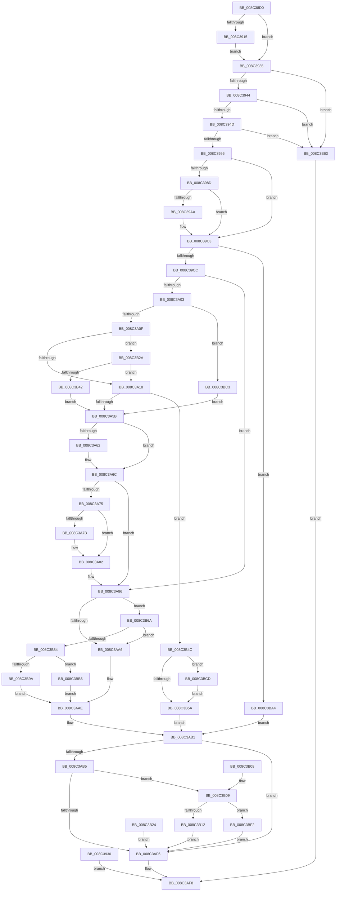

# NtCreateSemaphore

- RVA: `0x008C38D0`–`0x008C3C07` (길이 `823` bytes)
- VA: `0x00000001408C38D0`
- 실행 섹션: `PAGE`
- PDB 이름 있음: `예`; PDB Function 태그: `아니요`
- unwind 정보 RVA: `0x000838C0`
- 디코드: `206`개 명령, `823/823` bytes 표시
- 미해석 바이트: `0` (있으면 어셈블리에 `.byte`로 보존)

> 이 문서는 커널 이미지의 기계어와 PDB 기호를 분석해 생성했습니다. 4번과 5번은 함수 원형과 자료형을 바이너리 사용 방식에서 추정한 C 해석이며 원본 소스 복구 결과는 아닙니다.

## 1. Dependencies

- 직접 호출 지점: **15**; 고유 호출 대상: **13**
- 직접 호출자로 확인된 함수: **0**
- RIP 상대 이미지 참조: **4**

### Outgoing calls
- `0x008C3980` → [ExpInterlockedPopEntrySList](../../text/6B/ExpInterlockedPopEntrySList_function_006BA570.md) (function, `0x006BA570`)
- `0x008C399D` → [ExpInterlockedPopEntrySList](../../text/6B/ExpInterlockedPopEntrySList_function_006BA570.md) (function, `0x006BA570`)
- `0x008C39BB` → [guard_dispatch_icall](../../text/6B/guard_dispatch_icall_function_006BAAD0.md) (function, `0x006BAAD0`)
- `0x008C39F4` → [ObpCaptureObjectCreateInformation](../89/ObpCaptureObjectCreateInformation_function_0089B930.md) (function, `0x0089B930`)
- `0x008C3A4C` → [ObpAllocateObject](../89/ObpAllocateObject_function_00899FF0.md) (function, `0x00899FF0`)
- `0x008C3A67` → [ObpFreeObjectNameBuffer](ObpFreeObjectNameBuffer_function_008C4250.md) (function, `0x008C4250`)
- `0x008C3A7D` → [ExFreePoolWithTag](../../poolcode/B8/ExFreePoolWithTag_function_00B82870.md) (function, `0x00B82870`)
- `0x008C3AA9` → [ExpInterlockedPushEntrySList](../../text/6B/ExpInterlockedPushEntrySList_function_006BA5B0.md) (function, `0x006BA5B0`)
- `0x008C3ABE` → [KeInitializeSemaphore](../../text/46/KeInitializeSemaphore_function_004660D0.md) (function, `0x004660D0`)
- `0x008C3AE7` → [ObInsertObjectEx](../8B/ObInsertObjectEx_function_008B97A0.md) (function, `0x008B97A0`)
- `0x008C3B35` → [SeSinglePrivilegeCheck](../87/SeSinglePrivilegeCheck_function_00871E20.md) (function, `0x00871E20`)
- `0x008C3B9A` → [ExFreePool](../../poolcode/B8/ExFreePool_function_00B82850.md) (function, `0x00B82850`)
- `0x008C3BB9` → [guard_dispatch_icall](../../text/6B/guard_dispatch_icall_function_006BAAD0.md) (function, `0x006BAAD0`)
- `0x008C3BD0` → [ObpRegisterObject](../AC/ObpRegisterObject_function_00ACF3EC.md) (function, `0x00ACF3EC`)
- `0x008C3BE8` → [ObpPushStackInfo](../../text/21/ObpPushStackInfo_function_002109E4.md) (function, `0x002109E4`)

### Direct callers
- 이 함수 시작 RVA로 연결되는 직접 call은 확인되지 않았습니다. 간접 호출은 완전히 역산할 수 없습니다.

### Static image references
- `0x008C3956` → RVA `0x00FC52C0` (`ALMOSTRO`; read)
- `0x008C3B2E` → RVA `0x00FD9BD0` (`PAGEDATA`; read)
- `0x008C3B51` → RVA `0x00FC5010` (`ALMOSTRO`; read)
- `0x008C3B8B` → RVA `0x00B82850` (`ExFreePool`; read)

## 2. Other-region calls and transfers

- 다른 실행 섹션으로 향하는 call: **9**
  - `0x008C3980` → [ExpInterlockedPopEntrySList](../../text/6B/ExpInterlockedPopEntrySList_function_006BA570.md) (`PAGE` → `.text`)
  - `0x008C399D` → [ExpInterlockedPopEntrySList](../../text/6B/ExpInterlockedPopEntrySList_function_006BA570.md) (`PAGE` → `.text`)
  - `0x008C39BB` → [guard_dispatch_icall](../../text/6B/guard_dispatch_icall_function_006BAAD0.md) (`PAGE` → `.text`)
  - `0x008C3A7D` → [ExFreePoolWithTag](../../poolcode/B8/ExFreePoolWithTag_function_00B82870.md) (`PAGE` → `POOLCODE`)
  - `0x008C3AA9` → [ExpInterlockedPushEntrySList](../../text/6B/ExpInterlockedPushEntrySList_function_006BA5B0.md) (`PAGE` → `.text`)
  - `0x008C3ABE` → [KeInitializeSemaphore](../../text/46/KeInitializeSemaphore_function_004660D0.md) (`PAGE` → `.text`)
  - `0x008C3B9A` → [ExFreePool](../../poolcode/B8/ExFreePool_function_00B82850.md) (`PAGE` → `POOLCODE`)
  - `0x008C3BB9` → [guard_dispatch_icall](../../text/6B/guard_dispatch_icall_function_006BAAD0.md) (`PAGE` → `.text`)
  - `0x008C3BE8` → [ObpPushStackInfo](../../text/21/ObpPushStackInfo_function_002109E4.md) (`PAGE` → `.text`)
- 별도 외부 분기/꼬리 이동을 확인하지 못했습니다.

## 3. Assembly (complete function range)

```asm
008C38D0  4C 89 44 24 18                  mov qword ptr [rsp + 0x18], r8
008C38D5  89 54 24 10                     mov dword ptr [rsp + 0x10], edx
008C38D9  48 89 4C 24 08                  mov qword ptr [rsp + 8], rcx
008C38DE  53                              push rbx
008C38DF  56                              push rsi
008C38E0  57                              push rdi
008C38E1  41 54                           push r12
008C38E3  41 55                           push r13
008C38E5  41 56                           push r14
008C38E7  41 57                           push r15
008C38E9  48 83 EC 70                     sub rsp, 0x70
008C38ED  45 8B F9                        mov r15d, r9d
008C38F0  48 8B D1                        mov rdx, rcx
008C38F3  33 C9                           xor ecx, ecx
008C38F5  48 89 4C 24 50                  mov qword ptr [rsp + 0x50], rcx
008C38FA  48 89 4C 24 40                  mov qword ptr [rsp + 0x40], rcx
008C38FF  65 48 8B 04 25 88 01 00 00      mov rax, qword ptr gs:[0x188]
008C3908  44 0F B6 A0 32 02 00 00         movzx r12d, byte ptr [rax + 0x232]
008C3910  45 84 E4                        test r12b, r12b
008C3913  74 20                           je 0x1408c3935
008C3915  48 B9 00 00 FF FF FF 7F 00 00   movabs rcx, 0x7fffffff0000
008C391F  48 3B D1                        cmp rdx, rcx
008C3922  48 0F 42 CA                     cmovb rcx, rdx
008C3926  48 8B 01                        mov rax, qword ptr [rcx]
008C3929  48 89 01                        mov qword ptr [rcx], rax
008C392C  33 C9                           xor ecx, ecx
008C392E  EB 05                           jmp 0x1408c3935
008C3930  E9 C3 01 00 00                  jmp 0x1408c3af8
008C3935  8B B4 24 D0 00 00 00            mov esi, dword ptr [rsp + 0xd0]
008C393C  85 F6                           test esi, esi
008C393E  0F 8E 1F 02 00 00               jle 0x1408c3b63
008C3944  45 85 FF                        test r15d, r15d
008C3947  0F 88 16 02 00 00               js 0x1408c3b63
008C394D  44 3B FE                        cmp r15d, esi
008C3950  0F 8F 0D 02 00 00               jg 0x1408c3b63
008C3956  4C 8B 2D 63 19 70 00            mov r13, qword ptr [rip + 0x701963]
008C395D  0F 57 C0                        xorps xmm0, xmm0
008C3960  0F 11 44 24 58                  movups xmmword ptr [rsp + 0x58], xmm0
008C3965  48 89 4C 24 48                  mov qword ptr [rsp + 0x48], rcx
008C396A  65 4C 8B 34 25 20 00 00 00      mov r14, qword ptr gs:[0x20]
008C3973  49 8B BE 40 08 00 00            mov rdi, qword ptr [r14 + 0x840]
008C397A  FF 47 14                        inc dword ptr [rdi + 0x14]
008C397D  48 8B CF                        mov rcx, rdi
008C3980  E8 EB 6B DF FF                  call 0x1406ba570
008C3985  48 8B D8                        mov rbx, rax
008C3988  48 85 C0                        test rax, rax
008C398B  75 36                           jne 0x1408c39c3
008C398D  FF 47 18                        inc dword ptr [rdi + 0x18]
008C3990  49 8B BE 48 08 00 00            mov rdi, qword ptr [r14 + 0x848]
008C3997  FF 47 14                        inc dword ptr [rdi + 0x14]
008C399A  48 8B CF                        mov rcx, rdi
008C399D  E8 CE 6B DF FF                  call 0x1406ba570
008C39A2  48 8B D8                        mov rbx, rax
008C39A5  48 85 C0                        test rax, rax
008C39A8  75 19                           jne 0x1408c39c3
008C39AA  FF 47 18                        inc dword ptr [rdi + 0x18]
008C39AD  8B 57 2C                        mov edx, dword ptr [rdi + 0x2c]
008C39B0  48 8B 47 30                     mov rax, qword ptr [rdi + 0x30]
008C39B4  44 8B 47 28                     mov r8d, dword ptr [rdi + 0x28]
008C39B8  8B 4F 24                        mov ecx, dword ptr [rdi + 0x24]
008C39BB  E8 10 71 DF FF                  call 0x1406baad0
008C39C0  48 8B D8                        mov rbx, rax
008C39C3  48 85 DB                        test rbx, rbx
008C39C6  0F 84 D8 01 00 00               je 0x1408c3ba4
008C39CC  41 8B 46 24                     mov eax, dword ptr [r14 + 0x24]
008C39D0  89 03                           mov dword ptr [rbx], eax
008C39D2  45 33 F6                        xor r14d, r14d
008C39D5  44 89 74 24 28                  mov dword ptr [rsp + 0x28], r14d
008C39DA  48 89 5C 24 20                  mov qword ptr [rsp + 0x20], rbx
008C39DF  4C 8D 4C 24 58                  lea r9, [rsp + 0x58]
008C39E4  4C 8B 84 24 C0 00 00 00         mov r8, qword ptr [rsp + 0xc0]
008C39EC  41 0F B6 D4                     movzx edx, r12b
008C39F0  41 0F B6 CC                     movzx ecx, r12b
008C39F4  E8 37 7F FD FF                  call 0x14089b930
008C39F9  8B F8                           mov edi, eax
008C39FB  85 C0                           test eax, eax
008C39FD  0F 88 83 00 00 00               js 0x1408c3a86
008C3A03  8B 0B                           mov ecx, dword ptr [rbx]
008C3A05  41 85 4D 48                     test dword ptr [r13 + 0x48], ecx
008C3A09  0F 85 B4 01 00 00               jne 0x1408c3bc3
008C3A0F  F6 C1 10                        test cl, 0x10
008C3A12  0F 85 12 01 00 00               jne 0x1408c3b2a
008C3A18  41 8B 45 68                     mov eax, dword ptr [r13 + 0x68]
008C3A1C  41 8B 4D 6C                     mov ecx, dword ptr [r13 + 0x6c]
008C3A20  89 43 14                        mov dword ptr [rbx + 0x14], eax
008C3A23  89 4B 18                        mov dword ptr [rbx + 0x18], ecx
008C3A26  4C 89 74 24 30                  mov qword ptr [rsp + 0x30], r14
008C3A2B  48 8D 44 24 48                  lea rax, [rsp + 0x48]
008C3A30  48 89 44 24 28                  mov qword ptr [rsp + 0x28], rax
008C3A35  C7 44 24 20 20 00 00 00         mov dword ptr [rsp + 0x20], 0x20
008C3A3D  4C 8D 4C 24 58                  lea r9, [rsp + 0x58]
008C3A42  4D 8B C5                        mov r8, r13
008C3A45  41 0F B6 D4                     movzx edx, r12b
008C3A49  48 8B CB                        mov rcx, rbx
008C3A4C  E8 9F 65 FD FF                  call 0x140899ff0
008C3A51  8B F8                           mov edi, eax
008C3A53  85 C0                           test eax, eax
008C3A55  0F 89 F1 00 00 00               jns 0x1408c3b4c
008C3A5B  4C 39 74 24 60                  cmp qword ptr [rsp + 0x60], r14
008C3A60  74 0A                           je 0x1408c3a6c
008C3A62  48 8D 4C 24 58                  lea rcx, [rsp + 0x58]
008C3A67  E8 E4 07 00 00                  call 0x1408c4250
008C3A6C  48 8B 4B 20                     mov rcx, qword ptr [rbx + 0x20]
008C3A70  48 85 C9                        test rcx, rcx
008C3A73  74 11                           je 0x1408c3a86
008C3A75  80 7B 10 01                     cmp byte ptr [rbx + 0x10], 1
008C3A79  77 07                           ja 0x1408c3a82
008C3A7B  33 D2                           xor edx, edx
008C3A7D  E8 EE ED 2B 00                  call 0x140b82870
008C3A82  4C 89 73 20                     mov qword ptr [rbx + 0x20], r14
008C3A86  65 48 8B 14 25 20 00 00 00      mov rdx, qword ptr gs:[0x20]
008C3A8F  48 8B 8A 40 08 00 00            mov rcx, qword ptr [rdx + 0x840]
008C3A96  FF 41 1C                        inc dword ptr [rcx + 0x1c]
008C3A99  0F B7 41 10                     movzx eax, word ptr [rcx + 0x10]
008C3A9D  66 39 01                        cmp word ptr [rcx], ax
008C3AA0  0F 83 C4 00 00 00               jae 0x1408c3b6a
008C3AA6  48 8B D3                        mov rdx, rbx
008C3AA9  E8 02 6B DF FF                  call 0x1406ba5b0
008C3AAE  49 8B DE                        mov rbx, r14
008C3AB1  85 FF                           test edi, edi
008C3AB3  78 41                           js 0x1408c3af6
008C3AB5  44 8B C6                        mov r8d, esi
008C3AB8  41 8B D7                        mov edx, r15d
008C3ABB  48 8B CB                        mov rcx, rbx
008C3ABE  E8 0D 26 BA FF                  call 0x1404660d0
008C3AC3  48 8D 44 24 50                  lea rax, [rsp + 0x50]
008C3AC8  48 89 44 24 30                  mov qword ptr [rsp + 0x30], rax
008C3ACD  4C 89 74 24 28                  mov qword ptr [rsp + 0x28], r14
008C3AD2  44 89 74 24 20                  mov dword ptr [rsp + 0x20], r14d
008C3AD7  45 33 C9                        xor r9d, r9d
008C3ADA  44 8B 84 24 B8 00 00 00         mov r8d, dword ptr [rsp + 0xb8]
008C3AE2  33 D2                           xor edx, edx
008C3AE4  48 8B CB                        mov rcx, rbx
008C3AE7  E8 B4 5C FF FF                  call 0x1408b97a0
008C3AEC  8B F8                           mov edi, eax
008C3AEE  89 44 24 40                     mov dword ptr [rsp + 0x40], eax
008C3AF2  85 C0                           test eax, eax
008C3AF4  79 13                           jns 0x1408c3b09
008C3AF6  8B C7                           mov eax, edi
008C3AF8  48 83 C4 70                     add rsp, 0x70
008C3AFC  41 5F                           pop r15
008C3AFE  41 5E                           pop r14
008C3B00  41 5D                           pop r13
008C3B02  41 5C                           pop r12
008C3B04  5F                              pop rdi
008C3B05  5E                              pop rsi
008C3B06  5B                              pop rbx
008C3B07  C3                              ret
008C3B08  CC                              int3
008C3B09  45 84 E4                        test r12b, r12b
008C3B0C  0F 84 E0 00 00 00               je 0x1408c3bf2
008C3B12  48 8B 4C 24 50                  mov rcx, qword ptr [rsp + 0x50]
008C3B17  48 8B 94 24 B0 00 00 00         mov rdx, qword ptr [rsp + 0xb0]
008C3B1F  48 89 0A                        mov qword ptr [rdx], rcx
008C3B22  EB D2                           jmp 0x1408c3af6
008C3B24  8B 7C 24 40                     mov edi, dword ptr [rsp + 0x40]
008C3B28  EB CC                           jmp 0x1408c3af6
008C3B2A  41 0F B6 D4                     movzx edx, r12b
008C3B2E  48 8B 0D 9B 60 71 00            mov rcx, qword ptr [rip + 0x71609b]
008C3B35  E8 E6 E2 FA FF                  call 0x140871e20
008C3B3A  84 C0                           test al, al
008C3B3C  0F 85 D6 FE FF FF               jne 0x1408c3a18
008C3B42  BF 61 00 00 C0                  mov edi, 0xc0000061
008C3B47  E9 0F FF FF FF                  jmp 0x1408c3a5b
008C3B4C  48 8B 5C 24 48                  mov rbx, qword ptr [rsp + 0x48]
008C3B51  44 39 35 B8 14 70 00            cmp dword ptr [rip + 0x7014b8], r14d
008C3B58  75 73                           jne 0x1408c3bcd
008C3B5A  48 83 C3 30                     add rbx, 0x30
008C3B5E  E9 4E FF FF FF                  jmp 0x1408c3ab1
008C3B63  B8 0D 00 00 C0                  mov eax, 0xc000000d
008C3B68  EB 8E                           jmp 0x1408c3af8
008C3B6A  FF 41 20                        inc dword ptr [rcx + 0x20]
008C3B6D  48 8B 8A 48 08 00 00            mov rcx, qword ptr [rdx + 0x848]
008C3B74  FF 41 1C                        inc dword ptr [rcx + 0x1c]
008C3B77  0F B7 41 10                     movzx eax, word ptr [rcx + 0x10]
008C3B7B  66 39 01                        cmp word ptr [rcx], ax
008C3B7E  0F 82 22 FF FF FF               jb 0x1408c3aa6
008C3B84  FF 41 20                        inc dword ptr [rcx + 0x20]
008C3B87  48 8B 51 38                     mov rdx, qword ptr [rcx + 0x38]
008C3B8B  48 8D 05 BE EC 2B 00            lea rax, [rip + 0x2becbe]
008C3B92  48 8B CB                        mov rcx, rbx
008C3B95  48 3B D0                        cmp rdx, rax
008C3B98  75 1C                           jne 0x1408c3bb6
008C3B9A  E8 B1 EC 2B 00                  call 0x140b82850
008C3B9F  E9 0A FF FF FF                  jmp 0x1408c3aae
008C3BA4  BF 9A 00 00 C0                  mov edi, 0xc000009a
008C3BA9  48 8B 5C 24 40                  mov rbx, qword ptr [rsp + 0x40]
008C3BAE  45 33 F6                        xor r14d, r14d
008C3BB1  E9 FB FE FF FF                  jmp 0x1408c3ab1
008C3BB6  48 8B C2                        mov rax, rdx
008C3BB9  E8 12 6F DF FF                  call 0x1406baad0
008C3BBE  E9 EB FE FF FF                  jmp 0x1408c3aae
008C3BC3  BF 0D 00 00 C0                  mov edi, 0xc000000d
008C3BC8  E9 8E FE FF FF                  jmp 0x1408c3a5b
008C3BCD  48 8B CB                        mov rcx, rbx
008C3BD0  E8 17 B8 20 00                  call 0x140acf3ec
008C3BD5  41 B9 44 66 6C 74               mov r9d, 0x746c6644
008C3BDB  41 B8 01 00 00 00               mov r8d, 1
008C3BE1  41 0F B6 D0                     movzx edx, r8b
008C3BE5  48 8B CB                        mov rcx, rbx
008C3BE8  E8 F7 CD 94 FF                  call 0x1402109e4
008C3BED  E9 68 FF FF FF                  jmp 0x1408c3b5a
008C3BF2  48 8B 44 24 50                  mov rax, qword ptr [rsp + 0x50]
008C3BF7  48 8B 94 24 B0 00 00 00         mov rdx, qword ptr [rsp + 0xb0]
008C3BFF  48 89 02                        mov qword ptr [rdx], rax
008C3C02  E9 EF FE FF FF                  jmp 0x1408c3af6
```

## 4. C-style interpretation (structured pseudocode)

```c
__int64 __fastcall NtCreateSemaphore(__int64 a1, int a2, __int64 a3, int a4, unsigned int a5)
{
    __int64 result;
    __int64 v_r14;
    __int64 v_rbx;
    __int64 v_rsp;
    unsigned __int64 v_stack_m48;
    unsigned __int64 v_stack_m50;
    unsigned __int64 v_stack_m58;
    unsigned __int64 v_stack_m60;
    unsigned __int64 v_stack_m68;
    unsigned __int64 v_stack_m78;
    unsigned int v_stack_m80;
    unsigned __int64 v_stack_m88;
    unsigned int v_stack_p10;
    unsigned __int64 v_stack_p18;
    unsigned int v_stack_p40;
    unsigned __int64 v_stack_p48;
    unsigned __int64 v_stack_p50;
    unsigned __int64 v_stack_p8;
    unsigned __int64 v_stack_pB0;

    v_stack_p18 = a3;
    v_stack_p10 = a2;
    v_stack_p8 = a1;
    v_rsp = (v_rsp) - (112);
    a1 = 0;
    v_stack_m58 = 0;
    v_stack_m68 = 0;
    if ((unsigned __int8)(*(unsigned __int8 *)(*(unsigned __int64 *)(gs_base + (0 + 392)) + 562)) == 0) goto loc_008C3935;
    if (0 < 0) { a1 = 0; }
    *(unsigned __int64 *)(a1) = *(unsigned __int64 *)(a1);
    a1 = 0;
    goto loc_008C3935;
loc_008C3935:
    if (condition_is_less_or_equal) goto loc_008C3B63;
    if (sign_flag) goto loc_008C3B63;
    if (((unsigned int)((unsigned int)(a4))) > ((unsigned int)((unsigned int)(a5)))) goto loc_008C3B63;
    v_stack_m50 = v_xmm0;
    v_stack_m60 = 0;
    result = ExpInterlockedPopEntrySList(*(unsigned __int64 *)(*(unsigned __int64 *)(gs_base + (0 + 32)) + 2112), a1, a3, a4);
    if (result != 0) goto loc_008C39C3;
    result = ExpInterlockedPopEntrySList(*(unsigned __int64 *)(*(unsigned __int64 *)(gs_base + (0 + 32)) + 2120), a1, a3, a4);
    v_rbx = result;
    if (result == 0) {
        a2 = *(unsigned int *)(*(unsigned __int64 *)(*(unsigned __int64 *)(gs_base + (0 + 32)) + 2120) + 44);
        result = *(unsigned __int64 *)(*(unsigned __int64 *)(*(unsigned __int64 *)(gs_base + (0 + 32)) + 2120) + 48);
        a3 = *(unsigned int *)(*(unsigned __int64 *)(*(unsigned __int64 *)(gs_base + (0 + 32)) + 2120) + 40);
        a1 = *(unsigned int *)(*(unsigned __int64 *)(*(unsigned __int64 *)(gs_base + (0 + 32)) + 2120) + 36);
        result = guard_dispatch_icall(a1, a2, a3, a4);
        v_rbx = result;
    }
    if (v_rbx == 0) goto loc_008C3BA4;
    *(unsigned int *)(v_rbx) = (unsigned int)((unsigned int)(*(unsigned int *)(*(unsigned __int64 *)(gs_base + (0 + 32)) + 36)));
    v_r14 = 0;
    v_stack_m80 = 0;
    v_stack_m88 = v_rbx;
    result = ObpCaptureObjectCreateInformation((unsigned __int8)(*(unsigned __int8 *)(*(unsigned __int64 *)(gs_base + (0 + 392)) + 562)), (unsigned __int8)(*(unsigned __int8 *)(*(unsigned __int64 *)(gs_base + (0 + 392)) + 562)), v_stack_p18, v_stack_m50);
    if (sign_flag) goto loc_008C3A86;
    if (((*(unsigned int *)(*(unsigned __int64 *)(v_rip + 7346531) + 72)) & ((unsigned int)((unsigned int)(*(unsigned int *)(v_rbx))))) != 0) goto loc_008C3BC3;
    if ((((unsigned __int8)((unsigned int)(*(unsigned int *)(v_rbx)))) & (16)) != 0) goto loc_008C3B2A;
loc_008C3A18:
    *(unsigned int *)(v_rbx + 20) = (unsigned int)((unsigned int)(*(unsigned int *)(*(unsigned __int64 *)(v_rip + 7346531) + 104)));
    *(unsigned int *)(v_rbx + 24) = (unsigned int)((unsigned int)(*(unsigned int *)(*(unsigned __int64 *)(v_rip + 7346531) + 108)));
    v_stack_m78 = 0;
    v_stack_m80 = v_stack_m60;
    v_stack_m88 = 32;
    result = ObpAllocateObject(v_rbx, (unsigned __int8)(*(unsigned __int8 *)(*(unsigned __int64 *)(gs_base + (0 + 392)) + 562)), *(unsigned __int64 *)(v_rip + 7346531), v_stack_m50);
    if (!sign_flag) goto loc_008C3B4C;
loc_008C3A5B:
    if (v_stack_m48 != 0) {
        a1 = v_stack_m50;
        result = ObpFreeObjectNameBuffer(a1, (unsigned __int8)(*(unsigned __int8 *)(*(unsigned __int64 *)(gs_base + (0 + 392)) + 562)), *(unsigned __int64 *)(v_rip + 7346531), v_stack_m50);
    }
    if (*(unsigned __int64 *)(v_rbx + 32) == 0) goto loc_008C3A86;
    if ((*(unsigned __int8 *)(v_rbx + 16)) <= 1) {
        a2 = 0;
        result = ExFreePoolWithTag(*(unsigned __int64 *)(v_rbx + 32), a2, *(unsigned __int64 *)(v_rip + 7346531), v_stack_m50);
    }
    *(unsigned __int64 *)(v_rbx + 32) = 0;
loc_008C3A86:
    if ((*(unsigned __int16 *)(*(unsigned __int64 *)(*(unsigned __int64 *)(gs_base + (0 + 32)) + 2112))) >= ((unsigned __int16)(*(unsigned __int16 *)(*(unsigned __int64 *)(*(unsigned __int64 *)(gs_base + (0 + 32)) + 2112) + 16)))) goto loc_008C3B6A;
loc_008C3AA6:
    result = ExpInterlockedPushEntrySList(*(unsigned __int64 *)(*(unsigned __int64 *)(gs_base + (0 + 32)) + 2112), v_rbx, *(unsigned __int64 *)(v_rip + 7346531), v_stack_m50);
loc_008C3AAE:
loc_008C3AB1:
    if (sign_flag) goto loc_008C3AF6;
    result = KeInitializeSemaphore(0, (unsigned int)((unsigned int)((unsigned int)(a4))), (unsigned int)((unsigned int)((unsigned int)(a5))), v_stack_m50);
    v_stack_m78 = v_stack_m58;
    v_stack_m80 = 0;
    v_stack_m88 = 0;
    a4 = 0;
    a2 = 0;
    result = ObInsertObjectEx(0, a2, (unsigned int)(v_stack_p10), a4);
    v_stack_m68 = (unsigned int)(result);
    if (!sign_flag) goto loc_008C3B09;
loc_008C3AF6:
loc_008C3AF8:
    v_rsp = (v_rsp) + (112);
    return (unsigned int)((unsigned int)((unsigned int)((unsigned int)(result))));
loc_008C3B09:
    if ((unsigned __int8)(*(unsigned __int8 *)(*(unsigned __int64 *)(gs_base + (0 + 392)) + 562)) == 0) goto loc_008C3BF2;
    *(unsigned __int64 *)(v_stack_pB0) = v_stack_p50;
    goto loc_008C3AF6;
loc_008C3B2A:
    result = SeSinglePrivilegeCheck(*(unsigned __int64 *)(v_rip + 7430299), (unsigned __int8)(*(unsigned __int8 *)(*(unsigned __int64 *)(gs_base + (0 + 392)) + 562)), (unsigned int)(v_stack_p10), a4);
    if ((unsigned __int8)(result) != 0) goto loc_008C3A18;
    goto loc_008C3A5B;
loc_008C3B4C:
    if ((*(unsigned int *)(v_rip + 7345336)) != 0) goto loc_008C3BCD;
loc_008C3B5A:
    v_rbx = (v_stack_p48) + (48);
    goto loc_008C3AB1;
loc_008C3B63:
    goto loc_008C3AF8;
loc_008C3B6A:
    if ((*(unsigned __int16 *)(*(unsigned __int64 *)((unsigned __int8)(*(unsigned __int8 *)(*(unsigned __int64 *)(gs_base + (0 + 392)) + 562)) + 2120))) < ((unsigned __int16)(*(unsigned __int16 *)(*(unsigned __int64 *)((unsigned __int8)(*(unsigned __int8 *)(*(unsigned __int64 *)(gs_base + (0 + 392)) + 562)) + 2120) + 16)))) goto loc_008C3AA6;
    if ((*(unsigned __int64 *)(*(unsigned __int64 *)((unsigned __int8)(*(unsigned __int8 *)(*(unsigned __int64 *)(gs_base + (0 + 392)) + 562)) + 2120) + 56)) != (v_rip + 2878654)) goto loc_008C3BB6;
    result = ExFreePool(v_rbx, *(unsigned __int64 *)(*(unsigned __int64 *)((unsigned __int8)(*(unsigned __int8 *)(*(unsigned __int64 *)(gs_base + (0 + 392)) + 562)) + 2120) + 56), (unsigned int)(v_stack_p10), a4);
    goto loc_008C3AAE;
loc_008C3BA4:
    v_r14 = 0;
    goto loc_008C3AB1;
loc_008C3BB6:
    result = guard_dispatch_icall(v_rbx, *(unsigned __int64 *)(*(unsigned __int64 *)((unsigned __int8)(*(unsigned __int8 *)(*(unsigned __int64 *)(gs_base + (0 + 392)) + 562)) + 2120) + 56), (unsigned int)(v_stack_p10), a4);
    goto loc_008C3AAE;
loc_008C3BC3:
    goto loc_008C3A5B;
loc_008C3BCD:
    result = ObpRegisterObject(v_stack_p40, *(unsigned __int64 *)(*(unsigned __int64 *)((unsigned __int8)(*(unsigned __int8 *)(*(unsigned __int64 *)(gs_base + (0 + 392)) + 562)) + 2120) + 56), (unsigned int)(v_stack_p10), a4);
    result = ObpPushStackInfo(v_stack_p40, 1, 1, (unsigned int)(0x746C6644ULL));
    goto loc_008C3B5A;
loc_008C3BF2:
    *(unsigned __int64 *)(v_stack_pB0) = v_stack_p50;
    goto loc_008C3AF6;
}
```

## 5. (Beta) C Style

```c
int64_t NtCreateSemaphore(int64_t Arg1, int32_t Arg2, int64_t Arg3, int32_t Arg4, uint32_t Arg5)
{
    int64_t result;
    int64_t local_r14;
    int64_t local_rbx;
    int64_t local_rsp;
    uint64_t v_stack_m48;
    uint64_t v_stack_m50;
    uint64_t v_stack_m58;
    uint64_t v_stack_m60;
    uint64_t v_stack_m68;
    uint64_t v_stack_m78;
    uint32_t v_stack_m80;
    uint64_t v_stack_m88;
    uint32_t v_stack_p10;
    uint64_t v_stack_p18;
    uint32_t v_stack_p40;
    uint64_t v_stack_p48;
    uint64_t v_stack_p50;
    uint64_t v_stack_p8;
    uint64_t v_stack_pB0;

    v_stack_p18 = Arg3;
    v_stack_p10 = Arg2;
    v_stack_p8 = Arg1;
    local_rsp = (local_rsp) - (112);
    Arg1 = 0;
    v_stack_m58 = 0;
    v_stack_m68 = 0;
    if ((uint8_t)(*(uint8_t *)(*(uint64_t *)(gs_base + (0 + 0x188)) + 0x232)) == 0) goto loc_008C3935;
    if (0 < 0) { Arg1 = 0; }
    *(uint64_t *)(Arg1) = *(uint64_t *)(Arg1);
    Arg1 = 0;
    goto loc_008C3935;
loc_008C3935:
    if (condition_is_less_or_equal) goto loc_008C3B63;
    if (sign_flag) goto loc_008C3B63;
    if (((uint32_t)((uint32_t)(Arg4))) > ((uint32_t)((uint32_t)(Arg5)))) goto loc_008C3B63;
    v_stack_m50 = v_xmm0;
    v_stack_m60 = 0;
    result = ExpInterlockedPopEntrySList(*(uint64_t *)(*(uint64_t *)(gs_base + (0 + 0x20)) + 0x840), Arg1, Arg3, Arg4);
    if (result != 0) goto loc_008C39C3;
    result = ExpInterlockedPopEntrySList(*(uint64_t *)(*(uint64_t *)(gs_base + (0 + 0x20)) + 0x848), Arg1, Arg3, Arg4);
    local_rbx = result;
    if (result == 0) {
        Arg2 = *(uint32_t *)(*(uint64_t *)(*(uint64_t *)(gs_base + (0 + 0x20)) + 0x848) + 0x2C);
        result = *(uint64_t *)(*(uint64_t *)(*(uint64_t *)(gs_base + (0 + 0x20)) + 0x848) + 0x30);
        Arg3 = *(uint32_t *)(*(uint64_t *)(*(uint64_t *)(gs_base + (0 + 0x20)) + 0x848) + 0x28);
        Arg1 = *(uint32_t *)(*(uint64_t *)(*(uint64_t *)(gs_base + (0 + 0x20)) + 0x848) + 0x24);
        result = guard_dispatch_icall(Arg1, Arg2, Arg3, Arg4);
        local_rbx = result;
    }
    if (local_rbx == 0) goto loc_008C3BA4;
    *(uint32_t *)(local_rbx) = (uint32_t)((uint32_t)(*(uint32_t *)(*(uint64_t *)(gs_base + (0 + 0x20)) + 0x24)));
    local_r14 = 0;
    v_stack_m80 = 0;
    v_stack_m88 = local_rbx;
    result = ObpCaptureObjectCreateInformation((uint8_t)(*(uint8_t *)(*(uint64_t *)(gs_base + (0 + 0x188)) + 0x232)), (uint8_t)(*(uint8_t *)(*(uint64_t *)(gs_base + (0 + 0x188)) + 0x232)), v_stack_p18, v_stack_m50);
    if (sign_flag) goto loc_008C3A86;
    if (((*(uint32_t *)(*(uint64_t *)(v_rip + 0x701963) + 0x48)) & ((uint32_t)((uint32_t)(*(uint32_t *)(local_rbx))))) != 0) goto loc_008C3BC3;
    if ((((uint8_t)((uint32_t)(*(uint32_t *)(local_rbx)))) & (16)) != 0) goto loc_008C3B2A;
loc_008C3A18:
    *(uint32_t *)(local_rbx + 0x14) = (uint32_t)((uint32_t)(*(uint32_t *)(*(uint64_t *)(v_rip + 0x701963) + 0x68)));
    *(uint32_t *)(local_rbx + 0x18) = (uint32_t)((uint32_t)(*(uint32_t *)(*(uint64_t *)(v_rip + 0x701963) + 0x6C)));
    v_stack_m78 = 0;
    v_stack_m80 = v_stack_m60;
    v_stack_m88 = 32;
    result = ObpAllocateObject(local_rbx, (uint8_t)(*(uint8_t *)(*(uint64_t *)(gs_base + (0 + 0x188)) + 0x232)), *(uint64_t *)(v_rip + 0x701963), v_stack_m50);
    if (!sign_flag) goto loc_008C3B4C;
loc_008C3A5B:
    if (v_stack_m48 != 0) {
        Arg1 = v_stack_m50;
        result = ObpFreeObjectNameBuffer(Arg1, (uint8_t)(*(uint8_t *)(*(uint64_t *)(gs_base + (0 + 0x188)) + 0x232)), *(uint64_t *)(v_rip + 0x701963), v_stack_m50);
    }
    if (*(uint64_t *)(local_rbx + 0x20) == 0) goto loc_008C3A86;
    if ((*(uint8_t *)(local_rbx + 0x10)) <= 1) {
        Arg2 = 0;
        result = ExFreePoolWithTag(*(uint64_t *)(local_rbx + 0x20), Arg2, *(uint64_t *)(v_rip + 0x701963), v_stack_m50);
    }
    *(uint64_t *)(local_rbx + 0x20) = 0;
loc_008C3A86:
    if ((*(uint16_t *)(*(uint64_t *)(*(uint64_t *)(gs_base + (0 + 0x20)) + 0x840))) >= ((uint16_t)(*(uint16_t *)(*(uint64_t *)(*(uint64_t *)(gs_base + (0 + 0x20)) + 0x840) + 0x10)))) goto loc_008C3B6A;
loc_008C3AA6:
    result = ExpInterlockedPushEntrySList(*(uint64_t *)(*(uint64_t *)(gs_base + (0 + 0x20)) + 0x840), local_rbx, *(uint64_t *)(v_rip + 0x701963), v_stack_m50);
loc_008C3AAE:
loc_008C3AB1:
    if (sign_flag) goto loc_008C3AF6;
    result = KeInitializeSemaphore(0, (uint32_t)((uint32_t)((uint32_t)(Arg4))), (uint32_t)((uint32_t)((uint32_t)(Arg5))), v_stack_m50);
    v_stack_m78 = v_stack_m58;
    v_stack_m80 = 0;
    v_stack_m88 = 0;
    Arg4 = 0;
    Arg2 = 0;
    result = ObInsertObjectEx(0, Arg2, (uint32_t)(v_stack_p10), Arg4);
    v_stack_m68 = (uint32_t)(result);
    if (!sign_flag) goto loc_008C3B09;
loc_008C3AF6:
loc_008C3AF8:
    local_rsp = (local_rsp) + (112);
    return (uint32_t)((uint32_t)((uint32_t)((uint32_t)(result))));
loc_008C3B09:
    if ((uint8_t)(*(uint8_t *)(*(uint64_t *)(gs_base + (0 + 0x188)) + 0x232)) == 0) goto loc_008C3BF2;
    *(uint64_t *)(v_stack_pB0) = v_stack_p50;
    goto loc_008C3AF6;
loc_008C3B2A:
    result = SeSinglePrivilegeCheck(*(uint64_t *)(v_rip + 0x71609B), (uint8_t)(*(uint8_t *)(*(uint64_t *)(gs_base + (0 + 0x188)) + 0x232)), (uint32_t)(v_stack_p10), Arg4);
    if ((uint8_t)(result) != 0) goto loc_008C3A18;
    goto loc_008C3A5B;
loc_008C3B4C:
    if ((*(uint32_t *)(v_rip + 0x7014B8)) != 0) goto loc_008C3BCD;
loc_008C3B5A:
    local_rbx = (v_stack_p48) + (48);
    goto loc_008C3AB1;
loc_008C3B63:
    goto loc_008C3AF8;
loc_008C3B6A:
    if ((*(uint16_t *)(*(uint64_t *)((uint8_t)(*(uint8_t *)(*(uint64_t *)(gs_base + (0 + 0x188)) + 0x232)) + 0x848))) < ((uint16_t)(*(uint16_t *)(*(uint64_t *)((uint8_t)(*(uint8_t *)(*(uint64_t *)(gs_base + (0 + 0x188)) + 0x232)) + 0x848) + 0x10)))) goto loc_008C3AA6;
    if ((*(uint64_t *)(*(uint64_t *)((uint8_t)(*(uint8_t *)(*(uint64_t *)(gs_base + (0 + 0x188)) + 0x232)) + 0x848) + 0x38)) != (v_rip + 2878654)) goto loc_008C3BB6;
    result = ExFreePool(local_rbx, *(uint64_t *)(*(uint64_t *)((uint8_t)(*(uint8_t *)(*(uint64_t *)(gs_base + (0 + 0x188)) + 0x232)) + 0x848) + 0x38), (uint32_t)(v_stack_p10), Arg4);
    goto loc_008C3AAE;
loc_008C3BA4:
    local_r14 = 0;
    goto loc_008C3AB1;
loc_008C3BB6:
    result = guard_dispatch_icall(local_rbx, *(uint64_t *)(*(uint64_t *)((uint8_t)(*(uint8_t *)(*(uint64_t *)(gs_base + (0 + 0x188)) + 0x232)) + 0x848) + 0x38), (uint32_t)(v_stack_p10), Arg4);
    goto loc_008C3AAE;
loc_008C3BC3:
    goto loc_008C3A5B;
loc_008C3BCD:
    result = ObpRegisterObject(v_stack_p40, *(uint64_t *)(*(uint64_t *)((uint8_t)(*(uint8_t *)(*(uint64_t *)(gs_base + (0 + 0x188)) + 0x232)) + 0x848) + 0x38), (uint32_t)(v_stack_p10), Arg4);
    result = ObpPushStackInfo(v_stack_p40, 1, 1, (uint32_t)(0x746C6644ULL));
    goto loc_008C3B5A;
loc_008C3BF2:
    *(uint64_t *)(v_stack_pB0) = v_stack_p50;
    goto loc_008C3AF6;
}
```

## 6. Execution-region graph

[열기: 2D/3D 그래프와 함수 탐색 컨트롤 패널](../../../control-panel.html?section=page&rva=0x008C38D0&view=graph)

- 2D 그래프는 위에서 아래로 흐르고, 3D 그래프는 빈 공간을 드래그해 회전합니다. Shift+드래그는 이동, 휠은 확대·축소, 함수 노드 선택은 대상 보고서 이동입니다.

### Static fallback


