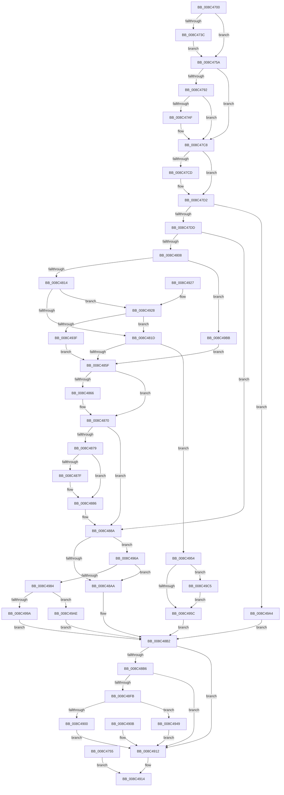

# NtCreateWaitCompletionPacket

- RVA: `0x008C4700`–`0x008C49ED` (길이 `749` bytes)
- VA: `0x00000001408C4700`
- 실행 섹션: `PAGE`
- PDB 이름 있음: `예`; PDB Function 태그: `아니요`
- unwind 정보 RVA: `0x00083A00`
- 디코드: `189`개 명령, `749/749` bytes 표시
- 미해석 바이트: `0` (있으면 어셈블리에 `.byte`로 보존)

> 이 문서는 커널 이미지의 기계어와 PDB 기호를 분석해 생성했습니다. 4번과 5번은 함수 원형과 자료형을 바이너리 사용 방식에서 추정한 C 해석이며 원본 소스 복구 결과는 아닙니다.

## 1. Dependencies

- 직접 호출 지점: **14**; 고유 호출 대상: **12**
- 직접 호출자로 확인된 함수: **0**
- RIP 상대 이미지 참조: **4**

### Outgoing calls
- `0x008C4785` → [ExpInterlockedPopEntrySList](../../text/6B/ExpInterlockedPopEntrySList_function_006BA570.md) (function, `0x006BA570`)
- `0x008C47A2` → [ExpInterlockedPopEntrySList](../../text/6B/ExpInterlockedPopEntrySList_function_006BA570.md) (function, `0x006BA570`)
- `0x008C47C0` → [guard_dispatch_icall](../../text/6B/guard_dispatch_icall_function_006BAAD0.md) (function, `0x006BAAD0`)
- `0x008C47F9` → [ObpCaptureObjectCreateInformation](../89/ObpCaptureObjectCreateInformation_function_0089B930.md) (function, `0x0089B930`)
- `0x008C4850` → [ObpAllocateObject](../89/ObpAllocateObject_function_00899FF0.md) (function, `0x00899FF0`)
- `0x008C486B` → [ObpFreeObjectNameBuffer](ObpFreeObjectNameBuffer_function_008C4250.md) (function, `0x008C4250`)
- `0x008C4881` → [ExFreePoolWithTag](../../poolcode/B8/ExFreePoolWithTag_function_00B82870.md) (function, `0x00B82870`)
- `0x008C48AD` → [ExpInterlockedPushEntrySList](../../text/6B/ExpInterlockedPushEntrySList_function_006BA5B0.md) (function, `0x006BA5B0`)
- `0x008C48E9` → [ObInsertObjectEx](../8B/ObInsertObjectEx_function_008B97A0.md) (function, `0x008B97A0`)
- `0x008C4932` → [SeSinglePrivilegeCheck](../87/SeSinglePrivilegeCheck_function_00871E20.md) (function, `0x00871E20`)
- `0x008C499A` → [ExFreePool](../../poolcode/B8/ExFreePool_function_00B82850.md) (function, `0x00B82850`)
- `0x008C49B1` → [guard_dispatch_icall](../../text/6B/guard_dispatch_icall_function_006BAAD0.md) (function, `0x006BAAD0`)
- `0x008C49CA` → [ObpRegisterObject](../AC/ObpRegisterObject_function_00ACF3EC.md) (function, `0x00ACF3EC`)
- `0x008C49E3` → [ObpPushStackInfo](../../text/21/ObpPushStackInfo_function_002109E4.md) (function, `0x002109E4`)

### Direct callers
- 이 함수 시작 RVA로 연결되는 직접 call은 확인되지 않았습니다. 간접 호출은 완전히 역산할 수 없습니다.

### Static image references
- `0x008C475A` → RVA `0x00FC7080` (`ALMOSTRO`; read)
- `0x008C492B` → RVA `0x00FD9BD0` (`PAGEDATA`; read)
- `0x008C4954` → RVA `0x00FC5010` (`ALMOSTRO`; read)
- `0x008C4987` → RVA `0x00B82850` (`ExFreePool`; read)

## 2. Other-region calls and transfers

- 다른 실행 섹션으로 향하는 call: **8**
  - `0x008C4785` → [ExpInterlockedPopEntrySList](../../text/6B/ExpInterlockedPopEntrySList_function_006BA570.md) (`PAGE` → `.text`)
  - `0x008C47A2` → [ExpInterlockedPopEntrySList](../../text/6B/ExpInterlockedPopEntrySList_function_006BA570.md) (`PAGE` → `.text`)
  - `0x008C47C0` → [guard_dispatch_icall](../../text/6B/guard_dispatch_icall_function_006BAAD0.md) (`PAGE` → `.text`)
  - `0x008C4881` → [ExFreePoolWithTag](../../poolcode/B8/ExFreePoolWithTag_function_00B82870.md) (`PAGE` → `POOLCODE`)
  - `0x008C48AD` → [ExpInterlockedPushEntrySList](../../text/6B/ExpInterlockedPushEntrySList_function_006BA5B0.md) (`PAGE` → `.text`)
  - `0x008C499A` → [ExFreePool](../../poolcode/B8/ExFreePool_function_00B82850.md) (`PAGE` → `POOLCODE`)
  - `0x008C49B1` → [guard_dispatch_icall](../../text/6B/guard_dispatch_icall_function_006BAAD0.md) (`PAGE` → `.text`)
  - `0x008C49E3` → [ObpPushStackInfo](../../text/21/ObpPushStackInfo_function_002109E4.md) (`PAGE` → `.text`)
- 별도 외부 분기/꼬리 이동을 확인하지 못했습니다.

## 3. Assembly (complete function range)

```asm
008C4700  4C 89 44 24 18                  mov qword ptr [rsp + 0x18], r8
008C4705  89 54 24 10                     mov dword ptr [rsp + 0x10], edx
008C4709  53                              push rbx
008C470A  56                              push rsi
008C470B  57                              push rdi
008C470C  41 54                           push r12
008C470E  41 55                           push r13
008C4710  41 56                           push r14
008C4712  41 57                           push r15
008C4714  48 81 EC 80 00 00 00            sub rsp, 0x80
008C471B  4C 8B E9                        mov r13, rcx
008C471E  48 83 64 24 50 00               and qword ptr [rsp + 0x50], 0
008C4724  45 33 F6                        xor r14d, r14d
008C4727  65 48 8B 04 25 88 01 00 00      mov rax, qword ptr gs:[0x188]
008C4730  44 8A A0 32 02 00 00            mov r12b, byte ptr [rax + 0x232]
008C4737  45 84 E4                        test r12b, r12b
008C473A  74 1E                           je 0x1408c475a
008C473C  48 B9 00 00 FF FF FF 7F 00 00   movabs rcx, 0x7fffffff0000
008C4746  4C 3B E9                        cmp r13, rcx
008C4749  49 0F 42 CD                     cmovb rcx, r13
008C474D  48 8B 01                        mov rax, qword ptr [rcx]
008C4750  48 89 01                        mov qword ptr [rcx], rax
008C4753  EB 05                           jmp 0x1408c475a
008C4755  E9 BA 01 00 00                  jmp 0x1408c4914
008C475A  4C 8B 3D 1F 29 70 00            mov r15, qword ptr [rip + 0x70291f]
008C4761  0F 57 C0                        xorps xmm0, xmm0
008C4764  0F 11 44 24 68                  movups xmmword ptr [rsp + 0x68], xmm0
008C4769  48 83 64 24 48 00               and qword ptr [rsp + 0x48], 0
008C476F  65 48 8B 34 25 20 00 00 00      mov rsi, qword ptr gs:[0x20]
008C4778  48 8B BE 40 08 00 00            mov rdi, qword ptr [rsi + 0x840]
008C477F  FF 47 14                        inc dword ptr [rdi + 0x14]
008C4782  48 8B CF                        mov rcx, rdi
008C4785  E8 E6 5D DF FF                  call 0x1406ba570
008C478A  48 8B D8                        mov rbx, rax
008C478D  48 85 C0                        test rax, rax
008C4790  75 36                           jne 0x1408c47c8
008C4792  FF 47 18                        inc dword ptr [rdi + 0x18]
008C4795  48 8B BE 48 08 00 00            mov rdi, qword ptr [rsi + 0x848]
008C479C  FF 47 14                        inc dword ptr [rdi + 0x14]
008C479F  48 8B CF                        mov rcx, rdi
008C47A2  E8 C9 5D DF FF                  call 0x1406ba570
008C47A7  48 8B D8                        mov rbx, rax
008C47AA  48 85 C0                        test rax, rax
008C47AD  75 19                           jne 0x1408c47c8
008C47AF  FF 47 18                        inc dword ptr [rdi + 0x18]
008C47B2  8B 57 2C                        mov edx, dword ptr [rdi + 0x2c]
008C47B5  48 8B 47 30                     mov rax, qword ptr [rdi + 0x30]
008C47B9  44 8B 47 28                     mov r8d, dword ptr [rdi + 0x28]
008C47BD  8B 4F 24                        mov ecx, dword ptr [rdi + 0x24]
008C47C0  E8 0B 63 DF FF                  call 0x1406baad0
008C47C5  48 8B D8                        mov rbx, rax
008C47C8  48 85 DB                        test rbx, rbx
008C47CB  74 05                           je 0x1408c47d2
008C47CD  8B 46 24                        mov eax, dword ptr [rsi + 0x24]
008C47D0  89 03                           mov dword ptr [rbx], eax
008C47D2  33 F6                           xor esi, esi
008C47D4  48 85 DB                        test rbx, rbx
008C47D7  0F 84 C7 01 00 00               je 0x1408c49a4
008C47DD  89 74 24 28                     mov dword ptr [rsp + 0x28], esi
008C47E1  48 89 5C 24 20                  mov qword ptr [rsp + 0x20], rbx
008C47E6  4C 8D 4C 24 68                  lea r9, [rsp + 0x68]
008C47EB  4C 8B 84 24 D0 00 00 00         mov r8, qword ptr [rsp + 0xd0]
008C47F3  41 8A D4                        mov dl, r12b
008C47F6  41 8A CC                        mov cl, r12b
008C47F9  E8 32 71 FD FF                  call 0x14089b930
008C47FE  8B F8                           mov edi, eax
008C4800  85 C0                           test eax, eax
008C4802  0F 88 82 00 00 00               js 0x1408c488a
008C4808  8B 0B                           mov ecx, dword ptr [rbx]
008C480A  41 85 4F 48                     test dword ptr [r15 + 0x48], ecx
008C480E  0F 85 A7 01 00 00               jne 0x1408c49bb
008C4814  F6 C1 10                        test cl, 0x10
008C4817  0F 85 0B 01 00 00               jne 0x1408c4928
008C481D  41 8B 47 68                     mov eax, dword ptr [r15 + 0x68]
008C4821  41 8B 4F 6C                     mov ecx, dword ptr [r15 + 0x6c]
008C4825  89 43 14                        mov dword ptr [rbx + 0x14], eax
008C4828  89 4B 18                        mov dword ptr [rbx + 0x18], ecx
008C482B  48 89 74 24 30                  mov qword ptr [rsp + 0x30], rsi
008C4830  48 8D 44 24 48                  lea rax, [rsp + 0x48]
008C4835  48 89 44 24 28                  mov qword ptr [rsp + 0x28], rax
008C483A  C7 44 24 20 70 00 00 00         mov dword ptr [rsp + 0x20], 0x70
008C4842  4C 8D 4C 24 68                  lea r9, [rsp + 0x68]
008C4847  4D 8B C7                        mov r8, r15
008C484A  41 8A D4                        mov dl, r12b
008C484D  48 8B CB                        mov rcx, rbx
008C4850  E8 9B 57 FD FF                  call 0x140899ff0
008C4855  8B F8                           mov edi, eax
008C4857  85 C0                           test eax, eax
008C4859  0F 89 F5 00 00 00               jns 0x1408c4954
008C485F  48 39 74 24 70                  cmp qword ptr [rsp + 0x70], rsi
008C4864  74 0A                           je 0x1408c4870
008C4866  48 8D 4C 24 68                  lea rcx, [rsp + 0x68]
008C486B  E8 E0 F9 FF FF                  call 0x1408c4250
008C4870  48 8B 4B 20                     mov rcx, qword ptr [rbx + 0x20]
008C4874  48 85 C9                        test rcx, rcx
008C4877  74 11                           je 0x1408c488a
008C4879  80 7B 10 01                     cmp byte ptr [rbx + 0x10], 1
008C487D  77 07                           ja 0x1408c4886
008C487F  33 D2                           xor edx, edx
008C4881  E8 EA DF 2B 00                  call 0x140b82870
008C4886  48 89 73 20                     mov qword ptr [rbx + 0x20], rsi
008C488A  65 48 8B 14 25 20 00 00 00      mov rdx, qword ptr gs:[0x20]
008C4893  48 8B 8A 40 08 00 00            mov rcx, qword ptr [rdx + 0x840]
008C489A  FF 41 1C                        inc dword ptr [rcx + 0x1c]
008C489D  0F B7 41 10                     movzx eax, word ptr [rcx + 0x10]
008C48A1  66 39 01                        cmp word ptr [rcx], ax
008C48A4  0F 83 C0 00 00 00               jae 0x1408c496a
008C48AA  48 8B D3                        mov rdx, rbx
008C48AD  E8 FE 5C DF FF                  call 0x1406ba5b0
008C48B2  85 FF                           test edi, edi
008C48B4  78 5C                           js 0x1408c4912
008C48B6  49 89 76 60                     mov qword ptr [r14 + 0x60], rsi
008C48BA  41 88 76 68                     mov byte ptr [r14 + 0x68], sil
008C48BE  41 88 76 69                     mov byte ptr [r14 + 0x69], sil
008C48C2  49 89 76 58                     mov qword ptr [r14 + 0x58], rsi
008C48C6  48 8D 44 24 50                  lea rax, [rsp + 0x50]
008C48CB  48 89 44 24 30                  mov qword ptr [rsp + 0x30], rax
008C48D0  48 89 74 24 28                  mov qword ptr [rsp + 0x28], rsi
008C48D5  89 74 24 20                     mov dword ptr [rsp + 0x20], esi
008C48D9  45 33 C9                        xor r9d, r9d
008C48DC  44 8B 84 24 C8 00 00 00         mov r8d, dword ptr [rsp + 0xc8]
008C48E4  33 D2                           xor edx, edx
008C48E6  49 8B CE                        mov rcx, r14
008C48E9  E8 B2 4E FF FF                  call 0x1408b97a0
008C48EE  8B F8                           mov edi, eax
008C48F0  89 84 24 D8 00 00 00            mov dword ptr [rsp + 0xd8], eax
008C48F7  85 C0                           test eax, eax
008C48F9  78 17                           js 0x1408c4912
008C48FB  45 84 E4                        test r12b, r12b
008C48FE  74 49                           je 0x1408c4949
008C4900  48 8B 4C 24 50                  mov rcx, qword ptr [rsp + 0x50]
008C4905  49 89 4D 00                     mov qword ptr [r13], rcx
008C4909  EB 07                           jmp 0x1408c4912
008C490B  8B BC 24 D8 00 00 00            mov edi, dword ptr [rsp + 0xd8]
008C4912  8B C7                           mov eax, edi
008C4914  48 81 C4 80 00 00 00            add rsp, 0x80
008C491B  41 5F                           pop r15
008C491D  41 5E                           pop r14
008C491F  41 5D                           pop r13
008C4921  41 5C                           pop r12
008C4923  5F                              pop rdi
008C4924  5E                              pop rsi
008C4925  5B                              pop rbx
008C4926  C3                              ret
008C4927  CC                              int3
008C4928  41 8A D4                        mov dl, r12b
008C492B  48 8B 0D 9E 52 71 00            mov rcx, qword ptr [rip + 0x71529e]
008C4932  E8 E9 D4 FA FF                  call 0x140871e20
008C4937  84 C0                           test al, al
008C4939  0F 85 DE FE FF FF               jne 0x1408c481d
008C493F  BF 61 00 00 C0                  mov edi, 0xc0000061
008C4944  E9 16 FF FF FF                  jmp 0x1408c485f
008C4949  48 8B 44 24 50                  mov rax, qword ptr [rsp + 0x50]
008C494E  49 89 45 00                     mov qword ptr [r13], rax
008C4952  EB BE                           jmp 0x1408c4912
008C4954  39 35 B6 06 70 00               cmp dword ptr [rip + 0x7006b6], esi
008C495A  75 69                           jne 0x1408c49c5
008C495C  4C 8B 74 24 48                  mov r14, qword ptr [rsp + 0x48]
008C4961  49 83 C6 30                     add r14, 0x30
008C4965  E9 48 FF FF FF                  jmp 0x1408c48b2
008C496A  FF 41 20                        inc dword ptr [rcx + 0x20]
008C496D  48 8B 8A 48 08 00 00            mov rcx, qword ptr [rdx + 0x848]
008C4974  FF 41 1C                        inc dword ptr [rcx + 0x1c]
008C4977  0F B7 41 10                     movzx eax, word ptr [rcx + 0x10]
008C497B  66 39 01                        cmp word ptr [rcx], ax
008C497E  0F 82 26 FF FF FF               jb 0x1408c48aa
008C4984  FF 41 20                        inc dword ptr [rcx + 0x20]
008C4987  48 8D 05 C2 DE 2B 00            lea rax, [rip + 0x2bdec2]
008C498E  48 8B 51 38                     mov rdx, qword ptr [rcx + 0x38]
008C4992  48 3B D0                        cmp rdx, rax
008C4995  48 8B CB                        mov rcx, rbx
008C4998  75 14                           jne 0x1408c49ae
008C499A  E8 B1 DE 2B 00                  call 0x140b82850
008C499F  E9 0E FF FF FF                  jmp 0x1408c48b2
008C49A4  BF 9A 00 00 C0                  mov edi, 0xc000009a
008C49A9  E9 04 FF FF FF                  jmp 0x1408c48b2
008C49AE  48 8B C2                        mov rax, rdx
008C49B1  E8 1A 61 DF FF                  call 0x1406baad0
008C49B6  E9 F7 FE FF FF                  jmp 0x1408c48b2
008C49BB  BF 0D 00 00 C0                  mov edi, 0xc000000d
008C49C0  E9 9A FE FF FF                  jmp 0x1408c485f
008C49C5  48 8B 4C 24 48                  mov rcx, qword ptr [rsp + 0x48]
008C49CA  E8 1D AA 20 00                  call 0x140acf3ec
008C49CF  41 B9 44 66 6C 74               mov r9d, 0x746c6644
008C49D5  41 B8 01 00 00 00               mov r8d, 1
008C49DB  41 8A D0                        mov dl, r8b
008C49DE  48 8B 4C 24 48                  mov rcx, qword ptr [rsp + 0x48]
008C49E3  E8 FC BF 94 FF                  call 0x1402109e4
008C49E8  E9 6F FF FF FF                  jmp 0x1408c495c
```

## 4. C-style interpretation (structured pseudocode)

```c
__int64 __fastcall NtCreateWaitCompletionPacket(__int64 a1, int a2, __int64 a3)
{
    __int64 result;
    __int64 v_r14;
    __int64 v_rbx;
    __int64 v_rsi;
    __int64 v_rsp;
    unsigned __int64 v_stack_m48;
    unsigned __int64 v_stack_m50;
    unsigned __int64 v_stack_m68;
    unsigned __int64 v_stack_m70;
    unsigned __int64 v_stack_m88;
    unsigned int v_stack_m90;
    unsigned __int64 v_stack_m98;
    unsigned int v_stack_p10;
    unsigned __int64 v_stack_p18;
    unsigned int v_stack_p20;
    unsigned __int64 v_stack_p48;
    unsigned __int64 v_stack_p50;

    v_stack_p18 = a3;
    v_stack_p10 = a2;
    v_rsp = (v_rsp) - (128);
    v_r14 = 0;
    if ((unsigned __int8)(*(unsigned __int8 *)(*(unsigned __int64 *)(gs_base + (0 + 392)) + 562)) == 0) goto loc_008C475A;
    if (a1 < a1) { a1 = a1; }
    *(unsigned __int64 *)(a1) = *(unsigned __int64 *)(a1);
    goto loc_008C475A;
loc_008C475A:
    v_stack_m50 = v_xmm0;
    result = ExpInterlockedPopEntrySList(*(unsigned __int64 *)(*(unsigned __int64 *)(gs_base + (0 + 32)) + 2112), a2, a3, a4);
    if (result != 0) goto loc_008C47C8;
    result = ExpInterlockedPopEntrySList(*(unsigned __int64 *)(*(unsigned __int64 *)(gs_base + (0 + 32)) + 2120), a2, a3, a4);
    v_rbx = result;
    if (result == 0) {
        a2 = *(unsigned int *)(*(unsigned __int64 *)(*(unsigned __int64 *)(gs_base + (0 + 32)) + 2120) + 44);
        result = *(unsigned __int64 *)(*(unsigned __int64 *)(*(unsigned __int64 *)(gs_base + (0 + 32)) + 2120) + 48);
        a3 = *(unsigned int *)(*(unsigned __int64 *)(*(unsigned __int64 *)(gs_base + (0 + 32)) + 2120) + 40);
        a1 = *(unsigned int *)(*(unsigned __int64 *)(*(unsigned __int64 *)(gs_base + (0 + 32)) + 2120) + 36);
        result = guard_dispatch_icall(a1, a2, a3, a4);
        v_rbx = result;
    }
    if (v_rbx != 0) {
        result = *(unsigned int *)(*(unsigned __int64 *)(gs_base + (0 + 32)) + 36);
        *(unsigned int *)(v_rbx) = (unsigned int)(result);
    }
    v_rsi = 0;
    if (v_rbx == 0) goto loc_008C49A4;
    v_stack_m90 = 0;
    v_stack_m98 = v_rbx;
    result = ObpCaptureObjectCreateInformation((unsigned __int8)(*(unsigned __int8 *)(*(unsigned __int64 *)(gs_base + (0 + 392)) + 562)), (unsigned __int8)(*(unsigned __int8 *)(*(unsigned __int64 *)(gs_base + (0 + 392)) + 562)), v_stack_p18, v_stack_m50);
    if (sign_flag) goto loc_008C488A;
    if (((*(unsigned int *)(*(unsigned __int64 *)(v_rip + 7350559) + 72)) & ((unsigned int)((unsigned int)(*(unsigned int *)(v_rbx))))) != 0) goto loc_008C49BB;
    if ((((unsigned __int8)((unsigned int)(*(unsigned int *)(v_rbx)))) & (16)) != 0) goto loc_008C4928;
loc_008C481D:
    *(unsigned int *)(v_rbx + 20) = (unsigned int)((unsigned int)(*(unsigned int *)(*(unsigned __int64 *)(v_rip + 7350559) + 104)));
    *(unsigned int *)(v_rbx + 24) = (unsigned int)((unsigned int)(*(unsigned int *)(*(unsigned __int64 *)(v_rip + 7350559) + 108)));
    v_stack_m88 = 0;
    v_stack_m90 = v_stack_m70;
    v_stack_m98 = 112;
    result = ObpAllocateObject(v_rbx, (unsigned __int8)(*(unsigned __int8 *)(*(unsigned __int64 *)(gs_base + (0 + 392)) + 562)), *(unsigned __int64 *)(v_rip + 7350559), v_stack_m50);
    if (!sign_flag) goto loc_008C4954;
loc_008C485F:
    if (v_stack_m48 != 0) {
        a1 = v_stack_m50;
        result = ObpFreeObjectNameBuffer(a1, (unsigned __int8)(*(unsigned __int8 *)(*(unsigned __int64 *)(gs_base + (0 + 392)) + 562)), *(unsigned __int64 *)(v_rip + 7350559), v_stack_m50);
    }
    if (*(unsigned __int64 *)(v_rbx + 32) == 0) goto loc_008C488A;
    if ((*(unsigned __int8 *)(v_rbx + 16)) <= 1) {
        a2 = 0;
        result = ExFreePoolWithTag(*(unsigned __int64 *)(v_rbx + 32), a2, *(unsigned __int64 *)(v_rip + 7350559), v_stack_m50);
    }
    *(unsigned __int64 *)(v_rbx + 32) = 0;
loc_008C488A:
    if ((*(unsigned __int16 *)(*(unsigned __int64 *)(*(unsigned __int64 *)(gs_base + (0 + 32)) + 2112))) >= ((unsigned __int16)(*(unsigned __int16 *)(*(unsigned __int64 *)(*(unsigned __int64 *)(gs_base + (0 + 32)) + 2112) + 16)))) goto loc_008C496A;
loc_008C48AA:
    result = ExpInterlockedPushEntrySList(*(unsigned __int64 *)(*(unsigned __int64 *)(gs_base + (0 + 32)) + 2112), v_rbx, *(unsigned __int64 *)(v_rip + 7350559), v_stack_m50);
loc_008C48B2:
    if (sign_flag) goto loc_008C4912;
    *(unsigned __int64 *)(v_r14 + 96) = 0;
    *(unsigned __int8 *)(v_r14 + 104) = 0;
    *(unsigned __int8 *)(v_r14 + 105) = 0;
    *(unsigned __int64 *)(v_r14 + 88) = 0;
    v_stack_m88 = v_stack_m68;
    v_stack_m90 = 0;
    v_stack_m98 = 0;
    a4 = 0;
    a2 = 0;
    result = ObInsertObjectEx(0, a2, (unsigned int)(v_stack_p10), a4);
    v_stack_p20 = (unsigned int)(result);
    if (sign_flag) goto loc_008C4912;
    if ((unsigned __int8)(*(unsigned __int8 *)(*(unsigned __int64 *)(gs_base + (0 + 392)) + 562)) == 0) goto loc_008C4949;
    *(unsigned __int64 *)(a1) = v_stack_m68;
    goto loc_008C4912;
loc_008C4912:
loc_008C4914:
    v_rsp = (v_rsp) + (128);
    return (unsigned int)((unsigned int)((unsigned int)((unsigned int)(result))));
loc_008C4928:
    result = SeSinglePrivilegeCheck(*(unsigned __int64 *)(v_rip + 7426718), (unsigned __int8)(*(unsigned __int8 *)(*(unsigned __int64 *)(gs_base + (0 + 392)) + 562)), (unsigned int)(v_stack_p10), a4);
    if ((unsigned __int8)(result) != 0) goto loc_008C481D;
    goto loc_008C485F;
loc_008C4949:
    *(unsigned __int64 *)(a1) = v_stack_p50;
    goto loc_008C4912;
loc_008C4954:
    if ((*(unsigned int *)(v_rip + 7341750)) != 0) goto loc_008C49C5;
loc_008C495C:
    v_r14 = (v_stack_p48) + (48);
    goto loc_008C48B2;
loc_008C496A:
    if ((*(unsigned __int16 *)(*(unsigned __int64 *)((unsigned __int8)(*(unsigned __int8 *)(*(unsigned __int64 *)(gs_base + (0 + 392)) + 562)) + 2120))) < ((unsigned __int16)(*(unsigned __int16 *)(*(unsigned __int64 *)((unsigned __int8)(*(unsigned __int8 *)(*(unsigned __int64 *)(gs_base + (0 + 392)) + 562)) + 2120) + 16)))) goto loc_008C48AA;
    if ((*(unsigned __int64 *)(*(unsigned __int64 *)((unsigned __int8)(*(unsigned __int8 *)(*(unsigned __int64 *)(gs_base + (0 + 392)) + 562)) + 2120) + 56)) != (v_rip + 2875074)) goto loc_008C49AE;
    result = ExFreePool(v_rbx, *(unsigned __int64 *)(*(unsigned __int64 *)((unsigned __int8)(*(unsigned __int8 *)(*(unsigned __int64 *)(gs_base + (0 + 392)) + 562)) + 2120) + 56), (unsigned int)(v_stack_p10), a4);
    goto loc_008C48B2;
loc_008C49A4:
    goto loc_008C48B2;
loc_008C49AE:
    result = guard_dispatch_icall(v_rbx, *(unsigned __int64 *)(*(unsigned __int64 *)((unsigned __int8)(*(unsigned __int8 *)(*(unsigned __int64 *)(gs_base + (0 + 392)) + 562)) + 2120) + 56), (unsigned int)(v_stack_p10), a4);
    goto loc_008C48B2;
loc_008C49BB:
    goto loc_008C485F;
loc_008C49C5:
    result = ObpRegisterObject(v_stack_p48, *(unsigned __int64 *)(*(unsigned __int64 *)((unsigned __int8)(*(unsigned __int8 *)(*(unsigned __int64 *)(gs_base + (0 + 392)) + 562)) + 2120) + 56), (unsigned int)(v_stack_p10), a4);
    result = ObpPushStackInfo(v_stack_p48, 1, 1, (unsigned int)(0x746C6644ULL));
    goto loc_008C495C;
}
```

## 5. (Beta) C Style

```c
int64_t NtCreateWaitCompletionPacket(int64_t Arg1, int32_t Arg2, int64_t Arg3)
{
    int64_t result;
    int64_t local_r14;
    int64_t local_rbx;
    int64_t local_rsi;
    int64_t local_rsp;
    uint64_t v_stack_m48;
    uint64_t v_stack_m50;
    uint64_t v_stack_m68;
    uint64_t v_stack_m70;
    uint64_t v_stack_m88;
    uint32_t v_stack_m90;
    uint64_t v_stack_m98;
    uint32_t v_stack_p10;
    uint64_t v_stack_p18;
    uint32_t v_stack_p20;
    uint64_t v_stack_p48;
    uint64_t v_stack_p50;

    v_stack_p18 = Arg3;
    v_stack_p10 = Arg2;
    local_rsp = (local_rsp) - (128);
    local_r14 = 0;
    if ((uint8_t)(*(uint8_t *)(*(uint64_t *)(gs_base + (0 + 0x188)) + 0x232)) == 0) goto loc_008C475A;
    if (Arg1 < Arg1) { Arg1 = Arg1; }
    *(uint64_t *)(Arg1) = *(uint64_t *)(Arg1);
    goto loc_008C475A;
loc_008C475A:
    v_stack_m50 = v_xmm0;
    result = ExpInterlockedPopEntrySList(*(uint64_t *)(*(uint64_t *)(gs_base + (0 + 0x20)) + 0x840), Arg2, Arg3, a4);
    if (result != 0) goto loc_008C47C8;
    result = ExpInterlockedPopEntrySList(*(uint64_t *)(*(uint64_t *)(gs_base + (0 + 0x20)) + 0x848), Arg2, Arg3, a4);
    local_rbx = result;
    if (result == 0) {
        Arg2 = *(uint32_t *)(*(uint64_t *)(*(uint64_t *)(gs_base + (0 + 0x20)) + 0x848) + 0x2C);
        result = *(uint64_t *)(*(uint64_t *)(*(uint64_t *)(gs_base + (0 + 0x20)) + 0x848) + 0x30);
        Arg3 = *(uint32_t *)(*(uint64_t *)(*(uint64_t *)(gs_base + (0 + 0x20)) + 0x848) + 0x28);
        Arg1 = *(uint32_t *)(*(uint64_t *)(*(uint64_t *)(gs_base + (0 + 0x20)) + 0x848) + 0x24);
        result = guard_dispatch_icall(Arg1, Arg2, Arg3, a4);
        local_rbx = result;
    }
    if (local_rbx != 0) {
        result = *(uint32_t *)(*(uint64_t *)(gs_base + (0 + 0x20)) + 0x24);
        *(uint32_t *)(local_rbx) = (uint32_t)(result);
    }
    local_rsi = 0;
    if (local_rbx == 0) goto loc_008C49A4;
    v_stack_m90 = 0;
    v_stack_m98 = local_rbx;
    result = ObpCaptureObjectCreateInformation((uint8_t)(*(uint8_t *)(*(uint64_t *)(gs_base + (0 + 0x188)) + 0x232)), (uint8_t)(*(uint8_t *)(*(uint64_t *)(gs_base + (0 + 0x188)) + 0x232)), v_stack_p18, v_stack_m50);
    if (sign_flag) goto loc_008C488A;
    if (((*(uint32_t *)(*(uint64_t *)(v_rip + 0x70291F) + 0x48)) & ((uint32_t)((uint32_t)(*(uint32_t *)(local_rbx))))) != 0) goto loc_008C49BB;
    if ((((uint8_t)((uint32_t)(*(uint32_t *)(local_rbx)))) & (16)) != 0) goto loc_008C4928;
loc_008C481D:
    *(uint32_t *)(local_rbx + 0x14) = (uint32_t)((uint32_t)(*(uint32_t *)(*(uint64_t *)(v_rip + 0x70291F) + 0x68)));
    *(uint32_t *)(local_rbx + 0x18) = (uint32_t)((uint32_t)(*(uint32_t *)(*(uint64_t *)(v_rip + 0x70291F) + 0x6C)));
    v_stack_m88 = 0;
    v_stack_m90 = v_stack_m70;
    v_stack_m98 = 112;
    result = ObpAllocateObject(local_rbx, (uint8_t)(*(uint8_t *)(*(uint64_t *)(gs_base + (0 + 0x188)) + 0x232)), *(uint64_t *)(v_rip + 0x70291F), v_stack_m50);
    if (!sign_flag) goto loc_008C4954;
loc_008C485F:
    if (v_stack_m48 != 0) {
        Arg1 = v_stack_m50;
        result = ObpFreeObjectNameBuffer(Arg1, (uint8_t)(*(uint8_t *)(*(uint64_t *)(gs_base + (0 + 0x188)) + 0x232)), *(uint64_t *)(v_rip + 0x70291F), v_stack_m50);
    }
    if (*(uint64_t *)(local_rbx + 0x20) == 0) goto loc_008C488A;
    if ((*(uint8_t *)(local_rbx + 0x10)) <= 1) {
        Arg2 = 0;
        result = ExFreePoolWithTag(*(uint64_t *)(local_rbx + 0x20), Arg2, *(uint64_t *)(v_rip + 0x70291F), v_stack_m50);
    }
    *(uint64_t *)(local_rbx + 0x20) = 0;
loc_008C488A:
    if ((*(uint16_t *)(*(uint64_t *)(*(uint64_t *)(gs_base + (0 + 0x20)) + 0x840))) >= ((uint16_t)(*(uint16_t *)(*(uint64_t *)(*(uint64_t *)(gs_base + (0 + 0x20)) + 0x840) + 0x10)))) goto loc_008C496A;
loc_008C48AA:
    result = ExpInterlockedPushEntrySList(*(uint64_t *)(*(uint64_t *)(gs_base + (0 + 0x20)) + 0x840), local_rbx, *(uint64_t *)(v_rip + 0x70291F), v_stack_m50);
loc_008C48B2:
    if (sign_flag) goto loc_008C4912;
    *(uint64_t *)(local_r14 + 0x60) = 0;
    *(uint8_t *)(local_r14 + 0x68) = 0;
    *(uint8_t *)(local_r14 + 0x69) = 0;
    *(uint64_t *)(local_r14 + 0x58) = 0;
    v_stack_m88 = v_stack_m68;
    v_stack_m90 = 0;
    v_stack_m98 = 0;
    a4 = 0;
    Arg2 = 0;
    result = ObInsertObjectEx(0, Arg2, (uint32_t)(v_stack_p10), a4);
    v_stack_p20 = (uint32_t)(result);
    if (sign_flag) goto loc_008C4912;
    if ((uint8_t)(*(uint8_t *)(*(uint64_t *)(gs_base + (0 + 0x188)) + 0x232)) == 0) goto loc_008C4949;
    *(uint64_t *)(Arg1) = v_stack_m68;
    goto loc_008C4912;
loc_008C4912:
loc_008C4914:
    local_rsp = (local_rsp) + (128);
    return (uint32_t)((uint32_t)((uint32_t)((uint32_t)(result))));
loc_008C4928:
    result = SeSinglePrivilegeCheck(*(uint64_t *)(v_rip + 0x71529E), (uint8_t)(*(uint8_t *)(*(uint64_t *)(gs_base + (0 + 0x188)) + 0x232)), (uint32_t)(v_stack_p10), a4);
    if ((uint8_t)(result) != 0) goto loc_008C481D;
    goto loc_008C485F;
loc_008C4949:
    *(uint64_t *)(Arg1) = v_stack_p50;
    goto loc_008C4912;
loc_008C4954:
    if ((*(uint32_t *)(v_rip + 0x7006B6)) != 0) goto loc_008C49C5;
loc_008C495C:
    local_r14 = (v_stack_p48) + (48);
    goto loc_008C48B2;
loc_008C496A:
    if ((*(uint16_t *)(*(uint64_t *)((uint8_t)(*(uint8_t *)(*(uint64_t *)(gs_base + (0 + 0x188)) + 0x232)) + 0x848))) < ((uint16_t)(*(uint16_t *)(*(uint64_t *)((uint8_t)(*(uint8_t *)(*(uint64_t *)(gs_base + (0 + 0x188)) + 0x232)) + 0x848) + 0x10)))) goto loc_008C48AA;
    if ((*(uint64_t *)(*(uint64_t *)((uint8_t)(*(uint8_t *)(*(uint64_t *)(gs_base + (0 + 0x188)) + 0x232)) + 0x848) + 0x38)) != (v_rip + 2875074)) goto loc_008C49AE;
    result = ExFreePool(local_rbx, *(uint64_t *)(*(uint64_t *)((uint8_t)(*(uint8_t *)(*(uint64_t *)(gs_base + (0 + 0x188)) + 0x232)) + 0x848) + 0x38), (uint32_t)(v_stack_p10), a4);
    goto loc_008C48B2;
loc_008C49A4:
    goto loc_008C48B2;
loc_008C49AE:
    result = guard_dispatch_icall(local_rbx, *(uint64_t *)(*(uint64_t *)((uint8_t)(*(uint8_t *)(*(uint64_t *)(gs_base + (0 + 0x188)) + 0x232)) + 0x848) + 0x38), (uint32_t)(v_stack_p10), a4);
    goto loc_008C48B2;
loc_008C49BB:
    goto loc_008C485F;
loc_008C49C5:
    result = ObpRegisterObject(v_stack_p48, *(uint64_t *)(*(uint64_t *)((uint8_t)(*(uint8_t *)(*(uint64_t *)(gs_base + (0 + 0x188)) + 0x232)) + 0x848) + 0x38), (uint32_t)(v_stack_p10), a4);
    result = ObpPushStackInfo(v_stack_p48, 1, 1, (uint32_t)(0x746C6644ULL));
    goto loc_008C495C;
}
```

## 6. Execution-region graph

[열기: 2D/3D 그래프와 함수 탐색 컨트롤 패널](../../../control-panel.html?section=page&rva=0x008C4700&view=graph)

- 2D 그래프는 위에서 아래로 흐르고, 3D 그래프는 빈 공간을 드래그해 회전합니다. Shift+드래그는 이동, 휠은 확대·축소, 함수 노드 선택은 대상 보고서 이동입니다.

### Static fallback


