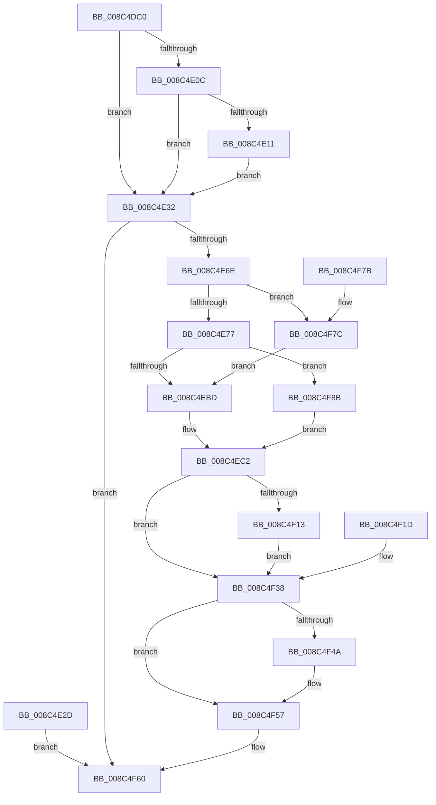

# NtDuplicateObject

- RVA: `0x008C4DC0`–`0x008C4F95` (길이 `469` bytes)
- VA: `0x00000001408C4DC0`
- 실행 섹션: `PAGE`
- PDB 이름 있음: `예`; PDB Function 태그: `아니요`
- unwind 정보 RVA: `0x00083B14`
- 디코드: `111`개 명령, `469/469` bytes 표시
- 미해석 바이트: `0` (있으면 어셈블리에 `.byte`로 보존)

> 이 문서는 커널 이미지의 기계어와 PDB 기호를 분석해 생성했습니다. 4번과 5번은 함수 원형과 자료형을 바이너리 사용 방식에서 추정한 C 해석이며 원본 소스 복구 결과는 아닙니다.

## 1. Dependencies

- 직접 호출 지점: **5**; 고유 호출 대상: **3**
- 직접 호출자로 확인된 함수: **0**
- RIP 상대 이미지 참조: **1**

### Outgoing calls
- `0x008C4E61` → [ObpReferenceObjectByHandleWithTag](../86/ObpReferenceObjectByHandleWithTag_function_00869650.md) (function, `0x00869650`)
- `0x008C4EA6` → [ObpReferenceObjectByHandleWithTag](../86/ObpReferenceObjectByHandleWithTag_function_00869650.md) (function, `0x00869650`)
- `0x008C4F02` → [ObDuplicateObject](ObDuplicateObject_function_008C4FA0.md) (function, `0x008C4FA0`)
- `0x008C4F40` → [ObfDereferenceObjectWithTag](../../text/2F/ObfDereferenceObjectWithTag_function_002F78E0.md) (function, `0x002F78E0`)
- `0x008C4F52` → [ObfDereferenceObjectWithTag](../../text/2F/ObfDereferenceObjectWithTag_function_002F78E0.md) (function, `0x002F78E0`)

### Direct callers
- 이 함수 시작 RVA로 연결되는 직접 call은 확인되지 않았습니다. 간접 호출은 완전히 역산할 수 없습니다.

### Static image references
- `0x008C4E32` → RVA `0x00FC6A98` (`ALMOSTRO`; read)

## 2. Other-region calls and transfers

- 다른 실행 섹션으로 향하는 call: **2**
  - `0x008C4F40` → [ObfDereferenceObjectWithTag](../../text/2F/ObfDereferenceObjectWithTag_function_002F78E0.md) (`PAGE` → `.text`)
  - `0x008C4F52` → [ObfDereferenceObjectWithTag](../../text/2F/ObfDereferenceObjectWithTag_function_002F78E0.md) (`PAGE` → `.text`)
- 별도 외부 분기/꼬리 이동을 확인하지 못했습니다.

## 3. Assembly (complete function range)

```asm
008C4DC0  48 89 5C 24 08                  mov qword ptr [rsp + 8], rbx
008C4DC5  48 89 74 24 10                  mov qword ptr [rsp + 0x10], rsi
008C4DCA  48 89 7C 24 18                  mov qword ptr [rsp + 0x18], rdi
008C4DCF  41 54                           push r12
008C4DD1  41 56                           push r14
008C4DD3  41 57                           push r15
008C4DD5  48 83 EC 70                     sub rsp, 0x70
008C4DD9  49 8B F1                        mov rsi, r9
008C4DDC  49 8B D8                        mov rbx, r8
008C4DDF  4C 8B E2                        mov r12, rdx
008C4DE2  4C 8B D1                        mov r10, rcx
008C4DE5  33 FF                           xor edi, edi
008C4DE7  48 89 7C 24 60                  mov qword ptr [rsp + 0x60], rdi
008C4DEC  48 89 7C 24 58                  mov qword ptr [rsp + 0x58], rdi
008C4DF1  48 89 7C 24 50                  mov qword ptr [rsp + 0x50], rdi
008C4DF6  65 48 8B 04 25 88 01 00 00      mov rax, qword ptr gs:[0x188]
008C4DFF  44 0F B6 B8 32 02 00 00         movzx r15d, byte ptr [rax + 0x232]
008C4E07  4D 85 C9                        test r9, r9
008C4E0A  74 26                           je 0x1408c4e32
008C4E0C  45 84 FF                        test r15b, r15b
008C4E0F  74 21                           je 0x1408c4e32
008C4E11  48 B9 00 00 FF FF FF 7F 00 00   movabs rcx, 0x7fffffff0000
008C4E1B  4C 3B C9                        cmp r9, rcx
008C4E1E  49 0F 42 C9                     cmovb rcx, r9
008C4E22  48 8B 01                        mov rax, qword ptr [rcx]
008C4E25  48 89 01                        mov qword ptr [rcx], rax
008C4E28  49 89 39                        mov qword ptr [r9], rdi
008C4E2B  EB 05                           jmp 0x1408c4e32
008C4E2D  E9 2E 01 00 00                  jmp 0x1408c4f60
008C4E32  4C 8B 05 5F 1C 70 00            mov r8, qword ptr [rip + 0x701c5f]
008C4E39  48 89 7C 24 38                  mov qword ptr [rsp + 0x38], rdi
008C4E3E  48 89 7C 24 30                  mov qword ptr [rsp + 0x30], rdi
008C4E43  48 8D 44 24 58                  lea rax, [rsp + 0x58]
008C4E48  48 89 44 24 28                  mov qword ptr [rsp + 0x28], rax
008C4E4D  C7 44 24 20 4F 62 44 75         mov dword ptr [rsp + 0x20], 0x7544624f
008C4E55  45 0F B6 CF                     movzx r9d, r15b
008C4E59  BA 40 00 00 00                  mov edx, 0x40
008C4E5E  49 8B CA                        mov rcx, r10
008C4E61  E8 EA 47 FA FF                  call 0x140869650
008C4E66  85 C0                           test eax, eax
008C4E68  0F 88 F2 00 00 00               js 0x1408c4f60
008C4E6E  48 85 DB                        test rbx, rbx
008C4E71  0F 84 05 01 00 00               je 0x1408c4f7c
008C4E77  4C 8B 05 1A 1C 70 00            mov r8, qword ptr [rip + 0x701c1a]
008C4E7E  48 89 7C 24 38                  mov qword ptr [rsp + 0x38], rdi
008C4E83  48 89 7C 24 30                  mov qword ptr [rsp + 0x30], rdi
008C4E88  48 8D 44 24 50                  lea rax, [rsp + 0x50]
008C4E8D  48 89 44 24 28                  mov qword ptr [rsp + 0x28], rax
008C4E92  C7 44 24 20 4F 62 44 75         mov dword ptr [rsp + 0x20], 0x7544624f
008C4E9A  45 0F B6 CF                     movzx r9d, r15b
008C4E9E  BA 40 00 00 00                  mov edx, 0x40
008C4EA3  48 8B CB                        mov rcx, rbx
008C4EA6  E8 A5 47 FA FF                  call 0x140869650
008C4EAB  44 8B F0                        mov r14d, eax
008C4EAE  89 84 24 A8 00 00 00            mov dword ptr [rsp + 0xa8], eax
008C4EB5  85 C0                           test eax, eax
008C4EB7  0F 88 CE 00 00 00               js 0x1408c4f8b
008C4EBD  48 8B 7C 24 50                  mov rdi, qword ptr [rsp + 0x50]
008C4EC2  41 8B DE                        mov ebx, r14d
008C4EC5  89 5C 24 44                     mov dword ptr [rsp + 0x44], ebx
008C4EC9  44 88 7C 24 38                  mov byte ptr [rsp + 0x38], r15b
008C4ECE  8B 84 24 C0 00 00 00            mov eax, dword ptr [rsp + 0xc0]
008C4ED5  89 44 24 30                     mov dword ptr [rsp + 0x30], eax
008C4ED9  8B 84 24 B8 00 00 00            mov eax, dword ptr [rsp + 0xb8]
008C4EE0  89 44 24 28                     mov dword ptr [rsp + 0x28], eax
008C4EE4  8B 84 24 B0 00 00 00            mov eax, dword ptr [rsp + 0xb0]
008C4EEB  89 44 24 20                     mov dword ptr [rsp + 0x20], eax
008C4EEF  4C 8D 4C 24 60                  lea r9, [rsp + 0x60]
008C4EF4  4C 8B C7                        mov r8, rdi
008C4EF7  49 8B D4                        mov rdx, r12
008C4EFA  4C 8B 64 24 58                  mov r12, qword ptr [rsp + 0x58]
008C4EFF  49 8B CC                        mov rcx, r12
008C4F02  E8 99 00 00 00                  call 0x1408c4fa0
008C4F07  44 8B F8                        mov r15d, eax
008C4F0A  89 44 24 48                     mov dword ptr [rsp + 0x48], eax
008C4F0E  48 85 F6                        test rsi, rsi
008C4F11  74 25                           je 0x1408c4f38
008C4F13  48 8B 4C 24 60                  mov rcx, qword ptr [rsp + 0x60]
008C4F18  48 89 0E                        mov qword ptr [rsi], rcx
008C4F1B  EB 1B                           jmp 0x1408c4f38
008C4F1D  4C 8B 64 24 58                  mov r12, qword ptr [rsp + 0x58]
008C4F22  44 8B B4 24 A8 00 00 00         mov r14d, dword ptr [rsp + 0xa8]
008C4F2A  48 8B 7C 24 50                  mov rdi, qword ptr [rsp + 0x50]
008C4F2F  8B 5C 24 44                     mov ebx, dword ptr [rsp + 0x44]
008C4F33  44 8B 7C 24 48                  mov r15d, dword ptr [rsp + 0x48]
008C4F38  BA 4F 62 44 75                  mov edx, 0x7544624f
008C4F3D  49 8B CC                        mov rcx, r12
008C4F40  E8 9B 29 A3 FF                  call 0x1402f78e0
008C4F45  48 85 FF                        test rdi, rdi
008C4F48  74 0D                           je 0x1408c4f57
008C4F4A  BA 4F 62 44 75                  mov edx, 0x7544624f
008C4F4F  48 8B CF                        mov rcx, rdi
008C4F52  E8 89 29 A3 FF                  call 0x1402f78e0
008C4F57  45 85 F6                        test r14d, r14d
008C4F5A  41 0F 49 DF                     cmovns ebx, r15d
008C4F5E  8B C3                           mov eax, ebx
008C4F60  4C 8D 5C 24 70                  lea r11, [rsp + 0x70]
008C4F65  49 8B 5B 20                     mov rbx, qword ptr [r11 + 0x20]
008C4F69  49 8B 73 28                     mov rsi, qword ptr [r11 + 0x28]
008C4F6D  49 8B 7B 30                     mov rdi, qword ptr [r11 + 0x30]
008C4F71  49 8B E3                        mov rsp, r11
008C4F74  41 5F                           pop r15
008C4F76  41 5E                           pop r14
008C4F78  41 5C                           pop r12
008C4F7A  C3                              ret
008C4F7B  CC                              int3
008C4F7C  44 8B F7                        mov r14d, edi
008C4F7F  89 BC 24 A8 00 00 00            mov dword ptr [rsp + 0xa8], edi
008C4F86  E9 32 FF FF FF                  jmp 0x1408c4ebd
008C4F8B  48 89 7C 24 50                  mov qword ptr [rsp + 0x50], rdi
008C4F90  E9 2D FF FF FF                  jmp 0x1408c4ec2
```

## 4. C-style interpretation (structured pseudocode)

```c
__int64 __fastcall NtDuplicateObject(__int64 a1, __int64 a2, __int64 a3, __int64 a4, unsigned int a5, unsigned int a6, unsigned int a7)
{
    __int64 result;
    __int64 v_rbx;
    __int64 v_rdi;
    __int64 v_rsp;
    unsigned __int64 v_stack_m18;
    unsigned __int64 v_stack_m20;
    unsigned __int64 v_stack_m28;
    unsigned __int64 v_stack_m30;
    unsigned __int64 v_stack_m38;
    unsigned int v_stack_m40;
    unsigned int v_stack_m44;
    unsigned __int64 v_stack_m50;
    unsigned __int64 v_stack_m58;
    unsigned __int64 v_stack_m60;
    unsigned int v_stack_m68;
    unsigned __int64 v_stack_p10;
    unsigned __int64 v_stack_p18;
    unsigned int v_stack_p20;
    unsigned int v_stack_p38;
    unsigned __int64 v_stack_p8;

    v_stack_p8 = v_rbx;
    v_stack_p10 = v_rsi;
    v_stack_p18 = v_rdi;
    v_rsp = (v_rsp) - (112);
    v_rdi = 0;
    v_stack_m28 = 0;
    v_stack_m30 = 0;
    v_stack_m38 = 0;
    if (a4 == 0) goto loc_008C4E32;
    if ((unsigned __int8)(*(unsigned __int8 *)(*(unsigned __int64 *)(gs_base + (0 + 392)) + 562)) == 0) goto loc_008C4E32;
    if (a4 < a1) { a1 = a4; }
    *(unsigned __int64 *)(a1) = *(unsigned __int64 *)(a1);
    *(unsigned __int64 *)(a4) = 0;
    goto loc_008C4E32;
loc_008C4E32:
    v_stack_m50 = 0;
    v_stack_m58 = 0;
    v_stack_m60 = v_stack_m30;
    v_stack_m68 = 0x7544624FULL;
    result = ObpReferenceObjectByHandleWithTag(a1, 64, *(unsigned __int64 *)(v_rip + 7347295), (unsigned __int8)(*(unsigned __int8 *)(*(unsigned __int64 *)(gs_base + (0 + 392)) + 562)));
    if (sign_flag) goto loc_008C4F60;
    if (a3 == 0) goto loc_008C4F7C;
    v_stack_m50 = 0;
    v_stack_m58 = 0;
    v_stack_m60 = v_stack_m38;
    v_stack_m68 = 0x7544624FULL;
    result = ObpReferenceObjectByHandleWithTag(a3, 64, *(unsigned __int64 *)(v_rip + 7347226), (unsigned __int8)(*(unsigned __int8 *)(*(unsigned __int64 *)(gs_base + (0 + 392)) + 562)));
    v_stack_p20 = (unsigned int)(result);
    if (sign_flag) goto loc_008C4F8B;
loc_008C4EBD:
loc_008C4EC2:
    v_stack_m44 = (unsigned int)((unsigned int)((unsigned int)((unsigned int)((unsigned int)(result)))));
    v_stack_m50 = (unsigned __int8)(*(unsigned __int8 *)(*(unsigned __int64 *)(gs_base + (0 + 392)) + 562));
    v_stack_m58 = (unsigned int)((unsigned int)(a7));
    v_stack_m60 = (unsigned int)((unsigned int)(a6));
    v_stack_m68 = (unsigned int)((unsigned int)(a5));
    result = ObDuplicateObject(v_stack_m30, a2, v_stack_m38, v_stack_m28);
    v_stack_m40 = (unsigned int)(result);
    if (a4 == 0) goto loc_008C4F38;
    *(unsigned __int64 *)(a4) = v_stack_m28;
    goto loc_008C4F38;
loc_008C4F38:
    result = ObfDereferenceObjectWithTag(v_stack_m30, (unsigned int)(0x7544624FULL), v_stack_m38, v_stack_m28);
    if (v_stack_m38 != 0) {
        a2 = 0x7544624FULL;
        a1 = v_stack_m38;
        result = ObfDereferenceObjectWithTag(a1, a2, v_stack_m38, v_stack_m28);
    }
    v_rbx = (unsigned int)((unsigned int)((unsigned int)((unsigned int)(result))));
    if (!sign_flag) { v_rbx = (unsigned int)((unsigned int)((unsigned int)(result))); }
loc_008C4F60:
    return (unsigned int)((unsigned int)(v_rbx));
loc_008C4F7C:
    v_stack_p38 = (unsigned int)(*(unsigned __int64 *)(v_stack_m18 + 48));
    goto loc_008C4EBD;
loc_008C4F8B:
    v_stack_m20 = *(unsigned __int64 *)(v_stack_m18 + 48);
    goto loc_008C4EC2;
}
```

## 5. (Beta) C Style

```c
int64_t NtDuplicateObject(int64_t Arg1, int64_t Arg2, int64_t Arg3, int64_t Arg4, uint32_t Arg5, uint32_t Arg6, uint32_t Arg7)
{
    int64_t result;
    int64_t local_rbx;
    int64_t local_rdi;
    int64_t local_rsp;
    uint64_t v_stack_m18;
    uint64_t v_stack_m20;
    uint64_t v_stack_m28;
    uint64_t v_stack_m30;
    uint64_t v_stack_m38;
    uint32_t v_stack_m40;
    uint32_t v_stack_m44;
    uint64_t v_stack_m50;
    uint64_t v_stack_m58;
    uint64_t v_stack_m60;
    uint32_t v_stack_m68;
    uint64_t v_stack_p10;
    uint64_t v_stack_p18;
    uint32_t v_stack_p20;
    uint32_t v_stack_p38;
    uint64_t v_stack_p8;

    v_stack_p8 = local_rbx;
    v_stack_p10 = local_rsi;
    v_stack_p18 = local_rdi;
    local_rsp = (local_rsp) - (112);
    local_rdi = 0;
    v_stack_m28 = 0;
    v_stack_m30 = 0;
    v_stack_m38 = 0;
    if (Arg4 == 0) goto loc_008C4E32;
    if ((uint8_t)(*(uint8_t *)(*(uint64_t *)(gs_base + (0 + 0x188)) + 0x232)) == 0) goto loc_008C4E32;
    if (Arg4 < Arg1) { Arg1 = Arg4; }
    *(uint64_t *)(Arg1) = *(uint64_t *)(Arg1);
    *(uint64_t *)(Arg4) = 0;
    goto loc_008C4E32;
loc_008C4E32:
    v_stack_m50 = 0;
    v_stack_m58 = 0;
    v_stack_m60 = v_stack_m30;
    v_stack_m68 = 0x7544624FULL;
    result = ObpReferenceObjectByHandleWithTag(Arg1, 64, *(uint64_t *)(v_rip + 0x701C5F), (uint8_t)(*(uint8_t *)(*(uint64_t *)(gs_base + (0 + 0x188)) + 0x232)));
    if (sign_flag) goto loc_008C4F60;
    if (Arg3 == 0) goto loc_008C4F7C;
    v_stack_m50 = 0;
    v_stack_m58 = 0;
    v_stack_m60 = v_stack_m38;
    v_stack_m68 = 0x7544624FULL;
    result = ObpReferenceObjectByHandleWithTag(Arg3, 64, *(uint64_t *)(v_rip + 0x701C1A), (uint8_t)(*(uint8_t *)(*(uint64_t *)(gs_base + (0 + 0x188)) + 0x232)));
    v_stack_p20 = (uint32_t)(result);
    if (sign_flag) goto loc_008C4F8B;
loc_008C4EBD:
loc_008C4EC2:
    v_stack_m44 = (uint32_t)((uint32_t)((uint32_t)((uint32_t)((uint32_t)(result)))));
    v_stack_m50 = (uint8_t)(*(uint8_t *)(*(uint64_t *)(gs_base + (0 + 0x188)) + 0x232));
    v_stack_m58 = (uint32_t)((uint32_t)(Arg7));
    v_stack_m60 = (uint32_t)((uint32_t)(Arg6));
    v_stack_m68 = (uint32_t)((uint32_t)(Arg5));
    result = ObDuplicateObject(v_stack_m30, Arg2, v_stack_m38, v_stack_m28);
    v_stack_m40 = (uint32_t)(result);
    if (Arg4 == 0) goto loc_008C4F38;
    *(uint64_t *)(Arg4) = v_stack_m28;
    goto loc_008C4F38;
loc_008C4F38:
    result = ObfDereferenceObjectWithTag(v_stack_m30, (uint32_t)(0x7544624FULL), v_stack_m38, v_stack_m28);
    if (v_stack_m38 != 0) {
        Arg2 = 0x7544624FULL;
        Arg1 = v_stack_m38;
        result = ObfDereferenceObjectWithTag(Arg1, Arg2, v_stack_m38, v_stack_m28);
    }
    local_rbx = (uint32_t)((uint32_t)((uint32_t)((uint32_t)(result))));
    if (!sign_flag) { local_rbx = (uint32_t)((uint32_t)((uint32_t)(result))); }
loc_008C4F60:
    return (uint32_t)((uint32_t)(local_rbx));
loc_008C4F7C:
    v_stack_p38 = (uint32_t)(*(uint64_t *)(v_stack_m18 + 0x30));
    goto loc_008C4EBD;
loc_008C4F8B:
    v_stack_m20 = *(uint64_t *)(v_stack_m18 + 0x30);
    goto loc_008C4EC2;
}
```

## 6. Execution-region graph

[열기: 2D/3D 그래프와 함수 탐색 컨트롤 패널](../../../control-panel.html?section=page&rva=0x008C4DC0&view=graph)

- 2D 그래프는 위에서 아래로 흐르고, 3D 그래프는 빈 공간을 드래그해 회전합니다. Shift+드래그는 이동, 휠은 확대·축소, 함수 노드 선택은 대상 보고서 이동입니다.

### Static fallback


